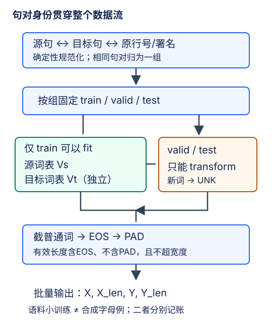

# 机器翻译数据：先守住句对，再构造张量

## 1. 翻译不是把两种语言拼成一条字符流

语言模型学习同一序列的下一词元；翻译学习给定源句$X$时目标句$Y$的条件分布。一个样本必须是**对齐的完整句对**，源、目标的长度可以不同，词序也不要求一一对应。把英文、法文分别随机打乱，或者照搬上一实验的跨句字符流采样，会破坏监督关系。

本讲要交付给模型的不是一段字符串，而是四项：源词元ID、源有效长度、目标词元ID、目标有效长度。它们背后还必须有可追溯的句对身份、划分、词表和预处理规则。张量形状正确只说明能计算，不说明评估可信。

## 2. 从句对到词表的顺序不能倒



图为编者依据教材9.5重绘的数据流。分组划分、只在训练侧拟合词表是本站实验的评估补充，不是宣称教材示例已经提供了独立测试集。

建议沿以下不可逆边界组织数据：

1. **识别格式**：教材历史镜像示例按两个制表符字段读取；当前ManyThings页面展示的是英文、另一语言、署名三个字段。先检查实际文件，不把署名列拼进法文，也不因`len(parts)==2`把三列包全丢掉。署名应保存在独立元数据里。
2. **确定句对身份**：先做不依赖全语料统计的确定性规范化，保留原行号/句子ID与署名；用规范化后的完整源—目标对作为重复分组键。
3. **按组划分**：同一规范化句对的所有副本必须进入同一段，固定训练/验证/测试成员。相同源句、不同译文不属于“完全重复句对”；是否进一步按源句分组，应另记策略，不能把两种去重定义混写。
4. **仅训练侧拟合**：从训练源句建立源词表，从训练目标句建立目标词表。最低词频、词表规模等选择也只依据训练侧或预先固定的合同；验证和测试只做转换。
5. **最后构造批量**：可以打乱训练句对的顺序，但源、目标、长度、身份必须一起移动。

如果先用整个文件拟合词表再切分，模型即使没有直接读到测试标签，也已经利用了测试词汇分布。不能用这个便利提高“未知词覆盖率”，再把结果称为严格留出评估。划分前只做确定性清洗与分组，不等于在全数据上拟合统计规则。

教材`load_data_nmt`在选取的样本上建立词表，用于入门演示；它没有自动完成上述训练/验证/测试合同。另外，固定源码`tokenize_nmt`用`i > num_examples`停止，行号从0开始；不能只凭参数名字断言恰好得到600个有效句对，必须按实际筛选结果记数。

## 3. 词元化和特殊词元各司其职

教材把不间断空格换为普通空格、转小写，并为`,.!?`补空格，然后按空格切词。它是简单英法教学方案，不是普适多语言分词器：撇号、连字符、Unicode规范化以及中文无空格词界均需单独说明。训练和推理必须用同一套转换，不能训练时拆标点、预测时只调用一个不同的`split`。

两套词表独立：同一个整数在源、目标侧可能表示完全不同的词。目标输出层大小是$V_t$，不是源词表大小$V_s$。

| 词元 | 含义 | 不该混淆的对象 |
| --- | --- | --- |
| `<unk>` | 训练词表之外或低于词频阈值的词 | 不是“没有输入” |
| `<pad>` | 仅补齐矩形张量 | 不是真实句子内容 |
| `<bos>` | 解码器生成的启动输入 | 通常不是要预测的第一个标签 |
| `<eos>` | 需要学习预测的结束符 | 不是padding，也不能从损失里一并抹掉 |

特殊ID应从各自词表查询，不假设两侧编号永远相同。若词表阈值为2，训练中只出现一次的普通词可映射为`<unk>`；验证中首次出现的词也映射为同一个未知项，但这两类未知的原因不同。

## 4. 截断、EOS与有效长度是一个合同

教材先追加EOS，再执行`line[:num_steps]`。当原句已经占满窗口时，EOS会被截掉。这不一定使程序报错，却会改变模型看到的结束信号。本站实验采用清晰的**预留EOS位置**策略，源和目标都同样声明：容量$T\geq1$，先保留至多$T-1$个普通词元，再追加EOS，最后padding。

设普通词元数为$m$：

$$
\ell=\min(m,T-1)+1
$$

$$
M_t=\mathbf{1}[t<\ell],\qquad 0\leq t<T
$$

有效长度$\ell$包括EOS、不包括PAD；它是**截断之后**的长度，始终不大于张量时间宽度。训练、验证、推理都必须用这个定义。若要比较教材“先EOS后截断”版本，必须另记策略，不能两者混用。

独立合成例子：容量$T=4$，普通源词元`[a,b]`变成`[a,b,EOS,PAD]`，有效长度为3；普通序列`[a,b,c,d,e]`变成`[a,b,c,EOS]`，有效长度为4。后者已经失去尾部内容，保留EOS只明确终止，不会恢复被截掉的信息。空普通序列在允许保留时变成`[EOS,PAD,PAD,PAD]`，长度为1；若业务拒绝空句，应在清洗阶段显式过滤并计数。

## 5. 一个小批量有两个时间轴

设$B=2,T_s=5,T_t=4$，字母仅表示合成词元，不是语料摘录：

```text
源 X： [a b EOS PAD PAD]  长度3
       [c d e   EOS PAD]  长度4
目标Y：[u v EOS PAD]      长度3
       [w EOS PAD PAD]    长度2
```

| 张量 | 形状 | 语义 |
| --- | --- | --- |
| 源ID | $(B,T_s)$ | 整数，查询源embedding |
| 源长度 | $(B,)$ | 控制编码器有效终态/源注意力mask |
| 目标ID | $(B,T_t)$ | 训练标签，查询目标词表 |
| 目标长度 | $(B,)$ | 控制有效目标token损失 |
| 目标mask | $(B,T_t)$ | 两行分别`1110`和`1100` |

源长和目标长可以不同。不能把源长当目标loss的mask，更不能在推理时用真实目标长度决定生成几步。

Teacher forcing的解码输入是`BOS + Y去掉最后一列`。第一行输入`[BOS,u,v,EOS]`，对应标签仍是`[u,v,EOS,PAD]`；最后一个PAD标签不计损失。当前目标$Y_t$不能直接成为预测$Y_t$的输入。推理没有$Y$，只能从BOS和之前的预测开始。

## 6. 三个遮蔽问题，不能只修一个

- **目标loss**：PAD位置不计入损失与分母；EOS计入。上例有效标签总数是5，不是$B T_t=8$。
- **编码器终态**：即使PAD的embedding为0，循环网络仍可能因递归与偏置改变状态。终态必须停在每条源句的有效末位，不能直接取填充矩形的最后一列。
- **源注意力**：有注意力时，PAD位置必须在softmax之前屏蔽。但正确attention mask不会自动修复已经被PAD污染的编码器终态。

一个重要不变量是：保持有效词元和长度不变，仅增加右侧PAD，正确的有效编码状态及解码结果应不变。验证时关闭dropout，比较同一模型、同一有效输入，而不是重新初始化两份参数。

## 7. 数据质量与实验边界

ManyThings说明句对按长度排序，且即使人工筛选也可能有错误。直接取文件前若干行会得到偏向短句的子集；这样的小训练可以检验工程链路，但不能外推长句翻译质量或通用翻译能力。采用确定性的分组划分也不自动消除所有近重复、译文变体或主题偏差，实际策略和局限都应记录。

本页不提供语料全文或实验完整实现。实践需要分别记下：下载文件hash、文件格式与署名字段、句对分组/划分、训练词表hash、截断规则、有效token数。真实数据小训练与合成mask机制检查是两类证据；这里的字母算例不能代替真实双语训练。

## 8. 自测与答案

<details><summary>1. 在全部句对上建词表，再划分，只要测试句未训练就没有泄漏吗？</summary>

不是。词汇表和词频阈值使用了留出数据的统计。先划分句对，再只用训练段拟合源/目标词表。

</details>

<details><summary>2. 容量4、普通词元5个，预留EOS策略的长度是多少？</summary>

4：保留3个普通词元并追加EOS。不能记录成原始5或6，否则mask与实际张量不一致。

</details>

<details><summary>3. PAD embedding为零，是否就不用源长度？</summary>

仍需要。RNN的循环变换与偏置会继续更新状态，零输入不是恒等更新；必须用真实长度决定终态。

</details>

<details><summary>4. 当前三列包为什么不能照抄教材两列解析？</summary>

第三列是归属信息。严格两列条件可能把数据全部过滤掉；随意把第三列并入目标又会污染标签。应解析并独立保存署名，实际格式以取得的文件为准。

</details>

## 9. 来源、语料条件与视频边界

- [官方课表](https://courses.d2l.ai/zh-v2/)2021年8月7日row086对应[教材9.5](https://zh.d2l.ai/chapter_recurrent-modern/machine-translation-and-dataset.html)。实际阅读固定提交`e6b18ccea71451a55fcd861d7b96fddf2587b09a`的正文、预处理/词表/批量代码与练习；这是当前中文第二版，不是2021快照。固定原件与hash见本讲manifest。
- 教材将`fra-eng.zip`指向D2L数据镜像，给定SHA1 `94646ad1522d915e7b0f9296181140edcf86a4f5`，并追溯到[ManyThings](https://www.manythings.org/anki/)整理的Tatoeba句对。**教材声明的校验值不是本页下载实测**。当前ManyThings页标更新2026-02-13，其三列包不能当作历史教材镜像的同一字节版本。配套实验选用带署名的当前包；实际取得文件、校验与训练情况以[公共资料](#/c/d2l-pytorch-2021)证据为准，本讲未独立获取或训练该语料。
- ManyThings页要求保留发布方与Tatoeba归属，并指出再分发时需句子作者署名；[Tatoeba条款§6.2、§6.5](https://tatoeba.org/en/terms_of_use)说明文本默认CC-BY 2.0 FR及逐项许可/归属责任。它们不是对教材镜像缺失归属信息的自动补齐，也不是本站已获额外许可的证明。本页不再分发句库，不把音频许可外推到文本或反过来。
- [官方视频](https://www.bilibili.com/video/BV1H64y1s7TH/)作者“跟李沐学AI”，mid 1567748478；平台标题“60 机器翻译数据集【动手学深度学习v2】”；上传2021-08-08，和课表8月7日分开记录。

| 分P | 平台标题 | cid | 时长 |
| --- | --- | --- | --- |
| P1 | 机器翻译数据集 | 384691473 | 10:16 |
| 全1P合计 | 616秒 | — | 10:16 |

2026-11-14该P公开字幕仅查询一次，成功返回空列表；这不证明没有烧录字幕。未取得可靠课堂内容，故无片内主题时间轴、课堂QA或draft。平台copyright=1、no_reprint=1并非开放转录授权。图与小例为自主讲解；实践入口：[seq2seq实验指导](#/c/d2l-pytorch-2021/lab/seq2seq-attention?v=guide)。
