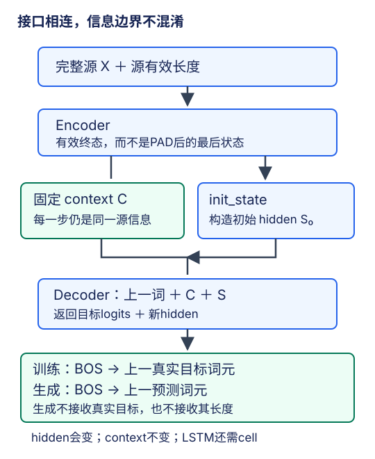

# 编码器—解码器：把接口、状态与信息边界分开

## 1. 一个接口，解决两种可变长度

分类器通常把一个输入映射为一个标签；翻译却要接收长度$T_s$的源句，输出另一个长度$T_t$的句子。$T_s$与$T_t$不必相等，而且推理时$T_t$未知。编码器—解码器把这个问题拆成两部分：编码器整理已知输入，解码器在该条件下逐步生成。

本讲讲的是**职责划分**，不是某一种RNN单元。编码器和解码器不必采用同一网络；它们需要的是兼容的接口与明确的状态转换。图像描述也可用图像编码器接文本解码器。这里不为这些应用添加新实验，只用它们理解架构的通用性。

图为编者根据教材9.6重绘。实线表示合法数据流；训练目标只通过“上一真实词元”进入teacher forcing，推理则用上一预测。源信息与解码历史不能在接口里混成一个含义不明的变量。

## 2. 三个调用各负责什么

教材的三个抽象操作可以读成下面的合同，而不是复制一个未实现的基类：

| 操作 | 进入 | 返回/职责 |
| --- | --- | --- |
| `encoder(X, src_len)` | 源ID和源有效长度 | 编码输出、有效终态等源表示 |
| `decoder.init_state(enc, src_len)` | 编码结果和必要元数据 | 构造初始解码状态，完成桥接 |
| `decoder(dec_X, state)` | 解码输入与当前状态 | 目标logits和更新后的状态 |

组合模型训练时先编码，再初始化，再解码。`init_state`不是每个目标时间步都重新执行：生成新句时初始化一次，随后持续更新解码状态。否则已经生成的历史会被抹掉。不同句子或不同beam分支也不能错误共享一份可变状态。

源有效长度必须真的被编码器消费，不能只是出现在函数签名里。教材抽象基类允许额外参数，**允许传参不等于子类已经实现了其语义**。同理，返回名叫`state`不等于它自动包含attention mask、固定context或LSTM cell；必须列明每个分量。

## 3. “状态”至少有三种含义

1. **固定源条件**：例如基础seq2seq中取源句有效末位编码得到的$C$。在一次目标生成过程中，它不随目标步改变。
2. **可变解码状态**：例如GRU各层隐藏状态$S_t$，表示到当前步已经消费的目标前缀。LSTM还包含cell $U_t$，二者一起更新。
3. **辅助记忆与元数据**：注意力模型保留全部源位置表示及源mask；有缓存的模型还保留该分支历史的缓存。内容可能固定或变化，必须分别说明。

教材9.6用固定形状状态解释最基础的压缩思路。这里“固定形状”是相对于源句长度，不是“数值永远不变”，也不意味着所有编码器—解码器架构只能传一个向量。后面的注意力模型会保留长度随源句变化的表示序列，但仍沿用编码器、状态初始化、解码器这套职责。

对固定context基础模型，一条清晰的递推是：

$$
C=\operatorname{Encoder}(X,\ell_s)
$$

$$
S_0=\operatorname{Bridge}(C)
$$

$$
S_t=g(E_t(y_{t-1}),C,S_{t-1})
$$

$$
z_t=W S_t+b
$$

$z_t$是目标词表上的logits，不是已经选好的词。softmax形成分布，贪心或束搜索才决定后续喂回哪个预测词元。训练时直接使用logits计算交叉熵，不必先argmax。

## 4. 先写出形状，再连接模块

以下是一个单向GRU示例，$B$为批量，$D_s,D_t$为两侧embedding宽度，$L$为层数，$H$为隐宽度。

| 对象 | 形状 |
| --- | --- |
| 源ID / 源embedding | $(B,T_s)$ / $(B,T_s,D_s)$ |
| 编码器顶层逐步输出 | $(T_s,B,H)$ |
| 编码器所有层有效终态 | $(L,B,H)$ |
| 解码器初始hidden | $(L,B,H)$ |
| 固定context（取顶层） | $(B,H)$ |
| 单步目标embedding | $(1,B,D_t)$ |
| 单步拼接输入 | $(1,B,D_t+H)$ |
| 单步logits | $(B,1,V_t)$ |

若$B=2,L=2,H=4,D_t=3,V_t=7$，初始hidden是$(2,2,4)$，固定context是$(2,4)$，单步拼接输入是$(1,2,7)$，logits是$(2,1,7)$。最后两个7含义完全不同：一个是输入特征数，一个是词表大小，数值恰好相同不能证明轴顺序正确。

源、目标embedding可以不同宽度。若编码器与解码器的层数/隐宽不同，就不能直接把一个hidden赋给另一个。应显式设计桥接，例如选取编码器各层/方向后用线性映射得到解码器需要的$(L_d,B,H_d)$；用哪层、如何组合方向必须有定义。LSTM的hidden与cell需分别桥接，不能把hidden复制成cell后声称等价。这里说明设计约束，不提供完整实验实现。

双向源编码在完整源句已知的离线翻译里是合法的；双向目标解码却会看见尚未生成的真实后缀，不能用于同样的因果生成合同。编码器与解码器虽然都叫“序列网络”，可见信息并不相同。

## 5. 正确形状也会藏着padding污染

假设某条源句有效长度为3，但批量宽度是6。直接取未打包RNN的`h_n`，表示网络还处理过3个PAD时间步；它不一定等于在第3步停止得到的终态。即使PAD输入为零，隐藏递归也会改变结果。

独立标量反例：$h_t=0.5h_{t-1}+x_t$，$h_0=0$。有效输入`[2,2]`后$h_2=3$；再输入两个零PAD后$h_4=0.75$。形状完全一样，数值含义却已经不同。零PAD不是“跳过该步”。

可按真实长度打包循环计算，或显式在无效步冻结每条样本的各层状态。对于单向单层模型，收集有效末位输出也能得到该层有效hidden；但只从最顶层`output`收集一次，不能恢复多层所有hidden，更不能恢复LSTM各层cell。因此不能把“取`output[length-1]`”不加条件地推广到所有模型。

attention mask属于另一个边界：它阻止解码器读取无效源位置，却不一定修复初始化用的污染终态。要同时检查编码状态和注意力访问范围。

## 6. 训练与推理的输入清单

| 阶段 | 合法输入 | 目标真实长度的用途 |
| --- | --- | --- |
| 训练 | 源句、源长度、BOS及左移真实目标 | 只决定有效监督位置 |
| teacher-forcing验证 | 同训练，关闭随机训练行为 | 只用于计算留出NLL |
| 自回归生成 | 源句、源长度、BOS及已预测历史 | **不能使用** |
| 生成后评分 | 已封存预测与真实参考译文 | 可以用于BLEU等离线评价 |

真实目标在训练时可提供**前缀条件**；当前词元不能作为自己那一步的输入。生成时除了BOS没有任何真实目标前缀，遇到自己预测的EOS才结束；最大生成步数是预先固定的安全边界，不是从参考译文长度拷贝来的答案。

一个有用的审计方法是：生成函数的签名只接收源和源长度；固定源后任意修改旁边的参考译文，生成结果应完全不变。`eval()`只改变dropout等行为，不会自动删除错误传入的真实标签。

## 7. 自测与答案

1. 编码器和解码器必须同层数、同隐宽吗？

架构不要求；“直接用编码器hidden初始化解码器”这种具体实现要求形状相容，否则需要明确桥接。不能靠广播掩盖不相容。

2. 每步重新调用init_state能简化生成吗？

不能随意这样做。它会重置历史。通常只在新源句开始时初始化一次，后续用返回的可变解码状态。

3. attention遮蔽了PAD，是否可直接使用未打包RNN的最后hidden？

不能据此保证正确。attention访问和编码器终态是两个问题；终态也必须对应有效末位。

4. 参考译文只有4个词，生成函数可以运行4步吗？

不能用这个真实长度决定推理循环。应根据预测EOS或事先固定的最大步数终止，生成完成后再与参考比较。

## 8. 来源与视频边界

- [官方课表](https://courses.d2l.ai/zh-v2/)2021年8月7日row087指定[教材9.6](https://zh.d2l.ai/chapter_recurrent-modern/encoder-decoder.html)。已读架构定义、三组接口与练习，并用[9.7](https://zh.d2l.ai/chapter_recurrent-modern/seq2seq.html)的PyTorch编码器/解码器核对形状。固定提交`e6b18ccea71451a55fcd861d7b96fddf2587b09a`是当前中文第二版，不是2021快照。桥接边界、PAD反例与接口审计是编者补充；原件/hash和准确阅读范围见manifest。
- [官方视频](https://www.bilibili.com/video/BV1c54y1E7YP/)作者“跟李沐学AI”，mid 1567748478，标题“61 编码器-解码器架构【动手学深度学习v2】”；上传2021-08-08，课表日期另为8月7日。

| 分P | 平台标题 | cid | 时长 |
| --- | --- | --- | --- |
| P1 | 编码器-解码器架构 | 384691545 | 03:33 |
| P2 | 代码 | 384693376 | 02:44 |
| 全2P合计 | 377秒 | — | 06:17 |

2026-11-14每P公开字幕查询一次，均成功返回空列表，不排除烧录字幕。分P清单不是片内时间轴；未观看内容，不编造课堂板书、QA或逐段译稿。copyright=1、no_reprint=1不构成开放转录许可。教材根[Apache-2.0](https://github.com/d2l-ai/d2l-zh/blob/e6b18ccea71451a55fcd861d7b96fddf2587b09a/LICENSE)与视频/语料条件分开；统一实测见[公共资料](#/c/d2l-pytorch-2021)，实践见[实验指导](#/c/d2l-pytorch-2021/lab/seq2seq-attention?v=guide)。
