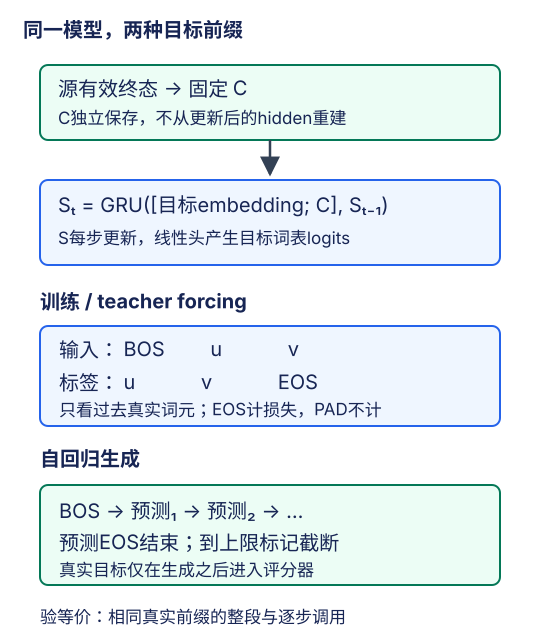

# 基础seq2seq：固定源上下文，变化的是目标历史

## 1. 把条件语言模型接到源句编码器上

基础seq2seq先把完整源句压成固定大小的表示，再根据它生成目标句。设源有效长度为$\ell_s$，目标含EOS的长度为$\ell_t$，使用GRU作为示例：

$$
h_i=f(E_s(x_i),h_{i-1})
$$

$$
C=h_{\ell_s}^{\mathrm{top}},\qquad S_0=H_{\mathrm{enc}}
$$

$$
S_t=g([E_t(y_{t-1});C],S_{t-1})
$$

$$
p_t=\operatorname{softmax}(W_oS_t^{\mathrm{top}}+b_o)
$$

其中$H_{\mathrm{enc}}$包含编码器各层的有效终态；$C$是顶层有效终态。固定context基础模型可以同时把源信息用于初始化和每步拼接。只用初始化也是另一种设计，但不能在训练、预测间无意切换。

条件链式分解是训练目标和自回归生成的共同基础：

$$
P(Y\mid X)=\prod_{t=1}^{\ell_t}p(y_t\mid y_{<t},X)
$$

训练时条件前缀来自真实目标；生成时来自模型自己的历史。二者使用同一递推和参数，但前缀分布不同。这是teacher forcing与自由生成的差别，不是两套可随意改动的模型。



图为编者据教材9.7自主绘制。源context在所有目标步固定；蓝色路径使用左移标签，绿色路径使用预测，不把真实目标或真实目标长度传入生成循环。

## 2. 形状链：不要把源时间轴当目标时间轴

设源词表$V_s$、目标词表$V_t$、层数$L$、隐宽度$H$、embedding宽度$D$。基础模型选单向GRU，两侧层数和隐宽相同，以便直接初始化。

| 阶段 | 形状 |
| --- | --- |
| 源ID、源embedding | $(B,T_s)$、$(B,T_s,D)$ |
| 时间优先编码输入 | $(T_s,B,D)$ |
| 编码器逐步输出 / 各层有效终态 | $(T_s,B,H)$ / $(L,B,H)$ |
| 固定顶层context | $(B,H)$ |
| 目标embedding | $(T_t,B,D)$ |
| 每步拼接context后 | $(T_t,B,D+H)$ |
| 解码器输出 | $(T_t,B,H)$ |
| 目标logits | $(B,T_t,V_t)$ |

PyTorch交叉熵若使用三维输入，类别轴需放到第二维，即$(B,V_t,T_t)$；也可把logits与标签按一致顺序展平。不能一个时间优先展平、另一个批量优先展平。目标ID必须来自目标词表，不能因两侧有相同词就共用源ID。

小形状例：$B=2,T_s=5,T_t=4,L=2,H=6,D=3,V_t=9$。context为$(2,6)$，拼接输入$(4,2,9)$，hidden为$(2,2,6)$，logits为$(2,4,9)$。拼接宽度9与词表9只是偶然同值；调大词表只改变输出头，不应改变context宽度。

## 3. 两个教材实现差异必须显式处理

### 3.1 源长度不应只是传而不用

固定教材PyTorch `Seq2SeqEncoder.forward(X,*args)`接收额外参数，但将完整embedding矩形直接传给GRU，没有按有效长度停止递归。因此补齐后的`state`不一定是有效源句的末状态。即使没有注意力，源长度也必须参与编码。

本站基础模型合同要求按有效长度打包循环计算或逐样本/逐步冻结无效位置的各层状态。若用多层GRU，需保留各层有效hidden；若用LSTM，还需各层有效cell。只在最后的loss上mask不能修复源表示。检验应固定有效输入与参数，追加或改变无效PAD尾部后比较有效编码终态，而不是仅看输出形状。

### 3.2 固定context不能从更新后的hidden重建

固定教材PyTorch解码器在每次`forward`内取`state[-1]`并沿本次输入的时间轴重复。训练整段调用时，进入函数的是编码器终态，context在该调用内固定；预测逐token调用时，下一次传入的`state`已经是更新后的解码器hidden，context便跟着改变。两种调用粒度不是自动等价的。

本站讲解的**固定context模型**把状态分为`(decoder_hidden, encoder_context)`：hidden每步更新，context从初始化开始一直保留原值。LSTM再额外携带cell。这个分离是明确的实现修正，不声称逐字复现教材预测helper。

验证方法：关闭dropout，给同一源和同一组左移目标，比较“一次输入整段目标”和“每次输入一个相同的真实前缀词元”的logits。它们应逐步一致。注意这个检查仍是teacher forcing，不是拿greedy历史与真实历史比较；两种历史不同，本来就不要求相同输出。

## 4. 左移标签：可以看过去，不能看当前答案

合成目标为`[u,v,EOS,PAD]`、有效长度3，则：

| 目标步 | 解码输入 | 要预测的标签 | 计入损失 |
| --- | --- | --- | --- |
| 1 | BOS | u | 是 |
| 2 | u | v | 是 |
| 3 | v | EOS | 是 |
| 4 | EOS | PAD | 否 |

以BOS启动，拼上`Y[:, :-1]`，构成与标签同宽的解码输入。PAD标签对应的尾部计算即使发生，也不能计入损失。逐句EOS位置不同，矩形左移不意味着每行输入中都完全没有EOS；关键是只监督有效标签位置。

Teacher forcing能直接优化真实目标前缀下的条件对数似然，不需要把argmax放进训练链。自由生成时模型可能误选一个词，后续遇到训练时少见的错误前缀，误差会积累；这解释了为什么低teacher-forcing损失不保证好的完整译文。不要仅把训练输入换成预测词元，就宣称等价优化了原目标。

## 5. 损失分母决定你究竟报告了什么

设mask $M_{bt}=\mathbf{1}[t<\ell_b]$，单位置交叉熵为$e_{bt}=-\log p_{bt}(Y_{bt})$。本站采用有效目标token加权的平均NLL，**包含EOS，不含PAD**：

$$
N=\sum_{b,t}M_{bt}
$$

$$
\mathcal{L}=\frac{\sum_{b,t}M_{bt}e_{bt}}{N}
$$

保留EOS的样本长度至少为1，正常非空批量因此有$N>0$；无有效监督的异常批量应在数据合同处拒绝，不用隐蔽分母补丁掩盖输入错误。先对logits计算未归约CE，再乘mask；不要先把PAD位置logits置零后期望CE自动为零——全零logits仍有非零交叉熵。

合成例子，矩形宽度4：

```text
行1 有效损失：[0.2, 0.4, 0.6]       长度3
行2 有效损失：[0.8, 1.0]            长度2
其余PAD位置均不计
```

有效损失和为3.0，token数5，平均NLL为0.6。若先按每句有效长度平均再平均两句，则$(0.4+0.9)/2=0.65$，长短句权重已改变。不是两个数都错，而是它们对应不同度量，必须先定口径。

固定教材PyTorch `MaskedSoftmaxCELoss`先mask，再对矩形时间宽度做`mean(dim=1)`。上例两行分别得到0.3和0.45，总和0.75；训练日志又把这个和除以有效token数，会得到0.15，而不是上面定义的0.6。固定$T_t$时它与总NLL有常数尺度关系，但改变padding宽度就改变数值；不能把那条日志直接当标准token平均NLL。本站用未归约有效损失的总和/有效token总数，并将这一差异记入实验合同。

跨批评估同样先累计分子与分母，最后一次相除，不平均各批已归约的均值。PAD位置梯度应为零；仅改变PAD logits或在右端添加PAD，不应改变报告的有效token NLL。

## 6. 从BOS生成到EOS，不访问真实目标

生成过程只需要源ID、截断后的源有效长度、参数、目标词表与事先固定的最大新词元数：

1. 编码源句一次，保存固定context，初始化解码hidden。
2. 输入BOS，得到下一词元的logits。
3. 用greedy或beam选择词元，同时携带匹配历史的解码状态。
4. 选到EOS则该候选完成，否则将预测词元作为下一步输入。
5. 达到最大步数仍无EOS，标记为**截断未完成**，不凭空补一个有概率的EOS。

最大步数计入可能生成的EOS；输出展示可移除BOS、EOS、PAD，但搜索得分必须保留实际生成EOS那一步的log概率。PAD/BOS是否允许作为候选应预先固定；若禁止，可在候选选择前屏蔽其分数，不能事后静默删去它们却仍声称搜索了同一条序列。

源有效长度可以使用，因为源句本来已知；真实目标长度不可以。`eval()`关闭dropout等训练行为，推理禁用梯度是计算设置，二者均不自动保证无目标泄漏。生成结果应先固定，再送给评分器；评分器读取参考译文的能力不能反向进入生成函数。

## 7. BLEU：数匹配，但必须说清是哪一种

BLEU对候选中的$n$-gram计数，并以参考允许的次数截断匹配数。例如参考只有一个`a`，候选重复三个`a`不能都算匹配。它不是只检查“这个词曾出现过”，也不要求匹配片段处在相同绝对位置。

对标准语料级BLEU，先逐句计算裁剪计数，再跨句累加；不能把句子串起来产生跨句$n$-gram。令$p_n$为汇总裁剪匹配数/汇总候选$n$-gram数，$c,r$为候选总长度和有效参考总长度。常用均匀权重为：

$$
\mathrm{BP}=\exp(\min(0,1-r/c))
$$

$$
\mathrm{BLEU}_N=\mathrm{BP}\exp\left(\frac1N\sum_{n=1}^N\log p_n\right)
$$

这是$c>0$时的表达；空候选语料单独定义为0，不能直接除以零。单参考时$r$是参考长度总和；多参考时需声明有效参考长度的选取与平局规则。

**固定教材9.7使用了不同的教学公式**：

$$
\mathrm{BLEU}_{\mathrm{book}}=\mathrm{BP}\prod_{n=1}^{k}p_n^{\,2^{-n}}
$$

它的幂次不是统一$1/k$，且有限$k$时权重和不为1。Papineni等原论文§2.3采用正权重和为1，基线是$N=4,w_n=1/N$；不是教材文字所述的“原论文使用$p_n^{1/n}$”。教材“长$n$权重更大”的文字也不能照搬：在log域中$2^{-n}$反而更小，对相同$\log p_n$的乘权更弱。本文保留教材公式以解释其代码，但不把它冒充常见标准BLEU-4。

独立合成例子：参考`a b c d`，候选`a b x d`。裁剪一元匹配3/4、二元匹配1/3，等长故BP=1。标准等权BLEU-2为$\sqrt{(3/4)(1/3)}=0.5$；教材$k=2$为$(3/4)^{1/2}(1/3)^{1/4}\approx0.6580$。这是公式比较，不是任何已训练模型的成绩。

短句还存在没有高阶$n$-gram的问题：固定$N$、effective order和平滑都改变结果。未经平滑，只要某个参与阶数的$p_n=0$，几何平均为0；若该阶分母也是0，必须按预先声明的规则处理，不能偷偷跳过再称同一指标。教材简单helper对极短/空字符串不提供完整稳健口径，不能直接当通用评测工具。

一份可比较的BLEU记录至少包含：数据划分、参考数、分词/大小写、去除特殊词元规则、最大阶数、权重、平滑、短句策略、句级还是语料级，以及0–1还是0–100量纲。语料BLEU不是句级BLEU的算术平均；更高BLEU也不是语义完全正确的证明。

## 8. 固定context为什么会成为瓶颈

基础模型让任意长度的源信息通过固定大小$C$，解码各步不能直接回看每一个源位置。对于长句，细节、词序和远距离关联都需要压在这一个表示中。增加hidden可能缓解部分问题，但不改变访问方式。

后续注意力模型会保留源位置表示，并针对当前目标步计算不同的context。注意力不是“把更新后的decoder hidden冒充新的源context”，而是明确从源记忆中读取。比较两个模型时应固定同一真实句对划分与训练预算，并报告参数量差异；不能把合成几步机制输出当翻译质量提升。

## 9. 自测与答案

<details><summary>1. 训练整段与逐步teacher forcing不一致，一定是浮点误差吗？</summary>

不是。先检查dropout、状态时间含义、固定context是否被更新hidden覆盖、PAD终态处理。固定参数和同一真实前缀后，正确等价实现才应数值接近。

</details>

<details><summary>2. EOS和PAD是否都应从交叉熵去掉？</summary>

本站合同只去掉PAD，EOS是需要预测的有效结束标签；否则模型缺少直接结束监督。

</details>

<details><summary>3. 目标mask有效，能证明源padding处理正确吗？</summary>

不能。目标loss mask与编码器有效终态是独立检查，attention源mask又是另一个检查。

</details>

<details><summary>4. 一句教材BLEU为0.8，能写成测试集BLEU-4=80吗？</summary>

不能。聚合范围、公式权重、阶数、平滑和量纲都可能不同；只有明确同一口径并确实运行的日志才可报告。

</details>

## 10. 来源与视频边界

- [官方课表](https://courses.d2l.ai/zh-v2/)2021年8月7日row088对应[教材9.7](https://zh.d2l.ai/chapter_recurrent-modern/seq2seq.html)。实际读取固定提交`e6b18ccea71451a55fcd861d7b96fddf2587b09a`的整节正文，重点核PyTorch编码器、解码器、mask/CE、训练、预测及BLEU代码；多框架原件完整存档，不宣称逐框架执行。它是当前中文第二版，不是2021快照。
- Papineni, Roukos, Ward, Zhu，2002，[BLEU: a Method for Automatic Evaluation of Machine Translation](https://aclanthology.org/P02-1040/)，重点§2.1、§2.2.2、§2.3：裁剪计数、语料汇总、短句惩罚与等权基线。它是编者为核公式补读的原论文，不新增必读路线，不宣称视频指定阅读或复现其人评实验。
- [官方视频](https://www.bilibili.com/video/BV16g411L7FG/)作者“跟李沐学AI”，mid 1567748478，标题“62 序列到序列学习（seq2seq）【动手学深度学习v2】”；上传2021-08-09，与课表8月7日分别保存。

| 分P | 平台标题 | cid | 时长 |
| --- | --- | --- | --- |
| P1 | Seq2Seq | 385253874 | 12:35 |
| P2 | 代码 | 385256109 | 27:27 |
| P3 | QA | 385264314 | 08:44 |
| 全3P合计 | 2926秒 | — | 48:46 |

2026-11-14每P公开字幕仅查询一次，均成功返回空列表，不排除烧录字幕。P3标题为QA不能证明其具体问答内容，故不编写QA或片内时间码，也不生成占位draft。copyright=1、no_reprint=1不是开放转录许可。小数例为编者手推，真实训练/译文/指标与硬件范围仅认[公共资料](#/c/d2l-pytorch-2021)日志；实践见[实验指导](#/c/d2l-pytorch-2021/lab/seq2seq-attention?v=guide)。
