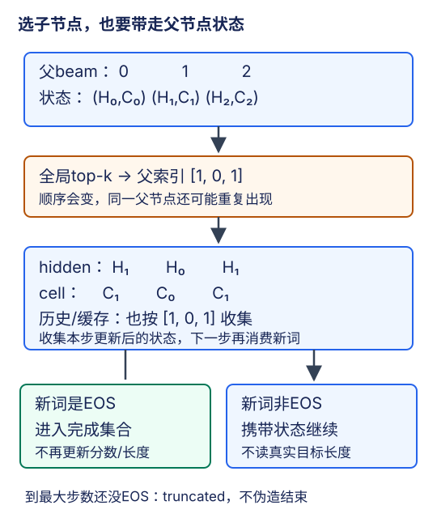

# 束搜索：选择的不只是词，还有整条历史的状态

## 1. 一步最优不等于整句最优

给定源句后，解码器定义每个前缀的下一词元分布。搜索的任务不是改模型参数，而是在这些分布形成的树上寻找得分高的路径。当前前缀不同，之后的概率分布也会不同；不能先算出一张与历史无关的概率表，再逐列选最大值。

设完整候选含EOS，共$L$个生成词元，BOS不计长度：

$$
P(Y\mid X)=\prod_{t=1}^{L}p(y_t\mid y_{<t},X)
$$

$$
A(Y)=\sum_{t=1}^{L}\log p(y_t\mid y_{<t},X)
$$

概率乘积容易下溢，实际累积log概率$A$；越大越好，通常为非正值。用`log_softmax`取得稳定的下一步log概率，不能累加原始logits，也不能只按最后一步的概率排序。

合成反例：第一步`P(a)=0.6,P(b)=0.4`；前缀`a`后EOS概率0.5，前缀`b`后EOS概率0.9。其余概率分给普通词元，并预设它们的后续概率不足以反超这两条完整路径。贪心先选`a`，可得到`a EOS`概率0.30；保留`b`则存在`b EOS`概率0.36。这个例子只证明局部最优可能丢失更好的完整候选，不是对任何真实翻译模型的观测。

## 2. 贪心、穷举和beam分别省掉什么

- **贪心**：每步仅保留当前最优的一条扩展。时间步数$T$、词表大小$V$时，候选评分规模约$O(TV)$。
- **穷举**：保留所有路径，最坏候选数随$V^T$增长。有限长度、确定评分下能找该搜索空间的最优解，但“模型得分最高”仍不等于“译文语义最正确”。
- **束搜索**：每层只保留最多$K$个候选，按全体父节点的扩展分数统一竞争。候选评分规模约$O(TKV)$，还要考虑网络前向、top-k与状态复制成本；它不是严格运行时间公式。

beam是近似搜索。已被剪掉的前缀无法在之后复活，因此通常不能保证找到全局最优；更宽的beam也不能无条件保证BLEU上升。模型概率、长度归一化分数与BLEU是三个不同目标。

## 3. 一个具体的全局top-k小例

假设当前有两个活动前缀，累计概率分别为$a:0.6$、$b:0.4$。为便于手算，用三个候选词`u,v,EOS`，每行下一词概率都和为1：

| 父前缀 | u | v | EOS |
| --- | --- | --- | --- |
| a | 0.1 | 0.1 | 0.8 |
| b | 0.6 | 0.3 | 0.1 |

乘上父前缀概率后，六个路径得分对应概率为：`a u=0.06`、`a v=0.06`、`a EOS=0.48`、`b u=0.24`、`b v=0.12`、`b EOS=0.04`。$K=2$的全局候选是`a EOS`与`b u`，不是每个父节点各自选两个后全部留下。

若按父行、词列展平且词ID为`u=0,v=1,EOS=2`，选中展平索引`[2,3]`：

$$
\mathrm{parent}=\lfloor\mathrm{index}/V\rfloor
$$

$$
\mathrm{token}=\mathrm{index}\bmod V
$$

于是父索引为`[0,1]`，词ID为`[2,0]`。第一条进入完成集合，不再生成；第二条继续。真实程序用log分数相加，其排序与这里的概率乘法一致。



图为编者自绘的独立机制例，突出“同一个父节点可以产生多个保留子节点”。图中的父索引顺序`[1,0,1]`只用于状态重排教学，不表示上表$K=2$的实际选中顺序。

## 4. top-k之后最容易漏掉的，是状态重排

对每条活动beam，至少维护：token历史、累计log概率、生成长度、结束标记、解码hidden，以及模型需要的cell、固定context、源长度、缓存等。**所有与beam身份绑定的数据，都必须跟随同一父索引。**

单向多层GRU hidden通常为$(L,BK,H)$，beam轴在中间，而不是第一个轴。LSTM的hidden和cell要同时沿该轴重排；只重排hidden会把另一条历史的记忆单元接到当前前缀上，程序可能不报错，但分数已经不对应所显示的句子。

明确一步的时间含义：进入本步时，状态对应“已消费到上一输入之前”，本步消费该父beam的上一词元（第一步为BOS），产生预测新词元的logits和更新后的状态。选出子词元后，应从**本次返回的状态**按父索引收集，子词元将在下一步消费。不能从旧状态收集而漏消费一个词，也不能提前把新词消费两次。

例如三条父beam的所有层hidden标记为`[H0,H1,H2]`，cell标记`[C0,C1,C2]`；若新beam的父索引为`[1,0,1]`，则：

```text
hidden： [H1,H0,H1]
cell：   [C1,C0,C1]
历史：   [历史1+新词A, 历史0+新词B, 历史1+新词C]
源身份： [源1,源0,源1]（这里只示意beam索引对应关系）
```

最后一行不是允许跨源句混合：批量搜索时必须在每个源样本内部独立top-k。若原始布局为$(B,K,\ldots)$，局部父索引$p$转换成全局索引时要加该源样本的偏移$bK$，保证绝不把另一句的状态接过来。

同一父索引可以重复出现。此时两个子分支起初hidden数值相同，但接收的下一词元不同，之后会分化。若状态容器可变，必须防止一个分支的原地更新污染另一个；固定源记忆可以共享只读内容，不能共享可变历史写入。

缓存同理：若模型保存每层历史key/value，先用父索引收集截至本步已消费前缀的缓存，再在各子分支下一步追加它自己的新词信息。不能仅重排token列表而把旧缓存留在原beam行。源端固定表示可按源身份索引，不必每步重复编码；若物理展开到beam轴，也必须随父索引保持一致。基础GRU本身无Transformer式KV缓存，这里讲的是通用状态纪律，不要求实验额外实现Transformer。

## 5. EOS集合与终止：先固定一种可审计的策略

教材展示每层候选与最终长度归一化思路，但没有给出完整的批量EOS状态管理实现。下面明确一种**总容量为$K$的beam合同**，用于理解与机制验收；其他实现可以选择“活动K条+独立完成池”，但必须注明区别，不能混用宽度含义。

1. 初始化仅一条BOS前缀，累计log概率为0，生成长度为0。不是复制$K$个相同BOS再把它们当不同候选。
2. 每步只扩展未完成条目，得到每个活动父节点的$V$个候选。
3. 已完成条目不再送进解码器，而作为**分数和长度都不变的一条候选**与新扩展共同参与全局top-k。它不会追加第二个EOS，也不会再累计概率。
4. 保留总计最多$K$条，再按是否刚生成EOS划分活动集合与完成集合。被保留的完成条目占用容量，所以活动条数可能小于$K$。保存完成结果时附带首次EOS位置和包含EOS的分数。
5. 所有保留条目都完成，则停止；否则运行到预先固定的最大生成步数。不能仅因为“出现了第一条EOS”就结束所有beam。

本合同以**原始累计log概率**剪枝，最终才用下面的长度归一化排序。$K=1$时它与使用相同候选限制、平局规则和最大长度的greedy一致：每次仅有一条活动路径，若选到EOS便永久完成。若实现改成另一种完成池、长度惩罚或候选限制，须重新核这个等价性，不能只因函数叫beam就断言成立。

如果选择“活动K条+独立完成池”，需要从更多候选中取足非EOS项、单独保留完成结果，并明确完成池容量、停止上界及返回规则。它与上面的总容量合同不相同，特别是$K=1$仍可能继续保留非EOS路径。实验应选择并记录一种，而不是让循环代码偶然决定语义。

达到上限时，活动条目带`finished=false, truncated=true`进入最终保留候选列表；完成条目为`finished=true`。与配套实测一致，本页采用**完成优先**返回政策：保留池中若有EOS完成项，只在这些完成项中按最终分数选择；一个完成项都没有时，才从未完成项中选择，并标记`max_steps_unfinished`。不能伪造EOS，把截断输出冒充完整译句。另一种“完成和未完成混在一起按分数选首名”的政策可能给出不同结果，不能与本实验混报。实测归一化指数为0.6；下节用指数1手算只为解释符号，不是实测参数。

## 6. 长度归一化不是免费的最优保证

教材给出的评分形式为：

$$
S(Y)=\frac{A(Y)}{L^\alpha}
$$

本页$L$是已生成词元数，**不含BOS、包含实际生成的EOS**；未完成候选按实际已生成长度计算。EOS不在展示文本中，不代表从概率或长度账本里删除。$\alpha=0$恢复原始log概率排序；正$\alpha$减轻乘法模型偏爱短序列的倾向。

注意符号：$A$通常为负，除以更大的正数，会让分数向0靠近。教材文字把分母说成“惩罚长序列”，但对于“取最大”的这个负log和公式，更准确是**相对补偿长度带来的负分累积**。独立例子：短句$A=-2,L=2$，长句$A=-3,L=4$。原始分数短句胜；$\alpha=1$时分别为$-1$与$-0.75$，长句反而胜。

这改变了搜索目标，不能仍称必然最大化原始序列概率。若在每步也按归一化分数剪枝，或者改用其他length penalty，都属于另一套策略，应记录。最终归一化不能挽救早先已剪掉的前缀，beam仍是近似搜索。

没有长度归一化时，继续扩展只会增加非正log概率，活动前缀分数可作为后代原始分数的上界；引入长度归一化后这个简单界失效，负分可能因分母增长而改善。因此不能拿“当前最佳完成分数大于当前活动归一化分数”直接作安全提前停止证明。本页合同采用全部完成或达到最大长度，避免没有依据的提前停止。

## 7. 搜索可重复，翻译质量仍需真实评估

实现时固定平局规则，例如先按分数、再按父索引和词ID，避免把排序不稳定误认成模型波动。比较greedy与beam时，固定同一模型参数、源预处理、词表、EOS策略和最大长度，并报告$K,\alpha$及剪枝/完成池政策。不同模型、不同分词或不同测试划分的分数不能归因于搜索算法。

正确搜索还需要：推理只能访问源及预测历史；源有效长度参与编码；基础模型固定context与可变hidden分离；保存beam得分对应的实际前缀。BLEU由生成后的独立评分器读取参考，不能用参考长度或参考词引导候选挑选。

本页不展示虚构翻译、不宣称beam更快或更准。机制验收可以用合成分布比较穷举和beam、核父索引重排；翻译质量必须另用真实双语留出集和明确BLEU口径验证。更宽beam消耗更多候选计算与状态内存，这不是任何具体硬件的吞吐测量。

## 8. 自测与答案

<details><summary>1. 为什么不能为每个父beam各选K条，然后直接得到下一层？</summary>

那会留下最多K²条。beam宽K要求所有父节点扩展在同一个源样本内统一竞争，全局保留至多K条，并同步收集父状态。

</details>

<details><summary>2. 父索引[1,0,1]为什么不是简单交换两行？</summary>

它既改变顺序，又复制父1形成两个不同子分支。hidden、cell、历史和缓存都必须同样收集，并避免之后原地更新相互污染。

</details>

<details><summary>3. 一条beam已生成EOS，下一步是否再给它EOS概率1？</summary>

可以用等价的冻结表示参与排序，但不能把这看成新的生成步：分数、长度和状态都不变，EOS只计一次。本页直接把完成条目作为不扩展候选携带。

</details>

<details><summary>4. 最大长度到了却没有EOS，能补上EOS让输出更整齐吗？</summary>

不能伪造一个未预测的EOS及其概率。应标记截断；若只接受完整结果，则报告没有完成候选。

</details>

<details><summary>5. 除以长度为什么可能让长句排名上升？</summary>

累计log概率为负。除以更大的正数会变得不那么负；它是在改变长度偏好，而不是额外扣掉长句分数。

</details>

## 9. 来源与视频边界

- [官方课表](https://courses.d2l.ai/zh-v2/)2021年8月7日row089对应[教材9.8](https://zh.d2l.ai/chapter_recurrent-modern/beam-search.html)。已读整节贪心反例、穷举、束搜索、评分公式与练习；固定提交`e6b18ccea71451a55fcd861d7b96fddf2587b09a`为当前中文第二版，不是2021快照。本文小例、父索引/缓存处理、总容量EOS政策及截断状态为编者补充，不能冒称课堂原讲或教材完整实现。
- [官方视频](https://www.bilibili.com/video/BV1B44y1C7m1/)作者“跟李沐学AI”，mid 1567748478，标题“63 束搜索【动手学深度学习v2】”；上传2021-08-10，与课表8月7日分别记录。

| 分P | 平台标题 | cid | 时长 |
| --- | --- | --- | --- |
| P1 | 束搜索 | 385254837 | 11:44 |
| 全1P合计 | 704秒 | — | 11:44 |

2026-11-14该P公开字幕查询一次成功且列表为空，不排除烧录字幕。未审阅音视频，不猜片内时间码，不生成课堂QA或draft。copyright=1、no_reprint=1不授予开放转录许可；教材根Apache-2.0不覆盖视频/语料。统一数值与真实翻译日志见[公共资料](#/c/d2l-pytorch-2021)，实践见[实验指导](#/c/d2l-pytorch-2021/lab/seq2seq-attention?v=guide)。
