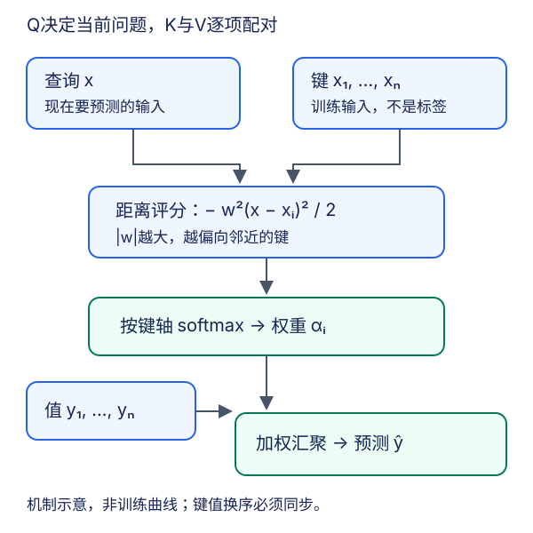

# 注意力机制：从查询到核回归

## 1. 为什么平均值不够

给定一批键值对，平均汇聚对每个值分配相同权重，回答的是“这批值总体怎样”。注意力还接收一个**查询**，回答“对当前问题，这批值中的哪些更有用”。同一批资料，查询改变，输出可以改变。

10.1用自主提示与显著性提示解释直觉，但神经网络注意力并不是人脑机制的完整模型。工程上只需抓住三种角色：

| 角色 | 要回答的问题 | 核回归中的对象 |
| --- | --- | --- |
| query，Q | 当前要估计哪个输入？ | 新输入$x$ |
| key，K | 每条记录靠什么与问题匹配？ | 训练输入$x_i$ |
| value，V | 匹配后取回什么信息？ | 训练标签$y_i$ |

键和值必须保持配对。它们可以来自同一表示，也可以维度不同；“K等于V”不是注意力的定义。查询也不是数据库里必须精确命中的字符串：这里通常是可微的软匹配。

图为编者依据10.1–10.2重绘的机制图，不是课堂截图或实际训练热图。图中实线表示先评分再归一化再汇聚，而不是先平均值再寻找查询。

## 2. 把Nadaraya–Watson核回归拆成三步

设已有$n$个训练对$(x_i,y_i)$。常数预测是所有$y_i$的平均，完全不使用查询$x$。核回归用距离决定权重。为避免核函数$K(\cdot)$与键矩阵K混淆，下面把核写成$\kappa$：

$$
\alpha_i(x)=\frac{\kappa(x-x_i)}{\sum_{j=1}^{n}\kappa(x-x_j)}
$$

$$
\hat y(x)=\sum_{i=1}^{n}\alpha_i(x)y_i
$$

需要非负核且分母非零。取单位带宽的高斯核时，分子分母共享的常数消去，得到：

$$
s_i=-\frac{(x-x_i)^2}{2}
$$

$$
\alpha_i=\operatorname{softmax}(s)_i
$$

$$
\hat y=\sum_i\alpha_i y_i
$$

因此整个过程是**距离评分 → 按键轴归一化 → 用权重加权值**。评分不是概率，softmax之后才是概率分布；高分是距离较近，不代表标签$y_i$较大。

权重非负、和为1，所以标量预测位于最小与最大训练值之间；向量值的结果在值向量的凸包内。它能插值但不能靠这一步在值域上任意外推。非参数不是“无超参数”“不保存数据”：固定核仍有带宽选择，预测仍需要键值库，计算量随库增长。

## 3. 一个可手算的小例

取键$[0,2]$、值$[2,6]$，单位带宽。查询为1时，两项距离平方都为1：分数同为$-1/2$，权重各$1/2$，输出4。查询换成0：

$$
(s_1,s_2)=(0,-2)
$$

$$
\alpha_1=\frac{1}{1+e^{-2}},\qquad
\alpha_2=\frac{e^{-2}}{1+e^{-2}}
$$

$$
\hat y=\frac{2+6e^{-2}}{1+e^{-2}}
$$

无需真实训练，就能验证“更接近键0时更靠近值2”。把两个键值对一起换序，输出不变；只换键不换值，输出通常改变。这是很有效的配对检查。

保持Q/K不变、将所有值都加3，权重不变而输出加3。将所有值乘2，输出乘2。**权重依赖Q/K，输出还依赖V**，不要把热图误读成输出本身。

## 4. 可学习带宽改变什么

10.2的参数版本将距离乘标量$w$：

$$
s_i=-\frac{w^2(x-x_i)^2}{2}
$$

若$w\ne0$，对应带宽$h=1/|w|$。$|w|$越大，距离差越被放大，权重越集中；$w=0$时分数全零，退化为平均汇聚。因为只依赖$w^2$，$w$和$-w$给出相同输出。精确初始化为0还会令这里的参数导数为0，不能指望它自己靠梯度离开平均汇聚。

可以从softmax导数理解参数训练。设$\delta_i=x-x_i$，则：

$$
\frac{\partial s_i}{\partial w}=-w\delta_i^2
$$

$$
\frac{\partial\alpha_i}{\partial w}
=\alpha_i\left(-w\delta_i^2+w\sum_j\alpha_j\delta_j^2\right)
$$

把这个导数乘$y_i$并求和，就得到预测对$w$的导数；再接平方损失即可反向传播。越尖锐不等于泛化越好：局部噪声也可能被放大。固定带宽下增加样本并不自动消除所有平滑偏差，核回归一致性还需要相应分布、带宽与样本量条件，不把教材的直觉表述当作无条件定理。

### 为什么训练时排除自身

若用$x_i$查询且键值库仍含$(x_i,y_i)$，让$|w|$很大就可能主要取回自己的标签，训练误差极低，却不能说明新查询预测好。教材为每个训练查询移除对应的自身键值对，形成留一式训练：$n$个查询各有$n-1$个键值。存在重复输入时，还需辨认相同输入及标签是否造成另一种近似自取回。

实际评估必须先划分数据。验证查询只能访问训练键值库，不能把验证标签加入V。留一构造是训练机制，不代替独立验证集。教材的合成回归曲线也不是本批真实翻译语料训练证据。

## 5. 张量形状：哪条轴归一化

一般批量记为$B$，查询数为$N_q$，键数为$N_k$，值维度为$D_v$：

| 对象 | 形状 | 操作 |
| --- | --- | --- |
| 分数S | $(B,N_q,N_k)$ | 每个查询对每个键评分 |
| 权重A | $(B,N_q,N_k)$ | 最后一维softmax |
| 值V | $(B,N_k,D_v)$ | 与键数对齐 |
| 输出C | $(B,N_q,D_v)$ | 批量矩阵乘法AV |

每个查询都在它可见的键集合上分配总质量1；不是跨查询归一化，也不是跨batch混合样本。教材标量核回归把每个查询作为独立一组，权重扩成`(查询数,1,键数)`，值扩成`(查询数,键数,1)`，批量乘后每个查询得一个数。广播可表达查询与全部键的距离，不必把每个查询真的复制许多份。

向量值例：两个值为$(1,3)$与$(5,7)$，等权输出$(3,5)$。输出维数由V决定，与Q的维数没有必须相等的关系。

## 6. 可视化和实现边界

- 画权重图时，行标查询，列标键，记录排序方式。排序后的连续输入可能形成近对角结构；这不是“模型学到了语言对齐”的证据。
- 若加入padding，必须在softmax前排除无效键。仅令padding值为0，仍会浪费概率质量。具体稳定算法见[下一讲](#/c/d2l-pytorch-2021/lec/lec65)。
- 当前标量例没有空键集合。翻译实验要求源序列有效长度至少1；全mask行不可偷偷生成均匀权重。
- 热图只可来自真实保存的权重日志，并注明训练/推理模式。本文仅画机制，不制作看似真实的训练热图。
- softmax只能区分相对评分：给同一行每个分数加同一常数，权重不变。这是数值稳定实现可以减去行最大值的原因。

## 7. 自测与答案

1. **Q/K不变，只改V，会改变注意力权重吗？** 不会；评分仅依赖Q/K时，变的是汇聚结果。
2. **核回归中“非参数”是否表示预测成本固定？** 不是，仍访问训练键值，成本随样本数增加。
3. **两个键距离查询相等，标签分别为2和6，输出是什么？** 权重各一半，输出4。
4. **把$w$从2变成$-2$会改变输出吗？** 不会；把绝对值变大才会改变锐度。
5. **为什么训练查询移除自身标签仍不足以证明泛化？** 还需要独立划分、验证键值边界以及重复样本处理。
6. **所有评分相同但padding占一半时直接平均有什么问题？** 无效位置吸收了一半质量；必须只在有效键集合归一化。

## 来源、范围与缺口

- [官方2021课表](https://courses.d2l.ai/zh-v2/)row090，课表日期2021-08-08；此日期不等同于视频上传日期。
- 固定提交`e6b18ccea71451a55fcd861d7b96fddf2587b09a`的[10.1源码](https://github.com/d2l-ai/d2l-zh/blob/e6b18ccea71451a55fcd861d7b96fddf2587b09a/chapter_attention-mechanisms/attention-cues.md)全文1–192行、[10.2源码](https://github.com/d2l-ai/d2l-zh/blob/e6b18ccea71451a55fcd861d7b96fddf2587b09a/chapter_attention-mechanisms/nadaraya-waston.md)全文1–703行；重点为核权重、参数带宽、批量乘法及留一训练。10.2是课表指定阅读，10.1是编者补充。当前第二版，不是2021快照。
- 作者张阿斯顿、李沐、扎卡里·C.立顿、亚历山大·J.斯莫拉；教材仓库根[Apache-2.0](https://github.com/d2l-ai/d2l-zh/blob/e6b18ccea71451a55fcd861d7b96fddf2587b09a/LICENSE)。本文与图为独立改写，未复制教材插图。根许可不外推视频、第三方素材；setup.py的MIT-0是另一字段。
- 本文未另读核回归原始论文，不以教材文献条目冒充论文全文核验。

### 视频分P覆盖表

下表是原站分P清单，不是片内主题时间轴；每段从各自P的00:00起算。

| P | 原站分P标题 | 本P范围 | 时长 |
| --- | --- | --- | --- |
| 1 | 注意力机制 | 00:00–13:58 | 838秒 |
| 2 | 代码 | 00:00–10:00 | 600秒 |

全2P合计1438秒（23:58）。已核BV1264y1i7R1、作者“跟李沐学AI”（mid1567748478）及2021上传年份；精确pubdate、cid与逐P字幕结果见`sources/p9-lec64/video-metadata.json`。未取得可靠课堂文本，未审阅音视频；公开字幕空列表不证明无烧录字幕。不猜片内时间码、问答或课堂演示，中文原课通过页头观看，本课不另作课堂逐段整理；不另作重复materials。视频copyright=1、no_reprint=1不等于开放转录授权。实验入口：[seq2seq-attention指导](#/c/d2l-pytorch-2021/lab/seq2seq-attention?v=guide)。
