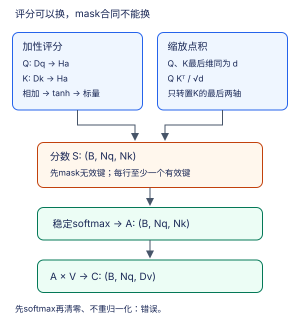

# 注意力评分：异维投影、缩放点积与稳定掩蔽

## 1. 分数、权重、输出是三个对象

上一讲用负平方距离评分。本讲更换评分函数，但保留相同结构：查询与键产生分数，softmax把分数变成对键的权重，再乘值。记批量$B$、查询数$N_q$、键数$N_k$：

$$
S_{bij}=a(q_{bi},k_{bj})
$$

$$
A_{bi:}=\operatorname{maskedSoftmax}(S_{bi:})
$$

$$
C_{bi}=\sum_j A_{bij}v_{bj}
$$

S和A都为$(B,N_q,N_k)$，但只有归一化后的A在有效键上组成概率分布。若V为$(B,N_k,D_v)$，C就是$(B,N_q,D_v)$。不能把评分的隐维度、值维度、键数混为同一概念。

图为编者机制重绘；没有展示训练结果。两种评分共用后半段，因此两种模型都必须遵守相同有效长度合同。

## 2. 加性注意力为何允许Q与K异维

设查询维度$D_q$、键维度$D_k$、评分隐维度$H_a$。使用列向量公式：

$$
u_{ij}=W_q q_i+W_k k_j
$$

$$
s_{ij}=w_a^\top\tanh(u_{ij})
$$

其中$W_q$为$(H_a,D_q)$，$W_k$为$(H_a,D_k)$，$w_a$为$(H_a)$。即使$D_q\ne D_k$，两个投影结果都是$H_a$维，才能相加。教材评分层无偏置；这里也按此约定，不另添参数。

批量中先分别投影，得到`Qp:(B,Nq,Ha)`与`Kp:(B,Nk,Ha)`，再插入轴：

| 阶段 | 形状 |
| --- | --- |
| Qp扩维 | $(B,N_q,1,H_a)$ |
| Kp扩维 | $(B,1,N_k,H_a)$ |
| 广播相加并tanh | $(B,N_q,N_k,H_a)$ |
| 最后线性投影并去掉末尾1 | $(B,N_q,N_k)$ |

例如$B=2,N_q=3,N_k=4,D_q=5,D_k=7,H_a=6,D_v=8$：Q/K原形状不同，评分特征为`(2,3,4,6)`，分数为`(2,3,4)`，输出为`(2,3,8)`。此评分无偏置参数量是$6\times5+6\times7+6=78$，不包括产生Q/K/V的其他网络。

“加性”不是把原始Q和K直接相加，也不是把值加到评分中。没有tanh时，评分可拆成只依赖查询的一项与只依赖键的一项；前者对同一查询行是常数，会被softmax消去，查询可能无法改变相对键权重。非线性在这里不是装饰。

## 3. 缩放点积的维度与动机

点积要求Q和K最后一维相同，设为$d$，但V的维数仍可不同。原始表示异维时，可以先各自学习到共同$d$维，不是从此不能用点积。

$$
S=\frac{QK^\top}{\sqrt d}
$$

$$
C=\operatorname{maskedSoftmax}(S)V
$$

这里的转置只交换K的**最后两维**，保留batch。`Q:(B,Nq,d)`乘`Kᵀ:(B,d,Nk)`得到`S:(B,Nq,Nk)`。不能把整个三维张量的轴顺序反转，也不能误用$\sqrt{N_k}$或$\sqrt{D_v}$作缩放。

在各坐标独立、零均值、单位方差的理想假设下，每个$q_rk_r$方差为1，求和$d$项使点积方差为$d$；除以$\sqrt d$后方差回到1。真实训练表示不必满足独立假设，这只是控制初始评分尺度的动机，不保证所有训练阶段方差恒为1。分数过大容易让softmax过早饱和，非最大项梯度极小。

复杂度上，点积评分主要使用矩阵乘法；加性评分还会构造查询—键配对的隐特征。不能仅凭公式声称某GPU上快多少，实际效率还受维度、实现和硬件影响。

## 4. padding必须在归一化之前消失

源长度$\ell_b$表示样本$b$的有效键数，包含本课程保留的源EOS，不包含pad。对于翻译中的每个查询：

$$
M_{bij}=[j<\ell_b]
$$

这里$j$从0起。长度形状可以为`(B,)`，向查询轴广播；更一般的每查询长度为`(B,Nq)`。后者不能错误地当成每样本一个长度。一个样本的源padding mask不应随着目标真实长度变化。

### 稳定计算顺序

本课程要求每个查询至少有一个有效键，且有效位置分数有限。先把无效分数视为负无穷，再求**有效分数最大值**$m$：

$$
m=\max_{j:M_j=1}s_j
$$

$$
z_j=\begin{cases}e^{s_j-m},&M_j=1\\0,&M_j=0\end{cases}
$$

$$
\alpha_j=\frac{z_j}{\sum_k z_k}
$$

有效分数减最大值后不大于0，避免指数溢出；至少一个有效位置给出$e^0=1$。实现可用框架稳定softmax配合mask，不必手写指数。无效位置应先遮蔽，不能让padding的极大分数决定减去的最大值，导致所有有效指数下溢。

教材以`-1e6`代替无效分数。它在教材特定数值范围中通常有效，但不是对任意dtype和任意分数的证明：低精度可能无法表示，且当所有位置都被同一有限负数替换时会得到错误的均匀分布。

### 全mask不许静默兜底

本课程合同是$1\le\ell_b\le N_k$，**拒绝全mask行**。清洗后空文本按预先规定处理；若保留空内容样本，可以仅含EOS，此时有效长度是1而不是0。全负无穷的softmax通常导致NaN，不应把NaN替成0后声称得到了合法概率分布。若别的系统设计全mask输出为零，必须显式另立合同；本文实验不采用它。

### “softmax后清零”错在哪里

分数$[0,0,0]$、长度2时，正确结果是$[1/2,1/2,0]$。先对三个位置softmax再清零得到$[1/3,1/3,0]$，有效质量只剩$2/3$。令值为$[2,4,100]$：正确输出3，错误输出2；把padding值设0也救不了这个错误。

数学上，先softmax、清零、再按剩余有效质量重新归一化可以等价，但有限精度下有效质量可能已经下溢；因此优先在softmax前mask。不能漏掉重新归一化，也不能把padding再次加入分母。

## 5. 两组纸面验收输入

**稳定性例**：分数$[1000,1000,2000]$，有效长度2，V为$[2,4,100]$。预期权重$[1/2,1/2,0]$，输出3；把无效分数改为$-2000$，结果仍不变。只看输出不够，还要查行和、无效位置精确零和有限梯度。

**缩放点积例**：$d=4$，查询$[2,0,0,0]$，两个键为$[1,0,0,0]$与$[0,0,0,0]$，两个标量值为2与6。缩放后分数$[1,0]$，所以：

$$
A=\left[\frac e{e+1},\frac1{e+1}\right]
$$

$$
C=\frac{2e+6}{e+1}
$$

若误除以$d$，分数会是$[1/2,0]$；若忘记缩放，则是$[2,0]$。三种结果可清楚区分，不需真实训练。

加性注意力还有一个不依赖随机权重的检查：同一行所有有效键相同，评分应相同，因此权重在有效键上均匀。教材例的值行依次为`[0,1,2,3]`、`[4,5,6,7]`等，长度2时预期输出`[2,3,4,5]`，长度6时为`[10,11,12,13]`，均指eval或dropout=0。

## 6. Dropout、梯度与图的解释

教材先保存softmax权重，再对权重做dropout参与AV。训练时经过dropout缩放的一行不必和为1，因此“加权平均”“凸包内”严格适用于dropout前或eval时的归一化权重。不要把dropout后的随机矩阵误标为概率分布；诊断mask先关闭dropout。

无效评分不应贡献梯度，注意力层输出对无效V的直接梯度也为0。但若无效源token之前已污染编码器终态，单独测attention层的mask通过仍不足以证明端到端正确。下一讲要求源有效长度同时控制编码器递归。

注意力图是模型内部计算记录，不是词对齐真值，更不是因果解释证明。只用实际日志画图，写清查询行对应哪个解码步、源列是否含EOS、是否eval、是否教师强制。本文不伪造训练热图。

## 7. 自测与答案

1. **Q维5、K维7，加性评分如何相加？** 分别投影到共同隐维$H_a$，再广播相加。
2. **V维8时输出维度是多少？** 8，不是评分隐维或键数。
3. **为何点积除以$\sqrt d$？** 独立零均值单位方差假设下原点积方差为$d$。
4. **长度0、全部填充为$-10^6$，能得到零权重吗？** 不能，通常是均匀分布；本合同拒绝此输入。
5. **mask后行和$2/3$说明什么？** 很可能在softmax后只清零而没有重归一化。
6. **训练dropout后的行和不是1，一定实现错误吗？** 不一定；应区分保存的归一化权重与参与汇聚的dropout张量。

## 来源、范围与缺口

- [官方课表](https://courses.d2l.ai/zh-v2/)row091，课表日期2021-08-08，指定阅读10.3。[固定源码](https://github.com/d2l-ai/d2l-zh/blob/e6b18ccea71451a55fcd861d7b96fddf2587b09a/chapter_attention-mechanisms/attention-scoring-functions.md)实际全文1–589行已读；重点75–212掩蔽、214–414加性、416–566点积。固定当前中文第二版提交`e6b18ccea714`，完整标识见源码链接，非2021快照。
- 教材作者张阿斯顿、李沐、扎卡里·C.立顿、亚历山大·J.斯莫拉；仓库根[Apache-2.0](https://github.com/d2l-ai/d2l-zh/blob/e6b18ccea71451a55fcd861d7b96fddf2587b09a/LICENSE)。本文推导、数值反例和SVG为自主讲解；未另读论文或复制教材图。全mask拒绝、稳定性及端到端padding验收是编者工程补充。

### 视频分P覆盖表

| P | 原站分P标题 | 本P范围 | 秒 |
| --- | --- | --- | --- |
| 1 | 注意力分数 | 00:00–10:45 | 645 |
| 2 | 代码 | 00:00–15:20 | 920 |
| 3 | QA | 00:00–04:42 | 282 |

全3P合计1847秒（30:47）。BV1Tb4y167rb，作者“跟李沐学AI”（mid1567748478），发布2021-08-12T02:10:12Z，与课表日期分开。cid、API地址、逐P空字幕记录见`sources/p9-lec65/video-metadata.json`。此表只是分P边界；P名为QA不代表已读到问答。未审阅音视频，空字幕不证明无烧录字幕；没有可信课堂时间轴，不猜问题或时间点，中文原课通过页头观看，本课不另作课堂逐段整理；不另作重复materials。copyright=1、no_reprint=1不授予开放转录许可。下一讲：[带注意力的seq2seq](#/c/d2l-pytorch-2021/lec/lec66)。
