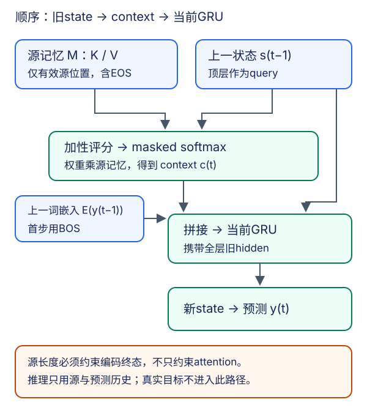

# 带注意力的seq2seq：先查询，再更新状态

## 1. 从固定上下文到每步检索

基础seq2seq把源序列压缩成固定上下文，再逐词生成目标。长句的不同部分都要经过同一个摘要，信息瓶颈明显。注意力不取消编码器，也不一次性生成整个目标；它保留源的所有有效位置表示，让解码器每一步按当前需求重新汇聚。

| 对象 | 固定上下文基线 | 本讲Bahdanau式模型 |
| --- | --- | --- |
| 编码记忆 | 主要使用编码器终态 | 保存每个源位置的编码输出 |
| 当前上下文 | 每步使用同一个源摘要 | 每步按上一解码状态重新计算 |
| 目标生成 | 自回归 | 仍然自回归 |
| 推理可读信息 | 源及预测历史 | 源及预测历史；没有新增真实目标权限 |

注意力让每步获得一条到源表示的路径，并不保证真实小数据上必然优于基线，也不使训练和推理完全相同。本站实验的固定上下文基线应把**不变的编码器context**与**不断变化的解码hidden**分别保存，不因把整段调用改成逐token调用就改变context语义；这是显式工程合同，不宣称逐字复现教材所有helper。

图为依据教材10.4独立重绘的时序图。它不是实际模型的attention热图，也不包含伪造的词对齐或训练输出。

## 2. 严格按时间顺序写一步

源编码输出记为$h_1,\ldots,h_{T_s}$，解码状态记为$s_t$。在预测目标第$t$个词元之前，手里只有上一状态$s_{t-1}$和上一输入词元$y_{t-1}$。第一步的输入是BOS。

**第一步，旧状态作查询。** 对每个有效源位置$j$计算加性分数：

$$
e_{tj}=w_a^\top\tanh(W_qs_{t-1}+W_kh_j)
$$

**第二步，屏蔽padding并汇聚。**

$$
\alpha_{t:}=\operatorname{maskedSoftmax}(e_{t:})
$$

$$
c_t=\sum_{j=1}^{\ell_s}\alpha_{tj}h_j
$$

**第三步，context和上一词嵌入拼接，更新当前GRU。**

$$
s_t=\operatorname{GRU}([E(y_{t-1});c_t],s_{t-1})
$$

**第四步，用当前状态预测当前词。** 教材实现使用线性输出头：

$$
z_t=W_os_t+b_o,\qquad p_t=\operatorname{softmax}(z_t)
$$

这些式子省略多层状态的层轴；多层时查询取上一时刻的**顶层**状态，GRU更新却需要携带**所有层**状态。若先用$s_t$求$c_t$、又用$c_t$求$s_t$，就产生循环定义。若先喂当前真实$y_t$再预测$y_t$，则是标签泄漏。

教材中的“Bahdanau注意力”是这种加性检索与GRU结合的教学实现，不声称与原始论文每个编码方向、输出头或训练设置完全一致；本页未另读原始论文全文。

## 3. 逐个对象对形状

按单向编码器、编码/解码同隐维$H$、层数$L$、目标嵌入维$E$、目标词表$V_t$说明：

| 对象 | 形状 | 使用位置 |
| --- | --- | --- |
| 源token | $(B,T_s)$ | 编码器输入 |
| 编码输出，time-major | $(T_s,B,H)$ | 所有源时刻的顶层状态 |
| 注意力记忆M | $(B,T_s,H)$ | 由编码输出permute，作K/V |
| 编码终态及初始解码状态 | $(L,B,H)$ | 各样本有效末位置，不是pad末尾 |
| 源有效长度 | $(B)$ | 控制编码递归与attention mask |
| 单步query | $(B,1,H)$ | 顶层旧状态插入查询轴 |
| 单步权重 | $(B,1,T_s)$ | 对源位置归一化 |
| 单步context | $(B,1,H)$ | 权重乘记忆 |
| context与嵌入拼接 | $(B,1,H+E)$ | 转成time-major后进GRU |
| 新的全层hidden | $(L,B,H)$ | 下一步携带 |
| 一批目标logits | $(B,T_t,V_t)$ | 与目标逐token对齐 |

加性评分允许编码/解码隐维不同，只需分别投影；但**初始化状态**还需另一个明确映射，不能因为评分支持异维就直接把形状不符的编码hidden塞进GRU。多层或双向编码器也不能简单丢层、丢方向来假装匹配。本批小模型使用明确约定，避免无关架构扩展。

教材PyTorch `init_state`附近把输入outputs注为batch-major，但紧接着调用`permute(1,0,2)`；按实际编码器输出和后续调用，应把入参理解为time-major。这是源码形状注释核对，不是课堂口误判断。

## 4. 有效长度必须保护两条路径

第一条是**记忆检索路径**：无效源位置不能得到attention权重。第二条是**初始状态路径**：源padding不能改变送给解码器的编码终态。

仅将pad embedding设为0不够。RNN仍会执行递归，带偏置或依赖旧状态的门控会继续改变hidden。即使attention完美屏蔽padding，如果$s_0$已是处理完若干pad后的状态，第一步query已经被污染。

可用按有效长度打包的递归，或逐步控制每个样本在超过有效长度后不再更新状态。单层单向情形也可从有效最后位置提取终态；多层初始化必须正确得到每一层的有效终态，不能只有顶层gather便声称完成。若采用双向，反向状态更要防止从padding开始的传播。

本课程源端保留EOS，长度至少为1。源文本先截断内容以给EOS保留位置，再加EOS，再padding；源长度数到EOS为止。改变有效长度之外的token、改变右侧padding宽度，都不应改变有效编码记忆、初始解码状态及eval下的输出。attention mask通过不等于此端到端不变量已通过。

## 5. 教师强制与推理的分界

真实句对先划分训练/验证/测试，重复句对分组避免跨段；只用训练段分别拟合源、目标词表。保留独立unk/pad/bos/eos含义，不把验证词汇“顺手”加入词表。翻译语料身份与署名条件由[实验说明](#/c/d2l-pytorch-2021/lab/seq2seq-attention?v=zh)集中记录，不能拿随机token或本页算例代替真实语料训练。

设某个目标为`[a,b,EOS,PAD]`，有效长度3：

| 目标预测位置 | 解码输入 | 应预测目标 | 是否计损失 |
| --- | --- | --- | --- |
| 1 | BOS | a | 是 |
| 2 | a | b | 是 |
| 3 | b | EOS | 是 |
| 4 | EOS | PAD | 否 |

因此训练输入是BOS加目标右移后的前缀，当前目标只进入损失，不进入当前输入。目标长度仅用于训练/评估loss mask，不能用于决定推理什么时候停止。

$$
\mathcal L=-\frac{1}{N}\sum_{b,t}m_{bt}\log p_{bt}(y_{bt})
$$

$$
N=\sum_{b,t}m_{bt}
$$

这里有效目标token包含EOS，不包括PAD。先累计有效token负对数似然，再除以总数；不能先平均每句或每batch后不加权平均，造成短句和小batch被放大。

推理入口只接受源、源长度、训练得到的模型/词表、最大生成长度与解码配置。第一步输入BOS，随后输入自己的预测；遇EOS结束，超最大长度停止并记截断。不能传真实目标或真实目标长度；BLEU参考只在生成完成后交给评测器。

## 6. 一个上下文算例和三类机制检查

**纸面汇聚例**：源有效记忆为$h_1=(1,0)$、$h_2=(0,2)$，另有一个padding位置。若当前有效分数为$[0,\log3]$，权重就是$[1/4,3/4,0]$，context为$(1/4,3/2)$。这是人为指定分数的机制算例，不是训练出的权重；padding值无论多大都不能改变它。

**时序检查**：记录送入attention的query与更新前顶层hidden，应一致；再记录GRU输入的context，确认它来自这一query。不能用“形状能跑通”代替时序正确性。

**分块检查**：eval、dropout关闭、同一组教师强制输入，用一次整段调用与逐token调用，logits和最终hidden应一致；memory与源长度不变。这能发现状态重置、context缓存错误或一步错位。

**反事实边界检查**：保持源和解码前缀不变，修改未来真实目标，前面logits不变；推理函数根本不收目标。保持源有效部分不变，改变pad token或右侧pad宽度，输出不变。两种检查分别针对目标泄漏和源padding泄漏。

## 7. 贪心、beam与热图不混账

贪心每步选最大概率词；beam保留多个前缀。每个候选都要携带对应的**全层decoder hidden**，并按选中的父候选重排；源memory和源长度也要与候选所属样本对应。结束候选不再生成新词；累积log概率包括预测EOS这一步。长度归一化需写清分母、长度是否含EOS、何时应用，并固定同一策略比较基础与注意力模型。

attention不是搜索策略；有注意力也可能因贪心选错早期词。beam更宽不保证BLEU提高，更不允许用真实目标长度帮助截断。BLEU必须注明分词、n-gram上限、平滑、短句处理及句级/语料级聚合；教材少量句子的演示分数不是独立测试集质量。

只有真实运行产生的attention日志才能画热图。最小记录应包括：模型/权重标识、源token与长度、生成token、每步权重、eval/教师强制标志、EOS与截断状态。图的列只保留真实源位置（包含源EOS），行对应实际解码步；若展示预测EOS那一步需明确标注。不能根据词义手画一条漂亮对角线，再称为“模型对齐”。

注意力权重较高只说明模型这一步加权了某个编码表示；表示本身可能已融合其他词的信息。它既不是人工对齐标签，也不足以独立证明模型的因果解释。

## 8. 自测与答案

1. **生成第$t$个词时query是$s_t$还是$s_{t-1}$？** 后者，先context后GRU才能避免循环定义。
2. **K/V相同是否表示二者角色相同？** 不是；K参加评分，V参加加权和，只是在此共享源表示。
3. **只屏蔽attention中的pad够吗？** 不够，还要保护编码器有效终态及初始化query。
4. **目标`a b EOS`的输入是什么？** `BOS a b`；EOS属于损失目标。
5. **训练可以知道目标长度，推理可以吗？** 训练用它mask损失；推理只由预测EOS与预设最大长度终止。
6. **beam换了父候选，只重排token不重排hidden会怎样？** 新前缀和旧状态不匹配，条件概率不再对应声称的序列。
7. **热图有对角线就证明翻译正确吗？** 不证明；要有真实日志、输出与独立评测，注意力也不是对齐真值。

## 来源、范围与缺口

- [官方2021课表](https://courses.d2l.ai/zh-v2/)row092，2021-08-08指定Bahdanau阅读；固定当前第二版对应**10.4**，不是10.3。[固定源码](https://github.com/d2l-ai/d2l-zh/blob/e6b18ccea71451a55fcd861d7b96fddf2587b09a/chapter_attention-mechanisms/bahdanau-attention.md)全文1–461行已读：模型23–44、PyTorch实现153–202、形状检查321–333、训练与图361–439。提交`e6b18ccea714`，完整标识见源码链接，不是2021快照。
- 教材作者张阿斯顿、李沐、扎卡里·C.立顿、亚历山大·J.斯莫拉；仓库根[Apache-2.0](https://github.com/d2l-ai/d2l-zh/blob/e6b18ccea71451a55fcd861d7b96fddf2587b09a/LICENSE)，setup.py的MIT-0分别记录。本文与图为自主讲解，不复制教材图；视频、翻译语料条件独立。未另读Bahdanau原论文，不将教材引用当作论文核验。
- 有效终态、固定数据划分、独立词表、训练/推理边界和日志检查为编者工程合同，不冒充教材或课堂的逐字要求。真实数值、数据身份、训练结果与浏览器验收由主agent在公共资料/实验来源中记录；本页不虚报运行、译文、BLEU或GPU性能。

### 视频分P覆盖表

| P | 原站分P标题 | 本P范围 | 秒 |
| --- | --- | --- | --- |
| 1 | 使用注意力机制的seq2seq | 00:00–10:15 | 615 |
| 2 | 代码 | 00:00–13:16 | 796 |
| 3 | QA | 00:00–07:06 | 426 |

全3P合计1837秒（30:37）。BV1v44y1C7Tg，作者“跟李沐学AI”（mid1567748478），发布2021-08-13T02:10:04Z。分P边界不是片内主题索引，P3标题不能当作已核问答内容。精确cid、来源与每P一次空字幕结果见`sources/p9-lec66/video-metadata.json`。未审阅音视频，不能排除烧录字幕；无可信课堂内容则不编时间码、课堂训练、问答或占位draft/materials。视频copyright=1、no_reprint=1不授予开放转录许可。继续实践：[seq2seq-attention指导](#/c/d2l-pytorch-2021/lab/seq2seq-attention?v=guide)。
