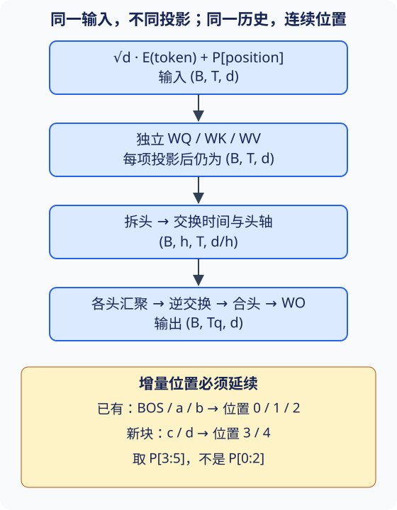

# 自注意力与位置编码：内容相同，位置不能丢

## 1. 先分清输入来源，再讨论头数

自注意力的“自”说的是Q、K、V来自**同一组输入表示**，不是说三个投影矩阵相等，也不是只关注自己。每个词元作为查询，在允许读取的所有位置中检索信息；输出仍有一个与该查询对应的向量。

| 机制 | Q来自哪里 | K/V来自哪里 | 输出长度 |
| --- | --- | --- | --- |
| 编码器自注意力 | 当前源表示 | 同一源表示 | 源长度 |
| 解码器自注意力 | 当前目标表示 | 允许的目标历史 | 查询目标长度 |
| 交叉注意力 | 解码器表示 | 编码器记忆 | 查询目标长度 |

用行向量约定，设输入$X$为$(B,T,d)$：

$$
Q=XW_Q,\quad K=XW_K,\quad V=XW_V
$$

$$
A=\operatorname{softmax}\left(QK^\top/\sqrt{d_h}+M\right)
$$

$$
H=AV
$$

softmax沿**键轴**归一化；$M$在允许位置为0、禁止位置为负无穷。评分决定“去哪里取”，V决定“取回什么”。Q/K/V数值相同只是一种特例。源序列完整可见也不意味着padding可见；目标端还有因果约束，下一讲分别展开。

## 2. 多头不是复制同一张注意力图

教材10.5是本讲所需补充：用不同可学习投影形成多个子空间，各头分别评分、汇聚，最后拼接并投影。不同头**可以**学习不同关系，但不能预先给头贴“语法头”“指代头”的标签，更不能仅凭热图证明这种解释。

令$h$为头数，$d_h=d/h$，本页采用$d$可被$h$整除的等宽头设计。一次大线性层与每头小线性层在参数排列对应时可以表示相同映射；直接把原始embedding切成几份却没有投影，不是教材实现。

图为依据10.5–10.6自主绘制的机制示意；不是课堂截图或实测权重。

| 步骤 | 形状（以Q为例） | 需要核对的含义 |
| --- | --- | --- |
| 输入 | $(B,T,d)$ | 每行是一个位置 |
| 线性投影 | $(B,T,d)$ | 输出通道包含所有头 |
| 拆头 | $(B,T,h,d_h)$ | 此时头轴仍在时间轴后 |
| 交换轴 | $(B,h,T,d_h)$ | 每个头拥有完整序列 |
| 评分 | $(B,h,T_q,T_k)$ | Q/K长度可不同 |
| 汇聚 | $(B,h,T_q,d_h)$ | V的长度必须匹配K |
| 逆交换、合头 | $(B,T_q,d)$ | 不得把时间轴拼进特征 |
| 输出投影 | $(B,T_q,d)$ | $W_O$混合各头信息 |

教材把$B,h$合成一轴以复用三维批量矩阵乘法；此时mask也必须按同一顺序扩展。若样本长度为`[3,2]`、每样本2头，顺序是`[3,3,2,2]`，不是`[3,2,3,2]`。后者形状一样但会让不同样本读取错误位置。

**有限纸面例**：$B=2,T_q=3,T_k=5,d=8,h=2$。每头宽4，评分张量是$(2,2,3,5)$，共60个分数；输出是$(2,3,8)$。同宽自注意力的四个无偏置$d\times d$投影共$4d^2=256$个参数，固定总宽$d$时不是再乘以头数。头数增加会增加显式注意力矩阵元素数，却不会按相同比例增加投影参数。

## 3. 为什么需要位置

没有位置编码、没有携带位置结构的mask，且其他操作逐位置共享时，自注意力对位置置换是**等变**的：把输入行重排，输出行相应重排。它不是把输出变成不变，也不意味着模型“完全不能利用任何顺序线索”；因果mask本身已经提供一种有向结构。

例如“狗追猫”和“猫追狗”的词元集合相同，但角色不同。仅凭内容匹配不足以明确描述“前一个”“后两个”。位置编码把“哪个词”和“处于哪里”放进同一个表示：教材Transformer使用$\sqrt d E(x_i)+P_i$，不是把位置当作目标标签，也不是把位置编号直接替代词嵌入。

正弦编码把每一对特征设为不同频率：

$$
\omega_j=10000^{-2j/d}
$$

$$
P_{i,2j}=\sin(i\omega_j),\qquad
P_{i,2j+1}=\cos(i\omega_j)
$$

这里位置从0开始，$j=0,\ldots,d/2-1$；本页限定偶数$d$。低编号特征变化快，高编号变化慢。二进制各位有不同翻转频率是帮助理解的类比，不表示正弦编码就是二进制存储，也不能把它当作有限精度下无限长位置都唯一可分的保证。

当$d=4$时，$P_0=(0,1,0,1)$，$P_1=(\sin1,\cos1,\sin0.01,\cos0.01)$。纸面近似为$(0.841471,0.540302,0.010000,0.999950)$；这些是数学预期，不是本页执行记录。

## 4. 相对位移为何能由线性变换表示

对固定偏移$\delta$，加角公式给出：

$$
\begin{bmatrix}P_{i+\delta,2j}\\P_{i+\delta,2j+1}\end{bmatrix}
=R_{\delta,j}
\begin{bmatrix}P_{i,2j}\\P_{i,2j+1}\end{bmatrix}
$$

$$
R_{\delta,j}=\begin{bmatrix}
\cos(\delta\omega_j)&\sin(\delta\omega_j)\\
-\sin(\delta\omega_j)&\cos(\delta\omega_j)
\end{bmatrix}
$$

关键是矩阵依赖$\delta,j$，**不依赖起点$i$**。这说明固定偏移有一致的线性表达，不保证训练后模型一定学会距离规则，也不保证超过训练长度仍能正确泛化。本页不把这种加法位置编码与旋转Q/K的其他架构混为一谈。

实现中位置表还需匹配device/dtype，并明确最大长度；若作为模型状态保留，应使用合适的buffer或可再生规则，不当作可训练词表。不要悄悄把超长位置截回0。

## 5. 训练与逐token生成必须使用同一位置

训练一次输入`BOS a b`，使用位置`0,1,2`；逐token推理依次输入`BOS`、预测的`a`、预测的`b`，也必须使用`0,1,2`。已有缓存长度为$p$，新块长度为$m$，应取$P[p:p+m]$，而非每次都从$P[0]$开始。

固定教材10.6的`forward`只按本次输入长度截取位置表；它本身没有增量offset参数。配合10.7逐token调用时，工程实现必须显式处理偏移，不能因为已缓存历史表示就认为当前位置自动正确。offset属于候选状态；重排beam时，历史、位置计数和每层缓存必须一致。整段与分块位置相同只是必要条件，还要让mask、归一化与dropout模式一致，见[下一讲](#/c/d2l-pytorch-2021/lec/lec68?v=notes)。

## 6. 路径短与运行快不是同一结论

| 架构 | 典型单层算术量 | 沿序列的顺序依赖 | 远位置如何连接 |
| --- | --- | --- | --- |
| 普通核宽$k$卷积 | $O(kTd^2)$ | 单层位置可并行 | 多层扩大感受野 |
| 普通RNN | $O(Td^2)$ | $O(T)$步 | 沿状态链传播 |
| 注意力汇聚 | $O(T^2d)$ | 已知输入可并行 | 一层直接检索 |

注意力这一行只计评分和汇聚；完整多头层还要加$O(Td^2)$投影，FFN另计。普通局部卷积建立全长依赖约需$O(T/k)$级路径；膨胀卷积等变体不在这张粗略比较中。自回归**生成**仍逐步等待自己前一个输出，不因训练并行而一次知道整个目标。

显式存储分数需要$BhT^2$个元素。$B=2,h=2,T=4$时为64个，若float32仅这一张矩阵是256字节；$T$翻倍则为256个、1024字节。这里不计梯度、投影、softmax副本、激活与allocator开销，也不代表融合attention内核必须物化该矩阵。吞吐、峰值显存和延迟必须另做明确硬件、实现、批大小与同步方式的基准，不能从大O或小模型CPU运行直接宣称GPU加速。

## 7. 自测：先画轴，再写操作

1. Q/K/V来自同一序列，为何可以数值不同？**提示**：区分输入来源与可学习投影。
2. $B=2,h=2$时为什么长度不能循环重复？**核对点**：先列出合并轴的四个“样本—头”身份。
3. 把所有输入词的顺序调换，输出应不变还是相应调换？**核对点**：本节结论是等变，需同时排除位置编码和位置mask。
4. 缓存已有3个位置，新输入2个位置，该取位置表哪段？**核对点**：从3开始，末端不包含5；不要重置。
5. 头数翻倍、总宽不变，四个投影参数会翻倍吗？**核对点**：算$4d^2$，再单独算分数矩阵大小。
6. 用同一$R_{\delta,j}$分别移动两个起点，结果应满足什么？**提示**：检查加角公式，不需要先训练模型。

以上是概念核对与局部提示，不是Transformer实验完整实现或完整学生答案。

## 来源、范围与缺口

- 教材作者张阿斯顿、李沐、扎卡里·C.立顿、亚历山大·J.斯莫拉；[10.6固定源码](https://github.com/d2l-ai/d2l-zh/blob/e6b18ccea71451a55fcd861d7b96fddf2587b09a/chapter_attention-mechanisms/self-attention-and-positional-encoding.md)已读1–208、246–382行；[10.5补充](https://github.com/d2l-ai/d2l-zh/blob/e6b18ccea71451a55fcd861d7b96fddf2587b09a/chapter_attention-mechanisms/multihead-attention.md)已读1–208、275–345、400–440行。当前中文第二版固定提交，不是2021快照；未把教材引用论文冒称已读原论文。
- [官方2021课表](https://courses.d2l.ai/zh-v2/)row093日期为2021-08-14。多头注意力没有独立课表阅读行，本页补习不增造讲次。源码根[Apache-2.0](https://github.com/d2l-ai/d2l-zh/blob/e6b18ccea71451a55fcd861d7b96fddf2587b09a/LICENSE)与setup.py的MIT-0分别记账；不外推到视频、数据或第三方素材。本文/SVG为自主讲解，不重复翻译教材。
- offset、有限算例及机制不变量是编者工程补充。主agent有限CPU核对见`sources/p10-shared/notes-smoke.json`；真实训练、恢复与缓存证据见[Transformer实验](#/c/d2l-pytorch-2021/lab/transformer?v=guide)，不外推GPU性能或全部学生实现。

### 视频分P覆盖表

| P | 原站标题 | 本P完整范围 | 秒 |
| --- | --- | --- | --- |
| 1 | 自注意力 | 00:00–27:52 | 1672 |
| 2 | 代码 | 00:00–02:57 | 177 |
| 3 | QA | 00:00–06:55 | 415 |

BV19o4y1m7mo，作者“跟李沐学AI”（mid1567748478），2021年上传；全3P合计2264秒（37:44）。精确发布时间、cid、获取日期与每P一次字幕查询见`sources/p10-lec67/video-metadata.json`。各P公开字幕列表为空，不排除烧录字幕。未审阅音视频，不编片内主题时间码、演示、QA；中文原课通过页头观看，本课不另作课堂逐段整理。copyright=1、no_reprint=1不是开放转录许可；materials不重复制作中文教材译文。原站入口只保留页头。
