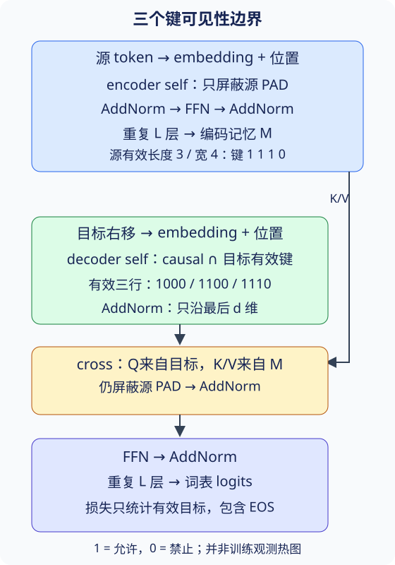
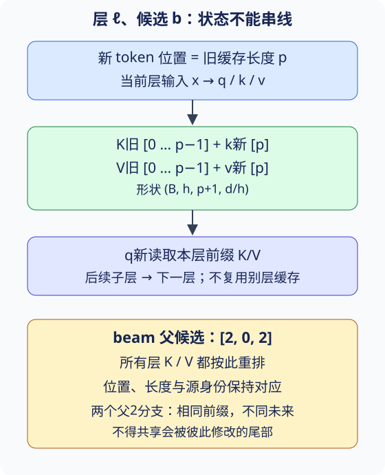

# Transformer：三道信息边界与两种解码路径

## 1. 先沿数据走一遍网络

翻译模型读入完整源句，生成尚未知晓的目标句。Transformer用多头注意力替代循环状态链，但没有取消条件概率分解：预测每个目标时，只能依赖源与已经获得的目标历史。

源token先做embedding、乘$\sqrt d$、加位置编码，再经过若干编码器块得到记忆$M$。目标训练输入右移：目标是`a b EOS`，解码输入是`BOS a b`。每个位置输出词表logits，分别预测`a`、`b`、`EOS`；并行训练不等于能看当前标签。



图为依据教材10.7自主重绘的逻辑图。箭头表示信息来源，矩阵表示允许读取的键，不是实际训练attention热图。

| 子层 | 查询Q | 键K、值V | 子层输出 |
| --- | --- | --- | --- |
| 编码器self-attention | 本层源输入 | 本层源输入 | $(B,T_s,d)$ |
| 解码器self-attention | 本层目标输入 | 本层目标输入或其历史缓存 | $(B,T_t,d)$ |
| 解码器cross-attention | 自注意力后的目标表示 | 最终编码器记忆 | $(B,T_t,d)$ |
| positionwise FFN | 每个位置独立的向量 | 不再检索序列 | 保持相同位置数和$d$ |

每个注意力子层都有自己的Q/K/V/O参数，各层也有独立参数；“相同的层结构”不等于“共享同一组权重”。交叉注意力的Q是当前块self-attention及AddNorm之后的表示，不能只看宏观示意就误接成原始embedding。

## 2. 残差、LayerNorm与FFN分别做什么

教材使用**post-LN**：子层先计算，再dropout，再与残差相加，最后归一化。对任一子层$F$：

$$
Y=\operatorname{LN}(X+\operatorname{Dropout}(F(X)))
$$

残差加法要求两项都为$(B,T,d)$；它不是concat。它提供一条绕过复杂变换的路径，但并不意味着深层网络自动易训练。不同的pre-LN顺序属于另一种设计，不能加载同形状参数后就认为两种计算等价。

本实验应对**每个token的最后$d$个特征**做LayerNorm。设某位置向量为$x$：

$$
\mu=\frac1d\sum_r x_r,\qquad
\sigma^2=\frac1d\sum_r(x_r-\mu)^2
$$

$$
\operatorname{LN}(x)_r=
\gamma_r\frac{x_r-\mu}{\sqrt{\sigma^2+\epsilon}}+\beta_r
$$

不跨batch，也不跨时间求均值方差，所以不会通过统计量把未来词混入早期位置。教材若干形状演示用`LayerNorm([T,d])`，真实训练段则用`[32]`；不能照抄演示的`[T,d]`到自回归模型，否则即使注意力mask正确，归一化仍可能泄漏未来信息，并固定时间长度。

FFN对每个位置使用同一个两层MLP：

$$
\operatorname{FFN}(x)=\operatorname{ReLU}(xW_1+b_1)W_2+b_2
$$

$W_1$把$d$扩到$d_{ff}$，$W_2$投回$d$。它混合特征，不直接混合不同位置；跨位置通信由attention负责。纸面例$d=8,d_{ff}=16$时，FFN含偏置参数数为$8\times16+16+16\times8+8=280$；每个LayerNorm有$2d=16$个可学习参数。不能把中间扩维输出直接加回$d$维残差。

## 3. 三种mask，不能只写一个“三角形”

以下统一约定`allow=True`表示可读；调用实际API时必须核对它的布尔语义，不能把不同API的True含义直接互换。索引从0开始，$\ell_s$为源有效长度，$\ell_{in}$为右移后目标输入的有效长度。

| 注意力 | 对键$j$的可见条件 | 防止什么 |
| --- | --- | --- |
| encoder self | $j<\ell_s$ | padding污染源记忆 |
| decoder self | $j\le i$且$j<\ell_{in}$ | 未来目标与目标padding泄漏 |
| decoder cross | $j<\ell_s$ | 从编码器padding取信息 |

源句完整已知，encoder不需要目标式causal mask；cross-attention的键轴是**源长度**，不能拿目标长度裁它。目标端causal mask和padding mask要相交，不是相加两个布尔值当作概率。分数先mask再softmax，禁止位置的权重应为0。

**一个有限例**：源宽4、有效长度3；目标输入宽4、有效长度3。任意有效源query及cross-query允许的源键均为`[1,1,1,0]`。decoder self的有效前三行是：

```text
位置0: 1 0 0 0
位置1: 1 1 0 0
位置2: 1 1 1 0
```

目标第3行是无效query，不计损失；不必把它整行mask为负无穷后交给普通softmax。全屏蔽行可能产生NaN，应有明确策略：只计算有效query，或保留安全可读键并在输出/损失端剔除无效query。键mask不保证padding query的输出为0；这是两个独立概念。

源EOS计入有效长度，PAD不计。输入中若embedding的PAD为0，也不能省mask：位置编码、偏置及后续变换都可能令padding表示非零。每层必须保持同一可见性边界，不能只在第一层屏蔽。

## 4. 未来不可干扰是端到端性质

固定源与目标输入前缀，改变位置$k$及其之后的输入token，则所有$i<k$的logits应保持一致。若直接改变真实标签$y_k$，右移输入后影响从下一位置开始：测试时先写明索引对应，避免把正确变化误判为泄漏。

检查应在eval、dropout关闭、固定参数时比较完整网络，不仅检查attention分数。失败可能来自mask轴错位、跨时间LayerNorm、位置错位、缓存串样本，或偷偷把真实长度传进推理。先定位首个出现差异的层，再定位子层；不要通过放宽容差掩盖语义错误。

推理入口只接受源及源长度、模型/词表、解码配置和上限。第一个输入BOS，之后使用自己的预测；预测EOS停止，未遇EOS达到上限则标记未完成。真实目标及其长度只能在生成结束后交给评测器，不能决定停止位置。

## 5. 缓存的对象必须说清楚

最容易混淆的是“历史层输入”和“已经投影的K/V”。固定教材10.7保存的是各解码块的历史输入表示`X`，随后仍把拼接历史送入注意力投影；它不是完整的projected KV cache。源码注释称其为块的输出，但赋值对象在块运算之前，阅读时应以数据流为准。

工程上，层$\ell$的当前输入$x_t^{(\ell)}$产生：

$$
q_t^{(\ell)}=x_t^{(\ell)}W_Q^{(\ell)}
$$

$$
k_t^{(\ell)}=x_t^{(\ell)}W_K^{(\ell)},\qquad
v_t^{(\ell)}=x_t^{(\ell)}W_V^{(\ell)}
$$

每步只把新$k_t,v_t$追加到这一层的缓存，当前query读取前缀全部K/V。缓存形状可约定为$(B,h,t,d_h)$；每个层、每个候选都有独立历史，不能只缓存最顶层，也不能用一份KV供所有层复用。

交叉注意力的K/V来自不变的编码器记忆，但投影参数随解码层不同，因此可**每层预投影一次**；多个候选可以共享同一源的只读记忆，必须维护正确的源身份映射。self-KV依赖候选自己的生成历史，不能随意共享可变尾部。



图是状态合同，不是完整实现。beam从旧父候选`[2,0,2]`产生三个子候选时，每层K、V和位置/长度都要按这个父序列取值；两次来自父2的子分支以后追加不同词，不能互相污染。新句子必须清空旧缓存，已结束候选不得继续增长。

## 6. 全前缀与增量为何应一致

比较的是**同一组参数、同一个给定前缀、同一位置编码和同一mask语义**，不是比较teacher forcing与已经走偏的自由生成路径。

- 全前缀路径：每次从BOS开始重算已知前缀，仍启用causal mask，取最后一位置logits。
- 增量路径：只送最新token，位置offset等于旧缓存的有效长度，各层只追加新投影K/V。
- 对照：每一步的logits及对应层缓存内容应在预先约定的浮点容差内一致；另核对长度每步恰加1。

若一次追加$m>1$个token，旧缓存长$p$，新块中第$r$个query只能读键$j\le p+r$，不是因为“推理模式”就能读整个新块。单token追加时历史加当前天然不含未来，才可省去显式三角矩阵；padding仍需处理。

教材把causal mask绑定`self.training`，eval下默认不生成它；这适合其单步调用假设，却不能直接用于eval全前缀对照。教材位置编码也没有offset参数。本站实验需要显式mask与位置合同，而不是声称原helper天然保证两条路径等价。关闭dropout还不够，LN必须只沿特征轴。

## 7. 从训练目标到真实小实验

完整训练需先冻结语料身份、划分、词表、特殊ID与长度规则，再构造源mask、右移目标及loss mask。有效目标含EOS不含PAD，累计负对数似然后按有效token总数归一化：

$$
\mathcal L=\frac{\sum_{b,t}m_{bt}\,\operatorname{CE}(z_{bt},y_{bt})}{\sum_{b,t}m_{bt}}
$$

不同batch的平均loss不能未经token数加权再平均。训练loss下降不等于翻译正确；固定验证集、生成策略和BLEU口径，不能挑几个好译文当测试成绩。attention图只能从实际日志绘制，必须注明层、头、query/key词元、是否教师强制和padding范围；三角形只是mask的结构，不是模型学会翻译的证据。

[Transformer实验](#/c/d2l-pytorch-2021/lab/transformer?v=guide)保留四任务：组件、mask、小翻译模型训练及恢复、训练/增量对比与成本。恢复训练至少记录模型、优化器、步数/配置、词表与划分身份及所需RNG/采样状态；在明确batch边界对比下一更新。只加载权重后能推理不等于恢复训练。教材训练配置不自动成为本站实测；真实运行与许可边界由实验来源单独记账。

## 8. 缓存省什么，不省什么

令目标长度为$T$，源长为$S$，总宽$d$，层数$L$。只比较decoder self-attention的朴素计算：

| 生成策略 | 整段生成的self评分/汇聚 | self投影 | 额外历史状态 |
| --- | --- | --- | --- |
| 每步全前缀重算 | $O(LT^3d)$ | $O(LT^2d^2)$ | 不持久保留KV |
| 逐步projected KV | $O(LT^2d)$ | $O(LTd^2)$ | $O(LBTd)$ |

缓存没有消除当前query读取增长历史的成本，也没有让生成脱离串行依赖。cross-KV预投影可把重复源投影变成一次$O(LBSd^2)$，仍要每步做目标到源的检索。FFN、输出词表投影、源编码与数据搬运另计。每步`cat`复制完整缓存还会带来额外搬运；算术复杂度不是完整系统成本。

纸面内存例：$L=2,B=1,h=2,d_h=4,T=5$，只算self-K和self-V，共$2LBhTd_h=160$个float32元素，即640字节。beam宽3且完全复制会变成1920字节；不包括cross-KV、参数、激活和allocator。训练时朴素显式分数矩阵按$BhT^2$增长，长度翻倍元素数四倍；融合内核可能避免物化完整矩阵，因此这不是实测显存结论。CPU小运行也不能代替GPU吞吐/延迟基准。

## 9. 自测与局部核对

1. 为什么FFN中间维度可以变化，残差输出却不能？**提示**：区分内部扩维与子层边界。
2. attention全是下三角，仍会泄漏未来吗？**核对点**：检查LN是否跨时间、训练输入是否正确右移。
3. cross-attention该用源长度还是目标长度？**提示**：先画清键轴身份。
4. 缓存历史`X`与缓存投影K/V节省的运算相同吗？**核对点**：找出旧token是否重复经过$W_K,W_V$。
5. 前缀长3，追加2词，第二个新query可看几个键？**核对点**：包含当前位置，总共5个；第一个只能4个。
6. beam父索引重复时，为何缓存数值相同还要防止共享可变尾部？**提示**：下一步两条分支可能输入不同词。
7. 全前缀与增量logits相同，是否证明模型翻译正确或速度更快？**核对点**：机制、质量、硬件性能分别需要证据。

这些问题只给边界与诊断方向，不提供四任务的完整学生答案。

## 来源、范围与缺口

- 教材作者张阿斯顿、李沐、扎卡里·C.立顿、亚历山大·J.斯莫拉；[固定10.7源码](https://github.com/d2l-ai/d2l-zh/blob/e6b18ccea71451a55fcd861d7b96fddf2587b09a/chapter_attention-mechanisms/transformer.md)已读模型1–19、FFN75–89、LN150–156/210–222、encoder295–315/417–447、decoder543–547/596–643/806–844、训练919–959、推理1003–1014、图1027–1037/1112–1159；精确工具展示范围与SHA256见source-index。当前中文第二版固定提交，不是2021快照；10.5/10.6补充已在上一讲核读。
- [官方课表](https://courses.d2l.ai/zh-v2/)row094日期2021-08-14；本页自主教材导读与SVG，不冒充课堂讲义、问答或截图。仓库根[Apache-2.0](https://github.com/d2l-ai/d2l-zh/blob/e6b18ccea71451a55fcd861d7b96fddf2587b09a/LICENSE)与setup.py的MIT-0分别记录，不外推视频、数据与权重；未另设必读论文。
- 目标padding、显式causal mask、位置offset、projected KV、候选重排与等价性是编者工程合同；原教材实现差异已单列。有限算例见`sources/p10-shared/notes-smoke.json`，真实小模型的缓存与恢复见配套实验。无GPU基准，不称工业Transformer复现；历史竞赛与课堂访问缺口独立保留。

### 视频分P覆盖表

| P | 原站标题 | 本P完整范围 | 秒 |
| --- | --- | --- | --- |
| 1 | Transformer | 00:00–21:04 | 1264 |
| 2 | 多头注意力代码 | 00:00–05:01 | 301 |
| 3 | Transformer代码 | 00:00–19:49 | 1189 |
| 4 | QA | 00:00–05:59 | 359 |

BV1Kq4y1H7FL，作者“跟李沐学AI”（mid1567748478），2021年上传；全4P合计3113秒（51:53）。精确时间戳、cid及每P一次字幕响应见`sources/p10-lec68/video-metadata.json`。公开字幕列表为空，不代表无烧录字幕；未审阅媒体，无可靠课堂内容和开放转录许可，不编片内时间码、QA或draft。copyright=1、no_reprint=1不授权全文再利用；materials不重复翻译中文教材。原站只用页头入口。
