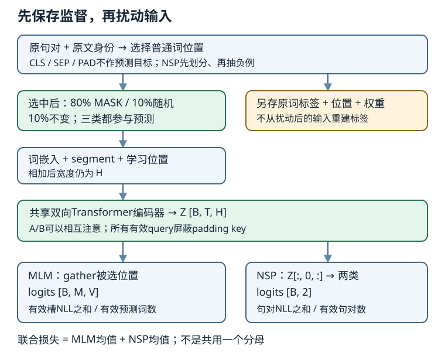

# BERT预训练：双向表示、样本构造与两种损失

## 1. 同一个词，为什么需要不同的表示

静态词向量把词表中的一个词映射到固定向量；上下文表示还读取它所在的句子。同一个“bank”出现在存钱和河岸语境中，输入词ID可相同，编码输出却可以不同。**向量不同只证明依赖上下文，不足以证明模型理解词义。**

教材先比较ELMo、GPT与BERT：ELMo把双向语言模型的表示用作下游特征；GPT以因果语言模型预训练，再微调；BERT用Transformer编码器读取左右上下文，采用MLM与NSP预训练，再接任务头。这里的历史对比不是给所有后续模型下定义。

| 机制 | 因果语言模型 | 本讲BERT |
| --- | --- | --- |
| 位置$i$的可见范围 | 当前输入位置及左侧历史 | 整个输入中的有效位置 |
| 典型训练目标 | 预测下一个词元 | 恢复选中的原词、判断句子是否相邻 |
| padding | 不能作有效key/value | 同样不能作有效key/value |
| 右侧词变化 | 不应改变较早位置输出 | 可以改变较早位置输出 |
| 直接生成长文本 | 与自回归接口匹配 | 不能把MLM直接冒充自回归生成器 |

双向不是两个单向输出简单拼接，也不是“两个句子互相看不到”。BERT句对中的A、B通常可以相互注意；segment标识句子身份，不是注意力隔离墙。

## 2. 三种嵌入相加，长度不变

单句打包为`<cls> A <sep>`；句对为`<cls> A <sep> B <sep>`。教材实际标记是小写尖括号形式，不应擅自用另一词表的`[CLS]`数值ID代替。

$$
\begin{aligned}
X_{b,i}&=E_{\mathrm{token}}[t_{b,i}]\\
&\quad+E_{\mathrm{segment}}[s_{b,i}]\\
&\quad+E_{\mathrm{position}}[i]
\end{aligned}
$$

三个向量都宽$H$，**相加而不是拼接**，得到$X\in\mathbb R^{B\times T\times H}$。BERT这里使用可学习位置嵌入；不能照搬LEC67正弦位置表，并假定任意长位置可用。

自拟句对`A=[we,read]`、`B=[books]`右补到8：

| 项目 | 内容 |
| --- | --- |
| token | `<cls> we read <sep> books <sep> <pad> <pad>` |
| segment | `0 0 0 0 1 1 0 0` |
| 有效长度 | 6，包含CLS与两个SEP，不含PAD |
| 编码输出 | 若$B=2,H=16$，形状为$2\times8\times16$ |
| 注意力分数 | 若4头，每头宽4，形状为$2\times4\times8\times8$ |

所有有效query都必须看不到最后两个padding key。padding query输出不保证为零；下游不得把它当有效token参与损失或池化。只把PAD的segment设成0不会屏蔽它。

图为依据14.8–14.10自拟重绘；位置、词和颜色仅用于解释数据依赖，不是课堂截图、真实attention或训练观测。

## 3. MLM先选位置，再决定输入怎样替换

必须分别保存三件事：**原词标签、选中位置、被扰动的输入**。不能改完输入后再从输入抄标签，也不能通过查找`<mask>`来反推监督集合——有些被选位置并不会变成MASK。

1. 先在未padding的文本中确定普通词元候选位置。CLS、SEP、PAD及人工插入的控制标记都不作为预测目标；UNK是否可选应写入具体词表合同。
2. 约选15%的候选位置，通常无放回；短句要固定取整和最少数量规则。没有候选词的样本应显式跳过或拒绝，不以CLS凑数。
3. **对已选中的每个位置**：80%换成MASK，10%换随机词，10%保持原词；三种情况都预测原词。
4. 用位置索引从编码结果取出$H$维表示，送进共享MLM头，输出词表上的logits。

这里80/10/10是条件概率，不是整句比例，更不是每个小batch必须精确凑齐比例。若选择率恰为15%，对应全部普通词的期望比例是12%、1.5%、1.5%；小样本随机计数不能用于断言实现错误。随机替换可能抽中原词，这不改变它所属的随机分支。

**固定教材与严谨小实验的差别。** 教材14.9的候选循环排除CLS/SEP，调用时尚未补PAD；但选择数使用`round(len(tokens)*0.15)`，这里长度包含特殊符号，不严格等于普通候选数的15%。随机替换从整个`vocab.idx_to_token`抽取，可能抽到特殊ID。自行实现若改用普通候选数、排除控制ID的随机池，应明确记为工程约定，不能声称原代码就是如此。教材在Dataset初始化时生成遮蔽，重复epoch不自动重新抽样；动态遮蔽是另一个需要记录随机种子与状态的选择。

### gather后的形状与填充槽

设$B=2,T=8,H=16,V=11$，每个样本为MLM预留$M=3$个槽：

| 张量 | 形状 | 含义 |
| --- | --- | --- |
| `pred_positions` | $2\times3$ | 每个样本内部的位置索引，不是词ID |
| gather结果 | $2\times3\times16$ | 选中位置的编码表示 |
| MLM logits | $2\times3\times11$ | 每个预测槽的词表分数 |
| 标签与权重 | 各$2\times3$ | 原词ID；有效槽1、补齐槽0 |

若第二个样本只有一个有效预测，可以把另两个位置槽填0，但**它们不是要求预测CLS**；权重必须为0。输入序列padding与MLM预测槽padding是两种不同的填充。

## 4. NSP是相邻性任务，不是三分类逻辑推理

正例来自同一段落的真实相邻句`(A_i,A_{i+1})`；负例用另一句替换第二句。教材以约一半概率选择正例，其布尔标签转为整数：`True=1`表示相邻、`False=0`表示随机负例。不要套用其他实现中可能相反的0/1映射。

NSP只预测“是不是原来的下一句”，不生成下一句，也不判断蕴涵、矛盾、中性。自然语言中两句逻辑相容，不保证它们在文档中相邻。

**身份比文字相似度更先要查。** 教材`random.choice(random.choice(paragraphs))`没有排除重新抽到真实后继，且先等概率抽段落、再抽其中一句，并非在所有句子上均匀采样。面向可审计小实验，应保存文档/段落/句子ID，先按文档或明确的组划分train/val/test，再仅在本划分内抽负例，排除当前句与真后继身份；若另加同文本排除或强制不同文档，也须记录。不能先生成句对后随意拆散，导致相同原文跨训练与验证。

输入包含句对，最后取`encoded[:,0,:]`经过hidden/tanh与二分类头，得到$B\times2$。**0是CLS的序列位置，不意味着CLS词表ID为0。** 教材14.8的独立NSP形状演示曾flatten整个编码张量；最终`BERTModel.forward`才是CLS路径，复用时以完整模型语义为准。

## 5. 两个任务，各自除以自己的分母

令预测槽的交叉熵为$\ell_{bm}$，有效槽权重为$w_{bm}$。本页采用有效预测词元平均：

$$
N_{\mathrm{MLM}}=\sum_{b,m}w_{bm}
$$

$$
L_{\mathrm{MLM}}=
\frac{\sum_{b,m}w_{bm}\ell_{bm}}{N_{\mathrm{MLM}}}
$$

NSP的分母是有效句对数量$B$，不是序列宽度、MLM槽数或词表大小：

$$
L_{\mathrm{NSP}}=\frac1B\sum_b\ell_b^{\mathrm{NSP}}
$$

$$
L=L_{\mathrm{MLM}}+L_{\mathrm{NSP}}
$$

这里要求$N_{\mathrm{MLM}}>0$；不能用微小常数把无有效监督悄悄包装成一次正常MLM训练。多batch评估应分别累计各任务的损失和与计数，最后相除，而不是平均每batch的mean。

手算诊断：预测槽NLL为`[[2,4,99],[6,99,99]]`，权重为`[[1,1,0],[1,0,0]]`，则MLM为$(2+4+6)/3=4$。NSP两对NLL为`[0.2,0.8]`，均值为0.5，总损失4.5。这是自拟算术例，不是模型训练输出；99所在槽的logits梯度应为0，但编码器可通过其他有效位置的上下文依赖收到梯度。

### 阅读PyTorch实现时的两个警报

- 固定14.10源码把默认`CrossEntropyLoss()`的标量mean乘上MLM权重：被补齐的标签已进入mean，事后乘权重无法剔除。应先获得逐槽损失，再与**同形状**权重相乘。仅改成`reduction='none'`却保留`(-1,1)`权重，会把一维损失广播成矩阵，仍然错误。
- 固定14.8的PyTorch编码器在forward取`pos_embedding.data`，会切断这条位置参数的autograd路径。要训练可学习位置，直接切片Parameter而非`.data`。这是源码静态审读发现，不声称本页已经执行反向验证。

## 6. 从数据管道到有边界的预训练

教材14.9选择WikiText-2演示，不是原始BERT的大规模图书语料加英文维基百科全量。原数据保留大小写等信息，不等于教材预处理保留：helper读取训练文件、转小写、按`' . '`切句、保留至少两句的段落；空白分词并以最小词频5构建词表。这个方案**不是WordPiece**，也不是可靠通用句子分割器。

管道顺序应能复述为：核准语料身份与条件 → 固定划分 → 训练集词表或固定checkpoint词表 → 句对与身份标签 → MLM位置/标签/扰动 → 打包与padding → 两头前向 → 各自归约 → 一次联合反传与更新。教材预训练helper对超过最大长度的句对跳过；LEC70微调helper则截断较长一侧，二者不能混为一种策略。

14.10教学小模型为2层、$H=128$、2头、FFN宽256，示例最大输入长64、batch512、训练50步。这些是**教材配置，不是本站运行记录**；其模型与LEC70下载的256维`bert.small`不能直接互换。更不能把一次随机初始化前向称为预训练迁移，或把短时CPU检查称为工业BERT复现/GPU基准。

输出编码可用于单句、句对或某个词元。比较上下文时应关闭dropout并使用同一模型/分词；否则随机性也会造成向量变化。保存供下游加载的checkpoint至少需要权重、精确词表顺序、特殊ID、模型config、预处理与来源身份；要续训还要优化器、步数和随机状态，而不只是权重文件。

## 7. 自测与简答

1. **只对输入等于MASK的位置算loss够吗？** 不够。随机替换与保持原词的选中位置也有监督，应由保存的选中集合决定。
2. **15%的位置中再有10%不变，相当于什么？** 在选择比例恰为15%的前提下，全部普通词期望1.5%被选中但保持原样；仍然算MLM损失。
3. **padding的segment是0，所以安全了吗？** 没有。必须屏蔽padding key；预测槽也须单独用权重排除。
4. **负例句来自验证集，但不使用验证标签，可以吗？** 不可以。验证文本已参与预训练训练样本；划分与抽样边界都要先固定。
5. **MLM比NSP数值大说明训练不平衡吗？** 不能直接推断。二者类别数、难度及分母不同；先排查归约，再判断是否需要有依据的权重。
6. **换掉右侧有效词，左侧BERT表示必须不变吗？** 相反，双向机制允许改变。应保持不变的是被mask的padding身份变化，不是合法右上下文。
7. **模型能返回编码向量，是否说明已完成预训练？** 不是。需要真实训练/已加载checkpoint身份及日志；结构可运行只是机制证据。

## 来源、版本与观看边界

- 《动手学深度学习》中文第二版，阿斯顿·张、李沐、扎卡里·C.立顿、亚历山大·J.斯莫拉，固定源码提交`e6b18cce…b09a`：课表指定[14.8 BERT](https://zh.d2l.ai/chapter_natural-language-processing-pretraining/bert.html)、[14.9 预训练数据](https://zh.d2l.ai/chapter_natural-language-processing-pretraining/bert-dataset.html)、[14.10 预训练](https://zh.d2l.ai/chapter_natural-language-processing-pretraining/bert-pretraining.html)。固定原件实际全文审读582、448、372行；完整提交、原始URL与SHA256见`sources/p10-lec69/source-index.json`。这是当前固定第二版，不是2021课堂源码快照；网页构建不保证与固定提交逐字相同。
- [官方2021课表](https://courses.d2l.ai/zh-v2/)row095–097日期为2021-08-15，保留BERT结构、数据、预训练全部三主题。课表链接p2/p3不能冒充现有视频分P标题或片内时间线。
- 数据、权重、词表/config的分别核验及运行证据集中在[BERT实验指导](#/c/d2l-pytorch-2021/lab/bert-pretrain-finetune?v=guide)与`sources/p10-bert-pretrain-finetune/`；本讲不重复下载语料，不把教材URL、根Apache-2.0或setup包MIT-0字段当作第三方许可，也不要求额外论文或分词库。

| 当前官方分P | 元数据标题 | 时长 |
| --- | --- | --- |
| P1 | BERT | 21:51 |
| P2 | BERT代码 | 11:37 |
| P3 | BERT预训练数据代码 | 08:15 |
| P4 | BERT预训练代码 | 09:37 |
| P5 | QA | 05:54 |

全5P合计3434秒（57:14），BV1yU4y1E7Ns，作者“跟李沐学AI”（mid1567748478），发布时间戳1629247002（2021年），与课表日期分开记录。2026-11-14每个cid公开字幕接口只查询一次，均HTTP412，**不是成功返回空字幕列表**，字幕有无未知；也不排除烧录字幕。未下载/审阅音视频，不编问答内容、演示、全片分块时间码或draft；materials不重复翻译中文教材。copyright=1、no_reprint=1不是开放转录授权。页头仅保留原站入口。
