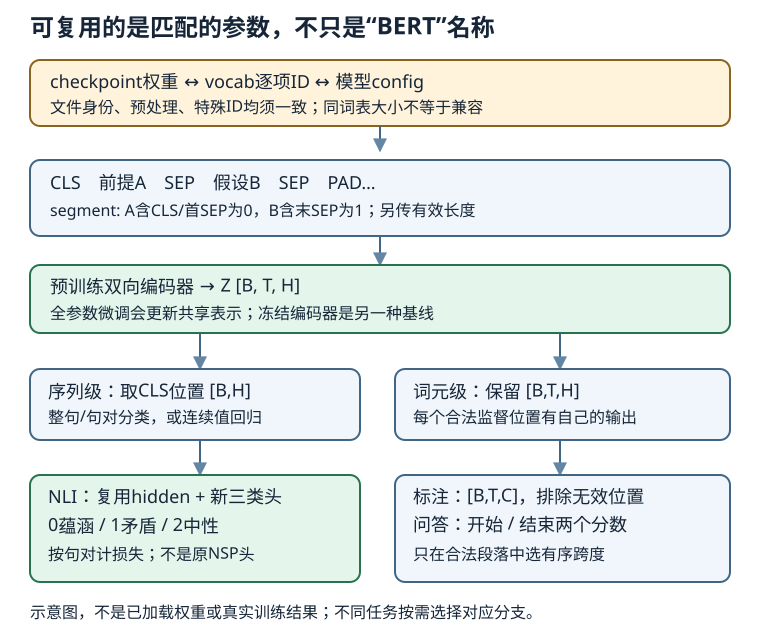

# BERT微调：任务头、SNLI与真正的参数迁移

## 1. 保留编码器，改变监督出口

预训练让编码器学习一种可复用的参数初始化；微调让下游有标签数据改变这些参数，使表示适合具体任务。不是把MLM预测词表换个名字，也不是只要类名叫BERT就算用过预训练。

设编码器输出为$Z\in\mathbb R^{B\times T\times H}$。任务决定从哪个维度取监督、最后一层宽多少、哪些位置参与损失。

| 任务 | 读取表示 | 输出形状 | 监督对象 |
| --- | --- | --- | --- |
| 单句分类 | $Z_{:,0,:}$，CLS位置 | $B\times C$ | 每句一个类别 |
| 句对分类，如NLI | 同一个打包句对的CLS | $B\times3$ | 每对一个逻辑关系 |
| 句对回归，如相似度 | 句对CLS | $B\times1$ | 连续分值，非类别ID |
| 词元标注，如实体/词性 | 每个有效词元表示 | $B\times T\times C$ | 每个有效标注位置 |
| 抽取式问答 | 问题与段落共同编码 | 两组$B\times T$ | 答案起止位置 |

CLS表示经过双向注意力可以汇聚两句，但它不是保证语义正确的魔法池化。词元任务不能把所有标签硬塞给一个CLS向量；反过来，NLI也不应把句对标签复制到每个token后当成词元分类。



图依据15.6、15.7独立绘制。箭头表示依赖关系，不是实际checkpoint执行记录；不同任务头是可选任务，不要求一个实验同时训练所有头。

## 2. 四类应用不应删成只有分类

### 单文本与文本对

单句用`<cls> A <sep>`；句对用`<cls> A <sep> B <sep>`。分类输出logits后交叉熵内部完成log-softmax，不要先softmax再传给以logits为输入的CE。

句对回归输出一个连续量，可采用均方误差。即使标签取值落在0至5，也不能未经定义便变成六分类。NLI中的前提/假设通常有方向；语义相似度是否对称由任务决定，不应从BERT结构推断。

### 词元标注

同一线性头作用于各位置，得到$C$类logits；PAD、CLS、SEP等非监督位置从loss与指标中排除。若采用子词分词，必须定义词标签如何对齐到子词，例如只监督首子词；不能随手重复标签后仍声称按原词计数。本文教材小模型采用空白词元，不能悄悄换成WordPiece而继续加载旧词表。

### 抽取式问答

输入通常为问题A、段落B，两组线性分数分别预测开始和结束。起点、终点分布应限定在合法段落词元，不能选PAD、问题词或SEP。给定真实起止$(i^*,j^*)$：

$$
L_{\mathrm{QA}}=-\log p_{i^*}^{\mathrm{start}}
-\log p_{j^*}^{\mathrm{end}}
$$

解码应选合法的$i\le j$，需要时再约束答案最大长；不能独立argmax后接受反向区间。自拟候选分数：起点`[1,4,2]`、终点`[5,1,3]`，独立最优会给$(2,1)$这个非法跨度；联合合法最大值为$(2,3)$，分数7。这里位置从1开始，仅指三个合法段落词，不是模型输出记录。抽取已有片段不等于自回归生成答案；SQuAD v1.1式任务也不能不加约定就处理“无答案”。

## 3. NLI：前提支持什么，而不是猜常识

自然语言推断输入前提$p$与假设$h$，输出三类关系。教材15.4的映射为：

| ID | 英文 | 中文与判据 |
| --- | --- | --- |
| 0 | entailment | 蕴涵：由前提可推出假设 |
| 1 | contradiction | 矛盾：由前提可推出假设的否定 |
| 2 | neutral | 中性：前提不足以确定假设真或假 |

自拟前提“盒里恰有两颗球，且两颗都是红色”：假设“盒里有球”是蕴涵；“盒里没有球”是矛盾；“盒子是木制的”是中性。**不能推出不是矛盾**；“中性”也不等于两句没有任何共同词。

NLI不同于LEC69 NSP：NSP的标签来自文本相邻性，NLI来自人标逻辑关系，类别数与映射均不同。把预训练二分类NSP头继续当三分类输出，不是微调。

SNLI是英语句对数据。教材读取官方train/test文件、去掉解析括号并规范空白，保留已定义三类的行；不在映射中的标签（如`-`）应过滤并记录数量，不编造成第四类或偷偷映射到neutral。原文件字段既有原句也有解析字符串：需说明实际选了哪一列，不把JSONL、TSV或预处理后的版本当成完全相同的字节文件。

评估划分也要明确：教材演示直接使用test评估，不等于可以反复用test调参。小实验应按既定train/dev/test或明确的组隔离合同使用数据，记录同前提/来源组交叠情况；若额外按前提组去重、筛选，应披露它与官方划分的区别。词表若是自己训练，只用训练文本；若加载固定预训练词表，则全部划分都用它，不能用SNLI重排ID“改善OOV”。

## 4. 句对打包、截断与padding的三个独立职责

前提作A，假设作B；保留CLS和两个SEP。若总预算为$T_{\max}$：

$$
|A|+|B|\le T_{\max}-3
$$

教材15.7反复删除较长一侧末尾；两侧等长时删B。这个规则可能删掉否定词或关键信息，因此要报告截断比例，不能把截断后的任务当成原长文本任务的无损替代。它与LEC69预训练超长句对直接跳过不同。

自拟$T_{\max}=10$，A有5个词、B有4个词：先从A删到4/4，再因等长从B删到4/3；加上3个特殊符号刚好10，不再补PAD。另一对A有2词、B有1词时，有效长度6，补4个PAD到10。

| 张量 | 短句对例子 | 不能替代的职责 |
| --- | --- | --- |
| tokens | `CLS a1 a2 SEP b1 SEP PAD PAD PAD PAD` | 提供词ID |
| segments | `0 0 0 0 1 1 0 0 0 0` | 区分A/B；不是mask |
| valid length | 6 | 排除padding key；不是NLI标签 |
| NLI label | 0、1或2 | 每个句对一个目标 |

BERT允许A/B互相注意，不能把segment当causal mask。评估时改变被屏蔽PAD的token ID，不应改变有效CLS logits；改变右侧有效假设词则允许改变CLS及前提位置的表示。比较要在`eval`模式下固定随机性，且仍保持每个位置ID合法。

## 5. checkpoint、词表、config必须是一个整体

“bert.small”只是一项下载名，不是跨框架通用架构，也不是原始Google BERT-Base的别名。固定教材15.7 PyTorch条目给出`bert.small.torch.zip`及预期SHA1；加载文件为`pretrained.params`与`vocab.json`。这些**教材声明**与本机下载hash/成功加载是不同层次的证据。

| 项目 | 固定教材PyTorch小模型合同 |
| --- | --- |
| 隐藏宽度 | 256 |
| 编码层数 / 注意力头数 | 2层 / 4头，每头64维 |
| FFN隐藏宽度 | 512 |
| 位置表最大长度 | 512 |
| 词表 | 包内`vocab.json`的完整顺序；大小由文件决定 |
| tokenizer | 教材lower后空白词元，不是自动替换的WordPiece |
| 权重 | 同包`pretrained.params`，逐参数形状必须匹配 |
| NLI新头 | 256到3，含偏置共有771个参数（手算） |

教材示例调用传`dropout=0.1`，但固定PyTorch加载helper内硬编码`dropout=0.2`，并硬编码部分256维/4头/2层参数。读者应审查实际构造，而非把函数参数名当成已生效的config。位置表最大512也不表示输入自动截断到512；打包必须先满足预算。

**不兼容的典型情形：**

- LEC69教学预训练是128维，LEC70下载小模型是256维；不能将两者state dict混用后用`strict=False`忽略关键缺失，称为成功迁移。
- 两份词表大小相同、普通词频相近，也不保证每行embedding含义相同。交换两个词的ID而不相应迁移权重，会静默破坏语义。
- `<cls>`在位置0，不代表词ID为0；PAD、MASK、CLS、SEP、UNK的真实ID必须从对应词表查验，不能套用另一BERT实现的数字。
- 文件后缀叫`.params`不说明序列化格式。只从可信已核来源加载权重，记录文件hash与安全加载策略；加载成功不授予再分发权，也不能证明完整训练历史。

完整的实际下载/许可与文件级身份审计集中在[BERT实验指导](#/c/d2l-pytorch-2021/lab/bert-pretrain-finetune?v=guide)及下述来源目录。本讲不另下载同一数据/权重，不虚构词表大小、特殊ID或成功迁移数值；使用时以该审计的实际包、词表/config和运行记录为准。

```text
sources/p10-bert-pretrain-finetune/
```

## 6. 哪些参数继续训练，哪些是新参数

教材15.7分类器复用`bert.encoder`与`bert.hidden`，后者是CLS上的线性层加tanh；仅新建三分类`output`。完整路径为：

$$
z_{\mathrm{CLS}}=Z_{:,0,:}
$$

$$
h=\tanh(W_hz_{\mathrm{CLS}}+b_h)
$$

$$
o=W_oh+b_o,\qquad o\in\mathbb R^{B\times3}
$$

这里复用的hidden不是随机新建。正常全参数微调对编码器、hidden、新输出头均反传；冻结编码器只训练头是可选的特征提取基线，必须另命名。MLM/NSP头不是NLI训练所需：固定PyTorch分类器只持有encoder、hidden和output，并未把整个BERT对象注册进分类器；不要照抄跨框架段落，称未挂入的预训练头仍在`net.parameters()`里更新。

标准NLI交叉熵按句对平均：

$$
L_{\mathrm{NLI}}=
-\frac1B\sum_b\log\operatorname{softmax}(o_b)_{y_b}
$$

准确率为正确句对数除以有效句对数；验证时累计正确数与样本数，而非平均不同batch大小的百分比。自拟两个batch分别3/4、1/2正确，总体为4/6，不是$(0.75+0.5)/2$。词元任务则需另一套有效词元分母。

**真正的迁移证据链：** 固定权重/词表/config身份 → 严格加载共享参数 → 新建下游头 → 用下游训练数据更新 → 在未训练数据上按固定映射评估。应该保留加载前后参数摘要与一次更新的变化证据；如果只是随机模型前向，记录为机制测试；若完成小语料预训练再迁移，记录为小模型迁移；若加载教材预训练包，记录为该包的迁移。不把这三类合并成“复现原始BERT”。

教材5轮、学习率$10^{-4}$等仅是示例配置；本站小运行不承诺教材准确率，更不保证优于随机初始化。微调要保存词表、config、标签映射及权重；若声称继续训练，还需优化器和随机状态。验证时应关闭dropout且不更新参数/优化器；全参数微调还应避免LEC69指出的位置嵌入`.data`断梯度问题。

## 7. 自测与简答

1. **一个token级实体识别任务能直接用CLS的三分类头吗？** 不能。需要每个有效词元的分类与标签对齐，类别数由实体标签集决定。
2. **“不是entailment”就等于contradiction吗？** 不等于，还可能是neutral。
3. **NSP的1能直接作为NLI的1吗？** 不能。前者在教材为相邻，后者为矛盾，目标语义不同。
4. **输入预算10，A=5词、B=4词，按教材规则最后各几词？** A=4、B=3，再加CLS/SEP/SEP共10。
5. **重建同样大小的SNLI词表，能继续用旧embedding吗？** 不能据此断言兼容；每个ID的词义与预处理必须一致。
6. **加载时没有报错，就能声明已微调？** 不能。还需下游真实更新、划分与评价证据；加载只是其中一步。
7. **只训练新头有没有学习？** 有，但不是全参数微调；应检查冻结范围，不能因loss下降就声称编码器更新。
8. **问答最高起点在最高终点之后怎么办？** 在合法跨度内联合选择，不能输出倒置区间。

## 来源、版本与观看边界

- 《动手学深度学习》中文第二版，阿斯顿·张、李沐、扎卡里·C.立顿、亚历山大·J.斯莫拉，固定源码提交`e6b18cce…b09a`。按课表顺序阅读[15.6 序列级和词元级微调](https://zh.d2l.ai/chapter_natural-language-processing-applications/finetuning-bert.html)、[15.4 NLI与数据集](https://zh.d2l.ai/chapter_natural-language-processing-applications/natural-language-inference-and-dataset.html)、[15.7 NLI微调BERT](https://zh.d2l.ai/chapter_natural-language-processing-applications/natural-language-inference-bert.html)，全文审读67、340、470行。原始固定URL、行范围和SHA256在`sources/p10-lec70/source-index.json`。这是当前固定第二版，不是2021课堂源码快照，不扩张为全章情感分析/词向量视频覆盖。
- [官方2021课表](https://courses.d2l.ai/zh-v2/)row098–100日期2021-08-15，保留微调、NLI数据、NLI微调三主题。正文是独立教材导读，不是逐段翻译，也没有新增必读论文。
- SNLI语料、WikiText预训练文本、教材权重及其词表/config的作者/许可/使用限制分别记账；实际审计见配套实验与`sources/p10-bert-pretrain-finetune/`。教材根Apache-2.0与setup包MIT-0不能为第三方权重、视频或数据自动授权；不发布整包、完整解答或训练脚本。

| 当前官方分P | 元数据标题 | 时长 |
| --- | --- | --- |
| P1 | BERT微调 | 09:45 |
| P2 | 自然语言推理数据集 | 04:43 |
| P3 | BERT微调代码 | 12:14 |
| P4 | QA | 04:44 |

全4P合计1886秒（31:26），BV15L4y1v7ts，作者“跟李沐学AI”（mid1567748478），发布时间戳1629336609（2021年），与课表日期分开记录。2026-11-14每个cid字幕接口仅查一次，均HTTP412，访问受限、字幕有无未知，不写成空列表；未审阅音视频，也不排除烧录字幕。P4标题不代表已核其问答；不补造课堂时间码、训练结果、draft或重复翻译的materials。copyright=1、no_reprint=1不是转录授权。视频只在页头提供原站入口。
