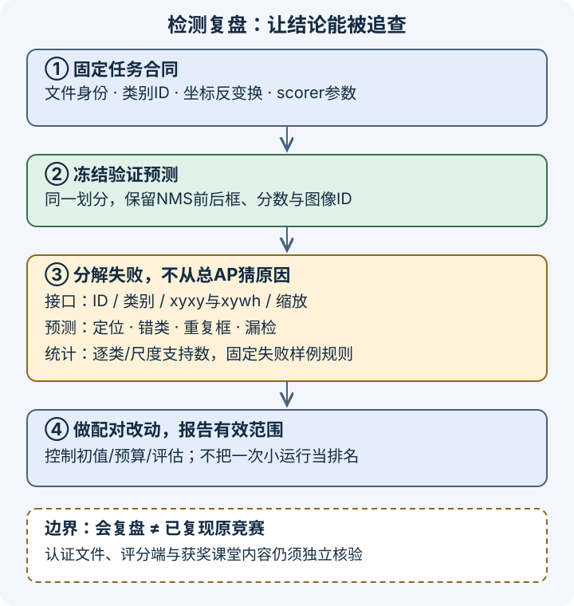

# 检测竞赛复盘：把一个分数拆成可追查的证据

## 1. 复盘的对象不是排行榜，而是一条可检验的因果链

面对“检测分数不高”，先问：模型没找到目标，框不准，类别错了，重复输出太多，还是导出文件把本来正确的预测写坏了？这些失败表象相似，修法却不同。直接换更大骨干，可能只是在更昂贵地重复接口错误。

一份有用的复盘应回答四个问题：**评估的到底是什么任务；观察到了什么失败；哪项改动有配对证据；哪些结论目前不能成立。** 将“我尝试过”与“我证明了”分开，才能把一次竞赛经验迁移到其他检测工程。

[LEC50](#/c/d2l-pytorch-2021/lec/lec50?v=notes)已展开竞赛身份、类别映射和接入条件；这里不重复启动教程，而把它们当作复盘的输入合同。

编者自绘：从同一批原始预测分出接口核验、误差分解和配对实验。图示是分析路线，不表示已经取得牛仔数据或跑通评分。

## 2. 固定任务身份，再解释指标

官方启动公告、结束公告的CodaLab33573结果入口，以及Kaggle **cowboyoutfits** 的历史提交说明互相对应。Kaggle公开host是 **Joshua Z. Zhang**；官方视频作者“跟李沐学AI”是另一个字段。历史评分截止为2021年8月7日04:00 UTC；公告中的8月15日前代码提交是赠书资格步骤，不是评分截止。

五个前景类别ID需要保留原值：

| 类别 | 外部category_id |
| --- | ---: |
| belt | 87 |
| sunglasses | 1034 |
| boot | 131 |
| cowboy_hat | 318 |
| jacket | 588 |

它们不是样本数，也不是连续的模型输出下标。内部0–4、带背景的训练类别、外部ID必须分别记账；不能靠最后统一加1“修复”。

复盘前先检查以下尚未闭合的接口：

| 环节 | 已有公开证据 | 仍缺什么 |
| --- | --- | --- |
| 文件身份 | Data介绍images、train.json、valid.csv、test.csv | 获授权后的真实文件、hash、表头、类型与标注统计 |
| 图像标识 | Data写image_id；host Starter Version 1取row['id'] | 实际CSV列名及导入到导出的对应，不能任选一边 |
| 框格式 | Starter乘回宽高，输出像素xyxy；Overview只说四坐标 | 评分端实际解析/转换约定；不能因COCO训练标注就改成xywh |
| 评分 | Overview明确AP 0.50:0.95；CodaLab称使用pycocotools | 部署scorer版本、参数、忽略对象、最大检测数和适配代码 |
| 使用条件 | CodaLab公开教育/非商用、不可向其他用途再分发 | Kaggle登录与接受完整规则；当前可下载或可提交性 |

**这些缺口不妨碍学评估原理，但阻止“已复现原竞赛”的结论。** 不用香蕉数据替代原竞赛身份；也不能把公开starter等同于获奖者的最终方案。

## 3. AP衡量排序和定位，不是一个阈值下的正确率

先限定一个类别、一个IoU阈值、普通非crowd对象，无忽略标注。每张图内按分数从高到低，将预测匹配到尚未占用的同类真实框。一个真实目标只能贡献一次TP；重复命中不能继续加分。随后汇集同类各图预测，按分数排序，逐步累计：

$$
P_k=\frac{TP_k}{TP_k+FP_k},
$$

$$
R_k=\frac{TP_k}{N_{\mathrm{GT}}}.
$$

$P$是precision（精确率），$R$是recall（召回率）；$N_{\mathrm{GT}}$是该类别参与评估的真实目标数。漏检通过召回率体现，不是给每个漏检硬塞一个低分预测。

COCOeval先构造向右取最大值的precision包络，再在0到1、间隔0.01的101个recall点取样。达不到的recall位置记0。无真实对象的类别/设置标记为无效并在汇总时排除，**不随意当作AP=0的正常类**。实际竞赛如何选择类别和忽略对象，仍要核scorer。

公开主指标AP 0.50:0.95意味着：IoU阈值为0.50、0.55，依次到0.95，共10档，再汇总有效类别与对应recall采样。它不是“0.5分以上预测占多少”，也不是先对每张图算AP再平均。AP50只取其中一档，不能替代主指标。

### 一个可以逐项核算的三预测小例

以下全是编者合成框，不来自竞赛图片。两真实框同类、同图，像素连续坐标，无加1的面积约定：

- A为`[0,0,10,10]`；B为`[20,0,30,10]`。
- 预测1：分数0.9，框等于A。
- 预测2：分数0.8，框也等于A。
- 预测3：分数0.7，框为`[22,0,32,10]`。

预测3与B的相交面积是80，两框面积各100，因此：

$$
\operatorname{IoU}=\frac{80}{100+100-80}=\frac23.
$$

在IoU阈值0.50时：

| 排名 | 判定 | 累计TP | 累计FP | precision | recall |
| --- | --- | ---: | ---: | --- | --- |
| 1 | 命中A | 1 | 0 | 1 | 1/2 |
| 2 | 重复A | 1 | 1 | 1/2 | 1/2 |
| 3 | 命中B | 2 | 1 | 2/3 | 1 |

包络在recall 0至0.50的51个采样点为1，在0.51至1的50个点为2/3。因此纸面预期是：

$$
\mathrm{AP}_{50}=\frac{51+50\times(2/3)}{101}
=\frac{253}{303}.
$$

在阈值0.75时，预测3变成FP，最大recall只有1/2；AP75的纸面预期为$51/101$。十档中前四档允许预测3匹配，后六档不允许，单类十档均值为：

$$
\frac{4\times(253/303)+6\times(51/101)}{10}
=\frac{193}{303}.
$$

主agent已用独立有理数小例核对上述结果，证据见页底；没有执行pycocotools或原竞赛scorer，不是实验成绩。真实评估还包含crowd、ignore、面积和最大检测数等规则，不能把三框简化器用于正式榜单。

### 三种阈值不应混在一起

- **训练匹配阈值**：决定哪些锚框接受哪个监督目标。
- **推理NMS阈值**：只比较预测框，用来抑制重复候选。
- **评估IoU阈值**：将冻结后的预测与真值匹配，计算质量。

上述例子中NMS可删除预测2，却不会让预测3的定位变准。NMS过强也可能删除拥挤场景的另一个真实目标；阈值变大通常保留更多重叠候选，但是否改善AP要看配对验证。教材NMS没有类别分组，逐类NMS须作为自己的明确策略记录。高展示分数阈值适合少画一些框，不应不加分析地当成AP计算前的裁剪阈值。

## 4. 把失败分到能行动的层级

不要只挑最好看的三张图。先冻结验证划分和预测文件，再按固定规则收集失败例及其分母。诊断标签可以重叠；若要报告互斥计数，须事先规定归因顺序。

| 观察 | 需要保留的证据 | 优先排查，而非直接下结论 |
| --- | --- | --- |
| 大部分框整体偏移或大小成倍变化 | 原图、变换参数、模型坐标与反变换后坐标 | 宽高顺序、缩放/padding逆变换、xyxy/xywh接口 |
| 框位置合理但类别错 | 类别映射、目标和预测类别、同类匹配结果 | 背景偏移、外部ID错配；再看模型分类能力 |
| 同物体多框 | NMS前后预测、分数顺序与框间IoU | 重复是否经后处理删除、逐类/跨类策略 |
| 低阈值找到、高阈值失败 | 同一预测在多档IoU的匹配 | 定位误差；AP50与AP75的差不能单独证明原因 |
| 目标没有可用候选 | NMS前低分候选、变换后目标可见性 | 分辨率、锚框尺度、裁剪、分数阈值及召回不足 |
| 少数类或小目标表现差 | 每类/尺度GT数、TP/FP/FN与固定样例 | 数据稀少、尺度分布、标注质量；不预设重加权一定有效 |
| loss下降但验证仍差 | 分类/回归损失分项、验证预测及指标 | 背景占比、训练/验证分布、损失权重、过拟合 |

空图也属于评估分布：没有真实目标却输出框，应能贡献相应FP；不能在读取数据时静默丢掉空图。另一方面，被裁剪掉的对象如何更新标签属于训练变换合同，不是评估端随意删除难例的理由。

“类别不均衡”是公开任务特征，不提供各类实例数。未取得真实标注，就不画假分布或编造稀有类。小验证集某类没有GT，也不意味着该类训练成功；应显式列出支持数和不可评估项。

## 5. 怎样把一次改动变成可信结论

### 先保存能复查的最小记录

每次运行至少记录：数据身份和许可、图像级划分及去重方式、类别映射、输入变换、模型配置和初值、优化器与调度、训练预算、随机种子及采样顺序、checkpoint选择规则、推理阈值/NMS、预测文件、评估器版本与参数、设备和精度。

大整数image_id不能先经浮点再转回整数。用带ID的预测而非数组行号追溯；序列化往返、预处理逆变换、类映射往返分别检验。模型参数相同不等于运行可恢复：继续训练还涉及优化器、调度器、随机状态和采样进度。恢复的系统练习见[优化与工程总结实验](#/c/d2l-pytorch-2021/lab/optimization-capstone?v=guide)，并不意味着这里已有牛仔checkpoint。

### 配对对照而不是方法名称竞赛

先固定基线，再只改一个因素。例如比较NMS阈值时复用同一原始预测；比较输入分辨率时承认显存、吞吐和目标像素尺度一起改变；比较骨干时记录预训练身份及计算预算，不把更长训练带来的变化全归因于结构。

| 对照问题 | 必须尽量固定 | 结论应保留的限制 |
| --- | --- | --- |
| NMS是否减少重复而不伤召回 | 原始预测、验证集、scorer | 可能随拥挤程度变化，不是通用最优阈值 |
| 增强是否帮助泛化 | 初值、训练预算、验证预处理 | 至少区分一次随机波动与稳定趋势 |
| 优化设置是否改善训练 | 数据、模型、更新次数与选择规则 | 学习率/调度是否为各方法单独调过必须披露 |
| 小目标是否受益 | 同一尺度切片与真实支持数 | 总AP可能掩盖另一类/尺度退化 |

一次小运行只能说明该次有限设置。没有重复种子就不宣称稳定排名，没有同步计时和真实设备测量就不报硬件加速。不能反复看最终测试/榜单后再把它叫独立验证；验证集选配置，冻结后才做最终评估。

## 6. 回到已有工程路线：已有证据与缺口各归其位

| 需要补的能力 | 站内入口 | 本次复盘用途 |
| --- | --- | --- |
| 框与检测数据 | [LEC40](#/c/d2l-pytorch-2021/lec/lec40?v=notes) | 对齐图像、标签、坐标与导出 |
| 锚框、匹配、NMS | [LEC41](#/c/d2l-pytorch-2021/lec/lec41?v=notes) | 区分监督、候选与后处理 |
| 分类竞赛复盘 | [LEC42](#/c/d2l-pytorch-2021/lec/lec42?v=notes) | 复用证据与配对比较方法，不将分类正确率当检测AP |
| 检测器结构和尺度 | [LEC43](#/c/d2l-pytorch-2021/lec/lec43?v=notes)、[LEC44](#/c/d2l-pytorch-2021/lec/lec44?v=notes) | 用失败证据选择结构实验，不重写检测器全集 |
| 像素级任务和上采样 | [LEC45](#/c/d2l-pytorch-2021/lec/lec45?v=notes)、[LEC46](#/c/d2l-pytorch-2021/lec/lec46?v=notes)、[LEC47](#/c/d2l-pytorch-2021/lec/lec47?v=notes)、[LEC48](#/c/d2l-pytorch-2021/lec/lec48?v=notes) | 分清像素mIoU和检测AP，不能互换指标 |
| 图像优化目标 | [LEC49](#/c/d2l-pytorch-2021/lec/lec49?v=notes) | 分清优化输入图像与训练检测器 |
| 原竞赛接入 | [LEC50](#/c/d2l-pytorch-2021/lec/lec50?v=notes) | 沿用已核身份与未闭合接口 |
| 实施路线 | [实验说明](#/c/d2l-pytorch-2021/lab/cv-dense-prediction?v=zh)、[实验指导](#/c/d2l-pytorch-2021/lab/cv-dense-prediction?v=guide) | 机制→教材真实小训练→有条件的原竞赛适配 |

此前P7已经完成真实教材香蕉TinySSD有限训练、VOC小规模迁移及两图风格优化，这些证据保留，不退回“全部未运行”。但TinySSD固定验证图在展示阈值0.9下没有框，VOC小验证预测近乎全背景；损失下降不是质量复现。香蕉样本是真实下载的教材合成图像数据，也不是牛仔照片。预训练迁移、机制纸例和硬件实测仍分账；P7未进行CUDA/MPS运行或性能基准。

今天能完成的是可复查的评估练习与复盘合同。只有在合法取得原竞赛文件、核清scorer与接口、完成真实运行之后，才追加原竞赛证据；不能用这个阅读页的完成状态替代这些条件。

## 7. 自测：能否拒绝一个看似合理的结论

1. 三预测例中两个框都完整覆盖A，为什么第二个仍是FP？

普通非crowd目标在该阈值下只能匹配一次。第二框只是重复目标，不增加召回；分数排序中它占了一个预测位置，降低precision。这是评估匹配，不是训练锚框分配。

2. AP50不错而AP75低，就能证明模型分类没问题吗？

不能。定位误差可能重要，但类别错误、排序、样本规模等仍可能影响指标。应保留同一预测在两阈值的匹配变化，再审查具体失败框，而非从两个汇总数推唯一原因。

3. 只看最高分图和总AP，能判断少数类受益吗？

不能。还需逐类GT支持数、同划分同scorer下的配对结果和预先确定的样例选择规则；缺GT类不可评估，不可擅补零或宣称已学会。

4. “使用pycocotools”能消除提交xyxy/xywh的疑问吗？

不能。提交文件可能先被适配，再交评估库。公开starter输出像素xyxy，Data与starter还存在image_id/id差异；未经真实文件及部署scorer核验，不宣布任选一种格式可提交。

5. 哪些材料足以说某方案是冠军方法？

需要可信的获奖者身份对应、其公开方案或可核课堂内容，以及准确的成绩/条件证据。公告、starter、视频标题和本页机制推导都不足；当前没有这类核验，故不列赢家、方法或成绩。

6. 本页纸面AP能否拿去代替原竞赛scorer？

不能。例子刻意只保留一类、两个普通GT和三个预测；真实scorer的忽略对象、crowd、面积、最大检测数、输入适配和版本仍未核。本例证明的是如何推理，不是原竞赛兼容性。

## 8. 来源与核验边界

- [2021官方课表](https://courses.d2l.ai/zh-v2/)row101：日期8月15日，主题“竞赛 目标检测总结”，没有独立教材或Notebook链接。课表PDF路径与LEC64重复，本页未读该PDF、不推断其中含竞赛方案。视频实际发布2021年8月22日，与课表日期分开。
- [本讲官方BV](https://www.bilibili.com/video/BV13b4y1m7y8)：平台标题“71  目标检测竞赛总结【动手学深度学习v2】”；作者跟李沐学AI，mid1567748478，2021上传。完整分P如下，不把主题标题当成已核课堂内容。

| 分P | 平台标题 | 时长 |
| --- | --- | --- |
| P1 | 目标检测竞赛总结 | 23:58 |
| 全片 | 1438秒，1P | 23:58 |

2026-11-14只对这个新P查一次公开字幕，API成功返回空列表；未审听音视频，也不能由空列表推出无烧录字幕。因此不提供时间轴、课堂QA、draft或“已看完课堂”的声明。

- [官方公告](https://courses.d2l.ai/zh-v2/announcements.html)、[CodaLab33573](https://competitions.codalab.org/competitions/33573)、[Kaggle Overview](https://www.kaggle.com/competitions/cowboyoutfits/overview)、[Data](https://www.kaggle.com/competitions/cowboyoutfits/data)、[Rules](https://www.kaggle.com/competitions/cowboyoutfits/rules)、host [Starter Kit](https://www.kaggle.com/code/zhreshold/cowboy-outfits-starter-kit)：本次实读P7保存的去凭据公开文本，不重刷认证页面。没有原竞赛数据、scorer运行、训练、AP成绩或提交。CodaLab公开教育/非商用及再分发限制不能省略，Kaggle完整规则尚未认证核查；代码许可不覆盖输入图片。
- [COCOeval上游实现](https://github.com/cocodataset/cocoapi/blob/master/PythonAPI/pycocotools/cocoeval.py)：Piotr Dollár、Tsung-Yi Lin，源码署2015，2026-11-14实读当前master的`evaluateImg`、`accumulate`、`summarize`、`Params`及全文件。编者补充，不是课程新增必读论文，也不是历史CodaLab部署代码；记录精简摘录与阅读范围，没有执行该库。
- 教材回顾为[13.3边界框](https://zh.d2l.ai/chapter_computer-vision/bounding-box.html)、[13.4锚框](https://zh.d2l.ai/chapter_computer-vision/anchor.html)。实读既有固定源码的边界框全文及IoU/NMS片段；中文第二版固定提交如下，不是2021全书快照，不新增materials重译。

| 教材仓库 | 固定提交 |
| --- | --- |
| d2l-ai/d2l-zh | `e6b18ccea71451a55fcd861d7b96fddf2587b09a` |

完整阅读与缺口索引保存于`sources/p11-lec71`；worker原始未执行记录保留，主agent有限数值核对见`sources/p11-shared/notes-smoke.json`。本文复盘路线和自绘图不是教师或获奖队伍的结论。
