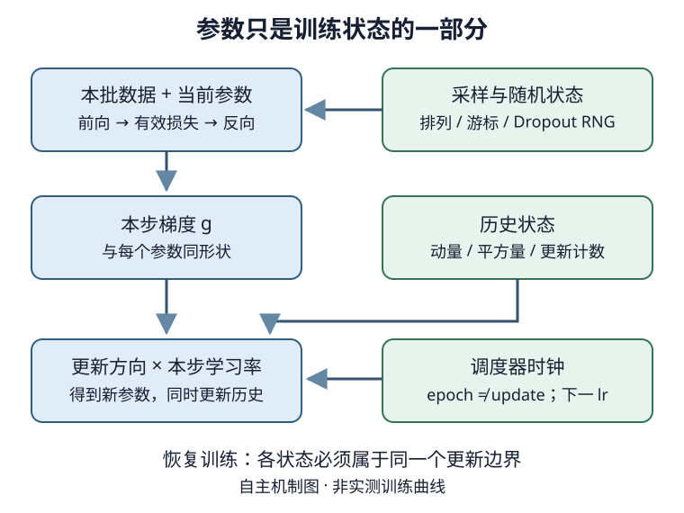

# 优化算法：从梯度估计到可恢复的更新过程

## 1. 优化器改变的是哪一件事

训练是重复回答四个问题：**本步用谁的数据、怎样形成梯度、梯度怎样变成更新、下次从什么状态继续。** 优化器不是模型、不是损失，也不是学习率调度器；但这四者的约定共同决定轨迹。

设训练样本数为$n$，参数展平成$\theta\in\mathbb R^P$时，每个样本产生标量损失$\ell_i(\theta)$。经验风险为：

$$
F(\theta)=\frac1n\sum_{i=1}^n\ell_i(\theta).
$$

优化器降低的是这个训练目标。真正想改善的，是未见数据上的期望损失；训练损失最低的时刻不一定是验证表现最好的时刻。若加正则项，还需区分“含正则的优化目标”和“仅数据项的报告损失”。

| 符号 | 形状或单位 | 作用 |
| --- | --- | --- |
| $\theta_t$ | 概念上$P$维，实际保留各参数张量形状 | 完成第$t$次更新后的参数 |
| $g_t$ | 与参数逐张量同形状 | 在$\theta_{t-1}$计算的本步梯度 |
| $\eta_t$ | 标量或每参数组一个标量 | 本次更新实际使用的学习率 |
| $v_t,m_t,s_t$ | 与相应参数同形状 | 动量或平方梯度历史，不是样本特征 |
| $B_t$ | 本批有效样本数 | 梯度归约分母，不一定等于配置batch size |

这里的“展平”只为数学记号；实现不必每步拼接、复制全部参数。比如`Linear(4,3)`的权重形状是$(3,4)$，其梯度和Adam两个矩也都是$(3,4)$；偏置各自有$(3,)$的状态。状态不能按batch大小初始化。

图为依据教材第11章自绘的数据依赖图，不是实测轨迹。调度器决定更新尺度，动量和二次矩决定历史如何参与；保存权重并未保存整张图的状态。

## 2. 凸性给我们一把尺，不给深网一张保证书

凸集内任意两点的线段仍在集合中。凸函数的图像不高于端点连线：对$0\le\alpha\le1$，

$$
f(\alpha x+(1-\alpha)y)
\le\alpha f(x)+(1-\alpha)f(y).
$$

例如$f(x)=x^2$，端点0、2的中点函数值是1，而端点函数值的平均是2。这就是两点版Jensen不等式。凸集的交集仍凸，并集**不一定**凸。凸函数的局部极小值也是全局极小值，但最小点可能不唯一，甚至不存在：$e^x$在实数上趋近0却取不到0。

对于定义在开凸域上的二次连续可微函数，处处Hessian半正定对应凸性。Hessian是$P\times P$的曲率矩阵，不是梯度平方。深网目标一般非凸：梯度为0可能是极小点，也可能是鞍点；$x^2-y^2$在原点的两个方向一个向上、一个向下。饱和激活也可能让梯度很小，却离需要的解很远。

约束与惩罚也要分清：限制$\|\theta\|\le r$是可行域，加入$\lambda\|\theta\|^2/2$是改变目标；两者不能未经条件说明就逐项等同。把**梯度**投影到范数球是梯度裁剪，不是在把**参数**投影回可行域。

## 3. 梯度下降：为什么步长不能无限大

局部一阶近似说明，沿负梯度移动足够小的一步通常能降低可微目标：

$$
\theta_t=\theta_{t-1}-\eta_t\nabla F(\theta_{t-1}).
$$

在一维二次目标$f(x)=\lambda x^2/2$、$\lambda>0$下，更新能精确写成：

$$
x_t=(1-\eta\lambda)x_{t-1}.
$$

因此非零初值收敛要求$|1-\eta\lambda|<1$，即$0<\eta\lambda<2$。$1<\eta\lambda<2$会左右振荡但幅度缩小，并非一跨过最小点就发散。

自拟$\lambda=1,x_0=1$的手算：

| 学习率 | $x_1$ | $x_2$ | $x_3$ | 判断 |
| --- | --- | --- | --- | --- |
| 0.5 | 0.5 | 0.25 | 0.125 | 逐步收缩 |
| 2 | -1 | 1 | -1 | 不收敛的等幅振荡 |
| 2.5 | -1.5 | 2.25 | -3.375 | 发散 |

多维狭长谷地里，曲率最大的方向限制步长，平坦方向因此前进很慢。特征标准化可以缓解坐标尺度失衡，但不能保证把深网目标变凸。

牛顿法进一步用曲率求方向，可写为$H\Delta=-g$后更新$\theta+\Delta$；数值实现通常求解线性方程，不应无理由显式求逆。完整$H$存储需要$O(P^2)$元素，非凸时它还可能不正定。对角预条件以更便宜的逐坐标缩放替代完整曲率，但AdaGrad/Adam的平方梯度统计**不是精确Hessian**。线搜索需要多次评估目标，整数据深网训练往往承担不起这种代价。

## 4. SGD与minibatch：统计效率和计算效率不是一回事

全批梯度每步读取全部$n$个样本；单样本SGD均匀抽一个样本；小批量在两者之间：

$$
g_t=\frac{1}{B_t}\sum_{i\in\mathcal B_t}
\nabla\ell_i(\theta_{t-1}).
$$

在固定参数、独立均匀抽样等条件下，这是全批梯度的无偏估计；独立梯度的方差随$1/B_t$缩小，标准差随$1/\sqrt{B_t}$缩小。实际每轮打乱后无放回遍历，并不等于每一步都从全数据独立有放回采样，不能不加条件套用同一证明。

小批量把许多小算子组成矩阵运算，降低解释器与调度开销，改善缓存和设备利用率；但batch越大也越占激活内存。固定epoch时，大batch的更新次数较少，不能只画epoch轴就说算法收敛更快。至少区分样本数、更新数、墙钟时间三种预算。没有计时就不写GPU加速比。

**归约只做一次。** 若CE已对本批取mean，更新时不要再除以batch size。尾批只有1个样本时也不能除以配置的64。跨批报告损失，应先累计损失总和与有效数量，再相除；两批均值1和3、数量2和1，全局均值为$5/3$，不是2。序列任务的有效数量可能是token数，不能机械换成句数。

梯度累积也遵循同一个分母：先明确期望的大批目标，再按各微批有效数量加权。带BatchNorm、随机Dropout等算子的微批计算，不保证与一次大批前向完全等价。

## 5. 动量：方向历史不是免费消除噪声

采用教材的未归一化速度约定，初始$v_0=0$：

$$
v_t=\beta v_{t-1}+g_t,
$$

$$
\theta_t=\theta_{t-1}-\eta_t v_t.
$$

同向梯度累积，交替方向部分抵消；历史权重按$\beta^k$衰减。若梯度恒定，速度趋近$g/(1-\beta)$，因此加入动量却保持同一学习率，并不是保持同一有效更新尺度。

另一种文献写法是$m_t=\beta m_{t-1}+(1-\beta)g_t$。它与上式差一个归一化因子；若要比较轨迹，学习率也需相应换算，不能混着抄公式。

自拟预先指定梯度$g_1=g_2=2$，$\theta_0=1,\eta=0.1,\beta=0.9$：

| 方法 | 第一步 | 第二步 |
| --- | --- | --- |
| 无动量SGD | $\theta_1=0.8$ | $\theta_2=0.6$ |
| 上式动量 | $v_1=2,\theta_1=0.8$ | $v_2=3.8,\theta_2=0.42$ |

这是规定梯度序列的算术例，不是声称同一目标在不同参数处仍产生同样梯度。动量会滞后，也可能越过谷底，不保证每步loss下降。对框架实现还须固定dampening、Nesterov和weight decay等选项；这里讨论的是无dampening、无Nesterov、无衰减的基本式。

## 6. 自适应方法：给每个坐标一把不同的尺

以下乘除、平方和开方都按元素执行。$s_0=0$，$\epsilon>0$防止分母为零。

### AdaGrad：记住全部平方梯度

$$
s_t=s_{t-1}+g_t^2,
$$

$$
\theta_t=\theta_{t-1}
-\eta\frac{g_t}{\sqrt{s_t+\epsilon}}.
$$

频繁且梯度大的坐标，累积量增长快、有效步长缩小；稀疏坐标不会仅因全局时间流逝而同样迅速衰减。代价是历史只增不减，后期可能过早走不动。仍需选基础学习率，并不是“自动选好所有超参数”。

### RMSProp：让旧梯度逐渐淡出

$$
s_t=\gamma s_{t-1}+(1-\gamma)g_t^2,
$$

$$
\theta_t=\theta_{t-1}
-\eta_t\frac{g_t}{\sqrt{s_t+\epsilon}}.
$$

$0\le\gamma<1$控制记忆，外部$\eta_t$控制全局节奏。给定梯度`[2,0]`，AdaGrad的$s$是`[4,4]`；RMSProp取$\gamma=0.9$时是`[0.4,0.36]`。这展示“累加”和“遗忘”，不是算法胜负。

上述根号内$\epsilon$采用教材从零实现的约定。调用框架优化器时必须核实它是否放在根号外、默认值是否相同；两个表达式不能仅凭类名就当成逐位等价。

### Adadelta：再追踪更新本身的尺度

记$r_t$为历史更新平方的指数平均，先更新$s_t$，再计算：

$$
\Delta_t=
\frac{\sqrt{r_{t-1}+\epsilon}}
{\sqrt{s_t+\epsilon}}\,g_t,
$$

$$
\theta_t=\theta_{t-1}-\Delta_t,
$$

$$
r_t=\rho r_{t-1}+(1-\rho)\Delta_t^2.
$$

$s_t$也采用衰减$\rho$。这里两个状态是**梯度平方与更新平方的平均**，不是二阶导数。教材基本式没有额外全局学习率，不代表所有库接口没有缩放参数，更不代表学习率为0；还要选择$\rho,\epsilon$。

### Adam：有方向的一阶矩，加尺度的二阶矩

初始$m_0=s_0=0$，更新步从$t=1$计：

$$
m_t=\beta_1m_{t-1}+(1-\beta_1)g_t,
$$

$$
s_t=\beta_2s_{t-1}+(1-\beta_2)g_t^2.
$$

零初始化使早期指数平均偏小，按历史权重和校正：

$$
\hat m_t=\frac{m_t}{1-\beta_1^t},\qquad
\hat s_t=\frac{s_t}{1-\beta_2^t},
$$

$$
\theta_t=\theta_{t-1}
-\eta_t\frac{\hat m_t}{\sqrt{\hat s_t}+\epsilon}.
$$

$s_t$是未中心化二阶矩，不是$E[(g-Eg)^2]$意义下的方差；偏差校正也不是batch normalization。若部分参数本步没有梯度，实际优化器的逐参数计数须按接口语义处理，不能只恢复一个想当然的epoch数。

自拟$g_1=2,\beta_1=0.9,\beta_2=0.999$，有$m_1=0.2,s_1=0.004$，校正后为2与4。仅为手算忽略正$\epsilon$时，$\eta=0.1$的首步幅度为0.1；不校正则约0.316228。这个局部例不能证明Adam比SGD泛化更好。

11.10还介绍Yogi对二阶矩的改动：根据$g_t^2-s_{t-1}$的符号调整累积方向，以$g_t^2$控制调整量。它是教材算法对照，不是本阶段新增必做训练，也不把其动机当成任意任务的收敛保证。

| 方法 | 每参数主要额外状态 | 工程取舍 |
| --- | --- | --- |
| 基本SGD | 无历史张量 | 简单、省状态，但敏感于尺度与学习率 |
| 动量 | 一个速度 | 累积方向，需连同速度恢复 |
| AdaGrad / 基本RMSProp | 一个平方梯度量 | 坐标适应与遗忘方式不同 |
| Adadelta | 两个平方量 | 梯度与更新双尺度 |
| Adam | 两个矩及步数 | 初始化/归约/步数都影响轨迹，更多内存 |

这些只算核心状态，不含参数、梯度、激活、框架临时缓冲或混合精度主权重。L2项进入梯度，与在更新外直接衰减参数，在自适应缩放下通常不是同一算法；不要把Adam与解耦衰减的AdamW混名比较。

## 7. 学习率调度首先是一只时钟

常见策略各有可解释的作用，但没有哪一种保证改善验证指标：

| 策略 | 规则 | 需要说清 |
| --- | --- | --- |
| 常数 | $\eta_t=\eta_0$ | 可能在最小点附近持续抖动 |
| 分段常数 | 里程碑处乘因子 | 里程碑以epoch还是update计 |
| 指数 | $\eta_t=\eta_0\gamma^t$ | 衰减过快可能过早停止进展 |
| 多项式 | $\eta_t=\eta_0(1+at)^{-p}$ | 指数与总预算相关 |
| 余弦 | 从大步逐渐到小步 | 终点后保持还是重启须定义 |
| warmup | 初期从小值升到基础值 | 预热步数占总预算多少 |

余弦在$0\le t\le T$的一种明确约定为：

$$
\eta_t=\eta_{\min}
+\frac{\eta_{\max}-\eta_{\min}}2
\left(1+\cos\frac{\pi t}{T}\right).
$$

预热是接在主调度前的一段上升过程，不是多训练一份数据；调度总预算是否包含预热必须统一。教材展示按epoch调用的训练循环，不能把其参数名`num_update`机械解释成每batch都会调用。

**记录“本次实际用的lr”，不是刚算出的下次lr。** 自拟StepLR合同：初始0.1，每两次参数更新乘0.5，每次先`optimizer.step()`再`scheduler.step()`。前五次更新实际用`[0.1,0.1,0.05,0.05,0.025]`。若每个batch都推进本来按epoch设计的时钟，曲线会提前衰减很多倍。

基于验证指标的调度器要等指标计算完再传入相应值；不能用测试集调度，也不能把`ReduceLROnPlateau`当作无需指标的StepLR。恢复时只恢复当前lr，不恢复里程碑进度，也会在后面走错。

## 8. 数值稳定性：先定位坏在哪里

稳定计算不是把NaN替换成0。建议沿数据 → logits → loss → 梯度 → 更新后的参数逐层定位首个非有限值，同时检查dtype、形状、mask与有效分母。

分类使用直接接收logits的CE。对于单样本正确类$y$，令$a=\max_j z_j$：

$$
L=(a-z_y)+\log\sum_j e^{z_j-a}.
$$

自拟logits`[1000,1000]`的CE仍为$\log2$；直接算`exp(1000)`会在float32溢出。先softmax再把概率当logits传给CE，改变了目标；给全部位置mask成负无穷，也不会自动得到合法分布。

梯度爆炸时，全局范数裁剪可限制本步梯度，但不是减小loss分母、修复错误标签或防止所有参数更新爆炸的万能替代。Adam还会改变逐坐标尺度。混合精度时若使用梯度缩放，需先unscale再按真实梯度裁剪；溢出跳过更新时，调度器也应遵循“有效更新”的约定。本页没有GPU或混合精度运行证据。

手写更新应在不记录梯度的上下文中进行，清梯度用正常接口；教材旧式`.data`不应成为绕过autograd版本检查的惯例。`zero_grad`不是优化器状态重置，`model.eval()`也不是禁止梯度或停止更新的自动开关。

## 9. 恢复的是训练过程，不只是一组权重

一个可继续训练的检查点需要覆盖以下依赖，而不是盲目保存某个固定列表：

- 模型参数与buffer，例如BatchNorm统计；架构、dtype、预处理/词表与数据划分身份。
- 优化器的参数组顺序、超参数、动量/矩与步数；重新绑定相同结构的参数，不能靠名字相似猜映射。
- 调度器状态及调用时钟；若实际使用混合精度，包含scaler状态。
- 实际使用的CPU、设备、Python/NumPy或独立生成器随机状态。只重设初始seed不能回到中途。
- 当前epoch、已完成更新数、**本轮排列与游标**。生成器在创建排列后已经前进，只存它的当前状态通常无法重建正在消费的排列。
- 若中途保存发生在梯度累积窗口内，还需保存未提交梯度与累积计数；简单合同可明确仅在完整更新边界保存。

有多worker随机增强或预取队列时，精确恢复还需额外处理数据管线状态；不要把单进程无预取的证明外推。初始化模型/优化器/调度器本身可能消耗随机数或覆盖lr，加载顺序和最后恢复RNG的位置必须在目标版本中核对。

最有力的局部验收是比较连续运行与“写磁盘 → 新进程加载 → 继续”：下一批ID、随机Dropout、实际lr、loss、梯度、参数、优化器状态都应在声明精度内一致。另设“仅权重+空优化器”的反例可以暴露恢复缺项；若同时丢失当前lr，就不能把差异只归因于矩状态。P9/P10没有可直接加载的持久化自训checkpoint；本阶段的新比较不是悄悄接着旧模型跑。

## 10. 怎样作出有边界的优化器结论

固定模型、划分、预处理、同一初值、同一批序列与训练预算，才能把差异主要归因于优化配置。相同数值学习率是一种**受控比较条件**，不是每种算法都得到相同有效步长，更不是公平调优后的最优比较。若分别调参，则应固定搜索预算、只用训练/验证选择，并报告候选范围。

看训练曲线、验证损失、任务指标与资源开销，而不是只报最后一批loss。一次小数据划分不支持“Adam永远最好”；更低训练CE也不证明更好校准或更高泛化准确率。本阶段实际运行证据、曲线与磁盘恢复放在[第十二实验](#/c/d2l-pytorch-2021/lab/optimization-capstone?v=zh)，实现思路见[实验指导](#/c/d2l-pytorch-2021/lab/optimization-capstone?v=guide)。本页负责解释为什么要有这些合同，不重复整份实验正文。

## 自测：能解释状态，才算理解算法

1. 凸函数一定有唯一最小点吗？梯度为0一定是局部最小吗？
2. batch从32变64，epoch相同，是否更新次数也相同？mean loss后还能在更新器再除64吗？
3. 上述动量手算为何第二步到0.42，而不是0.6？把$1-\beta$加进公式会改变什么？
4. AdaGrad和RMSProp见到零梯度时，其平方量怎样变？Adam为什么要保存步数？
5. StepLR当前lr正确，为什么恢复后仍可能与原训练不一致？
6. 同一seed和模型权重能否保证Dropout与下一批完全一致？
7. 优化器A验证准确率更高，但验证CE更差，是否一定记错了？

展开答案与排错要点

1. 不一定唯一，也不一定取得最小值；非凸目标零梯度可能是鞍点。需要说明域和曲率条件。
2. 固定数据大小时通常每轮更新更少；已mean就不能再除一次。尾批要用其实际有效数量。
3. 速度把上一步2保留了0.9倍，变成3.8；加入$1-\beta$是另一归一化约定，学习率需配套比较。
4. AdaGrad保持旧累积量；RMSProp乘衰减因子。Adam的偏差校正依赖更新计数，矩与计数不能分开恢复。
5. 下一次衰减时刻可能不同；还可能缺失动量、矩、批序列或RNG。看“本步使用的lr”及完整状态。
6. 不能。seed只是序列起点；模型构造、Dropout和shuffle各自消费随机数，当前排列/游标也有状态。
7. 不一定。准确率只看argmax，CE还惩罚置信度；小样本的一条预测差异不构成稳定排名。

## 来源与阅读边界

- [2021官方课表](https://courses.d2l.ai/zh-v2/)row102，日期8月21日，指定[优化第11章](https://zh-v2.d2l.ai/chapter_optimization/index.html)。实际阅读固定中文第二版11.1优化与深度学习、11.2凸性、11.3梯度下降、11.4 SGD、11.5小批量SGD、11.6动量、11.7 AdaGrad、11.8 RMSProp、11.9 Adadelta、11.10 Adam/Yogi、11.11调度器全文与各backend代码；正文以PyTorch为主。**阅读整章不是证明视频逐节覆盖整章。**

| 固定仓库 | 提交 |
| --- | --- |
| d2l-ai/d2l-zh | `e6b18ccea71451a55fcd861d7b96fddf2587b09a` |

- [固定优化源码目录](https://github.com/d2l-ai/d2l-zh/tree/e6b18ccea71451a55fcd861d7b96fddf2587b09a/chapter_optimization)，原件与精确阅读范围保存于`sources/p11-lec72/source-index.json`。这是当前中文第二版固定提交，不是2021全书快照；无需重译已是中文的materials。
- [PyTorch2.5优化器文档](https://docs.pytorch.org/docs/2.5/optim.html)，实际阅读“如何使用优化器”、参数组、确定性参数顺序、算法列表和学习率调度至SWA之前；作为现代工程补充，不冒充2021课堂内容。未新增必读论文。
- 教材符号有若干需独立核算之处：动量节二次型的中心应为$x-x^*$且$x^*=-Q^{-1}c$；$1<\eta\lambda<2$是振荡收敛。RMSProp展开的各历史项均为梯度平方，EMA权重半衰期是$\log(1/2)/\log\gamma$，不是$1/\gamma$或$1/(1-\gamma)$。Adadelta的“二阶”是平方量而非二阶导数。SGD凸性界应约束$E[R(\bar\theta)]-R^*$而不是向量$E[\bar\theta]-R^*$；本文不照抄其混淆下标的中间等式。小批量节256方阵乘的约算量是$2\cdot256^3$次浮点操作，不能把代码`2/秒`直接当GFLOPS。以上为编者纠偏，不是课堂勘误记录。
- 官方讲义`part-4_2.pdf`链接可达，但本次PDF文字提取不完整；没有据此声称读完讲义或获得课堂文本。

| 分P | 官方标题 | cid | 时长 |
| --- | --- | --- | --- |
| P1 | 优化算法 | 394179010 | 34:04 |
| P2 | QA | 394953619 | 09:13 |

全2P共2597秒（43:17）。官方BV1bP4y1p7Gq，作者“跟李沐学AI”（mid1567748478），pubdate=1629770712，2021上传；上传日期与课表8月21日分开。2026-11-14各cid公开字幕仅请求一次，均code0且`subtitles=[]`。未审阅音视频，不能从空列表推出没有烧录字幕；P2名称不等于已核问答。不生成draft、主题时间轴、课堂QA或无来源演示；copyright=1/no_reprint=1也不是转录授权。
