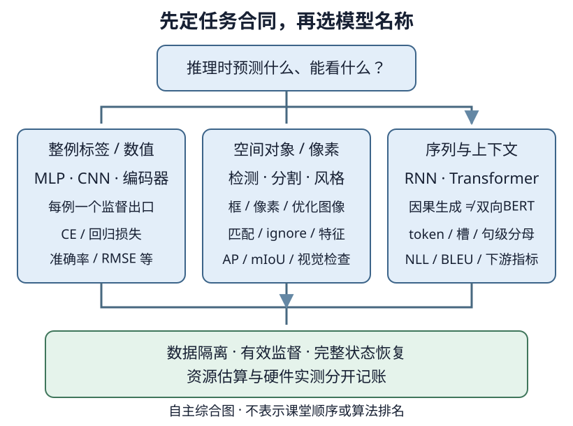

# 课程总结：把模型知识变成可独立完成的工程判断

## 1. 最后要带走的不是模型名称表

面对一个新任务，先回答：**预测对象是什么，推理时能看到什么，用什么监督，什么算失败，预算允许什么？** 这些问题比“换成Transformer会不会更强”更早。能够从原始样本走到可信指标，并解释错误的原因，才是本课程工程路线的收尾目标。

统一记号：$B$是批量，$T$是序列长度，$D$是输入/表示宽度，$H$是隐藏宽度，$C$是类别数，$V$是词表大小；图像写成$(B,C_{\rm in},H_{\rm img},W_{\rm img})$，避免把隐藏宽度与图高混为一谈。下表采用batch-first的说明约定，实际API可能需要转置。

图为自主综合图。模型族是实现选择，输出合同与数据可见性才是分支依据；所有分支最后都回到独立评估和资源预算，不表示模型之间的优劣排名。

## 2. 基础与MLP：从一个张量到一项可信预测

| 任务与模型 | 输入 → 输出 | 损失 | 评估 | 资源与取舍 |
| --- | --- | --- | --- | --- |
| 线性回归 | $(B,D)\to(B,1)$ | MSE或明确定义的回归损失 | MAE/RMSE；房价可用log RMSE | 参数少，易建基线；特征尺度与标签空间必须一致 |
| Softmax分类 | $(B,D)\to(B,C)$ logits | 类别交叉熵 | accuracy、CE、类别级错误 | 线性边界，低成本；不把类别ID当连续值回归 |
| MLP分类/回归 | $(B,D)\to(B,H)\to(B,C)$或$(B,1)$ | 由任务决定，不由“MLP”决定 | 对应任务指标及训练/验证差距 | 非线性增加表达能力，也增加参数、激活与过拟合风险 |

若要让多层结构超出一个仿射变换的表达能力，需要在线性层之间加入非线性；输出logits的线性头不必再接激活。Dropout、权重衰减和早停分别改变训练过程、目标/更新或选择时点，不是三种可以不加说明互换的“防过拟合开关”。

**自拟形状审计。** 两个样本、4维输入，MLP为`4→3→2`且两层带偏置：隐藏表示$(2,3)$，logits$(2,2)$，参数数目为：

$$
4\times3+3+3\times2+2=23.
$$

batch从2改成20不改变参数数目。分类标签通常是$(B,)$的整数ID；回归输出$(B,1)$时，标签也应对齐为$(B,1)$，否则可能广播成$(B,B)$。

房价之类表格任务里，预处理也是系统的一部分：训练折拟合均值/尺度/类别表，验证与推理只transform；不能把验证统计量混进去。Ames与历史加州竞赛不是同一个数据集，两个同名“房价预测”的指标不能互换。具体回看[LEC15](#/c/d2l-pytorch-2021/lec/lec15?v=notes)，不要在总结中另造一套预处理。

## 3. CNN不是CV任务的同义词

卷积提供局部连接和跨位置参数共享；池化/步幅降低空间分辨率，也丢失精确位置。它们改变了归纳偏置与计算组织，不是把MLP简单换个名称。

CNN架构的复盘不必背每层通道数，而应说清设计动机：LeNet建立卷积基线；AlexNet展示更深卷积、ReLU与训练工程；VGG用规整小卷积块；NiN用逐位置通道变换和全局汇聚；GoogLeNet以多分支组合尺度；ResNet让残差路径改善深网络优化；DenseNet显式复用先前特征，同时增加拼接与激活保存压力。BatchNorm的训练/推理行为还依赖运行统计，不是无状态的逐元素激活。

| CV任务 | 核心形状与输出对象 | 损失与监督 | 评估 | 资源与取舍 |
| --- | --- | --- | --- | --- |
| 图像分类 | NCHW输入，$(B,C)$ logits | 每图一类的CE | accuracy、CE、混淆与类别分布 | 高分辨率扩大激活；增强改变训练样本但不能污染验证 |
| 迁移学习 | 预训练骨干表示 → 新任务头 | 下游标签；可冻结或微调整网 | 同划分比较冻结/微调与错误 | 冻结省反传，但可能域不匹配；微调需更多状态与小心选lr |
| 目标检测 | 每图变长框集；密集候选可为$(B,A,C+1)$和$(B,A,4)$ | 类别损失+只对合法匹配监督的框损失 | 按协议的AP/IoU阈值 | 候选数、分辨率、匹配与NMS都有成本；框格式/坐标尺度不可混 |
| 语义分割 | $(B,C,H,W)$ logits，每像素一类 | 像素CE，ignore标签不参与 | pixel accuracy与mIoU | 输出分辨率和跳连占激活；背景多时accuracy会掩盖失败 |
| 风格迁移 | 直接优化图像，特征网络固定 | 内容特征、Gram风格、平滑项 | 视觉检查与各损失分量，不是分类accuracy | 多次特征前向/反传，分辨率越高越贵；不等于训练分类器 |

检测中的“物体数”不能用候选数替代，语义分割也不区分同类的不同实例。恢复原图坐标需要把resize/crop/flip的几何变换正确逆回去；预测类别正确但框协议错误，仍是失败。竞赛身份、数据许可、提交scorer和字段映射都是任务合同，不能用一个本地低loss绕过它们。

选择回看而不是重读全部旧笔记：[卷积/池化形状](#/c/d2l-pytorch-2021/lec/lec22?v=notes)、[检测器组织](#/c/d2l-pytorch-2021/lec/lec43?v=notes)、[密集预测实验](#/c/d2l-pytorch-2021/lab/cv-dense-prediction?v=guide)。牛仔竞赛仍有认证文件、评分端、`image_id`与`id`、像素`xyxy`等未核项，不能写成已训练提交或已复现获奖方法。

## 4. RNN、GRU、LSTM：共享参数，保留有身份的状态

序列建模不只是在张量里多加一个时间轴。模型必须知道哪些位置按时间相连，哪些行来自独立文档，训练时和推理时可见的信息是否一致。

| 任务/模型 | 输入与状态 → 输出 | 损失 | 评估 | 资源与取舍 |
| --- | --- | --- | --- | --- |
| RNN语言模型 | ID$(B,T)$；每步嵌入$(B,D)$及隐藏$(B,H)$；logits$(B,T,V)$ | 下一token的有效位置CE | 按token汇总NLL/困惑度，另看生成错误 | 状态紧凑、时间递归限制并行；长反传有梯度问题 |
| GRU | 同类输入；门控更新一个隐藏状态 | 仍由预测任务决定 | 与RNN同协议才可比较 | 更多门计算换取记忆控制，不保证记住无限历史 |
| LSTM | 隐藏$h$和记忆$c$各$(B,H)$ | 同上或下游监督 | 同上 | 两份状态与更多门，恢复/截断时不能漏掉$c$ |
| 深层/双向RNN | 多层状态；双向输出常为$(B,T,2H)$ | 分类、标注等任务 | 对应任务指标 | 深层增加计算；双向可读右侧，不能用于偷看未来的下一词预测 |
| Encoder–decoder翻译 | 源ID$(B,S)$，目标历史$(B,T)$ → $(B,T,V_{\rm tgt})$ | 有效目标token CE | 自回归生成后用明确语料级BLEU等指标 | 长源压缩、解码串行、长度与beam预算都影响成本 |

RNN参数沿时间共享，序列变长并不创建更多参数，却增加计算与训练激活。截断BPTT的detach切断计算图，但保留状态数值；不同文档的行身份变了，就不能继续沿用原隐藏状态。梯度裁剪、清参数梯度、detach隐藏状态、重置隐藏状态是四种不同操作。

自回归语言模型预测下一token，翻译训练常采用teacher forcing。验证CE仍可用真实历史计算，但**生成评估**必须只读源文本和自己已生成的前缀，不能用真实目标或真实目标长度决定输出。低teacher-forced CE不保证贪心解码准确。

**自拟指标审计。** 两段有效token数为2和3，对应NLL总和为4和6，则全局平均NLL为2，困惑度为$e^2$。应先加总NLL再除以有效token数，最后取指数；不要先对各batch困惑度平均。不同词表、分词和截断协议下的困惑度不能直接排胜负。

回看[LEC54的状态与BPTT](#/c/d2l-pytorch-2021/lec/lec54?v=notes)、[循环语言模型实验](#/c/d2l-pytorch-2021/lab/recurrent-language-model?v=guide)、[翻译与注意力实验](#/c/d2l-pytorch-2021/lab/seq2seq-attention?v=guide)。

## 5. Attention与Transformer：先问谁能看谁

注意力本身是一种可微检索/汇聚机制，不天然等于分类器或语言模型。Q决定要查什么，K决定怎样匹配，V提供被汇聚的信息。任务、mask、输出头和损失一起决定它在做什么。

| 机制/任务 | 形状合同 | 损失/监督 | 评估 | 资源与取舍 |
| --- | --- | --- | --- | --- |
| 注意力汇聚 | Q$(B,T_q,d_k)$、K$(B,T_k,d_k)$、V$(B,T_k,d_v)$；输出$(B,T_q,d_v)$ | 可作为核回归或下游网络组件，没有唯一“注意力loss” | 对应回归、分类或生成任务；热图不是质量指标 | 评分数随$T_qT_k$增长 |
| 多头自注意力 | 输入$(B,T,D)$；评分$(B,h,T,T)$；合头输出$(B,T,D)$ | 取决于编码器/解码器任务 | mask干预不变量、任务指标 | 多头增加显式评分矩阵；固定总宽时投影参数并非乘以头数 |
| Transformer翻译 | 源编码$(B,S,D)$，目标输出$(B,T,V_{\rm tgt})$ | 有效目标CE；源padding、目标padding、因果约束分开 | 真正自回归解码的BLEU与错误分析 | 训练沿时间可并行；生成仍逐token；KV缓存换内存、不能省掉全部计算 |
| 因果Transformer语言模型 | 右移输入ID$(B,T)$ → $(B,T,V)$ | 下一token CE | 相同token协议的NLL/困惑度及任务评价 | 长上下文评分与KV内存昂贵；BERT不能直接充当此接口 |

Transformer还需要位置表达、逐位置FFN、残差与规范化。不同post-norm/pre-norm、位置编码和参数共享约定不能只因名字相同就直接互换checkpoint。交叉注意力Q来自目标、K/V来自源，输出长度跟Q走，而不是跟源长度走。

**三种“mask”分开验：** padding key不能被注意；因果mask禁止读取未来；loss mask决定哪些目标计入分母。一个位置作为query的输出未必是零，仅仅屏蔽它作为key，不等于自动排除了它的loss。更改未来token后，因果模型较早位置输出应不变；双向模型则不应被要求满足这个性质。

一个最小资源账本：$B=2,h=4,T=128$，仅一份显式评分张量含

$$
2\times4\times128^2=131072
$$

个元素，float32时为524288字节，即512 KiB。长度翻倍到256，这一项变成2 MiB；这不是总显存，还没有算Q/K/V、FFN、反向保存、参数和优化器。采用不显式存整张评分矩阵的实现时，实际峰值又不同，所以复杂度推演不是显存实测。

回看[多头与位置](#/c/d2l-pytorch-2021/lec/lec67?v=notes)、[Transformer](#/c/d2l-pytorch-2021/lec/lec68?v=notes)及[Transformer实验](#/c/d2l-pytorch-2021/lab/transformer?v=guide)。缓存正确性要先与全前缀结果对照，beam分支还须独立写入；没有硬件计时就不声称缓存带来了某个倍数的加速。

## 6. BERT：预训练目标与下游任务不是一个标签

BERT以双向编码器形成上下文表示。MLM恢复选定的原词，NSP判别句对相邻性；NLI则判别前提与假设的逻辑关系。这三个监督对象都不能互换。

| 阶段/任务 | 输入 → 输出 | 损失/评估 | 资源与取舍 |
| --- | --- | --- | --- |
| 教材BERT预训练 | token/segment/位置相加，编码$(B,T,H)$；MLM选槽$(B,M,V)$、NSP$(B,2)$ | MLM只对有效选槽CE；NSP独立CE，各有分母 | 双向上下文、多目标；词表头、序列长和训练数据规模影响成本 |
| 句级/句对分类，如NLI | CLS表示$(B,H)$ → $(B,C)$ | CE与accuracy；NLI有方向、类别映射固定 | 冻结编码器只训头较省，完整微调更贵且可能过拟合 |
| token标注 | $(B,T,H)\to(B,T,C)$ | 有效词元CE，按协议实体/词元指标 | 子词与标签对齐、特殊符号排除不可省 |
| 抽取式问答 | 同一编码输出 → 两组$(B,T)$起止分数 | 起止CE；合法跨度与任务EM/F1 | 要限制在段落位置；不是生成任意文本 |

MLM中“被选中但未改写”的词仍是监督目标；不能只对MASK位置算loss。冻结参数也不自动切换Dropout/BatchNorm等运行行为。预训练迁移必须实际加载匹配词表、结构和权重，只创建同名随机模型不算迁移；反过来，用真实预训练权重做下游微调，也不算自己完成了预训练。

BERT双向可见，不可直接当成因果生成器。某个下载包的词表采用空白切词，也不能悄悄换成WordPiece后仍声称加载了相同系统。数据、权重、代码许可分别判断，代码开源不等于权重允许任意再分发。

回看[LEC69预训练](#/c/d2l-pytorch-2021/lec/lec69?v=notes)、[LEC70迁移与NLI](#/c/d2l-pytorch-2021/lec/lec70?v=notes)、[BERT双路径实验](#/c/d2l-pytorch-2021/lab/bert-pretrain-finetune?v=guide)。

## 7. 所有模型共用的一张工程检查表

把一个新任务写成六行，通常比先堆网络更有用：

1. **数据身份。** 数据从哪里来、版本/hash是什么、许可与使用范围是什么，样本以什么ID追踪；train/val/test如何隔离，是否按人、文档或时间分组。
2. **输入合同。** dtype、轴含义、预处理拟合范围、词表/类别映射、padding、截断与增强；输入能否在推理时取得。
3. **监督合同。** logits形状、标签形状、mask和分母；类别、框坐标、token对齐是否一致。目标泄漏不是用更小学习率能修复的。
4. **更新合同。** 同一初始化、随机源、batch顺序、优化器与调度时钟；train/eval模式、梯度清零/累积/裁剪；检查点保存完整状态。
5. **评估合同。** 验证不改参数、buffer或已有梯度；按有效样本加权；固定选择规则，测试集不参与调参。指标名称后附数据划分与协议。
6. **资源合同。** 参数/优化器、激活、输入管线和推理解码分别估算；实际测量设备、精度、batch、序列长、预热与同步条件，报告内存与吞吐/延迟的定义。

“每秒多少样本”对于变长语言模型往往不够，要说明有效token/s；推理吞吐与单请求延迟也不是同一个量。多GPU数据并行复制模型后同步梯度，不会自动让单卡放不下的模型变得可训练；梯度通信、负载不均和数据读取都可能成为瓶颈。混合精度、梯度累积、重计算各自换取不同的计算/内存收益，没有实测就只报告机制预期。

## 8. 用反例检验自己能否跨任务排错

### 场景A：训练loss下降，验证完全不涨

先问是否在评估模式、预处理是否一致、类别映射是否错位、验证是否过小；再看学习率、模型容量和过拟合。不要第一步就换优化器。分类多数类基线、回归常量基线、分割全背景基线都应能被明确比较。

### 场景B：翻译验证CE不错，生成却重复或过早结束

核对BOS/EOS、右移、PAD分母、目标因果mask、源padding、解码位置offset及缓存；再检查teacher forcing与自生成历史差异。真实目标长度不是可用的推理输入，beam变大也不保证修复训练或长度偏差。

### 场景C：本地预测框好看，竞赛分数却不对

检查评测身份、图像ID、类别ID、坐标格式、resize逆变换、置信度和重复框，再谈换主干或增强。评分端未核时，只能说本地机制完成，不能宣布竞赛复现。

### 场景D：重启后第一步就不同

先比较下一批ID与本步lr，再比较随机Dropout、前向、梯度、优化器状态和更新结果。只加载权重、只重设seed、只保存epoch号，都可能留下差异。完整恢复与优化器比较见[LEC72](#/c/d2l-pytorch-2021/lec/lec72?v=notes)，实践结果集中在[第十二实验](#/c/d2l-pytorch-2021/lab/optimization-capstone?v=zh)。

## 9. 不用一个“完成”掩盖四种证据

| 证据层次 | 能支持的结论 | 不能自动支持的结论 |
| --- | --- | --- |
| 手算/合成机制 | 形状、局部不变量、损失归约、状态更新 | 真实数据泛化、完整任务质量 |
| 真实小数据训练 | 固定数据与有限预算下确实发生学习/失败 | 全量数据复现、统计稳定的模型排名 |
| 真实预训练迁移 | 已核权重和结构在下游路径实际使用 | 自己复现了完整预训练、权重可自由再发布 |
| 硬件实测 | 指定设备和协议下的吞吐、延迟、峰值内存 | 另一GPU/精度/长度的表现，或仅凭CPU推演的多卡收益 |

课程前批真实Fashion、Ames、banana、VOC、R18/VGG19迁移与两图风格、TimeMachine、英法GRU/Transformer、WikiText小预训练及真实BERT迁移证据继续保留，不因本页没重跑就改成“全部未运行”。反过来，小样本表现弱的记录也不能在总结时包装成训练成功的大模型。P9/P10没有可供直接继续训练的持久化自训checkpoint；内存序列化证据与磁盘跨进程证据分开。

学习笔记、学生自己的任务完成、课堂视频观看、历史竞赛和硬件扩展各自记账。本页不能代替观看尚未核验的课程总结视频，也不能把实验中的“完成课程总结视频学习”悄悄删掉；该项保留为独立缺口。

## 10. 面向CS336的自主准备清单

这不是2021讲师的后续课程推荐复述，也不是新增前置课程或论文清单。先拿已有项目证明下面五项能力，缺哪项就回对应讲次补，不用重新从头刷全书。

| 能力 | 可以独立交付的证据 | 回到本课程哪里 |
| --- | --- | --- |
| 训练循环 | 一页训练/验证数据流；解释每次清梯度、反传、更新、调度、保存的时点；中断续训对照 | LEC72与第十二实验 |
| token与mask | 画出ID、右移、有效长度、三种mask和loss分母；未来扰动不改变因果前缀 | RNN/翻译、LEC67–70 |
| Transformer | 从输入ID追到Q/K/V、拆头、评分、合头、FFN和输出头；定位位置或cache错位 | Transformer实验 |
| 性能测量 | 在可用设备记录模型、精度、batch/长度、预热/同步、有效token吞吐、峰值内存；分清估算与实测 | 训练性能实验及资源账本 |
| 数据与评估 | 可追踪样本身份、分组划分、去重与许可；训练侧拟合词表/预处理；评估不泄漏 | 房价、CV、语言与BERT实验 |

随后学习大语言模型时，分词训练、数据治理、更大规模训练和系统优化可以在新课程里系统展开；本阶段不要求先读完一串论文，也不拿购买GPU当作理解机制的门槛。小CPU项目可以证明训练循环和mask正确，不能证明大规模性能已经准备充分。

清单中的每格应由自己填写“证据在哪里、我能解释什么、还没验证什么”，不是把本页的存在当作个人已掌握。最佳口头检查是：给一个真实错误现象，能提出最便宜且能区分原因的检查，而不是只说“再训练久一点”。

## 自测：从模型名转向工程判断

1. 为什么MLP的参数量不随batch变化，而训练内存通常会变？
2. 图像分类、检测、分割为何不能只统一比较accuracy？
3. RNN的detach与reset在什么情况下分别需要？双向编码何时构成未来泄漏？
4. Attention是否有唯一的损失函数？交叉注意力输出长度跟谁走？
5. Transformer序列长度翻倍，上述显式评分张量内存如何变？这是否等于总显存变化？
6. MLM随机替换后恰好没改词，是否还算loss？BERT的NSP能否直接作为NLI三分类头？
7. 真实迁移、自己小规模预训练、课堂观看完成，是同一件事吗？
8. 进入CS336前，怎样证明“会训练循环”，而不是只会调用一个训练器？

展开答案与能力检查

1. 参数定义映射并在样本间共享；中间激活与样本数量相关。自拟4→3→2带偏置模型为23参数。
2. 分类每图一个标签，检测要匹配框与类别并规定IoU阈值，分割按像素与类别交并比；背景和类别不均衡影响指标解释。
3. 连续流的截断反传detach但保留数值；独立文档/打乱后的行通常reset。下一token预测时读到目标未来即泄漏，完整句分类则可能允许双向。
4. 没有，监督由下游任务决定；交叉注意力输出跟查询长度，K/V必须配对。
5. 评分元素数四倍；不是总显存四倍，更不是实测性能结论。
6. 被选中的位置仍预测原词；NSP是二分类相邻性，NLI是有方向的三分类逻辑关系，不能混头与标签。
7. 三者独立；加载真实权重不证明自己完成预训练，笔记齐全不证明看完原课。
8. 解释张量、loss分母与更新顺序，能定位非有限值，验证不改训练状态，恢复后下一批/lr/随机态/更新可对照，并明确自己的运行边界。

## 来源与课堂边界

- [2021官方课表](https://courses.d2l.ai/zh-v2/)row103“课程总结和进阶学习”，课表日期8月21日，无单独教材指定链接。本页是编者自主全课程复盘，**不是原视频主题顺序、推荐清单或问答复述**。
- 实际复盘阅读：本站LEC15的输入/预处理合同、LEC22池化与分辨率、LEC43检测器路线、LEC54状态与BPTT、LEC64 Q/K/V、LEC67多头与位置、LEC69双向预训练、LEC70任务头；精确范围见`sources/p11-lec73/source-index.json`。对应固定教材原件沿用各讲已验收索引，不冒称本次重新阅读全文。另使用已有outline/practice计划和P10交接记录区分学习要求与已完成证据。

教材共同版本为当前中文第二版固定提交，而非2021全书快照：

| 固定仓库 | 提交 |
| --- | --- |
| d2l-ai/d2l-zh | `e6b18ccea71451a55fcd861d7b96fddf2587b09a` |

- [官方总结讲义链接](https://courses.d2l.ai/zh-v2/assets/pdfs/part-4_3.pdf)可达，但本次PDF文字提取不完整，未据此声称读完11页或获得完整课堂。没有新增必读论文，也未把自主CS336清单归于该讲义。

| 分P | 官方标题 | cid | 时长 |
| --- | --- | --- | --- |
| P1 | 课程总结和进阶学习 | 395491197 | 22:37 |
| P2 | QA | 395496630 | 05:18 |

全2P共1675秒（27:55）。官方BV1AL4y1Y7gu，作者“跟李沐学AI”（mid1567748478），pubdate=1629856816，2021上传；与课表日期分开。2026-11-14每P公开字幕一次请求均code0且`subtitles=[]`。未审阅音视频，不排除烧录字幕，不猜片内时间码或QA；不会以这份自主总结把“课程总结视频学习”标为完成。无来源draft不生成，中文教材不再造一份materials；copyright=1/no_reprint=1不等于开放转录许可。
