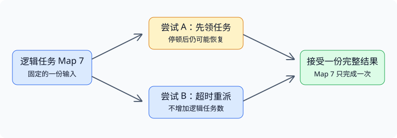

# L1：从 MapReduce 理解分布式系统

## 1. 多台机器为什么反而更难编程

一台机器处理不了全部数据时，最直接的想法是“把任务分给更多机器”。但随之出现三个问题：工作如何拆开，谁负责把结果拼回来，以及某台机器中途消失时怎么办。

**分布式系统是多台相互协作的计算机，而不是一台更快、永远可靠的大计算机。** 各节点有自己的执行进度；通信要花时间，也可能失败；一个节点故障时，其他节点往往还在运行。这种“部分失败”是理解后续课程的起点。

例如，协调器给 worker 分配一个任务，之后一直没收到完成消息。可能是 worker 崩溃，也可能是执行太慢、回复丢失，甚至任务已经完成但消息还没到。协调器掌握的是**观察结果**，不是远端的真实状态。

把本课程的问题压缩成三条线：

| 目标 | 真正要问的问题 | MapReduce 中的落点 |
|---|---|---|
| 性能 | 多加机器，哪个瓶颈才会变小？ | 任务并行、数据移动、负载不均与长尾 |
| 容错 | 部分组件失败时，怎样继续或恢复？ | 重新执行任务，保存可重建数据的依赖 |
| 一致性 | 并发、重试之后，结果还满足什么约定？ | 在条件满足时，与一次无故障顺序执行等价 |

可用性强调发生故障时仍能推进；可恢复性强调故障修复后能恢复运行。拥有备份不自动等于一直可用，能够重试也不自动等于结果正确。

## 2. 把分布式难题藏在受限接口后面

MapReduce 不要求每位应用开发者自己设计调度、网络传输和故障恢复。应用提供 Map 与 Reduce；运行时负责让许多任务协同完成计算。

先用一句话建立直觉：**Map 独立产生键值对，框架把同键的值聚齐，Reduce 对每个键进行归并。** 词频例子、程序模型与完整数据路径集中在[课程资料 §2–§3](#/c/mit-6.824-2021/lec/lec01?v=materials)。这里关心的是这个接口为什么值得限制。

- Map 任务之间不要求即时交换状态，所以可以独立调度。
- 同键归组规定了 Map 与 Reduce 之间的数据依赖，框架知道哪些数据必须送到一起。
- 如果函数对同一输入产生相同结果，任务失踪时就能重新计算，而不用恢复它执行到一半的栈和局部变量。

这不是“把任何顺序程序自动改成分布式程序”。需要跨任务实时交互、低延迟在线响应或频繁迭代的程序，不自然地适合单次 MapReduce。可以把多个作业串成流水线，但额外的数据物化与作业调度有成本；“单次调用只有两阶段”不等于“无法串联多个作业”。

## 3. 从结果正确倒推三个不变量

以下是编者将讲义主题整理成的推理框架；论文原有的提交规则见课程资料 §4。

### 不变量一：一个键的输入不能漏，也不能多算一次

设 Map 任务 $m$ 对键 $k$ 产生的值的多重集为 $V_{m,k}$。Reduce 应处理的是：

$$
V_k = \biguplus_{m=0}^{M-1} V_{m,k}.
$$

这里使用多重集：同一个词出现两次，就应贡献两次；但同一 Map 任务的两次**重试结果**不能被当成两份不同输入。

因此要区分：

- **逻辑任务**：作业中必须完成的一份工作，例如 Map 7。
- **执行尝试**：某个 worker 对 Map 7 的一次执行；超时重派后可能同时存在多个尝试。

正确性围绕逻辑任务定义；物理执行次数可以大于一次。按“有多少个 worker 说完成”累加进度，会把重复尝试误当成新任务。

### 不变量二：消费者只能依赖完整的已发布结果

“文件名已经出现”不代表文件写完了。如果 Reduce 读到半个中间文件，即使没有报错，也可能得到一个少算的结果。

所以要区分**私有写入**和**对外发布**。先写临时文件，完成后再通过原子重命名或元数据选择使完整结果可见。单文件原子重命名不等于多个文件的一次原子事务；Map 的多个分区何时可供使用，还取决于调度与提交规则。

对 2026 实验，最直接的阶段规则是：所有 Map 逻辑任务的分区文件都已准备好，才派发 Reduce。真实论文的 shuffle 可以提前拉取已完成 Map 的数据；它仍要等该 Reduce 的完整输入齐备后才能完成归约。不要把实验的简单屏障误读成论文完全没有流水重叠。

### 不变量三：宣布结束必须晚于结果发布

调度器派出了最后一个任务，并不意味着任务已完成。收到“计算完成”的消息，也只有在消息代表输出已经发布时，才能作为完成依据。

作业完成点应满足：所有 Reduce 逻辑任务的最终文件已就绪，后续无需正常 worker 再补写缺失结果。worker 暂时拿不到任务时，可能只是需要等待，并不是作业结束。

图：编者自绘。超时使同一逻辑任务出现两个执行尝试；完成计数仍只能增加一次。图中的“接受一份”是逻辑提交，不表示操作系统会自动阻止旧进程继续写文件。

## 4. 一个超时场景如何检验设计

考虑下面这个思想实验：

1. worker A 领取 Map 7，执行到一半停顿。
2. 协调器等待超时，把 Map 7 交给 B。
3. B 完成，协调器记录 Map 7 已完成。
4. A 恢复，也报告完成。

追问四件事：

**能否证明 A 死了？** 不能。超时只是恢复推进的一种决定，不是准确故障证明。增加等待时间会减少误判，但也会拖慢真实故障恢复。

**能否再增加完成计数？** 不能。逻辑任务只有一个。否则可能提前越过阶段边界。

**能否让 Reduce 同时读 A、B 的结果？** 不能把两份结果同时当作 Map 7 的贡献；即使两者各自正确，也会重复计数。

**只忽略 A 的完成 RPC 就足够了吗？** 还不够证明文件安全：A 可能已经写过某个公共文件。调度元数据与输出发布必须一起推理。确定性输出加原子替换可以使完整结果的替换无害；若输出不确定或含外部副作用，则需要更强的选择、隔离机制，不能直接照搬这个结论。

这也是后续 RPC 课程的伏笔：**执行次数、效果次数、调用者是否知道结果，是三个不同问题。** 本实验不提供任意外部副作用的 exactly-once 保证。

## 5. 性能：先找限制，再谈加机器

以下量级分析是编者补充，不是论文中的测量公式。

若总计算工作量为 $W$，使用 $N$ 个有效 worker；跨瓶颈链路传输的数据量为 $D$，该链路可用聚合带宽为 $B$；依赖链上的最长处理时间为 $L$，则完成时间至少受这些因素约束：

$$
T \ge \max\left(\frac{W}{N},\frac{D}{B},L\right).
$$

这是粗略下界，实际还要支付启动、同步、磁盘读写和调度成本；不能把它当成准确预测式。

- 增加 worker 能降低计算项，却不一定增加共享网络带宽。
- 若大部分记录都是同一个键，那个键仍聚集到同一 Reduce 分区；平均数据量小不代表最慢分区小。
- 如果最后只剩一个慢任务，空闲机器再多也不会自动缩短它的执行时间；备份执行正是针对这类长尾。
- 任务划分得更细，有利于动态平衡与故障恢复，但会增加调度次数和中间数据管理开销。

讲义强调网络、局部性和任务粒度；具体机制与论文实测见课程资料 §5–§7。这里应形成习惯：**说明性能结论时，同时写出数据量、资源瓶颈和运行条件。** 2004 年集群的测量不能直接当作今天任意机器上的性能。

## 6. 容错的边界也是设计的一部分

“能够容忍 worker 失败”不等于“任何失败都能容忍”。阅读系统时，把下面四个问题分开问：

| 问题 | 本讲需要记住的区别 |
|---|---|
| 进程死了还是机器不可达？ | 共享磁盘上的文件可能仍在；仅在故障机器本地的数据则可能不可读 |
| 结果能重算还是只能复制？ | 中间结果可以由原始输入重算；恢复成本因此不同 |
| 出错是停止响应还是返回错误数据？ | 超时重派处理前者，不能自行识别任意错误计算 |
| 管理者是否容错？ | 论文当时的 master 失败会中止作业；Lab 1 也不要求协调器复制 |

论文与实验的存储假设不同，详见课程资料 §9。不要仅凭“Map 完成了”就判断其结果永远可用，也不要在本地实验里机械地把 worker 进程退出当成共享文件全部丢失。

## 7. 做实验前的自测

### 题 1：所有任务都已派发，为什么还不能返回完成？

展开答案

派发只表示有人尝试执行，尚不能证明逻辑任务完成，更不能证明最终文件已发布。还可能存在执行中、超时后等待重派或完成消息尚未处理的任务。

### 题 2：把两次 Map 重试输出都拼进 Reduce，结果是否更可靠？

展开答案

不会。两份属于同一个逻辑输入的重复贡献，例如词频会被算两遍。冗余执行应增加获得一份可用结果的机会，不应增加该逻辑任务在计算中的权重。

### 题 3：有原子重命名，是否就有 exactly-once？

展开答案

没有。原子重命名解决单个文件的可见性；函数可能已被执行多次，外部消息或数据库更新也不会自动回滚。多个文件之间的一致性同样需要额外推理。

### 题 4：100 台机器只有一台繁忙，再加 100 台能否快一倍？

展开答案

不一定。要先判断是热点键、不可拆的大任务、机器异常，还是依赖造成串行尾部。增加空闲资源不自动改变分区或关键路径。

### 题 5：怎样从本讲进入 2026 实验？

先完成[MapReduce 实验说明](#/c/mit-6.824-2021/lab/mr?v=zh)中的顺序程序观察，再按[实验指导](#/c/mit-6.824-2021/lab/mr?v=guide)拆分实现。遇到 goroutine、互斥锁和 RPC 的基础问题，再衔接 L2/L10；不要先为 Lab 1 引入 Raft。

## 引用与来源

- MIT 6.824 Spring 2020，Robert Morris，L1 [官方讲义](http://nil.csail.mit.edu/6.824/2020/notes/l01.txt)。采用其中的课程主题、MapReduce 设计问题；正文重新组织，并明确标注推导。课程[首页](http://nil.csail.mit.edu/6.824/2020/)标注 [CC BY 3.0 US](https://creativecommons.org/licenses/by/3.0/us/)。
- Jeffrey Dean、Sanjay Ghemawat，*MapReduce: Simplified Data Processing on Large Clusters*，OSDI 2004，尤其 §3.3–§3.6。逐节精读及论文定位见本讲课程资料。
- 2026 Lab 1 与固定代码提交 `513cac0aef010750fc74688da8a395974a83cf7a` 仅用于实验衔接；没有回填为 2020 课堂内容。
- 本页未对视频逐段听写，不提供推测时间轴。字幕获取情况记录在课程 `status.json` 与 `sources/lec01-caption-p1.log`。
