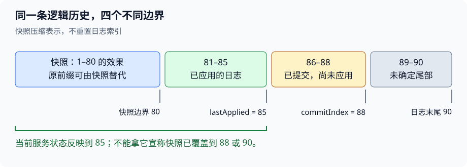

# L7：哪些历史可以删，哪些承诺不能退

## 1. 用四种“进度”拆开恢复问题

Raft（2）的核心问题是：**当日志分歧、进程重启、历史被压缩以后，服务为什么还能兑现此前的结果？**

先区分四种进度：

| 进度 | 它说明什么 | 它不能独自说明什么 |
|---|---|---|
| 已存储 | 本机保存了一条日志 | 该条目已经安全提交 |
| 已确认复制 | leader 得到 follower 的持久接收证据 | follower 已执行；任意旧项都可直接提交 |
| 已提交 | 该日志前缀不能被未来合法历史替换 | 本机服务已经执行到那里 |
| 已应用 | 服务已经执行该前缀 | 客户端一定收到了回复 |

许多错误都是把相邻两行合并：`Start` 返回就回复客户端；收到一份确认就把本地所有尾部当作匹配；`commitIndex` 已前进，就拿尚未执行到那里的 KV 表做快照。

课堂的讨论路线可这样查找，完整过程见[中文译稿](#/c/mit-6.824-2021/lec/lec07?v=draft)：

| 时间 | 想解决的问题 |
|---|---|
| 00:00–11:00 | 选举资格与图里没有画出的 currentTerm |
| 11:00–25:00 | 日志追赶、确认进度、旧任期条目为何不能只数多数 |
| 25:00–37:00 | 快速回退与通信量 |
| 37:00–60:00 | 持久化承诺、服务恢复与快照协作 |
| 60:00–72:20 | 旧快照问题；中间分组区间只有会务字幕 |
| 72:20–89:00 | Clerk、请求完成与线性一致性 |
| 89:00–108:46 | 课后问答：旧 leader、索引、写时复制、Start 返回 |

## 2. “可以修日志”为什么不等于“可以撤回结果”

把历史分成两个部分：已经确定的前缀，以及尚未确定的候选尾部。Raft 可以通过换 leader、冲突检查重写候选尾部，但不能让某个位置已经执行的命令变成另一条。

这里有两种性质完全不同的删除：

1. **冲突修复：** 删除未提交、与合法 leader 冲突的后缀。删除意味着放弃这份候选历史。
2. **快照压缩：** 删除已应用前缀的逐条表示。删除不放弃历史；其效果已经保存在快照里。

所以，排查“日志变短”不能只看长度变化，要问：**被删的是未决定的备选项，还是已经被另一种可靠表示取代的确定历史？**

还有第三种操作不合法：服务已经用某个状态回复成功，却因旧快照到达把这个状态撤回。它既不是安全修复，也不是等价压缩。

### 多数相交，还需要交点记住什么

多数相交只给出一个共同节点；真正有用的是这个节点仍保留它之前确认过的事实，并在下一次投票或复制时执行限制。

若交点在重启时丢失投票记录，它可能重复投票；若丢失已确认的日志，下一轮选举可能绕过原来已经受到保护的历史。**持久化让跨时间的多数相交仍然有意义。**

另一方面，旧项仅仅出现在多数日志中，未必已获得防覆盖保障。Figure 8 表明，需要将当前任期的提交条件和选举的新旧比较合起来看。具体反例、公式与证明统一见 [L5 课程资料 §4.1–§4.4](#/c/mit-6.824-2021/lec/lec05?v=materials)，这里不重新展开论文证明。

## 3. 用“猜测与证据”检查复制状态

`nextIndex` 回答的是：**下一次打算从哪里试着发送？** `matchIndex` 回答的是：**哪一段前缀已经有可靠确认？**

猜测可以乐观，可以回退；证据不能靠猜测生成。若同任期某 follower 刚确认到索引 40，后来一份更早请求的失败回复才到达，不能把已取得的确认当作从未发生。至少要把响应与发出时的任期、请求范围、当前进度关联起来。

一个有用的局部检查是：

> 成功回复所证明的终点，由**那次 RPC 的前驱与所带条目**决定，不由回复到达时 leader 新增长的日志尾部决定。

例如发出请求时只带到 40，等待期间 leader 本地又追加到 44。收到那次成功响应，只能据它确认到 40，不能说 follower 也拥有 41–44。

### 快速回退改变代价，不改变安全证据

设冲突后缀共有 $d$ 条，跨越 $t$ 个任期段。逐格探测可能产生与 $d$ 成正比的失败往返；利用冲突任期与首索引，可以让探测更接近按 $t$ 个段推进。**这不会把必须传送的实际日志内容凭空消除。**

因此要分别看两种成本：

- 探测多少次，决定要等多少轮网络往返；
- 重传多少字节，决定带宽与序列化成本。

“直接从 commitIndex 重发”或“每次发全日志”可能减少定位步骤，却发送大量已拥有的内容。课程中的字节预算就是让这种差异变得可见。

冲突任期用来定位日志段；RPC 的当前任期用来判断协议世代。这是两个问题。字段与边界约定见 [L5 课程资料 §3.4–§3.5](#/c/mit-6.824-2021/lec/lec05?v=materials)及 [Lab 3 指导 §5–§6](#/c/mit-6.824-2021/lab/raft?v=guide)。

### 课堂数值的阅读陷阱

译稿 16:00–19:00、97:00–99:30 中，讲师把 `matchIndex` 与下一空格混用。学习与实现应以论文定义为准：确认到 12，是 `matchIndex=12`；下一条从 13 发，是 `nextIndex=13`。字段语义不能因为“两个都表示进度”就互换。

## 4. 找持久化边界：谁已经开始依赖我的回复

不要先问“多久保存一次”，先问：**这条回复发出去后，其他节点会据此做什么不可撤回的决定？**

| 对外事件 | 对方会据此相信什么 | 必须先保住的状态 |
|---|---|---|
| 授予选票 | 本任期这张票不会再给另一人 | 当前任期与投票对象 |
| 确认日志接收 | 这份日志可以作为复制证据 | 对应日志及关联任期状态 |
| 保存新快照并丢弃旧前缀 | 重启时无需再找被删日志 | 快照、边界与剩余日志的一致组合 |

对于前两行，可以用一个三步故障实验思考：**修改内存 → 对外确认 → 尚未保存就崩溃**。只要重启后能够背弃刚才的确认，保存位置就错了。

### 为什么不是所有整数都必须永久保存

有些状态是在记录承诺，有些是在缓存“现在知道多少”。Figure 2 的基本模型允许重新获得提交边界，并重新建立 leader 的复制进度；它也默认服务能从日志重放重建。

但加入持久业务状态以后，恢复边界必须随之改变。不能一边保留已经扣款后的状态，一边把 `lastApplied` 当作零，从日志开头再扣一次。哪些字段在基本模型中易失，及其适用前提，见 [L5 课程资料 §3.2](#/c/mit-6.824-2021/lec/lec05?v=materials)。

## 5. 快照是一份带坐标的恢复点

快照不能只回答“表里现在有什么”，还必须回答“这些数据对应执行到了哪里”。用下面的例子区分边界：

*编者自绘：快照覆盖到 80，服务已应用到 85，本机已知提交到 88，日志保存到 90。数字是教学例子，不是课堂截图。*

此刻若从**当前服务状态**制作新快照，它对应的是 85，而不是 88 或 90。86–88 虽然已经提交，但尚未执行进这份状态；89–90 还可能是不确定的尾部。

恢复到快照 80 以后，应先有执行到 80 的状态，再按顺序执行后面确认安全的条目。不能再次执行 1–80，也不能直接跳到 86，除非已经安装了另一份覆盖到 85 的有效快照。

### 一个等价关系，解释为什么可以删前缀

设确定性转移函数为 $F$，日志前缀 $L_{1..s}$ 执行后的状态为 $S_s$。对于相同的后续已提交序列，有：

$$
\operatorname{Replay}(S_0,L_{1..n})
=\operatorname{Replay}(S_s,L_{s+1..n}).
$$

这个等式成立，需要 $S_s$ 真的是同一个前缀的结果。若快照里一半数据来自索引 80、一半来自 85，就不能给它随意贴一个边界。写时复制解决的正是“保存一个一致切面，同时继续处理请求”这一问题。

### 对快照要做的三个不同判断

1. **本地制作：** 服务给出的状态是否确实覆盖到声明的索引？
2. **远程安装：** 快照能否推进本机恢复点，还是已经过时？若与现有日志边界匹配，哪些后缀应保留？
3. **重启恢复：** 快照字节和 Raft 中记录的压缩边界是否来自相容的一次保存？

这三个判断不能用一个“收到就清空日志”代替。论文边界任期、后缀保留分支和快照成本见 [L5 课程资料 §6.1–§6.3](#/c/mit-6.824-2021/lec/lec05?v=materials)。

### 逻辑坐标不会随数组截断而重置

快照覆盖到 80，后面第一条日志仍叫 81。数组里的第一个元素可能对应边界占位项，也可能对应首个保留条目，具体约定由实现统一；但不能让同一任期中的“索引 1”因为截断而再次代表另一条命令。

这是课后 104:00–108:46 最值得提前理解的实现难点：**逻辑日志索引是协议身份，数组下标只是存储位置。**

## 6. 把 Raft 正确性接到服务正确性上

正确复制日志仍不足以让业务自动正确。服务至少要补齐下面三条连接：

### 6.1 从接受提议到返回结果

`Start` 返回表示底层调用结束，不表示命令已提交或业务结果已产生。服务必须把客户端等待的请求与真正交付、执行的命令联系起来。

旧 leader 留在少数分区时，可以继续误以为自己有权接受提议；只要不能取得有效提交证据，就不能向客户端返回新的成功结果。角色认知过期与成功结果错误，是两件不同的事。

### 6.2 从日志条目身份到业务请求身份

同一请求可能因为重试进入两个不同日志位置。Raft 会保证各副本对这两个位置达成一致，却不会自动理解“客户其实只想扣一次款”。课堂及论文通过请求 ID 和状态机去重处理这一层。

如果去重信息只在旧 leader 的临时内存里，换主或快照恢复后就可能重新执行。因此它若属于该服务协议，就必须进入服务的复制与恢复状态。完整客户协议见 [L5 课程资料 §8.1–§8.2](#/c/mit-6.824-2021/lec/lec05?v=materials)。

这只是对论文协议的推论。**2026 versioned Put 使用不同的接口与重试语义**，不能照此替换现有实验 API。

### 6.3 从共同顺序到外部时间约束

线性一致性不是“各副本最后会一样”。它要求整个可见调用历史能解释成尊重非重叠操作实时先后的合法串行执行。

判断读值时，可以按以下顺序推理，而不猜网络内部细节：

1. 标出已经完成后才开始的操作关系，得到必须遵守的实时边。
2. 按返回值加入语义约束，例如“读到 2”必须放在对应写入之后。
3. 检查是否存在满足这些约束的串行顺序；并发调用可以选择顺序，但不能让不同读者各选一套互相矛盾的历史。

课堂两个例子的区别在于**两次读是否重叠**，不是“返回 1 永远旧、返回 2 永远新”。完整推演见译稿 80:00–89:00；更多独立练习见[线性一致性专题](#/c/mit-6.824-2021/lec/update-linearizability?v=notes)。

## 7. 讲义比课堂多讲的内容，到哪里继续读

2021 链接讲义并不等于这 108 分钟的逐字脚本。课堂花了较多时间讨论快照和现场问题，没有完整展开讲义的以下内容：

| 讲义中的额外内容 | 继续阅读的位置 |
|---|---|
| 快速回退的 XTerm/XIndex/XLen 三种情况 | [Lab 3 指导 §6](#/c/mit-6.824-2021/lab/raft?v=guide)与实验说明；注意索引定义，讲义草图不是完整实现 |
| 线性一致性 history 3–6 | [线性一致性专题](#/c/mit-6.824-2021/lec/update-linearizability?v=notes)；课堂只完整走了前两个 |
| 每客户只保留一个请求结果、删除去重表旧项的条件 | [L5 课程资料 §8.2](#/c/mit-6.824-2021/lec/lec05?v=materials) |
| 不经日志直接读、no-op、心跳确认与租约 | [L5 课程资料 §8.3–§8.4](#/c/mit-6.824-2021/lec/lec05?v=materials) |
| 大状态快照的写入代价、持久数据结构选择 | [L5 课程资料 §6.3](#/c/mit-6.824-2021/lec/lec05?v=materials) |
| 指定阅读中的评估、相关工作与结论 | [L5 课程资料 §9–§10](#/c/mit-6.824-2021/lec/lec05?v=materials)，对应论文 §9–§12，不冒充视频讲解 |

只读优化尤其容易被一句话带偏：能够成为 leader，不等于多年以后仍能直接安全地读本地内存。历史提交边界、此次读取的有效权威、状态机应用进度，需要分别建立证据。课堂没有把这条优化路径完整讲完，先遵循实验提供的服务路径。

## 8. 连接 2026 Lab 3：沿用问题，重读接口

2021 的 Lab 2 对应本路线 **2026 Lab 3** 的 Raft 主题；2021 的 Lab 3 KV 对应后续 2026 Lab 4 的主题。这是学习顺序映射，不是接口兼容承诺。

当前最重要的三点差异：

- 持久化调用是 **`Persister.Save(raftstate, snapshot)`**。保存新 Raft 状态时还要维护已有快照，不能用 `nil` 顺手把它清除。
- 2026 骨架没有要求 `CondInstallSnapshot`。启动恢复时，**服务有自己的初始快照恢复流程**，不能再把同一旧快照作为新的状态重复交付。
- 基础 Raft 实验直接观察命令索引与 `ApplyMsg`，不是论文完整 KV 服务；不要只凭阅读到 no-op、请求 ID 或租约，就向基础实验增加不符合其契约的行为。

接口、恢复顺序、测试入口统一见 [Lab 3 实验指导](#/c/mit-6.824-2021/lab/raft?v=guide)，本文不提供完整实验实现。

## 9. 自测：为每个判断写出缺少的证据

### 已确认复制到 40，收到旧失败后把 matchIndex 改成 30，可以吗？

答案

若仍是同一领导任期，旧失败没有推翻后来成功取得的匹配证据。应先关联回复上下文，不能让迟到响应撤销新进度。若角色／任期已经变化，则要按新一轮状态处理，也不能把旧响应直接套进去。

### commitIndex 是 88，lastApplied 是 85，当前 KV 表能打上“快照到 88”吗？

答案

不能。表中没有 86–88 的效果。要么用一致的执行到 85 的状态生成边界 85 的快照，要么先把状态机推进到 88，再从那个一致边界生成。

### 快照 100 已经安装，迟到的快照 90 能先安装，再重放 91–100 补回来吗？

答案

不应把它当成正常安装路径。它会让已推进的状态机回退，还可能缺少被压缩掉的 91–100；重复执行也可能影响回复与去重信息。应识别这份快照已经过时，维护服务整体交付边界不倒退。

### 收到快照边界 100，本地日志到 110，是否一定保留 101–110？

答案

不能只按长度判断。需要证明本地索引 100 与快照边界的任期相同，才能依靠前缀匹配性质保留相应后缀；快照新旧与应用边界还要另外判断。

### 请求已执行但回复丢失。重试时读取到“上一次缓存的旧结果”，一定违反线性一致性吗？

答案

不一定。在论文的请求 ID 协议下，它仍是同一次逻辑调用，调用区间延续到最终拿到回复，可以把它放在最初执行的位置。不能把同一请求的重试误记为一次后来开始的新操作。若确实是新的调用，则不能随便复用旧结果。此题讨论论文协议，不替代 2026 versioned Put 的规格。

### 所有副本应用顺序一致，就能在 Start 返回时回复客户端吗？

答案

不能。`Start` 接受的提议可能最终被覆盖，也可能一直不能提交。副本对已提交日志的顺序保证，不会把尚未决定的提议变成成功结果。需要等待对应命令真正提交并执行。

### 切掉前 80 条后，数组只有 10 条，为什么下一个协议索引不是 11？

答案

因为逻辑日志仍已到 90，下一条是 91。快照改变存储表示，不改变历史坐标；否则会让相同 index/term 重新代表不同命令，破坏日志匹配所依赖的身份规则。

## 引用与来源

- Frans Kaashoek，MIT 6.824 Spring 2021，*Lecture 7: Fault Tolerance: Raft (2)*，视频 ID `h3JiQ_lnkE8`，上传日期 2021-03-11，108:46。全部 2732 条英文自动字幕按顺序读取，含 89 分钟后的问答；首六秒无字幕、分组区间不可恢复、末条超时 1.440 秒，无音画核验。
- [2021 链接讲义](http://nil.csail.mit.edu/6.824/2021/notes/l-raft2.txt)，496 行；[Raft（2）FAQ](http://nil.csail.mit.edu/6.824/2021/papers/raft2-faq.txt)，563 行，均完整读取。讲义首行残留“2020 Lecture 7”；FAQ 中有成员变更及旧实验编号，按来源保留，不据此扩展指定阅读中跳过的 §6。
- Diego Ongaro、John Ousterhout，*In Search of an Understandable Consensus Algorithm (Extended Version)*，2014。L7 指定 §7 至末，与 L5 共用[论文精读](#/c/mit-6.824-2021/lec/lec05?v=materials)；本讲定点复核 Figure 2、7、8、12、13 及相关文字，未声称重新完整通读论文。
- [课程网站](http://nil.csail.mit.edu/6.824/2021/)的 [CC BY 3.0 US](https://creativecommons.org/licenses/by/3.0/us/)适用于课程自有内容。视频独立元数据标记 CC Attribution，但具体版本未知。本文的边界模型、原创例子、自测与 SVG 为编者组织。
- 2026 版本事实采用已完成的 [Lab 3 指导](#/c/mit-6.824-2021/lab/raft?v=guide)与共享论文的接口核对；固定提交 `513cac0aef010750fc74688da8a395974a83cf7a`。本讲未重新审计完整实验代码、未运行实验测试。详细审阅记录位于 `sources/p3-lec07/review.txt`。
