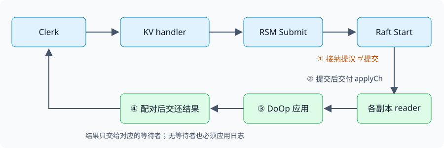

# 从 Raft 日志到可迁移的键值服务

## 1. 有了相同的日志，为什么还没有相同的服务？

Raft 决定命令的顺序，服务还必须回答三个问题：**何时执行、结果交给谁、重启后从哪里继续**。如果这三处衔接错误，日志完全正确也会出现读到旧值、把别人的结果返回给请求者、恢复后重复执行等问题。

2026 Lab 4 把这段通用逻辑单独放进 RSM（replicated state machine）层。它不需要理解键和值；它需要把一条已提交命令交给状态机，并把执行结果交还给相应的提交者。

| 层 | 负责的问题 | 固定入口 |
|---|---|---|
| Clerk | 找服务器、重试、表达写入结果的不确定性 | `Get`、`Put` |
| KV | 键、值、版本的确定性状态转换 | `DoOp`、`Snapshot`、`Restore` |
| RSM | 提交与执行结果的配对、顺序应用、应用快照衔接 | `Submit`、`applyCh` reader |
| Raft | 日志顺序、提交、持久化、日志压缩与快照传输 | `Start`、`GetState`、`Snapshot`、`PersistBytes` |

这里的“副本相同”指**执行相同日志前缀后得到相同状态**。网络、调度和应用进度可以不同，不要求各副本每一瞬间的内存都一致。

这个结论还依赖 `DoOp` 的确定性：相同的旧状态与请求必须得到相同的新状态和结果。若各副本自行用当前时间、随机数或外部网络查询决定业务更新，即使日志相同也可能分叉。KV 的版本判断与更新应只依赖被排序的请求和已应用的本地业务状态。

先学过 [L5/L7 的共识与恢复](#/c/mit-6.824-2021/lec/lec07?v=notes)，再把本页的层间契约落实到 [Lab 4 指导](#/c/mit-6.824-2021/lab/kvraft?v=guide)。具体任务与测试命令集中于实验页。

## 2. 一个请求有四个不同的完成点



*编者绘制：上方是提交路径，下方是已提交命令的执行路径；所有副本均应用命令，只有有对应等待者的节点需要交还结果。*

1. **接纳提议**：`Start(command)` 返回索引、任期和 `isLeader`。`true` 只说明该节点当时认为自己是 leader，既不代表提交，也不包含 KV 执行结果。
2. **日志提交**：Raft 建立不会被后续合法 leader 覆盖的日志前缀。Raft 不理解 `Put` 的业务结果；版本不匹配的 `Put` 也可以是一条正常提交的日志。
3. **状态机应用**：reader 接收 `CommandValid` 消息，按顺序调用 `DoOp`。这时才知道该 `Get` 读到了什么，或该 `Put` 返回 `OK` 还是 `ErrVersion`。
4. **结果回复**：确认结果属于本次 `Submit`，才交还给 RPC handler，再返回 Clerk。回复仍可能在网络中丢失。

把版本检查放在 `Start` 之前就直接决定结果是不可靠的：检查时看到版本 7，在命令真正轮到执行前，另一条日志可能已将它改为 8。**业务判定要在全体副本相同的执行位置进行。**

固定接口是：

```go
// StateMachine：由 KV 等具体服务实现
DoOp(any) any
Snapshot() []byte
Restore([]byte)

// RSM：供具体服务调用
Submit(req any) (rpc.Err, any)
```

`Submit` 的外层错误与 `DoOp` 的业务结果属于两层：外层 `rpc.OK` 表示已获得这次操作的执行结果，内层回复仍可能是 `ErrNoKey` 或 `ErrVersion`。不要把“达成共识”解释成“写入一定成功”。

## 3. 日志位置不是请求身份

考虑这个交错：

| 时刻 | 旧 leader A | 新 leader B |
|---|---|---|
| 1 | 将请求 X 放在索引 41，尚未提交 | — |
| 2 | 被隔离，X 的 handler 等待结果 | 获得新任期 |
| 3 | — | 在自己的索引 41 放入 Y，并提交 |
| 4 | 恢复通信，收到索引 41 的 Y | — |

如果 A 只按索引唤醒等待者，就会把 Y 的结果交给 X。Raft 可以合法覆盖**未提交**的位置，因此配对必须同时回答“哪个日志位置”和“到底是哪次提交”。固定骨架让 `Submit` 用带唯一标识的 `Op` 包装请求，reader 将其与等待调用对应。

这不是在要求 RSM 把请求去重机制强加给每一种应用。两种身份的用途应分开：

- **RSM 提交身份**：防止结果误投，尤其是覆盖、重放及重启之后的新提交。
- **KV 业务条件**：同一键的版本匹配才更新，保证一个给定版本的写入至多成功一次。

新的一次 RPC 重试可以形成新提交，但携带的 `Key/Value/Version` 不应擅自改变。RSM 通用测试使用计数器，不应偷偷在通用层假设“相同请求值就是重复请求”。两次相同的增量也可能是两个不同的合法操作。

还有一个没有故障也能发生的交错：`Start` 返回后，reader 在等待记录建立前已经执行完命令。设计时必须明确“登记等待”和“结果可见”的先后关系；否则唯一标识正确也会丢掉通知。具体并发组织留给实现，核心要求是**结果不会误投，也不会因正常调度而丢失**。

## 4. `ErrWrongLeader` 表达什么？

可以确定不是 leader 时，不应让调用等待一个永远不会由本节点提交的操作。已调用 `Start` 后发现任期改变，或预期位置出现另一条命令，也需要处理失去领导权的路径。

但 `ErrWrongLeader` 是“客户端应该寻找可继续服务的 leader”的信号，**不是通用的业务回滚证明**。操作可能已经提交，而本次等待没拿到结果；也可能确实永远未提交。返回错误不能撤销日志里的命令。

官方 4A 特别允许：若旧 leader 被独自隔离，它可能暂时不知道新 leader 的存在，可以等到分区恢复。不要额外把“所有旧 leader 必须立即自知失效”当成 Raft 的保证，也不能仅因等待超过某个时长就宣布操作一定未执行。

固定测试还实际观察了分区期间的等待及恢复后的退出，因而不能把“随便设置一个短超时，让所有 Submit 提前返回”当成这里的通用解法。时间阈值和具体观察点见实验指导；它们是这版测试的约束，不是共识安全性的定义。

reader 的另一个独立职责是继续应用已提交日志：即使本节点不是 leader、没有等待者，或原 RPC 已经结束，该命令仍须影响本地状态。**本地无人等结果，不等于这条命令可以不执行。**

## 5. 版本化 KV 把哪种不确定性留给了调用者？

2026 继续采用 Lab 2 的接口：

```go
Get(key string) (string, rpc.Tversion, rpc.Err)
Put(key string, value string, version rpc.Tversion) rpc.Err
```

版本是每个键的状态，不是 Raft 任期，也不是全局日志索引。已有键只在请求版本等于当前版本时更新值并递增版本；新键以版本 0 创建，成功后版本为 1。不存在的键收到正版本写入，返回 `ErrNoKey`。

假设 `x` 当前为 `(a, 7)`，客户端请求 `Put(x, b, 7)`：

1. 请求成功提交、应用，`x` 变为 `(b, 8)`。
2. 回复丢失。客户端换一个 leader，**仍用版本 7** 重发。
3. 重发在状态机里得到 `ErrVersion`，因此不会第二次更新。
4. Clerk 却无法仅凭这个回复分清“自己的第一遍成功”与“别人先把版本改了”，应按固定接口的重发规则向调用者报告 `ErrMaybe`。

第一次 RPC 就得到 `ErrVersion`，可以返回明确的 `ErrVersion`；重发后得到它，则按骨架契约返回 `ErrMaybe`。丢回复本身是继续重试的理由，不能一见网络错误就把一次不确定的 RPC 当成最终业务结果。服务端不直接产生 `ErrMaybe`。

这也说明为什么“至多一次写成功”不等于“客户端始终能知道是否成功”。论文 §8 的客户端请求编号与结果缓存是另一种设计；本实验没有要求用旧版 `PutAppend` 或去重表替换版本化接口。完整的历史判断与锁重试问题见 [线性一致性笔记](#/c/mit-6.824-2021/lec/update-linearizability?v=notes)。

## 6. Get 不修改数据，为什么也进日志？

构造反例：A 曾是 leader，保存 `x=a`；A 被隔离后，B、C 选出新 leader，并让另一个客户端的 `Put(x,b)` 返回成功。随后读请求到 A，A 仅检查自己的 `GetState()`，仍认为自己是 leader，于是从本地 map 返回 `a`。这个读在成功写之后开始，却看不到它，违反线性一致性。

2026 Lab 4 的直接方案是把 Get 和 Put 都送进 `Submit`。读必须在一个可提交的日志位置执行，不能靠旧 leader 的本地认知放行。一次操作在 `DoOp` 得到结果后，提交者与它配对并返回，形成清晰的顺序证据。

这不是说所有系统都必须把每次读写入日志。论文另有读优化；但它们需要额外的领导权与应用进度证明，固定实验不要求实现。ZooKeeper 的本地读与本实验的线性一致 Get 也不是同一契约，比较见 [L9 笔记](#/c/mit-6.824-2021/lec/lec09?v=notes)。

## 7. 快照是三个层次的共同边界

设已应用到索引 80，Raft 可能已提交到 85、追加到 90。应用快照只能声称包含自己实际反映的前缀，不能因为日志走到 90 就给当前 KV 状态标上 90。

| 层 | 需要保存或解释的内容 |
|---|---|
| KV | 所有键的值和版本；恢复后应有完全相同的业务判定 |
| RSM | 应用前缀边界及自身确需恢复的元信息，使字节内容与索引对应 |
| Raft | 被压缩边界的索引、任期、后续日志及其他持久状态；与应用快照原子保存 |

`StateMachine.Snapshot()` 只提供服务字节，`rf.Snapshot(index, bytes)` 才把应用状态绑定到 Raft 日志边界；两者同名但职责不同。RSM 若需要自己的元信息，可以约定外层快照格式，不过启动恢复和收到远程快照必须使用同一套解释。不要只给索引 80 的状态贴上 85，也不要把尚未提交的请求算进去。

生成快照与 `DoOp` 的关系同样要明确：若编码 map 时另一条操作正在更新，生成的字节可能不是任何一个合法日志前缀。单一应用序列或合适的同步必须保证状态与边界是一致的一份切面。等待 RPC 的 channel 等进程内对象不属于可恢复的业务状态。

### 触发、保存与恢复

- `maxraftstate` 与 `rf.PersistBytes()` 比较，限制的是持久 **Raft 状态字节**，不是应用快照字节；`-1` 表示不要求快照。
- 状态机先执行到某一位置，RSM 再向 Raft 提交该位置的一致快照；Raft 才能安全丢弃对应日志前缀。
- `Persister.Save(raftstate, snapshot)` 原子替换两份数据。骨架 RSM 注释残留 `SaveStateAndSnapshot`，固定类型没有这个方法。
- 重启时，延续 P3：在启动 Raft 前取得初始快照副本，在消费新的应用消息前恢复服务及其应用边界；不要让恢复覆盖已经执行的新状态。
- 运行中收到 `SnapshotValid` 消息，应恢复其对应前缀，再接续后续命令。不能把旧快照装回去，也不能在恢复后重新执行已包含的前缀。

P3 已确立第一条恢复交付须为更靠后的快照，或紧接已恢复快照的命令；不靠旧 `CondInstallSnapshot` 接口再补一层约定。具体恢复边界、自绘示例与论文 §7 分别见 [L7 笔记](#/c/mit-6.824-2021/lec/lec07?v=notes)、[L5 共享论文](#/c/mit-6.824-2021/lec/lec05?v=materials)。

快照不需要保存“这个进程还有哪个 RPC 在等”。收到快照后怎样处理等待者，是本进程活性问题；快照中有最终 KV 状态，也不能凭此伪造某次历史 Get 的精确返回值。

## 8. 用故障情境检查自己的理解

### 问题一：Submit 返回外层 OK，Put 却返回 ErrVersion，矛盾吗？

<details><summary>展开答案</summary>

不矛盾。请求经过一致的日志顺序执行了，但在执行位置不满足版本条件。共识保证顺序和结果来源，不保证所有业务条件成立。

</details>

### 问题二：没有本地等待者的日志可否略过？

<details><summary>展开答案</summary>

不可。它可能由别的 leader 提交，或来自重启后的重放。所有副本都要执行同一个已提交前缀；只有通知等待者是可选的本地动作。

</details>

### 问题三：快照保存了值却没有保存版本，会怎样？

<details><summary>展开答案</summary>

读值可能暂时正确，但条件写的判定已经变了。重试旧版本可能再次生效，或本应成功的新版本被拒绝。版本是业务状态的一部分。

</details>

### 问题四：任期改变就清空 KV，能避免旧 leader 回复吗？

<details><summary>展开答案</summary>

不能。任期不是业务状态的生命周期；已提交前缀不能因换 leader 而丢失。需要处理的是本次等待与领导权，业务状态仍由日志和快照恢复。

</details>

## 9. 分片之后，多了哪一个顺序问题？

一个 Raft 组只能排列**本组**操作。把同一分片从 A 复制到 B，并不会自动把 A 的最后一次写与 B 的第一次写排成一个共同历史。Lab 5 要补上的正是这条边界：**每个分片同一时刻最多有一个组能成功服务，请求跨组后仍延续原来的键值与版本。**

“配置”是 `ShardConfig{Num, Shards, Groups}`：12 个逻辑分片映射到组，再由组映射到服务器列表。键用既有 `Key2Shard` 映射，不能重新选择哈希函数。初始配置号为 `NumFirst=1`，`Gid1` 起初拥有全部分片；新组不能也默认拥有全部分片。

| 对象 | 职责 | 不应混淆的边界 |
|---|---|---|
| 外层 `shardkv` Clerk | `Query` 配置，找到分片组；处理换组重试 | 缓存配置是路由提示，不是服务授权 |
| 内层 `shardgrp` Clerk | 找到该组 leader，调用读写与迁移 RPC | 换 leader 与换组是两种重试 |
| 分片组 | 在 RSM 中排序 Get/Put 与迁移命令 | 每组服务器集合固定，不实现 Raft 成员变更 |
| `ShardCtrler` | 保存配置、驱动迁移、恢复未完成迁移 | 是短生命周期客户端，不是另一个默认已复制的服务 |
| 配置 KV | 保存控制器需要恢复的配置状态 | A–C 默认是 Lab 2 `kvsrv`，不是 Lab 4 `kvraft` |

控制器接口是 `InitConfig`、`Query`、`ChangeConfigTo`、`InitController`。`ShardConfig` 上的 `Join/Leave/JoinBalance/LeaveBalance` 是已有的本地配置计算辅助方法，**不是旧 shardmaster 的远程 Join/Leave/Move API**。

### 三种数字，各自约束什么？

- **键版本 `rpc.Tversion`**：限定一次条件写能否成功，包括保存配置的 KV 键。
- **配置号 `shardcfg.Tnum` / `Num`**：标识分片迁移属于哪轮配置，拦住延迟到达的旧迁移命令。
- **Raft index / term**：限定一个组内的复制顺序和领导任期，不提供全局配置选举。

两个控制器可能都构造出 `Num=8`，却分别想把分片移到 B 与 C。只比较 `Num` 无法选出唯一目标；这一点是 §13 的核心。

## 10. 冻结 → 安装 → 删除：移交的是服务权

考虑配置 7 中分片 s 在 A，配置 8 要把它移到 B。以下是官方推荐顺序的不变量解释，不规定完整实现的数据结构。

| 阶段 | A | B | 必须成立的事实 |
|---|---|---|---|
| 迁移前 | 服务 s | 不服务 s | B 有进程不等于 B 有服务权 |
| A 应用 `FreezeShard(s,8)` 后 | 保留冻结数据，拒绝后续 Get/Put | 尚未安装，不服务 | 截面包含冻结前已执行的写 |
| B 应用 `InstallShard(s,state,8)` 后 | 仍冻结 | 可按新状态服务 | 不能漏掉键版本，也不能让 A 复活 |
| A 应用 `DeleteShard(s,8)` 后 | 删除数据，保留必要的迁移屏障 | 服务 | 必须已确认安装成功才删源数据 |
| 发布配置 8 | 继续拒绝陈旧路由请求 | 新查询路由到 B | 正常客户端能够发现新位置 |

冻结和安装之间可以暂时无人服务 s；这是为安全性付出的迁移停顿。要求是“至多一个”，不是“永远恰好一个”。但**未参与迁移的分片必须继续服务**，不能把一个分片冻结变成整个集群停机。

为什么冻结也要经过 RSM？设 A 的 leader 只在内存里标记冻结并复制数据；随后换 leader，另一个副本不知道冻结，继续接受写。B 已开始服务，就出现双写。`FreezeShard`、`InstallShard`、`DeleteShard` 与 Get/Put 都必须在对应组的已提交应用序列中判定和生效；在 RPC 入口先检查一次 ownership 不足以约束排队中的请求。

若一个 Put 排在 Freeze 前，应先影响状态再被导出；若排在 Freeze 后，应被拒绝。冻结返回的数据必须对应这一确定的切点。不要把仍会修改的内部 map 直接交给 RPC 编码器；固定迁移 RPC 的 `State` 实际是 `[]byte`，应携带独立、可恢复的分片状态。

### 为什么冻结后 Get 也不能随便放行？

网页对第一步的简述只说拒绝 Put，但固定 `server.go` 明确写着拒绝后续 **Get/Puts**。若 B 安装后已成功写入新值，随后一个持旧配置的客户端从 A 读出冻结旧值，就破坏线性一致性。因此这里采用固定接口的边界：冻结后源组拒绝该分片的 Get 和 Put，外层 Clerk 重新查询并重试。

## 11. 重试不能让时间倒流

网络丢回复不能撤销一次状态转换。新控制器还可能重复旧控制器已经做过的步骤，所以“执行成功一次”与“重发能安全完成”必须一起设计。

| 重放情境 | 危险行为 | 必须保住的性质 |
|---|---|---|
| Freeze 回复丢失，再次 Freeze | 重新开放写入，或者重新截取不相容数据 | 同一轮冻结不改变已经确定的移交边界 |
| Install 已生效，B 又接受了新写；旧 Install 重来 | 用迁移时旧数据覆盖 B 当前状态 | 同轮重复安装不能回滚服务后的更新 |
| Delete 成功但回复丢失 | 把“数据不存在”解释成整个迁移失败 | 重复删除可识别已经完成，不需复活数据 |
| s 后来又迁回 A；旧 Delete 到达 | 删除 A 的新一轮数据 | 每分片记录的配置屏障不能随数据删除而忘掉 |
| 旧 Freeze/Install 延迟到新一轮之后 | 把新服务状态冻结或换成旧副本 | 过期命令不产生新副作用 |

因此仅有“最大 `Num`”还不够表达同号命令的先后阶段；也不能一律把相等 `Num` 当成第一次执行，或一律拒绝后让调用方永远重试。需要结合本分片在该轮已经达到的状态，区分首次动作、重复动作和过期动作。具体状态名及返回策略由实现决定，固定 RPC 没有预置完整的迁移状态机。

特别地，`FreezeShardReply` 带 `State/Num/Err`，而封装的 `Clerk.FreezeShard` 只返回 `([]byte, rpc.Err)`。内层 Clerk 必须正确处理回复身份；上层不能把任意返回字节都当成所请求配置的迁移数据。源组已经删除后，也不能凭“重试冻结”凭空取回旧数据；恢复路径需要利用已完成步骤的证据，避免重新覆盖已经安装的状态。

### 快照多保存哪些状态？

复用 §7 的双层快照和 P3 恢复顺序，额外检查：**每个分片的数据、每个键的版本、是否可以服务、迁移阶段和防旧 RPC 的配置屏障**，是否都能在重启后恢复。即使某个分片已无数据，它拒绝旧命令的理由也可能仍需保存。

安装分片不是给整个 Raft 组安装快照。`InstallShard` 是正常 RSM 业务命令，只改变目标分片；`Restore` 则恢复一个组的完整状态机切面。把两者混用，会把同组其他分片的数据覆盖掉。

## 12. 控制器崩溃，接手者凭什么继续？

控制器只是发 RPC 的进程，它的本地栈、循环位置和缓存不能成为恢复依据。官方建议在配置 KV 中保存 **current 和 next**：先记录获准实施的目标 next，再做迁移；完成后把 next 发布为 current。`Query` 给普通客户端的是当前配置；`InitController` 则检查有没有尚未完成的更高编号目标并接续它。

| 中断点 | 接手者需要回答的问题 |
|---|---|
| 目标已写入，但尚未冻结 | 持久目标是哪份配置？从哪些源组移动到哪些目标组？ |
| 已冻结，尚未安装 | 如何取得同一轮冻结截面并继续，而不是把源组重新开放？ |
| 已安装，尚未删除 | 如何让重复安装不覆盖新写，再安全收尾源数据？ |
| 已删除，尚未发布 current | 如何识别已完成的迁移，使新客户端最终找到新位置？ |
| 发布回复丢失 | current 是否已经推进？不能把超时等同于发布失败 |

这里要求保存**足够重建工作目标的信息**，不必把每次 RPC 的本地执行栈写入 KV。重复执行安全的迁移步骤可以减少记录进度的负担，但前提是 §11 的幂等与屏障真的成立。

“恢复控制器”也不意味着配置存储本身已经容错。A–C 测的是控制器故障、网络隔离及接手协调，默认配置仍存在 Lab 2 单机 KV。把它改成复制 KV 并自行测试故障，是官方 5D 的一个扩展方向。

## 13. 两个控制器提出同号不同配置，谁说了算？

设 current 为 7。控制器 X 想加入组 B，Y 想移除组 C；两者从同一旧配置计算出不同的配置 8。如果双方先发 Freeze/Install，再竞争公布配置，即便各组严格检查 `Num=8`，系统仍可能已经朝两份不同目标迁移。

需要先在配置 KV 中建立**唯一被接纳的 next 内容**，再执行它。官方建议用 KV 键的 versioned Put：两个控制器读到同一键版本，只有一个对该版本的写能成功。落败的调用不能用自己的未获选目标继续移动分片；恢复者可以帮助完成持久化的已获选目标。这不是要求实现另一个 Raft 选举。

注意两层不同的隔离约束：

1. **目标选择与发布**：KV 条件写保护持久配置，阻止同号不同内容和旧控制器回写覆盖新进度。
2. **迁移执行**：每个分片的 `Num` 与阶段检查，阻止延迟 RPC 影响新一轮数据。

只做好第二层，拦不住同号不同目标；只做好第一层，拦不住已经在网络中的旧 Delete。配置记录若分成多个键，也不能假定两次 Put 是原子的，必须分析中断与并发能看到的中间状态。这里不规定唯一存储布局。

### 条件写返回 ErrMaybe 怎么办？

沿用 §5：它既不是明确落败，也不是已获得资格的凭证。重新读取共享配置，核对**配置编号与实际内容及其进度**，再判断应帮助已有迁移还是停止当前候选。仅看“现在也是 Num=8”不能证明是自己的目标；更不能直接换成最新键版本、把自己的旧候选强写进去。写 current 的收尾同样不能越过较新的配置，也不能擦掉后来控制器已经接受的 next。

这也解释了为什么只用一个内存互斥锁或“旧进程应该已经死了”不成立：不同控制器不共享锁，被分区的旧进程还会重新联网。正确性来自共享条件写与服务端屏障，而非对死亡的猜测。

## 14. 跨组客户端的不确定性不能被重置

设 `x=(a,4)` 在 A。客户端 `Put(x,b,4)` 已执行但丢了回复；随后 x 迁到 B，包含 `(b,5)`。客户端刷新配置后把同一请求发给 B，得到版本不匹配。

- B 没有出错：迁移必须保留版本 5，让重试不能再次生效。
- 外层 Clerk 不能因为“这是第一次向 B 发 RPC”就报告确定的 `ErrVersion`；**这仍是同一次逻辑 Put 的重试，之前已有不确定执行。**
- `ErrWrongGroup` 表示这次服务节点不能处理，不证明之前发出的请求都未执行。内外两层 Clerk 要传递必要的不确定性；错误不应被刷新配置这一动作抹去。
- 重试仍用原始 `Key/Value/Version`，不能为求成功自动读取新版本再写。具体哪层负责重发、如何传递不确定状态，应形成一致契约。

由此得到跨迁移的线性化思路：源组冻结前的成功操作属于前段历史，目标组从完整移交状态继续；冻结后的错误与等待不构成成功读写。配置 KV 提供发现路径，真正的服务权由分片状态机维护，而不是要求所有客户端同时刷新路由。

## 15. 迁移自测与事务连接

<details><summary>只有删除数据，没有保存迁移编号，为什么重启后可能出错？</summary>

重启后节点失去拒绝旧 Install/Delete 的依据；延迟请求可能复活已经迁出的数据，或删除后来迁回的数据。空分片的控制状态也可能是持久状态。

</details>

<details><summary>目的组已开始服务，就可以让源组继续只读吗？</summary>

不可以。目的组成功的新写之后，源组的冻结副本会提供陈旧读。固定 Freeze 接口要求拒绝后续 Get/Put。

</details>

<details><summary>next 的条件写成功了，是否不再需要分片端 Num 检查？</summary>

仍需要。条件写选出配置目标，不会撤回已经发出的网络消息；分片端必须防止旧消息污染后续配置。

</details>

<details><summary>有多个 Raft 组，是否必须用 2PC 才能完成 Lab 5 A–C？</summary>

不需要。A–C 维护单键线性一致性和分片移交，不提供任意跨分片原子事务。迁移中的冻结与恢复不是完整事务接口。L13/L14 帮助理解更强的多对象原子性、隔离与真实时间顺序；在 Lab 5D 选择跨分片事务方向时，官方才要求实现两阶段提交与两阶段锁。

</details>

实验任务、接口表和阶段测试集中于 [Lab 5 说明](#/c/mit-6.824-2021/lab/shardkv?v=zh)与[指导](#/c/mit-6.824-2021/lab/shardkv?v=guide)。理论拓展见 [L13 事务](#/c/mit-6.824-2021/lec/lec13?v=notes)、[L14 Spanner](#/c/mit-6.824-2021/lec/lec14?v=notes)。5D 是官方开放扩展，本自学路线将它列为进阶项，并非宣称 MIT 不要求。

## 引用与来源

- 本页为跨版本编者桥接，不是 2021 或 2026 某一节课堂的译稿。§1–8 为 P4 的 RSM / KV / 快照桥接；§9–15 为 P5 的迁移、恢复与并发配置讲解。
- MIT 6.5840 Spring 2026：[Lab 4 官方要求](https://pdos.csail.mit.edu/6.824/labs/lab-kvraft1.html)，本地 `sources/lab-kvraft-2026.html`，2026-11-08 快照；正文 589 行完整读取。官网课程自有文本标注 [CC BY 3.0 US](https://creativecommons.org/licenses/by/3.0/us/)，本页为自主改写与推导。
- 固定仓库 `git://g.csail.mit.edu/6.5840-golabs-2026`，提交 `513cac0aef010750fc74688da8a395974a83cf7a`。主 agent 完整静态读取并核验哈希：`src/raftapi/raftapi.go`、`src/kvraft1/rsm/rsm.go`、`src/kvraft1/{server,client}.go`、`src/kvsrv1/rpc/rpc.go`、`src/tester1/persister.go`。实验专责阅读测试的范围另见 `sources/p4-lab4/review.txt`；未运行实验。
- 恢复契约沿用 `sources/P3-REVIEW.txt`，共享论文只引用 L5，未重新宣称全文阅读。请求身份、快照切面与故障表格为编者推导，不是完整实验实现。
- P5 完整读取 [Lab 5 官方页](https://pdos.csail.mit.edu/6.824/labs/lab-shard1.html)的本地 807 行快照，沿用 MIT 课程自有文本 [CC BY 3.0 US](https://creativecommons.org/licenses/by/3.0/us/) 署名。主 agent 完整读取并核验固定源码：`src/shardkv1/` 下的 `client.go`、`shardctrler/shardctrler.go`、`shardgrp/{server,client}.go`、`shardgrp/shardrpc/shardrpc.go`、`shardcfg/shardcfg.go`，以及 `src/kvsrv1/{client.go,rpc/rpc.go}`。迁移表格与反例为自主推导；测试静态阅读由实验专责完成，详见 `sources/p5-lab5/review.txt`；没有运行实验测试。
