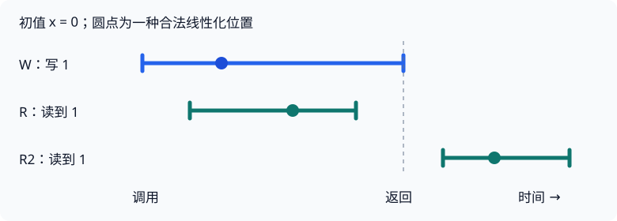

# 线性一致性：把并发历史放回一个合法顺序

## 1. 先明确：什么叫“像一台服务器”

想象一个键值服务，初值 `x=0`，只有两种操作：`Write(x,v)` 将值替换为 v，`Read(x)` 返回当前值。这里先用**普通读写寄存器**建立直觉，稍后再换成 Lab 2 的版本化 Put。

只要每次等待前一个操作返回后才发下一个，就容易判断：写 1、写 2、再读，应该得到 2。但若读取和写入重叠，或副本尚未同步，什么结果算正确？

一致性模型就是对**客户端能观察到的行为**作约定。线性一致性（linearizability，也称可线性化性）要求：每个操作看起来像在调用与返回之间的某一瞬间生效，所有操作在这些瞬间形成的顺序，符合对象的顺序规格。

它不是“用了 Raft”的别称，也不是“加了锁”的别称。先有规格，再选择实现；不同实现都可以满足它，同一个机制用错也可能违反它。

## 2. 历史记录的是调用与返回

一个操作至少需要这些信息：客户端、对象、操作及参数、调用事件、返回事件和返回结果。

例如 `R=[2,8]→1` 表示读取在时刻 2 调用、时刻 8 返回，结果是 1。时间区间包含网络等待与内部处理，不只是服务器执行 handler 的那一小段。

若 A **已经返回**，B 才**开始调用**，记为 $A\prec_H B$，这是必须保留的实时先后关系。若区间重叠，两者是并发操作，单凭开始时间或返回时间不能决定最终顺序。

“并发”不要求同一个纳秒都在 CPU 上执行。A 等网络期间 B 完成了一个请求，仍属于操作区间重叠。

图：编者自绘。每条线段是调用至返回；小圆点是一种合法选择，不是实际服务器日志里的时间戳。初值为 0，W 写 1，R 返回 1；R2 在 W 返回后才开始，也必须返回 1（假设没有其他写）。

实现不必给每个请求附带一个全球同步时钟。这里的时间用于表达外部约束；判断与证明可以利用事件关系，而不是依赖各机器墙钟完全一致。

## 3. 用四个小历史练习判断

### 例一：先调用，不一定先线性化

设 W 写 1，区间 `[1,6]`；R 读 x，区间 `[2,4]`。两者重叠：

- R 返回 0：可以排 `R → W`。
- R 返回 1：可以排 `W → R`。
- R 返回 9：没有任何写入能解释 9，不合法。

W 先开始，不强制它先生效。R 先返回，也不强制它先生效。关键是能否在区间内部选择点，并同时满足顺序规格。

### 例二：写已经完成，就不能再读旧值

W 写 1，区间 `[1,3]`；R 区间 `[4,5]`，却返回 0。实时关系强制 `W → R`，顺序规格又要求它返回 1，因此无法线性化。

读者是否“知道有人写过”不重要。落后副本返回旧值，也不能用“我还没同步到”解释为合法。

### 例三：两个读都和写重叠，为什么仍然可能错误

W 写 1，区间 `[1,10]`；R1 为 `[2,4]→1`，R2 为 `[5,7]→0`。

R1 看到 1，迫使 `W → R1`；R1 返回后 R2 才开始，迫使 `R1 → R2`。于是有 `W → R1 → R2`，R2 不可能再读 0。

**一旦某次读已经揭示了写入，严格后续的读不能忘掉它**，除非另有合法写入把值改回去。这解释了为什么不能逐个检查“每次读都与某个写重叠”就宣布整段历史正确。

### 例四：并发写的顺序也必须一致

两个写分别写 1、2，区间都是 `[1,10]`。A 在 `[2,3]` 读到 1、在 `[5,6]` 读到 2；B 在 `[2,3]` 读到 2、在 `[5,6]` 读到 1。若整个历史没有第三次写、初值为 0，A 要求写 1 在写 2 前，B 却要求相反，无法得到共同顺序。

线性一致性允许选择并发写的顺序，但不允许为每个读者单独选择一个互相矛盾的顺序。

## 4. 一张历史的判断步骤

1. **写出顺序规格**：对象是寄存器、队列，还是版本化 KV？同一组返回值对不同对象可能有不同结论。
2. **画硬性先后边**：A 返回在 B 调用之前，则 A 必须在 B 前。
3. **从结果增加约束**：某个读看到谁的写？队列的出队删除了哪个元素？
4. **找一个整体顺序并逐步模拟**：存在一个合法顺序即可，不需要唯一。
5. **若要证明不合法，给出矛盾**：例如强制顺序成环，或所有可用前驱状态都不能产生某个结果；仅试失败一种排列不够。

已有完成事件的操作不能随意删掉。只有未返回操作才涉及补全／忽略的形式规则，见[课程资料 §3](#/c/mit-6.824-2021/lec/update-linearizability?v=materials)。

线性化点是解释历史的工具，不一定对应内部某条固定机器指令。对简单加锁 KV，成功 Put 在锁内更新状态、Get 在锁内读取状态，可以给出自然的点；更复杂的算法不能仅凭“我猜这一行是提交点”完成证明。

## 5. 将规格换成 Lab 2 的条件写

Lab 2 的 Put 不是普通无条件 Write。键状态是 `(value,version)`；输入版本相同才允许改变值并递增，不同就不改变。完整分支表集中在 [Lab 2 指导 §3](#/c/mit-6.824-2021/lab/kvsrv?v=guide)。

例如已存在 `(A,4)`，两个客户端并发调用 `Put(B,4)`、`Put(C,4)`。在可靠网络下，两者可以任选谁成功，但不能都返回 OK：

- 若 B 先线性化，状态变 `(B,5)`；C 的输入版本 4 已过期，应返回 ErrVersion。
- 若 C 先线性化，则反过来。

这同时展示两个层次：**线性一致性要求结果能解释为一个合法顺序；版本条件规定这个顺序中每一步究竟允许做什么。** 没有版本条件，线性一致的普通 Put 也可以让两个覆盖写都成功。

锁利用条件写在竞争者之间决定唯一所有者，但锁本身还需要定义状态、拥有者标识与释放协议。不能由“底层 KV 线性一致”直接推出任意 Get/Put 组合都构成正确锁。

## 6. 重试是多个消息，历史却是一次 Clerk 调用

设普通无条件写的一个逻辑请求 W1 写 1，回复丢失后被重发；另一个 W2 写 2。如果服务先执行 W1，再执行 W2，随后又执行重发的 W1，读者可能依次观察到 `1 → 2 → 1`。但在只有 W1、W2 两个逻辑写的规格里，无法解释最后一次倒退。

因此，要明确观测边界：本实验讨论客户端对 Clerk 的调用，而不是把每个 RPC 包都当作新的应用操作。版本化 Put 使同一输入版本的重发至多改变一次状态；它与一致性定义相配合，却不是定义本身。

`ErrMaybe` 表示调用已经返回了一个**不确定结果**，不是“历史上没有返回的 pending 调用”。不能因为不确定就直接从历史删除它。要使用允许不确定结果的规格，结合其他操作判断：它可能在某处成功，也可能因版本不匹配没有改变状态，但不能随便改成任意值。

固定提交的 `models1/kv.go` 对 Put 的建模正体现这点：匹配版本时接受 OK 或 ErrMaybe 并更新；不匹配时接受 ErrVersion 或 ErrMaybe 并保持状态。模型还按键分区检查。

**检查器也不是完整规格本身。** 该文件 Get 的状态转移只比较 Value，未在这一函数中检查 Version 和 Err；其他测试还有专门断言。实现者仍须遵守官方接口，不能只迎合某个模型的简化。

## 7. 线性一致性给应用什么，又不给什么

一个生产者先成功写 `result=27`，再写 `done=true`；消费者读到 done 为 true 后再读 result。在没有其他相关写入的前提下，线性一致性可以连起这条顺序，消费者应看到 27。

这不等于任意两次操作组成事务。比如两个客户端都 Get 到计数 0，然后都普通 Put 1，每次操作可以完全线性一致，最终却只得到 1。原子增量、条件写或事务需要在 API 里另行提供。

同样，线性一致性本身不承诺请求一定及时返回、机器绝不崩溃、客户端绝不丢失结果。单机可以靠锁实现安全性；要承受服务器故障，还要设计复制、持久化和恢复。

跨地域系统若保证一个已完成写之后的读不陈旧，写路径或读路径必须承担相应通信等待。若副本彼此隔离，却都无条件继续提供本地读写，就可能违反上述历史约束。较弱的一致性模型允许某些陈旧或不同视图，换取不同的延迟与可用性选择；不是所有使用场景都需要相同保证。

## 8. 自测

### W=[1,9] 写 1，R1=[2,7]→1，R2=[3,5]→0，是否可线性化？

展开答案

可以。两次读重叠，可以选择 `R2 → W → R1`，例如分别在 3.5、4、6 生效。不要按返回顺序机械排序，也不要把它与例三“不重叠的两次读”混淆。

### 两个并发 Put 都使用同一已存在键的当前版本，均返回 OK，能否靠调整顺序解释？

展开答案

不能。无论谁先成功，都使版本递增，第二个请求的条件随即失效。问题出在顺序规格本身不允许这两个成功结果。

### 是否必须把线性化点选在服务器收到请求的时刻？

展开答案

不是。定义只要求点位于调用与返回之间，且整体结果符合顺序规格。服务器可能排队、复制或延迟处理。若在证明具体算法，需要说明所选点为什么对全部执行成立。

### ErrMaybe 是否表示“写了一半”？

展开答案

不是。服务器的条件更新仍应是原子的。Maybe 表达的是调用者不知道该次更新到底发生没有，而不是允许半个 value 搭配半个 version。

## 引用与来源

- MIT 6.5840 Spring 2026，[L8 讲义](https://pdos.csail.mit.edu/6.824/notes/l-linearizability.txt)与[FAQ](https://pdos.csail.mit.edu/6.824/papers/linearizability-faq.txt)，均完整读取。正文小历史为编者重新构造，非虚构课堂记录。讲义 Example 3 段落中的 “no assignment works for example 2” 是编号笔误，按当前 Example 3 理解。
- Maurice P. Herlihy、Jeannette M. Wing，*Linearizability: A Correctness Condition for Concurrent Objects*，TOPLAS 12(3)，1990，§1–§3.1；形式模型和局部性定理集中在[课程资料](#/c/mit-6.824-2021/lec/update-linearizability?v=materials)。
- 2026 Lab 2 与固定代码 `513cac0aef010750fc74688da8a395974a83cf7a`，特别是 `kvsrv1/rpc/rpc.go`、`models1/kv.go`。这里只静态读代码，不声称已运行线性一致性测试。
- 课程网站 [CC BY 3.0 US](https://creativecommons.org/licenses/by/3.0/us/) 不自动适用于论文；论文使用自主精读。正式登记来源与读取范围见 `sources/manifest-2021.json`、`sources/P2-REVIEW.txt`。
