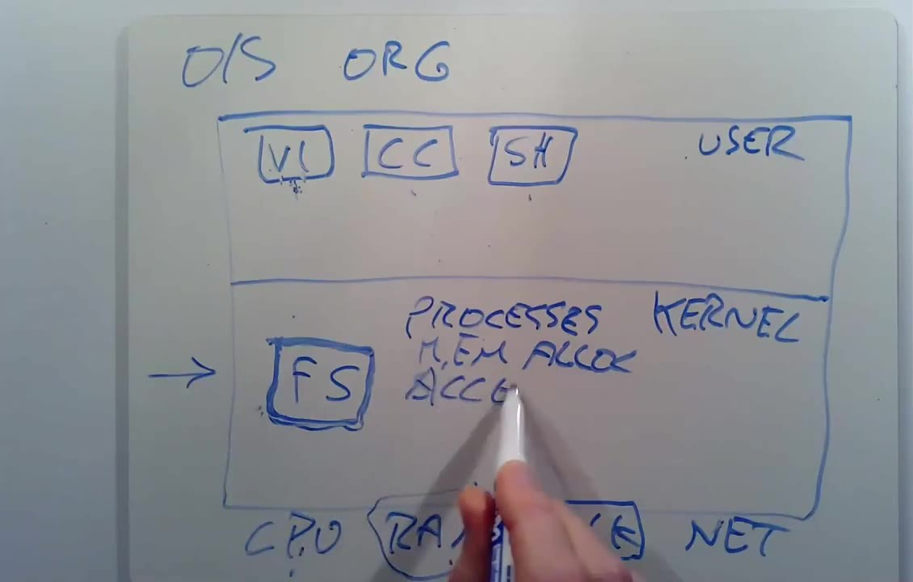
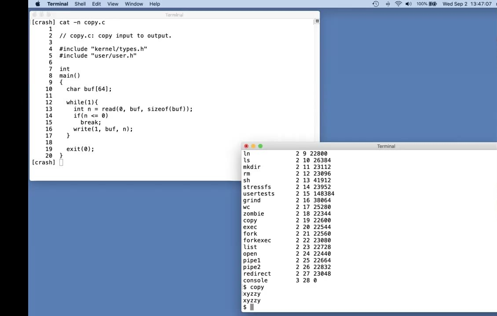
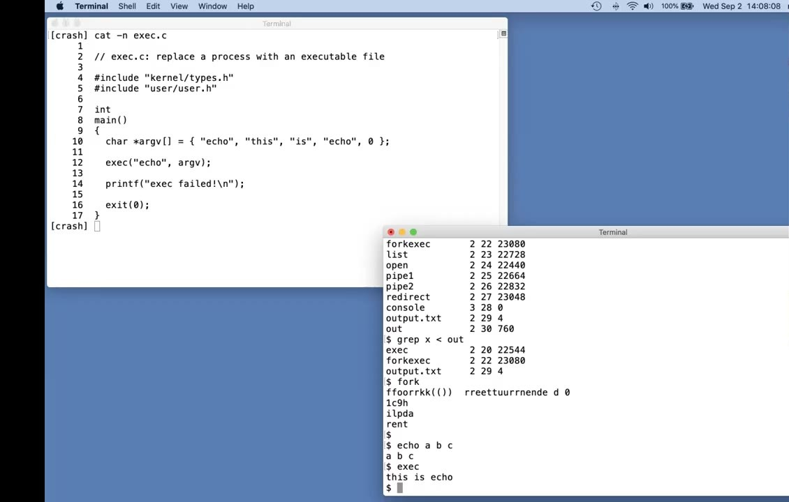
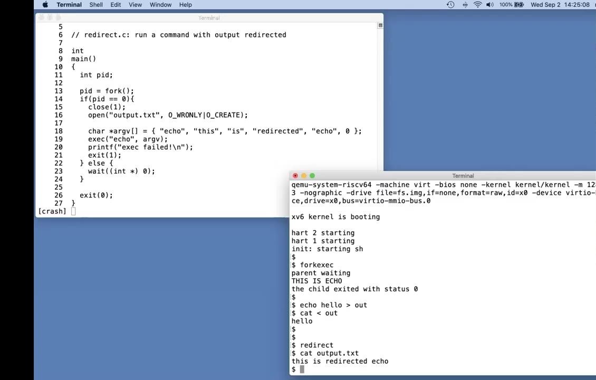

# 第 1 讲 · 中文译稿

按原片时间顺序，每 3 分钟一段，整理 Robert Morris 的讲授、演示和课堂问答。去掉了语气词、口误和重复，不是逐字对应；代码与画面以原片为准，必要处用「编者注」说明。

## 00:00–03:00｜课程介绍与操作系统目标

大家好，欢迎来到 6.S081 操作系统课程。我是 Robert，我会和 Frans 一起授课，助教是 David 和 Nicholas。在这些 Zoom 讲座中请大家多提问：你可以直接开麦打断我，也可以在聊天窗口里输入问题，会有课程人员看到并替你提出来。另外，这些讲座都会录像，录像之后会发布出来，方便大家复习，也方便没法在这个时间来听课的同学观看。

好，我想先列一下这门课的几个目标。第一条是理解操作系统的设计与实现。设计指的是高层结构，实现则真正关乎代码长什么样，这两方面我们都会花大量时间。为了深入理解其中发生的事情，你们会亲手接触一个小型操作系统——xv6。除了研读一个现成的操作系统之外，你们还会在实验中积累大量经验：扩展这个操作系统，修改并改进它的行为，以及编写使用操作系统接口的系统软件，比如应用程序。这就是你们在这门课上要做的事情。

我们也关心操作系统本身的目的是什么，这同样是这门课关心的问题。关于这一点我列了几条。外面有很多不同的操作系统，它们通常有一组共同的目的。

其中之一是对硬件进行抽象。你通常拿到手的起点是：你买了一台计算机，计算机有 CPU 和内存，但这是一组非常底层的资源。如果能有更高层的接口和抽象供应用程序使用，比如进程或者文件系统，那就太好了，这既是为了方便，也是为了可移植性。

操作系统另一项非常重要的任务，是在许多应用程序之间复用硬件。你可能同时在运行一个文本编辑器和一个编译器，或者在你的操作系统上运行好几个不同的数据库服务器之类的。

## 03:00–06:00｜隔离、共享、安全与性能

如果操作系统能让它们同时运行，或者说让所有事情同时进行，而彼此又不互相干扰，那就太好了，这通常被称为复用。由于操作系统上可能同时发生很多事情，关键在于它们之间不能无意中相互干扰，即使它们有 bug 也不行。这项任务叫作隔离，也就是不同的活动不应被允许互相干扰。

但另一方面，有些时候不同的活动确实希望相互影响，希望交互或协作。比如，我用文本编辑器创建了一个文件，然后想让编译器读取这个文件，我们当然希望允许这种共享。所以当用户本意如此时，我们要允许共享。但在很多情况下用户并不想共享，比如你登录在 Athena 这样的分时系统上，你不希望别人读你的文件。所以除了共享之外，我们还要在不想共享的时候不共享，这可以称为安全，或者权限系统、访问控制系统。

人们看重操作系统的另一点是：如果你在硬件上、在一台计算机上花了很多钱，你会希望应用程序能获得这台硬件理应提供的全部性能。这在很大程度上只是应用程序编程的事，但遗憾的是，不可避免地有一部分落在操作系统身上：操作系统必须确保它提供的各种服务不会妨碍应用程序获得高性能。所以操作系统至少不要碍事，最好还能帮助应用程序取得好的性能。

最后，大多数操作系统都必须支持各种各样的应用。也许是一台跑文本编辑器的笔记本，也许是在跑游戏，也许你的操作系统需要支持数据库服务器或者云计算。通常因为操作系统的设计和构建成本相当高，人们会把同一个操作系统用于许多不同的任务。比如 Linux，我相信你们很多人都在用，它就被用在我刚才提到的所有这些场景中。所以同一个操作系统确实必须能够支持一系列往往差别很大的用途。

我们希望能同时实现所有这些不同的目标，这门课上大家还会听到关于它们的更多内容。

好，关于操作系统，人们在几十年间总结出了一套效果相当不错的设计思想，也就是组织各个部分的方式。

## 06:00–09:00｜操作系统的经典组织结构

我来给大家讲一下这种经典的组织结构，它是这门课的标准设定，实际上在很多操作系统中也相当常见。这就是操作系统的内部组织。我是这样理解它的：画一个方框代表计算机。计算机自带一批硬件资源，我把它们放在最底下：可能有 CPU、RAM、用于存储的磁盘，可能还有网络接口。这些硬件是最底层。

在最上面，我们想运行各种应用程序：也许是文本编辑器，我碰巧用的文本编辑器是 vi；也许你要运行 C 编译器，比如 `cc`；你还会运行很多其他东西。今天我们会大量谈到 shell，也就是命令行界面。所以我们有这么多不同的程序在运行，应用程序运行的这个世界通常叫作用户空间。

与之相区别的，是一个单独的、特殊的程序，它始终在运行，叫作内核。内核可以说是计算机资源的守护者。开机时最先启动的就是它，而且它只有一个。它维护着一些数据，用来帮助管理每一个进程；内核还维护着大量数据结构，帮助它与这些用户程序需要用到的各种硬件打交道。

内核还内置了一批服务。比如，内核里通常有一个文件系统的实现，它实现文件名、文件内容和目录之类的东西，并且知道如何把文件存储到磁盘上。所以你们的程序会与内核里的文件系统打交道，而文件系统的实现再去与磁盘打交道。

在这门课中，我们主要关注内核里必须发生的所有事情、用户程序与内核之间的接口，以及内核内部软件的结构。所以我们非常关心内核里的这些服务。其中之一就是我提到的文件系统。还有进程管理：每个正在运行的程序都叫作一个进程，它拥有一些东西，比如自己的内存，以及一份 CPU 时间。所以内核把进程管理作为一项内核服务来提供。

## 09:00–12:00｜内核服务与系统调用

内核负责内存分配。不同的进程需要不同数量的内存，内核对内存进行复用和划分，把内存分配给所有不同的进程。



*原片 10:00 板书「O/S ORG」：上层是用户程序 vi、cc、sh（USER）；中间是内核（KERNEL），里面有文件系统 FS、进程（PROCESSES）、内存分配（MEM ALLOC）、访问控制（ACCESS）；底层是 CPU、RAM、磁盘与网络。*

如我所说，内核实现了文件系统。文件系统实际上由两三个、或者说若干个逻辑部分组成，但目前我们可以这样理解它：它管理文件内容，也就是文件里装的东西，并确定每个文件的内容应该放在磁盘的什么位置。文件系统还相对独立地管理一个命名空间：每个文件都有一个名字，还有一个目录层级结构，每个目录里有一批文件，这些都由文件系统来管理。

内核里通常还有某种安全机制，我们可以称之为访问控制。当某个进程想要使用某种资源时，比如从磁盘读点东西，或者使用一些内存，由内核里的访问控制机制来决定：这是允许的，还是不允许的。如果我们讨论的是像 Athena 这样的分时系统，情况可能会变得相当复杂：每个进程可能由不同的用户运行，它能访问什么，适用的访问控制规则也各不相同。

在一个真正完备的操作系统里，事实上还有非常非常多的其他服务。通常会有某种让不同进程相互通信的方式，叫作进程间通信。通常还有一大堆与网络相关的软件，比如用于网络通信的 TCP/IP 协议。通常还会支持声卡，可能还有几百种不同磁盘、几百种不同网卡的驱动程序。所以在一个完备的操作系统里，这部分的东西多得惊人，内核代码可能多达几百万行。

以上就是对内核内部的一个快速概览。我们也关心应用程序如何与内核交互，以及这个接口长什么样。这就是内核的 API，也就是应用程序访问内核的方式，通常通过一种叫作系统调用的东西来完成。系统调用看起来就像程序可以进行的函数调用，但实际上会跳进内核，执行内核里该系统调用的实现。这节课的后半部分我会多讲一些这方面的内容，现在先让大家感受一下，几个不同的系统调用在应用程序的源代码里大概是什么样子。

## 12:00–15:00｜系统调用示例与内核编程之难

比如，如果一个应用程序想打开一个文件，它会调用 `open` 系统调用，并把文件名告诉 `open`。假设它想以写方式打开一个名为 `out` 的文件，那么这里还会有一个额外的参数，在这个例子里是 1，表示我要写这个文件：`fd = open("out", 1);`。这个看起来像函数调用的 `open` 是一个系统调用，它实际上是一段特殊的代码，会跳进内核；内核可以取出这些参数，执行内核中实现 `open` 的代码，可能还会与磁盘交互，然后返回一个值，也就是这个文件描述符——`fd` 就代表 file descriptor。之后程序就可以把它当作一个句柄，用来指代这个已打开的文件。

如果你想写文件，相应的系统调用叫作 `write`。你必须给它传一个文件描述符，就是 `open` 返回的那一个。这些都是通过系统调用从程序传进内核的参数。你还要给它一个指向字符缓冲区的指针。这些例子是用 C 语言写的，在 C 里一个简便的写法就是用双引号括起一个字符串，也就是字符串的那些字节，这里的 `\n` 是换行符。第三个参数是你想写入的字符数：`write(fd, "hello\n", 6);`。这个字符串实际上是作为一个内存地址传进去的，所以你是在告诉内核：请从这个地址开始，把 6 个字节写到这个文件描述符所指向的文件里。

> **编者注**：字幕没有念出要写入的字符串内容；`"hello\n"`（恰为 6 字节）取自课程讲义 `l-overview.txt` 中的板书代码。

一个有意思得多的系统调用是 `fork`。`fork` 是创建新进程的系统调用，它创建的进程与调用者完全相同，并返回新进程的标识符，也就是进程 ID（pid）：`pid = fork();`。实际情况比这稍微复杂一些，后面我们会讲到更多。所以，这些看起来都像函数调用，但系统调用的特殊之处在于它们会跳进内核。这只是先让大家尝尝味道，后面会看到更多。

好，这就是一个快速概览。接下来我想讲讲，为什么我觉得学习操作系统既有挑战性又很有趣，也就是为什么从智识上说，这个领域值得专门修一门课。

它难的一个原因是环境很严苛。内核内部的编程环境是不留情面的，因为当你修改内核、扩展内核，或者编写一个新的操作系统内核时，你提供的是所有其他人都默认已经存在、用来运行他们程序的基础设施。

## 15:00–18:00｜设计张力与系统调用的特权

其他人写普通应用程序时，他们的程序下面都有一个操作系统；而当我们构建操作系统时，我们的操作系统下面是硬件，而硬件要难对付得多。在这门课中，我们会使用一个叫 QEMU 的硬件模拟器，它模拟一个 CPU 和一台计算机，这让日子好过了一点，但它仍然是一个比较难编程的环境。

它既难又有趣的另一个原因是：如果你在设计一个操作系统，你需要处理一系列张力，这些张力需要真正的设计思考。其一，你希望操作系统高效，这通常意味着它要在较低的层次、贴近硬件运行；但为了易用性，也因为真实的人要编写使用你的操作系统的程序，我们又希望它提供抽象的、高层的、可移植的接口。要提供既简单、可移植，同时又高效的抽象接口，是一件需要巧思的事。

另一个张力是：我们希望提供非常强大的操作系统服务，让操作系统能为运行程序分担大量负担；但我们也希望接口简单，也就是说，我们不希望给程序员使用的接口极其复杂、难以理解，因为他们会理解不了，也可能觉得很难用。所以这里要的是很简单的 API。提供内部具有强大机制的简单接口是可以做到的，所以我们会一直追求那种能提供强大服务的简单接口。

**学生（聊天区）：**说系统调用“跳进内核”，它的独特或不同之处在哪里？也就是说，它和跳到另一个函数的普通函数调用有什么区别？

**Robert：**内核是一段始终驻留的代码，拥有特殊的特权，因为机器启动时启动的就是内核。内核拥有特殊的特权，可以直接访问各种硬件，比如磁盘设备，而普通用户程序访问不了。所以如果你做的是一次普通函数调用，你调用的那个函数不会获得任何与硬件相关的特殊特权；而如果你通过系统调用进入内核——我们后面会讲它是怎么实现的——当系统调用跳进内核后，内核中的系统调用实现就获得了所有这些特殊特权，从而可以修改各种敏感的、受保护的硬件资源，比如直接访问硬盘。

## 18:00–21:00｜灵活与安全、特性交互与硬件变化

**Robert：**关于这一切，我们很快会看到更多细节。

好，所有操作系统都需要处理的最后一个张力是：你希望给程序尽可能多的灵活性，不想约束它们，所以你希望接口非常灵活；但你又确实需要在一定程度上约束程序，因为你绝对必须有某种安全的概念。我们很想给程序员完全的自由，但它不可能是真正完全的，因为我们不希望程序直接访问硬件、干扰其他程序，或者能够干扰操作系统本身的运行。这些都是可以做好的，我们也会大量讨论，但要同时具备这两列里的特性，总是有点像在解谜。

让操作系统设计既难又有趣的另一点是：操作系统提供了大量特性和服务，但它们往往会相互作用，有时还是以奇怪的方式，这需要大量思考。即使在我举的 `open` 和 `fork` 这两个简单例子里，它们之间其实也有交互。如果一个程序用 `open` 系统调用分配了一个文件描述符，然后这个程序又调用了 `fork`，而 `fork` 的语义恰好是创建一个新进程，它是当前进程的副本，那么如果它真要算是副本，你打开的这个文件描述符就必须在子进程中仍然存在并且可用。这一点需要仔细想清楚，也就是说，打开的文件和文件描述符与 `fork` 以这种有趣的方式相互作用。总得有人来决定：子进程能不能访问在调用 `fork` 之前创建的文件描述符？在我们要研究的这些操作系统里，答案是可以。

还有一些事情也很有意思。我已经提到，操作系统必须满足各种各样的用途，比如同一个操作系统既用于数据库服务器，也用于智能手机。而且随着时间推移，典型计算机所配备的硬件也在变化：比如你可能用上了超快的 SSD 存储，而不是机械硬盘；大约 15 年前，多核计算机从罕见的稀奇物件变得无处不在；最近我们又看到网络速度提升了一个数量级。所有这些都需要重新思考。

## 21:00–24:00｜选课的实际理由与聊天区提问

所以，这些是从智识层面上你们可能会选这门课的理由。另外还有一些更实际的理由，会让你们庆幸自己上过这门课。其一，如果你对计算机内部发生的事情感兴趣——你打开电脑时，在底层、在你看不见的地方究竟发生了什么——那这门课很适合你。同样，如果你喜欢基础设施，也就是说，如果你喜欢构建供其他程序使用的服务，那这门课本质上讲的全是基础设施，因为操作系统本身就是基础设施。

如果你需要花大量时间追查应用程序代码里的 bug，或者追查安全问题，这往往需要理解操作系统内部在发生什么。因为归根结底，很多安全机制是由操作系统来强制执行的；而出了问题时，也是操作系统来收拾残局。所以追查 bug 时常常会涉及操作系统。最后——

**助教：**聊天区还有两个问题。

**学生（聊天区）：**第一个问题：对应用开发者来说，真正深入理解自己所开发应用的目标操作系统有多重要？他们一定要成为专家吗？

**Robert：**你不必成为专家。但如果你花大量时间开发、维护和调试应用程序，不管你是否有意为之，最终你都会对操作系统了解很多。它就是会冒出来，你常常被迫去理解它。

**学生（聊天区）：**第二个问题：像 Python 这样的高级编程语言会直接使用系统调用吗？还是有内置函数或封装（wrapper）方便使用？

**Robert：**很多高级语言确实和系统调用隔了一层，这完全没错。部分原因是很多语言想提供一个可移植的环境，能在许多不同的操作系统上运行，所以它们不一定能绑定到某一个操作系统的具体系统调用上。所以我想这个问题的答案是：如果你用 Python，你在一定程度上和系统调用接口是隔离开的。当然，Python 内部为了完成工作必须进行系统调用；而且在 Python 和许多其他语言里，通常都有办法直接使用你所运行的操作系统的系统调用。

**助教：**大家有问题的话可以直接开口问，不必通过聊天区。

**Robert：**好，抱歉。接下来我要花几分钟讲讲 6.S081 的课程结构，然后再回到真正的技术内容。

## 24:00–27:00｜课程资源与讲座安排

这门课有一个网站，我现在就不把网址写出来了，你在 Google 上搜 6.S081 就能找到。网站上有课程日程，日程上标着各项作业；有实验作业；还有课程结构方面的信息，比如评分政策。

另一个你需要经常关注的重要资源是 Piazza。我猜在座的各位都是通过 Piazza 来到这里的。我们用 Piazza 主要做两件事。一是让大家提问实验作业相关的问题，课程团队会尽量回答，但你们也完全可以互相回答问题。另一件是公告：课程有任何公告，我们都会发在 Piazza 上。所以即使你不用它来求助实验，也应该留意 Piazza 上的公告。

课程的一大组成部分就是这些讲座。讲座会覆盖操作系统的基本思想。有些讲座会专门详细研读 xv6 的代码——xv6 是我们的小型教学操作系统——我们会讲它如何工作，看它的代码，并在讲座中演示代码的执行。此外，很多讲座之前都会布置阅读作业，读的是一本书，书里讲 xv6 如何运作以及为什么这样设计。所以你们应该在上课前完成阅读，这样才能理解课上的讨论。

有些讲座是背景知识，帮助你们做实验，比如讲解 C 语言是怎么工作的、RISC-V 是怎么工作的——RISC-V 就是我们要用的微处理器——这些对你们理解怎么做实验会有帮助。到课程后期，我们会用一些讲座讨论操作系统方面的论文，包括研究论文和这个领域的一些经典论文。我们会请你们在讲座前读完，然后在讲座中讨论这些论文。

对于所有讲座，或者说几乎所有讲座，我们都要求你们在讲座开始前提交一个关于该讲阅读材料的问题。这一讲很多人——甚至所有人——都交了，谢谢大家。我们会阅读这些问题，用来指导我们讲什么，并尽量多回答一些，不过遗憾的是，我们很少有时间把问题全部回答完。

## 27:00–30:00｜实验安排与评分方式

课程的下一大部分是实验。几乎每周都有一个编程实验要交。实验的目的是让你们获得实现和使用操作系统的动手经验。下周要交的实验是编写应用程序，去调用我们接下来要讲的那些系统调用；而之后的大部分实验，要么是让你们实现操作系统的基本功能，要么是给 xv6 操作系统添加内核扩展。最后一个实验是添加一个网络协议栈和一个网络驱动程序，这样你就能通过网络连接到你自己运行的操作系统。

如果做实验时遇到问题，助教会有答疑时间。此外，你也可以在 Piazza 上发帖提问，很多时候在 Piazza 上得到有用答案会比去答疑时间更快。

我们欢迎你们讨论实验，聊实验、聊怎么设计实验的解法。但请不要看别人的实验解答。你写的所有代码都应该是你自己的，不要分享代码，也不要看别人的解答。

今年的评分主要由实验决定。70% 的成绩取决于你提交的实验能否通过测试。评分时我们跑的测试和发给你们的测试是一样的，所以如果你的实验通过了我们给的所有测试，你很可能就能拿到这个实验的满分。20% 的成绩来自实验检查（check-off）面谈：我们会给你们每个人随机挑几个实验，由课程团队中的一位跟你聊，问你实现上的问题，只是为了确认你真的理解其中发生了什么。这就是实验检查。剩下的 10%——

**学生：**我有个问题：这个检查是像“是或否”、1 或 0 那种吗？还是说，如果有人答对了部分问题、但没有全答对，可以拿到中间的分数？

**Robert：**关于怎么打分，说实话我还没仔细想过。肯定有给部分分的余地，它不会是非此即彼的，你肯定可以拿到部分分数。好，最后 10% 由作业以及在课堂上和 Piazza 上的参与情况决定。

## 30:00–33:00｜无考试与课程事务问答

今年没有考试，也没有小测。这意味着 90% 的成绩都由实验决定。所以你们应该在实验上花大量时间，一定要早点开始，留出足够的时间完成实验、排查 bug，这样才能拿到满分。也正因为如此，这会是一门非常偏动手、偏软件的课程。关于课程的这些安排，大家有什么问题吗？

**助教：**聊天区有几个问题。

**学生（聊天区）：**第一个是事务性问题：目前 6.S081 没有被列为可用于系统方向（systems concentration）的课程〔听不清〕，以后有计划把它加进课程列表吗？

**助教：**我想就这一点来说，因为它不是 AAGS，而是 AUS，所以它不能用来满足 MEng 的要求，因为它不是研究生级别的课程，不过……

**学生（聊天区）：**唯一需要提交的作业就是这些提问吗？

**Robert：**看课程日历似乎是这样，除非我忘了什么。我想是的，没错。

**学生：**成绩会有分数线吗？比如 x% 拿 A，y% 拿 B 之类的？

**Robert：**没有。我们会针对每个学生，根据我们对你掌握课程内容程度的印象来给成绩，所以没有预先定好的分数线。好，还有别的问题吗？好。

**助教：**简单补充一下，聊天区有同学问到方向要求的事。我不是百分之百确定，但 6.S081 只是一个临时编号，是这门课拿到正式编号之前用的，所以它肯定不会被列在任何地方。如果你需要用它来满足方向要求，我想最好的办法可能是提交一份申请（petition），或者给 Katrina LaCurts 这样的人发邮件，问问情况如何。很遗憾，哪些课程能满足这类要求不是我们能决定的。另外关于课程用什么语言：这门课用 C 语言。

## 33:00–36:00｜系统调用示例与 xv6 运行环境

好，这节课剩下的时间，我想讲讲系统调用在应用程序看来是什么样子。因为系统调用是操作系统所提供服务的接口，所以这些系统调用长什么样、应用程序对系统调用有什么预期、它们如何表现，其实相当重要，值得去理解这个接口是什么样子的。第一个实验里你们就会用到我们要讲的这些系统调用，在之后的实验里还会扩展和改进这些系统调用的内部实现。

我接下来要做的，是给你们展示几个调用系统调用的简单小程序，然后在 xv6 里运行给你们看。xv6 是一个简化的类 Unix 操作系统。Unix 是一个古老的操作系统，至少在思想上是当今许多操作系统的基础，比如 Linux 和 OS X，所以它的应用非常普遍。我们的教学操作系统 xv6 要简单得多，它受 Unix 启发，整体结构相同，但比任何真实的 Unix 操作系统都简单得多。它足够简单，希望你们能比较轻松地读完全部源代码，再读完那本书——用几周时间，至少在本学期之内——从而理解 xv6 内部发生的一切。

xv6 运行在 RISC-V 处理器，也就是 RISC-V 微处理器上。这和最近的 6.004 课程重点讲的是同一种微处理器，所以你们很多人可能其实已经相当了解 RISC-V 指令集了。理论上你可以在一台 RISC-V 计算机上运行 xv6，也有人这么做过，但我们会在 QEMU 机器模拟器下运行它。

我写下来：我们的操作系统是 xv6，它运行在 RISC-V 微处理器上——而且不只是 RISC-V 微处理器，我们还假设有一定的周边硬件，比如内存、磁盘，以及一个让我们和它交互的控制台接口。但我们实际上是在 QEMU 机器模拟器下运行它，而 QEMU 运行在 Linux 上，这样你们所有人不需要真实硬件也能运行 xv6。好，接下来我切换过去给你们看代码。

## 36:00–39:00｜编译运行 xv6 与 copy 程序

好。首先，我已经在笔记本上配置好了 xv6，现在要运行它。我输入 `make qemu`——做实验时你们会经常这么做——它会编译 xv6。xv6 是用 C 写的，所以用 C 编译器来编译。我先 `make clean` 一下，让你们看到实际的编译过程。然后输入 `make qemu`，它会编译、构建 xv6 内核和所有用户进程，然后在 QEMU 模拟器下运行它们。编译需要一点时间……现在 xv6 已经跑起来了。

你们看到的美元符号 `$` 提示符就是 shell，也就是 xv6 的命令行界面，它仿照的是 Unix 上的 shell——如果你登录过 Athena 工作站，它就和 Athena 给你的那个 shell 差不多。xv6 本身非常小，只附带少量工具程序，比如我马上要运行的 `ls` 程序。运行 `ls`，它列出了 xv6 里的所有文件，总共只有二十来个，包括 `grep`、`kill`、`mkdir` 和 `rm` 这些，你们可能作为 Unix 工具已经很熟悉了。

我要展示的第一个用来说明系统调用的程序叫 `copy`。这是源码，只有一页。你们看到的这个程序从第 8 行的 `main` 开始，这是 C 程序的惯例。它在第 12 行进入一个循环，一遍又一遍地在第 13 行从输入读取一些数据，然后在第 16 行把刚读到的数据写到输出。

```c

// copy.c: copy input to output.

#include "kernel/types.h"
#include "user/user.h"

int
main()
{
  char buf[64];

  while(1){
    int n = read(0, buf, sizeof(buf));
    if(n <= 0)
      break;
    write(1, buf, n);
  }

  exit(0);
}
```

> **编者注**：代码取自课程示例目录，与录课画面可能略有差异。

如果我在 xv6 里运行 `copy`，它就在等待读取输入。我敲一些输入，它读进去，再原样吐回给我。所以这是个非常简单的程序，只做 I/O。我说过它是用 C 写的。如果你还不懂 C，值得去找一本标准的 C 语言教材，也就是 Kernighan 和 Ritchie 写的《The C Programming Language》，我想课程网站上有这本书更完整的引用信息。这本书会非常直白地教你怎么用 C 编程。

## 39:00–42:00｜read 的参数与返回值



*原片 40:00：左侧 `cat -n copy.c`，第 13 行 `read`、第 16 行 `write`；右侧 xv6 里 `ls` 列出的文件和 `copy` 的运行结果——输入 `xyzzy`，原样输出。*

正如我之前提到的，这个程序发起了两个、其实是三个系统调用：`read`、`write` 和 `exit` 都是系统调用。

看第 13 行对 `read` 的调用，它有三个参数。第一个参数是文件描述符，它其实是对一个之前已打开文件的引用。shell 会保证程序启动时，默认它的文件描述符 0 连接到控制台输入，文件描述符 1 连接到控制台输出。这就是为什么我能向这个 `copy` 程序打字，并看到它的输出。当然，程序预期这些文件描述符已经由 shell 事先打开并设置好了。这种文件描述符 0 和 1 的用法是 Unix 中一个无处不在的惯例，非常非常多的 Unix 程序都预期从文件描述符 0 读、向文件描述符 1 写。

`read` 的第二个参数是指向某块内存的指针，程序请求操作系统把数据读到这个内存地址里。这就是 `buf` 参数，第 10 行在栈上分配了 64 字节内存，供 `read` 读入数据。`read` 的第三个参数是程序想读取的最大字节数，这里 `sizeof(buf)` 表示最多 64 字节。所以这个 `read` 调用会从文件描述符 0 所连接的东西读取最多 64 字节，在这个例子里就是我的终端。

`read` 的返回值可能是读到的字节数，比如我刚才输入 `xyzzy` 时就是 6。`read` 也可能是在读一个文件，如果读到文件末尾、没有更多字节了，`read` 会返回 0。如果发生了其他错误，比如文件描述符不存在，`read` 可能返回 -1。

> **编者注**：字幕此处为 “xyz y”；原片 40:00 画面显示输入的是 `xyzzy`，五个字符加换行符正好 6 字节。

在很多这类例子里，比如第 16 行那里，我的示例代码并没有检查系统调用返回的错误，但你们应该比我更小心。你们应该弄清楚系统调用是怎么表示错误的——通常是返回 -1——并检查所有系统调用的返回值是否出错。如果你想知道系统调用有哪些参数和返回值，书里有一张表，我想是在第 2 章，列出了 xv6 所有系统调用的参数和返回值。

> **编者注**：在 2020 版 xv6 教材中，这张系统调用表是第 1 章的 Figure 1.2。

**学生：**关于 `read` 系统调用有个问题：如果我们把最大读取字节数从 `sizeof(buf)` 改成 `sizeof(buf)` 加 1，或者……

## 42:00–45:00｜读越界、字节流与打开文件

**Robert：**是的，那样的话，如果确实有 65 个字节可读，操作系统会很乐意把这 65 个字节全部拷贝到你提供的内存里。而栈上紧挨着的地方当然还有别的东西，可能是返回地址（return program counter），或者某个参数之类的。所以如果你传 65，就等于请内核把垃圾写到你栈上一个意想不到的位置。这就是一个 bug，它可能导致你的程序崩溃，或者做出别的意料之外的事情。所以作为程序员，你在这里必须小心。用 C 配合这类接口写代码，非常非常容易写出编译器挑不出毛病、也能运行、但其实完全做错了事的代码。这挺遗憾的，但现实就是这样。

有一点要注意：这个 copy 程序，乃至 `read` 和 `write` 系统调用本身，都不关心它们读写的数据是什么格式。它们只管读和写，这个 copy 程序处理的就是 8 位字节，也就是由 8 位字节组成的流。如何解释这些字节完全取决于应用程序：应用程序可能把它们解析成数据记录，或者 C 源代码，或者谁知道什么东西。操作系统只按 8 位字节流来看待它们。

好，我的 copy 程序假设文件描述符已经设置好了。但我们需要有办法创建文件描述符，最直接的方式就是 `open` 系统调用。这里是一个叫 open 的程序的源码，它使用了 `open` 系统调用。

**学生（聊天区）：**你说的“字节流”是什么意思？

**Robert：**我的意思只是：假设一个文件包含一百万个字节，如果你连续调用一系列 `read`，每次读 100 个字节，那么第一次会读到前 100 个字节，第二次读到第二个 100 个字节，第三次读到第三个 100 个字节。我就是这个意思。

好，这个 open 程序，我先运行给你们看。它做的是打开——实际上是创建——一个叫 `output.txt` 的新文件，然后往里写一些字节，然后就结束了。我们看不到任何输出，因为它把数据写进了它打开的这个文件。不过我们可以查看它创建的这个 `output.txt` 文件，看到它写进去的 `ooo`。

```c
// open.c: create a file, write to it.

#include "kernel/types.h"
#include "user/user.h"
#include "kernel/fcntl.h"

int
main()
{
  int fd = open("output.txt", O_WRONLY | O_CREATE);
  write(fd, "ooo\n", 4);

  exit(0);
}
```

> **编者注**：代码取自课程示例目录，与录课画面可能略有差异。

程序第 11 行发起了 `open` 系统调用，传给它文件名 `output.txt`。

## 45:00–48:00｜进程各自的文件描述符表

`open` 第二个参数里那些 `O_` 开头的东西是标志位，它们告诉内核中 `open` 的实现：我们想用这个名字创建一个文件，并且我们要往里写。`open` 返回一个新分配的文件描述符。文件描述符就是一个小整数，可能是 2、3、4 之类的。然后我们把同一个文件描述符连同一个缓冲区和要写的字节数一起传给 `write`，它就会把数据写进这个文件描述符所指向的文件。

文件描述符实际上是在索引内核里的一张小表。内核为每个正在运行的进程——也就是你运行的每个程序——维护状态。在这些状态当中，内核为每个运行中的进程记着一张以文件描述符为下标的表，这张表告诉内核每个文件描述符指向什么。关键的一点是，每个进程都有自己独立的文件描述符空间。所以如果你运行两个不同的程序，也就是两个不同的进程，它们都打开了一个文件，它们拿到的文件描述符数字可能是一样的；但因为内核为每个进程分别维护一张文件描述符表，同一个文件描述符数字在不同进程里可能指向不同的文件。

关于 `open`、关于这个小程序，有什么问题吗？

**学生（聊天区）：**有个不熟悉 C 的同学问：这里描述的这些文件，和普通 C 程序里的有什么不同？是因为我们只使用了内核调用吗？也就是说，我们难道不能用 Python 打开或写一个文件吗？

**Robert：**我不太明白这个问题。这就是一个打开并写入文件的 C 程序……好吧，我想我先继续往下讲。好，你问的是实际会发生什么——也许问题是，用 C 来做和用 Python 来做，除了语法之外有没有什么不同？其实没什么不同。Python 确实提供了很好用的函数调用，用来打开文件、读写文件、做这些事情。它们通常是更高一层的函数，比如不会让你直接跟内存指针打交道。

## 48:00–51:00｜shell 运行命令与重定向

Python 还会替你做更多的错误检查。但当你在 Python 里打开或写一个文件时，你调用的那些 Python 函数最终都会归结为和这里一样的系统调用。这样回答可以吗？我想可以。

好。我一直在跟 xv6 的类 Unix shell 打交道。shell 就是人们常说的命令行界面，与之相对的是某种更图形化的用户界面。如果你没用过 shell，它其实是一个相当有用的界面，适合做 Unix 系统的系统管理之类的事情。它提供了很多工具，用来摆弄文件、做程序开发，以及编写脚本来完成所有这些事情。

你们之前看到我运行过程序，我想演示几个 shell 的功能。通常你输入东西时，是在让 shell 运行一个程序。所以当我输入 `ls`，意思是我请 shell 运行名为 `ls` 的程序；更确切地说，文件系统里有一个叫 `ls` 的文件，里面包含一些指令——机器指令——而我是在请 shell 运行文件 `ls` 里的那些指令。运行 `ls`。`ls` 实际做的是列出当前目录下的文件。你们可以看到上面第四行，在 `ls` 列出的这些文件里，就有一个叫 `ls` 的文件，它正是包含我刚才运行的那些指令的文件。

除了运行程序，shell 还会为你做一些别的事情，比如它允许你重定向 I/O。例如我输入 `ls > out`，意思是请 shell 运行 `ls` 命令，但把它的输出重定向到名为 `out` 的文件。运行之后我们看不到任何输出，因为输出全都进了 `out`。现在 `out` 里有一堆数据。`cat` 命令会读取一个文件并显示其内容，所以我输入 `cat out`，现在就能看到，这正是保存下来的 `ls` 输出。

你还可以运行像 `grep` 这样的命令，并给它一个参数 `x`。`grep` 命令用来搜索模式，如果我运行 `grep x`，它会在输入中查找包含 `x` 的行。我可以让 shell 把它的输入重定向为来自文件 `out`（`grep x < out`），从而在保存下来的 `ls` 输出里查找 `x`。

## 51:00–54:00｜系统调用如何进入内核与 fork

结果发现有三个文件的名字里含有 `x`。

我们会花不少时间在 shell 上。shell 可以说是 Unix 最传统、最基础的接口，因为 Unix 最初被开发出来的时候，只有像我们现在用的这种简单的终端界面；而 Unix 最初的主要用途是分时（time sharing）：一群人登录到同一台机器上，很像 Athena 那样，和 shell 打交道。

**学生（聊天区）：**有个关于系统调用和编译器的问题：编译器是怎么处理系统调用的？生成的汇编代码是不是对操作系统定义的某段代码做一次过程调用？

**Robert：**RISC-V 有一条特殊指令，程序可以执行它来把控制权转交给内核。所以当你写 C 代码发起像 `open` 或 `write` 这样的系统调用时，严格来说实际发生的是：`open` 是 C 库里的一个函数，但这个函数里的指令其实就是机器指令——我们调用的这个 `open` 函数并不是用 C 写的，而是用汇编实现的，这段汇编代码里就包含这条特殊指令。在 RISC-V 上它叫 `ecall`，就是这条特殊指令把控制权转交给内核。然后内核查看进程的内存和寄存器，弄清楚参数是什么。

> **编者注**：在 xv6 中，这些用户态的系统调用桩函数位于由 `user/usys.pl` 生成的 `user/usys.S`：每个桩函数把系统调用号放入寄存器 `a7`，然后执行 `ecall`。

好，下一个我想看的例子，是一个调用 `fork` 来创建新进程的示例程序。这是 `fork` 非常简单的一种用法。

```c
// fork.c: create a new process

#include "kernel/types.h"
#include "user/user.h"

int
main()
{
  int pid;

  pid = fork();

  printf("fork() returned %d\n", pid);

  if(pid == 0){
    printf("child\n");
  } else {
    printf("parent\n");
  }
  
  exit(0);
}
```

> **编者注**：代码取自课程示例目录，与录课画面可能略有差异。

第 12 行我们调用了 `fork`。`fork` 做的是：创建调用进程的内存——也就是它的指令和数据——的一份拷贝。于是现在我们有了两个内存完全相同的进程。`fork` 系统调用在两个进程中都会返回：在原来的进程里，`fork` 返回新创建进程的进程号（pid），这是一个大于零的整数；而在新创建的进程里，`fork` 返回 0。所以尽管两个进程的内存完全相同，我们可以通过 `fork` 的返回值打破新旧进程之间的对称性。然后在第 16 行，你们可以看到代码检查进程号是否等于 0，如果是，那一定是子进程，也就是说我们此时一定运行在子进程里。

## 54:00–57:00｜父子进程并发输出交错

当然，这里有两个进程。在另一个进程，也就是发起调用的那个进程（通常称为父进程）里，进程号大于零。所以子进程会打印 `child`，父进程会打印 `parent`，然后它们都会退出。我运行 fork，结果是这样的。

看起来可能像乱码，但实际情况是：`fork` 之后这两个进程都在运行，它们是同时运行的。QEMU 实际上在为我模拟一个多核处理器，所以它们真的是在同一时刻运行。因此当它们产生输出时，一个进程在输出它的每个字节的同时，另一个进程也在输出它对应的那个字节，于是两个进程的输出交错在了一起。你们可以看到它们都在打 `f`——它们都要打出 `fork() returned`——所以你能看到两个进程各自的 `f`、各自的 `o`、各自的 `r`，依此类推。其中一个，你们可以看到第一行末尾的那个 0，是子进程打印的 `fork() returned 0`。我猜父进程里 `fork` 返回的是 19，也就是说子进程的进程号是 19，在 xv6 下这基本上意味着它是开机以来创建的第 19 个进程。然后其中一个打印了 `child`，你们可以看到 `c`、`h`、`i`、`l`、`d`，与之交错的是另一个进程打印的 `parent`。

所以这是 `fork` 的一个有点傻的用法，但我们能从这个输出里非常直观地看到：它创建了两个进程，`fork` 在两个进程中都返回了，而且两个进程都在运行。还要注意，一个打印了 `child`，另一个打印了 `parent`，所以 `fork` 在两个进程中返回不同的值，这一点很重要。

**学生（聊天区）：**`fork` 产生的子进程总是和父进程完全相同吗？还是说它们可能有所不同？

**Robert：**在 xv6 中，除了 `fork` 的返回值，它们是完全相同的：指令相同，数据相同，栈也相同。另外，这两个进程是彼此的拷贝，它们各自有独立的地址空间。也就是说，它们都认为自己的内存从 0 开始一直往上，但那是不同的内存，两者各有一份。在更复杂的操作系统里，会有一些我们完全不关心的细节，可能偶尔导致父进程和子进程有所不同；但在 xv6 中，除了返回值，它们完全相同。所以内存是相同的。

## 57:00–60:00｜文件描述符表的复制与 exec

此外，文件描述符表也会被拷贝。所以如果父进程打开了一些文件，子进程会看到同一组文件描述符，只不过子进程看到的是这张文件描述符信息表的一份拷贝。我们待会儿会看到，`fork` 除了拷贝内存，还拷贝打开的文件描述符表，这一点相当重要。

好，`fork` 创建了一个新进程。当我们在 shell 里运行东西时，shell 确实会为你输入的每条命令创建一个新进程，但它还需要在这个进程里真正运行那条命令。比如我输入 `ls`，shell 会 fork 出一个进程来运行 `ls`，但需要有某种办法让这个新进程真正运行 `ls` 程序里的指令，也就是从名为 `ls` 的文件里加载这些指令。

我待会儿给你们看的示例程序用到了 `echo`。`echo` 是一个非常简单的命令，它只是把你传给它的参数写到它的输出里。我给你们准备了一个叫 exec 的程序，它会发起 `exec` 系统调用。`exec` 会用从你指定的文件里读出的指令替换调用它的进程：把该文件里的指令加载到当前进程上，丢弃当前进程原有的内存，然后开始执行这些指令。

```c
// exec.c: replace a process with an executable file

#include "kernel/types.h"
#include "user/user.h"

int
main()
{
  char *argv[] = { "echo", "this", "is", "echo", 0 };

  exec("echo", argv);

  printf("exec failed!\n");

  exit(0);
}
```

> **编者注**：代码取自课程示例目录，与录课画面可能略有差异。

所以第 12 行对 `exec` 系统调用的调用，效果是让操作系统把名为 `echo` 的文件里的指令加载到当前进程中，替换当前进程的内存，然后开始执行这些指令。此外，你还可以传递参数，也就是命令行参数：`exec` 允许你传入一个命令行参数数组，其实就是一个指针数组。你们看第 10 行，它建立了一个字符指针数组——字符指针本质上就是字符串——并把它初始化为包含字符串 `echo`、`this`、`is`、`echo`。这就相当于运行 `echo` 命令，并带上三个参数 `this`、`is`、`echo`。

所以当我运行 exec，确实看到了输出 `this is echo`。尽管我运行的是 exec 命令、exec 程序，但 exec 程序做的是调用 `exec` 系统调用，用 `echo` 替换它自己，所以真正产生这个输出的其实是 `echo` 程序。

`exec` 系统调用有一点对我们很重要：`exec` 会保留当前的文件描述符表。

## 60:00–63:00｜exec 何时返回与参数数组



*原片 61:00：左侧 `exec.c`，第 10 行的 `argv` 以 0 结尾；右侧依次是 `grep x < out` 找到的三个文件、`fork` 程序父子进程交错的输出（`ffoorrkk(())…`、`1c9h` 中夹着子进程号 19 和 `child`）、`echo a b c`，以及 `exec` 打印的 `this is echo`。*

所以无论文件描述符 0、1、2 等在 `exec` 之前指向什么，在这个加载了新指令的新程序里，它们仍然指向同样的东西。

还有一点：通常 `exec` 不会返回，因为 `exec` 完全替换了当前进程的内存，已经没有可以返回的地方了。`exec` 读取那个文件里的指令并执行它们，然后就这样了。`exec` 唯一会返回的情况，是发生了某种错误，使得操作系统无法为你运行那个程序。例如程序根本不存在，比如 `exec` 找不到名为 `echo` 的文件，那么 `exec` 就会返回 -1，表示出了问题，它找不到这个文件。所以通常 `exec` 不会返回，只有当内核实际上无法为你运行该文件时它才会返回。

关于 `exec` 有什么问题吗？

**学生（聊天区）：**`argv` 里最后那个 0 是做什么用的？

**Robert：**它标记数组的结尾。C 非常底层，C 的数组机制没有办法让代码知道数组有多长。所以为了告诉内核，我们的意思是这个数组只包含 `echo`、`this`、`is`、`echo`，再没有别的了，我们把 0 作为最后一个指针。双引号里的每个字符串实际上都是一个指针，指向存放这些字节的某块内存；而数组的第五个元素是一个值为 0 的指针。约定是：值为 0 的指针，也就是所谓的空指针（null pointer），表示“什么都没有”，也就是到此为止。所以内核里的代码实际上会遍历这个数组，直到找到值为 0 的那个元素。

好，这就是一个程序如何用文件里的另一个程序替换自己。但实际上，当我们在 shell 里运行像 `echo abc`、`ls` 或者别的什么东西时，我们并不想替换掉 shell。我们不希望 shell 直接调用 `exec`，因为那会把 shell 替换成 `echo` 命令，等 `echo` 退出后，就什么都没了。我们不希望 `echo` 替换掉 shell。所以 shell 实际做的是先 `fork`，然后由子进程调用 `exec`。这是一个极其常见的 Unix 惯用法。

## 63:00–66:00｜forkexec 示例与 wait 退出状态

想运行一个程序、同时又要重新拿回控制权的程序，做法是调用 `fork`，然后让子进程调用 `exec`。这里有一个简单的例子，就是这个 `forkexec` 程序。

```c
#include "kernel/types.h"
#include "user/user.h"

// forkexec.c: fork then exec

int
main()
{
  int pid, status;

  pid = fork();
  if(pid == 0){
    char *argv[] = { "echo", "THIS", "IS", "ECHO", 0 };
    exec("echo", argv);
    printf("exec failed!\n");
    exit(1);
  } else {
    printf("parent waiting\n");
    wait(&status);
    printf("the child exited with status %d\n", status);
  }

  exit(0);
}
```

> **编者注**：代码取自课程示例目录，与录课画面可能略有差异。

在这个程序里，第 12 行调用 `fork`。子进程从第 14 行开始，和前面一样调用 `exec`：子进程把自己替换成 `echo` 命令，`echo` 做完它的事情之后就退出。然后父进程重新拿回控制权，因为在父进程里 `fork` 返回的是一个大于 0 的值，所以父进程接着从第 19 行往下执行。Unix 提供了一个 `wait` 系统调用（第 20 行），让进程等待它用 `fork` 创建出来的子进程。之所以需要它，是因为当我在命令行上运行一个命令时，我们希望 shell 等这个命令执行完，再重新打印提示符，也就是这个请我继续输入的美元符号提示符。正是 `wait` 系统调用让进程可以等待它的任意一个子进程返回。

这个 `status` 参数，是让正在退出的子进程把一个整数——一个 32 位的值——传给正在等待的父进程的途径。第 17 行传给 `exit` 的那个参数，也就是那个 1，操作系统会把它从退出的子进程传递给第 20 行的 `wait` 调用。`wait(&status)` 里的 `&` 是把 `status` 变量的地址传给内核，内核把子进程传给 `exit` 的参数填到这个地址里。Unix 的惯例是：程序成功完成时以状态 0 退出；如果遇到了错误，比如第 17 行这种情况，惯例是给 `exit` 传 1。所以如果调用方关心的话，可以查看 `wait` 拿到的状态，判断子进程是否成功完成。

**学生：**Morris 教授，我有个小问题，关于第 15 行的 `exec` 调用。我们刚才提到，`exec` 会完全进入 `echo` 程序，不会再返回到 `forkexec`，那它还会执行到第 16、17 行吗？

**Robert：**就这段代码而言不会，因为恰好确实存在一个叫 `echo` 的程序。不过如果我把这段代码改一下……我来给你改一下。好，先直接运行一下 `forkexec`。可以看到它确实用这些参数执行了 `echo`，我们看到了输出 `THIS IS ECHO`，还看到了子进程退出的那一行，说明 `echo` 成功退出了，父进程也等到了它。

## 66:00–69:00｜exec 失败返回与写时复制

**Robert：**我来改一下程序：不运行 `echo`，改成运行某个不存在的命令。我得先用 `Ctrl-a x` 退出 QEMU，再重新构建整个系统，才能把改过的 `forkexec` 重新编译进去。修改、编译之后再运行 `forkexec`，这一次，因为我们要求执行的程序并不存在，`exec` 就返回了。我们看到了“exec failed”的输出，以及 `exit(1)`：你看这里的 1 被传回了父进程，父进程打印出子进程以状态 1 退出。所以出了问题时，`exec` 会返回到调用它的函数。

**学生：**好的，明白了。

好。还有一点值得注意，其实我想你们很多人已经注意到了：先 `fork`、再在子进程里 `exec`，是一种常见的惯用法，但它可能有点浪费。`fork` 复制了整个父进程，而 `exec` 把这些复制来的内存全部扔掉，替换成你要运行的那个文件里的内容。所以如果你在意这类问题，`fork` 带来的复制在某种意义上大部分是白费的，因为复制来的内存全被丢掉，被 `exec` 替换了。对大程序来说，这个影响其实会很明显：如果一个好几 GB 的程序调用 `fork`，而它真的复制全部内存，光是复制可能就要花掉零点几秒，这可能会成问题。

不过在这门课后面，你们会亲手实现一些优化，特别是一种叫写时复制（copy-on-write）`fork` 的东西，它能消除“`fork` 费力复制、`exec` 又把副本扔掉”这种表面上的低效中的几乎全部开销。事实证明，借助虚拟内存系统的一系列技巧，你可以构造一个对复制“偷懒”的 `fork`：在 `fork` 之后紧跟 `exec` 这种常见情况下，它根本不做复制——你也确实不需要复制，因为子进程其实用不到大部分内存。我想你们会觉得这是一个有趣的实验。

**学生（聊天区）：**为什么父进程会在子进程调用 `exec` 之前，就把“parent waiting”完整地打印出来？

## 69:00–72:00｜输出顺序与 wait 问答

**Robert：**这纯属偶然。你观察到的是：父进程的输出本来有可能和子进程的输出交错在一起，就像我们之前在那个更简单的 `fork` 例子里看到的那样，只是这次碰巧没有。并不能保证我们一定看到这样的输出；事实上，如果看到这几行输出顺序反过来，或者交错在一起，我们也不该感到意外。我猜实际情况是：`exec` 系统调用有点昂贵，要花些时间和工夫——它得加载所有那些指令，要访问文件系统、访问磁盘，在分配好一些内存之后，把名为 `echo` 的文件内容从磁盘读进内存，还要释放旧进程的一些内存。所以 `exec` 系统调用里涉及相当多的机制，显然这些花的时间足够长，使父进程能在 `exec` 完成并开始运行 `echo` 之前，就把自己的输出打印完。这样解释清楚吗？

**学生：**我还有个问题：子进程不能等待父进程，这是一种约定吗？

**Robert：**Unix 没有提供让子进程等待父进程的直接办法。`wait` 系统调用基本上是唯一可用的机制，而 `wait` 只等待你自己的子进程，仅此而已。`wait` 的行为是：如果你有子进程，并且其中某一个已经退出或者之后退出了，`wait` 就会返回。但如果你没有任何子进程——比如在这个只有一个父进程和一个子进程的简单例子里，如果子进程调用 `wait`，它自己并没有子进程——那么 `wait` 会立刻返回 -1 表示出错，意思是这个进程没有子进程。总之，简短的回答是：子进程没有办法等待它的父进程退出。

**学生：**我们说子进程复制了父进程的全部内存，这具体指的是什么？我原以为子进程会重新定义一遍那些变量。

**Robert：**编译之后，你的 C 程序就只是一堆位于内存（RAM）里的指令，它们不过是 RAM 里的一些字节，所以可以被复制到别的地方。

## 72:00–75:00｜多个子进程与 I/O 重定向

**Robert：**再配合一些设置虚拟内存映射的技巧，让子进程里的映射看起来和父进程里的一样，就可以直接把父进程的内存映像复制给子进程，并在子进程里执行。虽然我们看的是 C 程序，但你应该把它们看作一堆机器指令，而这些指令只是内存中可以被复制的字节。

**学生：**如果一个父进程有多个子进程，`wait` 是不是第一个子进程一结束就返回？这意味着父进程和还没结束的子进程之间可能还会有更多交错。是否需要分别多次调用 `wait`，才能确保所有子进程都结束？

**Robert：**是的。如果一个进程调用了两次 `fork`，并且想等两个子进程都结束，它就必须调用两次 `wait`，每次 `wait` 都会在某一个子进程退出时立即返回。所以单看 `wait` 返回这件事，你并不知道是哪个子进程退出了；但 `wait` 会把退出子进程的进程号（pid）作为返回值，所以 `wait` 返回后你就能知道是哪一个退出了。

最后一个例子，我想展示一下这些机制如何组合起来实现 I/O 重定向。你们应该还记得，shell 给我们提供了一种很方便的语法：我可以输入 `echo hello > out`，它会带着这个参数运行 `echo` 命令，并把输出送到文件 `out` 里。我们查看 `out`——或者更好的办法是运行 `cat < out`，让 `cat` 的输入来自 `out` 文件——就能看到 `echo` 命令保存下来的输出 `hello`。

```c
#include "kernel/types.h"
#include "user/user.h"
#include "kernel/fcntl.h"

// redirect.c: run a command with output redirected

int
main()
{
  int pid;

  pid = fork();
  if(pid == 0){
    close(1);
    open("output.txt", O_WRONLY|O_CREATE);

    char *argv[] = { "echo", "this", "is", "redirected", "echo", 0 };
    exec("echo", argv);
    printf("exec failed!\n");
    exit(1);
  } else {
    wait((int *) 0);
  }

  exit(0);
}
```

> **编者注**：代码取自课程示例目录，与录课画面可能略有差异。

shell 是这样设置的：shell 先 `fork`，就像第 13 行这样；然后在子进程里，shell 改变文件描述符的设置，让子进程的文件描述符 1——按照惯例，大多数程序都用它来输出——指向这个输出文件，再运行你想运行的命令。这样父进程 shell 的文件描述符 1 保持不变。所以这种先 `fork`、再在子进程里调整文件描述符的惯用法，就是为你运行的命令重定向输入输出、同时又不影响调用方程序自身输入输出的常规做法：我们并不想重定向 shell 自己的输出，只想重定向子程序的输出。

## 75:00–78:00｜重定向原理与 fork/exec 分离

具体是这样工作的：我们照常调用 `fork`，第 15 行只在子进程里执行。第 15 行为什么要 `close(1)`？在这个程序里，我们只重定向 `echo` 命令的输出。我运行一下这个 `redirect` 程序：它自己不产生任何输出，但它运行了 `echo`，并把输出导向了 `output.txt`，所以我查看 `output.txt` 时，就能看到预期的输出。

第 15 行 `close(1)` 的原因是：我们希望 1 这个约定俗成的输出文件描述符指向别的东西。在子进程里，我们不想再使用 shell 原来那个连着控制台的文件描述符 1。第 16 行的 `open` 调用保证会返回 1，因为 `open` 的语义是：返回调用进程中当前未被使用的最小文件描述符编号。既然我们刚关闭了 1，而文件描述符 0 仍然连着控制台，那 `open` 就一定会返回 1。所以执行完第 16 行，文件描述符 1 就连到了这个文件上。当我们 `exec` 执行 `echo` 时，`echo` 只是把输出写到文件描述符 1，而现在输出会进入这个文件。

妙处在于，`echo` 对这一切毫不知情。`echo` 根本不需要了解 I/O 重定向，它只管把输出写到文件描述符 1；只有 shell 知道 I/O 重定向这回事。

这个例子也体现了 `fork` 与 `exec` 分离的巧妙之处。`fork` 和 `exec` 是两个独立的系统调用，这意味着在子进程里，从 `fork` 返回到调用 `exec` 之间有一段时间，我们运行的仍然是调用方进程的指令。所以尽管这些指令是在子进程里运行的，执行的仍然是调用方进程的指令，调用方进程仍然能修改各种东西，一直到第 19 行都还由它掌控。`fork` 和 `exec` 之间的这段间隙，就给了 shell 一个机会，比如去改变文件描述符所指向的对象。

关于这个重定向的例子，大家有问题吗？好，时间到了。

## 78:00–79:57｜总结与下周实验



*原片 78:00：左侧 `redirect.c`，第 15、16 行先 `close(1)` 再 `open`；右侧重启 xv6 后依次运行 `forkexec`（`parent waiting`、`THIS IS ECHO`、子进程以状态 0 退出）、`echo hello > out` 与 `cat < out`，最后 `redirect` 后 `cat output.txt` 得到 `this is redirected echo`。*

我简单收个尾。我们看了 Unix 的 I/O 抽象和进程抽象的一批接口。这里要带走的一点是：这些接口相对简单，你只是把文件描述符、进程号这样的整数作为参数，在这些系统调用之间来回传递；但接口内部的功能相对复杂，比如创建新进程、复制当前进程。此外，我还展示了一些例子，说明这些抽象虽然各自都很简单，却能以有用的方式组合起来，比如实现 I/O 重定向。

有一个实验下周末截止，这个实验要求你们编写更多简单的小工具，就像我展示的那些一样，用到我们讨论过的这些系统调用。祝你们做实验愉快，我们下周课上见。就这些。

**Robert：**既然是我在录制，我该怎么结束录制？这是我第一次在课上录。

**课程人员：**我想直接退出就行。

**Robert：**好，不用做什么特别的操作，直接退出，录像就会保存到某个地方？

**课程人员：**对。

**Robert：**太好了。Zoom 会建一个目录，把录像文件放进去。课后紧接着还有答疑时间（office hours），对吧？

**课程人员：**对。

**Robert：**好极了。好，谢谢大家，下周见。

**课程人员：**谢谢。

## 来源与说明

- **视频**：Robert Morris 主讲，*6.S081 Fall 2020 Lecture 1: Introduction and Examples*，2020-09-02 由 David Morejon 频道发布（课程官方课表所链视频），时长 79:57。
- **文字依据**：YouTube 英文自动字幕（共 2,119 条，无人工字幕）。已修正明显的识别错误，例如 Frans、QEMU、`xyzzy`、`Ctrl-a x`、copy-on-write；聊天区提问由课程人员转述，部分助教发言的说话人按上下文推断。
- **课堂截图**：原片 10:00、40:00、61:00、78:00 四帧，裁去右侧参会者栏，仅用于对照讲解内容。
- **代码块**：取自课程示例目录 [l-overview/](https://pdos.csail.mit.edu/6.S081/2020/lec/l-overview/)，该目录显示 2025 年修改时间，与录课画面可能略有差异；讲者口述的行号与示例文件一致。
- **本讲其他材料**：概念梳理与自测见「课程笔记」；官方讲义与教材第 1 章译文见「课程资料」。
