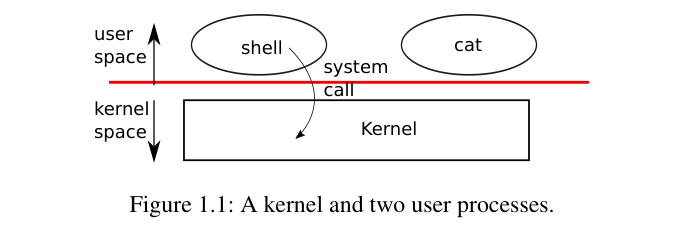
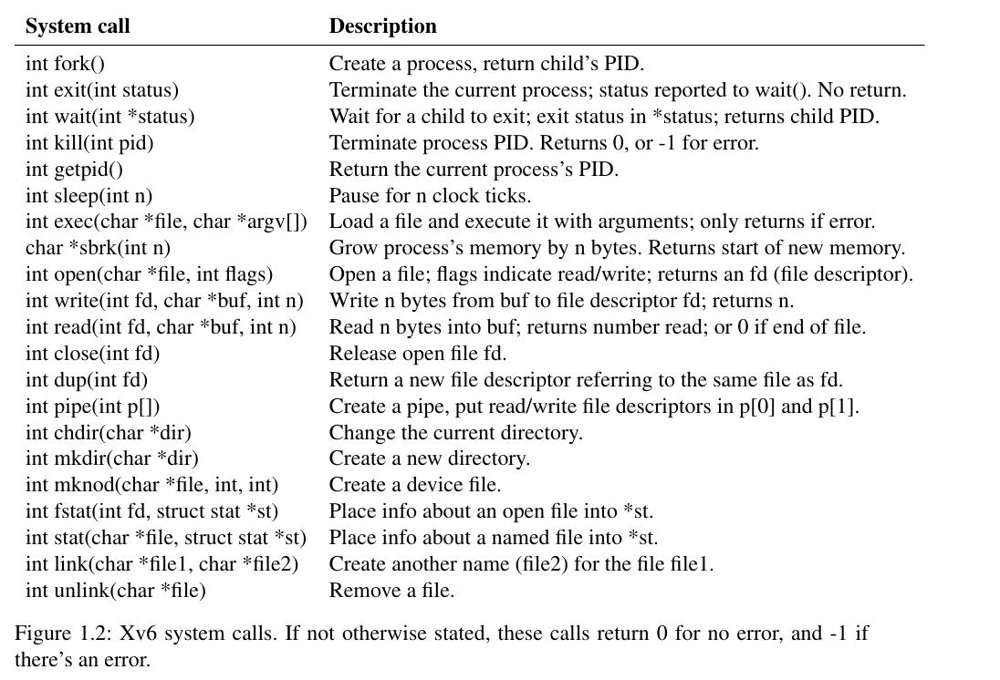

# 第 1 讲 · 课程资料

本讲的指定阅读是 xv6 教材第 1 章「操作系统接口」，下面是全章中文译文。课上演示过的 `fork`、`exec`、文件描述符和重定向，教材讲得更系统；课上没讲到的管道、文件系统与 inode、`cd` 为什么必须由 shell 自己实现，以及章末习题，只在这里出现。课堂原话见「中文译稿」。

## 第 1 章导言：操作系统接口

来源：Russ Cox、Frans Kaashoek、Robert Morris，*xv6: a simple, Unix-like teaching operating system*，2020-08-31 rev1，[原始 PDF](https://pdos.csail.mit.edu/6.S081/2020/xv6/book-riscv-rev1.pdf)，印刷页 9–20。以下按第 1 章顺序翻译。教材许可全文附在文末。

操作系统的工作是让多个程序共享一台计算机，并提供比单独的硬件更有用的一组服务。它管理并抽象底层硬件，例如让文字处理程序不必关心机器使用哪种磁盘。它在多个程序之间共享硬件，让这些程序同时运行，或者看起来像是同时运行。最后，它提供受控的交互方式，让程序能够共享数据、相互协作。

操作系统通过接口向用户程序提供服务。设计一个好的接口并不容易。一方面，我们希望接口简单、精简，这样更容易正确实现；另一方面，我们又容易想给应用提供许多复杂功能。化解这种矛盾的关键，是设计少量能够相互组合的机制，由这些机制的组合获得广泛的通用能力。

本书用一个具体操作系统 xv6 说明这些概念。它提供 Ken Thompson 和 Dennis Ritchie 的 Unix 操作系统所引入的基本接口，也模仿 Unix 的内部设计。Unix 的接口很精简，但各个机制可以很好地组合，因此获得了惊人的通用性。这组接口非常成功，BSD、Linux、Mac OS X、Solaris，甚至在一定程度上的 Microsoft Windows，都提供类似 Unix 的接口。理解 xv6，是理解这些系统以及更多其他系统的良好起点。



**教材原图 1.1，印刷页 10。** `user space` 是用户空间，`kernel space` 是内核空间，`system call` 是系统调用；shell 和 cat 是两个用户进程。红线表示用户与内核的边界。

如图 1.1，xv6 采用传统的内核结构。内核是一个特殊程序，为正在运行的程序提供服务。每个运行中的程序称为**进程**，它的内存中包含指令、数据和栈。指令实现计算，数据是计算所操作的变量，栈组织程序的函数调用。一台计算机通常有多个进程，但只有一个内核。

进程需要内核服务时，会调用操作系统接口中的一个系统调用。系统调用进入内核，内核完成服务后返回。因此，进程在用户空间执行与内核空间执行之间交替。

内核使用 CPU 提供的硬件保护机制，确保用户空间中的进程只能访问自己的内存。内核拥有实施这些保护所需的硬件权限，用户程序则没有。用户程序发起系统调用时，硬件提高权限级别，开始执行预先安排好的内核函数。

> 原书术语说明：本书通常把执行计算的硬件单元称为 CPU（中央处理器）。其他文档，例如 RISC-V 规范，也使用 processor、core 或 hart 等词。

内核提供的系统调用集合，就是用户程序所看到的接口。xv6 实现了传统 Unix 内核服务与系统调用的一个子集。



**教材原表 1.2，印刷页 11。** 下表是中文对照。原表对返回值的简写保留在译文里，具体错误处理仍应看实现。

| 接口 | 中文说明 |
|---|---|
| `fork()` | 创建进程；父进程得到子进程 PID，子进程得到 0。 |
| `exit(status)` | 终止当前进程；状态供 wait 获取；不返回。 |
| `wait(&status)` | 等待一个子进程退出，写入退出状态，返回子进程 PID。 |
| `kill(pid)` | 请求终止指定进程；成功返回 0，错误返回 -1。 |
| `getpid()` | 返回当前进程 PID。 |
| `sleep(n)` | 暂停 n 个时钟 tick。 |
| `exec(file, argv)` | 加载并执行文件，传递参数；仅在错误时返回。 |
| `sbrk(n)` | 将进程内存增加 n 字节，返回新内存的起始位置。 |
| `open(file, flags)` | 根据标志打开文件，返回文件描述符。 |
| `write(fd, buf, n)` | 从 buf 向 fd 写 n 字节；返回写入量。 |
| `read(fd, buf, n)` | 向 buf 读取至多 n 字节；返回读取量，文件结束时返回 0。 |
| `close(fd)` | 释放一个已打开的文件描述符。 |
| `dup(fd)` | 返回一个引用相同底层对象的新 fd。 |
| `pipe(p)` | 创建管道，把读端、写端 fd 放入 `p[0]`、`p[1]`。 |
| `chdir(dir)` | 改变当前目录。 |
| `mkdir(dir)` | 创建目录。 |
| `mknod(file, major, minor)` | 创建设备文件。 |
| `fstat(fd, &st)` | 取得已打开文件的信息。 |
| `stat(file, &st)` | 取得指定名字的文件信息。 |
| `link(file1, file2)` | 为 file1 所指文件增加名字 file2。 |
| `unlink(file)` | 从文件系统移除一个名字。 |

原表说明：除非另有规定，成功返回 0，出错返回 -1。编者注：原表把 `stat` 也列入了接口速查表；xv6 中它实际由用户库通过 open/fstat/close 组合实现，并不是独立的内核系统调用。

本章剩余部分介绍进程、内存、文件描述符、管道与文件系统，用代码和 shell 的用法说明这些服务。Shell 对系统调用的运用，体现了接口设计的巧妙。

Shell 是普通用户程序，它读取用户命令并执行。它不是内核的一部分，也没有特殊身份；这说明系统调用接口已经足够强大，也意味着 shell 容易替换。因此现代 Unix 有多种 shell，各自带有不同的用户界面和脚本功能。xv6 shell 是 Unix Bourne shell 核心功能的简单实现，代码在 `user/sh.c`。

## §1.1 进程与内存

xv6 进程由用户空间内存（指令、数据和栈）以及内核私有的每进程状态组成。xv6 在进程间分时共享 CPU：它会在等待执行的进程之间透明地切换可用 CPU。进程暂停执行时，xv6 保存它的 CPU 寄存器；下次再运行时恢复这些寄存器。内核为每个进程关联一个进程标识符 PID。

进程可以使用 `fork` 创建新进程。新进程称为子进程，调用者称为父进程；子进程初始内存内容与父进程完全相同。fork 在父子进程中都会返回：父进程得到子进程 PID，子进程得到 0。考虑以下 C 代码：

```c
int pid = fork();
if(pid > 0){
  printf("parent: child=%d\n", pid);
  pid = wait((int *) 0);
  printf("child %d is done\n", pid);
} else if(pid == 0){
  printf("child: exiting\n");
  exit(0);
} else {
  printf("fork error\n");
}
```

`exit` 使调用进程停止执行，并释放内存、打开的文件等资源。它接收一个整数退出状态，通常用 0 表示成功，1 表示失败。

`wait` 返回当前进程的某个已退出或被终止的子进程的 PID，同时把它的退出状态复制到传入地址。如果尚无子进程退出，wait 就等待；如果调用者没有子进程，则立即返回 -1。父进程不关心退出状态时，可以传入空地址 0。

例子中的两行输出：

```text
parent: child=1234
child: exiting
```

可以按任意先后顺序出现，取决于父子哪个先执行到 printf。子进程退出后，父进程的 wait 才返回，随后打印子进程已经结束的信息。

尽管子进程的初始内存内容和父进程相同，它们使用的是不同的内存和寄存器；一个进程修改变量不会影响另一个。例如，父进程把 wait 返回值存入 pid，不会修改子进程的 pid，子进程中的值仍是 0。

### exec：替换内存映像

`exec` 从文件系统中的文件加载新的内存映像，替换调用进程的内存。该文件必须具有特定格式，用来说明哪些部分是指令、哪些是数据、从哪条指令开始执行等。xv6 使用 ELF 格式，第 3 章会进一步讨论。

exec 成功后，不再返回原调用程序，而是从 ELF 文件头声明的入口开始执行新指令。它接收可执行文件名和字符串参数数组：

```c
char *argv[3];
argv[0] = "echo";
argv[1] = "hello";
argv[2] = 0;
exec("/bin/echo", argv);
printf("exec error\n");
```

这段代码用参数列表 `echo hello` 启动 `/bin/echo` 的实例，替换调用程序。多数程序不把参数数组第一个元素当作普通参数，因为它按约定是程序名称。

> 编者注：保留原书的 `/bin/echo` 写法；2020 xv6 实验镜像把 echo 等程序放在根目录，运行实验时应按实际路径使用 `echo` 或 `/echo`，不能直接假定存在 `/bin`。

### Shell 怎样使用这些调用？

Shell 的主结构很简单，见 `user/sh.c` 的 `main`。主循环通过 `getcmd` 读取一行用户输入，然后 fork 出 shell 的副本。父进程 wait，子进程运行命令。

例如用户输入 `echo hello`，shell 会用这条命令调用 `runcmd`。它负责真正执行命令，在这个例子里会调用 exec。若 exec 成功，子进程执行的就变成 echo 的指令，不再是 runcmd。某个时刻 echo 调用 exit，父 shell 的 wait 返回，再次回到主循环。

你也许会问，为什么不把 fork 与 exec 合成一次调用？稍后会看到 shell 利用二者分离来实现 I/O 重定向。为了避免复制出一个进程后立刻又用 exec 替换它造成的浪费，操作系统内核可以利用写时复制等虚拟内存技术优化 fork，见教材 §4.6。

xv6 隐式分配了大部分用户空间内存：fork 为子进程复制父进程所需的内存，exec 分配容纳可执行文件所需的内存。如果进程在运行中需要更多内存，例如供 malloc 使用，可以调用 `sbrk(n)`，把数据内存扩大 n 字节；返回值是新内存的位置。

## §1.2 I/O 与文件描述符

文件描述符是一个小整数，代表进程可以读写的某个由内核管理的对象。打开文件、目录或设备，创建管道，或者复制已有描述符，都能取得 fd。为了简便，本书常把 fd 指向的对象统称为「文件」。这套接口隐藏文件、管道和设备之间的差异，把它们统一表现为字节流。输入与输出简称 I/O。

内核把 fd 当作每进程表的索引。因此，每个进程都有自己从 0 开始的 fd 空间。按约定，进程从 fd 0（标准输入）读取，向 fd 1（标准输出）写入正常输出，向 fd 2（标准错误）写入错误消息。Shell 正是利用这个约定实现重定向与管线。Shell 确保自己始终打开三个描述符，默认连接控制台。

### read 与 write

`read(fd, buf, n)` 从 fd 读取至多 n 字节，复制到 buf，并返回实际读取量。对普通文件而言，打开文件的状态带有偏移量。read 从当前偏移读取，再按实际读取量推进偏移；下一次 read 接着上次的位置读取。没有更多数据时，返回 0，表示文件结束。

`write(fd, buf, n)` 把 buf 中 n 字节写入 fd，并返回写入量。原书针对 xv6 说明：只有出错时才会少于 n 字节。与 read 一样，write 在当前偏移写入，并按实际写入量推进偏移，因此下一次 write 会接着上次写。

以下片段是 cat 的核心：把标准输入复制到标准输出，出错时向标准错误报告。

```c
char buf[512];
int n;

for(;;){
  n = read(0, buf, sizeof buf);
  if(n == 0)
    break;
  if(n < 0){
    fprintf(2, "read error\n");
    exit(1);
  }
  if(write(1, buf, n) != n){
    fprintf(2, "write error\n");
    exit(1);
  }
}
```

关键在于：cat 不知道自己读的是文件、控制台还是管道，也不知道自己写的是控制台、文件还是其他对象。fd 以及「0 是输入、1 是输出」的约定，让 cat 的实现非常简单。

### close、open 与重定向

`close` 释放 fd，供后续 open、pipe 或 dup 重新使用。新分配的 fd 总是当前进程尚未使用的最小编号。

fork 除了复制内存，也复制父进程的 fd 表，因此子进程开始时与父进程打开相同的文件。exec 替换进程内存，但保留 fd 表。于是 shell 可以先 fork，在子进程里重新打开选定的 fd，再 exec 新程序，从而实现 I/O 重定向。

下面是 shell 执行 `cat < input.txt` 的简化代码：

```c
char *argv[2];
argv[0] = "cat";
argv[1] = 0;
if(fork() == 0) {
  close(0);
  open("input.txt", O_RDONLY);
  exec("cat", argv);
}
```

子进程关闭 fd 0 后，0 成为最小可用编号，所以成功的 open 会把 input.txt 放在那里。于是 cat 的标准输入就指向 input.txt。这些操作只修改子进程的描述符，父进程不受影响。

xv6 shell 的 I/O 重定向代码正是这样实现的，见 `user/sh.c` 中 `runcmd` 的重定向分支。执行到这里之前，shell 已经 fork 出子进程，后续 runcmd 会通过 exec 加载新程序。

open 的第二个参数是一组位标志，控制打开行为。定义在 `kernel/fcntl.h` 中：`O_RDONLY` 表示只读，`O_WRONLY` 表示只写，`O_RDWR` 表示读写，`O_CREATE` 表示不存在时创建，`O_TRUNC` 表示把文件截断到零长度。

现在可以看出 fork 与 exec 分开的好处：两次调用之间，shell 有机会重定向子进程的 I/O，而不影响主 shell。假想一个合并的 `forkexec` 调用，重定向的安排就会别扭：要么 shell 先修改自己的 I/O，调用后再恢复；要么把重定向指令作为 forkexec 的参数；要么让 cat 等每一个程序都自己处理重定向，而最后一种最不理想。

### 复制了表，为什么还共享偏移量？

虽然 fork 复制 fd 表，但底层打开文件的偏移量由父子共享：

```c
if(fork() == 0) {
  write(1, "hello ", 6);
  exit(0);
} else {
  wait(0);
  write(1, "world\n", 6);
}
```

片段结束后，fd 1 连接的文件包含 `hello world`。由于 wait，父进程在子进程结束后才写入；它会接着子进程留下的偏移写。这有助于让 `(echo hello; echo world) > output.txt` 这样的命令序列顺序输出。

`dup` 复制已有 fd，返回引用同一个底层 I/O 对象的新 fd。两个 fd 共享偏移量，就像 fork 复制的描述符一样。也可以这样写出 hello world：

```c
fd = dup(1);
write(1, "hello ", 6);
write(fd, "world\n", 6);
```

只有从同一个原始 fd 经一系列 fork、dup 派生的描述符才共享偏移。分别 open 同一个文件得到的描述符，不会因此共享偏移。

dup 使 shell 能实现：

```sh
ls existing-file non-existing-file > tmp1 2>&1
```

`2>&1` 要求把 fd 2 设置为 fd 1 的副本。于是，已存在文件的名字与不存在文件的错误消息都会写入 tmp1。xv6 shell 原本不支持错误描述符重定向，但现在你已经知道怎样实现。

文件描述符是强有力的抽象，因为它隐藏连接对象的具体细节：向 fd 1 写入，可能是在写文件、控制台设备或管道。

## §1.3 管道

管道是内核里的一个小缓冲区，通过一对 fd 暴露给进程，一个用于读，一个用于写。写入一端的数据，可以从另一端读出。管道因此提供了进程间通信的方式。

下面的代码运行 wc，并把它的标准输入连接到管道读端：

```c
int p[2];
char *argv[2];
argv[0] = "wc";
argv[1] = 0;

pipe(p);
if(fork() == 0) {
  close(0);
  dup(p[0]);
  close(p[0]);
  close(p[1]);
  exec("/bin/wc", argv);
} else {
  close(p[0]);
  write(p[1], "hello world\n", 12);
  close(p[1]);
}
```

> 编者注：与前面的 `/bin/echo` 一样，`/bin/wc` 是原书写法；在 xv6 实验镜像里按实际位置使用 `wc` 或 `/wc`。

pipe 创建管道，把读写 fd 放进数组 p。fork 之后，父子都持有引用同一条管道的描述符。子进程通过 close 和 dup，让 fd 0 指向管道读端，关闭 p 中的两个原始描述符，再 exec wc。于是 wc 从标准输入读取时，实际读的是管道。父进程关闭读端，写入数据，然后关闭写端。

### 为什么一定要关闭不用的写端？

管道暂时没有数据时，read 会等到有数据写入，或者等到**所有引用写端的 fd 都关闭**。后一种情况下，read 返回 0，和普通文件结束一样。

read 会一直阻塞到不可能再有新数据到来，这正是上面子进程必须在 exec wc 前关闭写端的原因之一：如果 wc 自己仍持有管道写端，它永远看不到 EOF。

### Shell 如何执行管线？

xv6 shell 用相似方式实现 `grep fork sh.c | wc -l`，见 `user/sh.c` 的管线分支。处理命令的子进程先创建管道，再分别为左边和右边 fork，并调用 runcmd，最后等待两边结束。

右边也可能是另一条管线，比如 `a | b | c`，这时又会为 b、c 创建子进程。Shell 因而可能构造出一棵进程树：叶子执行命令，内部节点等待左右子进程结束。

原则上也能让内部节点直接运行管线左边的命令，但正确实现会更复杂。假如只把 `sh.c` 改成不再为 `p->left` fork，而是直接在内部进程里运行 `runcmd(p->left)`，那么 `echo hi | wc` 不会产生预期输出：echo hi 在 runcmd 中退出时，内部进程也退出了，根本没机会 fork 运行右边。

可以让内部进程的 runcmd 不执行 exit 来修复，但这又要求 runcmd 知道自己是不是内部进程，增加复杂性。不为 `runcmd(p->right)` fork 也会带来问题。原书用 `sleep 10 | echo hi` 说明右边执行并退出后不再等待左边的情形。`sh.c` 的目标是尽量简单，因此没有刻意消除这些内部进程。

> 编者注：原书此处把问题表述为「hi 立即打印，而不是十秒后打印」，这一说法不准确。管线两端本来就可并发，echo 不读标准输入，可以立即打印；真正要关注的是 shell 是否在左侧结束前提前返回提示符。另外 xv6 的 `sleep 10` 单位是 tick，不是固定十秒。

### 为什么不用临时文件替代管道？

下面的管线：

```sh
echo hello world | wc
```

原则上可以改成：

```sh
echo hello world > /tmp/xyz; wc < /tmp/xyz
```

但管道至少有四个优势：

1. 管道会自动清理；使用临时文件时，shell 必须负责用完后删除它。
2. 管道可以传递任意长的数据流；临时文件方案要求磁盘能容纳全部中间数据。
3. 管道让各阶段并行执行；临时文件方案要等第一个程序完成，第二个才能开始。
4. 用于进程间通信时，管道的阻塞式读写，比普通文件的非阻塞等待语义更有效率。

## §1.4 文件系统

xv6 文件系统提供数据文件和目录。数据文件保存不作解释的字节数组；目录保存对数据文件和其他目录的带名字引用。目录构成一棵树，从称为根目录的特殊目录开始。

路径 `/a/b/c` 指向根目录 `/` 下 a 目录中的 b 目录中的 c 文件或目录。不以 `/` 开头的路径，相对于调用进程的当前目录解释；可以用 chdir 改变当前目录。假设涉及的目录都存在，下面两种写法打开相同文件：

```c
chdir("/a");
chdir("b");
open("c", O_RDONLY);
```

```c
open("/a/b/c", O_RDONLY);
```

第一种把进程当前目录改成 `/a/b`；第二种既不依赖，也不改变当前目录。

### 创建文件、目录与设备

mkdir 创建目录；带 `O_CREATE` 的 open 创建数据文件；mknod 创建设备文件：

```c
mkdir("/dir");
fd = open("/dir/file", O_CREATE|O_WRONLY);
close(fd);
mknod("/console", 1, 1);
```

mknod 创建引用设备的特殊文件。设备文件关联主设备号和次设备号，也就是 mknod 后两个参数，用于标识内核设备。进程打开设备文件后，内核把 read、write 转交给设备实现，而不是交给普通文件系统的数据读写实现。

### 文件名与 inode 不是同一个东西

文件名和文件本身是分离的。同一个底层文件，也称 inode，可以有多个名字，这些名字称为链接。每个链接是一个目录项，包含名字和对 inode 的引用。inode 保存文件的元数据，包括类型（普通文件、目录或设备）、长度、内容在磁盘上的位置，以及链接数量。

`fstat` 取得 fd 所引用 inode 的信息，填入 `kernel/stat.h` 定义的结构：

```c
#define T_DIR     1  // 目录
#define T_FILE    2  // 普通文件
#define T_DEVICE  3  // 设备

struct stat {
  int dev;       // 文件系统所在磁盘设备
  uint ino;      // inode 编号
  short type;    // 文件类型
  short nlink;   // 链接数量
  uint64 size;   // 文件大小，单位为字节
};
```

link 为已有文件的同一个 inode 增加另一个名字：

```c
open("a", O_CREATE|O_WRONLY);
link("a", "b");
```

现在读写 a 和读写 b 操作的是同一份文件内容。每个 inode 有唯一编号。用 fstat 检查可发现二者的 ino 相同，nlink 都是 2。

unlink 从文件系统中移除一个名字。只有当链接数为 0，且没有 fd 再引用该文件时，inode 和存储内容的磁盘空间才释放。因此，继续执行：

```c
unlink("a");
```

仍然可以通过 b 访问文件。还有一种常见写法：

```c
fd = open("/tmp/xyz", O_CREATE|O_RDWR);
unlink("/tmp/xyz");
```

它创建一个没有名字、但仍然由 fd 持有的临时 inode，进程关闭 fd 或退出时会自动清理。

### 为什么 cd 必须由 shell 自己实现？

Unix 把 mkdir、ln、rm 等文件工具实现为可从 shell 调用的用户程序。任何人都能通过新增用户程序扩展命令行界面。今天看起来很自然，但 Unix 同时代的其他系统，常把这些命令内建到 shell，甚至把 shell 内建到内核。

一个例外是 cd，它内建在 shell 中，见 `user/sh.c` 的主循环。原因是 cd 必须改变 shell 自己的当前目录。如果它是普通外部命令，shell 就会 fork 子进程来执行；cd 只改变子进程当前目录，父 shell 的当前目录不会变化。

## §1.5 真实世界

标准文件描述符、管道以及方便操作它们的 shell 语法结合起来，是编写通用、可复用程序的一大进步。这个思想催生了「软件工具」文化，是 Unix 强大和流行的重要原因；shell 则是最早所谓的脚本语言。今天，BSD、Linux 和 Mac OS X 等系统仍沿用 Unix 系统调用接口。

Unix 接口通过 POSIX（可移植操作系统接口）标准得到规范。xv6 不符合完整 POSIX：它缺少很多系统调用，包括 lseek 这样的基本调用；已有的一些调用也与标准不同。xv6 的首要目标是简单、清晰，并提供一个简单的类 Unix 接口。

有人为 xv6 添加更多系统调用和简单 C 库，以运行基础 Unix 程序。但现代内核提供的系统调用与服务种类远远更多，例如网络、窗口系统、用户级线程以及大量设备驱动。现代内核持续快速演化，功能也超出 POSIX。

Unix 用同一套文件名和 fd 接口，统一访问文件、目录和设备等不同资源。这个想法还能扩展到更多资源：Plan 9 就把「资源即文件」运用于网络、图形等领域。不过，大多数 Unix 派生系统没有沿这条路走得那么远。

文件系统和 fd 是强有力的抽象，但并不是操作系统接口的唯一选择。Unix 的前身之一 Multics，把文件存储抽象成类似内存的形式，接口风格很不一样。Multics 的复杂性直接影响了 Unix 的设计者，他们希望构建更简单的系统。

xv6 不提供多用户概念，也不保护某个用户免受另一个用户影响。按 Unix 的说法，所有 xv6 进程都以 root 身份运行。

本书研究 xv6 如何实现类 Unix 接口，但其思想不限于 Unix。任何操作系统都必须在底层硬件上复用进程、隔离进程，并提供受控的进程间通信。学完 xv6，你应该能在更复杂的其他操作系统中认出这些基本概念。

## §1.6 习题

编写一个程序，使用 Unix 系统调用，通过两条方向相反的管道在两个进程之间往返传递一个字节（ping-pong）。测量性能，以每秒交换次数表示。

> 编者注：这是教材习题；本学期 util 实验中的 pingpong 任务要求一次往返及规定输出，性能测量属于这里的教材练习，不要误当成实验评分要求。

## 配套实验与阅读定位

本讲对应的 **Lab util 中文要求**放在课程的[实验页](#/c/mit-6.s081-2020/lab/util?v=zh)，与所有引用该实验的讲次共用一份。课程笔记中的「下一步」说明各任务对应的机制；实验指导负责提供思路和常见错误。

| 遇到的问题 | 教材（本页） | 课堂（中文译稿） |
|---|---|---|
| 系统调用与普通函数调用有什么不同？ | 导言的图 1.1 | 15:00–18:00 |
| fork 后从哪里继续执行？父子变量会互相影响吗？ | §1.1 | 51:00–57:00 |
| 为什么 exec 下面的 printf 不执行？ | §1.1 | 60:00–69:00 |
| fd 表独立与共享文件偏移是否矛盾？ | §1.2 的 fork / dup 例子 | 57:00–60:00 |
| 重定向到底改变了谁？ | §1.2 | 72:00–78:00 |
| 为什么管道读取一直不结束？ | §1.3 | 课上未讲 |
| 为什么删除文件名后仍然可以读？为什么 cd 是内建命令？ | §1.4 | 课上未讲 |

## 来源、图像与教材许可

**覆盖范围：** 指定教材第 1 章（含图表、代码、习题）全文译入本页。官方讲义 [`l-overview.txt`](https://pdos.csail.mit.edu/6.S081/2020/lec/l-overview.txt) 是这节课的提纲，本页不再单独翻译：课上演示过的部分见「中文译稿」，讲义里有、课上没讲到的管道与目录由本页 §1.3、§1.4 覆盖。

**译文说明：** 译文保留原书的章节顺序与代码语义；技术纠错另以「编者注」标识。教材中的源文件行号属于 2020 版，正文保留文件名与函数定位，避免误用为新版代码行号。教材图片来自本地 PDF 原页裁图。

- 指定教材：Russ Cox、Frans Kaashoek、Robert Morris，2020-08-31 rev1，第 1 章；全章中文翻译，代码保留原文，注释译成中文，个别原书问题通过编者注明示。
- 教材图 1.1 / 1.2：从本地保存的同版本 PDF 第 10 / 11 页裁出，已查看图片；英文标签及表格说明已在正文翻译。
- 抓取时间和对应文件见 `sources/manifest.json`、`lectures/lec01/sources/figures.json`。

<details><summary>教材原始许可（MIT）：版权声明与许可全文</summary>

许可来源：[教材官方仓库 LICENSE](https://github.com/mit-pdos/xv6-riscv-book/blob/xv6-riscv/LICENSE)。这份许可适用于教材，不自动延伸到外链视频。

```text
The xv6 book sources are:

Copyright (c) 2006-2024 Russ Cox, Frans Kaashoek, and Robert Morris,
                        Massachusetts Institute of Technology

Permission is hereby granted, free of charge, to any person obtaining a copy of
this source and associated documentation files (the "Book"), to deal in the Book
without restriction, including without limitation the rights to use, copy,
modify, merge, publish, distribute, sublicense, and/or sell copies of the Book,
and to permit persons to whom the Book is furnished to do so, subject to the
following conditions:

The above copyright notice and this permission notice shall be included in all
copies or substantial portions of the Book.

THE BOOK IS PROVIDED "AS IS", WITHOUT WARRANTY OF ANY KIND, EXPRESS OR IMPLIED,
INCLUDING BUT NOT LIMITED TO THE WARRANTIES OF MERCHANTABILITY, FITNESS FOR A
PARTICULAR PURPOSE AND NONINFRINGEMENT. IN NO EVENT SHALL THE AUTHORS OR
COPYRIGHT HOLDERS BE LIABLE FOR ANY CLAIM, DAMAGES OR OTHER LIABILITY, WHETHER
IN AN ACTION OF CONTRACT, TORT OR OTHERWISE, ARISING FROM, OUT OF OR IN
CONNECTION WITH THE BOOK OR THE USE OR OTHER DEALINGS IN THE BOOK.
```

</details>
