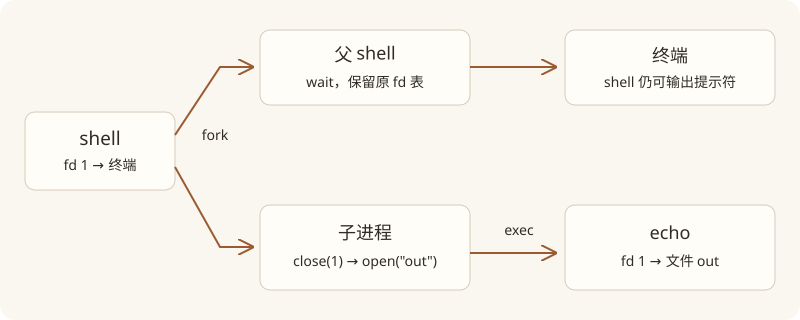

# Lecture 1 · 用小接口组合出一个操作系统

这节课的核心问题是：**为什么几个看起来简单的系统调用，可以支撑运行程序、读写文件和命令重定向？** 学完后，你应该能逐步解释 `echo hello > out`，而不只是记住 `fork`、`exec` 的定义。

## 阅读路线与视频范围

前置要求：能读懂简单的 C 函数、数组、指针和 `if`；暂时不要求掌握内核源码。

| 视频时间 | 主题 | 对应正文 |
|---|---|---|
| 00:00–15:00 | 操作系统目标、分层、内核服务与系统调用 | 第 1、2 节 |
| 15:00–25:00 | 设计权衡、接口交互、应用开发者为何需要懂 OS | 第 1、2 节 |
| 25:00–35:00 | 课程安排、实验、xv6 与 RISC-V | 实验页 |
| 35:00–45:00 | QEMU 演示、copy、read/write 和缓冲区问答 | 第 3 节 |
| 45:00–55:00 | open、fd 名字空间、shell、系统调用指令、fork | 第 3、4 节 |
| 55:00–65:00 | fork 的复制、exec、argv、fork/exec/wait | 第 4、5 节 |
| 65:00–75:00 | exec 失败、COW 动机、执行顺序、wait 问答 | 第 5 节 |
| 75:00–79:57 | 重定向、接口组合、收尾 | 第 6 节 |

时间是约 5–10 分钟的阅读窗口，不是精确的章节起点。

**范围差异：** 视频到重定向后结束；第 7 节管道与目录来自官方讲义和教材，课上没有讲到。

## 1. 操作系统在解决什么问题？

假设每个程序都直接控制磁盘、内存和 CPU：编辑器和编译器可能覆盖彼此的内存，一个程序可能永远占着 CPU；换一种磁盘，所有程序又要改一遍。操作系统提供一组更稳定的服务，让程序不用直接面对这些问题。[S1: Overview；B1: 第 1 章]

| 目标 | 具体含义 | 例子 |
|---|---|---|
| 抽象 | 用稳定接口隐藏硬件细节 | 用文件名读文件，而不是给磁盘控制器发命令 |
| 多路复用 | 让多个程序共享有限硬件 | 多个进程轮流使用 CPU |
| 隔离 | 限制程序出错造成的影响 | 一个进程不能随意改另一个的内存 |
| 协作与受控共享 | 在允许时交换数据，同时限制不该发生的访问 | 编译器读取编辑器保存的源码 |
| 性能与通用性 | 服务多种应用，同时减少管理开销 | 数据库和交互式程序有不同延迟需求 |

这些目标会冲突。保护检查可能增加开销；暴露更多硬件能力又可能削弱隔离。因此这门课会不断追问：**这个设计换来了什么，又付出了什么？**

这里讲的是通用 OS 的目标，不表示初始 xv6 已实现全部功能。例如教材 §1.5 明确说 xv6 没有真实 Unix 的多用户权限系统；网络也是后续实验的扩展。

## 2. 用户程序、内核和系统调用

可以把机器理解为三层：用户程序（shell、编辑器、编译器）→ 内核服务（进程、内存、文件系统）→ 硬件。Shell 本身也是普通用户程序；解析 `>` 的语法不需要写进内核。[S1；B1: 第 1 章开头]

不要把「shell 能启动程序」理解成「shell 就是内核」。课堂板书见「中文译稿」09:00–12:00。

普通函数调用改变执行位置，通常不改变执行权限。系统调用则通过受控入口进入内核，由内核访问受保护的资源。例如 `open` 查找文件并建立进程的 fd 表项，可能需要访问缓存或磁盘。

从 C 代码看，它像一次函数调用；用户态封装最终执行 RISC-V 的 `ecall`。这里应区分**用户态封装函数**与**内核中的实际实现**。Python 的文件 API 虽然更高级，底层也需要操作系统服务。[V1: 15:00–25:00、45:00–55:00]

> 编者说明：本讲只建立受控进入内核的概念。寄存器保存由哪些硬件动作、哪些入口代码完成，需要到 traps 章节具体学习；不能概括成“CPU 自动保存所有寄存器”。

## 3. read、write 与文件描述符

`fd` 是一个小整数，索引到**当前进程**的文件描述符表。两个进程的 `fd = 3` 可以指向完全不同的对象；不能把 fd 当作全系统通用的文件编号。[S1: open.c；B1: §1.2]

Unix 约定 0 是标准输入、1 是标准输出、2 是标准错误。它们不必连接键盘和屏幕，也可以连接文件或管道。下面是基于 `copy.c` 的教学摘写，省略了错误输出与完整程序入口：

读代码时把 `read(..., sizeof(buf))` 的容量上限，与 `write(..., n)` 的实际长度对应起来（课堂演示见「中文译稿」36:00–42:00）。

```c
char buf[64];
int n;
while ((n = read(0, buf, sizeof(buf))) > 0) {
  write(1, buf, n);
}
```

读懂这一小段，需要理解三个不同的“长度”：

1. `sizeof(buf)` 是缓冲区容量，也是本次允许读取的上限。
2. `read` 的返回值 `n` 是实际读到的字节数，可能少于上限。
3. `write` 应使用 `n`，因为只有这些字节是本次读取的有效数据。

`read` 返回 0 表示 EOF，-1 表示错误。真实实验程序应处理错误并检查 `write` 返回值；上面只是展示数据流。

课堂提问问到了一个重要边界：**缓冲区只有 64 字节，能不能给 read 传 65？** 这不是让内核“自动扩容”。若多出的地址仍在可访问内存中，就可能覆盖相邻数据。C 数组容量不是系统调用自动知道的信息。[V1: 40:00–45:00]

操作系统传递的是字节，不负责把它们解释为 UTF-8、整数或数据库记录。文件连续读取的位置由打开文件的偏移量推进；同一个 `read` 接口可以服务多种格式。[B1: §1.2]

## 4. fork：复制的是运行中的进程

程序是磁盘中的指令文件；进程是运行实例，包含用户内存、寄存器状态以及内核维护的状态。`fork()` 成功后，父子都从调用返回的位置继续执行，并不是让子进程从 `main` 重新开始。[B1: §1.1；V1: 50:00–60:00]

| 返回位置 | fork 返回值 | 用途 |
|---|---|---|
| 父进程 | 子进程 PID，正整数 | 知道创建了哪个子进程 |
| 子进程 | 0 | 进入子进程分支 |
| 失败时的父进程 | -1 | 没有创建成功，需要处理错误 |

父子的普通内存初始内容相同，但各自修改变量不会修改对方的变量。文件描述符表也被复制，**但表项可以引用同一个底层打开文件对象**，因此继承的普通文件描述符会共享文件偏移量。这一点与“每个进程有自己的 fd 表”并不矛盾。[B1: §1.2]

课堂 `fork.c` 演示中，两边的输出会交错。原因是两个进程都在执行，不能凭某次输出的先后顺序推断谁必定先运行。不同 PID 等进程身份信息也不同，“复制”不是把所有内核状态都无区别复制一遍。

## 5. exec 与 wait：让 shell 活下来

`exec` 的作用是**在当前进程中换一个程序**：加载新程序的指令和初始数据，替换旧用户内存，同时保留文件描述符。成功后不会回到原来的下一行；只有失败才返回。[S1: exec.c；B1: §1.1]

`argv` 是字符串指针数组，末尾的 `0` 是空指针，用于表示数组结束；它不同于每个字符串内部的结尾字符 `\0`。

```c
// 编者示例：xv6 风格，展示 fork/exec/wait 的控制流
int pid = fork();
if (pid < 0) {
  fprintf(2, "fork failed\n");
  exit(1);
}
if (pid == 0) {
  char *argv[] = {"echo", "hello", 0};
  exec("echo", argv);
  fprintf(2, "exec failed\n");  // 只有失败才会到达这里
  exit(1);
}
int status;
wait(&status);
```

为什么 shell 不自己直接 `exec("echo", ...)`？因为成功后 shell 自己就被换掉了。先 fork，子进程 exec，父 shell 等待，才能在命令结束后继续读取下一条命令。[S1: forkexec.c]

`wait(&status)` 返回退出子进程的 PID，并把退出状态写到 `status`。在 xv6 中，无子进程时返回 -1；有子进程但都未退出时等待。要回收两个子进程，需要两次成功的 wait。它不能用来等待自己的父进程。[B1: §1.1；V1: 65:00–75:00]

课堂还提出了性能问题：fork 刚复制内存，exec 又把它扔掉，是否浪费？后续 COW 实验会利用页表实现延迟复制，但那是实现优化，不能改变程序观察到的父子内存隔离语义。

## 6. 推导 echo hello > out

这个命令可以用已学过的机制组合完成，而不需要给 `echo` 添加“重定向模式”。[S1: redirect.c；B1: §1.2；V1: 70:00–79:57]



图为编者根据官方 `redirect.c` 与教材 §1.2 重绘，只画出标准输出的变化。

操作顺序如下：

1. Shell fork，保留父 shell 继续服务用户。
2. 子进程 `close(1)`，释放自己的标准输出表项。
3. 子进程 `open("out", O_CREATE | O_WRONLY)`。在 fd 0 仍占用且 open 成功的前提下，最低可用 fd 是 1，所以新文件接到标准输出。
4. 子进程 exec echo。它继承配置好的 fd 表，仍然只向 fd 1 写数据。
5. 父 shell wait。父进程的 fd 1 没有被子进程的 close/open 操作改变，提示符仍能显示在终端。

这要求三个接口契约配合：**fork 继承 fd；open 分配最低空闲 fd；exec 保留 fd**。接口各自简单，组合起来却能实现复杂行为。

> 编者补充：这里忠实解释官方演示的标志位。`O_CREATE` 不等于清空已有文件；若要求覆盖旧内容时截断文件，还要结合版本中的 `O_TRUNC` 语义。错误检查也不能省略：open 失败就不能继续假定 fd 1 已正确连接。

## 7. 讲义与教材补充：管道、目录

**本节不是该视频中已经讲完的内容。** 官方讲义继续列出 `pipe1.c`、`pipe2.c`、`list.c`，教材 §1.3–1.4 给出完整背景。

`pipe(p)` 创建一条由内核维护的字节通道，`p[0]` 是读端，`p[1]` 是写端。先 pipe 再 fork，父子便继承了能连接同一条管道的 fd。实际抓到的 `pipe2.c` 是**子进程写、父进程读**，不能沿用未核对的反向描述。

对于 `ls | grep x`，shell 把左命令的标准输出连接到写端，把右命令的标准输入连接到读端。两边各自只知道自己的 fd，不需要知道对方是谁。

管道为空不一定是 EOF：只要还有写端保持打开，后面仍可能有数据，读取就可能继续等待。**只有所有写端都关闭且缓冲区已读空，read 才返回 0。** 这解释了 primes 实验为什么一定要关闭无用 fd。[B1: §1.3]

目录则维护“名字到文件”的关系。xv6 可以打开目录并读取目录项，`list.c` 展示了这个思路；`.` 表示当前目录。具体目录项格式与路径拼接应对照本版本的 `user/ls.c`，这是 find 实验的起点。[S1: list.c；B1: §1.4]

教材还补足两个容易混淆的区别：

- **文件名不等于文件本身。** `link("a", "b")` 可以让两个名字指向同一个 inode；`unlink("a")` 只移除一个名字。还有名字或打开引用时，文件内容不因此立即消失。
- **进程状态不等于整个系统的状态。** cd 必须改变 shell 自己的当前目录，所以是内建命令。让子进程执行 chdir，只会改变子进程，回到父 shell 后目录仍是原来的目录。

详细过程与代码见「课程资料」§1.4；这些属于指定阅读的补充，不冒充视频已经讲过的内容。

## 下一步：把概念变成可运行的程序

点击页头「对应实验 · Lab 1 util」，先读「实验说明」中的官方要求，再看「实验指导」，按 2020 util 实验完成 sleep、pingpong、primes、find、xargs。优先用上面的接口语义预测程序行为，再运行验证。每当程序挂住，先问：**谁还持有管道写端？谁在等谁？exec 是否真的成功？**

## 课程总结与自测

Unix 的强大来自少量接口之间可预测的组合：**进程负责执行，fd 负责连接，shell 负责组合。**

| 机制 | 核心语义 | 容易混淆的点 |
|---|---|---|
| read / write | 传递字节；用实际读取长度控制写入 | 缓冲区容量不等于读到的长度 |
| open / close | 建立和释放当前进程的 fd 表项 | fd 不是全系统的文件编号 |
| fork | 创建子进程，父子分别返回 | 子进程不是从 main 重新开始 |
| exec | 替换当前进程的程序，保留 fd | 不创建新进程，成功不返回 |
| wait / exit | 回收子进程并传递退出状态 | 一次 wait 只回收一个子进程 |

<details><summary>fork 之后，子进程 close(1)，父进程还能写标准输出吗？</summary>

通常可以。关闭的是子进程的表项；父进程的引用仍保留。不要把“独立表”理解成底层对象一定完全独立。[B1 §1.2]

</details>

<details><summary>为什么不能把 echo 的重定向放在父 shell 中，改完就不管了？</summary>

这样会改变 shell 自己后续输出的位置。放在 fork 后的子进程中，就只影响要执行的命令。[S1 redirect.c]

</details>

<details><summary>exec 后面的错误消息为什么有时运行、有时不运行？</summary>

成功时已换成新程序，不回到原调用点；文件不存在等失败情况下才返回原程序。[V1 60:00–70:00]

</details>

<details><summary>一次演示中 parent waiting 总先打印，说明父进程必定先执行吗？</summary>

不说明。调度和 exec 的开销会影响观察到的顺序，接口并不保证父进程总先运行。[V1 65:00–75:00]

</details>

<details><summary>管道没有数据了，read 为什么还没返回 0？</summary>

还可能有未关闭的写端，包括读进程自己继承的那一个。只要将来仍可能写入，空管道的读取就可能等待。[B1 §1.3；讲义补充]

</details>

## 去哪里看更完整的讲解

课堂原话在[「中文译稿」](#/c/mit-6.s081-2020/lec/lec01?v=draft)，按时间段查；指定教材第 1 章的全文译文在[「课程资料」](#/c/mit-6.s081-2020/lec/lec01?v=materials)，按小节查。

| 笔记中的疑问 | 课堂（中文译稿） | 教材（课程资料） |
|---|---|---|
| 用户、内核、系统调用是什么关系？ | 06:00–18:00 | 导言的图 1.1 |
| read/write 的参数与返回值怎样配合？ | 36:00–45:00 | §1.2 的 cat 片段 |
| fork 后谁从哪里继续？exec 为什么不返回？ | 51:00–69:00 | §1.1 的父子进程例子 |
| fd 表与底层文件偏移的区别？ | 45:00–48:00、57:00–60:00 | §1.2 的 fork、dup 和重定向例子 |
| 重定向为什么只影响子进程？ | 72:00–78:00 | §1.2 |
| 管道为什么没有 EOF？ | 课上未讲 | §1.3 的 wc 示例和逐端关闭说明 |
| 文件名、inode、目录是什么关系？ | 课上未讲 | §1.4；补充解释 link/unlink 和 cd |

实验页的「实验说明」包含官方任务、提示、测试、提交步骤和选做题；「实验指导」提供思路：sleep 对应参数与系统调用；pingpong/primes 对应进程和管道；find 对应目录；xargs 对应 argv 与 fork/exec/wait。

## 文档引用与覆盖状态

本文依据官方讲义 [S1]、本讲英文自动字幕 [V1] 和 xv6 教材第 1 章 [B1] 自主整理，是中文学习讲解，不是视频逐字翻译。实验与教材均对齐 2020 年版。

抓取日期：2026-11-06。以下是本讲已读取的主要来源；本地 `sources/manifest.json` 保存各抓取 URL、时间、状态和 SHA-256。

| ID | 来源 | 章节 / 用途 |
|---|---|---|
| S0 | MIT 课程团队，[6.S081 2020 课表](https://pdos.csail.mit.edu/6.S081/2020/schedule.html) | LEC 1 的讲义、视频、阅读与 util 对应；全课 24 讲 |
| S1 | Robert Morris / MIT，[Lecture 1: O/S overview](https://pdos.csail.mit.edu/6.S081/2020/lec/l-overview.txt)，2020 | 本文概念与示例主题 |
| V1 | Robert Morris 主讲、David Morejon 频道，[Lecture 1 视频](https://www.youtube.com/watch?v=L6YqHxYHa7A) | 2020-09-02 上传，79:57；已读自动字幕，未逐句听音 |
| B1 | Russ Cox、Frans Kaashoek、Robert Morris，[xv6 教材 rev1](https://pdos.csail.mit.edu/6.S081/2020/xv6/book-riscv-rev1.pdf)，2020-08-31 | 第 1 章；§1.1 p.10–13 进程，§1.2 p.13–15 fd，§1.3 p.15–17 管道，§1.4 p.17–19 文件系统；页码为印刷页码 |
| L1 | MIT 课程团队，[Lab util](https://pdos.csail.mit.edu/6.S081/2020/labs/util.html)，2020 | 实验要求，未运行代码 |

直接核对的代码：[forkexec.c](https://pdos.csail.mit.edu/6.S081/2020/lec/l-overview/forkexec.c)、[redirect.c](https://pdos.csail.mit.edu/6.S081/2020/lec/l-overview/redirect.c)、[pipe2.c](https://pdos.csail.mit.edu/6.S081/2020/lec/l-overview/pipe2.c)。官方目录的 10 个 C 文件均已获取，当前目录显示 2025 修改时间，不保证与录课时逐字一致。

自动字幕共 2,119 条，开头约 1.9 秒无字幕，原始末尾超出视频时长 2.199 秒；「阅读路线」的时间索引按字幕划分并已按 79:57 封顶。已核对 10:00、40:00、61:00、78:00 四张课堂关键帧（放在「中文译稿」对应时间段），未做全片画面与逐句音频核对。已阅读教材第 1 章全文并查看图 1.1 / 1.2 原页裁图。教材翻译保留 MIT 许可，讲义与实验翻译保留官网 CC 署名。工具页已抓取，工具链尚未安装验证。
