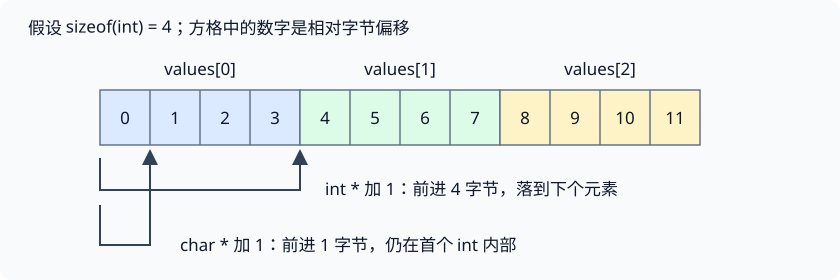

# 第 2 讲 · 把地址、对象和调试证据连起来

读懂内核 C 代码，最重要的不是记住多少运算符，而是每次访问内存时都能回答：**地址从哪里来？指向多大的对象？对象现在还活着吗？这次操作会改谁？** 调试器让你把这些推理与运行现场逐一对照。

## 学习路线

前置要求：能读简单的变量声明、循环、函数调用；理解第 1 讲中 `read` 的缓冲区和 `exec` 的 `argv`。

| 目标 | 本页 | 需要逐项核对时 |
|---|---|---|
| 说清一次指针访问 | §1 | 课程资料 §1.3、§1.5 |
| 设计不会返回悬空地址的接口 | §2 | 课程资料 §1.2、§1.4 |
| 读懂数组、字符串、`argv`、结构体 | §3 | 课程资料 §1.6；K&R 阅读定位 §4 |
| 根据位定义推导掩码 | §4 | 课程资料 §1.7 |
| 用一个可证伪假设组织调试 | §5 | 课程资料 §2 |
| 分辨语言保证与机器现象 | §6 | 课程资料 §3 的 `pointers.c` 分段分析 |

## §1 一个指针访问，需要四份信息

考虑编者示例：

```c
int values[3] = {12, 24, 36};
int *cursor = values;
cursor += 1;
*cursor = 99;
```

把它拆成四层：

1. **对象**：`values` 是包含三个 `int` 的数组，三份元素连续存放。
2. **地址值**：最初 `cursor` 保存首元素地址，之后保存第二个元素地址。
3. **类型**：`cursor` 是 `int *`，所以 `+= 1` 移动一个 `int`，而不是一个字节。
4. **有效性**：第二个元素仍在数组范围内，数组还处在生命周期中，因此能通过该指针写入。



*编者示意图：假设 `sizeof(int) == 4`，地址用相对偏移表示。按字节移动一位并不意味着移动后可以按 `int` 合法访问。*

写入后数组变成 `{12, 99, 36}`。`cursor` 和 `values` 没有各自维护一份元素；`cursor` 只是访问原数组的一条路径。这叫**别名**：不同表达式可以指向同一个对象。

### `p`、`&p`、`*p` 是三个不同问题

假设 `int *p = &values[1]`：

| 表达式 | 回答什么问题 | 类型 |
|---|---|---|
| `p` | 指针现在指向哪里？ | `int *` |
| `&p` | 指针变量自己存放在哪里？ | `int **` |
| `*p` | 所指对象当前是什么值？ | `int` 左值 |

因此 `p = ...` 是换目标，`*p = ...` 是改目标对象。不要仅凭十六进制数相似，就把“指针变量的位置”与“它指向的位置”混为一谈。

一条实用的读码标注法是：每遇到 `*p` 或 `p[i]`，在旁边写上 **基对象、偏移、访问宽度、存活条件**。若某一项无法解释，先查接口契约，而不是靠强制转换让编译器闭嘴。

## §2 函数接口：传的是值，责任可以不同

### 指针按值传递，为什么能改外部对象？

```c
// 编者例子：dst 必须指向一个仍存活、可写的 int
void put_value(int *dst) {
  *dst = 7;
}
```

调用 `put_value(&x)` 时，函数得到的是地址值的副本。但这两个地址值指向同一个 `x`，所以写 `*dst` 可以修改调用者的对象。反过来，如果函数只执行 `dst = 0`，改变的是参数副本，不会把调用者的指针变量清零。

若接口确实要修改调用者的指针变量，可以传它的地址，例如让形参为 `int **out`，对 `*out` 赋值。这又多了一层间接访问，但并没有改变 C 按值传参的规则。[对应 K&R §5.2、§5.6 的自主讲解]

### 生命周期问题不能只靠“返回地址”解决

若函数要产生短字符串，可以从接口责任出发选择三种设计：

| 设计 | 谁提供存储 | 返回后为什么仍可用 | 需要讲清的限制 |
|---|---|---|---|
| 调用者传入缓冲区和容量 | 调用者 | 不依赖被调函数的局部数组 | 调用者负责容量和存活期 |
| 函数返回动态分配区域 | 分配函数 | 没有随函数返回而释放 | 谁负责 `free`，失败如何表示 |
| 返回静态存储对象 | 程序的长期存储 | 对象具有静态存储期 | 多次调用可能共享同一结果，不是独立副本 |

下面是第一种设计的最小例子，代码是自主编写的接口练习：

```c
// 返回 0 表示写入成功；buf 至少指向 cap 字节可写空间
int make_tag(char *buf, unsigned cap) {
  if (cap < 3)
    return -1;
  buf[0] = 'o';
  buf[1] = 'k';
  buf[2] = '\0';
  return 0;
}
```

两个可见字符却需要三个字节。这里检查 `cap` 不是因为 C 能从 `buf` 推断数组大小，而是因为调用者把容量作为独立参数传了进来。函数只负责这次借用，不擅自释放调用者的区域。

这与第 1 讲的 `read(fd, buf, n)` 是同一个接口思想：**地址给出起点，长度给出范围，生命周期由调用双方约定。** `read` 读入任意字节，不自动补字符串结束符；若要把结果作为 C 字符串，还要留出一个字节并自行终止。

## §3 三种常见布局，不要只看星号数量

### 数组大小在哪一步丢失？

设调用者拥有 `int a[6]`，把 `a` 传给 `void inspect(int a[])`。函数参数声明会调整成 `int *a`，函数只拿到首元素指针；在函数体中 `sizeof(a)` 是指针大小，不能再求出元素个数。

这个变化发生在**函数参数接口**，不是原数组突然缩成了一个指针。调用者处对真正数组计算 `sizeof a / sizeof a[0]` 可以得到 6；在函数里则应另传长度。完整的数组类型校正见课程资料 §1.6。

### 字符数组和字符指针的可修改对象不同

```c
char owned[] = "cat";
const char *view = "cat";
```

`owned` 是独立数组，包含 `c a t \0` 四个字符，可以在范围内修改。`view` 是一个指针，指向字符串字面量；改变 `view` 的指向与修改其目标字符是不同操作。字符串字面量不能被程序修改，因此例子用 `const char *` 表达只读访问。

`sizeof owned` 是 4；`sizeof view` 是指针大小。字符串的字符数要沿着 `\0` 找到结尾，指针本身不记录长度。不要把 `sizeof` 当作字符串长度函数。[对应 K&R §5.3、§5.5 的自主讲解]

### argv 有两层“结束”

```c
char *args[] = {"echo", "hi", 0};
```

可以分两层读：

```text
args[0] ──→ 'e' 'c' 'h' 'o' '\0'
args[1] ──→ 'h' 'i' '\0'
args[2] = 空指针
```

- `args[i]` 取出一个字符指针；`args[i][j]` 再读取某个字符。
- 每个字符串里的 `\0` 终止字符序列。
- 最后的空指针终止指针序列，是 `exec` 的参数数组约定。

`char *args[]` 是指针数组；`char rows[2][5]` 则是在一个连续对象里放两个定长行。后者在常见表达式中变成 `char (*)[5]`，不是 `char **`。指针数组的元素存的是地址，二维字符数组的元素直接存字符，不能靠强转把两种布局互换。[对应 K&R §5.6 的自主讲解]

### 结构体中的指针不是自动深拷贝

编者示例 `struct item { int value; struct item *next; };` 同时包含值字段与指针字段。对有效的 `struct item *node`，`node->value` 等价于 `(*node).value`；`node->next` 读出下一个对象的地址，尚未访问下一个对象的内容。

若执行 `struct item copy = *node`，整数值被复制，`next` 的地址值也被复制，但不会递归复制链表。两份结构体仍可能通过 `next` 访问同一个后继对象。

xv6 的 `kernel/kalloc.c` 用 `struct run *next` 连接空闲页：一页在空闲时，其开头的字节被解释为链表节点。这要求“当前这页是否归分配器所有”的状态约定，光有一个 `struct run *` 类型并不够。这里先练习读出字段关系，分配器的完整机制见后续内存管理内容。[对应 K&R §6.4 的自主讲解]

## §4 位操作：先写清楚位号，再算整数

假设一个编者设计的 8 位状态字中，第 0 位表示可读，第 2 位表示可写，第 3 位表示有效。三者同时开启得到：

$$
2^0 + 2^2 + 2^3 = 1 + 4 + 8 = 13 = \texttt{0x0d}.
$$

不要把“第 3 位”直接写成数值 3 去参与 `&`；掩码应是 `1U << 3`，即 8。一个简洁的推导模板是：

| 想做什么 | 表达式（`mask` 已是掩码） | 为什么 |
|---|---|---|
| 保留旧标志并置位 | `flags \|= mask` | 目标位被置 1，其他位不变 |
| 清除目标位 | `flags &= ~mask` | 目标位对应 0，其余对应 1 |
| 切换目标位 | `flags ^= mask` | 只有掩码为 1 的位置翻转 |
| 至少一个目标位存在 | `(flags & mask) != 0` | 交集非空 |
| 所有目标位都存在 | `(flags & mask) == mask` | 交集等于整个目标集合 |

这里使用无符号标志类型，掩码宽度应和要表达的标志范围相配。若要操作 RV64 的高位，先用足够宽的无符号值再移位，不能先让一个 32 位 `1` 做过宽的移位，再把错误结果转换到 64 位。

`flags && mask` 只计算两个数是否都非零，不能检验对应位。`flags & mask == 0` 还容易遇到优先级误读，应写 `(flags & mask) == 0`。原 slides 的位号/掩码笔误及位宽问题详见课程资料 §1.7。

## §5 让 GDB 验证一个假设

面对“数组内容不对”，不要先单步一万行。先提出一个具体假设，例如：**某个指针在循环中越过了我以为的位置，导致下一次写入改错元素。** 然后按四步组织证据。

### 第一步：在错误发生之前建立基线

先在产生对象、初始化指针之后停下。记下：对象的基地址、元素大小、当前指针与长度。此时应该能用纸笔预测下一次写入的目标。

在具备符号且相应变量在当前作用域中时，编者检查清单可写成：

```text
p sizeof(*cursor)
p cursor
p &values[0]
p cursor - &values[0]
p values
```

最后的指针相减只在它们属于同一数组等合法情形下有意义；不应把任意两个地址相减当作 C 对象关系的证明。

### 第二步：在“指针变化”与“对象变化”之间选观察目标

若怀疑指针走错，观察 `cursor`；若怀疑某个元素被改坏，观察 `values[1]`。不知道谁写坏它时，可以在对象已建立后设置 `watch -l values[1]`，然后继续。

二者回答不同问题：指针完全不变时，也可能一直写错同一个对象；指针发生变化时，原对象可能完全没被修改。观察点语法、固定位置与目标支持的限制见课程资料 §2.6。

### 第三步：比较预期和实际，不只看 printf

观察点触发后，检查当前源码位置和调用链；必要时看指令与字节。`print` 提供类型层面的解释，`x` 提供原始布局层面的证据。例如一个整型看起来奇怪时，`x/4bx` 能帮助发现其某几个字节被另一笔写入覆盖。

不要把这类观察误解为运行结果的普遍保证。原始 `pointers.c` 包含未初始化指针和错位访问；其逐段推演已经在课程资料 §3 给出，这里不把它当成可移植测试的标准答案。

### 第四步：修复规则，再从原始条件重试

GDB 的 `set var ...` 可以测试“若这个值正确，后面是否恢复正常”的假设，但没有修复产生错误值的源码。找到首次违反对象范围、生命周期或接口约定的位置，改那里，再重新开始一次运行。

| 现象 | 优先问什么 | 需要的证据 |
|---|---|---|
| 一进入函数数据就坏了 | 调用者是否早已传错地址或长度？ | 参数、调用链、调用点 |
| 函数返回后才坏 | 返回的是不是局部对象地址？ | 对象的声明位置与存储期 |
| 某元素被莫名修改 | 有无别名写入或越界？ | 数据观察点、指针步长 |
| 断点停在陌生地址 | 连接的是哪台目标？加载的符号是否匹配？ | 目标架构、PC、符号文件 |
| 源码单步像在跳行 | 优化或源码/二进制不匹配？ | 构建产物、反汇编、调试符号 |

对于 xv6，先按公共资料配置工具，再按课程资料 §2.2 连接 2020 RISC-V 目标。不要直接抄 2018 slides 中的 `0x7c00`、`%esp` 或 JOS 的符号文件路径。

## §6 从示例走向内核代码的三条边界

1. **转换类型不等于转换对象。** `(struct run *)pa` 没有凭空创建一页内存；代码必须已经拥有可这样使用的区域。把错位地址 cast 成 `int *`，也没有自动修复对齐。
2. **地址数值不等于访问权限。** 指针看起来非零、地址在某个范围内，不足以证明当前对象仍存活、归自己所有，或该地址空间允许访问。后续系统调用与页表会继续展开这层区别。
3. **机器现象不等于 C 保证。** 小端序、4 字节 `int`、允许未对齐机器访问，都需要明确条件；一次输出稳定不能使未定义行为合法。

读 xv6 时，既要懂语言层的对象与类型，也要看清内核依赖的目标架构约定。把两者都说明白，比简单说“C 很底层，所以什么都能做”更有帮助。

## 自测

<details><summary>1. `int a[4]; int *p = a;` 执行 `p++` 后，a 是否也移动了？</summary>

没有。改变的是指针变量保存的地址，数组对象仍在原处。假设 `int` 为 4 字节，`p` 指向 `a[1]`，相对数组首地址增加 4 字节。

</details>

<details><summary>2. 函数收到 `int *p` 后执行 `p = 0`，能让调用者的指针变量变成空指针吗？</summary>

不能，参数是地址值的副本。若要改调用者的指针变量，需要访问那个指针变量本身，例如传入其地址并通过二级指针赋值。

</details>

<details><summary>3. 四个字符的字符串，容量至少要多少？`read` 会替你放末尾的 0 吗？</summary>

按四个单字节字符计算，至少五个字节，最后一个存 `\0`。`read` 只返回实际读到的字节数，不自动加终止符；处理输入时还要先判断返回值。

</details>

<details><summary>4. `args[2] == 0` 与 `args[1][2] == '\0'` 是同一件事吗？</summary>

不是。前者检验第 3 个指针是空指针，后者检验第 2 个字符串的第 3 个字符是结束符。后者还要求 `args[1]` 指向有效且足够长的对象。

</details>

<details><summary>5. `flags = 13`，要清除第 2 位而保留其他位，结果是多少？</summary>

掩码为 `1U << 2`，值为 4；`flags &= ~(1U << 2)` 得到 9。不能把“第 2 位”写成数值 2，也不能用 `flags = ~4U`，后者会重写所有位。

</details>

<details><summary>6. `flags = 1`、`mask = 5`，检查“至少一个”和“全部”会得到什么？</summary>

`flags & mask` 为 1，所以至少一个成立；它不等于 5，所以全部不成立。测试条件必须与想表达的接口语义对应。

</details>

<details><summary>7. 想追查 `p` 指向的那个整数被谁改写，应观察 `p` 还是 `*p`？</summary>

观察对象应使用 `*p`；`p` 观察的是地址值本身。若要固定在当前对象的位置，可在指针有效时用 `watch -l *p`；后续 p 换目标不会让固定位置跟随变化。

</details>

<details><summary>8. 为什么不能把 pointers.c 的第五行数字当作必然输出写进测试？</summary>

原程序更早已读取未初始化的指针，且后面通过偏移一个字节的 `int *` 写入。C 并不保证这种执行的结果；资料中的数字只是附带小端序、宽度及实际写入方式假设的字节推演。

</details>

## 下一步

继续做 [util 实验](#/c/mit-6.s081-2020/lab/util?v=guide) 时，用“指针＋长度＋生命周期”检查缓冲区、参数数组和递归调用。第 2 讲的课表也是 syscall 实验的发布节点；其正式要求仍以[2020 官方实验页](https://pdos.csail.mit.edu/6.S081/2020/labs/syscall.html)为准，不能把这份 GDB 旧讲义里的作业要求移植过来。

进入[第 3 讲](#/c/mit-6.s081-2020/lec/lec03?v=notes)时，关注“用户程序传来的地址为什么不能直接当内核里的普通指针使用”。本讲的对象、类型与调试基础会帮助你理解这条边界。

## 引用与覆盖说明

本页为自主组织的机制推导、接口示例和自测。书面资料按页整理、原示例逐段分析及 K&R 节号定位集中在[本讲课程资料](#/c/mit-6.s081-2020/lec/lec02?v=materials)，不把讲义扩写成课堂口述。

- **C / P**：MIT 6.S081 课程团队，[C slides](https://pdos.csail.mit.edu/6.S081/2020/lec/l-c-slides.pdf)、[pointers.c](https://pdos.csail.mit.edu/6.S081/2020/lec/pointers.c)，2020 课表所链书面材料；已完整读取。
- **G**：MIT 6.828 课程团队，[Using the GNU Debugger](https://pdos.csail.mit.edu/6.S081/2020/lec/gdb_slides.pdf)，2018-09-12，由 2020 课表链接；已读全部 44 页，通用命令与旧架构示例分别标注。
- **KR**：Kernighan、Ritchie，*The C Programming Language*，课表指定 §2.9、§5.1–5.6、§6.4；本页对应内容是自主讲解，不是原书译文，未声称审读原书全文。
- **X / GW**：固定 2020 xv6 参考快照与 GNU GDB 观察点手册，具体版本和链接见课程资料页底。

课程同站材料按官网 [CC BY 3.0 US](https://creativecommons.org/licenses/by/3.0/us/) 署名引用；编者新增示例、示意图、技术校正与自测均已和原材料区分。已查看两份 PDF 的原页渲染与关键表格。官方课表没有本讲视频，因此不生成中文译稿、时间轴或课堂问答。本文命令和示例未实际运行，工具链与实验也未验证。
