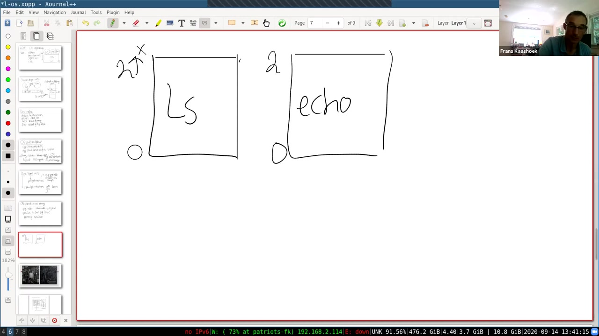
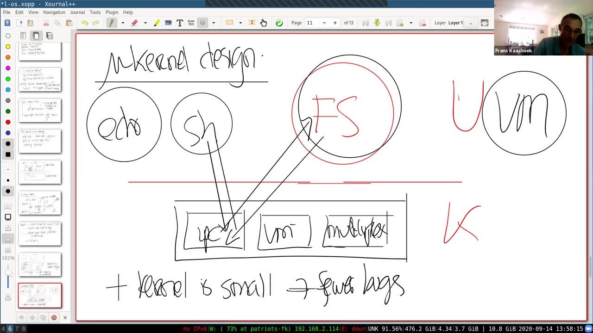
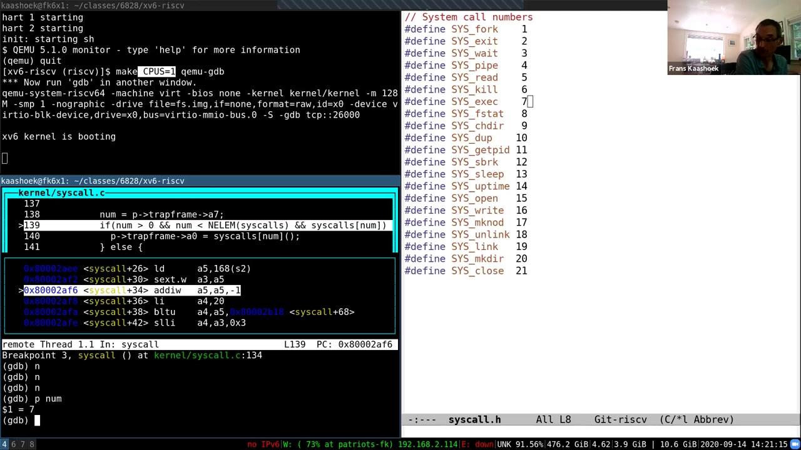

# 第 3 讲 · 操作系统组织与系统调用

## 00:00–03:00｜从使用 Unix 接口转向实现接口

课堂在确认声音正常后开始。Frans 给出这节课的四条线索：隔离、内核模式与用户模式、系统调用，以及这些机制在 xv6 中的具体形态。其中，**隔离是推动操作系统组织方式的主要目标**；区分用户与内核，是为了让应用与操作系统之间形成可靠的界限；系统调用则负责让应用在需要服务时，以受控方式跨过界限。

回顾第一讲，可以把计算机画成三层：底下是磁盘、CPU 等硬件，上面是操作系统，再上面是 shell、echo、find 等进程。操作系统把硬件资源抽象成服务，应用通过系统调用接口使用它们。本课程采用的是 Unix 接口。

刚做过的 util 实验主要在接口的使用者这一侧：大家调用系统调用，组合出一些小工具。接下来的课程会把视线移到接口下面，研究这些调用究竟如何实现。整个学期的大量时间都会花在这件事上，这一讲是第一次较系统地向内核内部观察。

许多同学已经通过阅读问题提交了很好的疑问，但第一次进入内核，不可能立即把所有细节展开。今天会接触很多组件，后续再逐一深入；不清楚时仍然可以随时打断提问。

## 03:00–06:00｜util 实验交流：xargs、管道与真正的并发

Frans 先问同学：util 实验里最有趣、最有收获的是什么？他自己的答案是 `xargs`。以前虽然也能用别的命令组合完成相似任务，但自己实现过之后，更直观地理解了它适合什么场景，现在反而比从前更常使用这个工具。

一位同学提到管道，以及如何通过管道写并发程序。Frans 追问是否以前用过；回答是接触过其他并发概念，但没有使用过这种操作系统级的管道。另一位同学也认为管道很有意思，尤其是 primes：做的过程中必须理清各条管道之间的关系，知道哪些端点应该关闭。Frans 认可这个体会：这个题目往往比第一眼看上去更难，自己每次也会重新感到细节容易出错。

还有同学说，primes 最有意思，但最初以为自己写好了，后来才发现实现并没有真正并发。重新分析进程与通信的执行关系，比最初预想的花了更多时间。这段讨论的重点不是只要输出正确就结束，而是要弄清程序是否真的按照要求，让多个进程借助管道同时推进。

另一位同学开始谈自己的习惯：直接用原始接口编程有些吃力，于是给它们加了一些辅助函数。课堂借这些不同体验，回到同一个主题：看过接口说明，与亲手处理进程和文件描述符的生命周期，是两种不同的熟悉程度。

## 06:00–09:00｜fork 继承管道端点，以及为什么要隔离

前一位同学继续说明，自己用包装函数组织调用，让程序更容易写。另一位同学觉得最惊讶的是：标准输入、标准输出原来也是文件描述符，就是 0 和 1。Frans 补充，普通 C 库往往再包一层接口，xv6 则把这些编号直接露给程序员；标准错误相应是 2。

随后一位同学描述了花了很长时间才发现的 primes 错误：先创建管道，再 `fork`，父子都会持有那一对文件描述符，因而需要考虑两边的引用。他最初只关闭了其中一部分，没有把子进程继承的副本算进去。教材虽然写着 fork 会复制打开的文件描述符，真正编程时却仍容易漏掉它对管道的含义。

> 编者说明：课堂把它形容为出现“四个端点”，更精确地说，是同一条管道的读端、写端各自多了一份进程中的引用，并没有变成四种不同方向的端点。

Frans 说，接口里的细节很多，动手遇到问题是形成真正理解的重要途径。接下来这节课也会帮助大家开始 syscall 实验。

进入正式主题：如果 shell、echo 或自己写的 primes 有错误，理想情况下错误只影响它自己。尤其不能因为一个小工具出了问题，连用来停止它的 shell 都坏掉。操作系统为所有应用提供服务，更不应该被其中一个应用拖垮。因此，应用之间、应用与操作系统之间，都需要强隔离。

## 09:00–12:00｜反例：把操作系统当作普通库

为了看出隔离为什么需要专门设计，Frans 提出一个反例：假设没有独立的操作系统，或者把操作系统仅当成应用链接的一个库。可以想象类似在 Python 中导入一个模块，导入后“整个操作系统”就在应用内部——这只是思想实验，不是在描述 Python 实际的 `os` 模块。

在这个方案里，shell 带着自己的库，echo 也带着自己的库；它们直接操作 CPU 核、磁盘块和物理内存。应用与硬件之间没有能够强制管理资源的抽象层。看上去直接、灵活，但一旦要同时运行多个应用，问题就出现了。

以只有一个 CPU 的机器为例。shell 占着 CPU 时，必须过一会儿主动让出执行权，让别的应用运行。这称为**协作式调度**：每个程序都要做一个守规矩的参与者。

如果 shell 的某个函数陷入无限循环，它就可能永远不再让出 CPU。其他应用全都得不到执行机会，包括本来想终止故障程序的工具。于是，资源复用取决于每个应用都没有错误、愿意合作。

真正希望得到的性质更强：**无论应用写了什么，操作系统都能迫使它在适当时候让出 CPU**。单靠应用内的普通库和自愿协作，不能可靠提供这一点。

## 12:00–15:00｜物理内存反例与 Unix 抽象的作用

同样的问题出现在内存上。虽然图中把应用画在硬件上方，应用的指令与数据最终仍存放在物理内存中。假设一块内存属于 shell，另一块属于 echo；如果两者可以自由使用物理地址，echo 就能向例如地址 1000 写入一个值，而那个地址可能属于 shell。

结果不是 echo 自己失败，而是它把 shell 的状态改坏了。错误跨越了程序边界，甚至可能很久之后才在另一个地方表现出来，这会给调试带来很大困难。我们希望的是内存隔离：一个应用不能随意覆盖另一个应用的内存。

因此，操作系统存在的一个主要理由，是同时实施强制的 CPU 复用与强内存隔离。把操作系统仅实现为普通库的方案，可能适用于彼此信任的某些实时环境，但不是多数通用操作系统采用的组织方式。

再从这个角度看 Unix 接口，就能理解它为什么不直接把硬件交给应用。它提供的是经过设计的抽象，让内核仍有机会介入并作出决定。例如 `fork` 创建的是**进程**，不是把某颗 CPU 永久划给调用者；进程可以执行计算，但其运行在哪颗 CPU、何时被切走，仍由内核决定。

这也是接口设计与隔离的关系：接口不仅让功能好用，还决定实现者是否保留了足够的控制权来保护系统。

## 15:00–18:00｜进程怎样抽象 CPU：时间复用问答

进程抽象允许内核在后台切换执行对象。应用面对的是“我的进程继续运行”，而不是直接管理 CPU 的所有寄存器与归属。Frans 接着准备把 `exec` 与内存映像联系起来，学生先追问了 CPU 的部分。

**问：**一个进程是不是占 CPU 的某一部分，另一个占另一部分？还是它们必须在不同 CPU 上？

**答：**这里主要指的是时间上的复用。以课堂举的四核机器为例，可以同时让四个进程分别运行在四颗核上；如果有七八个应用，内核就让某一颗核在几个进程之间轮换。例如先运行一个进程约 100 毫秒，暂停并保存它，再让另一个进程运行一段时间。后续讲座会解释怎样实现这种暂停、保存和恢复。

**追问：**也就是说，同一颗 CPU 不会在同一时刻执行两个这样的进程？

**答：**在这里的模型中，正是分时：一个先运行一会儿，再换下一个。不要把“多个进程都在运行”误理解为它们在同一颗核上同时执行指令。

随后讨论转到 `exec`。它接收文件名，从文件取得程序的内存映像，包括指令以及初始全局数据。应用还可以通过 `sbrk` 增加自己的内存，但这并不等于它能指定要某一段物理内存。接口让应用表达需求，把实际布局与隔离留给内核。

> 编者注：四核和 100 毫秒是此处讲解采用的配置／例子，不是所有实验运行都固定如此；后面的 GDB 演示明确使用 `CPUS=1`。

## 18:00–21:00｜文件抽象、缓存亲和性与调度源码

应用不能通过 `exec` 说“我要物理地址 1 KB 到 2 KB”。这不是接口缺少便利功能，而是内核需要保留对物理内存分配的控制，否则很难保证进程互不侵犯。

文件也是同样的设计。普通应用使用文件名和读写接口，而不是直接选择磁盘上的块。内核负责把文件内容映射到磁盘块，防止不同文件意外占用同一块，也有机会实施用户之间的访问权限。方便的命名与强隔离并不冲突，恰恰是同一个抽象层带来的两种收益。

至此可以重新理解 util 实验使用的 Unix 接口：进程、内存映像、文件并非随意选择的名称，它们隐藏底层资源，同时让操作系统能够在多个应用之间安排资源并控制访问。

**聊天区问：**复杂的内核会不会尽量把进程调度回同一颗核，以减少缓存未命中？

**答：**会，这涉及 **cache affinity，缓存亲和性**。现代调度器比当前介绍的模型复杂得多，会考虑缓存与性能；课程后半部分讨论高性能网络时还会碰到相关问题。

**聊天区问：**在 xv6 哪个文件能看到进程怎样被复用？

**答：**涉及不止一个文件，但 `proc.c` 最相关。几周后会详细分析进程切换。今天的目标是先建立全貌，不需要此时就掌握每个组件的实现。

> 编者说明：本段对用户文件权限说的是一般 Unix 的能力；初始 xv6 没有完整的多用户权限模型，不能把这些例子当成 xv6 已实现的功能清单。

## 21:00–24:00｜内核必须把应用看成可能出错的输入方

Frans 回到应用与操作系统的整体图，强调写内核时需要一种防御性的思维。应用传入奇怪参数，不应导致操作系统崩溃。否则，一个应用的一次调用，就可能让所有其他应用失去服务。

还不能仅假定应用是无意犯错。它可能由攻击者编写，目标正是突破隔离、取得内核控制权。一旦控制了内核，就可能进一步控制它所管理的硬件资源。因此，内核既要处理一般程序错误，也要面对精心安排的恶意输入。

这不是已经彻底解决的历史问题。即使像 Linux 这样的成熟系统，也仍会发现内核漏洞，有的漏洞可被应用利用来逃离原本的权限范围。设计与实现都必须认真对待这种可能性。

要让内核有能力拒绝不合法的行为，应用与内核之间首先得有一道应用自己不能随意拆掉的墙。主流做法依赖硬件支持；本讲先给出概念，之后再细讲。

两个关键组成是：**用户／内核执行模式**，以及**页表所支持的虚拟内存**。前者限制谁能修改敏感的机器状态，后者限制程序能访问哪些内存。它们需要结合起来，才形成操作系统能够控制的隔离边界。

## 24:00–27:00｜两类指令与硬件执行权限

面向多应用操作系统的处理器，通常都提供用户与内核模式、虚拟内存等能力，具体名称和实现可能不同。本课程的 RISC-V 也有这些支持；这里常说的内核模式，对应 RISC-V 的 supervisor mode。

先看执行模式。用户模式允许应用完成普通计算，例如寄存器加减、分支和过程调用。内核模式在此基础上还能执行特权操作，例如设置页表寄存器、控制中断等。这些操作之所以敏感，是因为它们改变的不是应用自己的普通变量，而是整个隔离与资源控制机制。

如果用户程序能任意重设页表，它就可能把别人的内存映射给自己；如果能禁止内核用来夺回执行权的中断，强制分时也会失效。因此，限制特权操作不是形式上的分层，而是在保护隔离本身。

当应用在用户模式下尝试执行不允许的特权指令时，处理器不会照常执行它，而会把控制权交给内核处理。内核随后可以终止这个行为不合要求的应用。这里的重点是：检查发生在硬件层面，不需要等待应用自愿承认自己违规。

> 编者校对：这一段自动字幕把部分“非特权指令”识别成了“特权指令”。已据板书第 5 页校正：`add`、`sub`、分支、普通跳转属于非特权操作；页表与敏感中断控制属于受限制的操作。

## 27:00–30:00｜谁检查特权？模式状态本身又由谁保护？

Frans 切到 RISC-V 特权架构文档，说明课程网站的参考资料页有链接。未来几周，大家会在代码里接触其中不少寄存器与指令；眼下先记住用户程序不能自由执行这类操作即可。

**问：**听上去像是在判断“如果是内核模式就允许，否则拒绝”。这个判断是谁执行的？处理器又怎么知道当前处于哪种模式？

**答：**可以先把它理解为处理器内部的一份模式状态。硬件译码指令时，知道它是否需要特权，并检查当前模式；权限不够就不执行。它不是应用能绕开的普通软件 `if`。

**追问：**如果程序能改掉表示模式的那个位，不就能获得权限了吗？

**答：**所以修改模式的能力本身也必须被保护。允许用户随意把自己设置为内核模式，整个机制就失去意义了。课堂用“模式位”的说法突出这个递归约束：保护机制的配置权，不能交给被保护机制所约束的程序。

> 编者说明：讲者用一个 0／1 位作概念模型，不是在给 RISC-V 特权编码下精确定义。RISC-V 实际有 U、S、M 等模式；后续应按相应控制状态寄存器和规范理解，不能把课堂随口举的 0／1 对应关系写进代码。

Frans 随后点出第三种模式——machine mode。它比当前讨论的模式权限更高，但本讲主要围绕用户与内核边界展开，暂不深入 M 模式细节。

## 30:00–33:00｜能否绕过操作系统？以及录课中断

**问：**如果用户代码都受到内核控制，使用计算机的人有没有办法完全绕过操作系统？

**答：**在机制正确建立的前提下，普通应用不能任意绕过。某些程序可能获得额外权限，例如通常 Unix 系统给 root 的特殊权限，但那也是操作系统有意授予的能力，并非每个用户程序都能取得。

**追问：**BIOS 是在操作系统之前还是之后运行？

**答：**它是随计算机提供、先运行并引导操作系统的软件。因此它也属于必须信任的部分：应当正确，也不能是恶意的。把隔离交给内核，并不意味着在内核之前启动的所有组件就可以不受信任。

**另一位同学问：**如果把处理器改成内核模式本身需要特权，那用户程序到底怎么请求内核执行操作？看起来所有通路都被封死了。

Frans 认可这个问题：禁止用户任意修改模式，正是想要的约束。他开始用用户程序尝试特权指令的情形解释控制转移，并提醒这还不是 RISC-V 的精确过程；但这段回答没有完整留下来。

**录课边界：**约 31:59，当前可辨认的发言在“特权指令”处中断。原始自动字幕把末条显示时间延长到约 32:16，之后没有新字幕，33:08 才出现下一段发言。这里不补写丢失的回答，也不把没有字幕的时间认定为已经核实的纯静音。

## 33:00–36:00｜恢复课堂：页表决定进程能看到什么内存

约 33:08，Frans 回到课堂，说明自己的 Zoom 客户端似乎崩溃了，向同学道歉并重新确认声音。随后转到第二项硬件支持：虚拟内存。

基本模型是一张**页表**，把程序使用的虚拟地址映射到物理地址。操作系统给不同进程设置不同页表，每个进程只能访问当前页表允许它访问的物理内存。如果内核把两个进程的私有区域映射到互不重叠的物理页，其中一个进程就不能靠随便写一个地址，访问另一个进程的私有内存。

换句话说，页表给每个进程提供了一种独立的“内存视图”。程序写出的数字先在自己的视图中解释，而不是直接交给物理内存。没有映射到某个物理位置，就不存在一个用户地址能直接指定那个位置。

Frans 重新画图：一个框装 `ls`，另一个框装 `echo`，两个框都从虚拟地址 0 开始向上延伸。此时不急于确定上界的确切数值；后面的页表讲座会解释 RISC-V 的地址范围。

这里最重要的变化是：两个程序都能提到“地址 0”，但这两个 0 并不因此表示同一片物理内存。地址数字必须连同当前采用的页表一起理解。

## 36:00–39:00｜隔离后的盒子仍需受控入口

*原片 36:00，未裁剪。板书中的 `ls` 与 `echo` 各有一个地址空间，都从 0 开始；上方指数只是占位示意，没有给出本讲已确定的位数。*

如果两个虚拟地址 0 映射到不同物理页，`ls` 与 `echo` 就不能借此访问彼此的私有内容。xv6 的内核也有自己的地址空间。图中的用户／内核边界还表示执行模式不同：用户侧运行在用户模式，内核侧运行在内核模式。

不过，这幅图如果只剩封闭的盒子，又过于严格。`ls` 要读写，shell 要 `fork` 或 `exit`，应用必须能向内核请求服务。所以我们需要的不是把所有交互都禁止，而是允许**在受控位置交出控制权**。

RISC-V 为此提供 `ecall`。应用准备好它想调用的服务编号，执行 `ecall`，控制就转到内核预先指定的入口，而不是由应用任意选择内核中的某条指令。xv6 的不同系统调用会经过共同的入口机制，再根据调用号分派。

> 编者校正：课堂口述及板书写成 `ecall <n>`，是把“准备调用号并发出请求”合并表示。实际 RISC-V 汇编的 `ecall` **没有这个立即数操作数**；xv6 把调用号放在 `a7` 中，随后单独执行 `ecall`。后面的 `initcode.S` 演示会直接看到这一点。

接下来，Frans 用 `fork` 说明用户侧函数与真正内核实现之间的关系：应用调用的那个名字，不等于直接跳到了内核的任意 C 函数中。

## 39:00–42:00｜系统调用桩、分派函数与检查位置

用户程序中的 `fork()` 先进入用户侧的一小段封装。这段代码准备调用号，执行 `ecall`，经受控入口把执行权交给内核。内核中的 `syscall()` 查看调用号，再转到对应处理函数。

`write()` 也是同样的路径：它并不直接调用内核的写文件函数，而是通过一个很小的**系统调用桩（system call stub）**进入内核；内核分派器再选择写操作。不同调用可以共用入口，只用调用号区分服务。

> 编者校正：本段讲者不确定地把保存调用号的寄存器说成了 `a0`，板书也写了 `a0`。2020 xv6 的实际实现是 `num = p->trapframe->a7`；`a0` 用于第一个参数以及返回值。76:00 的真实调试画面与后面的启动演示都能核实这一点。

**问：**只看到用户传了编号、执行 `ecall`，内核在哪里决定这个进程有没有权调用 fork 或 write？

**答：**检查在内核侧进行。进入内核并不意味着请求自动获准，处理函数可以检查参数以及它需要实施的条件。通常 Unix 进程都可以请求 fork，但像 write 这样的调用，必须核实用户提供的缓冲区地址，避免内核被诱骗去读取或输出不属于调用者的数据。

因此，“允许进入统一入口”和“允许执行指定操作”是两个不同问题：前者由硬件与入口机制保证控制转移安全，后者由内核代码结合参数和资源状态决定。

## 42:00–45:00｜无限循环怎样被抢占？为什么常用 C 写内核？

Frans 完成对 write 检查的解释：用户传入的地址不能被内核不加区分地当作任意可读地址使用，否则应用可能借内核的权限得到不属于自己的数据。

**问：**如果应用恶意运行或陷入无限循环，内核怎样重新取得控制权？

**答：**内核提前设置硬件定时器。定时器到期产生中断，执行就从用户程序转回内核；这时内核可以重新调度，让 CPU 运行另一个进程。这个过程不依赖用户程序主动发起系统调用，具体实现将在中断与调度章节展开。

**问：**为什么操作系统实现往往选择 C？

**答：**C 让程序很直接地控制底层资源。比如给定时器硬件编程，需要精确操作某些地址或状态，C 的指针和类型转换使这种工作较容易表达。它很适合贴近硬件的程序，这也是历史上成功的重要原因，但并不是说其他语言做不到。

**追问：**那为什么 C 比 C++ 更常见？只是历史原因吗？

**答：**确实可以用 C++ 写操作系统，也有这样的系统。常见内核选择什么语言，还包含历史、维护者偏好与项目习惯等因素；Frans 以 Linux 和 Linus 对 C++ 的态度举例，并没有提出“C++ 在技术上不能写内核”的结论。

## 45:00–48:00｜可信计算基与“哪些代码必须在内核里”

系统调用跨过边界后，内核承担真正执行服务、核实参数、避免被应用诱导的责任。安全领域把这种必须依赖其正确性的部分称为 **Trusted Computing Base，可信计算基（TCB）**。本讲用内核来说明这个概念。

把内核列入 TCB，不是宣称它天然没有错误，恰恰是说：隔离保证以它足够正确为前提。内核中一个看似很小的错误，可能被攻击者精心触发，演变成突破隔离或获得额外控制权的漏洞。

因此，内核不能按照“调用者总是正常程序”的假设编写。检查时要允许输入方有意选择最麻烦的参数、时机和组合。应用只是错误也好，确实恶意也好，操作系统都应该尽量把影响限制在该应用的权限范围内。

困难在于内核常常很庞大，而且要做很多细致的工作：操作硬件、维护状态、处理边界情况。广泛使用的操作系统也不断发现并修复安全漏洞，说明“实现完全正确”并不是一句话就能达到的目标。

这就引出组织结构的问题：既然运行在内核模式的代码尤其敏感，**哪些代码真的需要留在内核模式？** 接下来比较的宏内核和微内核，就是对这件事的两种回答。

## 48:00–51:00｜宏内核：共享一个内部世界的收益与代价

第一种回答是，把操作系统的主要实现都放进内核模式。在 xv6 中，文件系统、虚拟内存、进程管理等服务都属于同一个内核程序，许多传统 Unix 系统也是如此。这叫宏内核设计。

从错误影响的角度看，内核中的代码越多，需要信任和维护的部分就越大。一个子模块的 bug 不会天然被用户／内核边界挡住，因为它自己就在边界内。Frans 用代码规模与出错机会的经验性关系说明这个风险；它不是对某个系统作精确漏洞数量预测。

但把这些组件放在同一个程序中，也让它们很容易紧密合作。文件系统、虚拟内存、进程管理能直接调用彼此的函数，共用数据结构。设计得好时，这种整合可以带来很好的性能，Linux 是课堂举的例子。

第二种回答是尽量减少内核模式下的代码。微内核只保留支撑其他部分运行的基本机制，例如进程间通信、少量虚拟内存支持，以及 CPU 复用。这里的虚拟内存支持可以很底层，只包含安排页表等必须受保护的操作。

两种设计的区别不在于某个文件有多少行，而在于：服务之间的边界在哪里，哪些部分共享内核权限，哪些部分必须像用户程序那样通过受控机制合作。

## 51:00–54:00｜微内核：把文件系统放到独立服务器

Frans 在用户／内核分界线上方画出文件服务器。它像 echo 和 shell 一样，是用户空间中的进程。绘图时误用了红色，他特意澄清：颜色不表示这个服务器在内核里，位置与运行模式才是关键。某些虚拟内存服务也可以放在这样的用户级组件中。

*原片 53:00，未裁剪。红线以上有 echo、sh、FS 和 VM；以下内核只画 IPC、较小的 vm 和 multiplex。FS 虽用红笔画出，课堂已说明它仍在用户空间。*

好处是内核本身变小，希望由此减少会直接危及内核的错误。但 shell 想请求文件服务时，已经不能像宏内核内部那样直接调用一个共享地址空间中的函数。

典型过程是：shell 把请求交给内核的 IPC 机制，内核把消息送给文件服务器；服务器完成工作后，再经内核把结果送回 shell。为了突出代价，Frans 对比边界穿越：客户端进入内核、再到服务器；回复时服务器进入内核、再回客户端。这个简单模型里，比宏内核一次进入、一次返回的路径多了一组往返。

性能挑战有两方面：一是这些跨用户／内核边界的传递本身有开销；二是服务彼此独立后，原来简单的共享和紧密整合变得更难安排。例如文件系统与虚拟内存共用页缓存，在一个程序内部比较直接，拆成多个保护域后就需要明确的协作方案。

## 54:00–57:00｜现实选择与 xv6 的目录结构

宏内核与微内核并不存在一个适合所有场景的简单胜负结论。许多桌面系统沿用宏内核，有历史原因；数据中心中操作系统负载重的应用也经常使用 Linux，因为它能提供很好的性能。嵌入式环境则有不少微内核实例，课堂提到 Minix、seL4 一类设计。

如果从零开始写操作系统，可以认真考虑微内核；但把已经很成熟的宏内核整体重写成另一种组织方式，工作量非常大。维护者还会权衡这些投入，与新增功能、改善现有实现相比是否值得。课程后面会专门回到微内核的研究，而 xv6 先沿用传统 Unix 的宏内核结构。

随后切换到源码窗口。xv6 代码可以先从三个部分认识：

- `kernel/` 中是内核代码，各源文件最终链接成一个内核可执行文件，在内核模式下运行。
- `user/` 中是用户程序，其运行模式与权限和内核不同。
- `mkfs/` 中的工具负责制作文件系统镜像，让模拟出来的磁盘有可用的初始内容。

> 编者校正：课堂把 mkfs 的产物口头称为“空文件系统”。准确地说，它先建立文件系统结构，并把构建所选的初始文件装入镜像；不能因此推断启动镜像里没有 init、sh 等程序。

这些目录不只是文件分类，也反映了代码将在什么环境中运行。接下来先看内核如何从 C 文件变成处理器能执行的机器指令。

## 57:00–60:00｜编译、汇编、链接与 kernel.asm

以 `proc.c` 为例，C 编译器把它翻译成 RISC-V 汇编，汇编器再产生目标文件 `proc.o`。`pipe.c` 等其他源文件经历相同过程。链接器把所有目标文件组合起来，得到最终的 `kernel/kernel`。

课堂画出 `.c → .s → .o → 链接` 的流水线，是为了把几个工具的责任分开：编译器处理 C 语义，汇编器把汇编表示编码成机器指令，链接器安排各文件组成一个完整程序。Makefile 自动组织这些步骤，平时输入一条构建命令容易忽略中间过程。

构建还会生成 `kernel/kernel.asm`，其中保存整个内核的反汇编。这在调试内核时非常有用：知道出错时的程序计数器，就能查看那个地址的指令，并把机器级状态对应回实现。

Frans 打开反汇编，指出内核开头位于 `0x80000000` 附近，右边是 `auipc` 等汇编指令，旁边还有十六进制数。

**问同学：**汇编指令左边那些十六进制数字是什么？

**学生答：**是右侧汇编指令的编码。

Frans 确认：助记符是给人看的表示，处理器真正读取的是同一条指令的二进制编码。反汇编把地址、编码和文字表示放在一起，所以既能看源程序，也能在 GDB 中核对实际执行的字节。

## 60:00–63:00｜QEMU 启动参数对应一台怎样的计算机

先不使用 GDB，直接启动 xv6。构建完成后，Makefile 调用 QEMU，并通过 `-kernel` 指定要加载的内核文件。QEMU 是一个模拟 RISC-V 计算机的软件，加载布局与内核的链接安排需要一致；本例内核从 `0x80000000` 开始。

启动命令还指定内存容量、CPU 核数、磁盘设备以及文件系统镜像 `fs.img`。这些参数共同定义了 xv6 所看到的机器，而不是只让一个 C 程序在宿主系统里普通地调用 `main`。

为了建立正确的直觉，Frans 展示一块实际的 RISC-V 开发板。他办公室里有这样的硬件，适当适配后可以运行 xv6。板上有处理器、内存及各种外设接口，也有开关。使用 QEMU 时，应该想象 xv6 正在管理一台这样的计算机，只是硬件行为现在由软件提供。

继续查看处理器框图，可以看到多颗核、二级缓存、连接 DRAM 的接口，以及与外界通信的组件。板上的以太网接口等，也是在后续设备相关实验中要面对的对象。

> 编者说明：官方板书展示 SiFive HiFive Unleashed 及 FU540-C000 框图。课堂以它建立硬件概念，不意味着 QEMU `virt` 与这块板的所有设备、地址和启动方式逐项相同。

## 63:00–66:00｜“模拟处理器”意味着维护什么状态

处理器框图中的 UART 可以连接控制台输入输出，时钟等组件则会产生内核需要处理的事件。后续讲中，大家会修改与这些部件交互的代码。Frans 提到实物还放在办公室，自己从三月以来没有回去，因此只能用图片展示。

他进一步解释“模拟”的含义。可以先把 QEMU 理解成这样的循环：读取下一条 RISC-V 指令，观察编码中的操作码，判断是加法、减法或其他操作，然后用软件实现这条指令的效果，再继续取下一条。

要做到这一点，仅有一个循环不够，还要维护被模拟机器的状态。例如每个寄存器都要有对应的保存位置；模拟一条把常数放到寄存器里的指令，就要更新那份寄存器状态。模拟算术指令，则要取出输入值，计算结果，再写回目标寄存器。

同样，QEMU 不能只实现用户程序常用的普通指令，还要实现特权指令的语义。否则 xv6 无法建立页表、处理模式变化或控制机器。它给内核提供的应该是一台行为足够完整的 RISC-V 计算机。

> 编者校正：这是一种帮助理解指令语义的解释器模型，不是对 QEMU 实际执行引擎的逐行描述。板书中的算术例子也只是示意。不要把本段字幕中的“四字节或八字节”当作固定指令长度：后面 GDB 演示明确区分了 4 字节指令与 2 字节压缩指令。

## 66:00–69:00｜模拟器的并行性与 GDB 连接

**问：**QEMU 会不会也做硬件里的那些技巧，比如让指令重叠执行？

**答：**本讲希望大家先把它看作一个 C 程序；它运行在真实宿主 CPU 上，宿主 CPU 自己可能使用流水线等技术。不要把理解被模拟的指令行为，与复刻真实处理器内部所有微架构细节混为一谈。

**问：**模拟四颗核时，它内部是真的有多个线程吗？还是只有一颗核在做事？

**答：**课程所用的 QEMU 可以在内部使用多个线程模拟多颗核，所以不同虚拟核之间确实可能并行运行。后面的实验会看到这种并行带来的影响。

随后进入调试演示。QEMU 内置 GDB 服务端，可以先停下来等待调试器连接。Frans 启动支持 RISC-V 的 GDB；不同机器上的命令名可能是专用的 RISC-V GDB，也可能是支持多个体系结构的版本，关键是能理解目标指令集。

他在内核入口 `_entry` 设置断点并继续执行。GDB 停下的位置不是显示中的最开头地址，而是在 `0x8000000a` 附近，对应读取 `mhartid` 的指令。这里先观察源代码、指令地址以及处理器将要执行什么，接下来再解释启动地址的来历。

## 69:00–72:00｜从 _entry 到 main：先启动，再建立隔离

演示中读取 `mhartid` 的指令把 hart 标识写入寄存器 `a1`。QEMU 模拟这条指令后，单步调试就会推进到下一条指令。Frans 强调，`0x80000000` 是加载环境与内核布局配合的结果；打开 `kernel/kernel.ld`，能看到链接器把内核起始位置安排到相应地址。

GDB 同时显示了机器码。课堂据此比较指令长度：`csrr` 的编码占 4 字节，而旁边使用压缩形式的 `addi` 占 2 字节。反汇编中的地址增量，正好帮助理解为什么不能把每条指令都简单当成固定相同长度。

刚进 `_entry` 时，系统还没有完成页表与隔离配置，而且处于 machine mode。xv6 很快完成早期配置，再转到 supervisor mode。Frans 在 `main` 设置断点，继续执行；到达这里时，就已经在通常内核使用的监管者模式下。

调试器采用分屏布局，一边看 C 源码，一边看下一条机器指令。为了减少干扰，本次演示只启动一颗核，即 `make CPUS=1 qemu-gdb`。

接着从 `main` 向前单步：先初始化控制台与输出设施，之后才看到换行和 `xv6 kernel is booting`。再往下是物理页分配、内核页表、启用分页等初始化。这说明一个内核不能假定运行环境已经替它准备好，许多普通应用视为理所当然的能力，都要由它自己逐步建立。

## 72:00–75:00｜初始化顺序与第一个用户程序

`main` 还要初始化进程表、陷阱处理、中断控制器、缓冲区缓存、inode 缓存、文件表和磁盘驱动等。课堂快速走过这些调用，不在这一讲解释每个子系统的内部实现。基础设施齐备后，关键调用是 `userinit()`，负责让第一个用户进程能够运行。

**问：**这些初始化函数的顺序有要求吗？

**答：**有些步骤必须放在另一些之后，因为它们存在依赖；有些步骤之间则没有严格先后关系。不能因为它们看起来都是独立的 `init` 调用，就随意交换顺序。

第一个进程存在一个“先有谁”的问题：一般进程可以借已有设施从文件加载程序，但系统刚起步时，还需要一个最小的用户程序来把这条路径引出来。xv6 把 `initcode` 的机器码字节静态放在内核里，`userinit` 用它建立第一个用户映像。这是利用现成进程机制的少量启动代码。

Frans 打开 `user/initcode.S`。其最前面的动作很短：把 `/init` 字符串的地址放到 `a0`，把参数数组地址放到 `a1`，把 `SYS_exec` 放到 `a7`，然后执行 `ecall`。这就把执行权重新交回内核，请求加载真正的 init 程序。

为了验证推断，讲者在 `syscall` 下断点，然后继续运行。预期路径是：内核建立初始进程，转入用户空间，执行这一小段指令，再因 `ecall` 进入内核。调试器果然停到了 `syscall()`，因此看到了系统启动后第一个用户进程的第一次系统调用。

## 75:00–78:00｜调用号 7 如何走到 sys_exec 和 /init

在 `syscall()` 内单步，先取当前进程，再从保存的用户寄存器中读出调用号。打印 `num` 得到 **7**。接着打开 `kernel/syscall.h`，其中 `SYS_exec` 恰好定义为 7，和 `initcode.S` 中准备的请求一致。

*原片 76:00，未裁剪。左下 GDB 显示 `num = p->trapframe->a7`，以及 `p num` 的结果 `$1 = 7`；右侧 `syscall.h` 标出 `SYS_exec 7`。左上还可见本次使用 `CPUS=1` 的启动命令。*

下一步把这个整数当作 `syscalls[]` 的下标。数组里放的是函数指针；相应位置指向 `sys_exec`，单步进入后到达 `sysfile.c`。所以系统调用号不是跳转地址，而是内核在自己的分派表中选择实现的编号。

`sys_exec` 首先取得用户提供的参数，包括路径名和参数数组。课堂在这里展示把参数从用户地址空间复制到内核地址空间的代码，但详细的地址检查与复制机制留到后续讲座。此处先抓住调用边界：用户给出地址，内核必须按用户地址的含义取得数据，不能混成普通内核指针。

继续查看 `path`，可以确认请求加载的是 `/init`。随后打开 `user/init.c`：它打开控制台，把文件描述符复制成标准输出与标准错误，再 fork 一个子进程，让子进程 exec shell。

因此 `initcode` 不是交互式 shell，也不是整个 init 程序；它是一个极小的启动跳板，用第一次 exec 把更完整的用户程序接上来。init 再把正常的命令行环境启动起来。

## 78:00–80:47｜shell 出现、网络实验问答与收尾

继续执行时，调试器还能再次停在 exec 相关路径，此时请求对象变成 shell。再经过一些初始化系统调用，shell 开始运行，最终给出命令提示符。

这段演示串起了完整的启动轮廓：内核先运行并建立设施，制造第一个用户进程；该进程通过 `ecall` 请求 exec `/init`；init 准备控制台并启动 shell。今天并未展开每一步进入、退出内核的寄存器保存细节，但已经能把用户调用、调用号、分派表和处理函数连起来。接下来的 syscall 实验主要会接触这些位置。

**问：**课程会涉及网络或网络相关实验吗？

**答：**会，最后一个实验要实现网络驱动，编写与网卡硬件交互的代码，操纵相应寄存器，并发送数据包。前面展示开发板时看到的网络接口，说明操作系统最终需要和这样的外设打交道。

Frans 最后提醒：syscall 实验暂时不要求掌握所有陷阱机制细节，预计不一定比 util 更难，但后面的实验会逐渐增加挑战。不要等到截止前一晚才开始；如果碰到晦涩的错误，尽早开始才能留出讨论和求助的时间。课程随后结束，下一次课继续。

## 来源、许可与校对边界

- 主讲：Frans Kaashoek，MIT 6.S081 Fall 2020，LEC 3；课程日期 2020-09-14。课表所链视频由 David Morejon 频道于 2020-09-15 发布，ID `o44d---Dk4o`，时长 4847 秒。视频入口使用课程页头；这里不另做逐段跳转链接。
- 文字依据：YouTube 英文 ASR，无人工字幕可用。本地保存原始 `video.en.json3`、规范化 `captions.json` 和完整按分钟展开的 `captions-minute.txt`，共 2242 条有文本的 cue，已全部阅读。首条从 00:07.759 开始；末条结束时间比标称片长多 0.840 秒，正文以 80:47 封顶。
- 本页按主题保留推导、例子、问答与演示，自主组织中文表达；并非授权的逐字全文译本。尚未查得视频明确的开放翻译许可，课程网站许可不自动延伸到外链视频。
- 已读取 [官方课堂提纲](https://pdos.csail.mit.edu/6.S081/2020/lec/l-os.txt)，并查看 [15 页板书](https://pdos.csail.mit.edu/6.S081/2020/lec/l-os-boards.pdf)。官网课程材料标注 [CC BY 3.0 US](https://creativecommons.org/licenses/by/3.0/us/)；板书内第三方硬件图仍保留其自身版权，不另作全文图册转载。
- 课堂截图来自原片 36:00、53:00、76:00，均通过单帧方式取得并用图像工具实际查看，未裁剪。只在本页引用，不以板书 PDF 图片伪装成视频帧。
- 代码核对使用共享 2020 快照 `e23d53f27f6e187732a92a2b4705639d1c260f05`：`entry.S`、`start.c`、`main.c`、`proc.h`、`proc.c` 的启动部分、`syscall.c`、`syscall.h`、`exec.c`、`initcode.S`、`init.c` 等。快照用于核实符号和机制，不保证与讲者工作树逐字相同。
- ASR 专名校正包括 xv6、RISC-V、QEMU、GDB、xargs、TCB、UART、SiFive、syscall、exec；关键技术纠错以编者注标明。学生姓名不可靠处统一写“同学”，没有凭字幕错词确定身份。约 31:59–33:08 的中断不补造内容；未逐句听音、未逐帧看全片，也未运行或重现课堂调试命令。
- 提炼与自测见[课程笔记](#/c/mit-6.s081-2020/lec/lec03?v=notes)；指定教材第 2 章完整译文见[课程资料](#/c/mit-6.s081-2020/lec/lec03?v=materials)。
