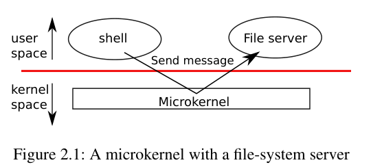
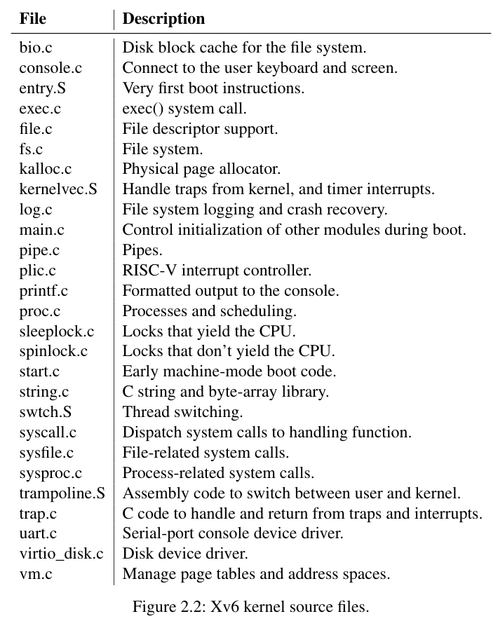
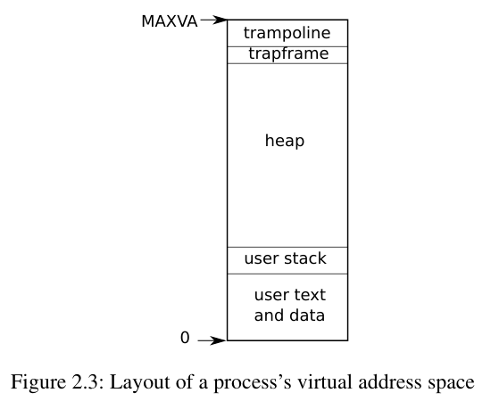

# 第 2 章 · 操作系统的组织

## 第 2 章导言：复用、隔离与交互

操作系统的一项关键要求，是同时支持多项活动。例如，利用第 1 章介绍的系统调用接口，一个进程可以通过 `fork` 启动新进程。操作系统必须让这些进程分时共享计算机资源。即使进程数超过硬件 CPU 数，也必须保证所有进程都有执行机会。操作系统还必须安排进程之间的隔离：一个进程有错误、行为失常，不应影响那些不依赖它的进程。但完全隔离又过于严格，因为进程应当能够有意交互，管线就是一个例子。因此，操作系统必须同时满足三个要求：**多路复用、隔离和交互**。

本章概述操作系统如何组织起来以实现这三个要求。实现方式有很多，本书着重讨论以**宏内核**为中心的主流设计，许多 Unix 操作系统都采用这种设计。本章也概述 xv6 的进程——它是 xv6 中的隔离单位——以及 xv6 启动时如何创建第一个进程。

xv6 运行在多核 RISC-V 微处理器上，许多底层功能，例如进程实现，都与 RISC-V 密切相关。这里的 RISC-V CPU 是 64 位的，xv6 使用“LP64”C：C 语言中的 `long`（L）和指针（P）为 64 位，`int` 则为 32 位。本书假定读者在某种体系结构上有一些机器级编程经验；RISC-V 特有的概念会在需要时介绍。《The RISC-V Reader: An Open Architecture Atlas》是一本有用的参考书；用户级指令集架构与特权架构文档则是官方规范。

> 原书脚注：这里“多核”指多个共享内存、并行执行的 CPU，每个 CPU 有自己的寄存器组。本书有时把 multiprocessor（多处理器）当作 multi-core（多核）的同义词；不过，前者也可特指拥有多个独立处理器芯片的计算机。

完整计算机中的 CPU 周围还有配套硬件，其中相当一部分是 I/O 接口。xv6 针对 QEMU 的 `-machine virt` 选项所模拟的配套硬件编写，包括 RAM、存放启动代码的 ROM、连接用户键盘和屏幕的串行接口，以及用于存储的磁盘。

## §2.1 抽象物理资源

接触操作系统时，首先可能会问：为什么一定需要它？完全可以把图 1.2 中的系统调用实现为一个库，让应用程序链接这个库。在这种方案中，每个应用甚至可以有适合自身需要的专用库。应用可以直接与硬件资源交互，以最适合自己的方式使用资源，例如追求很高或可预测的性能。一些面向嵌入式设备或实时系统的操作系统确实这样组织。

这种库方案的缺点是：只要同时运行多个应用，它们就必须行为良好。例如，每个应用都必须定期让出 CPU，其他应用才有机会运行。如果所有应用彼此信任且没有错误，这种协作式分时或许可行。但更常见的是应用互不信任，而且存在错误，因此我们通常希望获得比协作方案更强的隔离。

要实现强隔离，一种有效方法是禁止应用直接访问敏感的硬件资源，转而把资源抽象成服务。例如，Unix 应用通过文件系统的 `open`、`read`、`write` 和 `close` 系统调用访问存储，而不直接读写磁盘。这既给应用带来路径名的便利，也让实现接口的操作系统能够管理磁盘。即使不考虑隔离，有意交互的程序，或只是希望互不干扰的程序，也很可能觉得文件系统比直接操作磁盘方便。

类似地，Unix 在进程之间透明地切换硬件 CPU，按需保存和恢复寄存器状态，因此应用无需感知分时。这种透明性使操作系统能够共享 CPU，即使某个应用陷入无限循环也不例外。

再看一个例子：Unix 进程通过 `exec` 建立内存映像，而不直接与物理内存交互。这使操作系统能决定把进程放到内存的什么位置；内存紧张时，操作系统甚至可以把进程的一部分数据放到磁盘上。`exec` 还让用户可以方便地利用文件系统保存可执行程序的映像。

Unix 进程之间的许多交互通过文件描述符完成。文件描述符不仅隐藏了许多细节，例如管道或文件中的数据存放在哪里，其定义方式也让交互更简单。例如，管线中的某个应用失败时，内核会向管线中的下一个进程产生文件结束的通知。

> 编者注：这里的“文件结束”指读到 EOF，不是 Unix 的异步 signal。结合第 1 章的管道语义，须等所有写端关闭且缓冲数据读完，后继进程的 `read` 才返回 0；若还有其他写端引用，不能仅由某一个进程退出推出已经 EOF。磁盘换出是对一般 Unix 实现的说明，初始 xv6 没有交换区机制。

图 1.2 的系统调用接口经过精心设计，既方便程序员，又为强隔离提供实现条件。Unix 接口并不是抽象资源的唯一方式，但已经证明是一种非常好的方式。

## §2.2 用户模式、监管者模式与系统调用

强隔离要求应用与操作系统之间有一道坚实边界。应用出错时，我们不希望操作系统或其他应用随之失败；操作系统应能清理出错的应用，继续运行其余应用。为此，操作系统必须确保应用不能修改，甚至不能读取操作系统的数据结构与指令，也不能访问其他进程的内存。

CPU 为强隔离提供硬件支持。例如，RISC-V 有三种指令执行模式：**机器模式（machine mode）**、**监管者模式（supervisor mode）**和**用户模式（user mode）**。在机器模式下执行的指令拥有全部特权；CPU 启动时处于机器模式。机器模式主要用于配置计算机。xv6 只在机器模式下执行少量代码，然后切换到监管者模式。

在监管者模式下，CPU 可以执行特权指令，例如启用或禁用中断、读写保存页表地址的寄存器等。如果用户模式中的应用试图执行特权指令，CPU 不执行它，而是转入监管者模式，让该模式下的代码能够终止这个做了不该做之事的应用。第 1 章图 1.1 展示了这种组织方式。应用只能执行用户模式允许的指令，例如加法；我们称它运行在**用户空间**。监管者模式下的软件还能执行特权指令，称为运行在**内核空间**。运行在内核空间，即监管者模式下的软件，叫作**内核**。

想调用内核功能，例如 xv6 的 `read` 系统调用，应用就必须转入内核。CPU 提供一条特殊指令，把 CPU 从用户模式切换到监管者模式，并从**内核指定的入口**进入内核。RISC-V 为此提供 `ecall` 指令。切换后，内核可以检查系统调用参数，决定应用是否有权执行请求的操作，然后拒绝或执行它。

进入监管者模式的入口必须由内核控制。这一点非常重要：如果入口由应用决定，恶意应用就可能选择从跳过参数检查的位置进入内核。

## §2.3 内核的组织

一个关键设计问题是：操作系统的哪些部分应运行在监管者模式？一种选择是把整个操作系统都放进内核，所有系统调用的实现都在监管者模式下运行。这种组织称为**宏内核（monolithic kernel）**。

在这种组织中，整个操作系统都拥有完整的硬件操作权限。它很方便，因为设计者不必逐一决定哪些操作系统部分不需要完整权限；不同部分之间也更容易协作。例如，操作系统可以有一个缓冲区缓存，同时供文件系统与虚拟内存系统共享。

宏内核的一个缺点是：操作系统不同部分之间的接口往往复杂，本书后续会看到许多例子，因此开发者很容易犯错。在宏内核中，错误可能是致命的，因为监管者模式下的错误往往会使内核失败。一旦内核失败，计算机就停止工作，所有应用也随之失败；必须重新启动计算机才能恢复。



**图 2.1：带文件系统服务器的微内核。** `user space` 为用户空间，`kernel space` 为内核空间，`File server` 为文件服务器，`Microkernel` 为微内核。`Send message` 箭头表示 shell 通过微内核向文件服务器发送消息；红线是用户空间与内核空间的边界。

为减少内核中出错的风险，设计者可以尽量缩小在监管者模式下运行的操作系统代码量，把操作系统的大部分放到用户模式下执行。这种内核组织称为**微内核（microkernel）**。

图 2.1 展示了这种设计：文件系统作为用户级进程运行。以进程形式运行的操作系统服务称为**服务器**。为了让应用与文件服务器交互，内核提供进程间通信机制，把消息从一个用户模式进程发送到另一个用户模式进程。例如，shell 想读写文件，就向文件服务器发送消息，并等待响应。

在微内核中，内核接口由少量低层功能组成，例如启动应用、发送消息和访问设备硬件等。大部分操作系统功能都在用户级服务器中，因此内核可以比较简单。

与大多数 Unix 操作系统一样，xv6 采用宏内核。因此 xv6 的内核接口就是其操作系统接口，完整操作系统由内核实现。由于 xv6 提供的服务不多，它的内核甚至比某些微内核还小，但从设计概念上看，它仍是宏内核。

## §2.4 代码：xv6 的组织

xv6 的内核源码位于 `kernel/` 子目录。源码按大致的模块划分放进不同文件，图 2.2 列出了这些文件。模块之间的接口定义在 `kernel/defs.h` 中。



**图 2.2：xv6 内核源文件。** 表头 `File` 为文件，`Description` 为说明；完整中文对照如下。

| 文件 | 说明 |
|---|---|
| `bio.c` | 文件系统的磁盘块缓存。 |
| `console.c` | 连接用户的键盘与屏幕。 |
| `entry.S` | 启动时最早执行的指令。 |
| `exec.c` | `exec()` 系统调用。 |
| `file.c` | 文件描述符支持。 |
| `fs.c` | 文件系统。 |
| `kalloc.c` | 物理页分配器。 |
| `kernelvec.S` | 处理来自内核的陷阱以及定时器中断。 |
| `log.c` | 文件系统日志与崩溃恢复。 |
| `main.c` | 启动时控制其他模块的初始化。 |
| `pipe.c` | 管道。 |
| `plic.c` | RISC-V 中断控制器。 |
| `printf.c` | 向控制台输出格式化文本。 |
| `proc.c` | 进程与调度。 |
| `sleeplock.c` | 会让出 CPU 的锁。 |
| `spinlock.c` | 不让出 CPU 的锁。 |
| `start.c` | 机器模式下的早期启动代码。 |
| `string.c` | C 字符串与字节数组库。 |
| `swtch.S` | 线程切换。 |
| `syscall.c` | 把系统调用分派到处理函数。 |
| `sysfile.c` | 文件相关的系统调用。 |
| `sysproc.c` | 进程相关的系统调用。 |
| `trampoline.S` | 在用户与内核之间切换的汇编代码。 |
| `trap.c` | 处理陷阱与中断并从中返回的 C 代码。 |
| `uart.c` | 串口控制台设备驱动。 |
| `virtio_disk.c` | 磁盘设备驱动。 |
| `vm.c` | 管理页表与地址空间。 |

## §2.5 进程概述

与其他 Unix 操作系统一样，xv6 的隔离单位是**进程**。进程抽象防止一个进程破坏或窥探另一个进程的内存、CPU、文件描述符等，也防止进程破坏内核本身，进而颠覆内核的隔离机制。内核必须小心实现进程抽象，因为有缺陷或恶意的应用可能诱使内核或硬件做坏事，例如绕过隔离。实现进程所使用的机制包括用户／监管者模式标志、地址空间，以及线程的时间片调度。

为帮助实现隔离，进程抽象让程序产生拥有一台私有机器的错觉：程序看起来拥有自己的内存系统，即**地址空间**，其他进程不能读写；也看起来拥有一颗专门执行自身指令的 CPU。

xv6 使用由硬件实现地址转换的页表，为每个进程提供自己的地址空间。RISC-V 页表把**虚拟地址**——RISC-V 指令操作的地址——转换或“映射”为**物理地址**——CPU 芯片发送给主存的地址。

xv6 为每个进程维护独立页表，定义该进程的地址空间。如图 2.3，地址空间中的用户内存从虚拟地址 0 开始：先是指令，然后是全局变量，再是栈，最后是供 `malloc` 使用、进程可按需扩展的堆。



**图 2.3：进程的虚拟地址空间布局。** 自下而上：`user text and data` 为用户指令和数据，`user stack` 为用户栈，`heap` 为堆，`trapframe` 为陷阱帧，`trampoline` 为用户／内核切换所用的跳板代码页。图顶标出 `MAXVA`，图底标出 0。此图是概览，不表示中间整个区间都已分配物理内存。

地址空间的最大大小受到多种因素限制：RISC-V 指针宽 64 位；硬件查页表时只使用低 39 位；xv6 又只使用这 39 位中的 38 位。因此，最大地址为 $2^{38}-1=\texttt{0x3fffffffff}$，原书把它称为 `MAXVA`（`kernel/riscv.h`）。地址空间顶部，xv6 保留一页放 trampoline，再保留一页映射该进程的 trapframe，用来切换到内核；第 4 章将解释这些机制。

> 编者校正：2020 源码实际定义 `MAXVA = 1L << 38`，即不包含在有效范围内的**上界**；最大范围内地址是 `MAXVA - 1 = 0x3fffffffff`。原书把二者混用了。`MAXVA` 以下也并非处处有合法用户映射；trampoline 和 trapframe 在用户页表中没有 `PTE_U` 权限。Sv39 的“低 39 位”也不能理解为高位可随意填写，硬件还要求地址符合相应的符号扩展规则。

xv6 内核为每个进程保存许多状态，集中在 `struct proc`（`kernel/proc.h`）中。最重要的内核状态包括页表、内核栈和运行状态。本书用 `p->xxx` 指代 proc 结构中的字段，例如 `p->pagetable` 是指向该进程页表的指针。

每个进程有一条执行其指令的**执行线程**，简称线程。线程可以暂停，稍后恢复。为了透明地切换进程，内核暂停当前运行的线程，再恢复另一个进程的线程。线程的大量状态，例如局部变量、函数调用返回地址，保存在它的栈中。

每个进程有两个栈：用户栈和内核栈 `p->kstack`。进程执行用户指令时，只使用用户栈，内核栈为空。进程因系统调用或中断进入内核后，内核代码在该进程的内核栈上执行；此时用户栈仍保存着数据，但不被当前执行活动使用。进程的线程在两个栈之间交替活动。内核栈独立存在，并且用户代码不能访问，因此即使进程破坏了自己的用户栈，内核也仍能执行。

进程执行 RISC-V 的 `ecall` 指令即可发起系统调用。这条指令提高硬件特权级，把程序计数器改为内核定义的入口。入口代码切换到内核栈，执行实现系统调用的内核指令。系统调用完成后，内核切回用户栈，并通过 `sret` 指令返回用户空间；该指令降低硬件特权级，从系统调用指令之后继续执行用户指令。进程线程可以在内核中“阻塞”等待 I/O，待 I/O 完成后从停止处恢复。

> 编者说明：这里描述的是正常系统调用往返。成功的 `exec` 会换成新程序入口，`exit` 则不返回原用户程序。`ecall` 也不会自动替软件保存全部寄存器、切页表和换栈，这些细节属于第 4 章。

`p->state` 表示进程处于已分配、准备运行、正在运行、等待 I/O 或退出等阶段。`p->pagetable` 以 RISC-V 硬件要求的格式保存页表；在用户空间执行该进程时，xv6 让分页硬件使用它。进程页表也记录了为该进程内存分配的物理页地址。

> 编者说明：上面的阶段描述保留原书措辞，不是一份枚举常量表。固定 2020 快照的 `enum procstate` 为 `UNUSED, SLEEPING, RUNNABLE, RUNNING, ZOMBIE`。

## §2.6 代码：启动 xv6 和第一个进程

为了让 xv6 更具体，本节概述内核如何启动并运行第一个进程。后续章节会详细讨论这里出现的机制。

RISC-V 计算机上电后，先初始化自身，运行存储在只读存储器中的引导加载程序。引导加载程序把 xv6 内核加载到内存，然后 CPU 在机器模式下，从 `_entry`（`kernel/entry.S`）开始执行 xv6。此时分页硬件尚未启用，虚拟地址直接对应物理地址。

加载程序把内核放在物理地址 `0x80000000`，而不是 `0x0`，因为 `0x0` 到 `0x80000000` 这一地址范围中有 I/O 设备。

`_entry` 中的指令建立栈，使 xv6 能运行 C 代码。xv6 在 `start.c` 中为初始栈 `stack0` 声明空间。`_entry` 把栈指针寄存器 `sp` 设置为 `stack0 + 4096`，即栈顶，因为 RISC-V 栈向低地址增长。有了栈，`_entry` 就能调用 C 函数 `start`（`kernel/start.c`）。

> 编者注：原书这里按第一个 CPU 说明。实际 `_entry` 读取 `mhartid`，为每个 hart 设置 `stack0 + (hartid + 1) * 4096` 的栈顶，各 CPU 使用不同的初始栈。

`start` 执行只能在机器模式下进行的配置，然后切到监管者模式。RISC-V 提供 `mret` 指令进入监管者模式。通常它用于从先前的机器模式陷阱处理中返回，但 `start` 并不是从这样的调用返回，而是把状态设置得仿佛曾发生过一次调用：在 `mstatus` 中把先前的特权模式设为监管者模式；把 `main` 的地址写入 `mepc`，作为返回地址；向页表寄存器 `satp` 写 0，暂时关闭监管者模式的虚拟地址转换；把中断与异常委托给监管者模式。

跳转之前，`start` 还要配置时钟，使其产生定时器中断。准备完毕，它执行 `mret`，“返回”监管者模式，程序计数器因此变为 `main`（`kernel/main.c`）。

> 编者说明：这里保留原书对委托的概括。该版本的机器定时器中断仍先在 M 模式处理，再转换为供 S 模式处理的软件中断，见 `start.c` 与 `kernelvec.S`；不能理解为所有中断都直接由 S 模式接收。

`main` 初始化若干设备和子系统之后，调用 `userinit`（`kernel/proc.c`）创建第一个进程。这个进程执行一个很小的 RISC-V 汇编程序 `initcode.S`（`user/initcode.S`）。它调用 `exec` 系统调用，再次进入内核。正如第 1 章所述，`exec` 用新程序替换当前进程的内存和寄存器，这里新程序是 `/init`。

内核完成 `exec` 后，返回用户空间，运行 `/init`。`init`（`user/init.c`）在需要时创建设备文件 console，再把它打开为文件描述符 0、1、2，随后在控制台上启动 shell。至此，系统运行起来了。

## §2.7 真实世界

现实中既有宏内核，也有微内核。许多 Unix 内核是宏内核。例如，Linux 采用宏内核，尽管一些操作系统功能，例如窗口系统，也作为用户级服务器运行。L4、Minix 和 QNX 等则组织成微内核与服务器，在嵌入式环境中得到广泛使用。

大多数操作系统都采用进程概念，其进程与 xv6 进程大致相似。不过，现代操作系统支持一个进程中有多个线程，让单个进程利用多颗 CPU。为支持进程内多线程，需要不少 xv6 没有的机制，也可能涉及接口变化，例如 Linux 的 `clone`——一种 `fork` 变体——以控制线程共享进程的哪些部分。

## §2.8 习题

**1. 使用 GDB 观察第一次从内核到用户空间的转换。**

运行 `make qemu-gdb`。在另一个窗口的同一目录下运行 `gdb`。输入：

```text
break *0x3ffffff10e
```

这会在内核中负责跳转到用户空间的 `sret` 指令上设置断点。输入 GDB 命令 `continue`。GDB 应停在该断点，准备执行 `sret`。再输入 `stepi`，GDB 此时应显示正在地址 `0x0` 执行；该地址位于用户空间，是 `initcode.S` 的开头。

> 编者注：这是原书给出的**具体构建地址**，保留以完整呈现习题。工具链或代码版本变化后，`sret` 的偏移可能不同；应按本机反汇编和 trampoline 映射核实，不能把这个地址当成所有版本都固定不变的 ABI。本次内容制作未运行该实验。

## 来源、版本与许可

- Russ Cox、Frans Kaashoek、Robert Morris，[*xv6: a simple, Unix-like teaching operating system*，rev1，2020-08-31](https://pdos.csail.mit.edu/6.S081/2020/xv6/book-riscv-rev1.pdf)，第 2 章印刷页 21–28。以上是导言、全部八节、三幅图表和唯一一道习题的中文翻译；编者补充单独标明。
- 图 2.1、2.2、2.3 分别从同版本 PDF 的第 24、25、26 页裁出；已查看原页与裁图。英语图注、标签和表格全部在正文译出。
- 源码校对使用课程共享快照 `e23d53f27f6e187732a92a2b4705639d1c260f05`，不把它声称为录课现场工作树或某实验分支。保留文件名和函数定位，原书易随版本漂移的行号不作为操作依据。
- 官方讲义 `l-os.txt` 是课堂提纲，只用来核对；课堂讲解和演示见[中文译稿](#/c/mit-6.s081-2020/lec/lec03?v=draft)，机制提炼见[课程笔记](#/c/mit-6.s081-2020/lec/lec03?v=notes)。教材及工具链的公共链接见课程首页。
- 教材许可依据：[官方教材仓库 LICENSE](https://github.com/mit-pdos/xv6-riscv-book/blob/xv6-riscv/LICENSE)，本地共享存档 `sources/xv6-book-license.txt`。这是目前保存的仓库许可声明，版权年份覆盖至 2024；译文所用教材仍严格为 2020 rev1。

<details><summary>教材 MIT 许可全文</summary>

```text
The xv6 book sources are:

Copyright (c) 2006-2024 Russ Cox, Frans Kaashoek, and Robert Morris,
                        Massachusetts Institute of Technology

Permission is hereby granted, free of charge, to any person obtaining a copy of
this source and associated documentation files (the "Book"), to deal in the Book
without restriction, including without limitation the rights to use, copy,
modify, merge, publish, distribute, sublicense, and/or sell copies of the Book,
and to permit persons to whom the Book is furnished to do so, subject to the
following conditions:

The above copyright notice and this permission notice shall be included in all
copies or substantial portions of the Book.

THE BOOK IS PROVIDED "AS IS", WITHOUT WARRANTY OF ANY KIND, EXPRESS OR IMPLIED,
INCLUDING BUT NOT LIMITED TO THE WARRANTIES OF MERCHANTABILITY, FITNESS FOR A
PARTICULAR PURPOSE AND NONINFRINGEMENT. IN NO EVENT SHALL THE AUTHORS OR
COPYRIGHT HOLDERS BE LIABLE FOR ANY CLAIM, DAMAGES OR OTHER LIABILITY, WHETHER
IN AN ACTION OF CONTRACT, TORT OR OTHERWISE, ARISING FROM, OUT OF OR IN
CONNECTION WITH THE BOOK OR THE USE OR OTHER DEALINGS IN THE BOOK.
```

</details>
