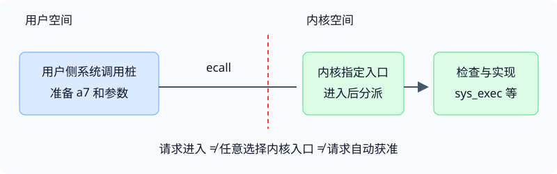

# 第 3 讲 · 隔离不是约定，而是内核必须能够强制执行的机制

这一讲最重要的问题是：**如果一个应用不合作，甚至故意作恶，为什么其他程序还能运行？** 从这个问题出发，可以推导出进程抽象、特权模式、页表、定时器以及系统调用的必要性。

## 1. 用三个反例推导隔离条件

不要先背诵“操作系统要隔离”。先想象把操作系统做成普通库，让应用直接控制机器，再分别破坏三个条件。

| 反例 | 单靠约定为什么无效 | 必须有的机制 |
|---|---|---|
| 应用进入无限循环，不再调用库 | 没有执行机会，库就无从“请它让出”CPU | 定时器中断让内核重新获得执行权，再由调度器切换 |
| 应用把某个地址当作指针乱写 | 如果这个地址直接指向别人的物理内存，错误就跨进程传播 | 页表与权限限制可访问的物理页 |
| 应用自己改页表或禁止抢占 | 前两条规则的配置权落到被约束者手里，规则可被撤销 | 特权模式限制敏感配置操作 |

由此得到一条因果链：**要管理资源 → 必须保留控制权 → 不能让应用随意改变管理机制 → 需要硬件保护内核的控制权。**

进程、文件等抽象把“请求什么”与“如何安排物理资源”分开。应用请求创建进程，不是指定永久占有某颗核；请求加载程序，不是指定霸占某段物理地址；按文件名读写，不是自由修改任意磁盘块。抽象在提供便利的同时，也给隔离留下实现空间。

课堂推导见[中文译稿](#/c/mit-6.s081-2020/lec/lec03?v=draft) 09:00–21:00；完整论述见[课程资料](#/c/mit-6.s081-2020/lec/lec03?v=materials) §2.1–2.2。

## 2. 三种“检查”不能混成一种

硬件不能仅靠执行一次 `ecall`，就理解“这个 fd 是否允许写”“这条文件路径是否允许打开”。需要区分三层问题：

1. **指令权限：**当前模式能否执行某种敏感操作？由处理器的特权机制约束。
2. **内存访问：**这个虚拟地址是否被映射，当前访问是否满足页权限？由页表及地址转换机制约束。
3. **服务语义：**调用号是否合法、文件描述符是否存在、缓冲区如何安全取得、操作是否允许？由内核实现检查。

如果只保留第 1 层，普通 store 仍可能写坏别人；如果页表不能保护自己的配置权，应用又能重写第 2 层；即使前两层正确，内核也可能因相信错误的用户参数，在自身权限下替应用做了不该做的事。

这解释了课堂为什么反复强调 **TCB（可信计算基）**：内核是必须依赖其正确性的部分，不是“因为被信任所以不需要检查”的部分。

### 系统调用是一扇门，不是授予用户内核身份

*编者自绘：省略 trap 入口的寄存器保存、页表和栈切换细节，只区分请求准备、控制转移与服务实现。*

用户侧 `write()` 的名字像普通 C 函数，但跨界发生在桩中的 `ecall`。进入之后执行的是内核指定的代码，用户不能挑一条“检查之后”的指令作为入口。

2020 xv6 中应记清楚：

- `a7`：系统调用号。
- `a0` 等参数寄存器：传递参数；内核通过保存下来的 trapframe 读取。
- `syscall()`：检查编号并索引内核自己的函数指针表。
- `a0`：也用来传回返回值。

课堂早先板书的 `ecall <n>` 与 `a0` 调用号只是简写／口述错误，不能照抄为汇编。实际例子和纠错见中文译稿 36:00–42:00、72:00–78:00。

## 3. “地址相同”不等于“内存相同”

讨论进程 A 中地址 0 和进程 B 中地址 0 时，缺少了一个关键条件：**当前页表是哪一张？**

把地址转换记作 $P_A(v)$、$P_B(v)$，则完全可以有：

$$
P_A(0) \ne P_B(0)
$$

数字一样，只说明两个程序使用相同的虚拟地址。若页表分别映射到不同物理页，二者的读写就不会落在同一处。反过来，若内核有意映射到同一物理页，就能安排受控共享。因此，页表提供的是**内核控制映射与权限的能力**，并不要求所有进程永远不共享任何内存。

进程状态也远不止用户内存。读 `struct proc` 时，可按以下问题给字段归位：

| 问题 | 相关字段 | 它记录什么 |
|---|---|---|
| 它能看到哪些内存？ | `pagetable`、`sz` | 用户地址空间与大小 |
| 它能否被调度？ | `state` | 可运行、运行中、睡眠、僵尸等状态 |
| 进入内核后在哪里运行？ | `kstack` | 独立且受保护的内核栈 |
| 返回用户态需要恢复什么？ | `trapframe` | 用户寄存器及用户 PC 等 |
| 内核线程切换到哪里继续？ | `context` | 内核上下文切换所保存的状态 |
| 它打开了什么、身处哪里？ | `ofile`、`cwd` | 文件描述符与当前目录 |

不要把 `context` 和 `trapframe` 当同一份保存区：前者服务于内核线程切换，后者服务于用户／内核转换。这一讲建立区别，后续 traps 和 scheduling 讲再展开。

**教材补足的内容：**课堂没有系统展开两个栈、线程阻塞、`struct proc` 各状态以及完整地址布局；这些见课程资料 §2.5。图顶的 `MAXVA` 是上界，源码中等于 $2^{38}$，不是最大范围内地址 $2^{38}-1$。

## 4. 宏内核与微内核：移动的是保护边界

比较两种组织，不要只比较代码量。

| 观察角度 | 宏内核 | 微内核 |
|---|---|---|
| 文件服务等放在哪里 | 内核地址空间中的模块 | 可作为独立用户态服务器 |
| 服务怎样合作 | 内部调用、共享结构较直接 | 通过 IPC 等机制跨保护域 |
| 错误传播范围 | 内核模块间没有用户／内核式隔离 | 服务与内核之间有保护边界 |
| 典型设计难点 | 复杂内部交互与较大的可信代码面 | 通信成本、数据共享与整合方式 |

课堂的“进入内核—到服务器—再经内核回复”用来说明额外通信路径，并不是所有微内核每次操作都固定多一倍开销的定律。性能取决于具体 IPC、缓存、批处理和应用负载等实现选择；本讲只建立权衡框架。

xv6 代码很少，但仍属于宏内核，因为关键服务共享内核权限和内部执行环境。**小内核不必然是微内核；有用户态程序也不意味着系统就是微内核。**

课堂比较见中文译稿 45:00–57:00；教材图与完整表述见课程资料 §2.3、§2.7。

## 5. 启动路线：第一个进程不可能再由现成 shell 创建

平时说“shell 通过 fork/exec 启动程序”，还留下一个问题：第一份 shell 谁来启动？把启动过程分成“建立机制”和“开始利用机制”，就不会绕圈。

| 阶段 | 关键位置 | 建立或使用的条件 |
|---|---|---|
| 进入内核映像 | `entry.S: _entry` | 为每个 hart 选好初始栈，才能调用 C |
| 早期机器配置 | `start.c: start` | 设置模式转换目标、定时器等，再进入 S 模式 |
| 建立各子系统 | `main.c: main` | 控制台、分配器、页表、进程表、陷阱与设备等 |
| 准备第一个进程 | `proc.c: userinit` | 分配进程，把内置 initcode 放入用户内存，准备用户 PC/栈 |
| 首次进入用户执行 | 调度与返回用户路径 | 先前准备好的进程开始执行 |
| 第一个用户请求 | `user/initcode.S` | 请求 `exec("/init", argv)`，调用号 7 |
| 建立正常使用环境 | `user/init.c` | 准备 0/1/2，fork/exec shell |

`userinit()` **准备**了可运行的进程，不是一个普通 C 函数调用就直接进入用户程序。它把最初用户 PC 设为 0，用户栈顶设为一页的上端，并把状态改为 `RUNNABLE`；真正开始用户执行还经过后续的调度与返回路径。

同理，`initcode → exec /init` 是同一个进程换程序，不是 exec 再创建一个进程。随后 init 用 fork 创建子进程，那个子进程才 exec shell。这与第 1 讲 fork 和 exec 的语义完全一致。

课堂调试路径见中文译稿 66:00–80:47；教材完整说明与 GDB 习题见课程资料 §2.6、§2.8。这里不把教材的固定断点地址当作所有构建都可复用的地址。

## 6. 怎样读本讲指定源码

先读短文件，再借定义找到大文件中对应的局部，不必第一次就逐行理解调度和 ELF 装载。

1. `kernel/entry.S`、`kernel/main.c`：分别识别最初栈设置与初始化清单；遇到模式转换再看 `start.c`。
2. `kernel/proc.h`：给进程状态分类；注意用户地址、内核地址与保存的寄存器分别是什么。
3. `kernel/defs.h`：把它当模块间函数声明的目录。声明存在，不等于函数都能从用户程序直接调用。
4. `kernel/proc.c`：重点定位 `allocproc`、`userinit`。前者准备进程所需的内核状态，后者为第一个用户进程补上特定映像与初始寄存器值。
5. `user/initcode.S`、`user/init.c`：对照极小的启动程序和正常用户程序，解释控制权为什么先返回内核，再进入 init。
6. `kernel/exec.c`：先找“准备新映像”和“提交替换”两个阶段，再问出错时为什么还能保留旧进程。ELF、页表分配和参数栈细节留给后续阅读。

**指定阅读与课堂的边界：**本讲课表要求阅读上述文件，并略读 `proc.c`、`exec.c`；课堂主要演示启动和系统调用分派，没有逐项讲完整个进程实现，也没有完整推导 exec 装载。教材 §2.4 的 27 项文件清单、§2.5 的双栈和地址空间、§2.8 的习题都在课程资料中完整保留。

官方提纲还列出用强类型语言实现另一类隔离的旁注，但本次字幕没有相应展开，因而不把它补写进课堂时间轴。

## 7. 自测：能否从机制推断结果？

应用完全不发起系统调用，内核还有机会运行吗？

有。定时器中断不需要应用合作。内核先设置中断机制，时间到后重新取得控制权，再决定是否切换进程。系统调用只是进入内核的一种原因。

只要用户不能执行特权指令，是否就不需要页表？

不能由此前提推出内存隔离。普通加载、存储也是用户合法执行的指令；还必须限制它们能访问的地址及权限。特权机制还需保护页表的配置权。

用户把 a7 设置成某个内核地址，能跳到那个函数吗？

不能。xv6 把它解释为系统调用号并检查范围，通过自己的表选择处理函数；`ecall` 的硬件入口仍由内核设定。编号不是内核代码指针。

为什么不能沿用可能已被应用破坏的用户栈执行内核？

内核需要可靠的执行环境，不能依赖用户栈的内容正确、容量充足或地址有效。独立且受保护的内核栈使内核仍能处理出错应用，见课程资料 §2.5。

syscall() 打印 num = 7，是否已证明它调用了 /init？

没有。7 只说明请求的是 exec。要确定加载对象，还需检查用户传入的路径参数；课堂继续进入 `sys_exec` 并查看 `path`，才确认 `/init`。后续同样的调用号还可用来 exec shell。

宏内核中的文件系统有 bug，与微内核中的文件服务器有 bug，为什么影响可能不同？

前者在内核权限和地址空间内运行，错误可能直接破坏其他内核状态。后者若正确受限为独立进程，硬件保护可以限制直接内存破坏的范围。但服务器失败仍可能使依赖它的服务不可用，微内核并非保证所有故障都没有影响。

看到 userinit 把 epc 设为 0，是否说明内核接下来跳到物理地址 0？

不是。这里准备的是第一个用户程序的虚拟 PC，结合该进程的用户页表解释。用户虚拟地址 0 与内核加载物理地址 `0x80000000` 属于不同语境。

## 引用与校对边界

- 课堂：Frans Kaashoek，MIT 6.S081 Fall 2020 LEC 3，课表日期 2020-09-14；视频 ID `o44d---Dk4o`，80:47。已读全部英文自动字幕，并查看三张真实关键帧；没有逐句听音或全片逐帧核对。课堂截图与问答只在中文译稿展开。
- 官方资料：[提纲](https://pdos.csail.mit.edu/6.S081/2020/lec/l-os.txt)、[板书](https://pdos.csail.mit.edu/6.S081/2020/lec/l-os-boards.pdf)，课程网站 [CC BY 3.0 US](https://creativecommons.org/licenses/by/3.0/us/)。板书用于核对，不在本页重复转载。
- 指定教材：Russ Cox、Frans Kaashoek、Robert Morris，[*xv6* rev1](https://pdos.csail.mit.edu/6.S081/2020/xv6/book-riscv-rev1.pdf)，2020-08-31，第 2 章，MIT 许可；全文中译及许可在课程资料。
- 源码：`mit-pdos/xv6-riscv`，固定快照 `e23d53f27f6e187732a92a2b4705639d1c260f05`。它用于核实符号、调用号、寄存器和启动次序，不宣称为录课工作树。源码查阅范围见 `sources/manifest.json`。
- 本页的反例表、符号化推导、自测和 SVG 为编者提炼；启动代码、trap 机制及 exec 的完整实现不在本页复制。未运行 GDB 习题或 syscall 实验。
