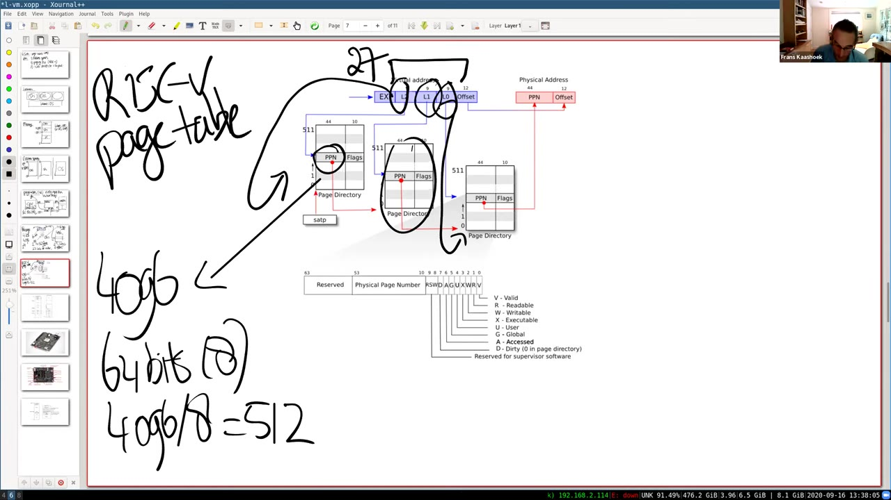
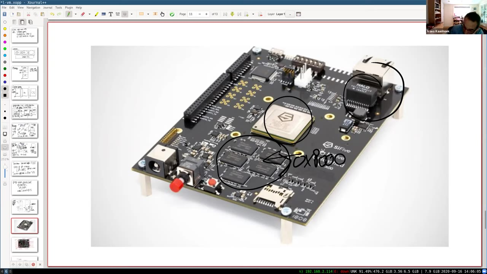
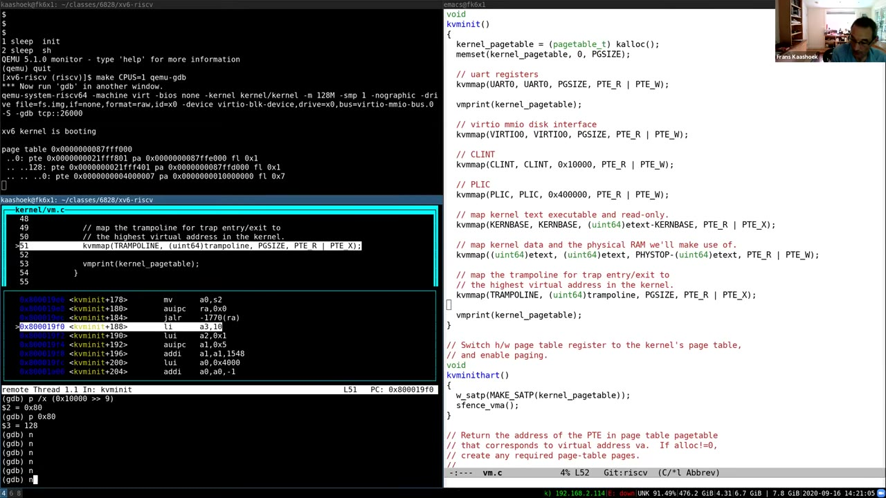

# 第 4 讲 · 页表与虚拟内存

## 00:00–03:00｜从已有印象开始：页表为什么值得再学一次？

开场完成声音检查后，Frans 向各地同学问好，并关心当时美国西海岸、佛罗里达和阿拉巴马受灾地区的同学。今天讲虚拟内存，具体集中在页表；这个主题之后还会在多次讲座和实验中回来。

他先请同学回忆以前的计算机系统课程里学过什么。自己第一次接触虚拟内存时，觉得它不过是把虚拟地址映射到物理地址的一张表，似乎不难。真正开始编程使用这套机制后，才发现其中的细节既棘手又有力量。接下来的课程和实验，要让大家获得的正是这种实现层面的理解。

几位同学依次作答：有人记得页内偏移不需要单独映射，可以减少映射记录；有人记得它用地址的表示层保护底层物理资源；还有人开始描述每个进程独立的地址空间。Frans 此时没有直接给出完整定义，而是让大家先把“映射”“偏移”“保护”这些已有印象说出来。

> **编者说明：** 自动字幕对开场点名和先修课程编号识别不稳定，这里不据此确定人名或课程号；保留可辨认的技术回答。

## 03:00–06:00｜把“映射”与“隔离”连接起来

接着的同学把思路说得更完整：每个进程可以有自己的地址空间，由内存管理单元把其中的虚拟地址翻译成物理地址。翻译以块为单位，低位保持不变；另一位同学强调，这让每个进程都能假定自己拥有独立的一套内存，是隔离的基础。

Frans 归纳出两条主线。第一，存在某种地址映射。第二，映射不是单纯改变数字，而是帮助实现隔离。这正是本课程此时讨论虚拟内存的原因。后续编程会展示它能支持哪些更有意思的行为，但今天首先把基本机制讲清楚。

本讲安排分成三部分：先解释地址空间，明确想得到的抽象；再研究 RISC-V 的分页硬件，看硬件具体如何执行翻译；最后进入 xv6，查看内核地址空间与用户地址空间的安排，以及相关代码。现代处理器普遍有某种分页支持，本课选用的是 xv6 实际使用的 RISC-V 机制。

## 06:00–09:00｜没有内存隔离时，一个错误指针能破坏谁？

Frans 重新画出用户程序与内核的关系：上面有 shell、cat，以及同学在 util 实验里编写的工具，下面是内核。希望在每个程序周围画出的框，真正成为保护边界：程序之间不能任意干扰，应用也不能因为错误或恶意行为破坏内核。

今天只聚焦这个目标的内存部分。机器实际上只有一组 DRAM 芯片；内核的代码、数据、栈，以及运行中的 shell、cat，都必须存放在这些物理存储单元里。仅仅把它们放在不同位置，并不自动产生隔离。

他用一个简化例子说明风险：假设 shell 的内存位于物理地址 1000 到 2000。cat 的程序出错，把数值 1000 放进 `a0`，然后通过这个地址存入数值 7。如果指令可以直接使用任意物理地址，这次存储就会改写 shell 的内存。问题不是 shell 和 cat 是否合作，而是 cat 根本不应该有凭一个错误数字触及 shell 私有内存的能力。

> **编者说明：** 这里保留的是板书伪指令的含义“向 a0 所指位置写 7”，不把字幕里不完整的指令拼成可执行 RISC-V 汇编。

## 09:00–12:00｜每个程序的地址 1000，都可以是它自己的 1000

解决目标称为**地址空间**：让 cat、shell 和内核分别拥有自己的地址命名范围。它们都可以从地址 0 开始向上编号，但同一个数字在不同空间里不必表示同一个物理位置。

回到刚才的例子，cat 执行“向地址 1000 写入 7”时，修改的是 cat 自己地址空间里的 1000，而不是 shell 的 1000。理想情况下，cat 根本没有一个可用地址能命名 shell 的私有内存；这比要求 cat 自觉不碰某段地址要强得多。

接下来真正的实现问题是：只有一份物理内存，怎样同时承载所有这些相互独立的地址空间？抽象上每个进程都有自己的内存世界，最终仍必须落到那一组实际 DRAM 芯片上。

**学生问：**物理硬件的空间有限，虚拟地址也有最大值。设计时是不是会把虚拟地址空间限制得足够小，使它能放进物理内存？这个问题引出下一段对“可表示的地址范围”与“实际拥有的内存”的区分。

## 12:00–15:00｜地址空间大小不等于已分配内存

**Frans 回答：**不一定。虚拟地址空间可以比物理内存大，物理内存也可以比单个虚拟地址空间大；后面会看到这种灵活性从哪里来。

**学生追问：**如果很多进程都使用大量内存，物理内存会不会耗尽？会。若许多大型应用既需要页表，又分配大量数据页，最终就可能没有可用内存。Frans 请大家联系正在做的 syscall 实验：报告空闲内存时，查看的是哪里？同学答出 `kalloc`。

`kalloc` 管理一份空闲页链表。链表耗尽后，再申请就会返回空指针。操作系统需要合理处理这种失败，并把无法分配内存的结果传回应用；虚拟地址范围很大，不意味着能够无限供应物理页。

讲解随后转向硬件方案。CPU 执行 load、store 或其他涉及地址的指令时，可以把指令产生的地址理解为虚拟地址。它先经过内存管理单元 MMU，再成为实际访问硬件的物理地址。这个转换机制是处理器提供的硬件支持，不需要应用在每次访问前自己调用一个翻译函数。

## 15:00–18:00｜页表在内存中，MMU 负责查表

开启分页后，指令中的地址先交给 MMU。比如 `a0` 里存着某个虚拟地址，MMU 按映射把它换成物理地址，之后才到内存中读取或写入相应位置。此时先把映射想成左右两列：一边虚拟地址，一边物理地址；具体目标位置可以由内核决定。

这张映射表本身通常也存放在物理内存里。处理器需要知道从哪里开始寻找它，因此提供一个寄存器。在 RISC-V 上，它叫 `satp`。概念上，它告诉 MMU 当前页表的根在哪里。

每个应用都有自己的映射：cat 有一份，shell 也有一份。这些表可以把相同虚拟地址翻译到不同物理位置。

**学生问：**MMU 是不是并不把整份映射保存在自己内部，而是从内存读取它，再执行翻译？

**Frans 回答：**这正是当前应该建立的理解。映射存放在内存中，MMU 查找或遍历它。不过真正的表结构比眼前画出的两列模型更复杂，稍后会展开。

> **编者校注：** `satp` 的具体字段存根页表的物理页号及分页模式，而非未经编码的完整字节地址。后面的 `MAKE_SATP` 演示会对应这一点。

## 18:00–21:00｜切换页表的权限为什么必须属于内核？

当 CPU 从一个应用切换去运行另一个应用，操作系统也切换 `satp`，使其选择新应用的页表。于是同一个 CPU 可以在不同时刻使用不同的地址解释规则：运行 cat 时按 cat 的表翻译，运行 shell 时按 shell 的表翻译。

**学生问：**各进程要写进 `satp` 的值，是由内核保存和设置的吗？

**Frans 回答：**是。尤其是写 `satp`，属于特权操作。用户程序不能自行宣布“我要用这张页表”。否则它就能选择让自己访问别的进程或内核内存的映射，隔离也就失效了。

至此有了基本方案，但朴素画法隐藏了一个巨大问题：如果每个虚拟地址都要占一项，表需要多大？RISC-V 寄存器宽 64 位，可以表示多少个地址？Frans 暂停，请同学在语音或聊天区给出答案。这个算术问题不是形式练习，而是要检查这种数据结构是否真的能装进机器内存。

## 21:00–24:00｜先按页映射，再区分页号与页内偏移

同学给出 $2^{64}$。如果真为每个字节地址放一个表项，映射表本身就大得不可能实现。因此第一步改进是按页而非按单个地址翻译。

本课使用的基本页大小是 4 KiB，即 4096 字节。把虚拟地址拆为两部分：前面是用于查表的页号索引，后面是页内偏移。查表得到目标物理页后，偏移决定访问这页中的哪个字节。例如偏移为 12，就是在选中的物理页起点后再走 12 字节。无须为同一页里的每个字节分别保存映射。

RISC-V 是 64 位架构，但本课采用的 Sv39 翻译并不把所有 64 位都用于索引。有效翻译部分是 39 位，因此其地址容量为 $2^{39}$ 字节，约 512 GiB。高出的位数为以后更大的虚拟地址模式留下空间。

> **编者校注：** 课堂用“高 25 位未使用”简化说明。Sv39 要求它们是位 38 的符号扩展；xv6 还只使用低半区，所以实际 `MAXVA` 是 $2^{38}$。这里讨论的 512 GiB 是 Sv39 容量，不是每个 xv6 进程已分配的内存。

## 24:00–27:00｜39 位虚拟地址如何对应 56 位物理地址？

39 位分成 27 位页号索引和 12 位页内偏移，因为 $2^{12}=4096$。物理地址格式则是 56 位，其中 44 位为 PPN，低 12 位沿用原虚拟地址的偏移。因此一个地址空间的容量，与整个系统能表示的物理地址范围，不必相等。

Frans 提醒，56 位只是硬件格式能够表达的范围，实际板子通常远没有这么多 RAM。他停下来让大家提问，强调这些具体位数会直接影响页表实验，不能只理解大意。

**学生问：**一个 4096 字节的页，在物理内存里是连续的一整块吗？

**Frans 回答：**是，页内是连续的 4096 字节，映射以这样一块为单位。学生进一步确认，12 位偏移恰好足以指定这块里的任意字节。这里连续的是**单个物理页内部**，不是说整个进程的所有物理页都必须相邻。

提问中学生请求讲者切回更清楚的页表画面，随后继续追问：图里的物理地址宽度 56 到底从哪里来？

## 27:00–30:00｜位宽是硬件选择，进程区分来自所选页表

56 位是体系结构设计者的选择，而不是由 39 位虚拟地址推导出来的。Frans 用技术趋势解释设计动机：设计者预留一段未来增长空间，使硬件不必很快因物理内存扩大而更换地址格式。

**学生问：**那么是否可能多个进程都用满自己的虚拟地址范围，仍没有耗尽整机物理地址范围？Frans 确认这种大小关系在原则上成立。这里必须区分“地址格式能表示多少位置”和“板上实际装了多少 RAM”。

**另一位学生问：**56 是地址位数吗？机器不是 64 位的吗？讲者确认：64 位机器不意味着全部 64 位都必须成为有效物理地址位。可以把它想成物理寻址路径只需要处理相应数量的有效位。

**学生又问：**在 CPU → MMU → 内存的图里，进程之间的区别在哪里？shell 与 ls 都可能使用 `0x1000`，它们怎么得到不同结果？Frans 把问题带回 `satp`：区别不需要写在每一个用户指针里，而是由当前选择的映射决定。

> **编者校注：** 这段提问的 ASR 有“虚拟内存到 $2^{27}$”的表述；27 是页号索引位数，字节地址范围对应的是 39 位，不能混用。

## 30:00–33:00｜为什么还需要三级页表？

ls 和 cat 分别运行在自己的映射下，`satp` 决定当前使用哪一份。这也意味着每个进程都需要页表，于是页表本身的大小更加重要。

即使按页记录，若直接分配 $2^{27}$ 个表项，每项 64 位、也就是 8 字节，一张完整表仍需要约 1 GiB。小程序只用很少几页，却要承担这么大的管理成本，显然不合理。

RISC-V 实际使用多级结构。把 27 位索引拆成三个 9 位字段。一页页表大小为 4096 字节，每项 8 字节，所以一页正好放 $4096/8=512$ 项，9 位足以选出其中任何一项。

`satp` 选择根页表，用最高 9 位选出一个 PTE；这项里的 PPN 指向下一页页表。接着用中间 9 位在那页选择 PTE，再由它找到最后一页页表；最低 9 位选出最终映射的叶项。原来的一次大数组索引，被拆成沿三级树的三次选择。

## 33:00–36:00｜一个数据页为什么只需要三个页表页？

*33:00 原片画面。讲者在教材页表图上圈出三层路径，并写出“一页 4096 字节、每项 64 位即 8 字节、4096/8=512”。这是课堂实时标注，不是后来制作的示意图。*

多级结构的主要好处是：大片地址没有映射时，对应的下级页表完全不必存在。Frans 假设进程只映射最底下的一页，即地址 0–4095。需要一页根表，它的第 0 项指向一页中间表；中间表第 0 项指向一页底层表；底层表第 0 项指向数据页。管理映射只需三个页表页，而非一个完整的巨大数组。

**学生问：**中间项只保存 44 位 PPN，下一层页表的完整地址缺少的 12 位从哪里来？

**Frans 回答：**所有页表页都按页边界对齐，所以它们的基址低 12 位一定为零。把 44 位 PPN 后面补 12 个零，就得到 56 位物理基址。无需为这些必然为零的位占用存储空间。

PTE 还要携带控制翻译的标志。要分清“PTE 中如何存储 PPN”和“取出 PPN 后如何构造地址”，不能把 PTE 本身当作已经可解引用的物理地址。

## 36:00–39:00｜有效、读、写、执行、用户权限

一个 64 位 PTE 中，本课关注 44 位 PPN 和低 10 位标志，剩余高位在这里的基础格式中保留。Frans 依次解释五个重要标志。

`V` 表示有效。刚才仅映射地址 0 所在页的例子中，每层只用到一个条目，其余 511 项都无效；MMU 看到无效项，就知道不能继续按它翻译。`R` 表示可读，`W` 表示可写，`X` 表示可从这一页执行指令，`U` 表示用户态可访问。这些权限让映射既能决定“去哪一页”，也能限制“能对那一页做什么”。

**学生问：**三层中的 PPN 是怎么组合为最终物理地址的？

**Frans 回答：**不是把三个 PPN 拼接起来。根表项给出下一层页表的位置，下一层又给出再下一层的位置；只有最后找到的叶项，才给出真正想访问的数据页的 PPN。三个索引是查找路线，前两层 PPN 是路上的页表地址，最后一层 PPN 才是目标。

讲者准备进一步解释为什么这里必须用物理页号，而不能把下级页表写成虚拟地址。

## 39:00–42:00｜页表为什么不能靠另一轮虚拟翻译来找到自己？

Frans 问：页目录里为什么保存物理页号，不保存虚拟地址？同学回答，要用它直接到内存里找到下一层目录。讲者确认，如果翻译本身必须再依赖另一轮同样的翻译，机制就会陷入递归依赖。`satp` 中的根也必须是物理页号，才能让查表有一个确定的起点。

**学生问：**我知道三段 9 位分别索引三张表，但它们之间为什么还要连起来？在讨论中，讲者再次强调：先根据根页表的某个条目知道下一张表在哪里，才能在那张具体的表里应用下一个索引。并不是全系统只有固定的三张表。

**学生追问：**如果查到的位置没有下一层表，MMU 会创建它吗？

**Frans 回答：**不会。硬件报告无法完成翻译，产生缺页异常，交给操作系统处理。类似执行非法运算时，处理器不会自行猜测程序想要什么；它拒绝继续这次访问。页表页是否要分配，是软件的决策。

> **编者校注：** 用户发起普通内存访问时不会为该地址重新装载 `satp`。当前根页表已经由内核设置；每次访问变化的是索引所用的 VA。

## 42:00–45:00｜补零还是补偏移？以及查三次表的代价

**学生确认：**要得到第二层页表地址，是不是取第一层 PPN，再接上原虚拟地址的 12 位偏移？

**Frans 纠正：**这里接的是 **12 个零**。下级页表页按 4096 字节对齐，所以先得到整页基址，再用相应的 9 位索引选择其中的条目。原虚拟地址的低 12 位只在最终目标数据页里使用。讲者称这些都是实验中会碰到的关键疑问，现在问清楚很值得。

之后转向性能。一次普通内存读取，看起来先要读根页表，再读中间页表，最后读底层页表，才能找到目标。这三次附加查找显然昂贵。

处理器因此保存近期使用过的地址翻译结果，缓存称为 TLB，即 Translation Look-aside Buffer。第一次翻译可能需要完整页表遍历，随后访问同一页时，如果命中 TLB，就可以直接得到对应物理页及相关信息，而不必重复走整棵树。

## 45:00–48:00｜TLB 对操作系统最重要的影响：旧翻译必须失效

**学生问：**TLB 到底缓存地址、页，还是中间页表结果？怎样缓存才更高效？

Frans 说明，TLB 有多种具体实现，内部组织不是今天课程的重点。需要掌握的是它存在，并且处理器通常把这些细节对操作系统隐藏起来。操作系统最不能忽略的后果，是**缓存可能变旧**。

例如切换到新页表后，旧页表下的翻译结果不一定还有效。如果处理器继续用它，就可能把相同虚拟地址送到错误物理位置。内核必须在合适时机告诉硬件别再使用这些缓存；RISC-V 对应的指令是 `sfence.vma`。

**学生问：**三级页表的遍历是操作系统实现的，还是硬件实现的？

**Frans 回答：**普通地址访问的遍历由硬件 MMU 完成。稍后也会在 xv6 里看到一个 `walk` 函数，它用软件模拟相似过程，因为内核在建立和查看页表时也需要查找 PTE。这不意味着每次用户 load/store 都调用 C 函数 `walk`。

最后又有同学问到，普通处理器缓存与这条翻译路径是什么关系。

## 48:00–51:00｜普通缓存的位置，以及软件 walk 的两种用途

Frans 先把 MMU 放回处理器芯片的整体图景：CPU 核、MMU 和 TLB 都属于处理器内部机制。同学澄清，自己问的不是 TLB，而是避免每次都访问 DRAM 的普通数据或指令缓存。

讲者解释，有的缓存按虚拟地址索引，有的按物理地址索引；在当前简化模型中，可以把前者想成位于翻译之前，后者位于翻译之后。这里的目标是区分普通内容缓存与地址翻译缓存，不展开具体芯片的全部缓存设计。

**学生问：**既然硬件能遍历页表，为何 xv6 还要自己写 `walk`？

**Frans 给出两个用途。** 一是创建页表：内核要找到正确层级、填写表项，必须理解三级结构。二是访问用户传入的地址：xv6 内核使用自己的页表，而每个用户进程使用自己的页表。例如 syscall 实验中，`sysinfo` 要把结果写到用户结构体指针指定的位置；这个数值在内核页表下并不自动具有正确意义。

因此 `copyin`、`copyout` 会用目标进程的用户页表做软件翻译，找到对应物理页，再通过内核能够访问的地址读取或写入。普通硬件翻译使用的是当前装入的那张表，并不会自动知道一个参数指针属于另外的地址空间。

## 51:00–54:00｜间接寻址带来的控制力

**学生继续问：**硬件为什么不暴露一个可直接调用的遍历指令，省得软件重复写、还可能写错？

Frans 把回答落到接下来的实验：如果调整页表布局，让需要访问的用户内存在内核地址空间中也有合适映射，普通 load/store 就能借助硬件完成翻译。页表实验会让大家这样改造，从而减少 `copyin`、`copyinstr` 中的软件遍历。这时还不急于展开实现，先理解为何现有布局需要它。

进入 xv6 前，他再强调一个看待页表的方法：它提供了一层**间接寻址**。VA 到 PA 的关系由操作系统控制，意味着操作系统可以改变内存访问的解释，而不用修改应用里每个指针。

例如访问无效项会触发 page fault；内核可以在异常处理中修改页表，再让原指令重新执行。这就不仅是遇到错误后终止进程，还可以成为实现更丰富内存机制的基础。相关技巧将在后面的缺页异常课程中展开，今天只建立机制与可能性。

下一步是看 xv6 的具体内存布局。

## 54:00–57:00｜物理地址空间不全是 DRAM

Frans 展示内核虚拟地址与物理地址的对照图，先看物理地址一侧。他马上修正一个容易误导的说法：不能把整条物理地址轴都叫作 DRAM；其中只有一部分是 RAM，另一些地址对应 I/O 设备。

他展示开发板照片，指出处理器、处理器之外的 DRAM 芯片及其他器件。每个核有相应的地址翻译机制，而板级硬件决定某段物理地址最终连到哪种资源。xv6 所用 QEMU 平台把 RAM 放在 `0x80000000` 开始的位置；较低的一些地址用于设备。

随后切到硬件手册的 memory map，说明这不是操作系统随意想象出来的布局。表中会列出保留范围、以太网等设备的寄存器范围，以及哪段地址连接外部内存。写操作系统需要遵守具体平台给出的物理布局。

> **编者校注：** 开发板照片和手册用来说明“物理地址由平台决定”。课堂运行的 QEMU `virt` 平台有自己的设备布局，不能把照片中每个设备的地址直接套进 xv6。

## 57:00–60:00｜CPU 架构与板级布局分别决定什么？

继续查看手册时，讲者定位到 DDR 内存条目，把它与照片中的 DRAM 芯片对应起来。虽然实验运行在 QEMU 软件里，仍应把它想成一台遵循具体硬件布局的机器。

**学生问：**这里说布局由硬件决定，是指 CPU 本身，还是 CPU 所在的板子？

**Frans 回答：**主要是把处理器、DRAM 与各种设备组合在一起的平台设计。操作系统不只处理 CPU，还要与 I/O 设备交互；例如发送网络数据，最终有人必须操作网卡，而这个责任落在操作系统及驱动程序上。

回到地址图，低地址有启动 ROM；启动时先执行其中代码，再跳到装有内核的 RAM 入口。图中还有 PLIC 与 CLINT 两类中断相关设备，后续会讲它们如何把设备事件送到合适的处理器。UART 对应控制台串口，virtio 接口用于磁盘。

重点是：向某个设备寄存器地址执行 store，并不是在 DRAM 中改写一个普通变量，而是在控制那个设备。这样的统一寻址方式叫内存映射 I/O。

## 60:00–63:00｜未使用地址、实际 RAM 与设备路由

**学生确认：**低于 RAM 起点的这些设备地址，并不真的存在于 DRAM 芯片中；访问时直接到其他硬件，对吗？讲者确认，并用以太网控制器说明：内核可以通过 load/store 读写设备寄存器，对它进行编程。

*61:00 原片画面。讲者在开发板照片上圈出中央处理器、下方 DRAM 芯片与右上方网络相关器件，用它们说明“一个物理地址最终访问哪个硬件资源”。照片不是 QEMU 内存布局的逐项设备清单。*

**学生问：**物理地址图上方为什么有那么大一块写着 unused？

**Frans 回答：**体系结构能表示 $2^{56}$ 字节的物理地址，不意味着主板必须装满这些位置。没安装相应内存或设备的区域可以不用。xv6 的配置只使用约 128 MiB RAM。

**学生又问：**从 CPU 发出的访问，到底在哪里决定发往 DRAM 还是某个 I/O 设备？讲者建议用一个分路器来理解：内存控制及互连逻辑根据物理地址把访问路由到目标资源。随后准备回到内核主动安排的虚拟地址一侧。

## 63:00–66:00｜恒等映射与高地址内核栈

机器刚启动时，还没有开启页表翻译。xv6 先建立内核将要使用的第一套地址空间。为保持代码简单，其主要映射采用恒等映射：虚拟地址数值等于最终物理地址数值。

图上许多箭头水平直连，正是在表达这一点。不过不要把它理解为“每个低地址都有效”；内核只为需要的 RAM 和设备范围建立映射。

一个重要例外是高地址内核栈。xv6 把栈映射到虚拟地址空间高处，在每个栈下方留下没有有效映射的保护页。如果内核栈向下越界，访问保护页就产生 page fault，比悄悄覆盖别的内核数据更容易定位。

高地址保护页不需要实际分配一页 RAM 来“填空”。它占的是一段不可访问的虚拟地址，PTE 无效即可。真正的栈物理页既有这个高地址别名，又能通过 RAM 的直接映射地址访问。

这展示了页表的灵活性：同一物理页可以在一个或多个虚拟位置出现；也可以故意留下完全没有映射的地址范围。xv6 使用的技巧不多，但这个例子已足以说明地址映射并非只能一一对应。

## 66:00–69:00｜内核权限、每进程内核栈与空闲内存用途

另一个值得注意的安排是权限：内核代码页可读、可执行，不可写；内核数据页可读写，不可执行。这样做可以尽早发现部分程序错误，而不只是防范用户程序。

**聊天区问题：**多个进程是否分别拥有内核栈？

**Frans 回答：**是，每个用户进程都有对应的内核栈。它们为什么需要分开，会在后续讨论中更加明确。

**学生问：**其他应用的内存放在物理图的哪里？讲者指向可分配内存区域。用户进程的页表页、代码页、数据页都从这里分配；应用越多，空闲页越少，最终 fork 或 exec 可能因为内存不足失败。

**学生追问：**所以用户进程的虚拟地址空间比内核小吗？讲者区分：原则上的地址范围一样大，但实际填入的映射通常少得多。虚拟范围大小和映射的密度不是一回事。

还有同学问，多个空间里相同的映射能否合并共享以减少开销。Frans 表示可以有这类优化，xv6 当前没有普遍这么做；页表实验的挑战题会涉及类似思路，真实系统也会更认真地处理这些成本。

## 69:00–72:00｜GDB 演示准备：停在 kvminit

讲解进入代码演示。Frans 启动 xv6，提醒大家 QEMU 在这里负责模拟机器。上次课追过启动到 `main`，这次要看 `main` 中建立内核地址空间的 `kvminit`。

演示开头并不顺利：他检查目录，重新连接 GDB，在 `main` 设置断点，尝试经过控制台初始化与物理内存分配器初始化。运行中出现了与预期不同的停顿或输出，因此又重新尝试，最后停到 `kvminit`。

这段没有新的页表算法，但体现了实际调试过程：先确认运行的是预期目录与构建，再把执行停在正确函数。不能把这些等待和重启写成顺利完成的一串虚构命令。

右侧编辑器显示 `vm.c`，左侧是 QEMU 与 GDB。讲者说明自己稍微改过这个函数，加入页表打印，接下来将单步观察每一步创建了什么映射。

> **编者说明：** 字幕不能还原这一段全部键入命令。后面的 76:00 关键帧可确认使用 `make CPUS=1 qemu-gdb`，但这里不编造完整终端会话。

## 72:00–75:00｜UART 映射：沿索引 0、128、0 找到设备页

切换到 GDB 分屏后，首先看到 `kvminit` 调用 `kalloc` 分配根页表页，再清零整页，使所有 PTE 初始都无效。接着逐项映射设备；第一项是 UART0。

Frans 打开 `memlayout.h`，说明硬件布局被转成代码里的常量。`kvmmap(UART0, UART0, PGSIZE, PTE_R | PTE_W)` 建立串口页的恒等映射，地址为 `0x10000000`。

页表实验的第一个任务是实现 `vmprint`，讲者也加了这个函数。执行第一项映射后，输出显示：根表有第 0 项；它指向的中间表使用第 128 项；底层表使用第 0 项；最终物理页为 `0x10000000`。

他用 GDB 做移位与进制检查，验证中间索引为什么是 128：先移掉 12 位页内偏移，再取下一个 9 位字段。画面后续保留的计算是 `0x10000 >> 9 = 0x80`，十进制为 128。这与三级结构的实际输出一致。

> **编者校注：** 对该 VA，完整索引为 `(L2,L1,L0)=(0,128,0)`。字幕把若干零和十六进制数识别丢失，数字按关键帧与 `PX` 定义校订。

## 75:00–78:00｜映射建好之后，还没有真正启用它

UART 叶项的标志显示为 `0x7`：`V|R|W`，表示有效且可读写。前两层只需要指向下级表，所以对应标志为 `0x1`。随后内核继续映射 virtio、CLINT、PLIC、内核代码、数据及可用 RAM，最后映射 trampoline。

*76:00 原片画面。左上保留首次 UART 映射的 `vmprint` 输出，三级索引为 0、128、0，叶项 PA 为 `0x10000000`、flags 为 `0x7`。左下有 GDB 的 `0x80 = 128` 验算；右侧 `kvminit` 中可见讲者额外加入的两次 `vmprint`。*

讲者逐步执行并打印完成后的页表，不逐项解释全部输出，因为结构已经说明了要点：这些有效 PTE 共同构造出前面看到的内核虚拟布局。

接下来更关键的是 `kvminithart`。Frans 发现已走过想看的位置，于是重新启动并在该函数设置断点。里面将执行 `w_satp(MAKE_SATP(kernel_pagetable))`，使处理器开始使用刚建立的页表。

他提出问题：写完这个寄存器，下一条指令的地址将会怎样解释？这不是只改变一份普通数据，而是即将改变后续所有地址访问的意义。

## 78:00–81:00｜写 satp 的瞬间：下一条指令为什么还能执行？

在启用分页之前，执行位置直接对应物理地址。启用后，接下来的取指地址也必须经过新页表。若新映射随意安排，原来紧接着的指令位置就可能指向别处，或者根本无法翻译。

这里之所以能继续执行，正是因为内核代码做了恒等映射。下一条指令的数值地址虽然现在作为虚拟地址解释，翻译后仍得到原来存放那条指令的物理位置。这个设计让启动从“不翻译”切到“翻译”的过程接得上。

Frans 强调，写 `satp` 是一个意义很大的时刻：CPU 的整个地址解释环境改变了。以后每个地址都要服从你建立的规则。

他问，如果页表有错，会发生什么？同学提出可能覆盖内核数据；讲者补充，也可能立即 page fault，因为下一条指令或者某个必要地址根本无法翻译。结果可能是奇怪错误或内核崩溃。

这也是页表实验难的地方：机制很强，错误的后果也强。实验时遇到崩溃，需要仔细调查是哪一项地址解释出了问题，而不是只盯着触发异常的那行 C 代码。

## 81:00–84:00｜下课后的第一个问题：walk 返回的是哪一个 PTE？

Frans 收束正式讲授：使用虚拟内存虽然容易碰到复杂问题，也很有趣，实验会帮助大家真正理解它。时间已到，赶下一节课的同学可以离开，有问题的继续留下。他提醒大家完成 syscall 实验，并说明下次课再见。

随后一位学生问 `walk`：为什么已经走到第三级，却似乎只返回“第一个表项”？其他函数又怎样拿到真正对应物理地址的项？

讲者画出一页含 512 个 PTE 的页表，解释返回值是**指向其中某个 PTE 的指针**。内核能通过这个指针读取或修改那个条目，例如把物理页号与权限位组合后写进去。

学生进一步说明，自己困惑的是它到底返回第一层还是最后一层。Frans 澄清：返回的是最底层对应 VA 的那个 PTE。代码先从 level 2 开始，经过 level 1，最后在 level 0 页表中选择表项。它不是返回根表第一个 PTE，也不是直接返回目标数据页地址。

## 84:00–87:00｜缺少中间表时怎么办？页表页又从哪里来？

沿着 `walk` 的代码继续解释：如果需要的中间页表不存在，且允许分配，函数就创建新页表页、清零，再继续下降。若不允许分配而路径缺失，就无法返回对应叶项。

> **编者校注：** 此版循环实际处理 level 2 和 level 1，循环结束后返回 `&pagetable[PX(0, va)]`；`alloc=0` 且中间项缺失时返回空指针，不是把那个无效中间 PTE 当作成功结果返回。即使找到叶项地址，调用者仍可能需要检查叶项自身是否有效。

**另一位学生问：**每个进程都要有三级树，内核自己也有三级树，那么这些树以及它们指向的进程内存，放在物理图的哪里？

Frans 回到内核地址布局，指出可分配物理内存区域。创建进程时，内核从那里取出几页用于用户页表，填写 PTE，再分配所需用户数据页。运行该进程时，把这棵树根的物理页号装入 `satp`，CPU 才使用为它构造的地址空间。

学生把它理解成内核从统一物理资源池拿出一部分用于进程。讲者再展示用户地址空间：它也从 0 延伸到 `MAXVA`，但只有实际需要的位置有映射，不能由图画得很高就推断物理内存已经全部准备好了。

## 87:00–90:00｜内核把物理地址当指针用，为何仍然有效？

上一位同学确认：实际进程不可能把图上所有地址都填满，否则早已耗尽 RAM；通常进程只有其中一小部分。

**接着的学生问：**启用 `satp` 后，内核访问也经过翻译。`walk` 却从 PTE 里拿出物理地址，转成指针继续读取；这时那个数值不会被当成虚拟地址吗？

Frans 先带着同学回看 `kvminit` 和 `kvminithart`，确认问题是：`walk` 在启用分页之后是否仍能按原方式工作？答案是能，关键仍是**恒等映射**。从 PTE 得到的 PA 数值，在内核直接映射区也恰好是一个可用 VA，并且指向同一物理页。

因此不是内核突然获得了绕过 MMU 的普通指针，而是页表布局让这两个数值相同。讲者强调，xv6 中很多看起来顺理成章的代码，都依赖这个选择。

**学生再问：**所有进程的 `satp` 寄存器存在哪里？讲者指出，每个核只有当前使用的一个硬件 `satp`；进程自己的页表根记录在 `struct proc` 的 `pagetable` 字段中，需要运行它时再装入硬件寄存器。

## 90:00–93:05｜稀疏树的收益与 etext 边界

**学生问：**三级表到底比一张巨大表好在哪里？自己仍未完全理解。

Frans 再从“缺失的分支”解释：根表中某项为空，就不需要为这一整片地址范围建立中间页表，更不用建立所有底层页表。这里节省的不只是表项内容，而是那些页表页本身根本不存在。开始只建立需要的一条路径，之后按需求再添加其他分支，就能支持巨大但稀疏的虚拟地址范围。

学生将其总结为按需分配这些块，而不是一开始分配整张大表，讲者确认。这里说的是按需建立页表结构，不等于已经实现后续实验里的“用户数据页惰性分配”。

最后一位同学询问 `vm.c` 中用 `PHYSTOP - etext` 作为映射长度的语句：这样会不会跨过不该碰的内存或 free memory？讲者回顾 `KERNBASE` 是内核开始位置，`etext` 表示代码结束边界；相减得到的是长度，而不是另一个新的起点。学生表示自己之前把 `etext` 的位置理解错了。

> **编者校注：** 最后回答在字幕中交替提到两个相邻的映射语句，应明确区分：`[KERNBASE, etext)` 是内核代码，长度 `etext - KERNBASE`、权限 RX；`[etext, PHYSTOP)` 包括内核数据及之后可分配 RAM，长度 `PHYSTOP - etext`、权限 RW。`etext` 是代码段结束边界，不是整个内核（含数据）的结束符号 `end`。为 free memory 建立直接映射，不等于把这些页分配给了某个进程。

录像以对这个边界的简短确认结束。

## 来源与整理说明

- Frans Kaashoek 主讲，*6.S081 Lecture 4: Page Tables*；MIT 2020 官方课表对应 9 月 16 日 LEC 4，David Morejon 频道 2020-09-18 发布，视频 ID `f1Hpjty3TT8`，时长 5585 秒。视频来源保存在元数据中。
- 英文自动字幕共 2461 条，已完整读取。最早 0.080 秒，最后一条结束标记为 5586.560 秒，比视频标称时长多 1.560 秒；正文时间封顶到 93:05。开头 0.080 秒无字幕，未发现由此丢失的实质开场内容，但未对全片逐句听音。
- 上述时间是约三分钟的阅读窗口，不是每句准确起止时间。技术问答均依字幕内容整理，省略语气词与反复确认；发言者未能可靠识别时仅记“学生”，不猜姓名。
- 真实关键帧查看了 33:00、61:00、76:00、85:00；前三帧用于本文，85:00 为多个文档并排显示，未用来推断代码或板书。图片未裁剪、无生成内容。未完整观看或听校全片。
- 官方课堂提纲 [`l-vm.txt`](https://pdos.csail.mit.edu/6.S081/2020/lec/l-vm.txt) 用于核对术语与代码主题。提纲里还列有未在录像中完整展开的 `exec`、`sbrk` 等流程，完整阅读见[课程资料 §3.7–3.8](#/c/mit-6.s081-2020/lec/lec04?v=materials)，没有把它们扩写成虚构课堂时间段。
- `walk`、`MAKE_SATP`、`PX`、页权限及内存边界对照固定 2020 源码；明显 ASR 错词如 risk five、chaotic、cisco lab 分别按上下文校为 RISC-V、`kalloc`、syscall lab。纠正口述简化或教材差异的内容均另作“编者校注”。
