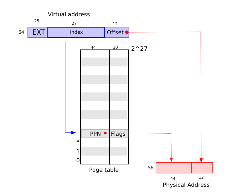
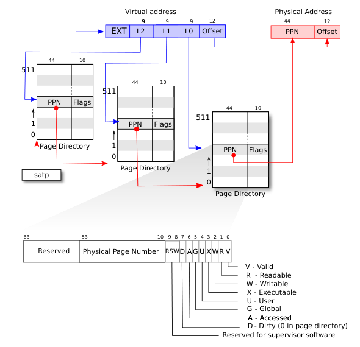
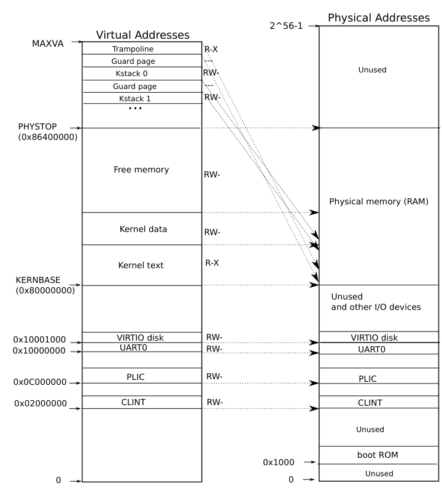
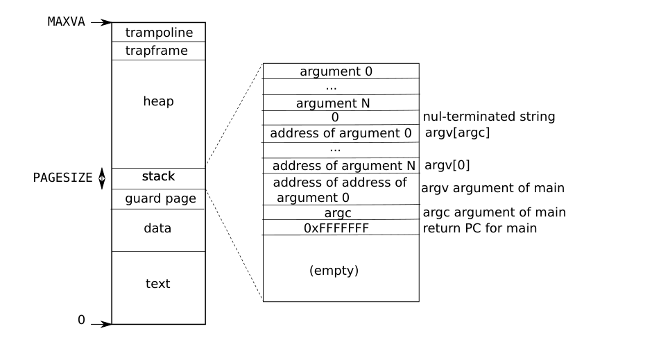

# 第 3 章 · 页表

## 第 3 章导言

页表是操作系统为每个进程提供私有地址空间和内存的机制。页表决定一个内存地址表示什么，以及哪些物理内存可以访问。它让 xv6 能够隔离不同进程的地址空间，并把它们复用到同一份物理内存上。

页表还提供了一层间接寻址，使 xv6 可以实现一些技巧：把同一块内存，也就是 trampoline 页，映射进多个地址空间；在内核栈和用户栈旁设置无法访问的保护页。本章下面介绍 RISC-V 硬件提供的页表，以及 xv6 如何使用它。

## §3.1 分页硬件

先回顾一下：RISC-V 指令——无论用户指令还是内核指令——操作的是虚拟地址。机器的 RAM，即物理内存，使用物理地址索引。RISC-V 页表硬件把每个虚拟地址映射到一个物理地址，从而连接这两类地址。

xv6 运行在采用 Sv39 的 RISC-V 上。这意味着一个 64 位虚拟地址中，仅低 39 位用于地址翻译，高 25 位不用于翻译。在这种 Sv39 配置中，逻辑上可以把页表看作一个包含 $2^{27}$，即 134,217,728 个页表项（page-table entry，PTE）的数组。每个 PTE 包含一个 44 位物理页号（physical page number，PPN）以及若干标志位。

分页硬件使用这 39 位中的高 27 位索引页表，找到 PTE；随后生成一个 56 位物理地址：高 44 位来自 PTE 中的 PPN，低 12 位直接复制原虚拟地址的低 12 位。图 3.1 把页表简化为 PTE 数组，展示了这一逻辑过程；实际结构见图 3.2。操作系统通过页表，以对齐的 4096 字节（$2^{12}$ 字节）块为粒度控制虚拟地址到物理地址的翻译，这样一块内存叫作一**页**。



**图 3.1 中文说明。** Virtual address 为虚拟地址，Index 为页号索引，Offset 为页内偏移，Page table 为页表，PPN 为物理页号，Flags 为标志。蓝线表示用 27 位索引选择一个表项；红线表示把表项中的 44 位 PPN 与原地址的 12 位偏移拼接成物理地址。图中的大数组是逻辑模型，不是实际分配的连续数组。

Sv39 RISC-V 不把虚拟地址高 25 位用于翻译；未来 RISC-V 可以利用这些位增加翻译层级。物理地址也留有增长空间：原书指出，PTE 格式还有 10 位空间，可供将来扩展物理页号。

> **编者校注：地址位数。** “不用于翻译”不等于可以随意填写。Sv39 的有效虚拟地址要求位 63–39 都等于位 38，即符号扩展。xv6 为避免处理高半区，使用 `MAXVA = 1L << 38`，只接受低半区的地址。因此，Sv39 的有效地址容量为 512 GiB，而 xv6 使用的低半区上界是 256 GiB。PTE 的高 10 位在这里讨论的基础格式中保留，不能据此在当前实现中自由设置它们。

如图 3.2，实际翻译分三步进行。页表作为一棵三级树存放在物理内存中。树根是一页 4096 字节的页表页，其中有 512 个 PTE，它们指向下一层页表页的物理地址。下一层的每页又包含 512 个 PTE，指向最后一层页表页。分页硬件用 27 位索引中的最高 9 位选择根页表项，用中间 9 位选择下一层页表项，再用最低 9 位选择最终 PTE。

翻译一个地址所需的三个 PTE 中，只要有一个不存在，分页硬件就产生缺页异常（page-fault exception），由内核决定如何处理，详见第 4 章。通常地址空间中有大片地址没有映射；三级结构让这些区域对应的整页页表都可以不分配。

每个 PTE 的标志位告诉分页硬件，对应虚拟地址允许怎样使用。`PTE_V` 表示表项有效；如果未设置，访问就引起异常，也就是不允许访问。`PTE_R` 控制是否允许读取，`PTE_W` 控制是否允许写入，`PTE_X` 控制 CPU 能否把页内容解释为指令并执行。`PTE_U` 控制用户态指令是否能访问这一页；若未设置，则这项映射只能供 supervisor 模式使用。图 3.2 展示完整过程。这些标志以及分页相关定义位于 `kernel/riscv.h`。



**图 3.2 中文说明。** L2、L1、L0 分别为三级的 9 位索引；每个 Page Directory 都是一页页表。`satp` 指向根页表；前两层 PPN 指向下一层页表，最后一层 PPN 指向目标物理页。下方 64 位 PTE 从高位到低位为：Reserved（保留，63–54）、Physical Page Number（物理页号，53–10）、RSW（留给 supervisor 软件，9–8）、D（脏，7）、A（已访问，6）、G（全局，5）、U（用户，4）、X（可执行，3）、W（可写，2）、R（可读，1）、V（有效，0）。原图注 D 在页目录项中为 0；这里的“页目录项”指向下一层页表的非叶项。

> **编者校注：不要把三个 PPN 拼起来。** 三级索引依次选路，只有最终叶项的 PPN 贡献目标物理地址。中间层的下级表基址是 `PPN << 12`，低 12 位补零；目标数据地址才附加原 VA 的页内偏移。对 xv6 的普通 4 KiB 映射，非叶项设置 `V` 而不设置 `R/W/X`，叶项具有访问权限。实际权限还有体系结构约束，例如 `W=1,R=0` 不是合法的普通叶项组合；`U` 也不意味着 supervisor 可以无条件执行用户页，或不受 `SUM` 等控制直接读写用户页。

为了让硬件使用某个页表，内核必须把根页表页的物理地址写入 `satp` 寄存器。每个 CPU 有自己的 `satp`；后续指令产生的地址，都使用本 CPU 的 `satp` 指定的页表翻译。各 CPU 拥有各自的 `satp`，因而可以运行不同进程，每个进程的私有地址空间由自己的页表描述。

> **编者校注：寄存器编码。** 上述“写入物理地址”是概念性表述。源码实际执行 `w_satp(MAKE_SATP(kernel_pagetable))`：`MAKE_SATP` 写入 Sv39 模式及根页表的**物理页号**，不是把未经编码的字节地址直接塞进寄存器。

最后澄清几个术语。物理内存指 DRAM 中的存储单元，每个字节有一个物理地址。指令使用虚拟地址，由分页硬件翻译为物理地址，再交给 DRAM 硬件读写。与物理内存和虚拟地址不同，**虚拟内存不是一个物理对象**，而是内核用于管理物理内存和虚拟地址的一组抽象与机制。

## §3.2 内核地址空间

xv6 为每个进程维护一个描述其用户地址空间的页表，另有一个单独的页表描述内核地址空间。内核安排自己的地址空间布局，使自己可以通过可预测的虚拟地址访问物理内存和各种硬件资源。图 3.3 展示这一布局如何把内核虚拟地址映射到物理地址。常量定义在 `kernel/memlayout.h`。

QEMU 模拟的计算机具有从物理地址 `0x80000000` 开始的 RAM。原书此处写 RAM 至少延伸到 `0x86400000`，并称这个上界为 `PHYSTOP`。QEMU 还模拟磁盘接口等 I/O 设备，把设备接口以**内存映射控制寄存器**的形式放在物理地址空间中低于 `0x80000000` 的位置。内核通过读写这些特殊物理地址与设备交互；这种读写是在和设备硬件通信，不是在访问 RAM。第 4 章进一步讨论设备交互。



**图 3.3 中文说明。** 左侧为内核虚拟地址，右侧为 xv6 预期的物理地址布局。Kernel text 是内核代码，Kernel data 是内核数据，Free memory 是可供分配的内存，Kstack 是各进程的内核栈，Guard page 是保护页，Trampoline 是陷阱进出所用的跳板页。RWX 分别表示读、写、执行权限；`---` 表示无有效映射。右侧 Unused 表示未使用的地址范围，不代表一定装有空闲 RAM；boot ROM 是启动只读存储区。UART0、VIRTIO disk、PLIC、CLINT 分别对应串口、虚拟磁盘接口、平台中断控制器和本地中断控制器。虚线展示同一物理页可以同时拥有直接映射和高地址映射。

> **编者校注：PHYSTOP。** 图与 §3.2 保留原书的 `0x86400000`，它与书中 §3.5 的 128 MiB 假设不一致。固定 2020 源码 `memlayout.h` 的定义是 `KERNBASE + 128*1024*1024`，即 **`0x88000000`**，对应区间 `[0x80000000, 0x88000000)`。做本学期实验应按实际源码计算，不能照图抄成 `0x86400000`。

内核通过**直接映射**访问 RAM 与内存映射设备寄存器，即把资源映射到与其物理地址数值相等的虚拟地址。例如内核本身在虚拟空间和物理内存中都从 `KERNBASE = 0x80000000` 开始。直接映射简化了内核读写物理内存的代码：例如 fork 为子进程分配用户内存时，分配器返回那块内存的物理地址；fork 复制父进程用户内存时，可以直接把这个数值当作内核虚拟地址使用。

有两类内核虚拟地址不采用直接映射：

- **Trampoline 页。** 它映射在虚拟地址空间顶部；用户页表也有同样的映射。第 4 章解释它的作用。这里先看到一个页表的有趣用途：保存 trampoline 代码的一个物理页，在内核地址空间中映射了两次，一次位于顶部，一次通过直接映射访问。
- **内核栈页。** 每个进程有自己的内核栈，映射在高地址，使 xv6 能在栈下面留出一页未映射的保护页。保护页的 PTE 无效，即 `PTE_V` 未设置。如果内核栈溢出，就很可能引发异常并使内核 panic。没有保护页，溢出会覆盖其他内核内存，导致错误运行；相比之下，立即 panic 更好。

内核使用高地址映射访问自己的栈，但也能通过直接映射地址访问这些物理页。另一种设计是只保留直接映射，并在直接映射地址使用栈。然而这样要设置保护页，就需要取消某些本来对应物理内存的虚拟地址映射，使那部分物理内存难以使用。

内核把 trampoline 和内核代码页映射为 `PTE_R | PTE_X`，以便读出并执行其中的指令；其他已映射页使用 `PTE_R | PTE_W`，以便读写其中的内存。保护页的映射无效。

## §3.3 代码：创建地址空间

xv6 操作地址空间和页表的代码，大部分位于 `kernel/vm.c`。核心数据结构 `pagetable_t` 实际是指向 RISC-V 根页表页的指针，可以代表内核页表，也可以代表某个进程的页表。核心函数是 `walk` 和 `mappages`：前者查找某虚拟地址对应的 PTE，后者安装新映射所需的 PTE。以 `kvm` 开头的函数操作内核页表，以 `uvm` 开头的函数操作用户页表，其余函数可能两边都用。

`copyout` 和 `copyin` 在内核与作为系统调用参数传入的用户虚拟地址之间复制数据。它们放在 `vm.c`，因为必须显式翻译这些用户地址，才能找到相应的物理内存。

启动早期，`main` 调用 `kvminit` 创建内核页表。此时 xv6 尚未启用 RISC-V 分页，地址直接指向物理内存。`kvminit` 先分配一页物理内存，用来存根页表；然后调用 `kvmmap` 安装内核需要的映射，包括内核指令、数据、直到 `PHYSTOP` 的物理内存，以及实际上对应设备的地址范围。

`kvmmap` 调用 `mappages`，为一段虚拟地址建立到相应物理地址范围的映射。`mappages` 以页为步长逐个处理虚拟地址：调用 `walk` 找到对应 PTE 的地址，再把物理页号、所需权限（`PTE_W`、`PTE_X`、`PTE_R`）以及表示有效的 `PTE_V` 写入 PTE。

`walk` 模仿 RISC-V 分页硬件查找虚拟地址对应 PTE 的过程，见图 3.2。它每次处理 9 位，逐层下降。每层使用相应 9 位索引 PTE，得到下一层页表或最终映射。如果 PTE 无效，说明所需的下级页表尚未分配；若 `alloc` 参数非零，`walk` 就分配新的页表页，并把其物理地址编码进当前 PTE。最后返回树中最底层 PTE 的地址。

这段代码依赖于物理内存直接映射进内核虚拟地址空间。例如 `walk` 下降时，从 PTE 取出下一层页表的物理地址，然后把这个数值作为虚拟地址，读取下一级 PTE。

`main` 调用 `kvminithart` 安装内核页表，把根页表页的物理地址编码后写入 `satp`。从这之后，CPU 便使用内核页表翻译地址。因为内核采用恒等映射，下一条指令的地址虽然现在是虚拟地址，仍然会映射到正确的物理内存。

同样由 `main` 调用的 `procinit` 为每个进程分配内核栈。各栈映射到 `KSTACK` 宏生成的虚拟地址，宏在它们之间为无效的保护页留出空间。`kvmmap` 向内核页表添加这些映射，接着 `kvminithart` 重新写入 `satp`，让硬件使用更新后的页表。

每个 RISC-V CPU 都会在地址翻译后备缓冲区（Translation Look-aside Buffer，TLB）中缓存页表翻译信息。xv6 修改页表后，必须通知 CPU 使相关缓存失效。否则，TLB 之后可能使用旧映射，而原物理页此时已经分给另一个进程，结果一个进程就可能覆盖另一个进程的内存。

RISC-V 的 `sfence.vma` 指令用于刷新当前 CPU 的相应地址翻译缓存。xv6 在 `kvminithart` 写入 `satp` 后执行它；返回用户空间前切换到用户页表的 trampoline 代码也会执行它。

> **编者校注：修改页表与刷新缓存。** `satp` 指向的仍然是内存中的页表，不是把页表内容复制进寄存器。重写 `satp` 本身不能替代所需的 `sfence.vma`；后者针对当前 hart，不是自动刷新其他 hart 的 TLB。

## §3.4 物理内存分配

内核运行时必须为页表、用户内存、内核栈及管道缓冲区分配和释放物理内存。

xv6 用内核末尾与 `PHYSTOP` 之间的物理内存满足运行时分配。它每次分配或释放完整的 4096 字节页，并把空闲页本身串成链表，以此记录哪些页可用。分配时从链表移出一页，释放时把页加入链表。

## §3.5 代码：物理内存分配器

分配器位于 `kernel/kalloc.c`。它的主要数据结构是可供分配的物理页空闲链表，每个链表元素是一个 `struct run`。保存这些管理结构的内存从哪里来？分配器直接把 `run` 放在对应空闲页本身，因为空闲页还没有其他需要保存的内容。

空闲链表由自旋锁保护。链表与锁一起放在一个结构体中，明确表示该锁保护该结构里的字段。目前可以先忽略锁以及 `acquire`、`release` 调用，第 6 章会详细讲解。

`main` 调用 `kinit` 初始化分配器。`kinit` 让空闲链表包含内核结束位置到 `PHYSTOP` 之间的所有完整页。xv6 本来应该解析硬件提供的配置信息，确定实际物理内存容量；但它简化为假设机器有 128 MiB RAM。

`kinit` 调用 `freerange`，由后者逐页调用 `kfree`，把内存加入空闲链表。PTE 引用的物理页基址必须按 4096 字节对齐，也就是 4096 的整数倍；因此 `freerange` 用 `PGROUNDUP` 保证只释放对齐的整页。分配器最初一无所有，正是这些 `kfree` 调用给了它可管理的内存。

分配器有时把地址当整数以进行运算，例如 `freerange` 遍历页；有时把地址当指针以读写内存，例如操作每页中的 `run`。这种双重用法是分配器代码中有大量 C 类型转换的主要原因；另一个原因是分配、释放本来就改变了这块内存的用途与类型。

`kfree` 先把待释放内存的每个字节设为 1。如果代码在释放后仍通过悬空引用使用它，就会读到垃圾而非原来的有效内容，从而有希望更早暴露错误。随后 `kfree` 把页插到空闲链表头部：把 `pa` 转为 `struct run *`，把旧链表头写入 `r->next`，再让链表头指向 `r`。`kalloc` 则摘下并返回链表的第一个元素。

## §3.6 进程地址空间

每个进程有独立页表，xv6 切换进程时也会切换所用的用户页表。如图 2.3 所示，进程用户内存从虚拟地址 0 开始，可以向 `MAXVA` 增长；原则上允许进程寻址 256 GiB 内存。

进程请求更多用户内存时，xv6 先用 `kalloc` 分配物理页，再在进程页表里添加指向这些物理页的 PTE，并设置 `PTE_W`、`PTE_X`、`PTE_R`、`PTE_U` 和 `PTE_V`。大多数进程不会使用整个地址空间，xv6 让未使用的 PTE 的 `PTE_V` 保持清零。

> **编者校注：这里是 2020 版行为。** 此版 `uvmalloc` 确实给一般用户页同时设置 R/W/X/U；不能套用新版 xv6 或现代系统“代码只读可执行、数据不可执行”的用户段权限来改写这段教材。内核代码与数据在本版本中仍分别使用 RX 和 RW。

这里可以看到页表的几个用途。第一，不同进程把同一个用户地址翻译到不同物理页，因此拥有私有用户内存。第二，每个进程看到从 0 开始连续的虚拟地址，而实际物理页可以不连续。第三，内核把 trampoline 代码页映射到用户地址空间顶部，让同一个物理页出现在所有这些地址空间里。

图 3.4 更详细地展示执行中进程的用户内存布局。栈只有一页，图中给出了 `exec` 创建它时的初始内容。命令行参数字符串及指向它们的指针数组放在栈顶部。原书接着说：其下方放置若干值，让程序像刚刚调用了 `main(argc, argv)` 一样开始运行。



**图 3.4 中文说明。** 左侧从低到高是 text（代码）、data（数据）、guard page（保护页）、stack（栈）、heap（堆），高端还有 trapframe（陷阱帧）与 trampoline（跳板）。右侧展开初始栈：argument 是参数字符串，nul-terminated string 是以零字符结尾的字符串，address of argument 是参数地址；`argv[argc]` 应为结束用的空指针。原图还画了 argc、argv 和伪造返回 PC 的栈槽。

> **编者校注：原图沿用了旧式栈示意。** 共享的 2020 RISC-V `exec.c` 实际把字符串和以空指针结尾的 `argv[]` 放入栈，将栈按 16 字节对齐；`argc` 通过系统调用返回值送入 `a0`，`argv` 地址写入 `trapframe->a1`，入口与栈指针分别写入 `epc` 和 `sp`。它没有按图把伪造返回 PC、argc、argv 三项依次压栈。图中参数序号/指针标签也有不一致，理解时应以 `argv[i]` 指向第 i 个参数、`argv[argc] == 0` 为准。

为了检测用户栈越过已分配范围，xv6 在栈下方安排一页保护页。如果用户栈溢出并试图使用下面的地址，硬件会产生缺页异常。真实系统也可以在用户栈越界时自动分配更多栈内存。

> **编者校注：用户保护页与内核保护页不同。** 原书把用户保护页称为 invalid，并说映射无效；此版代码实际先分配两页，再用 `uvmclear` 仅清除下方页的 `PTE_U`。它仍有物理页和有效 PTE，但用户态无权访问。内核栈的保护页则确实不建立有效映射。二者都能阻止相应的越界访问，不能把实现混为一谈。

## §3.7 代码：sbrk

`sbrk` 是进程扩展或缩小自身内存的系统调用。内存调整由 `growproc`（`kernel/proc.c`）完成；它根据参数 n 为正还是为负，调用 `uvmalloc` 或 `uvmdealloc`。

`uvmalloc` 用 `kalloc` 分配物理内存，再通过 `mappages` 向用户页表添加 PTE。`uvmdealloc` 调用 `uvmunmap`；后者通过 `walk` 找到 PTE，再用 `kfree` 释放它们指向的物理内存。

xv6 不仅用进程页表告诉硬件如何翻译用户地址，也把它作为记录“哪些物理页已分配给该进程”的唯一记录。因此，`uvmunmap` 释放用户内存时必须检查用户页表。

## §3.8 代码：exec

`exec` 创建地址空间的用户部分，并用文件系统中某个文件的内容初始化它。`kernel/exec.c` 的 `exec` 通过 `namei` 打开 `path` 指定的二进制文件；`namei` 将在第 8 章介绍。随后读取 ELF 文件头。xv6 应用使用广泛采用的 ELF 格式，其定义在 `kernel/elf.h`。ELF 二进制文件包含一个 `struct elfhdr`，之后是一系列 `struct proghdr` 程序头，每个程序头描述需要加载进内存的程序段。原书说明 xv6 程序只有一个要加载的程序段，而其他系统可能把代码和数据分成不同段。

第一步快速检查文件是否可能为 ELF。ELF 以四字节魔数 `0x7F`、`E`、`L`、`F` 开始，即 `ELF_MAGIC`。若魔数正确，`exec` 继续按 ELF 格式处理文件。

`exec` 先用 `proc_pagetable` 分配一个尚无普通用户映射的新页表；对每个 ELF 段，用 `uvmalloc` 分配内存，再由 `loadseg` 把段加载进去。`loadseg` 用 `walkaddr` 找到每个已分配目标页的物理地址，并调用 `readi` 从文件读取内容。

第一个由 exec 创建的用户程序 `/init`，程序头如下：

```text
# objdump -p _init
user/_init:     file format elf64-littleriscv

Program Header:
    LOAD off    0x00000000000000b0 vaddr 0x0000000000000000
                                      paddr 0x0000000000000000 align 2**3
         filesz 0x0000000000000840 memsz 0x0000000000000858 flags rwx
   STACK off    0x0000000000000000 vaddr 0x0000000000000000
                                      paddr 0x0000000000000000 align 2**4
         filesz 0x0000000000000000 memsz 0x0000000000000000 flags rw-
```

程序头的 `filesz` 可以小于 `memsz`。这表示两者之间的差额应填零，用来初始化 C 全局变量，而不是从文件中读取。对这里的 `/init`，`filesz` 是 2112 字节，`memsz` 是 2136 字节；因此 `uvmalloc` 分配能容纳 2136 字节的物理内存，但只从文件读取 2112 字节。

随后 `exec` 分配并初始化用户栈，实际供用户使用的栈只有一页。它逐个把参数字符串复制到栈顶，把相应指针记录在 `ustack`，并在要传给 `main` 的 `argv` 列表末尾放入空指针。原书接着写道：“`ustack` 的前三项是伪造的返回程序计数器、argc 和 argv 指针。”

> **编者校注：保留原书陈述，不沿用错误实现。** 上一句与此版 RISC-V 源码不符；实际 `ustack[0]` 起就是参数指针，`argc`/`argv` 的寄存器传递方式见 §3.6 校注。上面的 objdump 数字是原书样例输出，不表示本次重新编译运行的结果。

`exec` 在栈页下面设置不可访问页，使使用超过一页栈的程序发生异常。它也帮助处理过大的参数：`exec` 用 `copyout` 复制参数时，如果目的页不允许用户访问，`copyout` 就会发现并返回 -1。

在准备新内存映像的过程中，如果 `exec` 检测到无效程序段等错误，就跳到 `bad` 标签，释放新映像并返回 -1。在确定系统调用成功之前，它必须保留旧映像；否则旧映像已经消失，就无法返回 -1。`exec` 的错误都发生在构造新映像期间；新映像一旦完成，它就可以正式切换到新页表，并释放旧页表。

`exec` 把 ELF 文件里的字节加载到 ELF 指定的地址，而用户或进程可以在 ELF 里放入任意地址。因此这项工作有风险：ELF 中的地址可能意外或故意指向内核。一个不够谨慎的内核可能因此崩溃，或者被恶意破坏隔离机制，也就是出现安全漏洞。

xv6 做了若干检查来避免这些风险。例如，`if(ph.vaddr + ph.memsz < ph.vaddr)` 检查相加是否溢出 64 位整数。危险情形是用户把 `ph.vaddr` 设为自选地址，再令 `ph.memsz` 足够大，使两者的和回绕到看起来合法的 `0x1000`。在更老的 xv6 中，用户地址空间也包含内核映射，只是用户模式不可读写；攻击者可以指定内核内存地址，使 ELF 内容被复制到内核。RISC-V xv6 使用单独内核页表，`loadseg` 加载的是进程页表里的目标页，而非内核页表，因此不会以这一方式把内容直接写入内核。

内核开发者很容易遗漏关键检查。现实内核长期存在这类问题，用户程序能利用缺少检查之处取得内核权限。xv6 也很可能没有完整验证所有用户输入，恶意程序可能利用它绕过 xv6 的隔离。

## §3.9 真实世界

和多数操作系统一样，xv6 使用分页硬件进行内存保护与映射。多数系统把分页与缺页异常结合起来，比 xv6 使用得复杂得多；第 4 章讨论这种组合。

内核虚拟地址与物理地址直接映射，以及假设内核预定加载地址处一定存在 RAM，都使 xv6 简化了很多。这在 QEMU 上可行，但对真实硬件并不是好主意：真实硬件可能把 RAM 和设备安排在难以预先确定的物理地址上，内核预期位置可能根本没有 RAM。更完善的内核会利用页表，把任意的硬件物理内存布局转换成可预测的内核虚拟地址布局。

> **编者校注：原书笔误。** 本节两次把预期 RAM 起点写成 `0x8000000`，少了一个零；应为前文与源码一致的 `0x80000000`。

RISC-V 支持物理地址级保护，但 xv6 没有使用这一特性。

内存很多的机器可以考虑 RISC-V 的大页（super page）支持。物理内存少时，小页有利于细粒度分配和换出到磁盘。例如程序只用 8 KiB，却分给它整块 4 MiB 大页物理内存，就很浪费。对 RAM 很多的机器，更大的页可能合理，还能降低页表操作开销。

> **编者校注：大页尺寸。** 原文的 4 MiB 是用于说明浪费的泛化例子，不能当作 Sv39 的大页尺寸。Sv39 在 L1 或 L2 提前使用叶项时，对应 **2 MiB 或 1 GiB**；本版 xv6 的普通映射实现使用 4 KiB 页。

xv6 内核缺少类似 `malloc` 的小对象分配器，因此不便使用需要动态分配的复杂数据结构。

内存分配始终是热门问题，基本挑战是高效使用有限内存，同时准备应对未知的未来请求。如今人们往往比起空间效率，更关心速度。更复杂的内核还会分配许多不同大小的小块，而不是像 xv6 那样只分配 4096 字节块；实际内核分配器必须兼顾小分配和大分配。

## §3.10 习题

1. 解析 RISC-V 设备树，确定计算机具有多少物理内存。
2. 编写用户程序，通过 `sbrk(1)` 把地址空间扩大一个字节。运行它，调查调用 `sbrk` 前后的进程页表。内核实际分配了多少空间？新内存对应的 PTE 包含什么？
3. 修改 xv6，让内核使用大页。
4. 修改 xv6，使用户程序解引用空指针时收到异常。也就是说，不为用户程序映射虚拟地址 0。
5. Unix 的 `exec` 实现传统上会特殊处理 shell 脚本：如果文件以 `#!` 开头，就把第一行解释成运行该文件所需的解释器程序。例如用 `exec` 执行 `myprog arg1`，而 `myprog` 第一行是 `#!/interp`，则实际运行 `/interp`，命令行为 `/interp myprog arg1`。在 xv6 中实现这一约定。
6. 为内核实现地址空间随机化。

## 阅读定位

课堂以硬件翻译和内核页表启动演示为主，详见[中文译稿](#/c/mit-6.s081-2020/lec/lec04?v=draft)。物理页分配器、`sbrk`、完整 `exec` 加载流程和上述习题在本页展开；不要把这些指定阅读当作课堂已经逐项演示的内容。概念推导与自测见[课程笔记](#/c/mit-6.s081-2020/lec/lec04?v=notes)。

## 来源、校订与许可

- Russ Cox、Frans Kaashoek、Robert Morris，[*xv6: a simple, Unix-like teaching operating system*，rev1，2020-08-31](https://pdos.csail.mit.edu/6.S081/2020/xv6/book-riscv-rev1.pdf)，第 3 章，印刷页 29–39（第 40 页为空白）。本页为全章中文翻译；段内技术修正单列为编者校注。
- 图 3.1–3.4 来自同版 PDF 第 30、31、32、36 页，已实际查看原页并裁图，英文标签已在正文解释。
- 对照源码为 `mit-pdos/xv6-riscv` 固定提交 `e23d53f27f6e187732a92a2b4705639d1c260f05`：`kernel/memlayout.h`、`vm.c`、`riscv.h`、`kalloc.c`、`exec.c` 及 `proc.c`。它是 2020 参考快照，不保证与讲者演示工作树逐字相同。
- 原书参考文献 [7] 为内存分配背景，完整书目保留在公共教材；这里没有把未读取的外部文献另行翻译。
- 教材许可来自[官方教材仓库 LICENSE](https://github.com/mit-pdos/xv6-riscv-book/blob/xv6-riscv/LICENSE)。当前许可快照中的版权年份为 2006–2024，不据此改变本页所译教材的 2020 rev1 版本。

<details><summary>教材 MIT 许可原文</summary>

```text
The xv6 book sources are:

Copyright (c) 2006-2024 Russ Cox, Frans Kaashoek, and Robert Morris,
                        Massachusetts Institute of Technology

Permission is hereby granted, free of charge, to any person obtaining a copy of
this source and associated documentation files (the "Book"), to deal in the Book
without restriction, including without limitation the rights to use, copy,
modify, merge, publish, distribute, sublicense, and/or sell copies of the Book,
and to permit persons to whom the Book is furnished to do so, subject to the
following conditions:

The above copyright notice and this permission notice shall be included in all
copies or substantial portions of the Book.

THE BOOK IS PROVIDED "AS IS", WITHOUT WARRANTY OF ANY KIND, EXPRESS OR IMPLIED,
INCLUDING BUT NOT LIMITED TO THE WARRANTIES OF MERCHANTABILITY, FITNESS FOR A
PARTICULAR PURPOSE AND NONINFRINGEMENT. IN NO EVENT SHALL THE AUTHORS OR
COPYRIGHT HOLDERS BE LIABLE FOR ANY CLAIM, DAMAGES OR OTHER LIABILITY, WHETHER
IN AN ACTION OF CONTRACT, TORT OR OTHERWISE, ARISING FROM, OUT OF OR IN
CONNECTION WITH THE BOOK OR THE USE OR OTHER DEALINGS IN THE BOOK.
```

</details>
