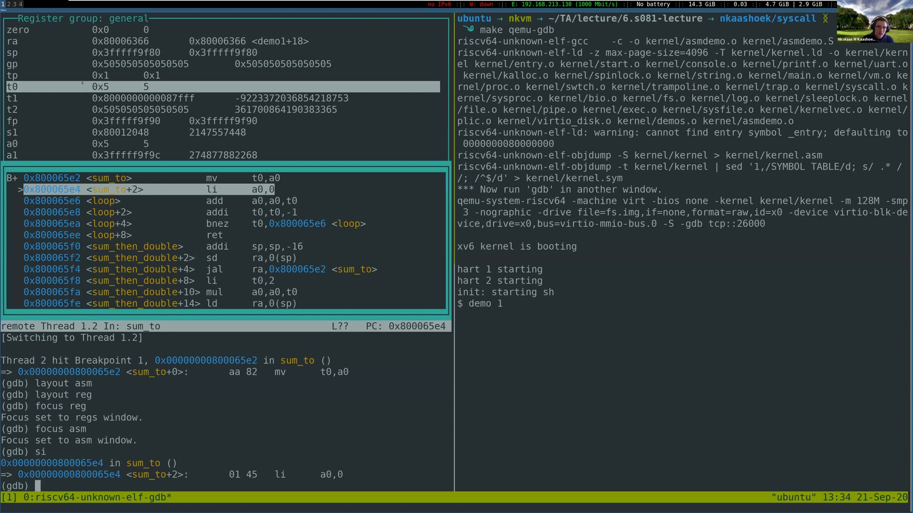
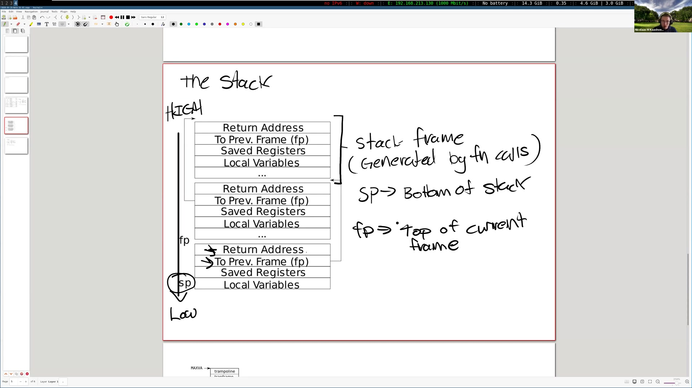
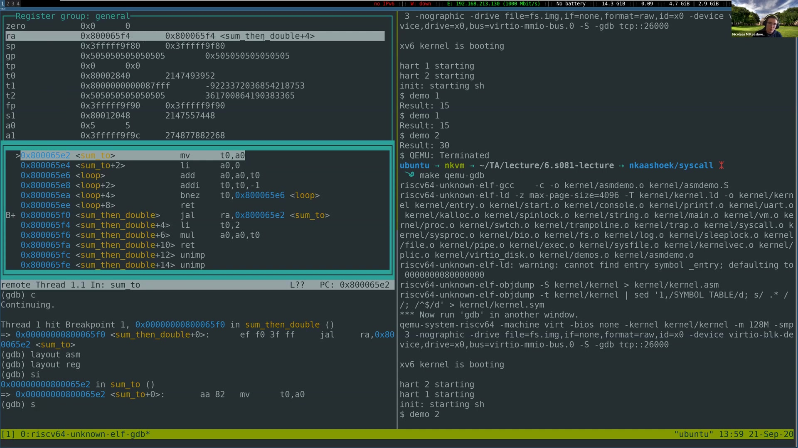
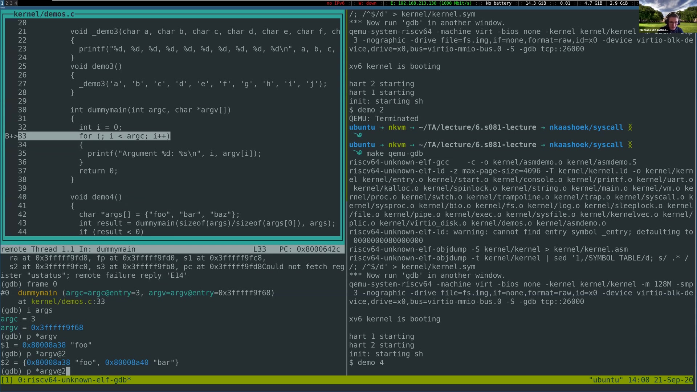
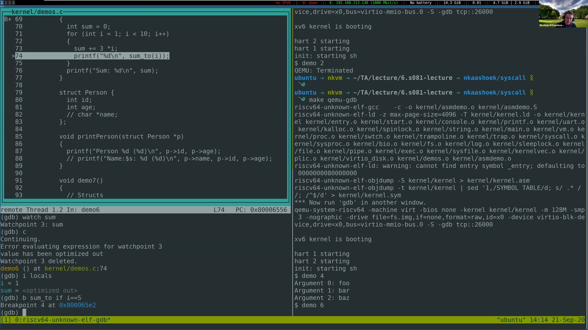
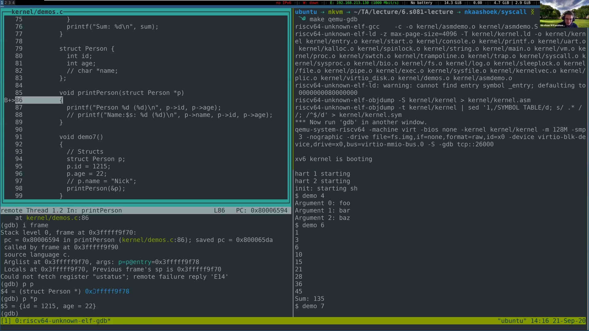
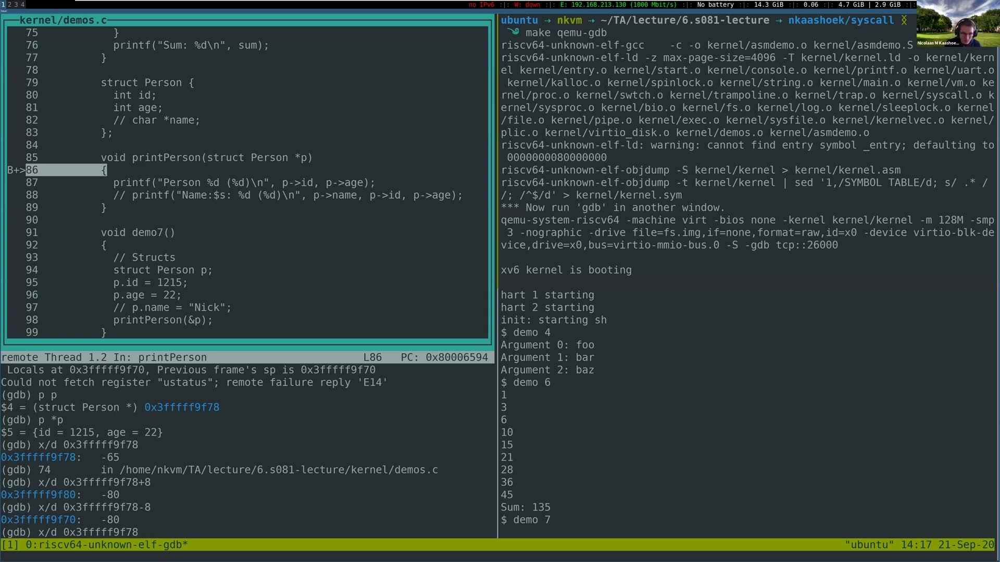

# 第 5 讲 · 中文译稿

## 00:00–03:00｜syscall 实验交流：一行被误删的继承逻辑

课堂先确认音频是否正常，然后延续上一周交流 util 实验的方式，请同学分享刚交的 syscall 实验：遇到什么有趣现象、难查的 bug，或者让自己绕了一大圈的小错误。这里暂时还没有开始讲调用约定。

一位同学说，自己的跟踪功能原本已经能运行，后来修改别处，再测试时却发现经过 `fork` 后的行为不对。他一直以为继承逻辑早已写好，因此花了很多时间查其他地方，最后才发现自己不知什么时候删掉了复制 tracing mask 的那一行。问题不是对 `fork` 的理解突然失效，而是一个已经正确的修改在后续编辑中丢失了。

这段交流中，讲者几次觉得学生的声音断断续续，询问其他人能否听清；其他同学表示自己能听到，判断是讲者这一端的音频问题。随后有一段连接调整和等待。恢复后，讲者继续邀请大家发言，并开玩笑问这个实验是否糟糕到应该从课程里删掉。

另一位同学提出，实验让自己意识到“执行顺序很重要”。他在 `syscall` 路径里提前做了 mask 相关计算，结果其他系统调用的跟踪看起来正确，偏偏 `trace` 自己不对。这一问题在下一段继续解释。

## 03:00–06:00｜trace 的时序与内核 printf 的区别

第二位同学继续说，后来在助教提醒下调整计算和跟踪的先后顺序，才解决 `trace` 自己没有按预期被记录的问题。讲者借此强调，页表实验同样很容易因先后顺序出错：先改了一个值，再试图利用它原来的含义，可能已经来不及。

> **编者说明：** 这段 ASR 对“计算 mask”与“执行 trace”的短语有重复和断裂。可以确定的是同学在讨论读取跟踪状态的时机，不据此还原他未展示的代码。`trace` 本身会改变 mask，因此在其实现执行前后读取 mask，可能观察到不同状态。

另一位同学说，自己在内核里放了很多调试 `printf`，又把所有 trace 位都打开，看到大量跟踪输出。他猜测这些是不是来自内核打印时对控制台的读写，进而问：**为什么内核里也能用 printf？它是不是也调用了系统调用？**

讲者先建议查看内核的 `printf.c`，并坦言自己最近没有细读这段实现。另一位课程人员补充关键结论：**内核 printf 不通过系统调用完成打印，所以它本身不应该出现在 syscall trace 中。** 学生于是接受了“那些跟踪记录可能来自别处”的解释，而不是继续把相关性当作因果。

> **编者核对：** 2020 参考快照中的 `kernel/printf.c` 通过 `consputc` 输出，`kernel/console.c` 再调用 `uartputc_sync`，没有在这个打印路径上重新发起用户态系统调用。

随后讲者转入正题：今天是偏实践的一课，目标是认识 RISC-V、汇编语言和调用约定。它对正在做的页表实验并非最核心，却是随后 traps 实验中调试栈、理解 trapframe 和实现相关功能的重要准备。

## 06:00–09:00｜从 C 源码到处理器执行的指令

讲者先用一个含 `main`、打印和退出的简单 C 程序说明抽象层次。人阅读 C 时能看见函数和语句，但处理器并不直接理解 C。汇编已经更接近处理器，真正被机器解释的则是指令的二进制编码。

画面展示一块 SiFive 开发板，并圈出其中的处理器。“这是一颗 RISC-V 处理器”意味着它理解 RISC-V 的指令集架构，也就是 ISA。每条机器指令有相应编码；处理器遇到这种编码，便执行规定的操作。C 代码必须经过编译、汇编以及链接等环节，才能进入这一层。

课堂用简图把主干写成 **C → assembly → binary**，暂不深入编译器和链接器的内部细节。讲者提醒大家，运行 `make qemu` 后目录里出现的许多 `.o`，就是这个过程中的目标文件；而 `.S`/`.s` 是汇编源文件。syscall 实验已经让大家接触过相关东西：`user/usys.pl` 生成的 `user/usys.S` 中有系统调用入口的汇编指令。

> **编者说明：** `.o` 不只是可以直接开跑的一串指令，它通常还含符号、重定位等信息；需要链接成内核或用户程序。课堂是在概览编译链，不是给出目标文件格式的完整定义。

这一层的重点是建立联系：以后在 GDB 中看到寄存器、机器地址和反汇编时，看到的仍是自己那段 C 程序的执行，只是编译器已经把高层结构转换成了更细的操作。

## 09:00–12:00｜汇编的低层结构与 RISC-V、x86 的区别

汇编看起来比 C 松散得多：通常是一行行加法、乘法、跳转和标签。C 里的循环、局部变量和函数定义不会以同样的外观存在；循环由控制转移组织，函数入口可以表现为一个标签。C++ 等编译型语言也会走到机器指令这一层，所以这不是 C 独有的转换。

讲者接着问，为什么课程一直强调“RISC-V 汇编”，而不只说“汇编”？因为汇编语言和目标 ISA 相关。2020 年同学日常使用的个人电脑很可能是 Intel 或 AMD 的 x86-64 机器，并不是课程里 QEMU 模拟的 RISC-V。两种架构都能算术、访问内存和跳转，但指令编码、寄存器以及具体语义不同，不能把一套汇编直接交给另一种处理器执行。

RISC-V 名称中的 RISC 表示精简指令集；讲者把 x86-64 作为复杂指令集 CISC 的例子。接下来要比较的不是“能不能计算”，而是指令集合怎样组织、每条指令的工作范围，以及为了兼容历史软件积累了多少复杂性。

为表现这种差别，讲者提到 Intel 手册非常庞大，有多卷文档。这个对比是帮助大家理解为什么课程选用相对容易查阅的 RISC-V，而不是要求大家先熟悉完整的 x86-64 指令体系。

## 12:00–15:00｜查阅 ISA 文档，以及“简单”的含义

讲者继续以手册体量和历史增长速度作对比，板书提到 x86 的大量指令和长期增加新指令的现象。他随后打开课程网站的参考资料页，指向 RISC-V 的非特权与特权 ISA 文档：不要求同学背下每一条指令，但遇到陌生指令，应该知道去哪里核对语义。

他展示的两份文档分别约两百多页和一百多页，用来说明这套资料仍然足够精简，适合在课程里查阅。RISC-V 的“简单”还体现在许多指令只做相对单一的工作，而复杂 ISA 中有些指令可以表达一组更复杂的操作。两边都有设计权衡，不能仅凭“精简”这个名字断言一种设计在所有情况下都更优。

另一个区别是开放性。讲者把 RISC-V 称为开放的指令集，解释这使不同厂商可以基于共同规范设计处理器，而不必把整个生态绑定在一个处理器厂商身上。RISC-V 起源于 UC Berkeley 的研究项目，这一背景也与课程选择它有关。

> **编者校正：** 课堂提到“约 15,000 条”“每月三条”等估数，并把 x86 家族的年代与 x86-64 混说；这里保留其比较意图，不将这些数字作为精确统计。指令耗费几个周期还取决于微架构、操作数及执行条件，不能从 RISC/CISC 标签直接推断。开放 ISA 也不意味着每颗实现它的芯片都是开源硬件。

## 15:00–18:00｜现实中的 RISC、兼容性与模块化扩展

课堂的话题暂时落到现实硬件。讲者提到当时 SiFive 关于面向个人计算、能运行 Linux 的 RISC-V 平台消息，并说如果同学学完课程后还想继续使用 RISC-V，可以关注这类设备。这些是录课时的市场背景，不是课程要求购买的硬件。

即使没有 RISC-V 电脑，大家也可能每天接触 RISC 架构：Android 手机上的 Qualcomm Snapdragon，以及 iPhone、iPad 使用的 Apple 处理器，都是课堂举出的 ARM 生态例子。聊天区还提醒 Apple 正在把 Mac 转向 ARM，讲者确认了这项当时的变化。RISC-V 则已出现在嵌入式等设备里，只是当时在个人电脑上远没有 x86 普遍。

为什么 x86 指令集会长期变得庞大？讲者强调向后兼容：新的处理器还要运行几十年前留下的程序，不能轻易把旧指令删掉。这种兼容性对用户和软件生态很有价值，也带来历史负担。

讲者随后回到 RISC-V 文档：它把基础整数指令与一系列扩展区分开来。讨论处理器支持什么时，可以明确列出支持的模块，而不是只说一个笼统的架构名字。下一段继续回答学生对此和 x86 生态的疑问。

## 18:00–21:00｜为什么不能立刻把所有 x86 都换掉？

**问题一：** 指令这么多，流水线实现不会很困难吗？为什么需要这么多？讲者的回答主要落在兼容性以及 SIMD 等专用操作带来的数量增长，并没有进一步展开流水线内部如何实现这些指令。他表示，实际程序通常不会把所有指令都用一遍；指令数量大，并不意味着每个程序都同样复杂。

讲者继续说明 RISC-V 的扩展方式。例如想支持单精度浮点运算，可以实现 F 扩展；编译器必须依据目标处理器支持的扩展生成代码。这样做让“这颗处理器能执行什么”变成可明确描述的接口。

> **编者校正：** 口述把乘法与基础整数指令放在一起举例，但整数乘除属于 M 扩展，不属于基础 I 指令集。这里应区分“课程常见的整数操作”与严格的基础 ISA。

**问题二：** 既然 x86 带来复杂性与潜在安全问题，为何不直接迁移到 RISC-V？讲者没有给出单一、绝对的答案。他先指出，大量既有软件与部署已经围绕 x86 运转，换 ISA 会失去对这些二进制软件的直接支持；RISC-V 当时又很新，适合个人电脑的产品尚少。

他也提醒，Intel 并非只有历史包袱：专门面向某些计算的指令可能非常高效，处理器还提供 enclave 等安全相关能力。因此迁移需要考虑软件兼容、可用硬件、专用能力和性能，而不是只比较手册厚度。关于个人计算产品较新的说明延续到下一段开头。

## 21:00–24:00｜sum_to：把累加循环拆成寄存器变化

结束架构比较后，讲者展示 `sum_to`。其 C 层意图是从 0 加到 `n`，最后返回累加结果。为了说明机制，课堂采用非常简洁的手写汇编；讲者明确提醒，自己用现代编译器编译相似 C 代码，未必得到同样的指令，因为优化会改变计算方式，甚至使某些变量根本没有独立存储位置。

汇编中先把输入参数从 `a0` 拷贝到 `t0`，再将 `a0` 清零，令它成为累加器。循环每次把 `t0` 加到 `a0`，再把 `t0` 减一；只要 `t0` 不为零就继续。最后 `ret` 返回，结果仍留在 `a0`。

```asm
# 课堂演示的核心；演示参数 n = 5
sum_to:
    mv   t0, a0
    li   a0, 0
loop:
    add  a0, a0, t0
    addi t0, t0, -1
    bnez t0, loop
    ret
```

**学生问：** `.section .text` 和 `.global` 是什么？讲者解释，`.global` 使符号可以由其他文件引用，并打开 `kernel/defs.h`，说明 C 代码也需要知道这些函数的声明；`.text` 表示代码段。他切到教材的进程地址空间图，指出图里的 text 正是这个含义。

> **编者说明：** 指令与符号拼写由 29:00 原片核对。此汇编的循环体先执行后检查，只适合作为课堂正数输入的例子；不能把它当成对任意整数 `n` 都与上方 C 循环等价的通用实现。GDB 的 `optimized out` 也不等于程序没计算结果，而可能只是变量不再能按源级名字取回。

## 24:00–27:00｜kernel.asm 与第一次 GDB 断点

讲者完成对 text 的解释后，展示构建生成的 `kernel/kernel.asm`。这个文件把内核的机器指令和地址列出来，也有函数符号。以后内核报错只给出一个地址时，可以到这里寻找对应指令，再结合函数和源代码理解问题。

**学生问：** `.asm` 和 `.S` 文件有什么区别？讲者说二者都与汇编有关，但当前看到的 `.asm` 有额外地址和注释；想知道它怎样生成，可以查 Makefile。

> **编者核对：** 2020 参考快照通过 `objdump -S kernel/kernel > kernel/kernel.asm` 生成混合源代码的反汇编列表。这里的 `.S` 是供汇编器处理的源文件，`.asm` 则是该项目用于检查构建产物的输出，不能仅凭后缀把两者视作同一用途。

演示环境有两个并排终端。讲者先运行 `make qemu-gdb`，使 QEMU 等待调试器连接，再在另一个终端启动 GDB。输入 `tui enable`，就出现文本用户界面；最初窗口可能为空，停到带调试信息的位置后才会显示内容。

他在 `sum_to` 设置断点，然后继续运行，在 xv6 中触发相应 demo。讲者特别说明，本次展示的函数都放在内核里，用户程序只是触发它们；因此这里没有先前调试用户程序时地址空间变化带来的那类断点困扰。

## 27:00–30:00｜用寄存器窗口看见循环真的在运行

停在 `sum_to` 后，讲者把 GDB 显示的 `pc` 地址拿到 `kernel.asm` 搜索。一个地址可能同时出现在函数定义处和某条调用指令的目标处；要辨认真正对应当前指令的位置，不能只看到第一次匹配就下结论。

接着演示 TUI 的几种布局：`layout asm` 查看反汇编，`layout reg` 加上寄存器；多个窗口并存时，`focus reg` 将滚动焦点交给寄存器窗口，`focus asm` 则交给汇编窗口。这样按方向键就不会误以为某个窗口“不能滚动”。



*原片 29:00，未裁剪。左上 `t0` 已变为 5，`a0` 仍为 5；当前停在 `li a0,0` 之前。左下保留 `layout asm`、`layout reg`、`focus` 与 `si` 命令；右侧 xv6 用 `demo 1` 触发演示。*

讲者执行指令级单步，先看见 `t0` 接收到 `a0` 中的 5，变化的寄存器被高亮；再执行清零，随后观察每次循环对累加器和计数值的修改。GDB 中直接回车可以重复上一条命令，适合连续单步。

最后介绍检查调试器状态的命令：`info breakpoints` 能看当前有哪些断点、命中过多少次；`info registers` 能在不使用寄存器窗口时列出寄存器。课堂强调的不是记住某一种界面，而是把每条指令与它改变的状态对应起来。

## 30:00–33:00｜tmux 分屏，以及为什么看不到 C 行号

讲者停下来接受 GDB 操作问题。有人问两个终端窗口怎样打开，于是课堂临时演示 tmux：先运行 `tmux`，底部出现状态栏；按前缀 `Ctrl-b`，再按 `c` 新建窗口。按前缀后用 `p`、`n` 在上一个、下一个窗口之间切换。

需要同时显示时，`Ctrl-b` 后按 `%` 做左右分屏，按 `"` 做上下分屏；用 `Ctrl-b` 后按 `o` 在 pane 之间切换。讲者强调“先按组合键，再按后一个键”的操作次序，课程人员也在聊天区提供速查资料。

**另一个问题：** 为什么现在显示机器地址，没有 C 行号？这不是 GDB 丢失了源程序，而是 `sum_to` 本来就完全用汇编写成，没有相应的 C 源行。讲者输入 `delete` 清掉之前的断点，再在用 C 写的 `demo1` 上断下。

此时 `layout split` 可以同时看源代码和反汇编，`layout src`（课堂口述 source）只显示源代码。两种展示内容取决于当前执行位置和调试信息是否具备，并不是所有函数都天然能从汇编反推出一份 C 源代码。

学生再次确认分屏命令，讲者重复说明：源代码与汇编共存用 `layout split`；只要汇编则用 `layout asm`。这些是 GDB 内部的视图布局，与终端层 tmux 的 pane 是两套不同操作。

## 33:00–36:00｜源行断点、命令检索与寄存器表

关于能否同时显示 C、汇编、寄存器，讲者说自己通常用 `layout split` 配合 `info registers`，没有在课堂上给出一个把三种信息都固定显示的通用布局。

**学生问：** 一行 C 可能对应多条汇编，那么按源行设断点时，显示的是哪条指令的地址？讲者回答一般是该行对应的第一条。这里是帮助理解正常情况下源行与指令的映射；优化和调试信息还会影响实际停下的位置。

课堂又确认启动 TUI 的命令是 `tui enable`，不是把两个单词反过来。忘记命令时，不一定要退出去搜索：GDB 的 `apropos` 能按关键词查找帮助。讲者用 `apropos tui` 演示，说明返回结果可能很多，但能帮助找到相关命令；对额外选项的记忆不确定，因此没有把它当作大家必须记住的命令。

随后课程进入更直接服务 traps 实验的内容。讲者打开指定阅读中的寄存器表，说明寄存器是 CPU 上保存值的位置。理解汇编时，需要从源代码中的变量名转到这些寄存器名字以及它们的调用约定角色。

这一转换很关键：C 源代码里同名变量并不会自动在整个函数执行期间占住同一个寄存器，而调用约定对跨函数边界保留下来的状态有明确要求。下一段从寄存器上的计算模式开始说明。

## 36:00–39:00｜寄存器计算、ABI 名称与压缩指令

讲者描述常见模式：先把值放进寄存器，再在寄存器上进行加减等操作，必要时把结果写回内存。他这里说的“load”有时泛指取得值，既可能来自内存，也可能来自另一个寄存器，不是每次都在指某一条具体的 load 指令。

RISC-V 的普通整数算术以寄存器为操作数，内存访问由相应 load/store 指令处理。讲者强调寄存器访问的效率，也解释为什么调用参数优先通过 `a0` 至 `a7` 传递：有足够寄存器时，尽量避免不必要的内存传送；参数更多时，仍需要使用栈。

日常读写汇编，通常使用 `a0`、`sp`、`s0` 这些 ABI 名称，而不是每次都写 `x10`、`x2`、`x8`。这些名字同时提示用途。学生此前对寄存器表中 `s1` 与 `s2–s11` 没有连在一起感到奇怪，讲者把它与压缩指令中常用的寄存器子集联系起来，并明确说这是自己的解释性猜测。

> **编者校正：** 这一段把普通指令长度说成 64 位，混淆了 RV64 的寄存器宽度。通常的基础指令编码是 **32 位**，C 扩展提供 **16 位**压缩编码；有些压缩指令使用 `x8–x15` 子集，但不能概括为所有压缩指令都只能访问这八个寄存器。29:00 的反汇编也实际显示了地址增加 2 或 4 的指令。

## 39:00–42:00｜caller-saved 与 callee-saved 到底谁负责？

讲者指向寄存器表的 Saver 一栏，承认 caller、callee 两个词很容易混，建议先记住可观察的承诺：**caller-saved 不保证跨调用保持旧值；callee-saved 保证调用返回时恢复旧值。**

假设 A 调用 B。若 A 把后面还要用的数据放在 caller-saved 寄存器中，就不能假定 B 会替它保护；B 可以用这些寄存器完成自己的计算。A 必须提前安排保存。反过来，如果 B 想改变一个 callee-saved 寄存器，它就要负责恢复，让 A 在 B 返回后仍看到原来的值。

返回地址 `ra` 是重要例子：一次新的调用需要记录自己的返回位置，因此会改变 `ra`。如果一个函数随后又要调用其他函数，就需要为自己更早的返回位置安排存放处。帧指针则属于要恢复的状态；讲者用它提示学生，栈的组织也依赖这些约定。

随后讲到 RV64 的整数寄存器有 64 位，放入较小的 C 类型时需要扩展。课堂用高位补零或补符号位说明直觉，具体类型规则在指定阅读里。

> **编者补充：** 这里的“保存”是软件契约，CPU 不会因为某寄存器名字以 `s` 开头，就自动把它压到栈里。并且 RV64 中 32 位无符号值的寄存器表示也有符号扩展要求，不能把课堂的简略说法理解成“一切无符号值都在 64 位寄存器里补零”；详见课程资料 §1.1。

## 42:00–45:00｜a1 能不能返回值？为什么还有这么多 s 寄存器？

**学生问：** 能把返回值放在 `a1` 吗？讲者解释，表里列出 `a0–a1`，主要是为了让比单个 pointer-word 更宽的返回结果可以使用一对寄存器。通常不能只把普通标量结果放到 `a1`，因为调用者会按照约定到 `a0` 寻找它。

> **编者校正：** 讲者在举例时把 `long long` 说成 128 位，实际指定阅读的表 18.1 规定它在 RV32/RV64 都是 **64 位**。在 RV64，两个 64 位寄存器能承载 128 位宽的数据，但普通 `long long` 不是这种例子。口述还偶尔把 return value 说成 return address；此处讨论的是结果 `a0/a1`，不是控制流用的 `ra`。

**又有学生问：** 为什么 `s1` 与后面的 `s2` 不连续，中间夹着 `a` 寄存器？讲者再次提到压缩指令使用某些常用寄存器的设计，并重申自己没有确定其全部历史原因。这里保留其不确定性；不要把课堂猜测改写成已经证实的架构设计结论。指令长度的校正同上一段。

**第三个问题：** 除了栈指针、帧指针，为何还需要这么多 callee-saved 寄存器？讲者解释，这给编译器或程序员保留跨调用仍需使用的值提供选择。如果一个值调用后还要继续用，放到合适的 `s` 寄存器就能利用被调函数恢复它的承诺。讲者此时没有立即举出具体代码，回答延续到下一段开头。

## 45:00–48:00｜从寄存器保存过渡到栈帧

讲者补充说，`s1–s11` 如何分配给变量，通常由程序员或编译器决定。表里还有浮点寄存器，用于浮点计算；本课程接下来主要使用整数寄存器，不需要先掌握浮点寄存器的全部细节。

现在开始讲栈。函数不能只知道“跳到哪里”，还要能够在完成工作后回到原来的执行位置，并找回上层调用留下的状态。栈提供了按调用嵌套组织这些状态的存储空间。图中一块块区域叫 stack frame，即栈帧。

当一个函数需要自己的栈帧时，它会调整栈指针取得空间。在本课程采用的 RISC-V 约定下，栈从高地址向低地址增长，所以分配空间通常表现为**减小 `sp`**。这里的“下”是图中的方向，更准确的判断依据是数值地址变小。

栈帧里可能放保存的寄存器、局部变量；寄存器放不下的调用参数也会进入栈。讲者特别提醒，示意图把帧画成一样大只是为了方便：函数需要保存多少寄存器、多少局部数据，各不相同，所以不能凭固定大小从一帧跳到上一帧。

栈与调用约定的联系在这里变得具体：所谓“保存旧值”，往往就是把值写到自己分配的栈空间。下一段进一步解释怎样定位上一帧，以及这些动作究竟由谁生成。

## 48:00–51:00｜sp、fp 与函数序言、尾声

讲者继续沿图解释两个指针：`sp` 指向当前已经分配的栈区域的低地址一侧，`fp` 为当前帧提供高地址一侧的定位基准。当前帧保存的返回地址和上一帧的帧指针，可以通过相对于 `fp` 的固定位置找到。



*原片 49:00，未裁剪。高地址在上、低地址在下；每帧画出返回地址、前一帧的 fp、保存寄存器和局部变量。保存的 fp 把各帧串起来，sp 则位于当前分配空间的低端。*

为什么保存上一帧的 `fp`？当前函数结束时，需要恢复调用者的定位基准。把保存的旧值重新放回 `fp`，它就重新指向调用者的帧；调试器也可以利用这样的链接追溯调用链。

这些布局不是 C 函数调用时由硬件自动创建的。编译器遵守调用约定，生成调整 `sp`、保存和恢复寄存器的汇编。常见结构是：prologue（序言）准备栈帧，body 执行实际计算，epilogue（尾声）恢复状态并返回。

> **编者限定：** 课堂为了画图把返回地址与旧 fp 说成总在固定位置；应理解为当前展示的、保留帧指针的布局。不是所有函数都有帧，叶函数、手写汇编和编译优化都可能改变布局。原片接下来就用无栈帧的 `sum_to` 说明这一点；共享 2020 Makefile 含 `-fno-omit-frame-pointer`，但它并不自动替手写汇编补序言。

## 51:00–54:00｜sum_then_double：保存返回地址后再嵌套调用

`sum_to` 为什么没有刚才那套序言、尾声也能运行？它是 leaf function：自己不再调用其他函数，计算只用参数寄存器和临时寄存器，所以无需为嵌套调用保护 `ra`。这不是说叶函数完全没有保存义务；如果改动了 callee-saved 寄存器，仍然要恢复。

`sum_then_double` 不同，它先调用 `sum_to`，再把结果乘二。课堂版本在进入时把 `sp` 减少 16，将旧 `ra` 存进栈；计算结束时恢复 `ra`，把 `sp` 加回去，然后返回。

```asm
# 课堂代码按可见反汇编与讲解整理；不是另一个实验实现
sum_then_double:
    addi sp, sp, -16
    sd   ra, 0(sp)
    call sum_to
    li   t0, 2
    mul  a0, a0, t0
    ld   ra, 0(sp)
    addi sp, sp, 16
    ret
```

讲者运行演示：`demo 1` 求和得到 15，`demo 2` 得到 30，符合输入 5 时“先求和再翻倍”的预期。随后他提出一个预测题：如果把序言与尾声删掉，只剩调用、乘二和 `ret`，会发生什么？

学生指出，内部调用 `sum_to` 会覆盖返回地址；`sum_then_double` 完成后不再知道怎样回到最初的调用者。讲者确认这一判断，然后退出 QEMU、重新编译删掉保存逻辑的版本，在 `sum_then_double` 上设断点，准备直接观察 `ra` 如何变化。

## 54:00–57:00｜让错误发生：ra 指回自身，函数陷入循环

GDB 停在损坏版 `sum_then_double` 时，`ra` 原本指向 `demo2` 内的返回位置。执行调用 `sum_to` 的指令后，`ra` 被改成 `sum_then_double+4`。这个新值对 `sum_to` 完全正确：它计算完毕就应该回到调用之后，继续乘二。



*原片 54:40，未裁剪。左上 `ra=0x800065f4 <sum_then_double+4>`；左中显示损坏版本只有 `jal`、`li`、`mul`、`ret`。右侧此前正确版本的 `Result: 15`、`Result: 30` 与重编译记录仍可见。*

问题出在下一层返回。`sum_to` 回来后，`sum_then_double` 做完乘法，执行自己的 `ret`，但它没有恢复更早的那个 `ra`。于是又跳回自己的乘二代码，再执行 `ret`，不断重复，始终回不到 `demo2`。这里不是函数“找不到任何地址”，而是使用了一个仍有效、却属于错误调用层次的地址。

讲者用这一演示说明，caller/callee-saved 的表不是形式规则：破坏返回状态会直接改变控制流，而 GDB 能把抽象错误落实到某个寄存器与某条指令。他随后恢复原来的保存代码。

**学生问：** 为什么分配时减 16，不是 4？讲者先解释减法是在取得当前帧的空间，并指出 4 字节容不下 RV64 的保存值；口述一度混用“指令大小”和“寄存器大小”，课程人员提醒应该看寄存器宽度。关于为何通常是 16 的讨论继续到下一段。

## 57:00–60:00｜16 字节的解释与 dummymain 的帧信息

讲者接着说，常见帧中要存返回地址和旧帧指针，二者各占 8 字节，所以常看到 16；当前这个手写小例子没有完整保存 fp。他又打开 `kernel.asm`，展示编译器输出里类似的栈调整。

> **编者校正：** 完整理由还包括指定阅读明确规定的 **sp 按 16 字节对齐**。即使只保存一个 8 字节的 `ra`，也不能据此认定减 8 就符合标准调用约定。课堂的“两个 8 字节值”解释了常见布局，但不是对齐规则的替代；它与指令是 16 位还是 32 位无关。

接下来改看 C 代码。`demo4` 在栈上建立字符串指针数组，把参数数量和数组地址交给 `dummymain`，后者像一个简化的 main 那样逐个打印参数。演示中的字符串是 `foo`、`bar`、`baz`。

讲者在 `dummymain` 设置断点并运行 `demo 4`，然后用 `info frame`（可缩写为 `i frame`）观察当前帧。输出包括帧编号、帧地址、当前 pc、保存的 pc、调用者帧，以及参数等。0 号帧是当前最内层的调用，不是整个程序最早创建的帧。

他把保存的 pc 再拿到 `kernel.asm` 中搜索，发现它落在 `demo4` 内部，正好是预期返回的位置。这一步再次把“调用链”与机器地址对应起来：不是只相信符号名字，而是核对保存状态实际会把控制权送回哪里。

## 60:00–63:00｜backtrace、选择帧与字符串指针数组

`info args` 可以查看当前函数参数：这里 `argc=3`，`argv` 是一个地址。`backtrace` 或 `bt` 则列出多层调用。课堂看到的路径包含 `usertrap`、`syscall`、演示系统调用的处理函数、`demo4`，最后到 `dummymain`；trap 入口附近有普通函数回溯不够直接解释的部分，讲者没有把它当成完整的用户态调用链继续推演。

想看某一层，可输入 `frame` 加编号。讲者选到 `syscall` 对应的一层，再用 `info frame` 查看其保存寄存器、局部状态和返回位置，然后用 `frame 0` 回到当前层。这改变的是调试器正在展示的上下文，并不是让被调试程序真正倒退执行。

讲者说明，下一次实验会要求实现一个简化的 backtrace 帮助函数。它不用像 GDB 那样显示这么多信息，但动机相同：发生问题时，知道“我们是沿着哪些调用到这里的”。

仅看到 `argv` 的地址还不够，接下来要读它指向的数据。`p *argv` 取得第一个 `char *`，GDB 再按字符串显示为 `foo`；使用 `@` 指定连续元素数，就能查看多个数组成员。



*原片 63:00，未裁剪。`argv=0x3fffff9f68`；`p *argv` 得到指向 `"foo"` 的 `0x80008a38`，`p *argv@2` 列出 `"foo"`、`"bar"`。源码中 `args` 包含三个字符串指针，`sizeof(args)/sizeof(args[0])` 计算参数个数。*

## 63:00–66:00｜optimized out、指针的层次与十六进制误读

讲者继续说明，可以用 `p *argv@argc` 让 GDB 根据 `argc` 显示整个指针数组，而不是手工写死元素数量。GDB 理解 C 类型，因此很多检查可以直接表达为 C 风格的解引用和索引操作。

**学生问：** 为什么有时 `argc`、`argv` 显示为 `optimized out`？讲者解释，编译器可能发现不必保留一个独立变量，直接在寄存器中完成计算，或者以另一种方式表达后续操作。此时按源变量名检索会困难。他提到在自己的普通项目里可尝试降低优化级别，但没有在课堂上修改本课程的构建设置。

**另一个学生问：** `p *argv` 显示在 `foo` 前的地址，是字符串地址吗？为什么它和 `argv` 不一样？讲者打开定义解释，`argv` 指向的是一组 `char *`；数组元素各自指向字符串。数组本身在栈上，而字符串字面量在另外的内核映像区域。因此“数组地址”与“第一个字符串地址”没有必须相同的理由。

随后有人看到几个字符串地址末尾是 `38`、`40`、`48`，疑惑字符串都长三字节，为什么间距不一致。讲者先猜测是对齐造成的存储间隔；其他人立即指出，这些数字是**十六进制**，`0x40-0x38` 与 `0x48-0x40` 都是 8。学生承认误把十六进制外观当成十进制。关于对齐和地址间隔的简短解释在下一段开头收束。

## 66:00–69:00｜watchpoint 与条件断点：只停在关心的变化上

讲者承接刚才的问题，提醒不同对象大小、对齐和编译器布局可能让地址看起来有空隙，不应凭字符串可见字符个数猜下一个对象的位置。随后他说跳过第五个 demo，直接演示第六个。

这一例子的目标是介绍 watchpoint 和条件断点。进入函数时先出现了 `sum` 被优化的情形，讲者切到 `layout split` 对照汇编，发现编译器使用了保存寄存器保存计算状态。这也给前面“为什么需要 s 寄存器”提供了一个实际观察点。

讲者尝试监视循环变量 `i`，但当时尚未进入声明它的 `for` 循环作用域，因此不能直接按该名字取得值。单步进入后，再用 `info locals` 才看到它。他也尝试对 `sum` 设置 watchpoint，让其变化时通知调试器；继续执行后，课堂遇到了这个局部表达式不能再被监视、监视点被删除的情况，而不是得到一个始终成功的演示。

接下来提出更具体的调试问题：如果怀疑循环在 `i=5` 时出错，就不必从第一次迭代开始一路人工单步。可以给相关执行位置加条件，只在条件成立时停住。讲者设置后继续运行，下一段可以看到程序已先完成早期迭代，再在选定情况停下。

> **编者说明：** 监视点依赖表达式是否可求值、变量是否仍在作用域和目标调试能力。这里保留课堂遇到的限制，不把优化后的局部变量描述成一定能稳定监视的内存地址。

## 69:00–72:00｜条件断点结果与 Person 结构体演示

条件断点的效果是跳过前面的常规情况：继续执行后，终端已经输出前几项求和结果，调试器在满足条件时停止。画面中的实际输入是 `b sum_to if i==5`。这是课堂当前调试上下文中的操作记录；在自己的代码中使用条件时，还要确保条件表达式在断点位置可求值，不能假定被调函数总能直接访问调用者的局部变量名。



*原片 69:05，未裁剪。`watch sum` 后 GDB 报出 `value has been optimized out` 并删除 watchpoint；随后 `i locals` 显示 `i=1`，讲者输入条件断点。这个失败过程也是课堂演示的一部分。*

讲者总结两种工具各自的用途：怀疑某个特定边界输入，就设条件断点；怀疑“不该变化的值发生了变化”，或某次写入后出错，就用 watchpoint 追踪变化。

最后一个主题是结构体的内存布局。结构体是一段连续的存储区域，成员按照布局规则放置；它像数组一样占据一块内存，但各字段可以有不同类型。课堂没有深入展开所有 padding 和对齐规则，而是用一个小结构体展示怎样在 GDB 中观察。

演示定义 `struct Person`，当前启用的字段只有两个 `int`：`id` 和 `age`。`demo7` 设置 `id=1215`、`age=22`，把 `&p` 传给 `printPerson(struct Person *p)`。讲者清除旧断点和监视点，在打印函数处断下，运行 `demo 7`。



*原片 71:40，未裁剪。左侧源码中 `name` 字段与相关打印被注释；`p p` 显示 `struct Person *` 及地址，`p *p` 显示 `{id = 1215, age = 22}`。右侧保留前面 demo 的输出，但不是本次制作重新运行的结果。*

讲者进一步尝试用 GDB 的 `x` 命令观察该地址的原始内存。画面里执行 `x/d 0x3fffff9f78` 得到 `-65`，又试了该地址加 8、减 8，得到 `-80`；并没有直接显示成前面的两个字段值。



*原片 71:59，未裁剪。`p *p` 的 `{id = 1215, age = 22}` 与 `x/d` 的负数输出同时可见。不能把这段描述成已成功按两个 int 的宽度读出字段。*

> **编者说明：** `x/d` 只指定十进制格式，没有在这条命令中指定读取单元宽度；GDB 会沿用当前的单元大小。`-65` 与 1215 的低字节按有符号字节解释相符，但这张单帧不能完整还原此前的格式设置。若要明确检查这个两字段例子，可用 `x/2wd p` 指定两个 4 字节单元；这是编者建议，未在本次制作中运行。

> **编者限定：** “通常按引用传递”描述的是这里显式传指针的代码习惯。C 也允许按值传结构体；具体寄存器或内存传递规则要看 ABI，不能把本例推广为所有结构体调用都只能传指针。

## 72:00–75:08｜调试方法收束与编译器由谁开发

讲者总结，GDB 不只是“下一步、再下一步”的工具：它还能检查参数、结构体、寄存器和调用帧。接下来 traps 实验需要处理汇编与栈帧，希望大家能用这些工具观察状态，而不是只靠添加打印语句猜测问题。

最后开放提问。**学生问：** 把 C 编译到不同 ISA 的编译器，是指令集设计者负责写，还是第三方负责？讲者举出 GCC 和 Clang/LLVM，说明常见编译器项目可以独立于 ISA 的制定者存在。新的 ISA 需要指令语义、调用约定等文档，编译器实现者会依据这些接口工作，双方通常需要合作。

讲者对具体组织关系使用了“我认为”“可能”等措辞，并推测 RISC-V 出自研究项目，早期工具链也可能由相关研究者直接参与。他随后提到 Intel 与 GCC/LLVM 的关系，但这部分不是经过课堂验证的项目贡献史。

> **编者校正：** 不应将最后的即兴回答理解成“处理器厂商不参与 GCC/LLVM”。这些开源项目可以有芯片厂商、独立开发者和研究人员共同贡献；“编译器不是 ISA 本身”也不意味着开发者群体互不重叠。

等候其他问题后，讲者感谢同学，表示比预定时间提前几分钟结束。录制在最后告别处结束；末条 ASR 的显示结束时间略越过视频元数据时长，没有据此续写额外课堂内容。

## 来源与校订说明

- 视频：Nicolas Kaashoek 主讲，*6.S081 Fall 2020 Lecture 5: RISC-V Calling Convention and Stack Frames*，David Morejon 频道，2020-09-21；官方课表链接的视频 ID 为 `s-Z5t_yTyTM`，时长 4508 秒。视频来源见页底视频信息；正文时间是阅读窗口，不是声称每句话刚好在段界说完。
- 字幕：YouTube 英文 ASR，无人工字幕；共 1917 条非空 cue，起点 1.280 秒，最后一条原始结束于 4509.520 秒，比视频时长多 1.520 秒。正文末尾封顶 75:08；开头无字幕区没有虚构发言。字幕全文已读，未逐句听音或核对全片画面。
- 术语校订：ASR 的 risk five、cisco、sum2、gdv/gdp、rv/rxc 等，结合上下文及画面分别校订为 RISC-V、syscall、`sum_to`、GDB、`argv/argc`。关于不确定的说话人，使用“学生”“课程人员”，不强行指定姓名。
- 课堂原图是原片单帧，获取后逐张实际查看，时间、无裁剪说明、哈希见 `sources/figures.json`。课堂截图只放在本页。
- 官方 [slides](https://pdos.csail.mit.edu/6.S081/2020/lec/l-riscv-slides.pdf) 六页用于核对概念与板书。官方 [文字提纲](https://pdos.csail.mit.edu/6.S081/2020/lec/l-riscv.txt) 标题仍为 **2019 Lecture 11**，示例编号、执行顺序和录课不同，且栈调整符号有误；没有用它覆盖 2020 视频的时间线，也没有把其中的 inline assembly 等未讲内容补成课堂发言。
- 编者技术核对使用指定 `riscv-calling.pdf` 和固定的 2020 xv6 参考快照 `e23d53f27f6e187732a92a2b4705639d1c260f05`；录课画面中的 `kernel/demos.c`、`kernel/asmdemo.S` 属于讲者定制工作树，不声称与该快照相同。未安装工具链或运行这些演示。
- 视频与历史阅读的授权依据有限，本页为独立组织的课堂译述。各段证据、问答与校正记录在 `sources/coverage.json`；指定阅读的技术规则见[课程资料](#/c/mit-6.s081-2020/lec/lec05?v=materials)，机制提炼与自测见[课程笔记](#/c/mit-6.s081-2020/lec/lec05?v=notes)。
