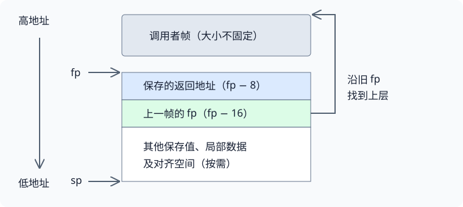

# 第 5 讲 · 一次函数调用究竟承诺了什么

函数能正确返回，靠的不只是 `call` 和 `ret`。更重要的是一个契约：**参数放对位置，仍然活跃的值不丢失，返回后恢复调用者需要的状态。** 本讲的目标是能用寄存器、栈帧和 GDB 证明这些条件成立。

## 1. 把三种“规则”分开

| 层次 | 决定什么 | 不能由它直接推断什么 |
|---|---|---|
| ISA | 指令对寄存器、内存和 pc 做什么 | 某个 C 参数必须放在 a0 |
| ABI / 调用约定 | 参数、返回值、寄存器保存、栈对齐 | 每个函数必须产生完全相同的序言 |
| 编译器及选项 | 怎样实现计算，哪些值放寄存器，是否保留帧指针 | 源变量始终有一个可直接打印的固定地址 |

例如，RV64 的整数寄存器宽度是 64 位；通常的基础指令编码是 32 位，压缩指令可以是 16 位；C 的 `int` 还是 32 位。这三个数字描述不同对象。课程资料 §1 给出类型大小，中文译稿 36:00–45:00 保留课堂的相关问答与校正。

同样，“CPU 能执行一次跳转”不等于“CPU 知道当前 C 函数的栈帧结构”。序言和尾声是编译器或汇编作者写出的指令，不是寄存器被命名为 `sp`、`fp` 后自动发生的动作。

## 2. 保存义务来自值的生命期

用一个比背表更容易应用的问题判断：**调用返回之后，我还需要调用之前的哪个值？**

- 值在 `t0`、`a0` 等 caller-saved 寄存器中：调用者要安排保护，不能要求对方保留。
- 值在 `s1` 等 callee-saved 寄存器中：被调函数若改动它，就必须恢复。
- 不再需要的临时值：无需为了“保存寄存器”而机械存一遍。

同一个函数既是上层的 callee，也可能是下层的 caller。假设 `B` 为循环累计值选择 `s1`：B 调用 C 时，可以依赖 C 恢复 `s1`；但 B 进入时若覆盖了 A 原有的 `s1`，B 自己仍须在回 A 前恢复它。**寄存器被保存，并不表示当前函数可以免费占用它。**

课堂先用 `ra` 解释该契约，后来 GDB 演示又看到编译器使用保存寄存器；具体过程见中文译稿 39:00–45:00、66:00–69:00。完整寄存器分工只在课程资料 §4 展开。

## 3. 不保存 ra，为什么会“返回到自己”？

取三层调用 `A → B → C`，只给返回位置起两个名字：

1. A 调 B 后要继续的位置叫 $R_A$。进入 B 时，`ra=R_A`。
2. B 调 C 后要继续的位置叫 $R_B$。执行这一调用后，`ra=R_B`。
3. C 的 `ret` 使用 $R_B$，正确回到 B。
4. 如果 B 没有保留并恢复 $R_A$，B 的 `ret` 仍使用 $R_B$，于是又进入 B 自己后半段。

所以错误不是 `ret` 的指令语义坏了；它准确地使用了错误层次的状态。修复的必要条件是：在覆盖 `ra` 之前保留 $R_A$，在返回 A 之前恢复它。栈为嵌套调用提供自然的保存位置。

课堂 `sum_then_double` 的删改、断点、15/30 输出和错误 `ra` 实值，见中文译稿 51:00–57:00。这里不再复制整段演示代码。

**叶函数的边界：** 没有下层调用，通常无需为调用再保存 `ra`；但仍可能因局部存储、寄存器分配而需要栈帧，也仍须履行 callee-saved 义务。不能从“leaf”推出“可以任意修改所有寄存器”。

## 4. 从 sp 与 fp 推出一条可回溯的链

`sp` 管当前分配到了哪里；`fp` 给当前帧一个方便定位的基准。对保留标准帧记录的 RV64 函数，常见关系是：

$$
\text{saved return address}=\mathrm{memory}[fp-8],\qquad
\text{previous fp}=\mathrm{memory}[fp-16].
$$

图中没有假定各帧大小相同。沿保存的旧 fp 找上一帧，才是“链”的意义；简单地给当前 sp 加一个固定常量，并不能一般性地得到上一帧。

由此可以推导回溯的思路：以当前 fp 为起点，读取返回位置，再沿旧 fp 前进。实现时还需要知道有效栈范围以及何时停止；不能无限解引用内存。当前页只建立机制，具体实验要求以 traps 实验为准。

这些偏移属于**特定帧记录布局**，不是每条 `call` 的硬件副作用。手写汇编可以不建这条链，叶函数可能省帧，trap 边界也不是普通函数调用。GDB 还能利用调试信息，因此它的回溯能力比简单地追 fp 更强。

另一个常见混淆是空间与对齐：RV64 的 `ra` 占 8 字节，但调用约定要求 `sp` 按 16 字节对齐。所以“只存 ra”并不能推出“只减 8 就行”。完整约定见课程资料 §4.1，课堂的问答与口误修正在中文译稿 54:00–60:00。

## 5. 调试时先明确自己在问什么

| 想回答的问题 | 优先观察 | 课堂定位 |
|---|---|---|
| 现在执行哪条机器指令？ | `pc`、`layout asm`、构建对应的 `kernel.asm` | 24:00–30:00 |
| 这条调用覆盖了什么？ | `si` 前后的 `ra`、参数与临时寄存器 | 54:00–57:00 |
| 我从哪个函数来到这里？ | `bt`、`info frame`、`frame N` | 57:00–63:00 |
| 指针到底指向什么？ | 先看类型，再用 `p`、解引用与数组长度 | 60:00–66:00 |
| 哪次变化引发错误？ | watchpoint；表达式必须还能求值 | 66:00–69:00 |
| 只在某次迭代停下？ | 在变量可见的位置设置条件断点 | 66:00–72:00 |
| 类型化打印与内存数值为何不同？ | 检查 `x` 的格式、单元宽度和地址偏移 | 69:00–72:00 |

### 两个课堂失败值得记住

**监视点被删除。** 原片里 `watch sum` 并没有一直工作；GDB 因值被优化、表达式不能求值而删除它。`optimized out` 表示当前调试信息无法按这个变量名提供值，不表示计算结果必定不存在。

**两个 int 却读出负数。** 结构体类型化打印正确显示字段，但讲者使用 `x/d` 时未明确读取单元大小，画面中得到的是不同数值。调试器显示格式也是实验条件的一部分。要检查两个 4 字节整数，明确单元宽度比凭上一条命令的默认状态更可靠。真实输入输出见中文译稿对应截图。

## 6. argv 不是字符串本体

`char **argv` 涉及至少两层：

1. `argv` 指向一组指针存放的位置。
2. `argv[i]` 取得其中一个字符串地址。
3. `argv[i][j]` 才是字符串中的一个字符。

因此 `argv` 与 `argv[0]` 不同并不奇怪。课堂里数组在栈上，字符串字面量在内核映像区域；两组地址的外观就很不同。查看 `p *argv@argc` 时，打印的是连续的指针数组元素，再由 GDB 按类型显示它们指向的字符串。

如果地址后缀是 `38`、`40`、`48`，先确认数字进制：十六进制下相邻差都是 8。即便字符串本身只有三字节可见字符，也不能要求不同字符串对象地址恰好相差三；还存在终止符与布局因素。完整学生问答见中文译稿 63:00–66:00。

## 自测

B 调用 C，B 的局部计数放在 t0；C 返回后计数变了。C 一定违反约定吗？

不一定。t0 是 caller-saved，B 如果还需要旧值就必须保护它。先查 B 是否跨调用错误地依赖 t0，而不是先指责 C。

B 使用 s2 保存状态，且下层函数都保留 s2。B 还需要保存进入时的 s2 吗？

需要，只要 B 改了它。B 对自己的调用者也有 callee-saved 义务。下层函数守约只能保护 B 当前的值，不能替 B 找回更早覆盖掉的值。

ra 已经有一个合法代码地址，为什么 ret 仍然可能导致无限循环？

地址合法不代表调用层次正确。它可能是 B 调 C 后的返回点，而不是 A 调 B 后的返回点。课堂损坏版正是这样。

frame 3 是否让程序回到三次调用以前？

不是。它切换 GDB 查看和解释的帧上下文，不会逆向执行程序。

只知道 sp，能否一直按 16 字节往高地址走来做 backtrace？

不能。16 字节是对齐要求，不是每个栈帧的固定大小。需要实际帧记录、调试信息或其他明确的展开规则。

## 去哪里继续读

- 想看一条错误的返回链怎样被观察出来：中文译稿 51:00–57:00。
- 想核对类型宽度、参数和大返回值：课程资料 §1–§3。
- 想理解 soft-float 的位传递：课程资料 §5；视频没有展开这部分。
- 想区分本课与旧提纲：旧提纲列出手工栈遍历、C/汇编互调、inline assembly、packed struct 等主题，2020 视频并未逐项完成。正文只按实际讲授与演示组织；对齐的阅读补充见课程资料 §1.1。

## 来源与核对范围

本页是编者提炼，课堂截图及完整演示过程只在[中文译稿](#/c/mit-6.s081-2020/lec/lec05?v=draft)。类型及 ABI 规则只在[课程资料](#/c/mit-6.s081-2020/lec/lec05?v=materials)系统展开。

- 官方 [2020 课表](https://pdos.csail.mit.edu/6.S081/2020/schedule.html)，LEC 5，2020-09-21，讲师栏 TAs/nk。
- Nicolas Kaashoek，课堂视频 `s-Z5t_yTyTM`，75:08；全读英文 ASR，并查看 7 张真实帧，未逐句听音。
- [指定 Calling Convention](https://pdos.csail.mit.edu/6.S081/2020/readings/riscv-calling.pdf)：V2.1draft 第 18 章，印刷页 89–92。历史摘录的授权说明见课程资料页底，不把现行手册许可或现行 ABI 自动套入。
- [课堂 slides](https://pdos.csail.mit.edu/6.S081/2020/lec/l-riscv-slides.pdf) 六页已查看；[文字提纲](https://pdos.csail.mit.edu/6.S081/2020/lec/l-riscv.txt) 自带 2019 年标题，与 2020 演示不完全一致。
- 固定 2020 xv6 参考快照 `e23d53f27f6e187732a92a2b4705639d1c260f05`：核对 Makefile 的 `objdump -S`、`-fno-omit-frame-pointer` 与内核 printf 路径。它不包含录课定制 demo；未运行编译或实验。
- `frame-link.svg` 为编者绘制，仅示意常见 RV64 帧记录，不是课堂截图。所有来源、校订与局限见 `sources/manifest.json`、`sources/coverage.json` 和 `status.json`。
