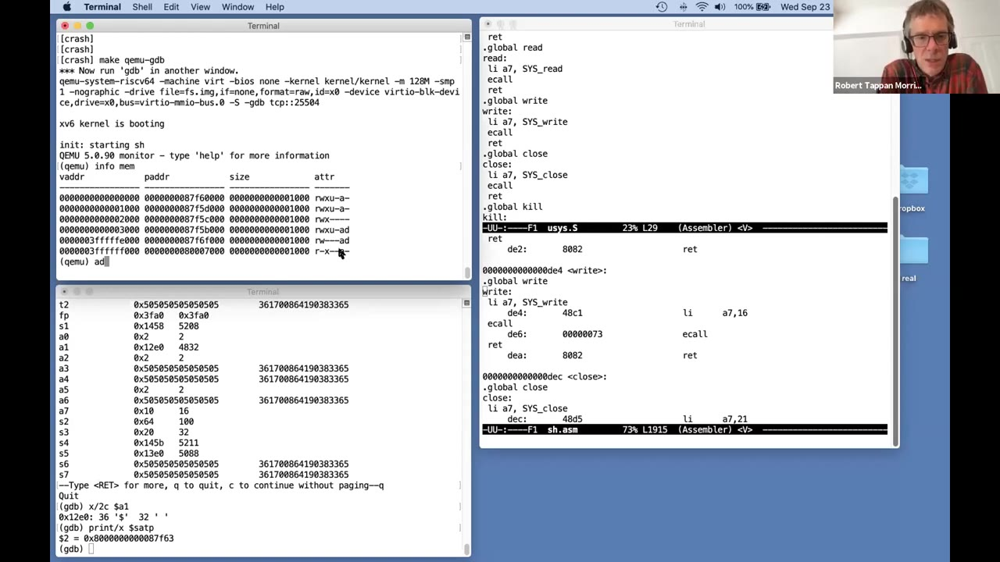
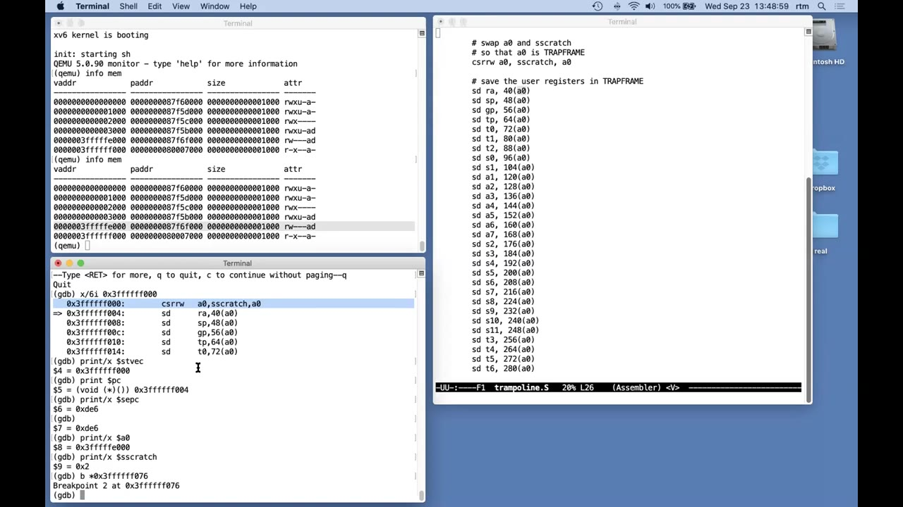
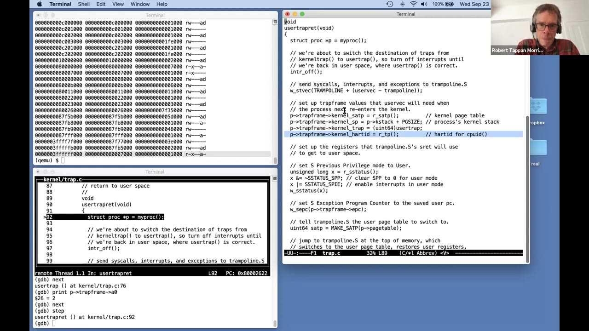

# 第 6 讲 · 隔离与系统调用的进入、退出

## 00:00–03:00｜从 shell 的一声提示开始

确认大家能听到声音后，Robert 提出今天的问题：CPU 怎样从运行用户程序，转为运行内核代码？用户发起系统调用、程序出现异常、设备请求中断，都需要这样的控制转移。这里的细节不只关乎“代码能不能跑起来”，还决定隔离是否可靠，以及频繁进入内核的程序能否得到足够好的性能。

本讲用一个非常小的动作贯穿整个过程：xv6 启动后，shell 调用 `write` 打印自己的第一个提示符。站在 shell 的角度，只是请求输出几个字符；站在机器的角度，却要把一套适合执行用户程序的状态，变成适合执行内核的状态，随后再恢复回来。

先列出需要关心的硬件状态。RISC-V 有 32 个整数寄存器，上一讲已经讨论过 `a0`、`a1` 等名字和用途。应用为了性能会使用大量寄存器；`sp` 这个栈指针本身也只是其中之一。除此以外，还有单独的程序计数器 `pc`，以及当前处于 user 还是 supervisor 的执行模式。此时 shell 正在用户模式下运行。

> **编者校注：** 课堂概括为“32 个用户寄存器”；实际需要保存的是 31 个可变整数寄存器，`x0` 恒为零。后文沿用“保存用户寄存器”来避免把概括误当成 32 次存储指令。

## 03:00–06:00｜进入内核之前，要搬动哪些状态？

还有一些专门控制 CPU 的寄存器：`satp` 选择当前页表；`stvec` 指明陷入应从哪里开始处理；`sepc` 保存陷入时的程序计数器；`sscratch` 会在最早的入口代码里派上重要用场。今天的大部分工作，就是改变或妥善保存这些状态，使普通内核 C 函数能安全运行。

第一件事是保存用户寄存器与程序计数器。尤其是设备中断，用户程序事先根本不知道会被打断；处理完后，它应像没有发生过中断一样继续。内核自己也要使用这些寄存器，所以不能一边覆盖，一边指望用户程序回来时仍正常。

第二件事是进入监管者模式，以取得内核需要的权限。第三件事是切换页表：当前用户页表只映射用户需要的内存，加上稍后要解释的两页；内核的大部分数据与指令不在其中。仅有更高权限，还不足以访问不存在的映射。

第四件事是让 `sp` 指向内核中的栈，因为 C 函数调用需要栈。最后，才能跳入某个合理的内核 C 入口。到了那里，代码虽然还会操作特殊寄存器，但整体上已经像正常的 C 程序。本讲重点就在“怎样抵达这个状态，以及怎样离开”，系统调用内部怎样完成文件输出留待以后。

## 06:00–09:00｜隔离和透明性，同时约束入口设计

入口首先不能依赖用户程序的善意。陷入时的寄存器可能装着恶意数值，用户也可能故意破坏自己的栈指针。内核不能把这些值当成可靠的工作环境。xv6 的早期入口主要把它们原样保存，而不是相信它们并拿来组织内核执行。

另一个要求是透明性：内核完成工作后，用户程序应能够继续，而不必为每次中断额外做准备。隔离要求“不能信任用户给的环境”，透明性要求“不能丢掉用户原有状态”，这两件事共同决定了后面看起来繁琐的步骤。

Robert 也限定今天的讨论范围：即使进入内核的这条路径完全正确，也不代表整个内核已经安全。`write` 等具体实现同样必须认真检查用户请求。今天只是拆开其中的入口、出口机制。

接着精确问：从 user 变成 supervisor，到底多了什么能力？首先，监管者代码能读写 `satp`、`stvec`、`sepc`、`sscratch` 等控制寄存器，而普通用户代码不能。其次，监管者能够使用不向用户开放的页表项。讲者在说到 `PTE_U` 时先口误说成“置位”，随即在下一段更正为“未置位”。

## 09:00–12:00｜supervisor 并不等于绕过页表

`PTE_U` 置位表示用户可以使用该映射；没有置位，则不是用户可访问的页面。这里一定要跟上讲者的更正：内核得到的是使用这些**没有 `PTE_U`** 的映射的权限。

更重要的是，监管者模式不会让 CPU 自动绕过地址翻译。如果当前页表根本没有某个虚拟地址，内核也不能因为权限更高，就直接拿这个数字读写物理内存。在本课 xv6 的配置下，普通 supervisor 访存也不能随意使用标为用户页的映射。这些约束将直接限制陷入入口最初能做什么。

> **编者说明：** 这里按 xv6 的设置理解。RISC-V 对 S 态访问 U 页还涉及 `SUM` 等规则，不能把课堂简化说法当成所有配置下一概不能访问；本课关键结论是“提权不自动切页表”。

在进入 GDB 前，先画出整条路线：shell 调用用户态库函数 `write`；其中的 `ecall` 进入监管者模式；最先运行 `trampoline.S` 中的汇编入口 `uservec`；它再跳入 `trap.c` 的 C 函数 `usertrap`。`usertrap` 判断是系统调用后调用 `syscall`，由它选择真正的服务实现。

这些名字里虽然多次出现 `user`，函数本身却属于内核。“user”描述的是处理来自用户空间的陷入或安排返回用户空间，不表示这些函数在 U 态执行。

## 12:00–15:00｜出口路线，以及直接映射的疑问

`syscall` 根据系统调用号查表，本次会进入 `sys_write`。它安排字符输出，完成后返回。随后，C 函数 `usertrapret` 负责那些适合用 C 完成的返回准备；最后一段不能再依赖普通 C 环境的工作，由 trampoline 中的汇编函数 `userret` 完成。它最终执行返回指令，让用户程序从 `ecall` 后面继续。

**学生问：**`vm.c` 中的函数运行在哪种模式？回答是监管者模式；它们是内核的一部分。

关于命名也有一小段交流。Robert 起初以为同学在抱怨这几个函数的名字，承认命名不够清晰；课程人员提醒，问题可能是为什么控制寄存器都以 `s` 开头。这里的 `s` 指 supervisor，其余部分来自 RISC-V 的命名。

**学生追问：**`vm.c` 不是会直接访问物理内存吗？为什么又说监管者必须经过页表？关键在于内核事先构造了**直接映射**：代码提供的仍是虚拟地址，但内核页表把它翻译到数值相同的物理地址。看起来像“直接使用物理地址”，实际上仍依赖页表。入口切换到内核页表之前，这些便利的映射尚不可用。

## 15:00–18:00｜能否用内存映射减少系统调用？

Robert 先补完刚才的限制：陷入早期仍使用用户页表，它没有内核那一大片直接映射。不能把日常内核 C 代码能做的事，想当然地搬到 `ecall` 后的第一条指令。

**学生提出性能问题：**`read`、`write` 要来回切换模式，比普通内存访问昂贵。能不能在打开文件后，不只拿到一个 fd，而得到一段受页表权限限制的地址，让程序通过读写内存来访问文件？这样似乎就不必每次进入内核。

Robert 肯定这个方向，并介绍**内存映射文件**：把对应文件内容的页面映射进进程的虚拟地址空间，程序通过普通 load/store 读写。许多操作系统支持它，对不少程序确实更高效；后面的 mmap 实验会实现一个版本。这里讨论的是映射文件内容，不是在承诺任意设备都能无条件交给应用直接控制。

随后切换屏幕共享，开始追踪 xv6 的真实执行。屏幕中的 `sh.c` 显示，shell 打印提示符的调用是 `write(2, "$ ", 2)`：向文件描述符 2 输出美元符号和空格。接下来启动 GDB，从这次调用对应的机器指令处停下来观察。

## 18:00–21:00｜write 的用户态封装只有几条指令

Shell 调用的 `write` 首先是链接到用户程序里的一个小库函数，不是直接调用内核中的 `sys_write`。在 `user/usys.S` 中，封装把 `SYS_write` 放入 `a7`；本版本中该编号是 16。然后执行 `ecall`。内核完成后回到下一条 `ret`，再由这个普通返回指令回到 shell 调用者。

可以把屏幕上的关键指令读成：

```asm
li a7, 16    # write 的系统调用号
ecall        # 受控进入内核
ret          # 回到用户态后，再返回 shell 调用点
```

为了给 `ecall` 设断点，要知道它在这份 shell 二进制里的地址。构建生成的 `user/sh.asm` 同时列出反汇编和地址；课堂找到的是 `0xde6`，于是设 `b *0xde6`，继续运行。GDB 停下来后，打印 `$pc`，确认确实停在预期地址。

再看寄存器：`a0=2` 是 fd；`a1` 是输出缓冲区指针；`a2=2` 是字节数。检查 `a1` 所指的两个字符，就能进一步确认这是 shell 打印提示符的那次调用，而不是另一次 `write`。

> **编者说明：** `0xde6` 是本次课堂构建地址，不是固定 ABI，也不是要求学习者在不同实验分支照抄的断点。

## 21:00–24:00｜用 QEMU 看见当前用户页表

GDB 查看缓冲区后，显示的确实是 `$` 和空格。还可以注意到，用户 `pc` 和 `sp` 都是接近零的较低地址；这是当前 shell 的用户地址布局，与稍后出现的内核地址明显不同。

只打印 `$satp`，只能看到选择页表的编码值，不能直观看出有哪些映射。Robert 用 `Ctrl-a c` 切到 QEMU monitor，输入 `info mem`，显示当前地址空间的映射。Shell 很小，这次只有六项：指令页、数据页、栈保护页、栈页，以及虚拟地址空间顶部的 trapframe 与 trampoline 两页。

他逐项解释权限列：R、W、X 分别是读、写、执行；U 表示是否向用户开放。栈保护页没有 U，因此用户栈越界到这里时不能正常访问；它不是给用户继续使用的栈空间。A 表示访问过，D 表示写过；中间另一个列的含义，讲者当场表示不确定，没有把猜测说成结论。

最上方两个特殊页面也没有 U。它们虽然列在用户页表里，用户代码却不能访问；进入监管者模式后，入口代码才可以使用。这正是后面跨边界的支点。

> **编者校注：** 课堂将保护页口头称为“invalid”，这里的实质是清除 `PTE_U`，不应误读成必然清除了 `PTE_V`。

## 24:00–27:00｜A/D 位的用途与执行 ecall 后的第一眼

这张页表除顶部两页之外，几乎完全服务于用户执行。它不包含内核主体的代码、数据、设备寄存器或物理内存直接映射，所以不适合直接开始运行普通内核函数。

**学生问：**权限列里的 A 是什么？Robert 解释，A 表示代码曾通过这个页表项访问内存；D 表示曾有写入。这些状态可以辅助更成熟的操作系统进行页面置换：内存紧张时，把页面写到磁盘、撤掉映射，腾出物理页；未用过或近期未用的页可能是更好的淘汰候选，D 则帮助判断页面是否被改过。初始 xv6 没有利用这两个位实现这种策略。



*原片 25:00，真实单帧、未裁剪。左上为六项用户映射；左下可见 `x/2c $a1` 打印 `$` 和空格；右侧反汇编显示 `0xde6: ecall`、`0xdea: ret`。*

Robert 回到 GDB，确认仍处于用户态 `write` 的 `ecall`，执行一次 `stepi`。现在 `pc` 从原来的低地址跳到很高的位置。但再次在 QEMU 运行 `info mem`，看到的仍是刚才那张小小的用户页表：**`ecall` 改变了执行位置，却没有替换页表。**

## 27:00–30:00｜入口已经在执行，但用户寄存器还不能随便动

新的 `pc` 落在 trampoline 页开头。GDB 反汇编那里，可以看到内核最早执行的几条汇编指令。Robert 说明了演示中的一个调试器细节：这次单步后，第一条指令似乎已经执行，当前位置是第二条；因此稍后看到 `a0` 改变时，要把最前面的交换指令算进去，而不能归因于 `ecall` 自动保存寄存器。

其余通用寄存器仍装着用户值。对其中某些值来说，寄存器可能是唯一的存放位置。内核如果直接拿它当临时寄存器覆盖，返回用户时就无法恢复原来的计算。这也是为什么入口不能立刻跳进由编译器任意使用寄存器的 C 代码。

**学生问：**第一条 `csrrw` 在干什么？Robert 先给一个预告：它交换 `a0` 和特殊的 `sscratch`。交换同时完成两件事——把用户的 `a0` 放到安全位置，并让 `a0` 获得原本放在 `sscratch` 里的值。于是入口终于有了第一个可使用的通用寄存器。

这个操作不是无关紧要的小技巧，而是在回答最基本的启动难题：如果所有寄存器都属于用户，内核怎样才能开始做任何事情？后面会把 `sscratch` 里预先放的值与 trapframe 联系起来。

## 30:00–33:00｜为什么跳到 trampoline，谁决定这个入口？

因为 `ecall` 不切换页表，最先执行的内核指令必须已经能通过用户页表找到。xv6 因此在每张用户页表中映射 trampoline，并在进入用户空间之前设置 `stvec`，让它指向这里。课堂打印出的 `stvec` 是 `0x3ffffff000`，也就是 trampoline 的高地址映射。

入口不是由 shell 临时提交的任意地址决定的。`stvec` 只有监管者可以修改；用户虽然可以请求陷入，却不能选择从内核中某个跳过检查的位置开始执行。与此同时，trampoline 和 trapframe 没有 `PTE_U`，用户也不能事先修改这些页面来偷换入口代码或保存区。

Robert 说自己没有在当前调试方式中直接查询执行模式的办法，但可以作间接判断：CPU 正在执行一张没有 U 权限的页面，而没有因权限错误崩溃，这与已经处于监管者模式相符。

然后总结 `ecall` 在此演示中的三个关键动作：切到 supervisor；把用户 `pc` 保存到 `sepc`；把 `stvec` 指定的入口放进 `pc`。打印 `sepc`，仍能看到熟悉的 `0xde6`。

> **编者补充：** 这是课堂突出控制流的三点概括。硬件还设置 `scause`、保存先前模式与中断状态并关闭 S 态中断；完整清单见课程资料 §4.1。

## 33:00–36:00｜为什么硬件不把所有工作都做完？

此时距离“可以运行内核 C 代码”还很远：寄存器要保存，页表要切换，内核栈要就绪，最后才进入 C 函数。理论上，CPU 完全可以把更多工作放进 `ecall`；历史上确有机器让系统调用硬件执行其中许多步骤。RISC-V 为什么选择留下这么多软件工作？

Robert 给出的理由是让操作系统设计者保留自由。若硬件强制切页表，就会排除那些不必切页表的快速路径。有些内核把用户和内核映射放在同一张表中，转换时根本不需要换表；另一些简单系统调用也可能只用当前映射就能处理。

同样，是否必须保存每一个寄存器，也取决于具体软件约定、语言和编译器。某些系统调用路径可能只需保存更少状态；如果硬件一律保存整组寄存器，软件便无法省去不必要的成本。

所以，xv6 展示的是一种具体设计，而不是 RISC-V 唯一允许的设计。硬件选择最小机制，把“保存多少、映射怎样组织、栈怎样安排”的策略交给软件。这样做让当前代码更绕，但允许其他系统追求更精简的路径。

## 36:00–39:00｜保存寄存器的循环依赖

有些极简单的系统调用甚至可以不使用栈；硬件不强加固定栈策略，也就留下进一步优化空间。系统调用、异常和中断可能非常频繁，因此硬件与软件领域都曾发展出许多精心优化的入口方案。

回到 xv6：现在必须先找到办法保存寄存器。能不能随便选一块物理内存，把它们写过去？不能，当前仍受用户页表约束。能不能先改 `satp`，切到什么都方便访问的内核页表？监管者确实有权这样做，但入口还不知道内核页表的信息；而且执行写 `satp` 的指令本身，就需要一个通用寄存器来装新值。我们正在解决的恰恰是“还没有空闲寄存器”。

解决方案分两半。第一半是内核为每个进程分配并映射一页 trapframe。它在用户页表里有固定虚拟地址，但不是向用户开放的页面。这里预留了存放用户寄存器的槽位，因此入口不需要相信用户栈，也不需要临时分配内存。

现在有了合法的目的地，但仍差一个关键东西：必须把目的地地址放进某个能用于寻址的寄存器。第二半方案就是之前看到的 `sscratch` 交换。

## 39:00–42:00｜trapframe 与 sscratch 接上了

在课堂配置中，`TRAPFRAME` 是 `0x3fffffe000`，紧邻 trampoline 下方。Robert 打开 `kernel/proc.h` 的 `struct trapframe`：除 `ra`、`sp`、`gp` 等用户寄存器保存槽外，前面还有五个字段。其中包括内核页表信息、内核栈指针、内核入口地址、用户 `epc` 和当前 hartid。这些都将在过渡过程中使用。

内核上一次进入用户空间之前，已把 `TRAPFRAME` 地址留在 CPU 的 `sscratch` 中。所以入口第一条指令：

```asm
csrrw a0, sscratch, a0
```

交换之后，`a0` 成为 trapframe 指针，`sscratch` 保存原来的用户 `a0`。课堂打印 `$a0` 得到 `0x3fffffe000`，打印 `$sscratch` 得到 2；这个 2 正是 shell 传入的文件描述符。

于是两项需求同时解决：用户第一个参数没有丢失，入口也拿到了可用的保存区基址。接下来用 `a0` 加各字段偏移，就能逐个把其他用户寄存器存到 trapframe 中。

> **编者校注：** 约 40:35 的自动字幕把寄存器转成了 `satp`；结合紧邻上下文、汇编和实际帧，这里应为 `sscratch`。不能把 trapframe 虚拟地址写进页表控制寄存器。

## 42:00–45:00｜保存动作，以及 sscratch 从哪里来

接下来的汇编基本是一串 `sd`：把 64 位寄存器值保存到 `a0` 指向的结构中不同偏移处。比如 `ra`、`sp`、各参数寄存器和保存寄存器，都有自己的槽位。Robert 准备设一个稍后的断点，跳过这些重复动作。

**学生问：**交换前，trapframe 地址为什么已经在 `sscratch` 里？回答是，内核前一次转到用户空间之前就安排好了。在 shell 运行的整个期间，这个寄存器一直留着 trapframe 地址；`ecall` 返回到 trampoline 后，第一条交换指令才取走它。

**学生继续追问：**这是进程分配时做的吗，`sscratch` 又放在哪里？Robert 澄清，`sscratch` 是 CPU 中的特殊寄存器，不是进程结构里的普通内存字段。为了定位实际设置位置，他暂时跳到返回用户空间的汇编末尾：那里也有一次交换。



*原片 44:00，真实单帧、未裁剪。右侧是 `csrrw a0, sscratch, a0` 与后续保存槽；左下显示 `a0=0x3fffffe000`、`sscratch=0x2`，并设下更后面的断点。*

返回路径恢复完其他寄存器后，`a0` 仍用作 trapframe 指针，`sscratch` 则放着要还给用户的 `a0`。再次交换，用户拿回 `a0`，内核把 trapframe 地址留在 `sscratch`，随后执行 `sret`。

## 45:00–48:00｜第一次运行用户程序，也走“返回”路径

那么，返回路径中的 `a0` 为什么先装着 trapframe 地址？Robert 切到 `trap.c` 的 `usertrapret`，指出末尾通过函数指针调用 trampoline 代码时，传入的两个参数依次是 `TRAPFRAME` 和用户页表的 `satp` 编码。按 C 调用约定，第一个参数就在 `a0`，第二个在 `a1`。这就是返回汇编为什么能够以 `a0` 为基址的原因。

**另一位学生仍有疑问：**如果进程刚开始运行，还从没发起过系统调用，为什么它已经走过这个“返回函数”？是不是必须先 `ecall`，才能有一次返回？

Robert 解释，机器启动时先执行内核；用户程序不是无中生有开始运行的。第一次进入用户态，和后来从系统调用返回用户态，都由内核安排，都会走这条 `sret` 路径。即使没有更早的用户调用，内核仍可以准备好寄存器、入口和返回地址，然后让用户代码开始执行。

**接着有人问：**触发 trampoline 的究竟是模式切换本身，还是其他动作？这个问题提醒大家，不能只说“进入 supervisor”就算解释完了；还必须明确 `pc` 怎样选中入口。Robert 随后再次沿 `ecall` 与 `stvec` 的关系回答。

> **编者说明：** 这里课堂明确采用 `a0=TRAPFRAME`、`a1=用户 satp`，与固定源码一致；教材 rev1 p.44 文字次序相反，详见课程资料 §4.2 的版本校注。

## 48:00–51:00｜为什么不用用户栈存这些寄存器？

关于 trampoline 的触发，Robert 再解释一遍：shell 执行 `ecall`，硬件改变模式、保存原 `pc`，并把 `stvec` 的值放到 `pc`。而 `stvec` 是内核进入用户空间前设置的 trampoline 地址。不是 CPU 看到“现在是 supervisor”就自行搜索某段内核代码。

**学生提出另一种保存方案：**这些寄存器原来就是用户程序在使用，为什么不用用户栈存，而要单独建立 trapframe？

回答分两部分。先说为什么必须保存：内核马上要运行 C 代码，编译器生成的指令会改写寄存器。只要希望正确恢复用户执行，就必须把原值留下。再说为什么不用用户栈：我们甚至不能确定用户程序具有传统意义上的栈。有的语言或手写程序可能不用 `sp`；有的运行时把栈组织成从堆上分配的小块，只有该运行时知道布局。

即使常见 C 程序通常有栈，内核也不能据此假定任意用户寄存器都可靠。`sp` 可能是零、无效地址，或故意构造的值。为了支持任意用户程序，入口必须能够独立完成保存与恢复，不能把用户内存的组织方式当成自己的前提。

## 51:00–54:00｜用户状态保存好，才建立内核栈

Robert 总结刚才的回答：trapframe 是内核拥有并安排好的内存，因而早期入口可以依赖它；用户栈不具备这个保证。问答结束后，回到还没执行多少的 `uservec`。

他继续到事先设置的较后断点，跳过逐个保存寄存器的指令。接下来一条关键指令是 `ld sp, 8(a0)`。`a0` 仍指向 trapframe；`proc.h` 给每个字段标了字节偏移，偏移 8 处正是 `kernel_sp`。

这个值由内核在进入用户空间之前准备，指向当前进程的内核栈顶。执行 load 后，`sp` 不再指向用户原来的栈，而指向本进程的内核栈。用户原来的 `sp` 已经在前面的保存步骤中留下，因此这次改写不会丢掉它。

打印出的内核栈地址很高。xv6 给内核栈作了特殊映射，便于在每个栈下方留出 guard page；这与用户栈的低地址不同。现在已经为稍后的 C 函数调用准备了栈指针，但还要让内核页表真正生效，才能使用内核的映射环境。

> **编者校注：** 自动字幕先出现“第八个槽”，紧接着讲者按结构注释澄清为“从第 8 字节开始”；`8(a0)` 是字节偏移，不是第八个 64 位字段。

## 54:00–57:00｜准备 hartid、C 入口，再切换 satp

下一步把 hartid 装入 `tp`。xv6 在内核中用这个寄存器保存当前核心编号，很多机制依靠它寻找每 CPU 状态，进而知道当前正在运行哪个进程。用户程序可能把 `tp` 用作别的用途，所以入口必须恢复内核自己的值。课堂为便于追踪，只给 QEMU 配置一个核心，因此这里看到编号 0。

随后，从 trapframe 取出 `usertrap` 的地址，装入 `t0`，等页表换好后再跳过去。再从 trapframe 取出内核页表的 `satp` 值，装入 `t1`。Robert 特别纠正“地址”的简写：这不是未经处理的页表字节地址，而是已经移位并加入分页模式等字段、可以直接写给 `satp` 的编码。

在切换前，再次用 QEMU `info mem` 查看，仍是那六项用户映射。单步执行 `csrw satp, t1` 并经过相邻的地址翻译同步指令后，再查看，就出现了大的内核页表，包含内核内存和设备等映射。现在既有内核栈，又有内核页表，普通内核 C 环境已接近齐备。

但这里藏着一个问题：我们正在执行指令，`pc` 也是虚拟地址。突然换了一张页表，为什么下一条指令没有变成垃圾，或者根本找不到？Robert 把这个问题留给同学回答。

## 57:00–60:00｜trampoline 保住切换瞬间的取指

**学生回答：**因为还在 trampoline 上，而 trampoline 在用户与内核页表里映射到同一个虚拟地址。Robert 确认，这正是关键。

两张表里的大多数映射不同，但最上面的 trampoline 映射相同，指向同一段入口代码。因此 `satp` 改变以后，当前虚拟 `pc` 仍能翻译到正确的指令，执行就能连续。Trampoline 之所以叫“跳板”，正是因为控制流先在这里落脚，再从用户空间一侧转入内核主体。

接下来是 `jr t0`。`t0` 已在前面从 trapframe 取得 `usertrap` 的地址；打印它并查看目标处的几条指令，可以确认即将进入 `trap.c` 的 C 函数。执行跳转后，Robert 打开 GDB 的 C 源码显示，开始逐行看 `usertrap`。

到这里，才真正进入一个熟悉的 C 执行环境：有内核栈，有内核页表，用户寄存器已经保存。之前看起来绕来绕去的汇编，都是在建立这些前提。

**段末学生问：**为什么 GDB 没显示 `ecall` 在里面怎样工作，好像一下就跳到了 trampoline？接下来的回答再次区分机器指令的硬件动作与可单步的内核汇编。

## 60:00–63:00｜ecall 的内部动作不是一个可单步的 C 函数

Robert 回答，`ecall` 本来就会直接改变模式和程序计数器；它把内核预先放到 `stvec` 中的值用作新的执行位置。GDB 看到的下一段指令就是 trampoline，不能期待中间还有一个叫作“ecall 实现”的内核函数可供逐行进入。前面的单步已显示了这条指令的效果。

然后回到 `usertrap`。到这里的可能是系统调用、异常或设备中断，所以 C 入口不仅要继续保存硬件状态，还必须查看陷入原因，决定之后执行什么代码。

首先修改 `stvec`，让它指向 `kernelvec`。理由是，现在已经在内核里了；若这时再次发生陷入，当前已经拥有内核页表和内核栈，不应再按照“刚从用户态来、什么都未准备好”的方式处理。因此内核陷入与用户陷入采用不同入口。

接着调用 `myproc()` 找当前进程。它利用当前核心编号索引每 CPU 状态；这个编号正是刚才在 trampoline 中恢复到 `tp` 的值。这样，前面看起来额外的一次 hartid 装载，与现在普通 C 代码能定位进程的能力就连起来了。

## 63:00–66:00｜把 sepc 变成进程状态，识别系统调用

用户的 `pc` 仍暂存在硬件 `sepc` 中，但不能长期只放在那里。内核执行期间可能切换到另一个进程，另一个进程再从用户态陷入，就会覆盖同一个 CPU 上的 `sepc`。所以 `usertrap` 把它复制到当前进程的 `p->trapframe->epc`，让它成为随进程保存的状态。

然后查看 `scause`。不同异常、中断和系统调用有不同原因值；课堂本次读到 8，表示来自 U 态的 `ecall`，于是进入系统调用分支。若进程已经被标记为 killed，就不应继续；当前 shell 没有这个问题。

还要把保存的用户 `epc` 加 4。硬件保留的是 `ecall` 本身的地址，而正常完成系统调用后，应执行它后面的指令。如果不前进，返回用户态后会再次执行同一个 `ecall`。这里加 4 对应这条指令的长度，并不是要求所有陷入都这样跳过原指令。

入口硬件此前关闭了中断；现在状态已保存、内核入口已就绪，可以重新允许中断，以免一个耗时系统调用长时间拖延设备服务。随后进入 `syscall()`，从 trapframe 保存的 `a7` 取得系统调用号，准备查表分派。

## 66:00–69:00｜系统调用号、参数和返回值都经过 trapframe

打印 `num`，看到 16，正是 shell 的用户封装最初放入 `a7` 的 `SYS_write`。`syscall` 用这个编号索引函数指针表，单步进入后便到达 `sys_write`。这里已经是内核中的普通 C 实现。

Robert 不继续拆解文件、控制台和驱动的内部工作，而跳过真正的输出实现，因为今天关心的是跨越边界的机制。仍需要注意一点：系统调用实现要找参数，也从 trapframe 读取。保存的 `a0` 是文件描述符 2；保存的 `a1` 是缓冲区地址；保存的 `a2` 是长度 2。进入内核后，真实硬件寄存器已被其他函数使用，所以不能再假定它们还装着这些用户参数。

`sys_write` 完成后返回写出的字节数。`syscall` 把结果赋给 `p->trapframe->a0`，而不是仅仅让某个临时 C 表达式保留它。原因是返回用户态时，汇编将从这个槽位恢复真实 `a0`；按照 RISC-V C 调用约定，用户会把它理解为 `write` 的返回值。

因此 trapframe 并非永远冻结的“原寄存器照片”：对于系统调用，内核会有意改写返回值槽。随后打印这个字段得到 2，表明这次输出完成了两个字节。

## 69:00–72:00｜返回之前，先为下一次陷入布置现场

回到 `usertrap` 后，再检查进程是否已经被终止；shell 仍可继续，于是调用 `usertrapret`。之前多次说过“内核进入用户态前已经准备好某个值”，现在终于看到集中准备这些值的地方。

第一步关闭中断。接下来会把 `stvec` 改回用户陷入入口 `uservec`，但 CPU 暂时还在内核里。若在这个窗口发生中断，它就会错误地进入预期用户态现场的入口，破坏内核状态。所以从切换 `stvec` 开始，一直到最终 `sret`，都要维持这个过渡窗口的约束。

之后填写 trapframe 中给下一次入口使用的字段：当前内核页表的 `satp` 值、本进程的内核栈顶、`usertrap` 地址，以及从 `tp` 读取的 hartid。尤其是 `tp`，用户程序可以改动它，因此下一次陷入时不能相信硬件里留下的用户值，而要从受保护的字段恢复内核所需的值。



*原片 72:00，真实单帧、未裁剪。右侧依次可见关中断、设置 `stvec`、填写四个 `kernel_*` 字段、设置返回状态与 `sepc`；左下保留本次系统调用返回值 2 的检查。*

## 72:00–75:00｜哪些必须用汇编，哪些可以留给 C？

**学生问：**为什么不在 trampoline 中顺便保存 `sepc`，而要等到 `usertrap`？Robert 说，可以这样改；当前 xv6 恰好在 C 中做这一步，他并不认为这里存在非如此不可的强理由。

但通用寄存器不同：一进入 C，编译器就可能生成修改它们的指令。所以这些寄存器必须在进入 C 前，由可精确控制的汇编保存。`sepc` 不会因为普通编译器分配寄存器而被随意改动，只要在可能覆盖它的事件之前保存即可。这里区分的是“必须在边界前完成的工作”和“可以选择放在哪里的工作”。

返回准备继续修改 `sstatus`。清除 `SPP`，表示下次 `sret` 应回到用户模式；设置 `SPIE`，准备好陷入返回时恢复的中断使能状态。再把 trapframe 中保存的用户 `epc` 写回硬件 `sepc`，供最终 `sret` 取用。

最后还要构造即将写入 `satp` 的页表编码。Robert 起初口头说成内核页表，随即纠正：现在正在返回用户空间，因此这里准备的是**用户页表**。准备编码可以在 C 中完成，真正切换则必须等到了 trampoline 再做。

## 75:00–78:00｜为什么不能在 usertrapret 中直接换页表？

如果仍在普通 `usertrapret` C 函数里就切到用户页表，下一条指令及其栈环境可能立刻失去映射。只有 trampoline 同时存在于用户与内核页表，所以必须先进入这座“桥”，再更换 `satp`。

`usertrapret` 计算目标地址：把 `userret` 相对 `trampoline` 的偏移，加到高地址 `TRAMPOLINE` 上。这样得到的是返回汇编在高地址映射中的入口，而不只是它在内核直接映射中的符号地址。然后把这个数转为函数指针，用两个参数调用：`TRAPFRAME` 在 `a0`，用户 `satp` 在 `a1`。

Robert 继续执行至 trampoline，再检查 QEMU 页表，最初仍是大的内核页表。返回汇编执行 `csrw satp, a1`，切换后再看 `info mem`，映射重新缩成用户的那几页。当前指令仍在 trampoline 上，所以不会因为页表切换而失去下一条指令。

接下来要为最后的 `a0` 交换做准备：从 trapframe 中取出应交给用户的 `a0`，暂存到 `sscratch`。此时真实 `a0` 还不能恢复，因为它仍是读取整个 trapframe 的基址。真正最后一刻再交换，才能两头兼顾。

## 78:00–81:00｜“保存的 a0”此时已经是返回值

具体来说，`a0` 指向 `TRAPFRAME`，偏移 112 的字段保存待恢复的用户 `a0`。汇编把它读到临时寄存器，再写进 `sscratch`。接着从 trapframe 逐个恢复其他用户寄存器。越往后，能再拿来当内核临时变量的寄存器就越少，因此这段必须严格按安排执行。

**学生确认：**trapframe 的 `a0` 槽现在是不是系统调用返回值，而不是原来传入的参数？Robert 认可这个区分。他前面一直口头叫它“保存的用户 a0”，但 `syscall` 已将它覆盖为希望 shell 看见的返回值。本次这个值也恰好是 2，已进入 `sscratch`；打印后确实得到 2。

这个例子恰好让入参 fd 和返回字节数同为 2，容易掩盖语义变化。进入时的 2 表示向哪个文件描述符写；返回时的 2 表示写了多少字节。二者经过同一个寄存器槽，但不是同一项含义。

Robert 跳过成排的恢复指令，再查看寄存器。`sp` 已回到用户的低地址，`a1` 又是输出缓冲区指针，`a2` 仍是字节数。此时只剩 `a0` 还装着 trapframe 指针，最后的交换将完成它的恢复。

## 81:00–84:00｜最后一次交换，再执行 sret

执行 `csrrw a0, sscratch, a0` 之前，`a0` 是 trapframe 指针，`sscratch` 是返回值 2。执行以后，`a0` 成为 2，`sscratch` 又成为 trapframe 地址。这个地址将一直留在特殊寄存器里，等用户下次陷入时，给入口提供第一个可用的保存区指针。

现在 CPU 还在监管者模式，`pc` 也还指向 trampoline。最后一条 `sret` 才完成模式和控制流的返回：按此前准备的 `SPP` 回到 U 态，把 `sepc` 复制到 `pc`，并恢复相应的中断使能状态。

单步执行后，GDB 显示 `pc=0xdea`。回看 `sh.asm`，这个地址恰好是 `write` 封装中的 `ret`，即 `0xde6` 那条四字节 `ecall` 的后继。真实 `a0` 也保留了预期返回值。接下来这条普通 `ret`，才把控制流从用户态 `write` 封装交还 shell。

**学生追问：**之前关掉的中断是谁重新打开的？Robert 回答，是最后执行的 `sret`，配合先前设置好的状态；他刚才讲最后一步时漏提了这点。不能让用户程序可能长时间运行时，设备中断也一直被屏蔽。

## 84:00–87:30｜总结、设计问题与 UIE 的未定回答

补完中断问题后，Robert 总结：系统调用在接口上刻意像一次函数调用，实际用户—内核转换却复杂得多。一大部分复杂性来自隔离：内核不能信任用户空间提供的环境；另一部分来自硬件希望保持简单而快速，把许多选择交给软件。

xv6 采用了我们刚刚看到的方案，但它不是唯一方案。值得继续想三个问题：能否重组硬件或软件，让整个过程更简单？能否减少保存、映射或切换成本，让它更快？恶意用户程序能否利用其中某一步突破隔离？这些问题比单纯背诵函数调用链更接近入口设计的本质。

**最后一位学生问：**`sstatus` 里似乎还有 UIE，为什么这里用的是 SIE 一类的位，而不用 UIE？Robert 明确表示自己不知道 UIE 的细节。他回到 `usertrapret`，指出代码设置的是 `SPIE`，全称 supervisor previous interrupt enable，并**猜测** `sret` 会把这个位复制到控制用户态中断的某个位，可能是 UIE。学生表示理解，录像随后结束。

> **编者校注：** 这段必须保留为课堂未确认的猜测，不能把它写成规范结论。S 态陷入返回的实际规则是 **`SIE ← SPIE`**，随后 `SPIE` 置 1；并不是复制到 UIE。送往较高特权级的中断在 CPU 处于较低级别时，还有相应全局使能规则，不能仅看“user”这个名字推断。当前 xv6 返回路径没有通过 UIE 完成这里的恢复。进一步机制见课程资料 §4.1 与后续中断讲座。

## 来源、校订与覆盖说明

- **V6：** Robert Morris 主讲，David Morejon 频道发布，*6.S081 Fall 2020 Lecture 6: Isolation & System Call Entry/Exit*，上传日期 2020-09-23，时长 87:30。视频定位见本讲视频元数据及课程页；没有取得人工字幕，使用英文原语言自动字幕 `en-orig`，未使用自动翻译字幕。
- **文字范围：** 完整读取 2,298 条正规化字幕，按顺序自主译述为 29 个阅读窗口，保留全部可辨认的技术推导、演示和问答；不是逐字翻译。开头 0–2.320 秒无字幕，不补写发言；最后字幕显示终点为 87:31.840，比视频长 1.840 秒，时间轴按 87:30 封顶。口头重复、停顿及字幕误识别的 `[Music]` 不作新的课堂事件。
- **S6：** MIT 课程团队，[官方本讲提纲](https://pdos.csail.mit.edu/6.S081/2020/lec/l-internal.txt)，用于核对 GDB 命令、地址、函数名。共享存档的 Last-Modified 为 2025-09-05，历史 URL 不保证与录课工作树逐字相同。提纲不在课程资料中重复翻译。
- **C2020：** 上游 [2020 固定参考提交](https://github.com/mit-pdos/xv6-riscv/tree/e23d53f27f6e187732a92a2b4705639d1c260f05)，辅助核对寄存器布局、`userret` 参数、返回值与 `sstatus` 位。**该快照不是已确认的录课工作树，也不代表 traps 等实验分支。** 课堂地址仅属于所演示二进制。
- **技术校订：** `sat p`、`st vac`、`scpc`、`s scratch`、`userback`、`user trap red` 等 ASR 词按源码校为 `satp`、`stvec`、`sepc`、`sscratch`、`uservec`、`usertrapret`。课堂对 `PTE_U`、页表方向的自我更正已保留；“32 个都保存”“第八槽”“SPIE 复制到 UIE”分别单独说明。课堂和教材使用“除零”作异常泛例，RISC-V 整数除零实际不陷入，见课程资料导言。
- **R-S / R-M（编者校核）：** [RISC-V Supervisor 文档](https://docs.riscv.org/reference/isa/v20260120/priv/supervisor.html)核对 `SIE ← SPIE`、U 态下 S 级中断条件和 `SUM`；[M 扩展](https://docs.riscv.org/reference/isa/v20260120/unpriv/m-st-ext.html)核对整数除零。文档版本为 20260120，仅用于显式校注，不作为课堂在 2020 年讲过这些文字的依据。
- **课堂图像：** 原片 25:00、44:00、72:00 三张真实单帧，已实际查看，未裁剪，仅用于这些时刻的界面与代码核对；没有听音核验全片，也没有逐帧观看。无字幕缺口被虚构为讲授内容。
- **许可边界：** 视频元数据 `license` 为空，未取得可据以全文翻译的再许可，因此这里是自主中文译述；MIT 课程网页的 CC BY 3.0 US 不自动延伸到该外链视频。教材翻译及其 MIT 许可见[课程资料](#/c/mit-6.s081-2020/lec/lec06?v=materials)。来源文件、校订证据与段落覆盖记录见本讲 `sources/`。
- **动手状态：** GDB/QEMU 操作是录像中讲者的演示，本次内容生产没有复现实验或执行 xv6 测试。
