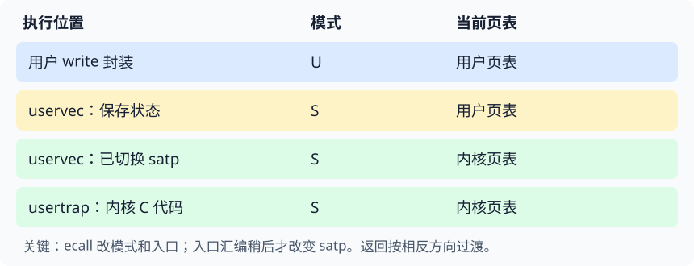

# 第 6 讲 · 从“不可信现场”建立可运行的内核

**系统调用的困难，不是跳到另一段代码，而是在不相信用户寄存器、用户栈和用户地址的前提下，安全地建立内核运行环境，最后还能正确继续用户程序。**

读本讲前，应理解页表的映射与权限，以及 RISC-V 的参数寄存器、返回值和栈。忘记这些基础时，先回到[页表讲座](#/c/mit-6.s081-2020/lec/lec04?v=notes)和[调用约定讲座](#/c/mit-6.s081-2020/lec/lec05?v=notes)。

## 1. 最容易混淆的两个开关

执行模式决定**有没有权限做某种操作**，页表决定**地址如何解释、映射是否存在**。二者独立变化。

*编者自绘：只画模式与当前页表两个维度。中间两行都是 S 态，但可以访问的地址不同。返回沿相反方向经过这些状态。*

因此，下面两个说法都不成立：

- “已经进入 supervisor，所以可以直接使用任意物理地址。”仍须遵守当前地址翻译。内核能方便地访问 RAM，是因为内核页表提供了直接映射。
- “当前用的是用户页表，所以正在运行用户代码。”`ecall` 后最初的 `uservec` 已是内核入口、S 态执行，只是暂时还用用户页表。

**判断一条指令是否能执行，至少同时问：它的虚拟地址在当前表里吗？权限允许当前模式取指吗？** 课堂的六项页表及反例见中文译稿 21:00–33:00；教材机制见课程资料 §4.1–4.2。

## 2. 用依赖关系推导出 trampoline 与 trapframe

先不要背函数名，试着解决三个约束：

1. `ecall` 不替换 `satp` → 第一条内核指令必须能通过用户页表取到。
2. 某条入口指令会替换 `satp` → 它后面的指令必须也能通过内核页表取到。
3. 用户不能改入口指令 → 这个映射虽然存在于用户页表，却必须没有用户权限。

三个条件合起来，就得到 **trampoline：同一物理代码页，在两侧页表使用同一虚拟地址，以非用户权限映射**。只说“双方都有这段代码”还不够；若虚拟地址不同，改变 `satp` 并不会自动调整 `pc`。

接着解决保存区问题：

1. 用户寄存器可能全被占用 → 覆盖任何可变寄存器之前，必须先保存它。
2. 保存到内存需要基址寄存器 → 必须先找出一个可用寄存器。
3. 用户 `sp` 不可信 → 不能靠向用户栈压入数据解开循环。

所以 xv6 提前安排 **trapframe：每进程独立的受保护数据页**，再让 `sscratch` 持有它的固定虚拟地址。一次 `a0 ↔ sscratch` 交换，既保存原 `a0`，又取得保存区基址，打破循环依赖。

| 对象 | 解决的问题 | 不应误认成 |
|---|---|---|
| trampoline | 切页表前后连续取指 | 每进程私有的一整份内核 |
| trapframe | 保存用户状态，并向入口提供内核环境信息 | 用户栈或函数调用栈帧 |
| 内核栈 | 让 C 函数调用、局部变量和内核执行有合法栈空间 | 硬件 `ecall` 自动提供的栈 |
| `sscratch` | 最早入口的一个安全寄存器交换支点 | 内存中的 trapframe 本身 |

完整推导与学生追问见中文译稿 33:00–54:00；结构字段及映射见课程资料 §4.2。

## 3. 返回路径其实在维持一个循环不变量

进入用户态之前，必须已经满足：

- `stvec` 指向这次用户运行应使用的受控入口；
- 用户页表包含受保护的 trampoline 与本进程 trapframe；
- `sscratch` 留有 `TRAPFRAME` 地址；
- trapframe 的 `kernel_*` 字段足以恢复内核页表、内核栈、hartid 和 C 入口。

下次陷入消费这些准备；返回之前再把它们准备好。因此“返回函数”也能用于**第一次**启动用户程序：先构造一份合法的待恢复状态，再走同样的出口。它不要求历史上真的发生过一次用户调用。

同理，返回汇编不能过早恢复 `a0`。在还要从 trapframe 读取其他寄存器时，必须留住基址。把最终用户 `a0` 暂存 `sscratch`，最后再交换，既恢复返回值，又重建下一次入口所需的不变量。

这个视角能解释为什么入口和出口互相依赖，而不必把“第一次 sscratch 从哪来”当成无限回溯。课堂问答见中文译稿 42:00–48:00、78:00–84:00。

## 4. 用户状态不是一张永远不能改的照片

“透明恢复”不代表所有字段总是不变。系统调用明确约定了可观察结果：

| 状态 | 正常 write 返回时的处理 | 为什么 |
|---|---|---|
| 用户整数寄存器 | 保存后恢复，其中 `a0` 按接口更新 | 用户计算继续，且获得返回值 |
| `trapframe->a0` | 写入系统调用结果 | 最终恢复到真实 `a0`，符合返回约定 |
| `trapframe->epc` | 在 `ecall` 路径加 4 | 继续执行下一条，而非重复调用 |
| 硬件 `sepc` | 先复制到进程内存，返回前再写回 | 同一 CPU 后续陷入可能覆盖它 |

课堂例子里，输入 fd 是 2，输出字节数也是 2。**数值碰巧相同，不代表同一个含义未经改变。** 用这个例子调试时，应跟踪字段的写入位置，而不只比较数值。

不要把系统调用的 `epc += 4` 搬到所有异常上：后续缺页处理中，修好映射后常要重试原指令。相关机制见[第 8 讲](#/c/mit-6.s081-2020/lec/lec08?v=notes)。

## 5. 关中断保护的是“入口约定不一致”的窗口

进入内核后，`stvec` 还暂时指向用户入口；返回用户前，`stvec` 又会提前改回用户入口。在这两个短窗口里，**当前执行现场与入口所假定的现场暂时不匹配**。

若允许设备中断进入，就可能让 `uservec` 把内核寄存器当成用户状态保存，或使用不符合它约定的 `sscratch`。因此进入时由硬件关中断，内核准备好 `kernelvec` 和保存状态后再打开；退出时先关中断，再布置用户入口，最后用 `sret` 完成状态转换。

这不是“整个系统调用期间都必须关中断”。耗时服务期间允许处理中断，可以改善设备响应。也不是“关中断就能防止所有异常”：同步异常另有触发规则，所以入口自身仍须正确。

课尾讲者对 UIE 的回答保留为猜测；正确的返回位关系是 `SIE ← SPIE`，并非 `UIE ← SPIE`。细节与说明见中文译稿 84:00–87:30、课程资料 §4.1，不从寄存器名字猜规则。

## 6. 阅读源码时先锁定版本和边界

最关键的版本陷阱是 **rev1 p.44 把 `userret` 的 a0/a1 参数顺序写反**。本课程固定参考源码与课堂均采用：

| 寄存器 | 进入 userret 时 | userret 最后返回时 |
|---|---|---|
| `a0` | `TRAPFRAME` | 系统调用返回值或待恢复用户值 |
| `a1` | 用户页表的 `satp` 编码 | 原用户 `a1` |
| `sscratch` | 将被设置为待恢复用户 `a0` | `TRAPFRAME`，留给下一次入口 |

PDF 原文、固定源码行号和修正依据只在课程资料 §4.2 展开。不要拿新版 `trampoline.S` 或不同实验分支的函数签名来解释这段录像。

另外，入口安全不等于参数安全。`argaddr` 取出一个指针数值，并没有证明它可访问；`copyin`、`copyinstr` 等还必须按用户页表查找并检查映射。课堂只点到参数来自 trapframe，**用户指针的校验、内核陷入的完整处理、共享映射方案及章末习题**在课程资料 §4.4、§4.5、§4.7–4.8 中展开。

## 自测：能否从约束推出答案？

1. 若 trampoline 在两张表中指向同一物理页，但虚拟地址不同，可以直接切 satp 吗？

不能据此保证连续执行。`pc` 是虚拟地址，写 `satp` 不会同时重定位 `pc`；下一次取指必须在新表的同一个虚拟位置得到正确代码。

2. 用户故意把 sp 设成 0 再 ecall，为什么入口仍有可能正常工作？

早期汇编不用用户栈保存状态，而是用 `sscratch` 取得内核安排的 trapframe，再恢复可信的内核 `sp`。之后能否接受该系统调用及返回用户后如何运行，是另外的问题。

3. 为什么不能先跳进 usertrap，再让 C 函数保存用户寄存器？

函数序言及编译器生成的代码本身就可能改写尚未保存的寄存器，而且此时尚无可靠内核栈和完整内核映射。保存必须先于依赖这些资源的 C 执行。

4. sepc 已由硬件保存，为什么还要复制到 trapframe？

硬件寄存器属于当前 hart，不是每进程长期存储。后续嵌套陷入或其他进程的陷入可能覆盖它；放入进程自己的内存后，才能跨这些事件保存。

5. userret 为什么先切用户页表，再按 TRAPFRAME 地址读取保存值？

`TRAPFRAME` 是这份用户页表中的特定映射。固定内核页表没有在同一高地址专门映射它；普通内核通过 `p->trapframe` 的直接映射别名使用同一物理页。不能把两个地址混用。

6. 把保存的 a0 恢复为原来的 fd，能完成 write 返回吗？

不行。`write` 应返回实际写入字节数或错误，不是 fd。当前演示恰好两个值都是 2，错误实现可能被这个例子的数值巧合掩盖。

7. 系统调用必须切两次页表吗？

这是当前 xv6 映射设计的要求，不是所有操作系统的必然要求。其他系统可以用权限保护的共同映射省去切换；代价与权衡见课程资料 §4.7。

## 阅读与动手衔接

| 想解决的问题 | 中文译稿 | 课程资料 |
|---|---|---|
| 怎样开始执行第一条内核指令？ | 24:00–33:00 | §4.1–4.2 |
| 没有空闲寄存器，怎样保存寄存器？ | 36:00–45:00 | §4.2 |
| 第一次用户运行是谁启动的？ | 45:00–48:00 | §4.2；第 2 章启动流程 |
| 切换页表为什么不丢失当前代码？ | 54:00–60:00、75:00–78:00 | §4.2 |
| 参数和返回值怎样穿过边界？ | 63:00–69:00、78:00–81:00 | §4.3–4.4 |
| 内核内部又发生陷入怎么办？ | 60:00–63:00、69:00–75:00 | §4.5 |

[中文译稿](#/c/mit-6.s081-2020/lec/lec06?v=draft)保留课堂的单步演示和问答；[课程资料](#/c/mit-6.s081-2020/lec/lec06?v=materials)按教材小节系统阅读。进入 [Lab traps](#/c/mit-6.s081-2020/lab/traps?v=zh) 前，先能解释“用户返回地址存在哪里、哪些寄存器必须恢复、为什么返回值可单独改变”。实验要求与指导以实验页为准。

## 来源与边界

- **V6 / S6：** Robert Morris，[2020 官方本讲提纲](https://pdos.csail.mit.edu/6.S081/2020/lec/l-internal.txt)及课表所链录像，87:30。完整英文 ASR 阅读、三帧实际查看；没有逐句听音，课堂细节集中在中文译稿。
- **B4：** Cox、Kaashoek、Morris，[xv6 rev1](https://pdos.csail.mit.edu/6.S081/2020/xv6/book-riscv-rev1.pdf)，第 4 章除 §4.6；全文翻译、教材许可和版本校注见课程资料。
- **C2020：** 上游提交 `e23d53f27f6e187732a92a2b4705639d1c260f05`，重点 `trampoline.S`、`trap.c`、`riscv.h`、`proc.h`。固定参考快照不等于已确认的录课工作树或实验分支。
- **R-S（编者校核）：** [RISC-V Supervisor 文档 20260120](https://docs.riscv.org/reference/isa/v20260120/priv/supervisor.html)，核对 `sstatus` 的 SIE/SPIE 规则，不冒充 2020 课堂指定资料。
- **编者提炼：** 依赖关系推导、循环不变量、对照表、自绘 SVG 与自测，是本页的学习组织；没有把它们归为讲者逐字发言。视频无已核实再许可，网页 CC 不套用于视频；教材 MIT 许可单独保留。
- **检查边界：** 只做内容文件与引用资源的局部检查，未运行 xv6、GDB 或实验测试。
