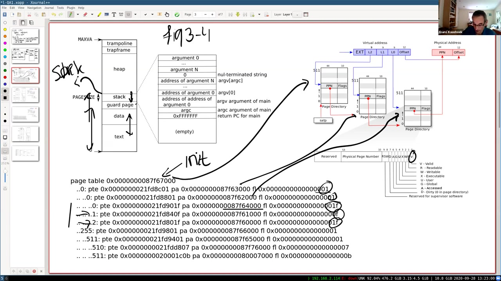
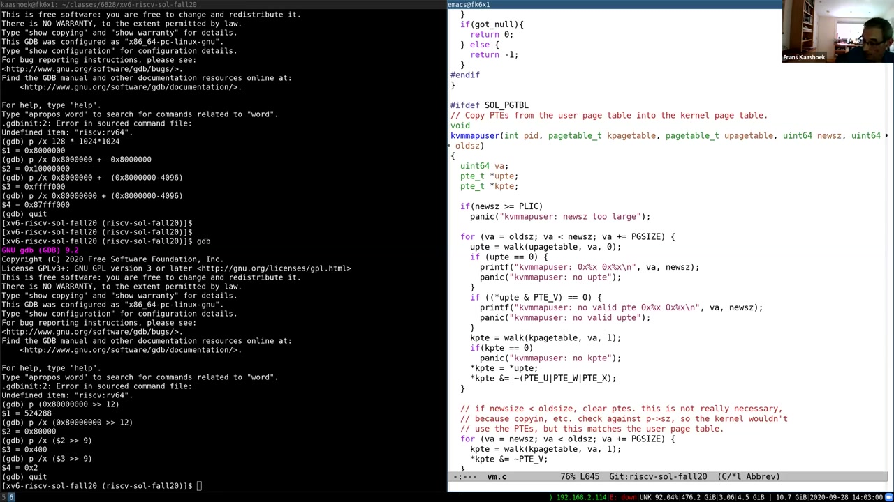
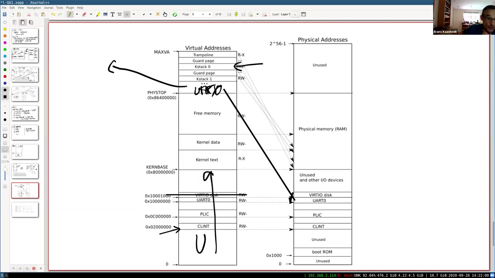

# 第 7 讲 · 实验问答（一）

## 00:00–03:00｜为什么代码不多，页表实验却如此难调？

完成声音检查后，Frans 说明今天没有一套需要按顺序讲完的新理论。他准备借课程团队的实验实现，尤其是自己的实现，回答大家对最近几个实验的疑问。当天上午 11 点之前提交的问题已放在讲义末尾；如果展示代码时还没有回答到自己的问题，同学可以直接打断，也可以等后面查看问题列表。

首先讨论 pgtbl，因为它收到的问题最多，也明显让许多同学花了最多时间。它的一个特点是：最终增加的代码可能很少，但由错误引起的现象十分难追。最糟糕的情况下，QEMU 或其中运行的 xv6 看起来直接停住，不再有任何输出；学生面对的只是一个沉默的系统。相对“好”的结果是内核还能 panic，至少留下一个检查失败的位置。

然而，panic 所在位置也不一定是错误发生的位置。内核某个不变量被破坏，可能只是更早的页表构造错误终于显现出来。程序员必须从后来的症状，倒追到当初安装了什么映射、遗漏了什么权限或指向了哪块内存。代码短并不意味着错误容易局部化：改坏的是后续所有内存访问都依赖的基础设施。

## 03:00–06:00｜课程团队也会遇到这些错误

Frans 接着强调，内核的编程与调试环境很不宽容，这不是同学个人能力不足的证明。课程团队自己做实验也会犯相似的错误，只是有更多追查经验。有些问题一看就能认出，是因为工作人员以前踩过同一个坑；另一些问题则是学生找到了团队此前没有遇到过的破坏内核的方法。即使只是一小段代码里的一处细节，找出来也可能耗时很久。

无论在 6.S081 还是此前的 6.828 中，第一个虚拟内存实验往往都是最难的实验之一。原因叠加在一起：错误后果严重，调试环境苛刻，而学生此时又还没有积累多少内核编程经验。今年的 pgtbl 是新安排，原意是提供一个更平缓的虚拟内存入门；Frans 认为它在部分方面达到了目标，但显然仍然困难。

此前首先安排的是 lazy allocation 实验，也就是本学期下一步要做的内容。他猜测，经过这次页表练习，同学再做 lazy 时会比往届轻松，因为已经建立了更多虚拟内存背景。这是对学习经验的期待，并不是保证之后不会再遇到难调的错误。

在进入具体代码之前，他暂停询问是否有问题，随后应同学要求，先快速恢复 CPU、物理内存和页表之间的整体关系。

## 06:00–09:00｜恢复整体图景：指令、CPU 与 MMU

Frans 在右边画物理地址空间：有些地址通向设备，有些地址通向 DRAM。xv6 的内核指令和数据被放在 RAM 起点附近；所谓“内核在这里”，就是那些地址上的字节实际存放着机器指令以及内核的数据结构。左边则画 CPU，其中有通用寄存器、程序计数器等状态。

CPU 根据程序计数器确定下一条指令在哪里，取指、解码，再更新相应状态。随后加入 MMU：开启分页时，取指、加载和存储使用的地址先作为虚拟地址送入 MMU，转换后的物理地址才用来选择设备或 DRAM 中的位置。

控制这条转换路径的是 `satp`。Frans 用“其中装着当前页表的根”来概括它；若关闭分页，则没有这一步转换，地址直接作为物理地址使用。机器刚启动、xv6 尚未配置分页时，就处在这样的阶段。因此，理解启动代码不能先假定内核页表一直存在。

> **编者校注：** 开场地址数字的自动识别不可靠。板书及固定 2020 源码的 `KERNBASE` 为 `0x80000000`；这是 xv6 内核的加载与入口位置，不等于说模拟器从最初复位起就只在这一地址执行。`satp` 的严格格式还包含模式与根页号，不能把“任意非零值”当作开启分页的完整条件。

## 09:00–12:00｜页表本身也在内存中

继续看物理内存图：内核代码和静态数据上方，还有交给页分配器管理的空闲 RAM。课堂采用的配置使用 128 MiB RAM；空闲部分可以被分配给用户程序，也可以被拿来存放页表。页表不是凭空存在于 MMU 中的一组无限大的表格，它自身也占据物理内存。

假设其中某页作为根页表。内核把相应信息写入 `satp` 之后，MMU 才能从这页出发，按页表层级找到目标物理页。CPU、MMU 与 `satp` 可以在概念上看成一起工作的部件：CPU 给出虚拟地址，MMU 根据当前根进行翻译，最后访问物理内存。

Frans 停下来确认这个总图是否清楚，强调稍后分析分配与释放时，始终要记得“页表也住在 RAM 里”。它既描述别的内存，又是需要管理生命周期的一种内存。

随后进入实验第一部分：打印 `init` 的页表，并用教材图 3.4 解释输出。图里低地址依次安排程序指令、数据、保护页和用户栈；堆可以继续向上增长。这里先辨认用户地址空间的组成，再把抽象布局与打印出来的实际页表层级对应起来。

## 12:00–15:00｜vmprint 打印的是哪一刻、哪一层？

用户栈之外，内核还有自己的栈，两者不能混为一谈。堆的增长通过 `sbrk` 请求，地址空间顶端则有 trampoline 与 trapframe：前者保存进出内核所需的过渡代码，后者为寄存器保存提供位置。刚进入内核时，通用寄存器里仍装着用户程序的值，内核不能直接把这些寄存器当空白工作区随意使用。

课堂展示的打印发生在第一次成功执行 `exec` 的末尾：`initcode` 请求加载 `init`，新程序映像建立后打印其页表。不是打印一个还只有初始引导代码的地址空间。Frans 的输出还额外列出了 flags，方便区分不同用途的 PTE。

他将根地址、第一层打印项和第二层打印项画箭头连到三级页表图上，中途发现箭头画错，暂停重画。某个 PTE 所显示的物理地址，是它指向的下一页页表的基址；并不是每一行都已经指向用户数据。中间项的 flags 为 `1`，表示设置了 `V`，而没有叶映射的读、写、执行权限。

每页 4096 字节，每个 PTE 为 64 位，即 8 字节，因此一页装 512 项。低地址这一支最后落到三个叶页。这时要把三个概念分开：打印缩进代表层级，索引代表当前页表页中的槽位，而物理地址代表这个条目实际指向哪里。

## 15:00–18:00｜页 0、页 1、页 2：用权限认出保护页

第一个低地址叶页对应虚拟地址 0，其物理页来自刚才所画的空闲内存池。它的 flags 为 `0x1f`：`V`、`R`、`W`、`X`、`U` 都设置了。因此这个页同时容纳程序代码与数据，用户态可以读、写和执行。

**Frans 问：**页 1 为什么只有 `0x0f`，少了 `U`？

**学生答：**这是 guard page。Frans 确认：它有有效映射，但用户程序没有访问权限。用户栈向低地址增长；如果一页大小的栈用满，继续向下写就可能触及保护页，触发异常并进入内核。拦住访问的是权限，而不是“没有打印出来的无效 PTE”。

接着问页 2，同学认出它是用户栈。它也是 4096 字节，目前同样拥有很宽的权限。Frans 问能否更严格，同学建议去掉执行权限。他认可：若没有 `X`，用户就不能在栈上执行临时生成或存放的代码，这通常是更合理的安排；xv6 在这里为了简单，未把权限细分到这个程度。



*实际查看的原片 18:00 帧。页 0、1、2 的 flags 分别为 `0x1f`、`0x0f`、`0x1f`；箭头把打印结果连接到层级结构。画面借用了教材的旧式初始栈布局，本段只使用其中的地址区域关系。*

## 18:00–21:00｜最高两个叶页为什么没有 U？

余下两个叶项的 flags 分别是 `0x07` 和 `0x0b`。`0x07` 允许读写，适合保存和恢复寄存器的 trapframe；带执行权限的另一个页则是 trampoline。最终叶索引 510 对应 trapframe，511 对应 trampoline。

**学生确认：**内核会在还使用用户页表时访问这些页，是吗？

**Frans 回答：**正是如此。进入内核后，还没把 `satp` 换成内核页表之前，过渡代码已经需要取指、保存寄存器和读取入口所需状态。用户页表里因而必须有这些映射，但它们都不设置 `U`，不允许用户模式直接读取、改写 trapframe 或执行其中的内核入口代码。页表属于用户进程，不表示其中每个页都供用户态访问。

> **编者校注：** 课堂口述及官方提纲将 `0x0b` 简写成了“X、V”；实际 `0x0b = V | R | X`。这也与 `proc_pagetable` 中 trampoline 的 `PTE_R | PTE_X` 相符，不能遗漏 `R`。

随后讨论物理地址是否连续。同学回答“不必连续”，Frans 指着打印值说明，这个例子实际也不连续：相邻虚拟页并没有简单指向递增的相邻物理页。正是这种解耦，让内核能够从空闲链表取得可用页，而无需为每个连续的虚拟区间找到一块同样连续的物理内存。

## 21:00–24:00｜为什么根索引是 255，而不是 511？

完成第一部分后，有同学请求再解释 `sbrk`。Frans 表示周三的课与 lazy 实验会专门讨论它，先把这个问题留到那里；若到时仍不清楚，请再提问。本讲没有在此补讲完整的堆分配过程。

**另一位学生问：**教材说 trampoline 和 trapframe 在地址空间最顶端，可为什么打印出的根索引是 255，而不是 511？

Frans 认可这是他本来就打算回答、却差点忘记的问题。Sv39 的根页表有 512 项，表面看“最顶端”似乎应当走最后一项。他请同学解释。一位同学指出，xv6 为了避免符号扩展的麻烦，没有使用本来可以使用的那一位。

Frans 确认：Sv39 的有效虚拟地址部分为 39 位，但 xv6 只采用低半区，也就是非负的 38 位范围。若使用位 38 为 1 的高半区，则 64 位地址的更高位也必须全部为 1。教学实现选择不处理这一半，因此 `MAXVA` 对应的边界是 $2^{38}$，最高有效区域位于根项 255。

这里“顶端”指的是 **xv6 所使用地址范围的顶端**，不是把全部 512 个根项都占满后的顶端。往下的索引仍然可以是 511，所以 `(255, 511, 511)` 与 trampoline 位于 xv6 顶部并不矛盾。

## 24:00–27:00｜简化 exec 的代价，与内核地址布局复习

**学生问：**为什么把 text 和 data 放在同一个页？若分开，不就可以分别设置更准确的权限吗？

Frans 回答，主要是为了简单。把程序段拆开、按不同权限映射，会增加 `exec` 的实现复杂度；xv6 希望尽量少写代码，让读者容易读懂。通常的操作系统会更认真地区分这些区域。课堂还指出 Makefile 中有一个链接选项，刻意采用这种简单布局。

> **编者校注：** 固定 2020 Makefile 的用户程序链接命令含 `-N`，并以 `-Ttext 0` 指定 text 起点。这里说的是该教学版本，不是所有 RISC-V 系统都必须如此布局。

随后有人追问：只用 38 位是操作系统的选择，硬件仍支持 Sv39，对吗？Frans 确认，并说明 xv6 本来就只使用远小于这个范围的 RAM，因此愿意为简化实现接受限制。他口述还把这与可利用 RAM 大小联系起来。

> **编者校注：** 虚拟地址宽度不直接等于硬件物理寻址上限。这里应理解为 xv6 的布局及直接映射设计所受的限制，不应推导成“Sv39 硬件最多只能访问 $2^{38}$ 字节物理内存”。

接着切到内核地址空间图：左边虚拟地址，右边物理地址；设备位于低地址，内核代码与数据位于 RAM 起点，后面的空闲页供用户程序、页表等用途分配，直到配置的 RAM 上界。分配器用尽这些页，就必须返回失败。

## 27:00–30:00｜第二部分难在“到处都假设只有一张表”

实验第二部分要求每个进程拥有自己的内核页表。乍看很简单：已经有一张能工作的内核页表，给每个进程做一份不就行了？Frans 在展示实现之前，先列出这种直觉忽略的问题。

第一，原有 xv6 代码是围绕一张全局内核页表写的。`kvminit` 并不是一个可以直接传参数、反复调用的通用建表函数；把它推广为创建多张页表，本身就需要修改原来的接口与假设。

第二，`kvminit` 不是故事的全部。`procinit` 还要为内核栈建立映射，磁盘相关代码也会与内核地址转换发生关系。只复制眼前最明显的初始化代码，很容易遗漏其他地方依赖的映射，或遗漏仍然查询全局表的辅助函数。

第三，创建之外还有清理。进程不再运行后，新增的页表内存必须还给空闲池，否则不断创建进程会持续漏内存。但清理又不能把仍在使用的内存一起释放，尤其不能看到一条映射，就认为映射指向的物理页属于这张表、可以随意回收。

因此真正需要改动的是一组相互配合的生命周期操作，而非单独增加一个“复制页表”调用。下一段继续解释为什么这种错误往往不会立即暴露。

## 30:00–33:00｜两种实现：重建映射，或者共享不变的子树

页表复制中哪怕只有一个很小的错误，也可能变成很难调的大问题。新表构造完成、写入 `satp` 后，内核甚至还能正常运行一阵子，直到第一次访问某个遗漏或错误的页才 panic。故障现场离根因很远，是这一类问题特别耗时的原因。

Frans 将实现路线分为两种。第一种可称为“复制”：为每个进程分配新的页表结构，重新建立需要的内核映射。这里的复制是复制映射关系，不是把内核代码、RAM 中每份数据也复制一遍。

第二种是“共享”：对实验中不会改变的区域，直接让新根表的对应 PTE 指向已有的下级页表。第三部分只会向低地址加入当前进程的用户映射，上面的许多内核区域不需要因进程变化而改变，因此可以共用其页表结构。

两种方案都能成立，Frans 并没有宣布其中一种唯一正确。他自己的实现选择共享；其他课程人员采用了重新建立映射的路线，也有同学混用两种方法。重要的是识别哪些地方会变、哪些可以共享，以及回收时谁真正拥有被指向的页表页。

## 33:00–36:00｜小步修改：给自己留下可比较的旧实现

Frans 坦言，自己采用共享方案，有一部分原因是“懒”：对那些确定不改的区域，直接复制 PTE，就不必再逐一思考其中具体映射了什么。他本来希望少写代码，但最终是否比重建方案更短，也没有把握。这是个人实现选择，不是性能或正确性的证明。

比选择哪条路线更普适的是修改策略。他通常会先有整体计划，再一次只做一两项小改动，确认仍然工作后继续。初期尽量保留原有代码，增加新路径，再逐步切过去。这样既能把旧实现与新实现对照，也能在出现难解错误时退回前一个可运行状态。

这种做法的价值在于缩小错误范围：如果一次同时改建表、切换、用户映射和释放，系统挂住后很难知道哪条推理错了；若每一步都有可比较的状态，就能把调查集中到最近的变化。

随后切到 `vm.c`。先看到原来的 `kvminit`，再看分配根页的 `uvmcreate`，最后看自己的 `kvmcreate`。创建新根后，它会复制既有内核页表中的高位根项；低地址那一项留给独立构造，因为下一部分还要在这里加入当前进程的用户映射。

## 36:00–39:00｜共享的是页表子树，不是把 511 棵树复制出来

具体地，Frans 从全局内核页表复制根项 1 到 511，共 511 项。PTE 里的指向没有改变，所以这些根项下面的页表页已经存在，无需再分配新的 L1、L0 页；新旧根共同指向同一批子树。

根项 0 则独立建立。原因是它覆盖低端 1 GiB，包含设备映射，也将包含实验第三部分要加入的用户映射。课堂提及 CLINT、PLIC、UART 和 virtio 等设备：不能因为要为用户区重建低端分支，就把内核运行所需的设备地址忘掉。

他借三级图重算覆盖范围：一个普通叶项映射 4 KiB；一个 L1 项下面有 512 个叶项，覆盖 2 MiB；一个根项下面再有 512 个这样的区域，覆盖 1 GiB。因此低端用户区的改动可以限制在根项 0 下面，而不碰其他根项所引用的共享子树。

`kvmfree` 与这种结构配套：不能递归释放根项 1–511 指向的共享页表页。只沿私有的根项 0 下去，回收属于这张表的下级页表页，再释放相应中间页与根本身。Frans 承认这个实现利用了很多布局知识，不一定特别漂亮，但与自己的共享策略一致。

> **编者说明：** 此处描述课堂实现的所有权思路，不把它替换成可直接提交的完整实验解答。根项编号上界是 511，而不是 512。

## 39:00–42:00｜现场算 KERNBASE：原来它在根项 2

**学生问：**为什么只复制 1 及以上的根项，不能连 0 一起复制？

Frans 回到内核地址空间图，换一种方式提问：`KERNBASE = 0x80000000` 落在哪一个根项中？有人猜第 0 项。他没有直接宣布答案，而是让大家先回答根项 0 能覆盖多少地址。

一个根项覆盖 1 GiB，所以根项 0 覆盖低端 1 GiB；设备地址位于这一带，但内核基址已经更高。为了确认数值，Frans 现场打开 GDB，将地址先右移 12 位去掉页内偏移，再右移 9 位去掉 L0 索引，再右移 9 位去掉 L1 索引。剩下的值是 2。

这个过程可用下面的短算式表示；它是课堂计算的整理，不是完整终端录屏转写：

```text
0x80000000 >> 12 = 0x80000
0x80000    >>  9 = 0x400
0x400      >>  9 = 0x2
```

因此内核基址位于根项 2。该演示让“高位部分可以共享”落到了具体索引，而非仅凭地址图看起来在上方就作判断。原片 58:00 帧中仍能看到这次 GDB 计算的结果。

## 42:00–45:00｜为什么从进程回来后还要换回全局页表？

根项 0 需要独立管理，而较高区域可以共享，这回答了刚才的疑问。接下来检查新建表函数在哪里调用。Frans 在 `allocproc` 中为新进程建立内核页表，并将结果保存到 `struct proc` 新增的字段里。

有了页表还不够，必须实际使用它。进入调度器后，在切入某进程之前，要让 `satp` 选择该进程的内核页表；从该进程返回调度器之后，则切回全局 `kernel_pagetable`。这是两个方向的工作，不是只改“切进去”一侧。

**Frans 问：**为什么切回来重要？

最初的回答是“选择正确的页表”。他继续追问：这张进程页表什么时候会被释放？学生随后抓住关键：进程结束后会被清理，若调度器还依赖它，就可能在表已经释放时继续用它转换地址。

这比“页表名字选对了没有”更深一层。页表不仅要描述正确的映射，还必须在 CPU 使用它的整个期间保持存在。即使旧表与全局表暂时映射同样的内核地址，也不能据此认为永远不必切换。

## 45:00–48:00｜wait 回收、设备边界与另一种切换方案

Frans 进一步解释，正在运行的进程页表不能被释放。xv6 借 `wait` 清理已经退出的子进程；某个进程或某个 CPU 回收页表时，必须确保没有执行流仍在使用被回收的那一张。调度器还可能遇到根本没有用户进程可运行的情况，因此它需要一张不依赖某个具体进程生命周期的全局表。

**学生问：**为什么新内核页表里还有 CLINT？实验不是限制用户程序只能增长到某个设备地址之前吗？Frans 回答自己映射了 CLINT 和 PLIC，随后把实验边界说成 PLIC，并以“为了简化实验”为理由解释这一上限。

> **编者校注：** 这里的设备名称及“谁更低”的口述不可靠，不能照读为地址大小关系。固定 2020 参考源码中 `CLINT=0x02000000`，`PLIC=0x0c000000`，前者更低；2020 官方 pgtbl 要求使用 **PLIC 上限**，但参考快照的 `kvminit` 仍映射较低的 CLINT。两者不能不加区分地混用：若保留这段低地址设备映射，就必须处理它与用户区的冲突。课堂未在此完整解释这处差异，也未取得讲者完整解答工作树，不能据口述认定冲突已经解决。

另一位同学提出不同设计：只保留全局根，每次进程切换时将所需用户映射换进去，是否可行？Frans 认为原则上能构造这样的方案，不过修改可能更复杂，而且每次调度都更新部分映射，成本可能更高。他提醒这甚至可能触发 `usertests` 的时间限制，但没有给出实测数据。

## 48:00–51:00｜直接读取用户指针，究竟省了什么？

刚才的同学说，自己确实尝试过动态换入映射，体验很糟糕，所以想确认是否方向根本错误。Frans 回答，它不是原则上不可能，只是未必最简单；可能需要 xv6 的其他配套修改。继续往下前，他还提醒 `usertrapret` 一侧必须安排好当前进程的内核页表，确保下次从用户态陷入时选对表。

第三部分的目标是在每进程内核页表的低端区域，映射该进程的用户内存；课堂图把 PLIC 以下画成用户区。接着提出最重要的问题：为什么要做这件事？

Frans 比较原来的 `copyin` 与新的复制路径。原实现要把用户数据带到内核中，但当前内核页表没有用户虚拟地址的同名映射，因此不能直接解引用用户传入的数字。它先软件遍历用户页表，找到对应物理页，再借内核的 RAM 直接映射访问该页。

复制还必须逐页进行。用户虚拟区间可以连续，物理页却可能不连续，不能找到第一块物理地址后就沿着物理地址一直向后复制。这个限制来自映射方式，而不来自用户缓冲区在逻辑上是否连续。

## 51:00–54:00｜软件 walk 与硬件 walk 的区别

如果一个结构跨越页边界，原 `copyin` 必须先复制第一页尾部的若干字节，再查下一页的映射，继续复制后面的部分。课堂借此前使用过的结构体来说明跨页情形；关键不是特定结构名，而是不能假定跨页后仍是相邻物理地址。

新的安排是：让当前内核页表直接包含那些用户地址的映射。这样复制函数可以把用户虚拟地址交给 `memmove`，普通加载指令所需的地址转换由 MMU 完成，不再由 `copyin` 为每一页显式调用 `walkaddr`。翻译并没有消失，只是从软件复制循环中的显式工作，转到硬件本来就承担的地址转换路径中。

**学生问：**既然硬件来遍历，是否也会更快？

Frans 认为确有性能方面的影响。原实现复制较大缓冲区时，每跨一页都要再次调用软件查表函数，这可能有相当开销。他又请大家举一个会复制大量用户数据的系统调用，同学答出 `write`：应用可以提交很大的缓冲区，内核要把其中的字节送入文件系统或管道。

这段讨论解释的是优化动机，课堂没有运行基准，也没有给出两种方式的速度比。新的映射还需要建立与维护，不能只根据删除了一个函数调用就断言整个系统在所有负载下都更快。

## 54:00–57:00｜还可以只访问一个字段；映射函数怎样连接两张表？

Frans 提出另一个未在本实验中充分展开的好处：假如只想读写用户结构体里的一个字段，是否必须先把整个结构复制进内核，修改后再复制回去？如果这些用户页已经映射在内核地址空间，内核可以按需要访问那个字段。这里讨论的是映射方式提供的可能性，不表示当前只读的 `copyin` 实现已经支持任意写回。

由此可理解，为什么许多内核愿意把用户程序映射在内核地址空间的低端：内核代码能够更直接地访问用户数据，而不必在每一次使用前显式处理其物理布局。

接着查看自己的 `kvmmapuser`。它假定用户页表已经有效建立，然后把其中指定范围的映射加入当前进程的内核页表。接口按旧大小、新大小描述需要处理的区间，以页为单位前进。

对每个用户虚拟地址，先在用户页表中 `walk`，拿到对应 PTE 的地址。这里取得的是**页表项的位置**，不是复制了一份用户页，也不是立即得到了可以任意写入的用户指针。随后才在内核页表中定位同一个虚拟地址，把两边的映射关联起来。

## 57:00–60:00｜复制 PTE，再改内核侧的权限

对用户表的查找不应新建页表层级：用户映射应当已经存在。课堂实现检查找出的指针是否为空、PTE 的 `V` 是否设置；Frans 说这些检查也帮助调试，因为按这时的前提，指定范围应当有效。

对内核表的查找则允许分配缺少的中间页。拿到两边 PTE 后，他直接复制 PTE，而不是调用 `mappages` 重新组合每个字段。结果是同一物理用户页被两张页表引用；没有为用户数据再分配一份副本。

随后调整的是**内核侧副本**的权限。他清除 `X` 和 `W`，因为这条 `copyin` 路径只从用户内存读取；写回由 `copyout` 负责，内核也没有理由在这个映射上执行用户指令。还必须清除 `U`：在 xv6 使用的 RISC-V 设置下，supervisor 模式不能直接读取 `U=1` 的页。Frans 补充，这种行为有硬件控制位可以调整，但当前 xv6 没有启用相应访问方式。



*实际查看的原片 58:00 帧。右侧代码显示复制 PTE 后清除 `PTE_U | PTE_W | PTE_X`，并包含地址空间缩小时清除旧项 `V` 的分支；左侧保留了 `KERNBASE` 根索引为 `0x2` 的计算。终端目录是讲者的实验解答工作树，不能当作未修改的共享参考快照。*

**学生问：**禁止内核读这些页，是为了防止内核破坏用户内存吗？Frans 开始区分“约束普通用户”与“帮助内核避免自身错误”，下一段继续回答。

## 60:00–63:00｜内核能改规则，为什么还要给内核设权限？

Frans 的回答是：内核本来就控制 `satp`，可以改页表，甚至可以关闭分页，所以不能把 `U` 的这条规则理解为“用户内存从此能抵御任意恶意内核”。在未修改 xv6 的设计中，内核代码本来就不应直接解引用用户虚拟地址；若程序员不小心这样做，立刻触发页故障，比悄悄读错地址更容易发现问题。

**学生追问：**`U` 的理由理解了，那 `W` 和 `X` 呢？

Frans 反过来问：内核到底在这段映射上做什么？当前 `copyin` 中的 `memmove` 只会从那里读取源字节。既然不需要写入，就保守地清除 `W`；既然不需要在那里取指，就清除 `X`。这两项不必都作为实验的最低要求，但能让这条路径的用途更明确，并在不符合预期的访问发生时暴露错误。

因此，权限不仅用于划分“不可信用户”和“可信内核”，也能在可信代码内部表达预期行为。内核有能力修改规则，与它通常应在较窄的规则下运行，是两件不同的事。

讲解随后转向 `kvmmapuser` 的调用位置。Frans 特别挑出同学问得较多的 `fork` 和 `exec`：即使映射函数本身正确，若传入了错误的进程页表，也会产生非常隐蔽的问题。

## 63:00–66:00｜fork 的“内容相同”，为什么不能推出“页表可互换”？

**Frans 复述问题：**`fork` 刚把父进程的用户内存复制给子进程，两边看起来一样。构造子进程的内核映射时，为什么一定要取子进程的用户 PTE，不能直接取父进程的？

有人猜会触发 `remap`。Frans 说可能遇到这种错误，但这不是他要指出的那个后果；他请尝试过这种实现的同学回忆 `usertests` 的表现，尤其是反复创建与退出进程的测试。

关键在于父进程可能比子进程先退出并被回收。若子进程的内核页表从父用户表取得映射，它仍会指向父进程拥有的物理内存。父进程清理后，这些地址就不再属于子进程可以依赖的资源。xv6 释放页时会用固定字节模式填充，以便暴露悬空引用；之后内存还可能被重新分配，于是错误表现变得很不稳定。

> **编者校注：** 原讲把这里概括成“子进程还指向父页表、出现无效 PTE”。更精确地说：若复制的是父表的**叶 PTE**，子进程内核别名指向的是父的用户物理页；内容相同不代表父子 PPN 相同。若还错误共享了父的页表子树，才另有页表页被回收的问题。`kfree` 的填充值是每字节 `0x01`，不是所有二进制位都置 1。

接着看 `exec`。Frans 的方案没有为每次 `exec` 另换一整张内核页表，而是在新的用户地址空间构造好后，把它的用户映射反映到已有的每进程内核表中。课堂展示了新增调用的位置，并把它与第一部分打印页表的改动区分开来。

## 66:00–69:00｜其他同步位置，以及 trapframe 为什么按这种顺序排列

Frans 问还有没有遗漏的问题。学生提醒：`growproc` 也需要修改吧？他确认，并切到相应位置，展示同类的映射更新调用。因为 `sbrk` 通过它改变进程大小，内核侧映射也必须跟着改变。

他又提到 `userinit`：第一个进程的创建路径比较特殊，要把那一页 `initcode` 也映射到它的内核页表。至此课堂点出了四处关键入口：`fork`、`exec`、`growproc` 和 `userinit`。它们不是四种不同转换算法，而是用户地址空间在不同生命周期阶段发生变化的四条路径。

随后回到课前提交的问题列表。前几项重复询问 `PTE_U`、supervisor 能否更换 `satp`、能否关闭分页；Frans 认为刚才已经覆盖，再次强调这些设置不是防止内核本身掌控机器。

另一个问题是：`proc.h` 中 trapframe 为什么依次排 `t0–t2`、`s0/s1`、`a0–a7`，然后才是 `s2–s11`？他把这种看似不规则的排列联系到 RISC-V 的寄存器编号与压缩指令的紧凑寄存器编码：某些常用寄存器放在相邻编号区域，方便用较短编码引用。

> **编者校注：** 从源码看，保存区里的通用寄存器按 `x1` 到 `x31` 的硬件编号排列，ABI 名称才显得“交错”。压缩指令中常见的紧凑寄存器子集为 `x8–x15`，并不是说启用压缩指令后机器只剩这几个寄存器。trapframe 字段偏移仍须与 `trampoline.S` 的保存、恢复指令对应。

## 69:00–72:00｜共享下级页表很常见；U 位也与阻止利用漏洞有关

Frans 邀请大家在问题列表滚动时随时指出尚未回答的条目。看到“分层页表的低层结构能否部分共享”时，他说自己的第二部分已经是例子：多个根中的 PTE 指向同一批下级页表。这是一种常见技巧，不是 xv6 特有的例外。

再次遇到调度器切换的问题时，他补充：即便已经没有任何用户进程可运行，调度器本身仍需要页表。全局内核页表为这种状态提供了独立于进程的执行环境，所以恢复它不应只看“马上是否要运行下一个进程”。

聊天区此时提出一个重要反问：RISC-V 特权规范不是说，这类分离也能防止用户利用内核漏洞，让内核跳到用户空间的任意代码吗？

Frans 承认这个观点成立。内核不应直接跳去执行用户可控制的代码，禁止这种访问可以阻挡某类错误路径。他此前用“帮助内核调试”来描述，学生则强调了“限制漏洞后果”的一面；两者不必对立。讲者再次说明，xv6 默认让这样的误访问触发异常，而不是默默执行下去。

> **编者澄清：** “不能隔离恶意内核”不等于“没有安全价值”。权限可以限制内核中某个漏洞的利用路径，即使内核整体在架构上仍有权重新配置页表。课堂在这次追问后补足了前面过于单一的解释。

## 72:00–75:00｜管道、freewalk 的 panic，以及怎样移走设备映射

接下来的问题是：每进程内核页表是否影响管道通信？Frans 解释，管道核心是内核中的缓冲区。进程向管道写入时，通过复制函数把用户字节交给这个缓冲区；本实验改进的是用户缓冲区的访问方式，而不是取消这块内核缓冲区，也没有要求通信双方共享同一个用户虚拟地址空间。

另一个反复出现的问题是，为什么 `uvmfree`、`freewalk` 原来遇到叶项会 panic，现在实验中又需要不同处理？Frans 说原来的 panic 是在检查未修改 xv6 的不变量：进入释放页表结构的阶段时，不应再剩下叶映射。新建的内核页表有不同的共享和回收关系，不能机械沿用原函数的全部假设。

> **编者说明：** 这不是建议把原版 `freewalk` 的检查无条件删除。需要的是为新的所有权关系设计清理路径：私有页表页可回收，共享内核叶页和共享子树不能重复释放。原用户页表的清理契约仍应保持清楚。

随后讨论设计题：实验让用户区在低端设备地址之前停止，若希望继续向上增长，怎么办？同学建议重映射 CLINT、PLIC、UART 等设备。Frans 追问应映射到哪里。有人提议放到内核附近，他指出 RAM 上界以上还存在大片未使用的**虚拟地址**，可以在那里安排设备别名，而不必让设备永远占据其物理地址同名的位置。

## 75:00–78:00｜统一设备别名；高地址内核栈的真正好处

Frans 以 UART 为例，在较高的空闲虚拟地址画一个新位置，连接到原来的 UART 物理地址。设备本身没有搬动；变化的是内核用哪个虚拟地址去访问它。删除低端旧映射后，原来的虚拟区间就可腾给用户程序。其他设备也可采用类似办法。

**学生问：**每进程内核页表不是要保持与原内核页表一致吗？这么改会不会破坏这个要求？

**Frans 回答：**那就把全局表和各个进程的表一起改，使整个内核一致地采用新的设备地址。他不是提议让不同表随意使用互不相容的位置，而是改变共同的地址布局。只有所有相关代码都采用一致的映射约定，这个方案才完整。

话题转到另一个布局疑问：为什么内核栈要映射到很高的位置？有人回答，因为 RISC-V 栈向下增长，在高处就有空间往下长。Frans 追问到底能长多少；另一位同学指出，实际上只有一页，不是高地址之下所有空间都给了它。

真正有用的是紧邻栈页设置未映射的 guard page。越界访问触发内核异常，比覆盖其他数据结构更容易发现错误。这个内核 guard page 没有对应物理页，所以可以使用虚拟地址的空洞来保护，而不用额外消耗一页 RAM。



*实际查看的原片 77:00 帧。大箭头将高虚拟地址的 UART 别名连到原设备物理地址；上方栈与 guard 交替排列。背景教材图写 `PHYSTOP=0x86400000`，而本课口述及固定 2020 配置采用 128 MiB、上界 `0x88000000`；不要把背景旧标注与当前配置混用。*

## 78:00–81:00｜能跳过 guard 吗？实验做完就能删掉页表切换吗？

学生确认：内核栈那一页有实际物理内存，guard 却没有。Frans 肯定这种区别，认为这正体现了虚拟内存的灵活性。

**学生再问：**能不能直接越过整个 guard page？

**Frans 回答：**能。例如一个特别大的栈缓冲区，可能让后续访问一下越过一页空洞，落到另一段已经映射的区域。如果顺序使用缓冲区，通常会先碰到 guard 从而触发故障；但也可能不走这样的访问路径。所以 guard page 是非常有效的调试手段，却不是对所有越界行为都可靠的证明。

快到下课时，又有同学问：现在每个进程都拥有自己的内核页表，trap 代码是不是就不用切页表了？Frans 起初给出肯定方向，随后在学生指出 `U` 位问题后，把设计前提说得更严格：**如果进一步改成一张同时供用户与内核使用的页表**，就能省掉两张表之间的切换；仅仅完成本实验，并没有自动成为这种设计。

在原来的 xv6 中，用户页表不含完整内核映射，所以入口必须切换。若把用户与内核都映射进同一张表，并用权限阻止用户访问内核，入口、出口可以简化，但还需要其他配套修改。Frans 以当时此前的 Linux 做法说明这种组织确实存在。

## 81:00–84:00｜KPTI、SUM，以及“这一个位让我调了四小时”

Frans 接着谈到 Meltdown：针对这类侧信道攻击，Linux 引入 KPTI 模式，用更分离的用户与内核页表运行。从这个高层结构上看，它更接近 xv6 所采用的两张表，而不是让完整内核一直存在于用户运行时的同一张表中。这里是 2020 年课堂对设计变化的说明，并未展开漏洞实现或性能测量。

**学生仍不明白：**如果同一张表中的用户页必须设置 `U`，内核又不能读 `U=1` 的页，这种组织怎么工作？

Frans 回答，不同体系结构的规则不完全一样；即便在 RISC-V 上，也有 `sstatus` 中的 **SUM** 位，可以允许 supervisor 对用户页进行数据访问。他把它口语化地说成“内核模式下忽略 U”。

> **编者校注：** 这里必须收窄为**读写数据**：SUM 允许 S-mode 的 load/store 访问 `U=1` 的页，仍要满足对应页权限；它不允许 S-mode 从用户页执行指令，也不是取消所有 `U` 检查。课堂对 Intel 的回答同样只是高层对比，没有讨论其各项可配置保护功能。

学生半开玩笑地说，原来就是这样一个位，让自己多熬了四小时。Frans 回忆起自己暑假也碰到过同类错误，只是讲实验时忘记提起，并为此道歉。学生说，最终是在睡前发了 Piazza 问题，醒来得到回复后才继续做下去；虽然折腾，理解这个问题的过程仍有价值。

正式结束前，Frans 希望这次复盘能让后续几个虚拟内存实验更容易。愿意继续提问的同学可以留下，需要去下一堂课的同学则可以离开。课后第一个问题是：实验常说“对后续有用”，究竟需不需要把前一实验的代码带到下一个实验？

## 84:00–87:14｜实验为何独立；共同页表下还需要特殊 trampoline 映射吗？

Frans 解释，实验分支不互相依赖是刻意设计的。如果前一个实验存在没有被测试暴露的错误，后一个实验又建立在那份实现上，新任务就可能因旧错误失败，学生很难判断问题来自哪里。因此“对后续有帮助”主要指理解和调试经验：以后继续操作页表、修改 `sbrk` 时，这次对用户表、内核表和错误现象的认识仍然有用，并不要求直接搬运这里的代码。

学生确认，自己没有复制 util 实验里的 `xargs`，并不等于漏做了一项要求。Frans 明确肯定：实验之间有意保持独立。

最后一位同学接着问共同页表的设想：若已经采用那种修改，还需要在用户页表中专门映射 trampoline 吗？Frans 先说明自己没有完整推演过，然后现场沿进出路径分析。

若用户与内核共用同一张表，退出内核时仍在 supervisor 模式，已经可以访问内核代码与寄存器保存位置；完成恢复并返回用户模式后，用户代码就在同一张表下继续运行，只有用户区域设置 `U`。再次陷入时，这张表本来就映射了内核，所以可以直接到达内核入口，不再为了切换 `satp` 而特别维持一个两边同址的过渡页。寄存器保存区也可采用内核能直接找到的位置，不一定还按当前“用户表顶部的一页 trapframe”组织。

不过，他保留了明显的限定：这是现场设计推演，可能漏掉细节，没有给出经过实现、测试的补丁。学生表示理解，录制在最后几句交流中结束。

> **编者说明：** 原始自动字幕末条超过标称时长约 2.08 秒，且最后一句没有完整结束；本稿以 87:14 封顶，不补造后续内容。这段结论针对“进一步采用共同页表”的设想，不是让 pgtbl 实验直接删除 trampoline、寄存器保存或 `sret` 所需的设置。

## 引用、许可与核对范围

- **V7**：Frans Kaashoek 主讲，David Morejon 频道，*6.S081 Fall 2020 Lecture 7: Q&A for Labs*，视频 ID `_WWjNIJAfVg`，上传于 2020-09-29，时长 87:14。官方课表日期为 2020-09-28。全读 2235 条 `en-orig` 自动字幕；未逐句听音，学生说话人按语境区分，不据字幕猜姓名。正文是自主组织的中文译述，不是英文字幕逐字翻译。
- **O7 / B7**：MIT 课程团队，[官方提纲](https://pdos.csail.mit.edu/6.S081/2020/lec/l-QA1.txt)与[九页板书](https://pdos.csail.mit.edu/6.S081/2020/lec/l-QA1.pdf)，按课程网站 [CC BY 3.0 US](https://creativecommons.org/licenses/by/3.0/us/) 保留署名。全部提纲及板书已阅读；共享快照的 HTTP 修改时间为 2025 年，不能据历史 URL 保证其与录课时逐字相同。提纲列出的 syscall、util 解答计划没有在本片中逐项展开，不将其补写成课堂内容。
- **C2020**：MIT xv6-riscv 固定参考提交 `e23d53f27f6e187732a92a2b4705639d1c260f05`，核对 `vm.c`、`memlayout.h`、`riscv.h`、`proc.h`、进程与 trap 路径、`kalloc.c` 和 Makefile。它不包含讲者的 `SOL_PGTBL` 解答改动，也不等于实验分支；只用于校对机制和基础常量。
- **L7**：2020 [pgtbl 官方实验页](https://pdos.csail.mit.edu/6.S081/2020/labs/pgtbl.html)，用于核对 PLIC/CLINT 差异。完整要求与指导见[页表实验](#/c/mit-6.s081-2020/lab/pgtbl?v=zh)。
- **R-SUM**：RISC-V International，[Supervisor-Level ISA，v20260120](https://docs.riscv.org/reference/isa/v20260120/priv/supervisor.html)，仅核对 SUM 的数据访问与取指区别；是补充校注的现行规范版本，不是 2020 指定阅读，也未全文翻译。

三张原片帧分别取自 18:00、58:00、77:00，均已实际查看、未裁剪，仅用于解释对应讲解；没有完整观看全部画面。0–0.48 秒无字幕；尾部按视频时长封顶。未运行 xv6、GDB、实验测试或全站构建。逐段证据及具体技术校注存于本讲 `sources/coverage.json`，来源版本与哈希存于 `sources/manifest.json`。
