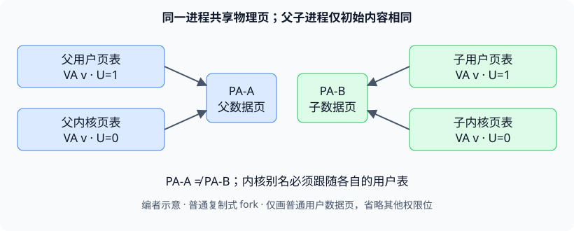

# 第 7 讲 · 用不变量回答页表实验中的“为什么”

做完页表实验后，最值得确认的不是“我改了哪几行”，而是：**同一个地址，在当前这张表、当前权限和当前生命周期下，究竟还能不能指向正确的内存？** 本讲的问答大多可以归结到这三个条件。

## 遇到哪种疑问，就从哪里开始

| 你的问题 | 本页的思考入口 | 中文译稿定位 |
|---|---|---|
| 代码很短，为什么挂住后却难以定位？ | 看故障现场之前，先找被破坏的前提 | 00:00–06:00、27:00–36:00 |
| `vmprint` 的数字怎样对应地址布局？ | 层级、地址、权限分开读 | 12:00–27:00 |
| 复制根页，为什么会影响别的进程？ | “复制字节”未必“取得独立所有权” | 30:00–42:00 |
| 为什么调度器要换回全局表？ | 映射仍正确，不代表页表仍活着 | 42:00–48:00 |
| 新 `copyin` 不是仍要查表吗？ | 去掉的是软件显式 walk | 48:00–57:00 |
| 父子数据一样，为什么不能用父 PTE？ | 相同内容与相同物理页不同 | 63:00–66:00 |
| 内核有最高控制权，权限还有什么意义？ | 防止误用与限制漏洞利用路径 | 57:00–63:00、69:00–72:00、81:00–84:00 |
| 能移走设备、删掉 trampoline 吗？ | 先分清局部实验与整体布局重设计 | 72:00–87:14 |

完整提问、现场推导、代码展示与课后交流见[中文译稿](#/c/mit-6.s081-2020/lec/lec07?v=draft)。本页把这些问题抽成可检查的条件，不按课堂顺序再讲一遍。

## “复制”到底复制了什么？

讨论页表时，“复制”至少有三种不同含义。若不先指出对象，很容易在 `fork` 和回收路径中混淆。

| 操作 | 得到了什么 | 没有自动得到什么 |
|---|---|---|
| 复制非叶 PTE | 另一条指向原下级页表的引用 | 独立的下级页表及独立修改权 |
| 复制叶 PTE | 对同一物理数据页的另一份映射 | 新的数据页 |
| 分配新页并复制页内字节 | 内容初始相同的独立物理页 | 与旧页相同的物理地址 |

课堂共享内核子树用的是第一种；将用户映射加入内核表用的是第二种；未使用 COW 的 2020 `uvmcopy` 为子进程复制用户内存，用的是第三种。

设用户表转换为 $U_p(v)$，进程内核表转换为 $K_p(v)$。对需要通过 `copyin` 读取的普通用户地址，目标是：

$$
K_p(v)=U_p(v)
$$

这里相等的是目标物理地址，**不是两边的权限位必须相等**。而对普通 `fork` 创建的父子进程，即使内容相同，通常也有：

$$
U_{parent}(v)\ne U_{child}(v).
$$

*编者自绘，使用符号 PA-A、PA-B，不是原片地址。每个进程自己的两张表指向自己的物理页；父子页只是初始内容相同。此图不讨论后续 COW 实验。*

如果误令 $K_{child}(v)=U_{parent}(v)$，错误不仅是“父退出后会读坏”。即使父还活着，子在用户态看到的是子页，进入内核复制时读到的却可能是父页：同一个进程在两个模式下观察到不同数据。父页释放后，问题才进一步变成悬空别名。完整课堂追问与讲者口述的精确化见中文译稿 63:00–66:00。

## 映射相同，为什么仍然必须切页表？

调度器返回后是否切回全局表，不能只比较两张表里的地址值。还要问：**谁负责让这张表继续存在？**

假设进程 P 已退出，CPU 还用 P 的内核页表执行调度器。短时间内，内核代码和数据也许仍能正常访问，因而表面上看不出问题。一旦 P 被 `wait` 回收，这张页表占用的物理页就可能被填充、加入空闲链表、分配给别的用途。下一次转换才暴露错误，故障与错误切换之间相隔很远。

把检查拆成两句会更准确：

1. **空间条件：**当前页表映射了下一条指令、当前栈和即将访问的数据。
2. **时间条件：**当前 CPU 使用这张表期间，没有人会释放它或它依赖的私有子树。

全局页表给无当前进程的调度器提供稳定环境。每进程内核表给代表某个进程执行的内核代码提供正确用户别名。它们在部分映射上相同，不代表生命周期职责相同。

相关实现步骤、释放对象与失败路径见[页表实验指导](#/c/mit-6.s081-2020/lab/pgtbl?v=guide)「每进程内核页表」「释放所有权」；本讲的现场追问见中文译稿 42:00–48:00。

## `memmove` 变简单了，复杂性去了哪里？

旧复制路径要显式执行“查用户页表 → 找当前页剩余长度 → 复制 → 处理下一页”。新路径让硬件按当前页表解释用户虚拟地址，所以不再由复制循环手工处理物理页是否连续。

复杂性转移到了**映射维护**。可以用一个反证问题检查自己的理解：若 `fork` 后内核别名没有同步，或者 `exec` 后仍残留旧映像的别名，普通 load 硬件会知道程序员的原意吗？不会。硬件只忠实执行当前页表的内容。

因此，直接访问成立需要同时满足：

- 当前安装的是正确进程的内核页表；
- 普通用户映射与内核别名指向同一批物理页；
- 每条改变用户地址空间的路径都更新了相应别名；
- 页权限适合当前访问，用户参数仍满足复制接口的范围约束。

课堂展示了 `fork`、`exec`、`growproc`、`userinit` 四处更新，并在 58:00 画面中出现缩小时清除旧项的分支。不要只检查堆增长而忘记收缩，也不要把“硬件能查表”理解成“任意用户指针都可以信任”。本讲未逐条讲完新复制函数的参数检查，具体要求仍看[实验说明](#/c/mit-6.s081-2020/lab/pgtbl?v=zh)。

性能也应按成本转移理解：省去反复软件 walk，但增加映射建立和同步成本。课堂给出 `write` 大缓冲区的动机，没有测量数据，不能据此写一个普适加速倍数。

## 权限问题先问访问类型，再问特权级

“内核可以控制一切”描述的是配置权；“这次 load 是否成功”描述的是当前配置下的访问规则。两者可以同时成立。

本讲最容易误记的三点：

- `U` 不是替代 `R/W/X` 的总开关。页是否供用户访问，与允许读、写、执行哪些操作，是不同维度。
- xv6 默认设置下，S-mode 不能直接读写 `U=1` 的页；实验给内核侧别名清 `U`，用户表中的 `U` 应继续保留。
- SUM 允许 S-mode 对用户页进行**数据读写**，仍受相应页权限约束；它不能让内核执行 `U=1` 页中的指令。不能把“忽略 U”推广为任何操作都允许。

内核整体有能力改页表，不代表权限检查没有意义。误用用户指针时尽早失败，能帮助排错；禁止内核执行用户可写代码，也能限制某些漏洞的后果。课堂学生在 69:00–72:00 对“只是调试”的说法作了重要补充。

若想进一步改为用户、内核共用一张表，还必须同时处理用户页权限、内核页保护、入口寄存器保存与返回状态。**“每进程有内核页表”与“用户内核共用页表”不是同一种设计。** 课后的 trampoline 讨论有这个额外前提，讲者自己也声明未完成验证。

## 读 vmprint 的三个短检查

这些检查适合拿着自己的输出做，不需要复现讲者那组物理地址。

1. **先还原索引的范围。** 根项覆盖 $2^{30}$ 字节，`0x80000000 >> 30 = 2`；不能看到它是内核起点，就猜落在根项 0。`MAXVA=2^{38}` 使 xv6 顶部走根项 255。
2. **再按位读 flags。** `0x1f` 为 `V/R/W/X/U`；`0x0f` 少 `U`；`0x07` 为 `V/R/W`；`0x0b` 为 `V/R/X`。课堂把最后一个简述成“XV”，要补回实际存在的 `R`。
3. **最后区分两种 guard。** 当前用户栈 guard 是有物理映射、清 `U`；高处内核栈 guard 是没有有效映射、没有专属物理页。两者都能拦截预期方向上的越界，但不保证拦住跨越整页空洞的任意跳跃访问。

详细位宽与布局不在本讲重新推导；见[LEC 4 课程资料](#/c/mit-6.s081-2020/lec/lec04?v=materials) §3.1、§3.2、§3.6。本讲对实际打印值的分析见中文译稿 12:00–27:00。

## 三份代码背景要分开

| 背景 | 本讲怎样使用它 |
|---|---|
| 固定 2020 xv6-riscv 参考提交 | 校对原有函数、权限位、地址常量；没有 `SOL_PGTBL` 解答 |
| 讲者录课时的实验解答工作树 | 用共享子树演示设计；只核对实际显示与讲述的部分，没有完整仓库 |
| `xv6-labs-2020` 的实验分支 | 做实验的起点与评分约定；按对应实验页进入，不以参考快照替代 |

一个实际差异是 CLINT：参考快照把它映射在 `0x02000000`，低于 PLIC 的 `0x0c000000`；官方 pgtbl 则用 PLIC 作为用户区上限。课堂该段对设备顺序的口述有混淆，不能把“保留低端 CLINT 映射”与“用户区可连续增长到 PLIC”不加处理地组合。相关冲突已在中文译稿 45:00–48:00 标出，没有凭猜测修复讲者工作树。

另一个差异是图上的 `PHYSTOP`：背景教材旧图写 `0x86400000`，课堂口述和参考源码采用 `0x88000000`。图中设备别名的思想仍然成立，具体边界值须按手头版本核对。

## 带着失败现象自测

子进程能正常计算，但系统调用偶尔读到父进程刚改过的数据。先检查什么？

检查子内核表中的低地址别名是否取自父用户表。子在用户态可能用自己的物理页，内核复制时却读父页；不必等父退出才出错。比较相同 VA 两边 PTE 的 PPN 比仅比较页内初始字节更有区分力。

删掉一次页表切换后，系统启动正常，反复退出与 wait 时才失败。为什么不矛盾？

旧页表起初仍有效，因此可正常运行。回收发生后，它的内存才失效或被复用。检查的是页表存活期，而不只是启动时的映射内容。见中文译稿 42:00–48:00。

只复制一页根表，为什么递归释放时可能破坏全局内核？

非叶 PTE 仍指向旧子树。复制根表字节没有创建独立子树，递归释放会释放其他根也在使用的页。先划清私有与共享区域，再定义回收责任。

一条连续虚拟缓冲区跨两页，两块物理页不连续。新版 copyin 为什么仍能只用普通内存复制？

因为两个虚拟页都已在当前内核表中正确映射。MMU 分别翻译访问，内存复制函数不必把整个区间当成连续物理地址。它省掉的是软件显式查表，不是取消地址转换。

打开 SUM，能否在 supervisor 中执行用户页里的代码？

不能。SUM 处理 S-mode 对用户页的数据访问；S-mode 不能从 `U=1` 的页取指执行。共同页表的内核代码仍应位于适合内核执行的受保护页。

“后续实验会用到这些经验”，是否要求合并自己的 pgtbl 解答？

不要求。课堂明确说明实验独立，是为避免前一实验未暴露的 bug 传递到下一实验。继续使用各实验指定分支；能力积累主要是映射理解与调试经验。

## 接着做什么

- 对照自己的实现解释三条不变量：映射目标正确、权限适合访问、回收后无人再引用；再读[页表实验指导](#/c/mit-6.s081-2020/lab/pgtbl?v=guide)。
- 系统调用接口不清楚时回[syscall 实验](#/c/mit-6.s081-2020/lab/syscall?v=guide)；进出内核的保存、恢复路径回[traps 实验](#/c/mit-6.s081-2020/lab/traps?v=guide)。它们的要求不在本页重复。
- 关于 `sbrk` 与延迟分配，继续到[LEC 8](#/c/mit-6.s081-2020/lec/lec08?v=notes)与[lazy 实验](#/c/mit-6.s081-2020/lab/lazy?v=zh)。本讲把 `sbrk` 的完整解释明确留给了后续课程。

## 引用与核对状态

- **V7**：Frans Kaashoek 主讲，David Morejon 频道，[Lecture 7: Q&A for Labs](https://www.youtube.com/watch?v=_WWjNIJAfVg)，2020-09-29 上传，87:14；完整阅读英文自动字幕，实际查看 18:00、58:00、77:00 三帧，未逐句听音。时间是阅读窗口，不是逐句对齐承诺。
- **O7/B7**：MIT 课程团队，[问答提纲](https://pdos.csail.mit.edu/6.S081/2020/lec/l-QA1.txt)、[九页板书](https://pdos.csail.mit.edu/6.S081/2020/lec/l-QA1.pdf)，已全读与查看，按 [CC BY 3.0 US](https://creativecommons.org/licenses/by/3.0/us/) 署名；课堂之外的提纲条目不冒充已经讲过。
- **C2020**：[xv6-riscv 固定提交](https://github.com/mit-pdos/xv6-riscv/tree/e23d53f27f6e187732a92a2b4705639d1c260f05)，核对 `vm.c`、`riscv.h`、`memlayout.h`、`proc.c/h`、`trap.c`、`kalloc.c`、Makefile；不是讲者完整解答工作树。
- **L7**：[2020 pgtbl 要求](https://pdos.csail.mit.edu/6.S081/2020/labs/pgtbl.html)，核对映射更新入口与 PLIC 上限。
- **R-SUM**：RISC-V International，[Supervisor-Level ISA，v20260120](https://docs.riscv.org/reference/isa/v20260120/priv/supervisor.html)，仅阅读 SUM 相关段落，用于澄清数据访问与取指的区别；这是显式标年的补充核对，不是本讲的 2020 指定阅读。

本讲没有指定阅读，因此不建立 `materials.zh.md`。自绘图仅解释父子页的别名关系；课堂原图在中文译稿。未运行 xv6、实验、GDB 或全站构建。原始来源与覆盖记录见本讲 `sources/manifest.json`、`sources/coverage.json`。
