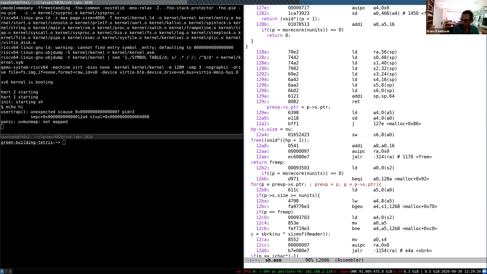
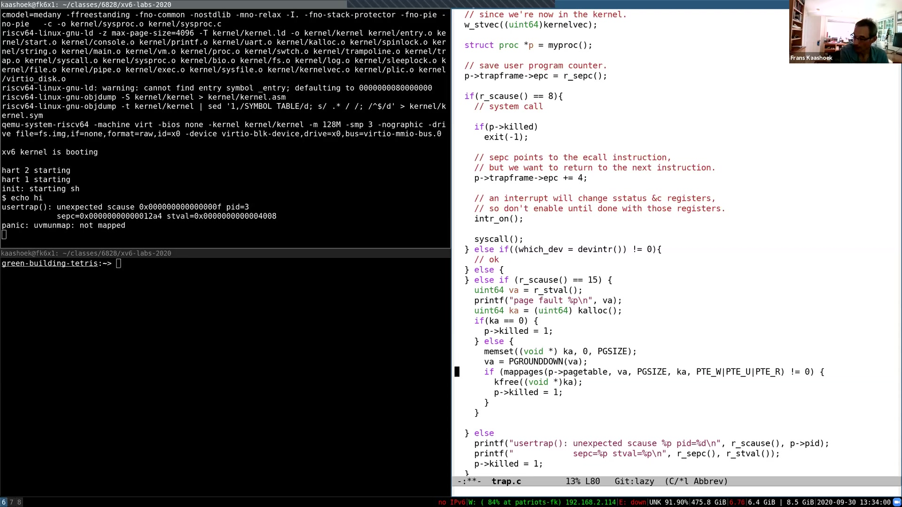
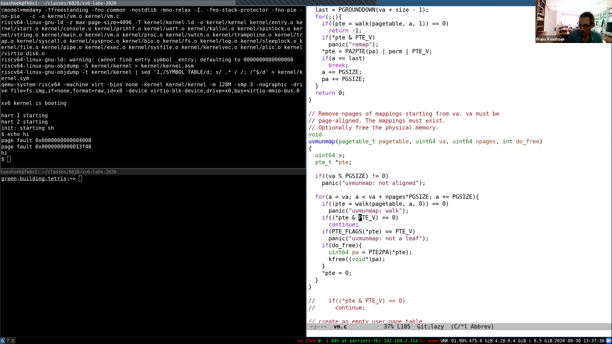
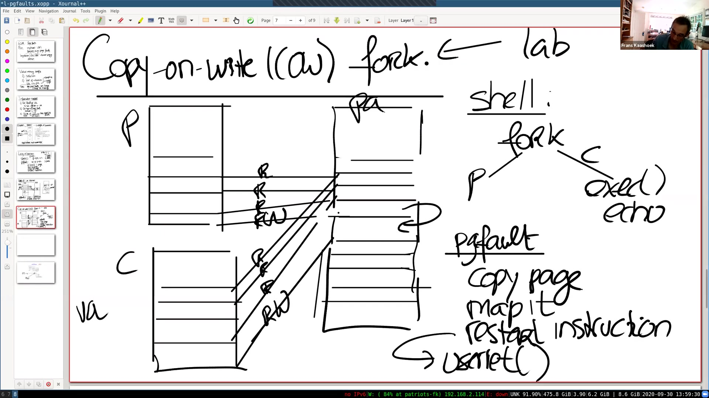

# 第 8 讲 · 缺页异常

## 00:00–03:00｜把缺页异常变成一种实现工具

录制开始约十二秒后，Frans 做声音检查，向不同时区的同学问好。今天讨论的不是如何把现成的 xv6 代码逐行读完，而是怎样利用缺页异常设计新的虚拟内存功能：惰性分配、写时复制 fork、按需分页，以及内存映射文件。Linux 等实际系统已经实现这些机制，未修改的 xv6 则没有。

在原始 xv6 中，用户程序发生缺页异常，内核通常只是终止该进程。我们要问的是：内核收到这个异常后，能不能做点更有用的事，让程序继续运行？接下来的设计会说明，“当前不能访问”并不总意味着“这个地址永远不应访问”。

这些设计也与后续实验直接相连。Lazy allocation 是即将发布的实验主题；COW fork 和 mmap 会分别成为后面的实验。因此今天会少一些现成代码遍历，多一些机制与策略的讨论：这些功能还没有出现在基础 xv6 里，必须先弄明白应该怎样实现。

在进入细节之前，先退一步想：虚拟内存究竟给操作系统带来了什么？Frans 把它的好处分成两类，下一段从已经熟悉的隔离讲起。

## 03:00–06:00｜隔离之外，还有内核可以控制的间接映射

第一个好处是隔离。每个应用有自己的地址空间，一个应用不能因为错误或恶意行为，直接修改另一个应用的内存；用户空间与内核空间之间也有相应保护。前面的页表实验已经让大家接触了这种隔离。

第二个好处是增加一层间接映射。指令使用虚拟地址，究竟映射到哪个物理地址，则由内核设置页表决定。应用看到的是稳定的地址，内核却有机会改变这个地址背后的实现。

到目前为止，xv6 对这层映射的使用相对静态。内核大部分区域采用直接映射；trampoline 展示了把同一个物理页放进多个地址空间的办法；栈旁的 guard page 展示了怎样故意不允许访问某个区域。内核页表在启动时设置，用户页表在创建地址空间时建立，之后很少动态改变这些关系。

缺页异常带来的新机会，是让内核在运行过程中按需调整映射。某条指令暂时无法访问一个地址，硬件把控制权交给内核；内核改好页表，再让它继续。**页表提供可控的映射，缺页异常提供改变映射的时机**，两者结合，比静态隔离更有表现力。

## 06:00–09:00｜处理异常，需要知道哪个地址、哪一种访问

假设已经进入缺页处理程序，要作出有用的决定，首先必须知道引发异常的虚拟地址。RISC-V 把它放在 `stval` 中。大家在实验中见到的异常打印信息，就包含这个值。

缺页异常进入内核时，沿用上一讲的 trap 机制：受控地从用户态进入内核，而不是普通函数调用。与 `ecall` 不同的是，这次还需要把导致异常的地址交给处理程序。

第二项信息是访问类型。读、写和取指可能需要不同的处理政策。例如，一个只读共享页允许读，却希望在写入前通知内核；代码页尚未加载，则可能在取指时发生异常。

Frans 切到 RISC-V 文档中的异常原因表，指出 `scause` 的三个值：**12 是 instruction page fault，13 是 load page fault，15 是 store/AMO page fault**。课上主要用“读、写、指令”来称呼它们。这里的数字是十进制异常编号；后面 xv6 的打印采用十六进制，所以 store page fault 会显示成 `0xf`。

## 09:00–12:00｜保存故障指令的位置，修复后重新执行

作为对照，用户态执行 `ecall` 的原因值是 8，这正是上一讲重点跟踪的系统调用入口。几类异常的原因不同，但从用户态转入内核的基本路径相同。

还需要第三项信息：**哪一条指令触发了缺页异常？** Frans 请同学回忆上一讲。学生答出 `sepc`，即 supervisor exception program counter。再问保存到哪里，学生指出 trapframe；xv6 把它保存为 `p->trapframe->epc`。

于是处理程序手中有三种互补的信息：`stval` 是访问目标地址，`scause` 是访问失败的类型，`sepc`／trapframe 中的 `epc` 是故障指令的地址。不能把访问的内存地址与正在执行的指令地址混成一个数。

为什么特别在意故障指令地址？因为我们打算修好页表，然后**重新执行同一条指令**。如果之前是一个对尚未映射地址的 load 或 store，建立正确映射后，重试就有希望成功。异常处理不必替应用模拟整个程序，只需把暂时缺少的运行条件补上。

> **编者校注：**固定 2020 `trap.c` 只在 `ecall` 分支执行 `epc += 4`，因为系统调用返回后要越过 `ecall`。修复缺页后应保留故障 PC，不能照搬这一步。返回用户态仍经过 `usertrapret` 和 trampoline 的 `userret`。

## 12:00–15:00｜sbrk 的现状：申请时就把物理页准备好

第一个应用是分配内存。`sbrk` 让应用扩展堆。Frans 在用户地址空间图上画出 text、data、stack 以及其上方增长的 heap；`p->sz` 记录当前用户内存范围的上界。

进程调用 `sbrk(n)`，上界向上移动。基础 xv6 随即分配所需物理内存、清零、建立用户映射，然后才从系统调用返回。多次调用就能继续增长；传负数还可以收缩地址空间，今天的第一步演示先集中在正数增长。

这叫 **eager allocation，立即分配**：应用一提出需求，内核就兑现全部物理资源。但应用往往不知道将来究竟需要多少内存，常常按最大可能输入来预留空间。

例如程序处理输入或对矩阵作计算，作者为了容纳最坏情况，可能申请能放下最大矩阵的内存。实际运行所处理的矩阵却小得多。如此一来，地址范围增长了，内核也真的分配并清零了许多页，其中一部分可能从未被访问。

> **编者校注：**`sbrk(n)` 的参数单位是字节。板书用几个页块说明增长，不表示系统调用把 `n` 解释成页数。

## 15:00–18:00｜惰性分配：先承诺地址，首次访问时再兑现

这种“申请得多、实际用得少”的情况很常见。虚拟内存允许内核对此作出更合适的响应：不要在 `sbrk` 中完成所有工作，而是采用 **lazy allocation**。

第一步，`sbrk` 只记录新范围，把 `p->sz` 增加 `n`。这时并不分配物理页，也不清零，不为新增区域建立可用映射。应用得到了地址空间的承诺，物理资源则暂时没有兑现。

第二步，应用真正读写其中某个地址。因为对应页尚未映射，硬件触发缺页异常。内核检查该地址是否属于应用已申请、但还没有实际分配的堆范围。如果是，就分配一页、清零、映射到对应虚拟页，然后重新执行原来的指令。

这里有一个口头表达需要结合图理解：增长前是旧的 `sz`，增长后 `p->sz` 已经成为新的上界。新申请区域位于旧上界与新上界之间；发生缺页时检查的是地址是否在**新的合法范围之内**，不是要求它大于当前 `p->sz`。

所以真正执行工作的时刻，变成第一次访问该页的时候。申请了但一直不用的页，就一直不需要占用物理内存。

## 18:00–21:00｜内存耗尽发生在何时？地址上界又意味着什么？

映射修复后，刚才失败的 load 或 store 可以重新执行。这时学生提出一个重要区别：立即分配时，申请太多会在申请阶段遇到物理内存不足；改成惰性分配后，应用何时才知道没有内存？

Frans 回答，惰性分配看起来像是给应用很大的可用内存空间，但物理内存当然有限。若已有页耗尽了内存，应用又第一次访问一个新页，内核可能就在该次缺页处理中发现分配失败。Lazy 实验采取简单办法：没有空闲页就终止进程。更完整的系统还有更复杂的做法，稍后讨论如何腾出内存。

这也引出了多个进程共同使用有限 RAM 的问题：不能只看单个应用的地址范围，还要决定所有应用如何分享实际资源。

聊天区又问，为什么检查地址低于 `p->sz`，不是从零开始算？Frans 回到图上解释：text、data、stack 原本已经存在，新增的是上方的堆区域。`p->sz` 被推高后，中间有一段尚未物理分配的空间。检查上界是为了确认访问至少落在承诺的用户范围内；若地址高于这个范围，更可能是程序拿了一个自己根本没申请过的地址。

> **编者校注：**“低于 `p->sz`”不是充分的合法性条件；guard page、原有只读映射等不能因此自动获得可写物理页。课堂随后明确承认演示省略了必要检查。

## 21:00–24:00｜现场第一步：删掉立即分配，观察真实异常

接下来动手改代码。这是本讲主要的现场编程部分，也对应 lazy 实验的起步工作。另一位同学追问：内存不足时为什么不直接向应用返回“请稍后再试”的错误？Frans 先保留这个问题：演示与实验先终止进程，完整内核可能更复杂，但完全找不到任何内存时，仍可能只能终止某个进程。

他修改 `sys_sbrk`，不再调用原来的增长分配逻辑，改为只增加进程的大小字段；暂不处理负数收缩。现场一开始漏掉取得进程指针的代码，补上 `myproc()` 后重新编译启动。

系统可以引导，shell 也出现了。但输入 `echo hi` 就出问题。这并不奇怪：shell 为解析、执行命令会使用动态内存，用户态 `malloc` 会调用 `sbrk`；现在 `sbrk` 虽然返回了地址，却没有分配它背后的物理页。

屏幕显示异常原因、PID、故障 PC 和故障虚拟地址。Frans 先指出原因值为 15，也就是刚才表里的 store page fault。后面会利用其余两个地址，定位究竟是哪一次写入触发了故障。

## 24:00–27:00｜用 sepc 与 stval 定位 malloc 的写入

输出中的进程号是 3。`sepc` 为 `0x12a4`，`stval` 为 `0x4008`。前者告诉我们该去反汇编里找哪条指令，后者告诉我们那条指令试图访问哪里。

*实际查看的 24:50 未裁剪关键帧。左侧是 `scause=0xf`、`pid=3`、`sepc=0x12a4`、`stval=0x4008`；右侧 `0x12a4` 对应 `sw s6,8(a0)`，源级语句为 `hp->s.size = nu`。这些地址属于录课生成的二进制，不应拿来定位任意重新编译的 xv6。*

Makefile 已生成 shell 的反汇编 `sh.asm`。定位 `0x12a4`，确实看到 store 指令。向前看，它属于 `malloc` 所用分配器的实现：`morecore` 从 `sbrk` 取得新内存后，需要写入分配块头部，初始化用户态空闲链表的信息。

这就把整个现象串起来了：申请得到的地址是 `0x4000` 一带，写入块头中的大小字段时使用偏移 8，于是访问 `0x4008`。4096 字节一页，`0x4000` 是零起编号的第 4 页起点，也就是顺序上的第五页；访问地址是该页开头后八字节。

Frans 随后打开 `trap.c` 的 `usertrap`。现有分支先判断系统调用，再判断设备中断，其余情况就打印这些信息并终止进程。我们要增加一个新的分支，接住能够修复的缺页异常。

## 27:00–30:00｜在 usertrap 中补页，并向下对齐地址

应该在新增分支里做什么？学生建议先检查 `stval` 是否低于 `p->sz`，满足条件后再分配内存。Frans 认可这个方向，但说明现场要简化处理，完整实验需要补足边界。

演示先只接住 `r_scause() == 15`。取 `r_stval()` 作为故障地址，打印它以便调试；调用 `kalloc` 分配物理页，失败就标记进程应被终止。成功则用 `memset` 把整页清零，计算对应的页起点，再调用 `mappages` 建立用户可读可写映射。

特别要注意对齐：故障地址是 `0x4008`，但不能把“一个整页”映射到这个带八字节偏移的位置。应使用 `PGROUNDDOWN` 得到 `0x4000`，让虚拟页起点对应新物理页起点。以后访问 `0x4008`，硬件自然把页内偏移 8 加到新物理页上。

*29:00 未裁剪关键帧显示 `kalloc`、清零、`PGROUNDDOWN`，以及 `PTE_W | PTE_U | PTE_R`。画面仍处于现场编辑中，`else` 和括号尚未全部修好；它是讲解证据，不是可以照抄的最终代码。映射失败路径还会释放新分配的页并终止进程。*

现场重新编译时又出现括号问题，学生指出 `else` 附近缺少开括号。这个小插曲之后，演示才能进入下一轮运行。

## 30:00–33:00｜补页成功，却在解除映射时遇到旧假设

再次运行 `echo hi`，这次能看到两次缺页打印，说明新分支已经处理了第一次访问，程序确实向前走了。但系统仍然 panic：`uvmunmap` 抱怨要解除映射的页根本没有映射。

Frans 请大家解释。学生答出：那可能是已经惰性申请、却还没有实际使用的内存。是的，`sbrk` 增加了地址空间上界，并不保证范围内每一页都有物理内存。回收整个地址空间时，遇见这样的洞现在是合法的。

因此，在这次演示遇到的 `PTE_V` 未设置情形，不应再 panic，而应 `continue`，跳到下一页。没有物理页，就没有可释放的对象。修改后再输入 `echo hi`，输出两次缺页信息、`hi`，然后回到 shell 提示符。

*32:30 未裁剪关键帧：故障地址分别是 `0x4008`、`0x13f48`，随后输出 `hi`；右侧在 `(*pte & PTE_V) == 0` 时执行 `continue`。画面里的 `walk` 失败仍然 panic，说明这只是覆盖当前演示的最小改动。*

一位学生仍不明白为什么可以跳过。Frans 再解释一次：这段虚拟地址确实属于申请范围，但从来没有访问过，因此没有分配物理页；若继续进入普通释放逻辑，反而会把不存在的物理页当成真实对象处理。

## 33:00–36:00｜修改的是内核不变量，不是随意删除 panic

另一个问题更进一步：原来的 panic 肯定有理由，是否应该保留一个严格版本，再写一个不 panic 的版本？

Frans 从设计不变量回答。未修改的 xv6 采用立即分配，因此在它管理的这段用户地址范围里，不应该出现“有地址但没有映射”的情况；panic 用来发现违反该假设的 bug。引入惰性分配后，合法状态集合改变了，这个不变量不再成立，所以相关代码也必须改变。

到这里，只能说有一个最小的 lazy allocation 演示运行起来了，绝不能说实验已经完成。Frans 明确指出，自己还没有加入前面说过的地址上界检查。再问还有什么问题，学生指出 `sbrk` 参数是有符号整数，可以为负，意味着地址空间收缩；这个路径也要正确处理。

更普遍地说，整个内核有许多地方会检查或遍历同一份页表。改变它允许存在的状态，就需要重新审视所有这些使用点。实验会通过 `usertests` 暴露其他情形；演示只是三部分任务之一，旨在帮大家开始。

> **编者说明：**本页记录的是原片的运行结果，本站没有运行 xv6 或实验测试。完整要求与思路分别见 [lazy 实验说明](#/c/mit-6.s081-2020/lab/lazy?v=zh)和[实验指导](#/c/mit-6.s081-2020/lab/lazy?v=guide)。

## 36:00–39:00｜为什么很多页一开始只需要全零？

接下来换一种很常见、也比较直接的技巧：**zero fill on demand，按需零填充**。

Frans 从可执行程序的布局说起。Text 保存指令，data 保存有初始内容的数据；此外还有 BSS，用来描述启动时应当为零的全局或静态存储。例如在 C 文件顶层声明一个很大的全局矩阵，它的初始值都是零。

没有必要把这个大矩阵的每一个零字节都写进可执行文件。文件只需记录：这个区域需要多大，并且初始内容应当为零。这样可以节省文件本身的空间。

普通的立即装载方案在 `exec` 时为这块区域分配物理内存并清零。问题是，这可能涉及许多页，而应用实际只使用其中很小一部分。与前面的堆预留类似，程序往往按最大情况声明大数组。

如果所有这些页此刻表达的内容都是一样的——整页零——能否让它们暂时共享同一份物理内容？Frans 画出虚拟地址空间和物理内存，准备利用页表里的间接映射实现这个想法。

## 39:00–42:00｜共享一个只读零页，写入时才分开

做法是只分配一个物理页，把它清零，再把所有需要初始零内容的虚拟页映射到这个物理页。这可以大幅减少启动时的内存使用。

但是权限必须仔细设置：这些映射只能读，不能直接写。所有映射都依赖那个物理页仍是全零；只要允许某一个地址修改它，其余本不相干的变量就会一起改变。

当应用第一次向其中某个虚拟页写值时，store 会因为没有写权限而触发缺页异常。Frans 问应该怎么办，学生提出：新分配一个页，填零，再执行原指令。

具体而言，内核为这一次写入所在的虚拟页分配独立物理页，保持其初始内容为零，改掉这一项 PTE，让它指向新页并允许读写，然后返回重试 store。其他虚拟页继续指向共享零页，不受影响。

这不是把整个 BSS 一次性展开，也不是把共享零页改成可写；真正分开的只有正在被修改的那一页。Frans 接着请大家判断，这个优化为什么有价值。

## 42:00–45:00｜少分配与快启动，交换的是首次写入的成本

学生首先指出节省内存：大数组可能只是预留了容量，并没有全部使用。Frans 补充第二点，`exec` 做的工作更少，程序可以更快开始运行，交互体验也可能更好。建立多个 PTE 仍要做，但不用立即为每个区域分配、清零单独的物理页。

学生追问，写入不是会变慢吗？每次都要缺页怎么办？Frans 承认，这是把一部分成本推迟到后面，并且额外引入了异常开销；收益部分来自那些始终没有写入的页。

不过异常的粒度是页，不是每个字节。一页是 **4096 字节**，某页第一次写入时分开，此后这页上的普通写入就可以直接执行，不需要每个零字节都触发一次异常。

那么一次缺页比一次 store 贵多少？学生说，store 主要是一次内存访问，而缺页要进入内核。Frans 让大家回忆 trap 入口：光保存与恢复寄存器就涉及很多 load/store，还有权限切换和处理逻辑。他与学生用“上百条量级”的口头估计强调差距，并没有给出精确指令计数或性能测试。

结论不是“按需一定更快”，而是它用首次访问的额外成本，换取未访问部分的工作节省和更短的前期等待。接下来会看到一个通常更有吸引力的例子：fork 后立刻 exec。

## 45:00–48:00｜fork 后 exec：刚复制的内存马上被丢弃

写时复制 fork，简称 **COW fork**，也将成为实验题。动机此前已经出现过多次：shell 为执行命令先 fork，得到父进程与子进程；子进程执行少量指令后便调用 `exec`，装入例如 echo 这样的新程序。

基础 xv6 的 fork 会完整复制父进程内存。假设 shell 有四页，子进程就再分配四页，并把每页内容都拷贝一遍。然后 `exec` 很快又把这套地址空间释放，改为装载 echo。

这种情况下，许多复制工作从应用的角度看完全没有价值。子进程根本没来得及读写那些复制来的内容，就已经换成另一个程序。

Frans 在图上分别画父、子的虚拟地址空间和中间的物理页。优化思路是不立即为子进程创建第二套物理副本，而只建立子进程自己的页表，让它暂时指向父进程已有的那些物理页。

这里省掉的是物理页的复制，不是父子各自的地址空间。接下来还必须保证 fork 的隔离语义：其中一方修改自己的变量，另一方不能看到这种修改。

## 48:00–51:00｜只读共享到第一次写入，然后复制一个页

为了保持隔离，父子双方的相关映射都改为只读。不能只改子进程：父进程如果还可以直接写，同样会影响子进程看到的内容。

之后父或子写一个共享页，都会触发 store page fault。假设本次是子进程写：内核分配新页，把旧页的完整内容复制过去，将子进程这个虚拟页改成指向新页、允许读写，再返回用户态重试原 store。现在写入只影响子进程的副本。

在课堂只画父子两个使用者的简化图里，旧物理页只剩父进程使用，因此也可以恢复父进程对应页的写权限。这样，从两个只读映射共享一页，变成两个进程各有自己的可写页。

学生问，怎样找到父进程中对应的虚拟地址，是不是与孩子相同？Frans 回答，fork 复制的是地址空间布局，因此在这个例子里，父子对应页使用相同虚拟地址。再有学生问，没有普通父进程的初始进程，一开始应只读还是读写，还是等 fork 才改变权限？这涉及实现选择，下一段继续讨论。

> **编者校注：**“恢复父页写权限”依赖旧页不再被其他进程共享。多个孩子或多次 fork 时不能无条件这样做；一般实现依据物理页引用计数处理，课堂稍后会引入它。也不要求在每次子进程 fault 时都立即找到并修改父页表。

## 51:00–54:00｜复制有多贵？怎样区分 COW 与真正的只读页？

关于初始进程，Frans 强调实现有一定自由度：也可以让它走现有的只读与异常处理机制，不一定非得为第一个进程增加专门路径。这是设计讨论，而不是要求所有新页从诞生起都必须 COW。

学生又问，既然经常整页复制，硬件有没有“从页 A 复制到页 B”的特殊指令？Frans 举 x86 的内存区域复制指令作为例子；RISC-V 的普通实现仍使用读取和写入，性能好的实现会充分流水化，尽量接近内存带宽。

但本例最重要的优化恰恰是少复制：原本四页都复制，现在如果只写了一页，就只复制一页。于是既可能节省物理内存，也可能让 fork 更快完成。

接着有一个关键问题：异常处理程序怎样知道这次写只读页，是 COW 的“请帮我复制”，还是程序错误地修改了真正只读的内存？不能把所有只读页都变成可写，否则原来的保护语义就消失了。

Frans 回答，内核必须维护额外信息，标明哪些页属于 COW。RISC-V 的 PTE 里有此前没有详细讲过的两位，叫 **RSW，reserved for supervisor software**。它们留给内核软件使用，硬件不替内核规定含义。

## 54:00–57:00｜用软件位作标记，再用引用计数管理共享页

可以选择 RSW 中的一位，约定它表示 COW。fork 设置共享只读映射时，同时设置这个标记；缺页处理读到标记，就知道应当复制，而不是把它误判为普通非法写入。RSW 位于 PTE 的 bit 8–9，这里的“第 8 位”不是 accessed 位 `A`。

*54:30 未裁剪关键帧。板书把父 P、子 C 的虚拟空间与物理内存分开画，右侧写出 `copy page → map it → restart instruction → userret()`；只读共享与复制后的读写映射都属于课堂简化图。*

还有一个需要修改的旧假设：基础 xv6 的普通用户物理页基本只属于一个进程；trampoline 是例外，但它不会按普通用户页的方式释放。引入 COW 后，同一物理页可能同时由多个地址空间引用。

如果父进程立即退出，能不能直接释放这些页？不能，因为子进程可能仍在使用。Frans 提到 `kfree` 会把页填上用于发现错误的字节；若仍被引用的页被这样处理，孩子看到的内容会被破坏，之后还可能被分配给其他用途。

学生提出“没有孩子才释放”。Frans 把它推广成更准确的规则：**为每个物理页记录引用计数；撤销一个引用时减一，只有计数到零才真正释放**。这也适用于多个子进程，而不只是一对父子。

## 57:00–60:00｜引用计数放哪里？从 COW 转向按需装载

学生问，为每一页存引用计数会不会太多？Frans 说，实验可以为每个 4096 字节的物理页维护一份计数，这样最简单。可以优化存储方式，但不必一开始就追求复杂方案。

再问能否用 PTE 剩余的两个软件位保存计数。Frans 认为这是一种设想，但位数太少，fork 几次就无法表示更多共享者，优化会受到很大限制。

另一位学生问，COW 标记是否一定要放在 PTE，不能在进程相关数据结构里记录地址区间吗？可以。内核可以维护地址空间区域的额外描述，说明某段地址是什么用途、采用什么处理方式；后面的实验会增加这样的元数据。RSW 是便利选择，不是唯一选择。

随后进入 **demand paging，按需分页**。先看 `exec`：基础 xv6 从可执行文件读取 text 和 data，并立即把它们放到物理内存、建立映射。与 lazy 和零页相同，可以再问一遍：为什么不等程序真的访问这些内容时再装入？

大型可执行文件可能包含当前运行根本不会执行的指令路径，数据段也可能远大于这次运行真正需要的部分。磁盘读取又是昂贵操作，所以推迟装载值得考虑。

## 60:00–63:00｜第一条指令也可以通过缺页装入

按需 `exec` 先建立地址空间的逻辑描述，却不立即读入所有 text/data 页；相应 PTE 暂不置有效位。Frans 问：如此修改以后，第一次缺页发生在哪里？

学生想到初始化代码的装载。Frans 澄清，这次恰恰是在省去立即装载；当真正返回用户空间、准备取第一条指令时，就会发现它还不在内存中。在课堂 xv6 示例里，普通程序起始地址画在 0，因此首先是在这里取指失败。

处理程序必须知道，这不是一个非法的指令地址，而是一个应从可执行文件装入的页。所以在 `exec` 阶段就要保留元数据：这个虚拟区域对应哪个文件、其中哪部分内容。

发生异常后，内核分配物理页，从文件读入对应内容，建立映射，然后重新执行被中断的取指或访问。程序可以继续向前跑，遇到下一个尚未装入的页再重复这个过程。

> **编者校注：**一般起始 PC 应来自可执行文件的入口字段，不能把“所有程序都从 0 开始”当成通用规则。这里保留的是课堂对 xv6 程序布局的说明。

## 63:00–66:00｜如果物理内存满了，就必须腾出空间

最坏情况下，程序用到全部 text 和 data，就会为每一页付出一次装入异常的成本；有利情况下，未用到的页始终不必读取，也不占物理内存。`exec` 的前期工作变少，程序更快进入实际执行。

接着把问题扩大：可执行文件本身就可能比 RAM 大；或者多个应用合起来的需求超过物理内存。某次缺页需要新页，`kalloc` 却返回零，怎么办？这也回答了开头关于 lazy allocation 内存耗尽的问题。

一个办法是 **evict，换出已有页**。把需要保存的旧内容写到后备存储，再撤销旧映射，腾出来的物理页就可以用于满足这次缺页。新内容装入后，恢复应用执行。

这个过程仍然以“重试原指令”收尾，但背后可能已经做了磁盘 I/O 和用户态恢复工作，远不止执行一条简单跳转。

> **编者校注：**课上泛称把修改过的数据写回文件系统。实际应区分后备对象：共享文件映射可以写回相应文件，私有修改或匿名页通常需要交换空间等后备存储，不能因此把任意进程私有数据写回原可执行文件。

## 66:00–69:00｜选择牺牲页：最近没用过，最好还是干净的

有了换出机制，下一个问题是选谁。学生提出 **LRU，least recently used**，即最近最久未使用的页；Frans 将其作为常见的替换策略思路。

如果两个候选页，一个 dirty，一个 clean，更倾向于哪一个？Dirty 指内容已经被写过，需要在复用物理页前妥善保存。学生先选择 dirty，理由是反正最终也要写回。

Frans 指出，通常恰好优先选 clean。若有效内容已经保存在后备文件中，就不必先做一次写回，只要撤销映射即可复用物理页。过早写出 dirty 页，之后又被修改，还可能让同一内容需要反复写回。

另一位学生想起 CPU cache 的 dirty cache line，问 RAM 中的页到底相对于什么“脏”：页本来就在内存里，还要写到哪儿？Frans 用马上要讲的文件映射说明：文件内容装入内存后被 store 修改，内存副本与文件副本不同步，这时就需要记录它已变脏。

> **编者校注：**只有存在可恢复内容的后备对象，才可直接丢弃干净驻留页；不能把“没有发生最近一次写入”误当成“任何匿名页都可以丢掉”。课堂用文件页作为具体例子。

## 69:00–72:00｜A/D 位提供线索，清 A 才能观察“最近”

PTE 里还有两个有用的位。`D` 是 dirty，位于 bit 7；`A` 是 accessed，位于 bit 6。课上采用硬件在相应访问时设置它们的模型：写入令页变脏，访问则留下 accessed 线索。

Frans 问，知道某页有没有访问过有什么用？学生答，没有访问过的页可以优先换出。准确地说，若一段时间内没有访问，它更可能是 LRU 近似策略的合适候选；近期访问过的页则更值得留下。

学生随即发现问题：如果 A 位一旦设为 1 就不清了，怎样区分昨天访问和刚刚访问？所以内核必须周期性清除访问标记，再观察它是否重新被设置。

Frans 举时间窗口的例子：假设每 100 毫秒清一次，下一次观察时 A 为 1，就说明该窗口中至少访问过；仍为 0，则该窗口没有观察到访问。课堂也提到可以按秒取样，这些数字是解释策略的例子，不是 xv6 的既定参数。

实际内核不必每次把所有内存整齐扫描一遍，可以采用逐步扫描的办法。Clock 算法是典型思路之一。A 位也可以结合额外计数，支撑更复杂的使用强度估计；它不是精确的最后访问时间戳。

## 72:00–75:00｜mmap：用 load/store 访问文件的一段内容

最后一种功能是 memory-mapped files。目标是把一个文件的全部或一部分放进进程地址空间，让应用用普通 load/store 操作这些字节，而不是反复调用 read、调整文件偏移、再 write。

典型系统通过 `mmap` 提供接口。参数包括地址、长度、保护权限、flags、已打开文件的描述符，以及文件偏移。概念上，它要求把文件中从 `offset` 开始的 `length` 字节，对应到进程中的一段虚拟地址。

如果立即实现，可以先把那些字节读到物理内存，再建立带指定权限的映射。应用随后就能通过指针访问。但现代实现通常不会立刻把整段文件读入，而是把这件事也交给按需分页。

对应的 `munmap` 让应用声明不再需要这段映射。在课堂讨论的可写、需要写回的文件映射情形中，解除映射时还要把修改过的内容保存回去；PTE 的 D 位可以帮助识别哪些页被写过。

要做到惰性装载，内核需要另外保留一份记录：这段虚拟地址究竟对应哪个文件、什么偏移与权限。通常把这类记录称为 **VMA，virtual memory area**。

## 75:00–78:00｜VMA 与多进程映射文件的问答

对于一个映射区域，VMA 保存其范围、文件关联、偏移等元数据。某个地址缺页时，内核找到覆盖该地址的 VMA，再去文件中读取对应页。它解决的是“PTE 还没有可用物理页，但这段地址仍有合法含义”的问题。

学生问，如果多个进程映射同一个文件，会不会有同步问题？Frans 反问，多个进程普通地 read/write 同一文件，Unix 会自动给应用建立怎样的同步关系？写入会以某种次序发生，但默认没有应用期望的事务或协作协议。需要协调时，可以使用系统提供的锁等机制；映射本身不会自动代替同步。

另一位学生询问 `length` 和 `flags`。`length` 是希望映射的字节数；`prot` 表达读、写、执行等权限；flags 涉及 private/shared 等选择，详细要求留到 mmap 实验。

接着又问，如果另一个进程修改磁盘文件，这里的映射是否会反映变化？Frans 尝试按共享映射来解释，但对精确语义并不确定，讨论继续到下一段。

> **编者校注：**本段没有建立完整的 mmap 一致性规范。尤其不能把“无需额外同步保证”读成“所有并发行为都未定义”，也不能把所有映射都写回：`MAP_PRIVATE` 的修改不应作为共享修改回写到文件。这里保留课堂问题，把精确定义留给具体接口与实验约定。

## 78:00–81:00｜保留尚未讲清的 mmap 边界，总结动态页表的力量

学生继续追问，共享映射是否必须通过相同文件描述符建立，还是分别打开同一文件也一样。Frans 明确表示自己对共享 mmap 的这些精确语义记得不够清楚；学生提出一种关于分别打开文件可能不同步的推测，现场没有进一步验证。

> **编者校注：**不能把这段不确定讨论当成结论：“分别 open 同一文件就一定不共享”。同一底层文件的共享映射，并不以文件描述符整数相同为前提。原片没有在这里给出严谨的可见性与持久化规则，本站也不把这几句问答包装成已经证明的 API 保证。

Frans 说明 mmap 实验排在文件系统实验之后，通常是课程最后一个虚拟内存实验。今天讨论的只是一组代表性例子，真实内核还会使用更多技巧。

本讲把前面两部分知识接在了一起：大家已经学习页表怎样工作，也已深入 trap 的进入与返回；现在利用缺页异常，在运行中动态改变页表，就能实现惰性分配、COW、按需装载和文件映射等功能。

准备结束时还有学生问，如果要映射的文件比 `length` 大会怎样？Frans 澄清，`length` 本来就是用户指定要映射多少内容，例如从某个 offset 开始映射 10 字节，并不是要求把整个文件都放进内存。文件更长不意味着必须把剩余部分也映射进来。

## 81:00–82:08｜最后一个问题：换页是多种机制的共同后援

学生确认了 length 的含义后，另一位学生回到换出问题：刚才是在 demand paging 的第二部分谈 eviction；那么 lazy allocation 等机制发现物理内存不足时，也可以采用同样的办法吗？

Frans 回答，可以。这是一种共同的资源管理机制。无论当前需要新页的原因是按需装载还是惰性分配，都可以在物理内存耗尽时，挑选已有页换出，腾出空间满足新需求。LRU 一类策略帮助决定牺牲谁。

理解长期运行的系统时，可以想象内存经常处于充分利用状态。新的活动要取得内存，就需要把某些已有内容移走或回收，而不是始终依赖还有一大块从未使用过的空闲 RAM。问答以学生确认理解结束。

## 引用与整理说明

- 主讲 Frans Kaashoek，视频由 David Morejon 频道发布，标题 *6.S081 Fall 2020 Lecture 8: Page Faults*，视频 ID `KSYO-gTZo0A`，上传日期 2020-10-01，标称时长 4928 秒。元数据没有给出可确认的再许可，因此采用自主中文译述。
- 全读原语言英文自动字幕 2129 条；首条开始于 12.320 秒，原始末条到 4930 秒，超过标称时长 2 秒，正文时间轴封顶 82:08。未对开头无字幕区间添加内容，未逐句听音。
- 已实际查看 24:50、29:00、32:30、54:30 四帧，均从原片单帧提取，无裁剪。只在本文件使用课堂截图。没有保存全片音视频、cookies 或签名媒体 URL。
- [2020 官方提纲](https://pdos.csail.mit.edu/6.S081/2020/lec/l-pgfaults.txt)已读，用来核对术语。该历史 URL 当前文本仍以“6.828 2016”开头，服务器记录为 2025 年修改；其中共享虚拟内存、TLB 管理、Linux 演变等末尾主题没有在本片展开，未补造为课堂内容。共享板书 PDF 为 13 页存档，未逐页通读；实际截图来自视频，不由板书 PDF 代替。
- 源码核对使用共享 `xv6-riscv-2020`，固定提交 `e23d53f27f6e187732a92a2b4705639d1c260f05`；核对了 `trap.c`、`vm.c`、`umalloc.c` 等相关位置。它是 2020 参考快照，不是讲者正在修改的工作树，也不冒充 lazy/cow 实验分支。
- 课堂中的简化检查、COW 两使用者模型、内存不足策略与 mmap 语义疑问，均与编者校注分开。教材 §4.6 的独立译文见[课程资料](#/c/mit-6.s081-2020/lec/lec08?v=materials)。
