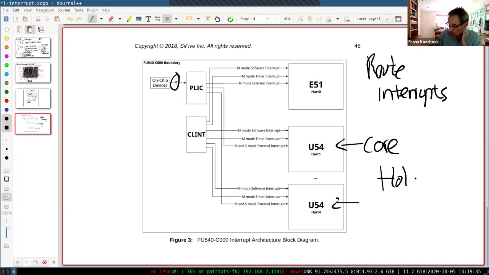
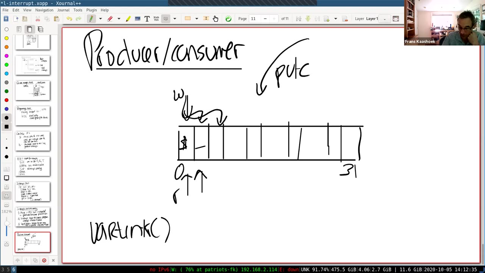
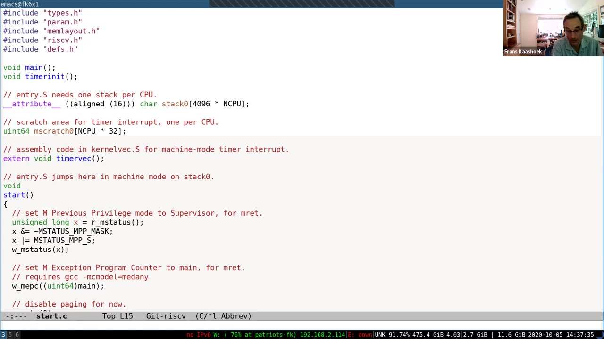

# 第 9 讲 · 中文译稿

## 00:00–03:00｜先问实验体验：traps 与 lazy allocation

正式开始之前，Frans 向已经进入会议的同学做了一个非正式调查：traps 实验做得怎么样？如果已经开始 lazy allocation，感觉又如何？尤其想知道，它们是否比前面的页表实验更容易推进。

Andrew 说，traps 整体还好，主要障碍是正确使用 trampoline 页；把这一点弄明白以后，其余部分就比较顺畅。Frans 回应，这正是实验希望达到的目的：让大家真正接触 trap 处理的入口和出口，而不是只在纸上听一遍。

Amir 觉得 traps 比页表实验更可控，也有一些可以巧妙实现的地方；lazy allocation 目前仍在调试，但总体体验也比页表实验好。Frans 说，这个反馈让他很高兴，学生能觉得后面的实验没有那么痛苦，是课程团队希望看到的。

Timmy 的感受类似：这两个实验比页表实验好一些。lazy allocation 中比较难的是处理 `read`、`write` 等相关情况，但仍然可以接受。随后 Frans 问 Catherine 的体验；中间有一个确认点到的是哪位 Catherine 的小插曲，她也回答，后面的实验确实没有页表实验那么痛苦。

## 03:00–06:00｜补上上一讲的演示：真实系统为什么几乎没有空闲内存

Frans 总结，页表实验实际比课程团队原先预想的更难，所以想先听听后续实验的反馈。接着欢迎大家进入这次关于中断的讲座。不过，在进入主题前，他想补充上周没有来得及展示的内容：真实操作系统如何使用内存。

他切换到终端，展示通过 Athena 的登录机器进入系统后运行的 `top`。上周讨论了页面换出、寻找空闲内存等问题，现在可以在真实运行的机器上观察其背景。`top` 的内存统计显示机器装有相当多的内存，但真正空闲的只是其中很小一部分。

这里不能把“内存被使用”全理解成“应用程序正在占用”。很大一块被用作 buffer cache，也就是缓冲缓存。操作系统通常不希望让物理内存闲置：如果应用暂时不需要它，用来缓存数据也能做有用的事。因此，系统几乎没有大块完全空闲的内存，并不罕见。

这会影响后续分配。内核或应用若只需要少数页面，也许能从已有空闲页取得；但若需要很多内存，就可能必须从应用占用的页面或缓存中回收一些东西。Frans 用这个观察提醒大家：在真实系统中，获得新内存不总是简单、廉价地从一堆闲置页面里拿一页。这里展示的是运行状态和管理思路，没有在课堂上实施页面换出实验。

## 06:00–09:00｜虚拟大小、驻留内存，以及硬件为什么要打断 CPU

Frans 把 `top` 的进程列表按驻留内存排序，比较各进程的虚拟地址空间大小与真正占用的物理内存。后一项通常小得多；共享内存一列则包括共享库带来的共享页面。这正是上一讲讨论的需求分页、共享等虚拟内存机制在真实系统中的体现：虚拟地址空间不能直接当成物理内存消耗。

屏幕上还有一些有趣的背景：登录用户很多，进程接近千个，负载却不高；机器已连续运行了很长时间。Frans 开玩笑说，大家正在修改的 xv6 内核恐怕很少能连续活这么久。他也指出列表中能看到课程同学及 QEMU 进程，鼓励大家自己运行 `top` 观察。字幕中的用户数和运行天数有口头更正、识别不稳，这里不把它们整理成精确测量结论。

回到中断。目标很直接：硬件有时需要软件现在就来处理事情。例如网络接口收到包，或用户按下一个键。软件不能永远按原先路径继续执行，而要先把正在做的工作保存起来，处理这个事件，再恢复原先的工作。

这个“保存、处理、恢复”的机制并不陌生。系统调用、缺页异常也会让 CPU 进入内核，然后恢复先前的执行。中断使用同一套基本 trap 机制；真正值得单独讨论的，是它带来的上下文与并发问题。

## 09:00–12:00｜中断新增的三个难点

Frans 列出中断与系统调用、异常相比特别值得注意的三件事。

第一是**异步性**。系统调用与调用它的进程有清楚的关系：进程发起请求，内核在这个调用者的上下文中工作。设备中断则不一定与当前运行进程有关。硬件到某个时刻才发出中断，此时 CPU 上可能已经运行了另一个完全无关的进程。中断处理程序不能把“我打断了谁”当成“这个事件属于谁”。

第二是**并发**。设备与 CPU 真正在并行工作。网卡可能独立地从网络接收数据，然后才发出中断；与此同时 CPU 正在执行别的代码。UART 也是如此。驱动要协调两个可以独立前进的参与者，这是后续并发、锁课程的起点。

第三是**设备编程**。要让外部设备做事，就必须了解设备的控制接口。像 RISC-V 有指令集和寄存器手册一样，每种设备也有自己的手册，说明有哪些寄存器、读写某些位有什么效果。有些设备文档不如处理器手册清楚，这会让驱动更难写。

本讲不会铺开所有设备，而是沿着一个非常小的例子，把这些复杂性落到实处：shell 提示符如何出现在屏幕上，用户键入的字符又如何回到 shell。

## 12:00–15:00｜整讲围绕 `$ ls`：先看中断从哪里来

Frans 写下 `$ ls`。`$` 是 shell 输出的提示符，`l` 和 `s` 是用户键入、又回显到控制台的字符。剩余的大部分讲授，就是解释这几个字符背后需要哪些机制。字符数量很少，牵涉的软硬件层次却很多。

他先展示 SiFive 开发板照片。板上有以太网接口、Micro USB、MicroSD、复位按钮以及扩展连接器等。来自设备的信号通过板上连线连接到处理器，因此 CPU 必须有方法感知这些设备的事件。

照片上标注了 UART 的发送和接收连线。Frans 对其中具体引脚、UART 芯片所在位置使用了“我认为”的措辞；这里保留为课堂定位说明，不把这种口头猜测升级为硬件接线结论。重要的观察是：UART 有发送方向和接收方向，它通过这些连线与外部通信。

接下来从板卡照片进入处理器框图。QEMU 所模拟的环境与展示的 SiFive 板有相似结构，但并非逐项完全一致；尤其是稍后会看到的 UART 地址和设备型号，不能只根据这张板卡图来认定。

## 15:00–18:00｜PLIC：把设备中断路由给处理器核

处理器框图右边有 UART 等设备，另一侧是 DRAM。UART 出现在物理地址空间的某个位置，软件可以用 load、store 访问它的寄存器。课堂随后把注意力放到 PLIC，即 Platform-Level Interrupt Controller，平台级中断控制器。

设备中断线进入 PLIC，由 PLIC 管理并转给处理器核。展示的 SiFive 图中有 53 条片上设备中断输入；这是这张硬件图的配置，不是 xv6 可移植的固定设备数量。课堂运行 QEMU 时使用多个核，内核可以配置哪些核接收哪些中断。

*17:00 实际课堂帧，未裁剪。图中 PLIC 接收片上设备中断，CLINT 对应本地软件／定时器信号；右侧标出不同 hart。底图署名 SiFive，课堂手写说明强调路由与保留待处理中断。*

如果此时没有核能够处理，例如各核暂时关闭了中断，PLIC 会保留待处理状态，等到有合适的接收者。其交互可以理解成：PLIC 通知某个核存在待处理中断；核 **claim** 它；PLIC 记录这次中断已被认领；处理完后，核再告知 **complete**。

**学生问：**多个 hart 都向 PLIC 询问时，PLIC 会保证公平吗？Frans 回答，操作系统可以对 PLIC 进行配置，决定中断投递和优先级；PLIC 是提供路由机制的硬件，不能把它理解成自动替内核制定完整公平策略的调度器。

## 18:00–21:00｜驱动的上半部与下半部

Frans 补充，内核还能设置不同中断的优先级，决定哪些更重要。硬件提供相当多的灵活性，具体使用方式由内核决定。

转向软件。管理某个设备的代码叫驱动。在 xv6 中这些驱动位于内核内，主要是 C 代码；本讲重点查看的是 `uart.c`。Frans 画了一个上下两部分的框，并特意说明这不是地址空间布局，而是代码组织方式。

框的下半部是中断处理程序。硬件中断进入后，CPU 经 trap 入口到达对应处理代码。它不是由某个特定用户进程主动发起的调用，因此不能依赖某个固定进程的上下文。

框的上半部是进程或内核其他代码进入驱动的接口。例如控制台支持 `read`、`write`；系统调用沿调用链进入这些函数，要求读取或写出数据。

二者之间通常放队列。输出时，上半部可以把待发送字符放入队列；输入时，下半部可以把新收到的字符放入队列。队列把两边的速度和运行时机分离开，接下来读代码时会反复看到这种结构。

## 21:00–24:00｜为什么中断不能随便使用当前进程的页表

这个队列不仅保存数据，还使上半部和下半部不必同步出现。设备可以独立工作；CPU 也可以执行别的任务，到合适的时候再通过队列交接。

Frans 特别指出，中断处理程序受到上下文约束。它不能理所当然地调用针对“当前用户”的 `copyin` 或 `copyout`：中断发生时的进程或页表，可能根本不是这批数据应当交给的那个进程。通常由上半部负责与用户进程交互，下半部只处理设备和内核中的缓冲数据。

现代系统里驱动数量很多，每种设备都需要对应代码，驱动总代码量甚至可能大于核心内核。困难不只是 trap 如何进入，而是必须适配大量各不相同的硬件接口。

随后解释 memory-mapped I/O。板卡制造者规定设备出现在物理地址空间的什么位置，操作系统需要知道这个布局。CPU 仍使用普通的 load、store 指令，但这些地址的读写实际上落在设备控制寄存器上。

因此，指令形式看起来像内存访问，语义却不同。读取可能取走一个收到的字符；写入可能启动发送。理解这些副作用，必须查设备文档，不能按普通 RAM 的行为来推测。

## 24:00–27:00｜物理地址表与 16550 寄存器表

Frans 并排展示两类文档。右边是 SiFive 的物理地址布局，标出 CLINT、PLIC、UART 等部件的位置；左边是 QEMU 使用的 16550 UART 的寄存器说明。

他再次提醒，QEMU 不是对这块 SiFive 板逐字逐位的复制。尤其 UART 在 QEMU 中的位置与右侧手册所列不同。课程代码最终以 QEMU 平台的定义为准。对本讲固定源码，`CLINT` 为 `0x02000000`，`PLIC` 为 `0x0c000000`，`UART0` 为 `0x10000000`；这些数值用源码校对了字幕里容易丢失的零。

UART 看起来已经是很简单的设备，却仍有不能忽略的寄存器语义。寄存器偏移 0 是一个例子：正常工作模式下，读这个位置取得收到的数据；写这个位置则交给发送路径。于是，同一地址不等于一个普通的、读写对称的 RAM 字节。

UART 的基本工作是串行通信：把一个字节的各个位依次放到发送线上；接收端把这些位重新组装成字节。发送线和接收线是不同方向，因此输出和输入不能混为一谈。

## 27:00–30:00｜波特率、中断使能与连续写寄存器的问题

UART 还可以配置线路速率，以及其他通信格式。Frans 向下滚动文档，展示每个寄存器各个位的解释。对本讲尤其重要的是 IER，即 Interrupt Enable Register，中断使能寄存器。软件设置相应位，才能让 UART 在输入到达或发送侧可继续工作时发出中断。

文档还区分轮询方式和中断方式，说明如何检查状态、如何配置控制位。这只是实际芯片资料的一个简版；即使 UART 相对简单，正确使用它也不能只记住一个“写字符”的地址。

**学生问：**如果连续两次写发送保持寄存器，第二次会不会把第一次还没发完的数据覆盖掉？硬件是否会保证不丢？

Frans 解释，这正是驱动必须遵守协议的地方。软件先把一个字节写给设备，UART 再慢慢把它发到线上；设备准备好继续接收后，通过状态或中断通知内核。不能因为 store 指令执行完，就认为设备已处理完那一字节，也不能不检查容量便无限写入。

对于带 FIFO 的型号，硬件可能暂存多个字符，而不是每次只能放一个；但 FIFO 仍然有限。下一段会继续这个容量问题，并把它连到 `$ ls` 的案例。

## 30:00–33:00｜硬件 FIFO 也有限：把发送和接收方向分开

Frans 说，这里使用的 16550A 内部有 FIFO，他记得大约能缓冲 16 个字符。不过，即便能放 16 个，也不意味着可以继续无限写入；软件仍需等设备告诉自己已经腾出位置。学生确认理解。这段中的 FIFO 容量是课堂口头说明，不是本次独立做过的硬件测量。

现在把整个交互先画成高层流程。打印 `$` 时，驱动把字符写入 UART 的发送接口；UART 独立发送，待可以继续发送时产生中断，内核便能交给它更多字符。

另一个方向是键盘输入。用户按下 `l`，这个输入经模拟终端连接交给 UART 接收侧。UART 收到一个完整字节后，通知 CPU；中断处理程序再从设备取走这个字符。

课堂用“两端 UART、串行线”的图景帮助理解输入输出连接。对正在 QEMU 下运行的 xv6 来说，这些外部连接由模拟器提供。关键不是要求笔记本的实体键盘必须接在这种 UART 上，而是 xv6 看到的设备接口确实如此。

到这里，需要深入追踪的两条路径已经分清：一条是写出提示符，另一条是接收并回显用户输入。它们共享 UART 驱动，但触发事件和缓冲区方向不同。

## 33:00–36:00｜RISC-V 中断相关寄存器各管什么

Frans 列出会用到的几个寄存器。`sie` 是 supervisor interrupt-enable register，其中分别有外部中断、软件中断和定时器中断的使能位。本讲主要追踪外部设备中断；软件中断与定时器先只登记名称，后面问答才会继续展开。

`sstatus` 中还有一个 `SIE` 位，用来控制当前核在 supervisor 模式下是否接收相应中断。可以把 `sie` 的各位理解成分类开关，`sstatus.SIE` 理解成这一模式下的总开关。每个核都有自己的这些寄存器，所以一个核打开中断，不是直接把所有核都打开。

`sip` 表示待处理的 supervisor 中断状态；`scause` 则在进入 trap 时报告原因。二者不是同一个用途：一个描述哪些事件处于 pending，另一个帮助处理程序解释这次为什么进入。

最后是已经见过多次的 `stvec`：它保存 trap 入口地址，CPU 在接收系统调用、异常或相关中断后，把执行位置转向这里。课堂不再从头重讲全部入口汇编，而是准备查看 xv6 如何初始化这些机制。

> **编者校注：SIE 的适用范围。** 这里的“总开关”主要描述在 S 模式中屏蔽 S 模式中断的情形。不要把它推广为“只要该位为零，正在 U 模式运行就绝不会陷入 S 模式中断”。跨特权级的使能规则还取决于当前特权级与委派设置。

## 36:00–39:00｜从 start 到 main：先把中断通路搭起来

Frans 明确说，这一部分不使用 GDB 逐指令走，而是直接在编辑器中查看相关函数。首先打开 `start.c`。CPU 启动时运行于 machine 模式，`start` 配置后续执行环境，包括暂时关闭分页，让内核稍后建立页表。

`start` 设置异常和中断的委派，并写 `sie`，允许 supervisor 软件、定时器和外部中断这几类来源。代码还调用定时器初始化，因为这台平台的定时器中断先由 machine 模式处理；此处没有展开其细节。

接着进入 `main.c`，看外部设备如何准备。最早初始化的设备之一是控制台，因为内核很早就要打印内容。`main` 调用 `consoleinit`，而 `consoleinit` 会继续调用 UART 初始化函数。

这一阶段的目标不是处理一个已经到来的字符，而是让每一层都处在可工作的状态。UART 能发出中断、PLIC 愿意转交、CPU 愿意接收，是不同条件。只配置其中一层，不意味着整个链路就已经打通。

## 39:00–42:00｜uartinit 与 plicinit：设备使能不等于 CPU 已可接收

`consoleinit` 初始化锁，并调用 `uartinit`。Frans 暂时略过锁的实现，把重点放在设备配置顺序：先关闭 UART 中断，切换到设置波特率的方式，设置速率，再配置字长和校验方式，清理并启用内部 FIFO，最后启用接收与发送中断。

**Amir 问：**波特率具体是什么？Frans 简答，它就是线路工作的速率。课堂这里只解释配置的含义，没有计算 UART 分频器。

此时 UART 已可以产生事件，但 PLIC 和 CPU 的接收条件还不一定具备。因此回到 `main`，继续看 `plicinit`。PLIC 自身也是内存映射硬件，其寄存器通过物理地址访问。

代码把 PLIC 的相关地址转换为 `uint32 *`，因为这里寄存器宽 32 位，然后写值。UART 对应中断源的优先级被设为非零，virtio 磁盘的中断源也同样处理；磁盘不是本讲重点，不再沿它追踪。

> **编者校注。** `plicinit` 中写 1 的精确作用是设置中断源优先级，优先级 0 表示禁用。每个 hart 是否接收该来源，还要看接下来 `plicinithart` 的 enable 位和门限。固定快照把 `IER_TX_ENABLE` 定义为位 0、`IER_RX_ENABLE` 定义为位 1；这里同时 OR 两位，实际写入为 3。本次外部 UART 网页独立获取失败，不以这些宏名代替对芯片位义的核验。

## 42:00–45:00｜每个 hart 表态，再由 scheduler 打开中断

`plicinit` 配置共享的 PLIC 中断源；紧接着 `plicinithart` 为具体 hart 配置接收条件。每个核都要表示自己愿意接收 UART 和 virtio 磁盘中断。QEMU 平台上 UART 的 IRQ 编号是 10；这个编号来自硬件平台，不是 UART 驱动自己随便分配的。

`plicinithart` 写该 hart 的 S 模式 enable 寄存器，同时把优先级门限设置为 0。课堂为简化讨论不做复杂优先级策略。这里“设置为 0”的是 hart 门限，不是把刚设为 1 的设备优先级清零。

完成这些之后，设备能产生中断，PLIC 也能把它通知给相应 CPU，但 CPU 还需要允许接收。`main` 完成其他初始化后调用 `scheduler`，调度器在寻找进程之前调用 `intr_on`。

查看 `riscv.h` 可以看到，`intr_on` 的核心是把 `sstatus.SIE` 置位。如果 PLIC 中已有满足条件的中断等待，这个核一打开中断，就可能马上被打断。初始化不是以“等 shell 运行后再说”为界，而是从开关真正生效的那个时刻开始可能接受事件。

## 45:00–48:00｜打开的是哪个核？控制台又怎么变成 fd 0、1、2？

**学生追问：**刚才说“在这一点被中断”，具体是哪个核？Frans 解释，每个核都有自己的调度器循环，也都会执行开中断。例如核 1 先到达 `intr_on`，那么从它设置自己使能位开始，它就可能接收中断。这不是只有某一个特殊核才会运行调度器。

接下来开始追踪 `$` 的输出。Frans 先打开用户程序 `init`，解释最初的标准输入、标准输出和标准错误从哪里来。`init` 打开名为 `console` 的设备文件；若它不存在，就先创建，再打开。第一次获得的可用文件描述符是 0，然后两次 `dup(0)` 建立 1 和 2。

`init` 再 fork、exec shell。Shell 继承这三个打开的描述符，因此无需亲自了解 UART，就能用文件接口与控制台交互。提示符写到描述符 2；内容是 `$` 后跟一个空格。

这体现了 Unix 的设备文件抽象：对 shell 作者而言，输出端就是一个文件描述符。其背后可以是设备，也可以通过重定向连接到别处。Shell 不需要自己处理 UART 地址、寄存器或中断。

> **编者校注：创建与打开。** 课堂口头把创建设备与取得描述符合并叙述。固定 `user/init.c` 中，`mknod` 创建设备节点；返回 fd 的是 `open`，不是 `mknod`。

## 48:00–51:00｜一个字符经过 write、filewrite、consolewrite

用户态的小型打印库最终调用 `write(fd, &c, 1)`。因此，本例中 `$` 作为一个字节，通过 `write(2, &c, 1)` 交给内核；后面的空格会有另一次字符写入。用户库的字符式实现意味着一次格式化输出不一定对应一次系统调用。

`sys_write` 取出文件、用户缓冲区地址和长度，调用 `filewrite`。后者按文件类型分派：管道走管道实现，设备走该设备的写函数。控制台的设备操作已在初始化时登记，所以最终进入 `consolewrite`。

`consolewrite` 把用户地址中的字符复制到内核，然后调用 `uartputc`。到这里，已经从通用文件接口走到了设备驱动的上半部。Frans 再次暂时略过锁，把注意力放在 UART 的输出队列。

`uart.c` 中有一个 32 字节的 `uart_tx_buf`，以及写位置 `uart_tx_w`、读位置 `uart_tx_r`。这里“读”和“写”是针对这个软件缓冲区：生产者把待发送字符写进去，消费端从中读走并交给设备。两个位置相等表示缓冲区为空。

`uartputc` 首先要检查能否继续放入字符。不能只看数组是否还有一个物理下标没用过，因为它是循环缓冲区；下一段会解释它如何区分空与满。

## 51:00–54:00｜循环队列留一格，并由 uartstart 启动发送

写位置从 0 向后推进，到数组末尾再绕回 0。如果“写位置再前进一步”就碰到读位置，代码判定队列已满。在这个实现中，长度 32 的数组要留一个槽位，用来让“满”不与两个索引相等的“空”混淆。

队列满时，`uartputc` 调用 `sleep`，使当前写入进程等待；内核可以运行其他进程，直到消费端腾出位置。此时不能覆盖旧字符，因为那些字符还没有交给 UART。

在刚打印提示符的情形里，通常有空间。代码把 `$` 存入缓冲区，推进写索引，再调用 `uartstart`。Frans 把这描述为“踢设备一下”：已经准备好数据，让设备开始做事。

`uartstart` 检查软件队列是否有数据，也检查 UART 发送接口是否能够接收。设备仍忙时就返回，等以后的中断继续推进；能够接收时，它取出一个排队字符，把字符写入发送保持寄存器 `THR`。正常寄存器配置下，这个发送接口位于偏移 0。

于是，CPU 这边的系统调用可以返回了。它不必站在原地等字符在串行线路上完成发送。Shell 返回用户态后，可以继续执行，最自然的下一步就是调用 `read` 等待输入；与此同时 UART 正在独立地工作。

## 54:00–57:00｜中断到来时，硬件先做哪些事

现在假设 UART 已准备继续发送，于是产生中断，经 PLIC 通知一个核。Frans 回顾硬件 trap 步骤：当前允许接收时，先清除 S 模式中断使能，避免处理入口尚未准备好就继续被同级中断打断；保存被中断的 PC 到 `sepc`；记录原先特权级；切换到 supervisor 模式；再把 PC 指向 `stvec`。

这与前几讲系统调用、异常所使用的入口机制相通。但设备中断不是某条 `ecall` 指令的主动结果：它可能在程序的普通执行位置到来，所以需要恢复的也是那里的执行状态。

`stvec` 指向何处，取决于中断发生时的执行环境。假设 shell 已返回用户空间，则入口是 trampoline 中的 `uservec`；如果中断发生在内核，入口则应是 `kernelvec`。Frans 在口头列举中来回提到 `usertrap`、`uservec`，随后明确了用户入口这一层。

> **编者校注：硬件不会直接调用 C 函数。** `uservec` 保存必要状态并转入 `usertrap`；内核路径是 `kernelvec` 再调用 `kerneltrap`。`scause` 也由硬件设置。通用寄存器的保存，以及可能的栈、页表切换，是入口软件的工作，不能从这段高层复述推断成硬件自动完成。

## 57:00–60:00｜devintr 识别外部中断，plic_claim 得到设备编号

Frans 回到 `usertrap`。系统调用分支已经在 traps 实验中见过，这次关注的是 `devintr` 分支。`devintr` 查看 `scause`，判断是不是 supervisor 外部中断；如果是，就询问 PLIC。

`plic_claim` 根据当前 hart 读对应的 claim 寄存器，返回这次认领的中断源编号。对 UART 来说，本平台编号是 10。它同时是认领动作，不只是读一个没有副作用的变量：PLIC 会记录该来源正在被处理。

`devintr` 比较返回的 IRQ。如果是 `UART0_IRQ`，便调用 `uartintr`；其他已支持来源则交给相应驱动。这里分成两级判断是必要的：`scause` 告诉我们“大类是外部中断”，PLIC 才告诉我们“具体哪个外部设备”。

进入 `uartintr` 后，Frans 起初沿接收分支讲解：调用 `uartgetc`，从接收接口拿到一个字符，再交给 `consoleintr`。不过，这与正在追踪的“输出 `$`”不一致；他在下一段随即发现并纠正。这里保留讲授中的转折，避免读者误以为每次发送中断都必定收到键盘字符。

## 60:00–63:00｜教师纠正发送／接收分支；为什么输出也经过 UART

Frans 停下来说明，刚才走错分支了：现在讨论的是**发送**，还没有人按键。`uartgetc` 因没有输入可读而返回 -1，循环结束；随后 `uartintr` 调用 `uartstart`，继续处理软件发送缓冲区里可能还有的字符。

比如 `$` 后面还有一个空格。在 UART 发送 `$` 的同时，shell 可能已经再次进入内核，把空格排进软件缓冲区。发送侧中断到来后，`uartstart` 就可以发现这个空格，并把它交给设备。两边是独立推进的，所以不能假定“每发一个字符，shell 必须等中断回来才能提交下一个”。

**学生问：**键盘字符通过 UART 很容易理解，但 shell 打印时并没有按键，为什么也需要 UART？

Frans 回答，这里涉及两个方向：一个是键盘输入，一个是控制台显示。QEMU 把输出侧连接到模拟控制台，UART 发送字符，控制台再把字符绘制出来。UART 不只服务输入，它也是 xv6 与外部终端之间的输出接口；设备需要时间完成工作，所以这条路径也可以由中断驱动。

至此已经看过主要代码，Frans 暂时退出逐函数追踪，转而讨论它暴露出的并发：相同的几行 C 代码，放到设备与多个核同时运行的环境下，会产生什么问题？

## 63:00–66:00｜三种并发中的前两种：设备并行与内核被打断

第一种并发是设备和 CPU 同时运行。UART 发字符时，CPU 可能正在返回 shell，shell 又可能调用另一次 `write`。两者不需要等待对方执行完全部工作，但必须有协议协调谁生产、谁消费。这就是即将详细讨论的生产者—消费者模式。

第二种是中断打断正在运行的程序。对用户代码而言，如果内核正确保存并恢复状态，这种插入通常是透明的：程序从被打断的地方继续，寄存器恢复，仿佛只是过了一段时间。

内核代码则需要更小心。不能看到源码中相邻的两条指令，就断言它们之间不会运行别的内核代码。中断可能正好插在两者之间，中断处理程序也可能访问或修改它们正在操作的数据。

因此，有些必须保持连续性的内核片段，需要暂时关闭中断，以免在本核被中断处理程序穿插执行。之后再恢复接收中断。Frans 把它与“让一段操作具有原子性”的需求联系起来，但这里还没有给出完整锁实现。

第三种情况比同一核上的穿插更进一步：驱动的上半部和下半部甚至可能在不同核上真正同时执行。下一段以同一个发送队列说明这一点。

## 66:00–69:00｜上、下半部并行，为什么共享队列需要锁

假设一个核正在执行 shell 的第二次 `write`，要把空格加入 UART 队列；与此同时，另一个核接收 UART 中断，正从队列取字符。上半部和下半部都在访问相同的缓冲区和索引，却不是同一个顺序执行流。

这类共享数据需要锁。锁让某一时刻只有一个核修改相应队列，避免读写位置和缓冲内容相互错配。Frans 明确把锁的详细机制留到周三；本讲先把“为什么需要它”讲清楚。

他接着画生产者—消费者缓冲区。数组下标为 0 到 31，读、写两个索引最初相同。生产者放入 `$`，推进写索引；之后还可以继续放字符。只要继续推进不会追上读索引，就仍有可用空间。

当下一次推进将撞到读索引时，生产者必须停下来。这不是设备坏了，而是它暂时跟不上生产速度。`sleep` 把当前 shell 放到等待状态，让其他进程得到 CPU。等待的条件是队列重新出现空间，而不是简单地“睡固定几毫秒”。

## 69:00–72:00｜读索引追赶写索引；sleep 的地址参数是什么

消费端由 `uartstart` 推进；它既会被上半部用来启动发送，也会在 `uartintr` 中被调用来继续发送。队列里如果还有空格，读索引便再向前走；等到读、写索引重新相等，就说明软件队列暂时没有待发送字符。

*70:00 实际课堂帧，未裁剪。板书用 `$` 和代表空格的短线标出两个已提交字符；上方写索引推进，下方读索引追赶。数组画成直线，索引在实现中按容量取模。*

**学生问：**所有核使用同一个数据结构吗？Frans 回到 `uart.c`，指出缓冲数组和两个索引都在共享内存中。它们不是每个核的私有副本，所以不同核可能并行接触它们，这也正是锁存在的原因。

**学生又问：**`sleep` 只传了一个地址，怎么知道应该让 shell 睡眠？Frans 回答，`sleep` 挂起的是当前运行进程，这里恰好是调用 `write` 的 shell。传入的地址不是用来指定“哪个进程”，而是作为等待通道，标识“我在等什么”。

本例等待通道是 `&uart_tx_r`。消费端释放空间后，对同一地址调用 `wakeup`，所有等待该通道的进程就有机会继续。具体如何保证检查条件、释放锁、进入睡眠之间不会丢失通知，会在后续课程展开。

## 72:00–75:00｜反转角色：shell 读输入时成为消费者

Frans 将 `sleep` 与 `wakeup` 称为配套的条件同步操作，并结束 `$` 的发送路径。虽然只是一个提示字符，已经需要用户库、系统调用、文件分派、驱动缓冲、设备寄存器和中断共同参与。

现在看输入。提示符与空格打印后，shell 调用 `read`。`fileread` 发现描述符对应设备，于是调用控制台读函数 `consoleread`。

控制台驱动也有一个输入缓冲区，容量为 128 个字符；字幕把数字识别得不完整，这里用源码 `INPUT_BUF` 校正。在这条路径上角色反转：键盘经 UART 和中断处理代码成为生产者，shell 是消费者。

`consoleread` 检查读位置和已提交写位置。若相同，说明没有可交付给这次读取的数据，于是进入 `sleep`。Shell 不需要在用户态或内核中持续空转等待下一次按键。

稍后，用户输入 `l`。这个字节到达 UART，设备请求中断，PLIC 把它通知给可接收的核。接下来仍走熟悉的 `devintr` 分派，只不过这次 `uartgetc` 确实会读到一个字符。

## 75:00–78:00｜输入回显、整行提交，以及中断开销的变化

`uartintr` 取得 `l`，把它交给 `consoleintr`。这正是前面误入过、现在真正需要的接收分支。`consoleintr` 先判断是否为特殊控制字符：例如 Control-P 打印进程列表，Control-H 与 Control-U 用于编辑输入。

对普通字符，它一方面回显到控制台，让用户看到按键已经收到；另一方面把字符放入控制台输入缓冲区，留给 `consoleread` 消费。等到换行，代码提交整行并唤醒等待读取的进程。因而“看到 `l` 已经回显”与“shell 的读调用已经返回”不是同一个时刻。

这里再次出现用缓冲区解耦的模式。生产者与消费者可以按自己的速度运行；消费者没有数据时等待，生产速度超过缓冲能力时则需要处理容量限制。

> **编者校注。** 不能把上句理解成 UART 输入中断处理程序也会调用 `sleep` 等空间。固定实现中，普通输入在缓冲已满时不会继续存入；输出队列满时睡眠的是写入进程。这两种边界行为不同。

随后 Frans 转向中断机制的历史变化。早期 Unix 所处的环境中，中断相对处理器执行速度没有那么昂贵，硬件可以较简单，遇到事件就请软件处理。随着设备速率上升，逐事件打断 CPU 的成本变得越来越重要。

## 78:00–81:00｜每秒 150 万个包：逐包中断的时间预算

中断处理有固定成本：进入、保存状态、运行处理程序、恢复并返回。即使设备只报告很小的一件事，处理器也要付出这些代价。现代设备因而越来越倾向于先在硬件中完成更多工作，再通知软件。

Frans 用千兆以太网举例。若链路上都是很短的包，包率可以达到大约每秒 150 万个。假设每个包都触发一次中断，那么 CPU 留给每个包的时间就不到一微秒。

课堂在“一微秒左右”与“比一微秒更少”之间口头修正，最终强调的是数量级：不仅要完成中断入口，还要在这点预算里真正处理数据。设备可以按这种速度持续产生事件，CPU 却可能把大量时间耗在反复进入和退出中断上。

如果事件到得比处理速度还快，就不能只要求“把每次中断写得更快一点”。需要换一种与设备交互的策略，其中之一是 **polling，轮询**。

轮询不等设备来打断，而是 CPU 主动反复查看状态寄存器，询问是否有可处理的数据。以 UART 为类比，就是不断检查输入就绪状态，有数据再取出；真正高速网卡的接口更复杂，但基本取舍相同。

## 81:00–84:00｜慢设备用中断，持续高负载时轮询可能更好

轮询的明显代价是 CPU 时间。CPU 一遍遍读寄存器、却没有数据可处理时，这些周期本可以运行其他应用。之前控制台读路径把 shell 放到睡眠状态，就是为了把 CPU 留给别的工作。

因此，像人的键盘输入这样慢而稀疏的事件，不适合一直忙等。中断允许内核在没有输入时做别的事，等硬件真正有数据再回来处理。

高速设备则不同：刚检查完不久就可能有新数据，甚至始终有数据等待。此时轮询虽然持续占用 CPU，却省掉了每个事件一次 trap 进入／退出的开销。所谓“浪费”要结合工作负载判断，而不是仅根据代码里有没有循环。

较复杂的驱动可以动态切换：事件稀疏时用中断，高负载时改用轮询。Frans 结束主要讲授，预告周三继续并发主题，用锁等机制保证共享数据结构正确更新。

课程并没有在这里真的结束。一位学生说刚才在寻找自己的问题，来不及开口，于是接下来进入较长的课后问答。以下仍按原片保留，而不是把 83 分钟附近的告别当作全片终点。

## 84:00–87:00｜为什么只有一份 UART 缓冲？中断里为什么也要锁？

**学生问：**`uartinit` 只调用一次，是不是因此所有核只共享一份 UART 缓冲区？Frans 解释，更根本的原因是这里有一个 UART 设备；多个核上的多个进程，都可能试图向同一个控制台输出。驱动围绕同一个设备维护共享状态。

**学生追问：**那么同一时刻只有一个核能操作 UART？Frans 回到 `uartputc` 的代码，具体看加锁。多个核同时想入队时，只有一个先取得 `uart_tx_lock`；它检查索引、放入字符或决定等待，完成后释放锁，下一个核才继续。锁把对这份数据的并发访问串行化。

另一位学生问，为什么中断处理函数里也需要锁？不是通常说中断里应避免复杂阻塞吗？Frans 认出这与学生先前邮件中的问题有关，重新强调上下半部之间的并行关系。

一个核可能正在 `uartputc`，另一个核正在 `uartintr`。它们会接触同一发送缓冲区，不能只因为后者是“中断代码”，就认为它天然与前者互斥。相应的锁是为了让这些访问正确串行化；锁的具体类型与可否睡眠，是另外需要区分的事情。

## 87:00–90:00｜sleep 会释放锁；PLIC 是硬件，claim 不会重复交付同一请求

**学生担心：**多个核会不会都在等待其中一个核，连中断也被卡住，最终谁都不能继续？Frans 说，确实有需要小心的死锁情形，周三会讲；但这里队列满后进入 `sleep` 的路径不是“一直拿着驱动锁睡死”。

`sleep` 接收锁作为参数，在真正挂起进程前会释放它。这样中断处理程序才有机会取得锁，推进发送并腾出空间。进程被唤醒后，`sleep` 返回前又会重新获取这把锁。学生确认：传锁不是让它永久占着，而是为睡眠期间释放、恢复后重新持有服务。更细的同步正确性留到后面讲。

**又有问题：**UART 发出一个中断时，是不是所有 CPU 都收到并处理？Frans 说明，要区分“可能通知多个核”与“实际成功认领这次来源”。按 PLIC 的配置，多个核可能观察到通知，但其中一个执行 claim 并拿到 IRQ 后，PLIC 就记住这个来源正在被服务，不再把同一次待处理请求交给其他核。

学生追问是不是随机选择。Frans 回答，具体路由和优先级可配置，不能把它简化成一定随机。对话中学生把 PLIC 想成某段调度代码，随即又纠正自己；Frans 明确说，PLIC 本身是硬件。内核程序配置它，但不是另有一个 CPU 在执行“PLIC 程序”。

## 90:00–93:00｜printf 为什么交错？定时器为什么先进入 machine 模式？

**学生联系 primes 实验：**多个进程打印时经常出现字符交错，是不是因为锁只保护某次字符输出，而一次 `printf` 的多个 `putc` 仍可能与别的核交错，所以整个 `printf` 不保证原子性？Frans 确认，这就是该现象的关键。

> **编者校注：用户库和内核打印要区分。** 这里问的是实验用户程序的打印。固定 `user/printf.c` 逐字符调用 `write`；固定 `kernel/printf.c` 则另有 `pr.lock`，正常情况下保护一次内核格式化打印，并经 `consputc` 使用同步 UART 路径。不能把课堂回答推广成两者完全相同。

下一位学生问，教材说定时器中断由 machine 模式处理，但 traps 实验里在哪里切到 machine 模式？Frans 打开 `start.c`，指出启动代码本来就在 M 模式，`timerinit` 负责设置本地定时器 CLINT。

关键设置之一是把 `mtvec` 指向 `timervec`。当 CLINT 发出定时器中断，无论此前运行在用户态还是 supervisor 模式，处理器都会按相应机制转入 machine 模式的入口。

再看 `kernelvec.S`，其中除了 `kernelvec`，还有专门的 `timervec`。它只保存少量自己要用的寄存器，安排下一次定时器事件，然后请求一个 supervisor 软件中断。真正要与普通内核逻辑交互的工作，因此能留在 S 模式处理。

## 93:00–96:00｜mret 后接软件中断；scratch 的容量问题没有当场定论

假设定时器打断了 S 模式内核。`timervec` 先在 M 模式完成小段工作，再执行 `mret` 回到被中断位置。如果 S 模式中断允许接收，刚才挂起的软件中断便会被接收，进入 `kernelvec`，保存内核状态，再进入 `kerneltrap`。这条路径最终会识别定时器通知。

**学生问：**那先进入 M 模式的意义是什么？Frans 没有给出一个想当然的体系结构设计理由。他回答，这是当前硬件的工作方式；从 xv6 实现者角度，如果能直接委派给 S 模式会更方便，但这台平台不能简单这么做。他提到背后可能有设计考虑，并未把未核实的理由说成确定答案。

随后另一位学生继续问 `start.c` 的 scratch 区：为什么分配 32 个 `uint64`，看起来却只用到其中几个？Frans 先尝试从每 CPU 的暂存需求和核数解释，又逐项数了保存寄存器与额外数据所用的槽位。

*95:00 实际课堂帧，未裁剪。屏幕清楚显示 `uint64 mscratch0[NCPU * 32];`，以及“每 CPU 一份”的注释。它直接支持原片所问的是这版声明，不能用后来源码中的不同变量名或数组布局替换课堂。*

他认为分配多一些本身没有危害，但想不起“32”这个具体数值的历史原因。课堂尝试的核数乘法并未完成一个经确认的解释；对话会在片尾继续。

## 96:00–97:18｜承认尚需核查，保留片尾问题的边界

Frans 说，他过去想过这处代码，但现在不能立即回忆起为什么这样安排，准备再检查一下。对话中还确认这些槽位按 8 字节计算，而不是把字节数与 `uint64` 元素数混为一谈。

最后他仍没有给出确定答案，表示需要之后再回复。学生表示理解并致谢；Frans 也感谢这些问题，录制到此结束。这里不补写一次并不存在于录像中的“最终证明”。

> **编者校注：能从固定代码确定什么。** 固定快照同样声明 `mscratch0[NCPU * 32]`，每个 hart 的起点是 `&mscratch0[32 * id]`，所以 **32 是每 hart 的元素跨度，不是所有 CPU 合计只分到 32 个元素**。`timervec` 实际保存 `a1`、`a2`、`a3` 到槽 0、1、2；`a0` 通过 `mscratch` 交换保存；槽 4、5 保存 `mtimecmp` 地址和间隔，槽 3 在这条路径未使用。这能解释访问布局，不能据此证明最初为何选择 32；该历史动机仍未核验。

## 引用、校订与覆盖边界

- **V9**：Frans Kaashoek 主讲，David Morejon 频道，*6.S081 Fall 2020 Lecture 9: Interrupts*，2020-10-05 上传，视频 ID `zRnGNndcVEA`，时长 5838 秒。完整阅读英文自动字幕 2174 条；无人工字幕，未做全片听音复核。本文是保持课堂顺序、推导和问答的自主中文译述，不是获得视频全文翻译许可后的逐字译本。
- **O9**：[官方课堂提纲](https://pdos.csail.mit.edu/6.S081/2020/lec/l-interrupt.txt)与[13 页课堂板书](https://pdos.csail.mit.edu/6.S081/2020/lec/l-interrupt.pdf)已读。网站课程材料按 [CC BY 3.0 US](https://creativecommons.org/licenses/by/3.0/us/)署名复用；其中 SiFive 底图有独立版权标记，不据官网许可推定外部手册或视频也适用 CC。板书用于核对，没有再作为课程资料重复翻译。
- **C20**：核对共享固定提交 [`e23d53f27f6e187732a92a2b4705639d1c260f05`](https://github.com/mit-pdos/xv6-riscv/tree/e23d53f27f6e187732a92a2b4705639d1c260f05) 的 `kernelvec.S`、`plic.c`、`console.c`、`uart.c`、`printf.c`、`trap.c`、`start.c`、`main.c`、`memlayout.h` 和相关用户程序。它是 2020 参考快照，不宣称就是录课工作树或任何实验分支。专名、函数名、IRQ、地址、缓冲区大小以这些证据校订；技术补充明确标成编者注。
- 阅读窗口连续覆盖 00:00–97:18，不表示每个三分钟边界都是精确换题点。首条字幕从 0.040 秒开始；末条原始结束时间 5839.480 秒，比视频时长多 1.480 秒，正文按元数据时长封顶。字幕中的短暂停顿不被当作已听音确认的静音。
- 字幕覆盖还在约 12:47.560–12:57.839、83:05.840–83:17.400、96:27.060–96:41.440 有超过十秒的空隙。没有听音确认其中是停顿、操作画面还是遗漏讲话，因此没有为这些空隙补写发言。
- 共查看 17:00、68:00、70:00、95:00 四张真实帧；68:00 的缓冲图尚未画完，正文改用 70:00。课堂截图仅用于本页；没有逐帧审阅全片，也没有运行 GDB、xv6 或实验。当前官方提纲、板书 HTTP 时间戳为 2025，历史课程 URL 不保证文件自 2020 年以来从未变化。
- 教材完整阅读译文见[课程资料第 5 章](#/c/mit-6.s081-2020/lec/lec09?v=materials)；提炼、边界条件与自测见[课程笔记](#/c/mit-6.s081-2020/lec/lec09?v=notes)。来源摘要、哈希、时间覆盖与保留缺口见本讲 `sources/manifest.json`、`sources/coverage.json`。
