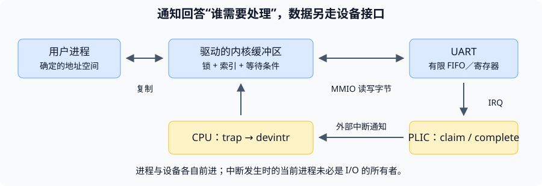

# 中断：让不同速度的执行者正确交接

本讲最重要的不是背出一长串函数名，而是回答：**设备与 CPU 独立运行，事件又随时可能到来，为什么字符既不会被错误地交给当前进程，也不需要 CPU 一直原地等待？**

前置知识是用户态／内核态、trap 入口、文件描述符和基本 C 指针。暂时只需知道锁提供互斥、`sleep` 让当前进程等待；两者的完整实现分别在后续锁与调度课程中展开。

## 1. 先分清三个“完成”

一次控制台输出可以先后经过三道边界：

1. **进程已提交字节**：内核已经从用户缓冲区取得字节，放进软件队列或交给设备。
2. **设备可接收下一个字节**：UART 的发送保持寄存器／FIFO 有可用位置。
3. **字节已在外部呈现**：串行传输、终端绘制等外部活动已推进到相应阶段。

这三个时刻不相同。`write` 返回不要求屏幕恰好已经画出字符；`uartstart` 检查的 `LSR` 位 5 表示发送保持接口可接收，不是“整条输出流水线全部空闲”。把三者混为一谈，会误以为每个字符的系统调用都必须等待一次中断。

*编者自绘：仅画控制台 I/O 的数据与通知边界。图中的双向数据箭头概括输入和输出，不表示两个方向共用一份软件队列。*

**中断是通知，不是字符本身。** CPU 从 `scause` 知道发生了外部中断，从 PLIC claim 得到设备编号，再由驱动读取 UART 寄存器。字符不会装在 `scause` 或 IRQ 编号里。

课堂完整追踪见[中文译稿](#/c/mit-6.s081-2020/lec/lec09?v=draft) 45:00–63:00；教材输入／输出过程分别见[课程资料](#/c/mit-6.s081-2020/lec/lec09?v=materials) §5.1、§5.2。

## 2. 缓冲区解决速度差，锁解决同时修改

这两件事常被错误地当成一种机制：

| 问题 | 机制 | 不能替代的东西 |
|---|---|---|
| 生产者和消费者速度不同 | 有限缓冲区 | 缓冲不会自动防止索引竞争 |
| 两个核同时操作共享状态 | 锁 | 锁不会凭空增加队列容量 |
| 当前没有数据或没有空位 | `sleep`／`wakeup` 与条件重查 | 唤醒不等于得到一份独占数据 |
| 同一核持锁时又被相同锁的中断处理程序打断 | 合适范围的关中断 | 关本核中断不会停止其他核 |

### 留一格如何区分空与满

固定 2020 `uart.c` 的读、写索引都保持在 $[0,N)$，其中 $N=32$：

$$
\text{empty}: r=w,\qquad
\text{full}: (w+1)\bmod N=r.
$$

当前排队字符数可写成 $(w-r+N)\bmod N$，最大为 $N-1=31$。例如 $r=30,w=1$，有效元素依次位于 30、31、0，共三个，不能直接用 `w > r` 判断是否有数据。

**推导留一格的必要性：**若允许再存第 32 个字符，写索引将追上读索引；而这个状态已被用来表示空。除非额外记录计数或满标志，否则只能保留一个槽位。这个结论只针对本版本的模索引实现，不能机械套到使用单调计数器的其他版本。

### 等待的是条件，不是变量会自动通知

`sleep(&uart_tx_r, &uart_tx_lock)` 中，`&uart_tx_r` 是等待通道的身份。变量值变化不会自动唤醒进程；消费端必须显式调用对应的 `wakeup`。

唤醒只把等待者变成可运行。多个等待者可能一起醒来，其中一个先占走了空间；因此恢复运行后仍需在锁保护下重查条件，不能把 `while` 换成只判断一次的 `if`。

课堂的队列演示、两个相关问题见译稿 66:00–72:00；`sleep` 释放参数锁的问答在 87:00–90:00。完整无丢失唤醒推导属于后续调度课，本页不重复提前铺开。

## 3. 输入多了一个边界：已回显不等于已提交

控制台输入的三个索引分别是：

- `r`：读者下一次取字符的位置。
- `w`：已经提交、可交付给读者的边界。
- `e`：正在编辑的输入末尾。

普通 `l` 到达后可以立即回显，并使 `e` 前进；但 `w` 不一定跟着动。这样用户还能退格或用 Control-U 撤销当前尚未提交的输入。换行、Control-D 或缓冲区满时，代码把 `w` 推进到 `e` 并唤醒读者。

因此，三个观察可以同时为真：**屏幕上已经显示 `l`；内核已保存 `l`；shell 的 `read` 仍在等待。** 不需要假设中断没收到，也不能以此认定调度器有 bug。

输入和输出的“满”也不能混同：输出上半部可以让写入进程睡眠；输入中断处理程序不会在满缓冲上睡眠等 shell，它必须快速结束当前处理。教材 §5.1 与 §5.3 解释这种上下文划分；课堂对应 72:00–78:00。

## 4. 找不到中断时，沿使能链逐层问

“我已经开中断了”通常信息不足。应当指出具体是哪一层：

| 层次 | 2020 实现中的证据 | 它决定什么 |
|---|---|---|
| UART | `uartinit` 写 IER | 设备是否生成相关通知 |
| PLIC 来源 | `plicinit` 设置非零优先级 | 这个来源是否有可投递优先级 |
| PLIC 每 hart 上下文 | `plicinithart` 设置 enable 与门限 | 哪些来源可以通知该 hart 的 S 上下文 |
| CPU 分类使能 | `start` 设置 `sie` | CPU 允许哪些 supervisor 中断类别 |
| CPU 当前接收条件 | `sstatus.SIE`、特权级、委派状态 | 此时能否进入相应 trap |
| 软件入口 | `stvec` 与入口汇编 | 接收后有没有正确保存并分派 |

`plic_claim` 是认领，`plic_complete` 是通知处理结束；它们不是同一个动作。可能多个核被通知，但同一个待处理来源不会因此交给每个核重复服务一次。若 claim 返回 0，`devintr` 不会把 0 当作 UART 编号去处理。

**两个限制：**PLIC 保留 pending 不等于拥有无限事件队列；设备缓冲仍可能溢出。`intr_off` 也只影响本核对应的中断接收条件，既不会冻结硬件，也不会把别的核都停下。

初始化过程见译稿 33:00–45:00，claim 多核问答见 87:00–90:00。

## 5. kernelvec 补读：恢复的是被打断的执行，不是“唤醒的进程”

**本节是对指定源码及官方提纲的补读。** 视频重点走了 `usertrap` 与驱动路径，并未逐条演示提纲里 `kernelvec` 保存、恢复汇编的全部过程。

如果中断发生在内核，CPU 已使用内核页表和一份可用的内核栈；`kernelvec` 因而不必再照搬从用户态进入时的 trampoline 页表切换。它在**当前内核栈**上留出 256 字节，保存通用寄存器，再调用 `kerneltrap`。

“当前内核栈”不一定是 shell 的栈：如果 CPU 正在调度器循环里，就使用调度器当时的栈；若正在某进程的内核执行中，就使用那份内核栈。设备中断不会因为数据是给 shell 的，就自动找到 shell 栈并跳过去。

`kerneltrap` 先把 `sepc`、`sstatus` 存到局部变量，调用 `devintr`。定时器路径在符合条件时还可能 `yield`，期间 CPU 的 trap 寄存器可能再次变化，所以返回前需要恢复先前保存的 `sepc`、`sstatus`。`kernelvec` 恢复寄存器，释放栈空间，最后 `sret`。

有一个有意的不对称：保存了 `tp`，却不从旧栈槽恢复它。注释说明线程可能迁移了 CPU；内核用 `tp` 标识当前 hart，不能用旧核的值覆盖新核身份。这也说明“恢复全部状态”是围绕正确执行语义，不是无条件把所有旧位模式原样写回。

由此得到一个常见问题的答案：**UART 中断唤醒 shell 后，`sret` 不一定直接返回 shell。** 它先恢复被打断的执行；shell 只是变成可运行，之后才由调度器选中。官方提纲的键盘例子用调度器被打断来说明这点；教材更一般地解释上下文限制，见 §5.3。

另一个原子性边界是 trampoline：`usertrapret` 在改写 `stvec` 前先关中断，以免内核仍在运行时，新的用户入口被错误地当作内核中断入口使用。该短过渡区不能按照“所有内核位置都随时开中断”理解。

## 6. 三个不能凭名称猜出的版本细节

### 用户 printf 与内核 printf 不走同一条路径

用户打印库逐字符调用 `write`，因此不同进程的整段格式化输出可能交错。内核 `printf` 正常情况下使用自己的 `pr.lock`，通过 `consputc` 走 `uartputc_sync`。后者轮询设备可写状态，不走可能 `sleep` 的普通 `uartputc`，可供内核打印与输入回显使用。

结论不是“中断里完全不能有锁”，而是要区分**短时自旋互斥**与**挂起当前进程等待**。上半部 `sleep` 只释放传入的锁，其他仍持有的锁不会神奇地全部释放。固定快照的 `consolewrite` 还持有 `cons.lock` 调用 `uartputc`；本页未验证这种旧版组合在缓冲满时的运行行为，不能把课堂局部解释当作对整条旧版输出路径的测试证明。

### 定时器不走 UART 的 PLIC 来源路径

2020 版本是：CLINT 定时器 → M 模式 `timervec` → 设置 S 模式软件中断 pending → 普通 S 模式 trap 路径。外部设备 IRQ 与这条本地定时器路径应分开理解。完整指定阅读在课程资料 §5.4，课堂补充问答在译稿 90:00–97:18。

### 只确认实际布局，不补造历史动机

原片 95:00 和固定快照都使用 `mscratch0[NCPU * 32]`，每 hart 跨度为 32 个 `uint64`。因此，不应从别的版本复制一个不同的变量名或更紧凑的数组布局，来替换这段课堂问题。实际槽位用途可从汇编核对，但教师当场没有解释清楚为何最初取 32；本讲保留这个未决问题，不把猜想写成答案。

## 7. 轮询与中断：比较固定成本，而非给机制排优劣

设每秒事件数为 $\lambda$，每次中断的固定开销为 $C_i$ 秒，仅入口／退出一类开销就要占用约 $\lambda C_i$ 的 CPU 时间。若这个量接近或超过 1，一个核甚至可能还没做有效数据处理就已饱和。这里是编者的简单成本模型，不是课堂实测数据。

课堂用约 $1.5\times10^6$ 包／秒说明预算不足：平均每包时间约 $0.67\,\mu s$。事件稀疏时，轮询大量返回“没有数据”，中断更划算；持续高负载时，每次轮询几乎都有工作，省下反复 trap 的固定成本就可能有利。

还可以一次通知一批请求，或者按负载动态切换。**DMA 则解决另一件事：谁来搬数据。** 中断／轮询解决何时获知状态，DMA／程序控制 I/O 解决怎样移动数据，两个维度不要混用。DMA 是教材 §5.5 的补充，视频没有系统展开；课堂成本讨论在 78:00–84:00。

## 自测

UART 有 32 字节软件数组，为什么本版只能排队 31 字节？

读、写索引相等已表示空；若全部 32 格都装满，索引又相等，状态将无法区分。满条件是下一次写索引等于读索引，所以留一格。不是所有循环队列都必须这样设计。

给 uart_tx_r 赋新值之后，等待进程会自动醒来吗？

不会。地址只是等待通道身份；消费端要显式 `wakeup(&uart_tx_r)`。醒来后还要竞争锁并重新检查空间。

用户已看到字符 l，为什么 shell 仍在 read 中睡眠？

回显与输入提交分开。`e` 已前进、字符已回显，但通常还没换行，`w` 尚未推进；消费者只能读取已提交区。Control-D 和缓冲满是其他提交条件。

UART 中断恰好打断另一个用户进程，能用它的页表把字符交给 shell 吗？

不能。被打断进程与 I/O 所有者未必相同。下半部先放入内核缓冲，真正读取该设备的进程在上半部进行用户内存复制。

在核 0 上 intr_off 后，可以不加锁访问 UART 队列吗？

不能由此推出。核 1 仍可能进入上半部或处理设备中断。关本核中断只排除一种交错来源，多核共享状态还需要互斥。

唤醒 shell 的 UART 中断必须用 shell 的内核栈吗？

不必。内核中断使用被打断位置已有的内核栈；如果当时在调度器，就用调度器栈。唤醒与切换不是同一操作。

把 UART 驱动改成 DMA，是否就无需中断和轮询？

不是。DMA 可以减少 CPU 搬运数据，但软件仍需要了解缓冲区完成、可复用或出错等状态；通知方式可以是中断或轮询。

## 阅读定位与来源

| 想继续核对的问题 | 中文译稿 | 课程资料 |
|---|---|---|
| 真实机器如何用掉物理内存 | 03:00–09:00，`top` 演示 | 上一讲缺页机制 |
| 驱动为什么需要上下半部 | 18:00–24:00 | 第 5 章导言、§5.3 |
| PLIC、CPU、设备怎样分别使能 | 33:00–45:00 | §5.1；指定 `plic.c` |
| 一次提示符输出怎样推进 | 45:00–63:00 | §5.2 |
| 环形队列和等待通道 | 66:00–72:00、87:00–90:00 | §5.2、§5.3 |
| 输入编辑与回显 | 72:00–78:00 | §5.1 |
| 高频事件为什么改用轮询 | 78:00–84:00 | §5.5 |
| 定时器 M→S 转发与 scratch 问题 | 90:00–97:18 | §5.4 |

- **V9**：Frans Kaashoek，[Lecture 9: Interrupts](https://www.youtube.com/watch?v=zRnGNndcVEA)，David Morejon 频道，2020-10-05，97:18。全文字幕驱动的自主译述在本讲中文译稿；未逐句听音。
- **O9**：MIT 课程团队，[2020 官方提纲](https://pdos.csail.mit.edu/6.S081/2020/lec/l-interrupt.txt)、[板书](https://pdos.csail.mit.edu/6.S081/2020/lec/l-interrupt.pdf)。正文为自主提炼，署名遵循官网 [CC BY 3.0 US](https://creativecommons.org/licenses/by/3.0/us/)；外链视频和嵌入的第三方手册不自动继承此许可。
- **B5**：Russ Cox、Frans Kaashoek、Robert Morris，xv6 rev1（2020-08-31），第 5 章，pp.49–54，MIT 许可；[完整中译](#/c/mit-6.s081-2020/lec/lec09?v=materials)仅保留在课程资料。
- **C20**：固定提交 [`e23d53f27f6e187732a92a2b4705639d1c260f05`](https://github.com/mit-pdos/xv6-riscv/tree/e23d53f27f6e187732a92a2b4705639d1c260f05)，核对文件与哈希见 `sources/manifest.json`。它不是录课工作树或实验分支的替代声明。未运行实验，也未测试旧源码全部边界。
- **正文源码定位**：§1–2 对照 `kernel/uart.c:87–160`、`kernel/proc.c:548–592`；§3 对照 `kernel/console.c:138–180`；§4 对照 `kernel/plic.c`、`kernel/trap.c:177–218`；§5 对照 `kernel/kernelvec.S:10–86`、`kernel/trap.c:134–160`。
- 官方提纲中有关相邻汇编指令可能被插入中断、内核栈保存／恢复的展开，在视频中讲得较简略；本页 §5 标为指定源码补读。用户态直接接收中断等提纲末尾展望，视频未实质展开，本页没有伪装成课堂结论。
