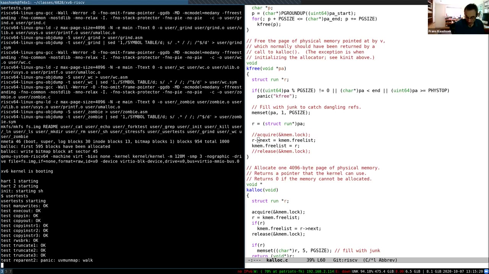
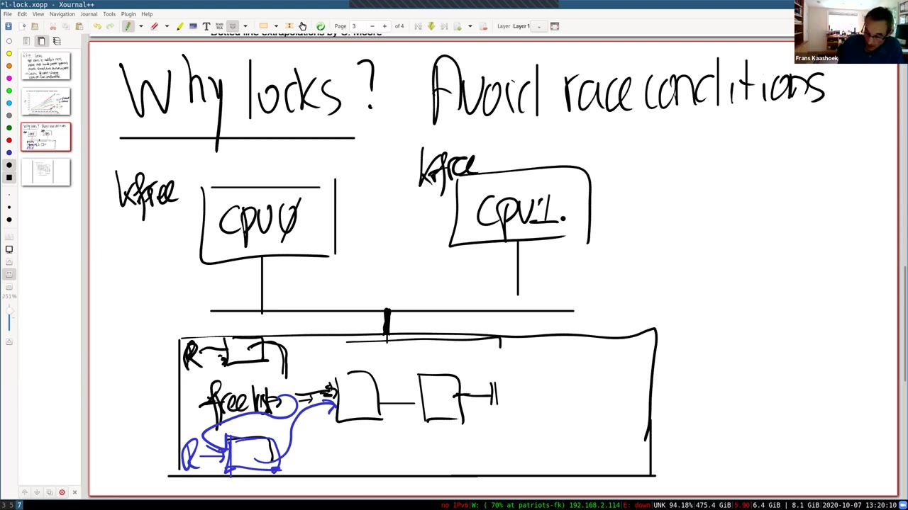
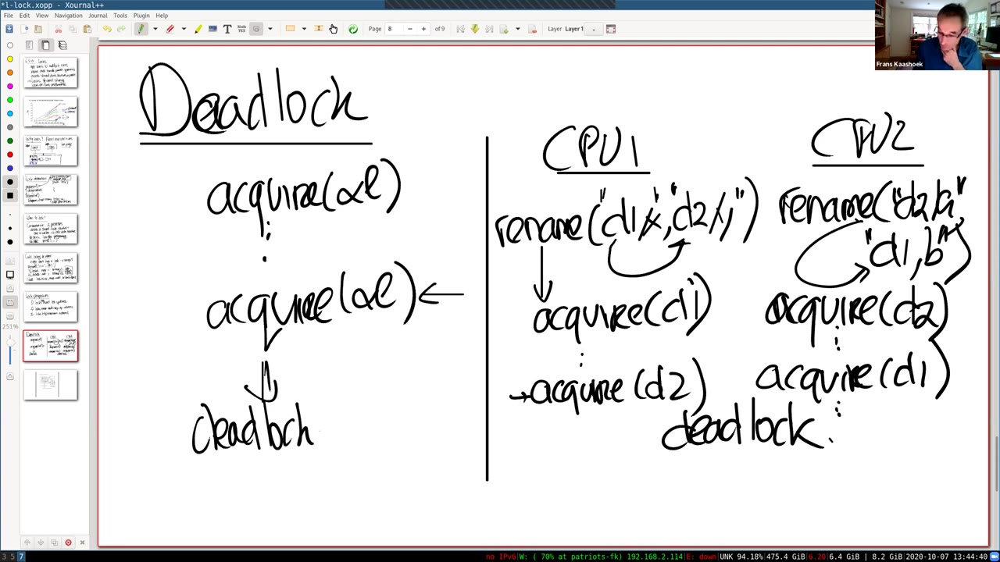
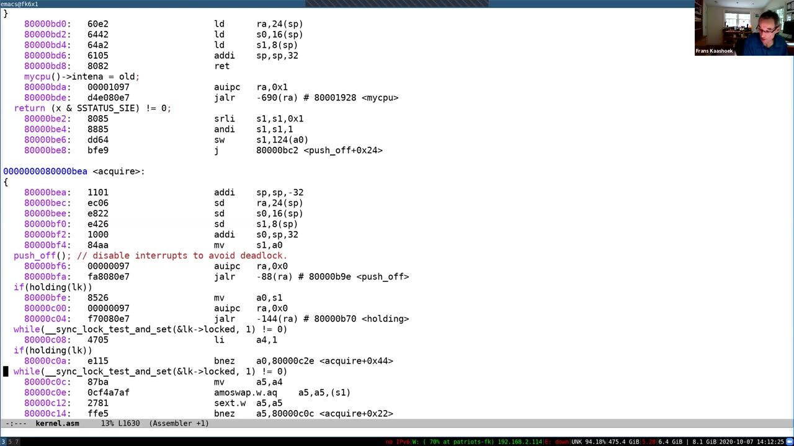

# 第 10 讲 · 多处理器与锁

## 00:00–03:00｜从 lazy 实验转到多核内核

录像开始时，课堂已经在讨论 lazy allocation 实验。开头只留下关于“有效地址”的半句话，前面的完整问题没有录入这一段字幕。Frans 接着询问几位同学的进展。一位同学说总体还好，曾在 `copyin`、`copyout` 相关路径遇到问题，现在已经解决。老师指出，这类边界情形往往不是刚开始编程就会想到的，好在 `usertests` 可以帮忙暴露它们。另一位同学尚未做完，老师提醒留意复制数据的路径。还有同学觉得最古怪的部分是判断访问何时越过栈的下边界；老师确认，这就是 guard page 一类的问题。

约 01:20，正式讲授开始。今天讨论锁。有的同学在以前的课里已经见过锁，或者至少接触过相关概念，所以部分内容可能熟悉；本讲会把重点放在操作系统和内核里，而这种环境会带来一些额外要求。

出发点并不是“内核里恰好有很多锁”，而是应用需要性能，希望利用多个处理器核。一个应用的不同执行部分运行在不同核上，也会从这些核发起系统调用。因此，内核必须能够处理并行的系统调用。系统调用在不同核上运行时，又可能访问同一份内核数据结构：从应用的并行需求，一步步就走到了内核共享数据的问题。

## 03:00–06:00｜正确共享与性能之间的矛盾

xv6 已经出现许多共享数据，例如 `proc` 相关结构、时钟计数 `ticks`；以后还会看到 buffer cache。只要多个核同时访问这些结构，而其中有写入者，就必须协调更新，让读取者看到一致的状态。锁的作用正是帮助实现这种正确、受控的共享。

麻烦在于，我们本来希望系统调用并行运行，以获得更多性能；但如果它们访问同一份共享数据，就需要锁，而锁又会把相关操作串行化。因此，锁对于正确性有帮助，对并行性能却可能不利。这是本讲反复要面对的张力：既不能因为性能而任由共享状态损坏，也不能认为把所有代码锁住之后，性能问题就自动解决了。

老师切换到一张处理器技术趋势图。横轴是年份，纵轴有多种单位，具体要看正在观察哪条曲线。图的重点是：进入 2000 年代之后，时钟频率的增长基本停滞，单线程性能的增长也显著放缓；与此同时，晶体管数量还在增长。新增晶体管不能再简单地换成单核频率的同等增长，于是硬件转向增加处理器核数。

这里用的是课堂展示的历史趋势，不是说从此每一代处理器的单线程性能都完全不再变化。讲者要说明的是：应用若想继续显著提高性能，不能只等下一颗更快的单核处理器。

## 06:00–09:00｜为了看见竞争，删掉 kfree 的锁

随着核数上升，应用必须真正利用多个核。如果应用很依赖内核，比如频繁调用操作系统服务的服务器，那么只有应用自身并行还不够，操作系统也必须能在多核上高效运行。这就是我们关心内核并行性的原因。

接下来从正确性入手：没有锁时，可能出现竞争条件。与其先只下定义，不如故意在 xv6 中制造一个问题，再观察它如何表现。

老师打开 `kernel/kalloc.c`，查看 `kfree`。内核用一条简单的空闲链表记录可用页，`kalloc` 需要页时从这条链表取，`kfree` 则把归还的页接回去。分配器有一把 `kmem.lock`，两次链表赋值放在 `acquire` 和 `release` 之间。

课堂修改只把 `kfree` 中这一对取锁、释放锁调用注释掉，留下中间两步更新：

```c
// 课堂故意制造的错误：这两句失去了 kmem.lock 的保护。
r->next = kmem.freelist;
kmem.freelist = r;
```

失去锁以后，不能再把这两步看作相对于其他链表使用者不可分割的一次操作。老师随后编译并准备在 QEMU 中运行，接下来要看“明显不安全的修改”是否立刻就会让系统坏掉。

## 09:00–12:00｜系统能启动，测试仍可能 panic

xv6 启动成功了。启动过程中已经做过内存管理工作，但系统暂时看起来正常。老师让大家先预测，再运行 `usertests`。

**学生：**可能会丢掉一些页，但也可能这次不触发竞争。

**Frans：**正是如此。竞争是否暴露，与执行时序有关，不能只看一次运行。QEMU 此时模拟三个核，这些核可以并行执行。测试开始后，一项项显示通过；与此同时，QEMU 和 Zoom 给老师的机器增加了负载，所以运行也有些慢。老师先打算回到板书，稍后再来看结果。

如果每次恰好都是一个 CPU 完成两步链表更新后，另一个才开始，就会像有锁时一样没有出错。真正危险的是，两个执行流在这些步骤之间交错。就在解释这个问题时，测试出现了 panic。



*原片 11:25，未裁剪。右侧 `kfree` 的 `acquire`、`release` 已被注释，下面 `kalloc` 的锁仍保留；左侧在 `test reparent2` 处出现 `panic: uvmunmap: walk`。前面多项测试的 `OK` 不能说明删除锁是正确的。*

老师说明，竞争可以用不同方式表现。这次确实出现了 panic；别的执行时序下，测试可能一直跑到最后，才通过空闲页数量的检查报告丢页。也有运行可能没有明显症状。接下来分析的是一个容易画清楚的“丢页”时序，并不把它冒充这次 panic 的完整根因分析。

## 12:00–15:00｜两个 CPU 怎样读到同一个链表头

老师画出两个 CPU：CPU 0 与 CPU 1 各自执行指令，都连接到共享内存。真实机器有 DRAM 控制器等硬件，这里只保留理解竞争所需的结构。空闲链表就存放在这份内存中，假设原来已有两个空闲页。

两个 CPU 大致同时调用 `kfree`，分别归还不同的物理页。函数接收物理地址 `pa`，把它当作 `struct run *r` 使用，目的是把这一页接到空闲链表头。注意，两次调用各有自己的 `r`，但读写的是同一个 `kmem.freelist`。

先看第一句 `r->next = kmem.freelist`。其中一个 CPU 先执行，让自己那一页的 `next` 指向旧链表头。但它还没来得及执行第二句时，另一个 CPU 也执行第一句。由于共享头指针还没有改变，第二个 CPU 读到的仍是同一个旧链表头。

于是，两个待归还的页都指向原来的第一项。到此为止，链表头还指着旧位置，两边都只完成了“设置新节点后继”这一步。这个中间状态正是关键：不能把两行 C 代码想象成硬件天然保证连在一起的动作。它们之间完全可能穿插另一个核的操作。

## 15:00–18:00｜覆盖链表头导致丢页，引出锁对象

两边剩下的操作都是 `kmem.freelist = r`，即把共享链表头改成自己归还的页。即使它们几乎同时发起更新，最终对同一内存位置的写入也会表现出先后：一个先写，另一个后写。

第一次写入后，链表头指向第一个新页，看起来这页已成功归还。第二次写入却让链表头改指向另一个新页，而这个新页的 `next` 仍然是此前读到的旧链表头，并没有接上第一次加入的新页。这样，从 `freelist` 再也走不到第一个新页。内存还在那里，却不在分配器管理的空闲链表上，所以丢掉了一页。



*原片 16:15，未裁剪。黑色与蓝色分别表示两个执行流使用的页和指针；两页都接向旧链表头，而共享 `freelist` 最后只能保留其中一个作为新头。*

这只是一个坏结果。如果还有更多 CPU 操作这条链表，它们可能看见短暂的中间状态，并据此继续分配或释放，结果可以比单纯丢一页更复杂。

通常用锁解决这一问题。锁也是一个普通对象，内核用结构体中的字段记录它的状态。接口很小：把锁对象的地址传给 `acquire`，然后操作共享状态；完成后把同一个对象的地址传给 `release`。下一段要明确的，是这两个函数向调用者保证什么。

## 18:00–21:00｜临界区与大内核锁

锁抽象的核心约定是：同一时刻，只有一个执行者可以成功取得一把锁。如果另一个进程也调用 `acquire`，它必须等到当前持有者调用 `release` 才有机会继续。`acquire` 与 `release` 之间的指令序列叫作临界区。

临界区里常有多条指令，合起来完成一次数据结构更新。对同样使用这把锁的其他执行者而言，这些修改表现为一个整体：它们不会进入更新到一半的临界区，也不会出现刚才链表例子中的指令交错。老师用“全部一起执行”来描述这一点；它说的是相对于其他持同一锁的访问者的原子效果，不是把多条指令变成一条硬件指令。

一个程序通常有很多把锁，xv6 也是如此。原因还是性能：一把锁会串行化争用它的执行流。如果整个内核只有一把锁，那么每个系统调用进入内核时取得它，完成后释放，所有内核中的系统调用工作都会轮流执行。这种方案就叫大内核锁。

即使应用在多个核上并行运行，进入这样的内核之后，也只有一个执行者能工作。所以大内核锁很容易限制并行性。为了让独立的操作同时执行，通常需要多把锁，分别保护不同的状态，而不是让每个操作都排在同一条队列里。

## 21:00–24:00｜锁与数据的对应关系由程序员维护

如果两个系统调用访问不同的数据、使用不同的锁，它们就有机会真正并行执行，不必互相等待。这就是为内核设置多把锁的动机。

但锁的接口并不会自动保证开发者使用正确。`acquire` 不知道你下一步要操作哪个数据结构；结构体里放了一把锁，也不意味着访问其中任何字段都会自动取锁。到底哪把锁对应哪些数据，何时取得、何时释放，都是程序员需要安排并遵守的规则。少放一个 `acquire`，或者拿错一把锁，都可能破坏预期的原子性。

那么，什么时候应该加锁？老师先给一个保守的判断准则：**如果两个执行者会访问一个共享数据结构，并且至少一个会修改它，就应该用锁保护这份数据。** 这更像编程时的红旗提示，而不是一条穷尽所有正确程序的数学定理。

看到这样的访问模式时，应当立刻想到：这里可能存在竞争，需要安排协调。起步时使用这条保守规则很有帮助，尤其是在还没有足够理由证明某种特殊无锁方案正确的时候。锁限制并行性，并不构成忽略竞争的理由；先要有一个正确的访问协议。

## 24:00–27:00｜规则的边界，以及“锁自身会竞争吗”

这条规则在一方面太严格：存在无锁编程方式，允许多个执行者访问同一数据结构，其中也可以有写入者。它们往往是为了更好的并行性或性能而设计的。不过，无锁编程比用锁更难，学期后面才会接触一些内核里常见的做法。本讲及大部分课程先用锁控制共享，因为这件事本身已经足够复杂。

另一方面，这条规则又可能太宽松。锁不只用于保护一个明显的内存数据结构。例如，内核 `printf` 希望把一个字符串完整输出，不要让来自多个执行者的字符交错。即使你没有立刻找到一个“被保护的普通共享结构体”，仍然可能需要锁来串行化这种外部可观察行为。

**学生：**会不会两个进程同时取得锁，因此仍然同时修改数据结构？

**Frans：**锁抽象的契约恰恰就是禁止这种情况。任何时刻，一把锁只能有一个持有者，或者没有持有者。两个进程可以同时尝试获取，但不能同时成功持有。后面会看实现怎样保证这一点；现在先把它作为 `acquire` 必须满足的规格。

刚才故意删掉 `kfree` 的锁，是一种比较容易识别的竞争，竞争检测工具也能帮助发现。但在更复杂的操作中，问题不只是忘记某次取锁，还涉及一个操作究竟要保护多大的范围。

## 27:00–30:00｜每个对象自动加锁，为什么仍然不够

既然共享结构需要锁，能否让语言或编译器自动做这件事？例如，每个 `struct` 都附带一把锁，访问或修改结构体时，自动取得它，操作结束后自动释放。这样似乎能减少程序员漏加锁的机会。

问题是，这种逐对象、逐次操作的方案太死板。老师用文件重命名举例：假设有一个 `rename("d1/x", "d2/y")` 操作，把目录 `d1` 下的名字 `x` 移到目录 `d2`，改成 `y`。这里讨论的是一个操作系统接口示例，并不是说 xv6 本身已经提供了这个系统调用。

按刚才的自动方案，可能先取得目录 `d1` 的锁，删除 `x`，然后释放 `d1`；接着取得 `d2` 的锁，加入 `y`，再释放 `d2`。两个目录各自的内部修改都有锁，单独看每次目录操作，似乎没有问题。

老师问：为什么整个方案还是错误的？关键不是某个目录里的指针写坏了，而是完整的重命名被拆成两个分别可观察的步骤。在第一步已经完成、第二步还没开始的间隙，其他进程能够看见什么？这个问题要求我们从“每次访问有没有锁”转向“整个操作应该向外表现出什么语义”。

## 30:00–33:00｜隐藏重命名的中间状态

**学生：**文件看起来消失了。

**Frans：**对。在删除旧名字之后、加入新名字之前，外部可能看到文件没有名字可达。但我们本来只是重命名，并不想暴露一个“文件暂时不存在”的中间状态。为了让这个操作对外表现为整体，应该先取得 `d1` 与 `d2` 两把锁，再完成删除和添加，最后释放两把锁。

这说明，操作需要持锁的范围，并不总等于某一次结构体访问的范围。重命名涉及两个对象，它必须把两边的修改包在同一个协调范围里。程序员需要控制从哪里开始持锁、到哪里才释放，而不是让朴素的“每个对象访问完就解锁”方案替自己决定。

**学生：**那么能否规定，操作一开始就把接下来会用到的所有数据结构的锁都拿到？

**Frans：**这是一种办法。但若过分保守，获取范围不断扩大，就很容易接近大内核锁的效果，失去并行性。这正是粗粒度加锁与性能之间的张力：大范围持锁让推理简单，却可能因为争用降低性能。当然，是否真的降低性能还取决于有没有别的执行者需要同一把锁。

于是，锁的设计不只是“用或不用”两个选项，还包括哪些状态一起保护、在哪个范围内保持原子性，以及这样做会阻止哪些本来可以并行的工作。

## 33:00–36:00｜理解锁的三种视角

老师提出三种理解锁的方式，可以选择最适合当前问题的一种，但最好都熟悉。

第一种是**避免丢失更新**。这是很底层的视角：在 `kfree` 例子里，某次对链表头的更新被后来的写入覆盖，归还的一页没能保留在链表里。正确使用锁后，两次归还都应当体现在最终链表中。

第二种是**让多步骤操作具有原子性**。先取锁，再完成多条指令，最后解锁，使其他遵守同一协议的执行者只能看到操作之前或操作之后的状态，而不能插入这些步骤之间。重命名的例子尤其适合这样理解：需要整体发生的并不只是一个字段赋值。

第三种是**维护数据结构的不变量**。没有持锁者时，数据结构应该满足约定的性质；取得锁并开始更新之后，可以暂时破坏某些性质；释放锁前必须恢复它们。其他执行者通过取锁，避免在这些性质暂时不成立时使用结构。

以空闲链表为例，我们希望空闲页正确连接成一条链，头指针与各个 `next` 一致地描述这条链。加入一页的中途，新页已经指向旧头，但新的头指针尚未发表，操作仍未完成。对于链表，这个不变量相对简单；对于复杂结构，用“不变量是什么、什么时候允许暂时不成立”来思考，通常比只盯住单个变量更有帮助。

## 36:00–39:00｜锁也会引入错误：自我等待与多锁死锁

锁能解决竞争，但用得不对也会引入新的问题。首先是死锁。

最简单的例子是：一个执行者已经 `acquire(&l)`，还没有 `release(&l)`，就在临界区内再次对同一把锁调用 `acquire`。按这里的锁规格，第二次获取不能继续，因为锁还没有释放；但能释放它的就是当前被卡住的执行者自己，于是形成自我等待。

这不是 xv6 支持的递归锁用法。xv6 会检查当前 CPU 是否已经持有该锁，发现重复获取时直接 panic，而不是任由它永远自旋。这个例子很简单，更值得注意的是多把锁参与的情形。

回到重命名。CPU 1 执行 `rename("d1/x", "d2/y")`，CPU 2 则反向执行 `rename("d2/a", "d1/b")`。名字特意不同，强调问题不依赖于两次操作使用同一个文件名；关键是两次操作都需要目录 `d1` 和 `d2`。

我们已经知道，一次重命名必须同时持有两个目录的锁。但如果程序仅仅按参数先后顺序取锁，CPU 1 会先取 `d1`，CPU 2 会先取 `d2`。接下来，就有可能把两个正确的“局部取锁动作”组合成一个无法前进的系统。

## 39:00–42:00｜两个目录的反向取锁与统一顺序

假设两个 CPU 真正并发执行，CPU 1 已取得 `d1`，CPU 2 已取得 `d2`。CPU 1 接着调用 `acquire(d2)`，但锁在 CPU 2 手里，所以它等待。CPU 2 接着调用 `acquire(d1)`，锁又在 CPU 1 手里，所以它也等待。两边都不会先释放已经取得的锁，因为它们都还没进入能够完成操作和解锁的位置。这就是多锁死锁。



*原片 40:45，未裁剪。左边是重复获取同一把锁的简单死锁；右边 CPU 1 按 `d1→d2` 取锁，CPU 2 按 `d2→d1` 取锁，两边都等待对方。*

解决办法是给锁规定顺序，并要求所有相关操作都按这个顺序获取。比如，在这个例子里规定 `d1` 总在 `d2` 前面；更一般地，可以规定先获取编号较小的目录锁，再获取编号较大的目录锁。

这样，两个重命名调用虽然参数方向相反，真正取锁时却都按 `d1→d2` 进行。它们会首先在同一把锁上排队，而不会一边拿住第一把、另一边拿住第二把再互相等待。重要的是按共同的锁顺序，而不是按每次调用的参数顺序。

## 42:00–45:00｜全局锁顺序会穿透模块边界

统一取锁顺序解决了刚才的循环等待，但它也暴露一个系统设计问题：这个顺序是跨调用、跨模块的，不能只在每个函数内部独立决定。

老师画出模块 M1 的函数 `g` 调用模块 M2 的函数 `f`。如果 `g` 已经持有某些锁，而 `f` 内部还会获取其他锁，那么 `g` 的作者可能必须知道 `f` 要用哪些锁，才能保证整条调用路径符合共同的顺序。不能只说“`f` 内部已经加好了锁，所以调用它总是安全的”。

理想的模块抽象希望调用者只知道接口，不必知道内部实现。然而，加锁要求经常使 M2 的部分内部信息暴露给 M1：至少哪些锁会被取得、在什么情况下取得、调用前允许持有哪些锁，都可能成为接口契约的一部分。

因此，锁会让模块化设计复杂起来。一个函数内部看似很小的加锁改动，也可能影响调用它的其他模块。如果调用者仍按旧的理解持锁调用，新组合就可能违反全局顺序。这里的重点并不是反对模块化，而是提醒：在并发代码中，锁协议本身常常就是模块接口的一部分，不能当作完全隐藏的实现细节。

## 45:00–48:00｜是否必须给所有锁排一个总序

**学生：**需要给所有锁一个完整顺序吗？有没有一些锁可以任意排序？

**Frans：**这取决于它们是否会一起使用。xv6 中存在不同的锁顺序链。有些锁集合互不相关，从来不会一起获取，那么这些集合的顺序可以独立安排。真正需要一致的是：所有操作同一组、可能一起取得的锁的函数，要同意共同的顺序。并不是说每一把彼此毫无关系的锁都必须放进同一条有意义的全序链。

除了死锁和模块化，第三项挑战是性能。如果只有一把大内核锁，内核并行能力就被限制在一个 CPU 上。想让吞吐量随核数增长，就需要拆分共享数据结构及其锁，让不同 CPU 尽量使用不同的部分。

如何拆分并不显然。文件系统应给每个目录一把锁，还是每个 inode 一把？进程管理按每个进程加锁是否合适？有时还需要换一种数据结构组织方式。每次修改加锁协议，都必须重新确认原有不变量还成立；分裂一把锁也常常意味着重写相关代码，而不是机械地增加几个锁对象。

## 48:00–51:00｜先粗粒度，再测量，再有针对性地拆分

为了获得更好的并行性能而重构内核，往往工作量很大。必须拆数据结构、引入新锁、重新推理不变量，还可能改写算法。因此，“锁越细越好”不是一条实用的起步建议。

老师建议先从粗粒度锁开始，然后测量。运行实际应用，观察利用更多核时是否有加速。如果并行表现已经足够好，现有锁设计就可能够用了。只有测量表明某把锁存在争用，多个进程总在等同一把锁，才值得重新设计那部分系统。

有些模块虽然只有一把大锁，却很少被并发调用，或者本身占用时间很短。为了它付出大规模细粒度重构的代价，未必有收益，还会让正确性推理更难。合理的流程是：先实现一个容易理解的正确方案，测量争用，再针对真正限制并行性的地方改进。

> **编者注：** 课堂把“没有加速”与锁争用联系起来，是围绕本讲主题的诊断方向；实际性能没有提升，也可能由其他瓶颈造成，因此仍需测量锁的等待情况。

随后，老师开始查看 xv6 里的实际用锁场景，选择上节课已讨论过的 UART 驱动。现在不再只是看字符怎样发送，而是要逐项解释：那把锁究竟保证了什么。

## 51:00–54:00｜UART 发送队列：一把锁保护一组状态

在 `uart.c` 中，发送路径有一把 `uart_tx_lock`。相对于整个 UART 发送模块，这是相当粗粒度的设计。它保护发送缓冲区 `uart_tx_buf`，以及读位置和写位置。

写位置指向下一个可以放入待发送字符的槽；读位置指向下一个应交给 UART 发送的字符。老师用生产者—消费者图来表示：产生输出的程序向缓冲区追加字符，UART 发送侧从另一端消耗。沿环形队列的逻辑方向，读位置到写位置之间是尚待发送的字符，另一段则是可用空间；锁帮助维持这些位置与内容之间的关系。

再看 `uartputc`。它先取得锁，如果缓冲区有空间，就写入字符、推进写位置、调用启动发送的函数，然后释放锁。若两个进程同时输出字符，锁保证一个进程放入当前槽，另一个使用接下来的槽，而不是两者都看到同一个空位置，后写的字符把先写的覆盖掉。

这里必须把“写字符”和“更新位置”一起看。只保护缓冲区数组却不保护索引，或者只保护索引却允许字符内容与索引不同步，都会破坏队列协议。这也是为什么锁保护的是一组状态及其不变量，而不是一个孤立变量。

## 54:00–57:00｜锁还协调发送状态与硬件寄存器

老师继续查看 `uartstart`。队列中有字符时，发送路径会把字符交给 UART。锁的作用不只是在两个写进程之间选择下一个空槽，还要协调队列的推进与正在进行的发送，避免一个执行流在另一个执行流处理发送状态时，错误地改动相关状态。

板书把这概括为“队列发送端的字符正在传输”。理解这句话应注意区分软件缓冲区与硬件：程序从缓冲区取出字符后，会推进读位置，再把字符写入 UART 的发送寄存器。不能把板书的队首位置当成一份始终精确标识“硬件现在正在移出哪个字节”的记录。

另一个职责是确保对硬件寄存器的协调访问。UART 的发送保持寄存器 `THR` 只有一个。`uartstart` 的调用者必须已经持有锁，因而在这条受锁保护的发送路径中，不会有两个执行者同时检查状态、各自以为可以发送，再彼此覆盖写入。

发送完成或硬件可接收更多数据时，会发生中断。中断处理程序也可能调用 `uartstart`，所以它同样必须遵守锁协议。接下来要考虑的并发来源，不再只有两个普通进程，还包括驱动的上半部与中断下半部。

> **编者注：** 课堂用 `printf` 泛指产生字符的调用者。固定参考快照中，内核 `printf` 走 `uartputc_sync`；此处围绕 `uart_tx_lock` 的讨论针对缓冲发送路径 `uartputc` / `uartintr`，不应扩大成“所有 UART 寄存器访问都由这一把锁覆盖”。

## 57:00–60:00｜中断下半部也取锁；先写一个错误的 acquire

假设 CPU 0 上的进程正在输出，而 CPU 1 接收了 UART 中断。CPU 1 的中断处理程序会执行发送推进代码，与 CPU 0 上的驱动上半部真正并行。因此，要维护缓冲区的不变量并协调硬件寄存器访问，中断处理程序也必须取得 `uart_tx_lock`，调用 `uartstart`，最后释放锁。

这说明“中断处理程序”并不意味着可以不加锁。它可能运行在另一个核上，和普通内核代码同时使用相同状态。老师暂时留下另一个更微妙的问题：如果中断与持锁代码在同一 CPU 上发生，锁实现还需要什么保证？后面再回来解释。

接着转入锁的实现。规格仍然是：任何时刻至多一个持有者。老师先写一个故意错误的 `acquire`：不断循环；如果发现 `l->locked == 0`，就把它设为 1，然后返回；若已经是 1，就继续循环等待。

```c
// 课堂反例：检查与置位之间可以发生竞争。
while (1) {
  if (l->locked == 0) {  // A
    l->locked = 1;      // B
    return;
  }
}
```

它看似实现了“等到空闲再占有”，但两步之间仍然存在和普通共享数据相同的问题。

## 60:00–63:00｜检查与置位必须成为一个原子步骤

**学生：**两个进程可能同时读到锁还没有被持有。

**Frans：**对。把执行顺序画出来，CPU 0 与 CPU 1 都来到 A，都读到 0，然后两者都执行 B，把字段写成 1，最后都返回。锁字段虽然只剩一个 1，但两个执行者都以为自己取得了锁，互斥规格已经被破坏。

因此，不能只靠一次普通读取，再加一次普通写入来实现获取。需要把“取得旧值”和“写入占用标志”合成一个不可分割的操作。解决方式有多种，最常见的是借助处理器提供的原子硬件指令，也就是 test-and-set 一类的支持。

RISC-V 中可以使用原子内存交换指令 `amoswap`。老师用概念步骤说明它：给出一个内存地址、要写入的新值，以及接收旧值的寄存器；硬件在这次操作期间保证对该地址的读取和写入不能被别的 CPU 插入。先读出旧值保存，再把新值写进去，最后把旧值交给调用者。

这里所谓“锁住地址”是理解原子效果的概念模型，不是用另一把 xv6 软件锁来实现它。否则只会把“锁怎么实现”的问题无限往下推。真正承担底层协调的是硬件。

## 63:00–66:00｜原子交换由硬件怎样保障

原子交换的外部语义很清楚：读取旧值、写入新值、返回旧值，这几个动作作为一个整体发生。大多数处理器都有适合实现锁的原子指令。这样，我们把软件锁的最底层原子性要求交给了硬件。

不过，指令集规定的是行为，不规定内部唯一的实现方式。具体怎样完成，取决于机器的内存系统。

如果多个处理器的读写都经过同一个内存控制器，控制器就可以协调顺序，使一个处理器的这次读改写在其他访问插入之前完成。如果处理器连在共享总线上，总线仲裁机制可以支持这种不可分割的内存操作。如果各 CPU 有自己的缓存，则通常需要缓存一致性协议配合，把相应缓存行的修改权协调给一个 CPU，并在原子操作期间保持所需的独占性。

所以，不要把 `amoswap` 理解成所有机器上都通过同一种“锁总线”电路实现。实现机制可以不同，但软件依赖的保证必须相同：针对同一锁字的并发原子交换不能互相穿插成两次都成功读到空闲的操作。

有了这个基础，接下来就可以看 xv6 怎样把一个原子交换包装成完整的 `acquire` 和 `release`，并补上内核环境中的其他要求。

## 66:00–69:00｜从 spinlock.h 到实际的 amoswap

老师先打开 `spinlock.h`。结构很简单：`locked` 是占用标志；另外还有锁的名字，以及当前持锁 CPU，用于调试。比如同一 CPU 对同一把锁重复获取，就可以据此报告错误。

再看 `acquire` 中的循环：

```c
while (__sync_lock_test_and_set(&lk->locked, 1) != 0)
  ;
```

这个接口要求原子地把 1 写到锁字，并返回原来的值。它提供了可以跨处理器体系结构使用的 C 级接口，由工具链生成相应硬件指令。课堂口述把它称为 C 标准定义的操作；更准确地说，xv6 这里使用的是编译器的 `__sync_*` 原子内建接口，而不是 ISO C 标准函数。

老师切到 `kernel.asm`，寻找 `acquire` 对应的指令。可以看到 `amoswap.w.aq a5, a5, (s1)`：`s1` 保存锁字地址，`a5` 在执行前提供要写入的 1，执行后接收旧值。后续分支决定继续自旋还是离开循环。



*原片 68:30，未裁剪。底部依次可见 `mv a5,a4`、`amoswap.w.aq a5,a5,(s1)`、`sext.w`，以及 `bnez a5,...<acquire+0x22>`；非零旧值会跳回循环。*

老师现场辨认跳转地址时略有犹豫，随后回到 C 代码解释条件。这里应以返回旧值的语义和已查看的汇编为准，不把临时口误整理成反向分支规则。

## 69:00–72:00｜旧值决定成功与否，release 原子清零

若锁原来空闲，`lk->locked` 为 0，原子交换把它改成 1，并返回 0。循环条件“返回值不等于 0”不成立，于是结束自旋，调用者取得锁。多个 CPU 同时尝试时，只有一个能遇到那个从 0 变为 1 的时刻。

若锁原来已经是 1，原子交换读出 1，又把 1 写回。它不会让锁变成别的状态，返回的旧值仍为 1，循环条件成立，调用者继续等待。等持有者把锁释放为 0，后续某次交换才有机会成功。这就是“自旋锁”名称的由来：等待者在循环里反复尝试。

老师接着查看 `release` 及其汇编。释放锁也使用原子操作，把 0 写入 `lk->locked`。这里不需要等待循环，因为释放者本来就应该是持有者；它要做的是明确地把锁重新变为空闲。

随后老师问，为什么不直接写一条普通赋值来清零？不能仅从一行 C 源代码推断它在所有工具链、所有体系结构上都是符合需要的原子内存操作。这个问题引出下一段关于底层实现保证的讨论。

## 72:00–75:00｜清零的保证与关闭中断的问题

**学生：**是否因为另一个进程可能同时向锁写 1，或者写 0？

**Frans：**并发访问锁字当然可能发生，但这里想强调的是，很多人自然地把“一次存储”想成不可分割的动作，而具体保证仍与体系结构有关。老师用缓存行的加载和更新作为直观说明，解释为什么不能只凭表面的存储语句猜测底层行为。xv6 选择显式的原子接口，就是为了依赖明确的原子性约定。

> **编者校正：** 缓存内部有多个微操作，本身并不等于一条架构可见的普通存储会被其他核观察成非原子操作；也不能由“缓存行大于整数”推出整数存储必然不原子。此处保留课堂讨论的动机，正确结论是要区分 C 赋值、具体指令的对齐与原子性保证、以及内存顺序，不能混为一谈。

老师还打开 RISC-V 手册，展示原子交换不是唯一的原子指令。还有原子 AND、OR、最大值、最小值等，可以把对同一内存位置的读与修改结合成原子操作。

接下来回到 `acquire`。函数开头还有一个很重要的动作：关闭中断。为什么取锁要管中断？老师让大家想象错误版本的 `acquire` 没有这么做，然后回到 `uartputc`：它已经持有 `uart_tx_lock`，此时若还允许中断，会发生什么？

## 75:00–78:00｜同核中断会把持锁者困住

**学生：**可能发生时钟中断，随后又需要打印，重新进入输出路径，但锁已经被占用了。

**Frans：**这可以成为一种情形，不过 UART 本身就提供了更直接的例子。`uartputc` 已经取得锁，此时 UART 完成之前的字符传输，触发中断；`uartintr` 开始运行，而它也要取得同一把锁。

先只考虑一个 CPU。中断处理程序在等待锁，原先的 `uartputc` 则被中断暂停了。它只有在中断处理程序返回后才能继续，释放锁；中断处理程序又只有取得锁、完成处理后才能返回。因此出现死锁。xv6 的调试检查实际上会识别同一 CPU 重复获取同一把锁并 panic，但问题本身是这条无法前进的依赖关系。

所以，自旋锁要处理两种并发：不同 CPU 同时运行，靠锁字的原子获取协调；同一 CPU 的代码被中断打断，则必须防止中断处理程序重入同一个受锁保护的区域。xv6 在 `acquire` 里先关闭本核中断，释放锁之后才通过 `pop_off` 恢复原有中断状态。其他 CPU 仍可执行，仍需要真正的锁。

最后还有一个微妙问题：即使取锁本身原子，中断也正确处理，编译器与 CPU 会不会改变共享数据访问的顺序？老师开始用 `x = x + 1` 的小例子引入内存顺序。

## 78:00–81:00｜为什么锁字正确还不够：重排与屏障

想象一个执行流：先把锁变为已持有，接着在临界区里执行 `x = x + 1`，最后把锁改回空闲。

对于完全串行的执行，`locked` 与 `x` 是不同的内存位置。如果只考虑这个执行流最终的结果，把对 `x` 的更新移到清零锁字之后，可能没有差别。编译器会为了优化调整指令顺序，CPU 也会通过乱序执行等方式提高性能；它们通常只需要保持规定的可观察行为，不会自动知道程序员心中的“这几行是一段临界区”。

但在并发执行时，这种移动会造成灾难：清零锁字相当于对其他 CPU 宣布临界区结束，而真正的数据更新还没完成。另一个 CPU 可以取得锁，与原持有者的 `x` 更新发生重叠。源码中看起来位于 `acquire`、`release` 之间的访问，实际上已经跑到受保护范围外。

为约束这种重排，锁实现需要内存屏障或 fence。xv6 的 `acquire` 和 `release` 都有 `__sync_synchronize()`，向编译器与处理器表达顺序要求。特别是释放前的屏障，不能让临界区里的加载、存储越过这个边界，跑到对外宣布释放之后。取得锁之后的相应约束，则不能让临界区访问抢到成功获取之前。

## 81:00–84:00｜屏障问答与设计建议

**学生：**如果编译器发现一条取锁之前的指令也可以放到释放之后，它能跨过整个临界区移动吗？还是会被屏障挡住？

**Frans：**这里 `acquire` 和 `release` 都有屏障。可以把它们看成两个边界：相关内存访问不能任意穿过边界；临界区中的访问保持在两者之间。老师在板书上标出 barrier 1、barrier 2，用它们说明前面、中间、后面这些内存访问区域的关系。

> **编者注：** 屏障主要约束内存访问及其可见顺序，不意味着所有与内存无关的寄存器计算都必须逐条保持原来的物理执行顺序。这里也不是对所有体系结构 acquire/release 语义的完整定义，而是在解释 xv6 的保守实现。

正式讲授进入收尾。锁有助于正确性，却可能损害并行性能；锁还让编程复杂。后续实验和源码阅读会不断遇到锁，不能只知道它们“防竞争”，而要说明每把锁在哪里、保护什么、为什么覆盖这个范围。

最直接的简化办法是：不需要共享，就不要共享。没有共享数据，就不需要为这类竞争建立复杂的锁协议。确实需要共享时，先采用粗粒度、便于理解的方案，后面再根据测量判断是否值得细化。

## 84:00–87:00｜课后追问：amoswap 已有 aq/rl，fence 还需要吗

老师补充，使用竞争检测工具也很重要。即使代码里已经有锁，放错 `acquire`、`release` 的位置仍会留下竞争。课程后面会继续学习锁，也会在学期末讨论内核中的无锁编程。约 84:45，老师宣布正式讲授结束，有其他安排的同学可以离开，想继续问的同学可以留下。

**聊天区提问：**`amoswap` 可以带 acquire/release 顺序标志，那么 fence 是否多余？

**Frans：**同步接口承担两层工作，一层是约束编译器，一层是约束硬件。编译器知道目标体系结构，也知道要针对相应内存模型生成哪些指令。不同硬件的内存模型不同，具体要插入哪些 fence，就要结合目标架构判断。

**学生继续追问：**问题正是如何只约束编译器。假设汇编里已经用了带 `.rl` 的原子交换，它已经提供所需硬件顺序，那么怎样阻止编译器移动内存访问，又不额外发出 fence？如果简单调用当前同步接口，似乎两层都会做。

老师承认这是很好的问题。专门针对 RISC-V 优化的取锁、释放实现，可以比 xv6 现在这种较粗的、显式使用屏障的方式更精细。这类优化需要更仔细理解内存模型，不能仅看到一个 `.aq` 或 `.rl` 后缀，就把其他顺序要求一概删掉。

## 87:00–90:00｜编译器屏障和硬件顺序不能含糊合并

老师建议，有兴趣可以读 RISC-V 非特权指令手册中关于内存顺序的章节；这里的规范相当细致。

**学生：**所以编译器会因为我们放进了那条汇编指令，就自动知道不该移动其他内存访问吗？

**Frans：**当前讨论的 `__sync_synchronize` 是由编译器提供的接口，可以有不同实现；编译器知道它的语义。

**学生再次澄清：**编译器自己也会做加载、存储重排。我想问的是，不产生 fence 的前提下，怎样禁止编译器做这些优化？

老师说明，当前同步接口同时告诉编译器和硬件顺序要求；如果目标平台、已提供的硬件保证满足条件，实现不一定非要额外发出同样的指令。学生接着指出，RISC-V 本来就允许相当宽松的硬件顺序，因此需要把“编译器不能移动”与“硬件使用 acquire/release 保证顺序”分别安排。

最后老师把结论收束为：确实存在比这个粗粒度同步接口更细的接口，可以让程序员更精确地表达顺序要求，也给编译器更多空间；但他不能当场凭记忆给出这些接口的准确细节。课堂没有完成一个具体的、已验证的替代实现，因此不能把这段问答整理成“直接删除 fence 即可”的答案。

约 89:36，另一位学生问：前面主要讨论多个 CPU，如果是在一个处理器上运行多个线程，是否仍可用相似的方式推理？

## 90:00–92:56｜单核线程仍有临界区，队列读位置为何落后

老师请学生重复问题，确认讨论的是“多个线程、但只有一个 CPU”。概念上仍然类似：某些内核指令序列必须作为整体执行，仍需要临界区。单核内核不一定需要与多核完全相同的原子自旋获取机制，但仍必须防止不合适的中断或切换打断更新。许多较老、假定单处理器的内核，没有现在这种完整的 `acquire`/`release` 形式，而是用关闭、恢复中断之类的机制保护相应区域。

同一位学生再问 UART 队列的图：读位置为什么总是在写位置后面？

老师回到缓冲区图。写入者不断把新字符追加到缓冲区，而发送者要把已经放入的字符交给显示设备。不可能发送一个尚未放进缓冲区的字符，因此消费进度只能跟着生产进度走。发送者处理前面的字符时，其他输出调用可能继续追加字符，使写位置进一步前进；发送者再向前消费下一个。

等发送者赶上写入者，读、写位置相同，就表示缓冲区已经没有待发送字符。这里的“落后”指队列上的逻辑进度，不是说环形数组两个索引在普通整数大小上永远满足 `r < w`；回绕以后不能这样比较。

学生表示理解，向老师道谢。老师询问还有没有问题，随后与留下的同学告别，录像结束。字幕最后一句从 92:54.719 开始，其显示结束时间略超出视频容器时长；本页按元数据中的 92:56 封顶，没有把超出的字幕显示时长当成额外课堂内容。

## 来源、校订与覆盖说明

- 视频：Frans Kaashoek 主讲，David Morejon 频道发布，2020-10-07，*6.S081 Fall 2020 Lecture 10: Multiprocessors and Locks*；视频 ID `NGXu3vN7yAk`，元数据时长 5,576 秒。由课程 2020 官方课表链接定位。
- 文字依据：无人工英文字幕，已获取并全读 2,332 条英文 ASR；原始首条从 0.080 秒开始，末条显示至 5,577.760 秒。00:00 开始已是课前交流的半句话；正文保留可辨认内容，不补造此前问题。字幕中的 `k3`、`calc`、`logs`、`view art`、`coffee` 等按上下文、板书和源码分别校订为 `kfree`、`kalloc`、locks、UART、`copyin`/`copyout` 等；未逐句听音确认。
- 官方提纲 [`l-lockv2.txt`](https://pdos.csail.mit.edu/6.S081/2020/lec/l-lockv2.txt) 与 [16 页板书](https://pdos.csail.mit.edu/6.S081/2020/lec/l-lock.pdf) 已读、已查看。提纲说演示可能通过测试却丢页；实际录像 11:25 显示 panic，正文按录像说明。提纲另列的长等待与 blocking locks 没有被扩写成虚构课堂讲授，完整教材讨论见「课程资料」§6.7。
- 课堂截图为原片 11:25、16:15、40:45、68:30 的真实单帧，均已用图像读取工具查看，未裁剪；没有把官方 PDF 板书冒充视频截图。首次 HLS 单帧请求超时，改用直接 MP4 流后四帧成功，未保存全片音视频或签名媒体地址。
- 校对源码为固定 `e23d53f27f6e187732a92a2b4705639d1c260f05` 的 `spinlock.h/c`、`kalloc.c`、`uart.c`；它仅作辅助参考，不声称就是录课工作树或实验分支。课堂修改与运行结果来自视频，本次没有运行 xv6 或任何实验。
- 视频授权未明确，不把课程网站 CC 许可套用到外链视频；正文使用自主组织的中文译述，整理了口头重复、停顿和不完整句。技术纠正另行标明，尤其是 `__sync_*` 的身份、存储原子性、UART 同步路径、最后的内存顺序问答。
- [课程笔记](#/c/mit-6.s081-2020/lec/lec10?v=notes) 提炼不变量、三层保证与自测；[课程资料](#/c/mit-6.s081-2020/lec/lec10?v=materials) 为教材第 6 章完整中译。逐段证据对应在 `sources/coverage.json`；未做全片音频、全片画面复核。
