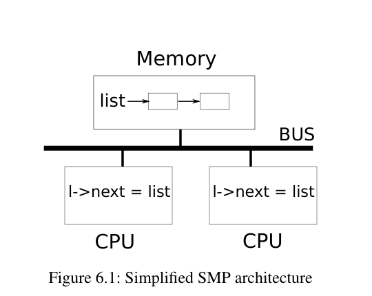
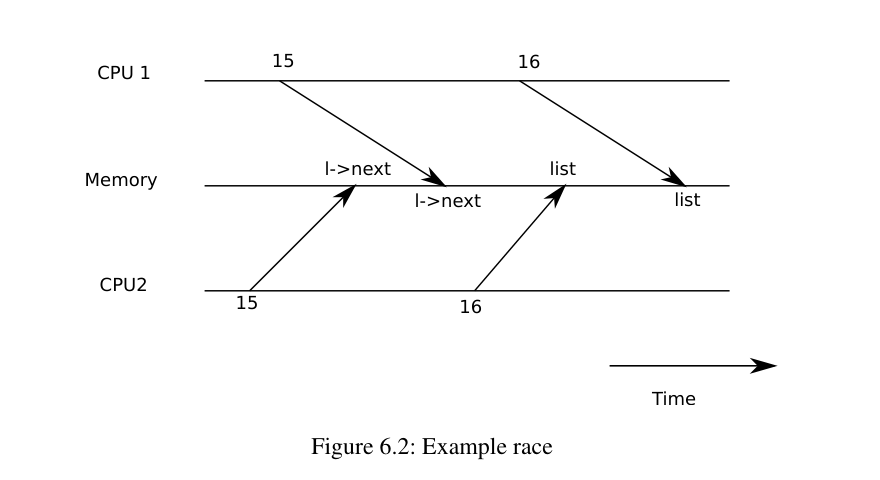
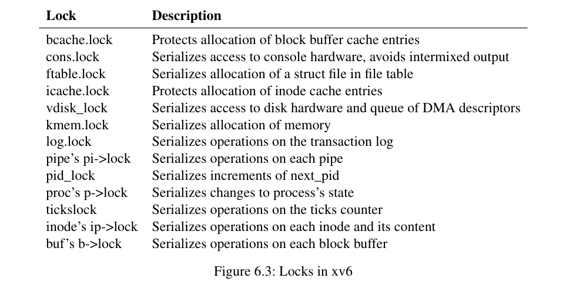

# 第 6 章 · 锁

## 第 6 章导言：锁

包括 xv6 在内，大多数内核会交错执行多项活动。交错的一种来源是多处理器硬件：一台计算机具有多个独立执行的 CPU，xv6 所用的 RISC-V 机器就是如此。这些 CPU 共享物理 RAM，xv6 利用这种共享，维护所有 CPU 都能读写的数据结构。但共享也意味着：一个 CPU 可能在另一个 CPU 更新数据结构的中途读取它，甚至多个 CPU 会同时更新同一份数据。如果不精心设计，这种并行访问很可能产生错误结果，或者破坏数据结构。即使只有一个处理器，内核也可能让 CPU 在多个线程之间切换，使它们的执行交错。最后，如果设备中断处理程序与某段可以被中断的代码修改同一份数据，而中断恰好发生在不合适的时刻，也可能损坏数据。**并发（concurrency）**一词指的就是多个指令流交错的情况，无论交错来自多处理器并行、线程切换，还是中断。

内核里到处都是被并发访问的数据。例如，两个 CPU 可以同时调用 `kalloc`，并发地从空闲链表头部取出节点。内核设计者希望允许大量并发，因为并行能提高性能，并发也能改善响应性。然而，他们因此必须花费大量精力，确信代码在这些并发情形下仍然正确。写出正确代码有很多办法，其中一些比另一些更容易推理。以保证并发正确性为目标的策略，以及支持这些策略的抽象，统称为**并发控制技术**。

xv6 根据不同情形采用多种并发控制技术；除此之外还有许多可能的方法。本章着重讨论一种广泛使用的技术：**锁（lock）**。锁提供互斥，保证同一时刻只有一个 CPU 能持有它。如果程序员为每项共享数据关联一把锁，并且代码使用该数据时总持有相应的锁，那么同一时刻就只有一个 CPU 使用它。这时，我们说锁**保护**了这项数据。锁是一种容易理解的并发控制机制，但它的缺点是可能严重损害性能，因为它会把并发操作串行化。

本章余下部分解释 xv6 为什么需要锁、怎样实现锁，以及如何使用锁。

## §6.1 竞争条件

考虑两个进程在不同 CPU 上调用 `wait`，就能看出为什么需要锁。`wait` 会释放子进程的内存，因此两个 CPU 上的内核都会调用 `kfree`，释放各自子进程的内存页。内核分配器维护一条链表：`kalloc()`（`kernel/kalloc.c`）从空闲页链表中弹出一页内存；`kfree()` 则把一页压入链表。为了获得最佳性能，我们希望两个父进程的 `kfree` 并行执行，彼此不必等待，但对于 xv6 的 `kfree` 实现，这样做并不正确。



**图 6.1：简化的 SMP 结构。** `Memory` 是共享内存，`BUS` 是总线；两个 CPU 都在执行 `l->next = list`。

图 6.1 更具体地展示了这一情形：链表位于两个 CPU 共享的内存中，CPU 用加载和存储指令操作链表。实际处理器有缓存，但从概念上看，多处理器系统的行为就像只有一份共享内存。如果不存在并发请求，可以这样实现链表的压入操作：

```c
struct element {
  int data;
  struct element *next;
};

struct element *list = 0;

void
push(int data)
{
  struct element *l;

  l = malloc(sizeof *l);
  l->data = data;
  l->next = list;   // 原书第 15 行
  list = l;        // 原书第 16 行
}
```

单独执行时，这个实现是正确的。但如果多个副本并发执行，它就不正确了。两个 CPU 同时执行 `push` 时，可能像图 6.1 那样，都先执行完第 15 行，然后才有一个执行第 16 行。错误结果如图 6.2 所示：两个链表元素的 `next` 都被设成 `list` 的旧值。随后，第 16 行的两次 `list` 赋值中，第二次覆盖第一次；第一次赋值所加入的元素就丢失了。



**图 6.2：竞争示例。** `Time` 向右推进，`Memory` 表示共享内存；两条 CPU 时间线上的 15、16 是上面原书代码的行号。两边先写各自的 `l->next`，再先后覆盖同一个 `list`。

第 16 行的更新丢失就是一个**竞争条件（race condition）**的例子。竞争条件指某个内存位置被并发访问，而且至少有一次访问是写入。竞争通常是 bug 的迹象：访问是写入时，可能丢失更新；访问是读取时，可能读到尚未更新完整的数据结构。竞争的结果取决于两个 CPU 的精确时序，以及内存系统如何安排它们的内存操作顺序，这使得竞争引起的错误难以复现和调试。例如，在调试 `push` 时加入打印语句，就可能充分改变执行时序，使竞争消失。

避免竞争的通常方法是使用锁。锁保证互斥，使同一时刻只有一个 CPU 能执行 `push` 中的敏感语句，上述情形因而不可能发生。正确加锁的版本只需要增加几行：

```c
struct element *list = 0;
struct lock listlock;

void
push(int data)
{
  struct element *l;
  l = malloc(sizeof *l);
  l->data = data;

  acquire(&listlock);
  l->next = list;
  list = l;
  release(&listlock);
}
```

`acquire` 与 `release` 之间的指令序列通常称为**临界区（critical section）**。通常说，这把锁保护了 `list`。

说锁保护数据，真正的意思是：锁保护适用于这些数据的一组**不变量（invariants）**。不变量是数据结构在各次操作之间始终维持的性质。一个操作要正确执行，通常依赖于操作开始时不变量成立。操作可以暂时违反不变量，但必须在结束前重新建立它们。例如，对于链表，不变量是 `list` 指向第一个元素，每个元素的 `next` 指向下一个元素。`push` 的实现暂时违反了这个不变量：执行 `l->next = list` 后，`l` 指向下一个链表元素，但 `list` 还没有指向 `l`；下一条 `list = l` 才重新建立它。刚才的竞争之所以发生，是因为第一个 CPU 暂时破坏不变量时，第二个 CPU 执行了依赖这些不变量的代码。正确使用锁，可以保证同一时刻只有一个 CPU 在临界区操作数据结构，因此不会有 CPU 在数据结构的不变量不成立时执行相应操作。

可以把锁看成是把并发临界区串行化，使它们一次只运行一个，从而保持不变量——前提是每个临界区单独运行时正确。也可以认为，由同一把锁保护的临界区彼此具有**原子性**：每个临界区只看到先前临界区的完整修改，绝不会看到只完成一部分的更新。

正确使用锁虽然能使错误代码变得正确，但锁会限制性能。例如，两个进程并发调用 `kfree`，锁会把两次调用串行化，于是在不同 CPU 上运行它们并没有收益。如果多个进程同时想取得同一把锁，就说这些进程发生冲突，或者这把锁存在**争用（contention）**。避免锁争用是内核设计的重要挑战。xv6 为此做得很少；复杂内核则会专门组织数据结构和算法来避免锁争用。对于链表的例子，内核可以为每个 CPU 维护一条空闲链表，只有本地链表为空、必须向别的 CPU 窃取内存时，才访问其他 CPU 的链表。其他用途可能需要更复杂的设计。

锁放置的位置也会影响性能。例如，把 `push` 中的 `acquire` 提前到 `malloc` 之前，在正确性上没有问题，但可能降低性能，因为 `malloc` 调用也被串行化了。下面的“使用锁”一节会给出放置 `acquire` 和 `release` 的一些原则。

## §6.2 代码：锁

xv6 有两种锁：**自旋锁（spinlock）**与**睡眠锁（sleep-lock）**。先看自旋锁。xv6 用 `struct spinlock`（`kernel/spinlock.h`）表示自旋锁。最重要的字段是 `locked`：锁空闲时这个字为 0，锁被持有时为非零。从逻辑上说，xv6 可以像下面这样获取锁：

```c
void
acquire(struct spinlock *lk) // 这个实现不正确！
{
  for(;;) {
    if(lk->locked == 0) {   // 原书第 25 行
      lk->locked = 1;      // 原书第 26 行
      break;
    }
  }
}
```

遗憾的是，在多处理器上，这个实现不能保证互斥。两个 CPU 可能同时来到第 25 行，都看到 `lk->locked` 为 0，然后都执行第 26 行取得锁。此时两个不同的 CPU 都持有这把锁，违反了互斥性质。我们需要一种方法，让第 25 和第 26 行作为一个原子的、不可分割的步骤执行。

锁使用得如此广泛，因此多核处理器通常提供指令，实现第 25、26 行的原子版本。在 RISC-V 上，这条指令是 `amoswap r, a`。`amoswap` 读取内存地址 `a` 处的值，把寄存器 `r` 的内容写到该地址，再把先前读出的值放进 `r`。也就是说，它交换寄存器与内存地址处的内容。它利用专门的硬件原子地完成这一序列，防止其他 CPU 在这次读取与写入之间使用该内存地址。

> **编者注：** 这里保留原书的简化指令表示。实际汇编有目的寄存器、源寄存器和地址寄存器，例如 `amoswap.w.aq a5, a5, (s1)`；不要把原书的二参数写法直接当作汇编语法。

xv6 的 `acquire`（`kernel/spinlock.c`）使用可移植的 C 接口 `__sync_lock_test_and_set`，它最终转换为 `amoswap` 指令；返回值是 `lk->locked` 原先的、被交换出来的内容。`acquire` 把交换放在循环里，不断重试，也就是自旋，直到取得锁。每轮迭代都把 1 交换进 `lk->locked`，然后检查旧值。旧值为 0，说明我们已经取得锁，交换也已经把 `lk->locked` 设为 1；旧值为 1，说明另一个 CPU 持有锁，而原子地向 `lk->locked` 再写入 1，并不改变它的值。

取得锁之后，`acquire` 还记录取得锁的 CPU，供调试使用。`lk->cpu` 字段受这把锁保护，只能在持锁时修改。

`release`（`kernel/spinlock.c`）与 `acquire` 相反：先清空 `lk->cpu`，再释放锁。从概念上说，释放只需要向 `lk->locked` 赋值 0。不过，C 标准允许编译器用多条存储指令实现一次赋值，所以相对于并发代码，一次 C 赋值未必是原子的。因此，`release` 使用执行原子赋值的 `__sync_lock_release`；它同样最终转换为 RISC-V 的 `amoswap` 指令。

> **编者注：** 原书把这些接口称作 C 库函数；在本版本工具链里，`__sync_*` 是编译器提供的原子内建接口，不是 ISO C 的普通库函数。这里讨论的是 xv6 的实现选择，不表示 RISC-V 上任何普通存储都不具备原子性。

## §6.3 代码：使用锁

xv6 在许多地方使用锁，避免竞争条件。前面讲到的 `kalloc`、`kfree` 就是很好的例子。可以做习题 1、2，观察去掉这些函数里的锁会怎样。你很可能发现，错误行为很难触发。这表明，通过测试可靠地判断代码没有加锁错误和竞争非常困难；xv6 中存在某些竞争也并非不可能。

使用锁的一项难点，是决定需要多少把锁，以及每把锁应该保护哪些数据和不变量。有几条基本原则。第一，只要一个 CPU 可能写某变量，而另一个 CPU 同时可能读或写它，就应该用锁防止这两个操作重叠。第二，要记住锁保护的是不变量：如果一个不变量涉及多个内存位置，通常就必须用同一把锁保护它们，才能保证不变量得到维护。

上述规则指出什么时候需要锁，却没有指出什么时候不需要锁。为了效率，避免过度加锁很重要，因为锁减少并行性。如果并行性不重要，那么可以只安排一个线程执行，从而不必担心锁。一个简单内核可以在多处理器上使用一把锁：进入内核时必须取得它，退出内核时释放它。不过，管道读取、`wait` 等系统调用会带来问题。许多单处理器操作系统曾通过这种方法改造成可在多处理器上运行，这有时叫作**大内核锁（big kernel lock）**。但这种方法牺牲了并行性：同一时刻只有一个 CPU 能执行内核代码。如果内核要做大量计算，使用更多、更细粒度的锁会更高效，因为内核就能同时在多个 CPU 上执行。

xv6 的 `kalloc.c` 分配器是粗粒度加锁的例子：一把锁保护一条空闲链表。不同 CPU 上的多个进程同时尝试分配内存页时，每个进程都得在 `acquire` 中自旋，等待轮到自己。自旋并不做有用的工作，所以会降低性能。如果锁争用浪费了相当一部分 CPU 时间，就可以考虑修改分配器设计，使用多条分别受锁保护的空闲链表，以实现真正的并行分配。

细粒度加锁的例子是，xv6 为每个文件分别设置一把锁，因此操作不同文件的进程通常不必等待彼此的锁。如果希望不同进程能够同时写同一文件的不同区域，还可以进一步细化文件加锁方案。最终，锁粒度的选择必须同时依据性能测量和复杂性考虑。

后续各章解释 xv6 的各个部分时，还会讨论使用锁处理并发的例子。图 6.3 预先列出了 xv6 中的锁。



**图 6.3：xv6 中的锁。** 中文对照如下，名称与描述按 rev1 原表保留。

| 锁 | 说明 |
|---|---|
| `bcache.lock` | 保护块缓冲区缓存条目的分配。 |
| `cons.lock` | 串行化对控制台硬件的访问，避免输出交错。 |
| `ftable.lock` | 串行化文件表中 `struct file` 的分配。 |
| `icache.lock` | 保护 inode 缓存条目的分配。 |
| `vdisk_lock` | 串行化磁盘硬件及 DMA 描述符队列的访问。 |
| `kmem.lock` | 串行化内存分配。 |
| `log.lock` | 串行化事务日志操作。 |
| 管道的 `pi->lock` | 串行化每条管道上的操作。 |
| `pid_lock` | 串行化 `next_pid` 的递增。 |
| 进程的 `p->lock` | 串行化进程状态的修改。 |
| `tickslock` | 串行化 `ticks` 计数器的操作。 |
| inode 的 `ip->lock` | 串行化每个 inode 及其内容上的操作。 |
| 缓冲区的 `b->lock` | 串行化每个块缓冲区上的操作。 |

> **编者注：** 这是教材原表，不是对所有历史源码版本重新生成的清单。例如本讲只读参考快照中的 UART 还有 `uart_tx_lock`。不能用表的省略推断该锁不存在。

## §6.4 死锁与锁顺序

如果内核中的一条执行路径必须同时持有多把锁，就必须保证所有执行路径都按同一顺序获取这些锁。否则会有**死锁（deadlock）**的风险。假设两条路径都需要锁 A、B，路径 1 先取 A 再取 B，另一条路径先取 B 再取 A。线程 T1 执行路径 1，已经取得 A；线程 T2 执行路径 2，已经取得 B。接着 T1 尝试取得 B，T2 尝试取得 A。两次获取都会无限等待，因为需要的锁都由另一个线程持有，而另一个线程又要等自己的 `acquire` 返回后才会释放已有锁。为避免这种死锁，所有代码路径必须按同一顺序取锁。需要全局取锁顺序，意味着锁实际上是每个函数规格的一部分：调用者必须以符合约定顺序的方式调用函数。

由于 `sleep` 的工作方式（见第 7 章），xv6 有许多涉及每进程锁，也就是各 `struct proc` 中那把锁的长度为二的锁顺序链。例如，`consoleintr`（`kernel/console.c`）是处理键盘输入字符的中断例程。收到换行符时，应当唤醒所有等待控制台输入的进程。为此，`consoleintr` 持有 `cons.lock` 调用 `wakeup`；后者为唤醒等待进程，又取得那个进程的锁。因此，全局防死锁顺序里必须包含规则：`cons.lock` 要先于任何进程锁取得。

文件系统代码包含 xv6 最长的锁链。例如，创建文件时需要同时持有目录锁、新文件的 inode 锁、磁盘块缓冲区锁、磁盘驱动的 `vdisk_lock`，以及调用进程的 `p->lock`。为了避免死锁，文件系统代码始终按刚才列举的顺序取得这些锁。

遵守全局防死锁顺序，可能比想象中困难。有时锁顺序与程序的逻辑结构冲突：模块 M1 调用模块 M2，但锁顺序要求先取得 M2 的锁，再取得 M1 的锁。有时事先不知道锁的身份，因为必须先持有一把锁，才能确定下一把应当取得的锁。文件系统逐一查找路径名组成部分时会遇到这种情况；`wait` 和 `exit` 扫描进程表、寻找子进程时也会遇到。最后，死锁风险常常限制加锁方案能细化到什么程度，因为锁越多，死锁机会通常也越多。避免死锁往往是内核实现中的重要设计因素。

## §6.5 锁与中断处理程序

xv6 的某些自旋锁保护线程和中断处理程序都会使用的数据。例如，时钟中断处理函数 `clockintr`（`kernel/trap.c`）可能正要增加 `ticks`，同时某内核线程在 `sys_sleep`（`kernel/sysproc.c`）中读取它。`tickslock` 把这两种访问串行化。

自旋锁与中断的交互会带来危险。假设 `sys_sleep` 持有 `tickslock` 时，它所在的 CPU 发生时钟中断。`clockintr` 尝试取得 `tickslock`，发现已被持有，于是等待释放。此时 `tickslock` 永远不会释放：只有 `sys_sleep` 能释放它，但 `clockintr` 返回之前，`sys_sleep` 无法继续执行。于是这个 CPU 死锁，其他需要相关锁的代码也会停住。

为避免这种情况，如果中断处理程序使用某把自旋锁，那么 CPU 绝不能在持有这把锁时开启中断。xv6 采用更保守的规则：CPU 获取任意一把自旋锁时，总是关闭该 CPU 的中断。其他 CPU 仍可能发生中断，因此中断处理程序的 `acquire` 可以等待另一个 CPU 上的线程释放自旋锁，只是不能等待同一个 CPU 上被打断的线程。

CPU 不再持有任何自旋锁时，xv6 才恢复中断。为了应付嵌套临界区，需要做一些记账。`acquire` 调用 `push_off`，`release` 调用 `pop_off`（都在 `kernel/spinlock.c`），跟踪当前 CPU 上锁的嵌套层数。计数降到 0 时，`pop_off` 恢复进入最外层临界区之前的中断使能状态。`intr_off` 和 `intr_on` 分别执行 RISC-V 指令来关闭和开启中断。

特别重要的是，`acquire` 必须严格在设置 `lk->locked` **之前**调用 `push_off`。如果颠倒顺序，就会出现一个短暂窗口：锁已经持有，中断却仍开启。中断若不巧落在这个窗口，就会使系统死锁。同样，`release` 必须先释放锁，再调用 `pop_off`。

## §6.6 指令与内存顺序

很自然地，我们会认为程序按源代码语句出现的顺序执行。然而，许多编译器和 CPU 为了提高性能，会乱序执行代码。如果一条指令需要很多周期才能完成，CPU 可能提前发出它，让它与其他指令重叠，避免 CPU 停顿。例如，CPU 可能发现串行序列里的 A、B 两条指令互不依赖，于是先启动 B：可能是 B 的输入先准备好了，也可能只是想让 A、B 的执行重叠。编译器也会做类似重排，让后面某条语句的指令出现在前面语句的指令之前。

编译器和 CPU 重排时会遵循规则，保证不改变正确编写的串行代码的结果。但这些规则允许改变并发代码结果的重排，因此很容易在多处理器上造成错误行为〔原书参考文献 2、3〕。CPU 的排序规则称为**内存模型（memory model）**。

例如，在下面的 `push` 代码里，如果编译器或 CPU 把第 4 行的存储移动到第 6 行 `release` 之后，就会出大问题：

```c
l = malloc(sizeof *l);  // 1
l->data = data;         // 2
acquire(&listlock);     // 3
l->next = list;         // 4
list = l;              // 5
release(&listlock);     // 6
```

发生这种重排后，会出现一个窗口：另一个 CPU 可以取得锁，看见更新后的 `list`，却看到一个尚未初始化的 `list->next`。

为了告诉硬件和编译器不要做这种重排，xv6 在 `acquire` 和 `release` 中都使用 `__sync_synchronize()`。这是一个**内存屏障（memory barrier）**，告诉编译器与 CPU 不要把加载或存储跨越屏障重排。由于 xv6 在访问共享数据时都使用锁，这两个函数里的屏障几乎覆盖了所有重要的顺序要求。第 9 章会讨论少数例外。

## §6.7 睡眠锁

有时，xv6 需要长时间持有一把锁。例如，文件系统（第 8 章）读写磁盘上的文件内容时会锁住文件，而磁盘操作可能花费几十毫秒。若如此长时间持有自旋锁，而另一个进程又想取得它，就会造成浪费：后者将在很长时间里自旋，白白消耗 CPU。

自旋锁的另一个缺点是，进程不能在保留自旋锁的同时让出 CPU。我们希望允许这样做，是因为持锁进程等待磁盘时，可以让别的进程使用 CPU。持有自旋锁时让出 CPU 是不允许的，因为它可能导致死锁：如果第二个线程尝试取得该锁，由于 `acquire` 不让出 CPU，第二个线程的自旋可能阻止第一个线程运行并释放锁。持锁时让出 CPU，也会破坏“持有自旋锁时必须关闭中断”的要求。因此，我们希望另一种锁在等待获取时会让出 CPU，并且允许持锁者让出 CPU、允许中断。

xv6 用睡眠锁提供这种能力。`acquiresleep`（`kernel/sleeplock.c`）在等待时让出 CPU，具体技术将在第 7 章解释。从高层看，睡眠锁有一个受自旋锁保护的 `locked` 字段；`acquiresleep` 调用 `sleep`，原子地让出 CPU 并释放这把内部自旋锁。结果是，`acquiresleep` 等待时其他线程仍能执行。

因为睡眠锁保持中断开启，所以不能在中断处理程序中使用。又因为 `acquiresleep` 可能让出 CPU，所以不能在自旋锁临界区内使用睡眠锁；反过来，在睡眠锁临界区内可以使用自旋锁。

自旋锁最适合短临界区，因为等待它会浪费 CPU 时间；睡眠锁适合耗时较长的操作。

## §6.8 真实世界

尽管有关并发原语和并行性的研究已经持续多年，用锁编程依然很有挑战。通常，最好把锁隐藏在同步队列之类的更高层结构中，虽然 xv6 没有这样做。使用锁编程时，最好使用尝试识别竞争条件的工具，因为很容易漏掉某个需要锁来保护的不变量。

大多数操作系统支持 POSIX 线程（Pthreads），允许一个用户进程的多个线程并发运行于不同 CPU 上。Pthreads 支持用户级锁、屏障等机制。支持 Pthreads 需要操作系统配合。例如，一个 pthread 阻塞在系统调用中时，同一进程的另一个 pthread 应当能够在这个 CPU 上运行。又如，一个 pthread 改变进程地址空间，例如映射或取消映射内存时，内核必须安排其他正在运行该进程线程的 CPU 更新它们的硬件页表，以反映地址空间变化。

不借助原子指令也能实现锁〔原书参考文献 8〕，但代价高，所以多数操作系统使用原子指令。

如果许多 CPU 同时尝试获取同一把锁，锁可能非常昂贵。假设一把锁已经缓存在某个 CPU 的本地缓存中，另一个 CPU 要获取它，那么更新锁所在缓存行的原子指令，必须把这条缓存行从前一个 CPU 的缓存移到后一个 CPU 的缓存，还可能使其他缓存中的副本失效。从另一 CPU 的缓存获取缓存行，可能比从本地缓存获取慢几个数量级。

为了避免锁的开销，许多操作系统使用无锁数据结构和算法〔原书参考文献 5、10〕。例如，可以实现一种类似本章开头的链表：查找链表时不需要锁，插入元素只需一条原子指令。然而，无锁编程比用锁编程更复杂，例如必须考虑指令与内存重排。使用锁已经很难，因此 xv6 避免再引入无锁编程的额外复杂性。

## §6.9 习题

1. 注释掉 `kalloc`（`kernel/kalloc.c`）中对 `acquire` 和 `release` 的调用。看起来，这应该给调用 `kalloc` 的内核代码带来问题。你预期会看到什么症状？运行 xv6 时看到了吗？运行 `usertests` 时呢？如果没有看到问题，为什么？试着在 `kalloc` 的临界区内插入无实际作用的循环，看看能否诱发问题。
2. 恢复 `kalloc` 中的锁，改为注释掉 `kfree` 中的加锁。现在可能发生什么错误？`kfree` 缺少锁是否比 `kalloc` 缺少锁危害更小？
3. 如果两个 CPU 同时调用 `kalloc`，其中一个必须等待另一个，这会损害性能。修改 `kalloc.c`，增加并行性，使不同 CPU 对 `kalloc` 的同时调用能够彼此不等待地继续执行。
4. 使用大多数操作系统支持的 POSIX 线程编写并行程序。例如，实现并行哈希表，测量随着核数增加，单位时间内的 `put`/`get` 操作数是否相应增长。
5. 在 xv6 中实现 Pthreads 的一个子集：实现用户级线程库，使一个用户进程能够拥有多个线程，并安排它们在不同 CPU 上并行运行。设计必须正确处理某线程执行阻塞系统调用以及修改共享地址空间的情况。

## 来源、版本与许可

- Russ Cox、Frans Kaashoek、Robert Morris，[*xv6: a simple, Unix-like teaching operating system*，rev1，2020-08-31](https://pdos.csail.mit.edu/6.S081/2020/xv6/book-riscv-rev1.pdf)，第 6 章，印刷页 55–65；第 66 页已查看，为空白页。本文按原节序全文翻译，编者校正均另行标出。原书源码行号改用文件与函数定位。
- 图 6.1、6.2、6.3 分别裁自同一 PDF 的第 56、57、61 页，已实际查看；原图英文标签及表格内容均有中文对照。
- 只读源码校对版本为 `mit-pdos/xv6-riscv` 的 `e23d53f27f6e187732a92a2b4705639d1c260f05`。该快照不是对录课工作树或实验分支的声明。
- 原书引文编号沿用教材编号，文献表可在原 PDF 的 Bibliography 定位；本次没有把那些被引论文标作已读材料。
- [本讲中文译稿](#/c/mit-6.s081-2020/lec/lec10?v=draft) 保存课堂推导和问答；[课程笔记](#/c/mit-6.s081-2020/lec/lec10?v=notes) 提炼机制。官方 `l-lockv2.txt` 是课堂提纲，已用于核对，不在此重复翻译。
- 教材许可来自[官方教材仓库 LICENSE](https://github.com/mit-pdos/xv6-riscv-book/blob/xv6-riscv/LICENSE)，只读存档为课程 `sources/xv6-book-license.txt`。许可年份按该存档原文保留，不改变教材的 2020 rev1 版本。

<details><summary>教材 MIT 许可全文</summary>

```text
The xv6 book sources are:

Copyright (c) 2006-2024 Russ Cox, Frans Kaashoek, and Robert Morris,
                        Massachusetts Institute of Technology

Permission is hereby granted, free of charge, to any person obtaining a copy of
this source and associated documentation files (the "Book"), to deal in the Book
without restriction, including without limitation the rights to use, copy,
modify, merge, publish, distribute, sublicense, and/or sell copies of the Book,
and to permit persons to whom the Book is furnished to do so, subject to the
following conditions:

The above copyright notice and this permission notice shall be included in all
copies or substantial portions of the Book.

THE BOOK IS PROVIDED "AS IS", WITHOUT WARRANTY OF ANY KIND, EXPRESS OR IMPLIED,
INCLUDING BUT NOT LIMITED TO THE WARRANTIES OF MERCHANTABILITY, FITNESS FOR A
PARTICULAR PURPOSE AND NONINFRINGEMENT. IN NO EVENT SHALL THE AUTHORS OR
COPYRIGHT HOLDERS BE LIABLE FOR ANY CLAIM, DAMAGES OR OTHER LIABILITY, WHETHER
IN AN ACTION OF CONTRACT, TORT OR OTHERWISE, ARISING FROM, OUT OF OR IN
CONNECTION WITH THE BOOK OR THE USE OR OTHER DEALINGS IN THE BOOK.
```

</details>
