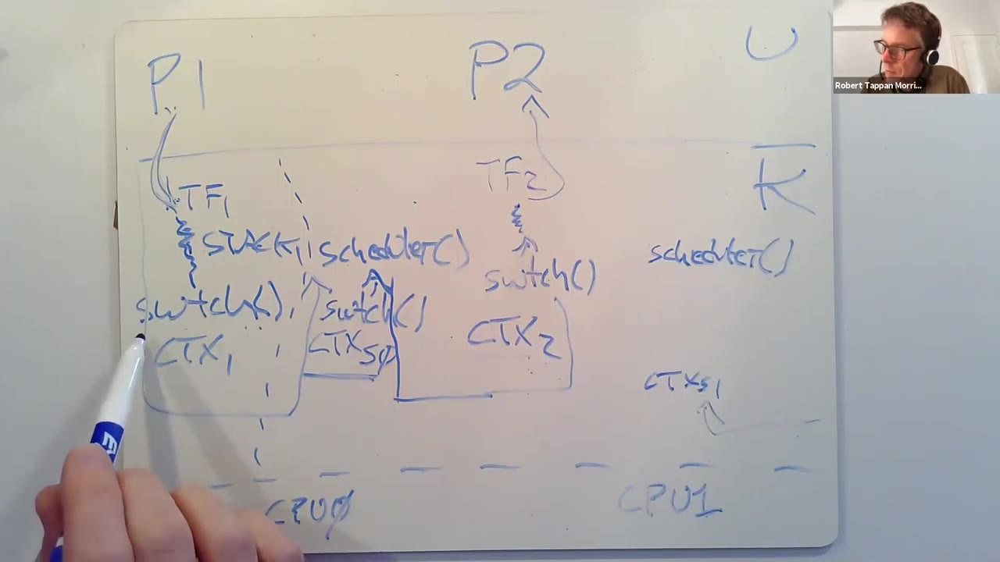
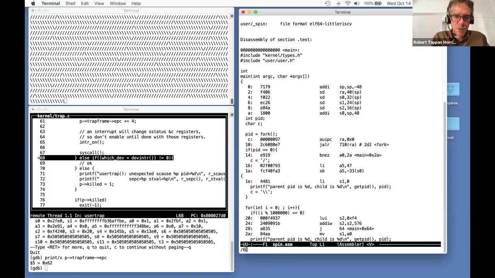
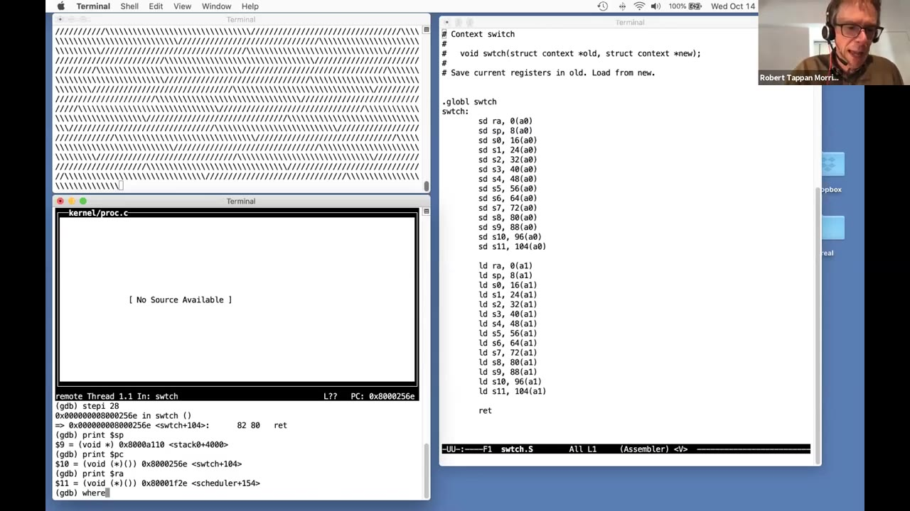
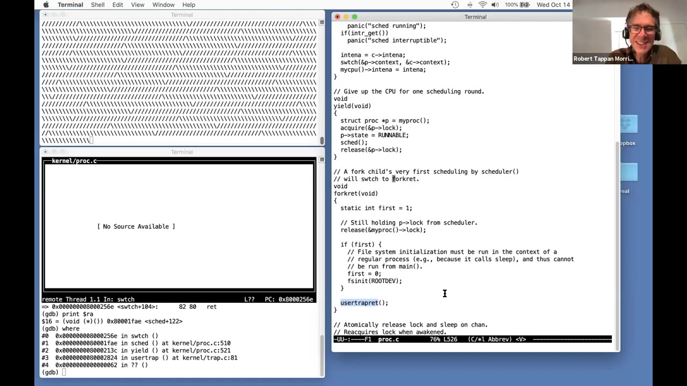

# 第 11 讲 · 线程切换

## 00:00–03:00｜为什么要让多个任务同时推进？

开场确认声音后，Robert 把这节课定位为继续深入 xv6 内部实现：前面已经看过系统调用、中断、页表和锁，现在要看 CPU 怎样从一个进程切换到另一个进程。首先不是看汇编，而是问为什么需要这套机制。

一类需求是分时共享。多人登录同一台机器，每个人都希望自己的程序能运行；即使只有一个用户，一台个人电脑乃至手机也常有许多程序需要推进，不能只完成其中一件事。另一类需求来自程序组织：把复杂工作拆成几个顺序执行的活动，可能比在一个控制流里手工协调所有事情更简洁。第一份实验的素数筛就用多个进程组成流水线，虽然它不是共享内存的线程程序，却展示了这种结构上的好处。

第三类需求是多核加速。如果能把工作分给四个线程，并让它们在四个核上有效并行，理想情况下可能获得约四倍速度；“可能”很重要，拆分本身不会保证加速。xv6 内核也可以看作一个多核并行程序。

这里先采用宽泛的线程定义：**一个独立的顺序执行流**。像普通程序那样，CPU 一条指令接着一条指令地执行，就是一个控制线程。不同系统对“线程”的具体组织有不同选择，这节课会逐步说明 xv6 的选择。

## 03:00–06:00｜线程状态与两种运行办法

要暂停一个执行流再继续，就必须知道它停在什么地方。最直观的状态是程序计数器 PC，此外还有编译器用来保存变量、临时值的寄存器，以及记录当前函数调用链的栈。通常每个线程有自己的栈：调用了哪些函数、各层局部变量和返回位置，都与这个线程走到的执行位置对应。

线程系统的作用，是自动管理多个执行流的交错。程序员希望启动两个、几百个甚至上千个线程后，由系统让它们都取得进展，而不是自己把每个线程的一小段代码拼到一个巨大的循环里。

一种办法是使用多个 CPU：四个核分别运行四个线程，每个线程自然拥有所在核的 PC 和寄存器。但如果只有四个核，却有一千个线程，单靠“一线程一核”无法解决问题。另一种办法就是本讲的中心：让每个 CPU 在不同线程之间切换。

切换时，系统先运行线程 A 一会儿，把它的状态保存起来，再让 B 使用同一套硬件寄存器运行，然后轮到 C。之后重新取出 A 的状态继续执行。保存的是“从这里接着走”所需要的信息，并不是把 A 当成新程序重新启动。

## 06:00–09:00｜共享内存与不共享内存的线程

xv6 和大多数操作系统会结合上述两种办法：把所有可用核用起来，同时让每个核在若干线程之间分时切换。常见情形是想运行的线程数多于 CPU 数，不过这不是必须成立的条件。

不同线程系统的重要差别之一，是线程之间是否共享内存。多个线程可以在同一个地址空间执行；一个线程修改变量，另一个线程就能看到这个修改。上节课的锁，正是处理这类共享访问时所需要的机制。

xv6 内核中，每个进程有一个执行其系统调用等工作的内核执行流；这些内核线程共享内核内存和数据结构。所以，虽然它们各有执行位置和栈，仍然可能同时修改相同的内核对象，需要锁来协调。

用户空间的安排不同。原始 xv6 每个用户进程只有一个执行流，各个进程拥有各自的地址空间，没有“同一进程中多个用户线程共享普通变量”的接口。Linux 则支持一个进程里有多个线程，它们共享该进程的内存，很适合写利用多核的用户程序。底层仍用到今天的许多技术，但还需要额外的数据结构，把同一地址空间中的多个执行流分别管理起来。

## 09:00–12:00｜调度系统的三个问题

线程不是让多个任务交错推进的唯一办法。Robert 提到事件驱动编程和状态机：它们也能组织许多活动，有时比线程更高效。不过，线程让程序员按通常的顺序代码方式表达任务，往往更方便。本讲聚焦线程，不展开其他模型。

要实现线程系统，有几个问题必须分别回答。首先，怎样真正实现交错执行，以及什么时候停止当前线程、挑哪个线程继续？这一组选择通常称为 scheduling，也就是调度。xv6 有具体的调度代码，而且每个核都有自己的调度器。

其次，暂停线程时保存什么、放在哪里、恢复时怎么找回？“保存状态”不是一句空话：我们必须辨认哪些状态马上会被另一个线程覆盖，哪些状态已经安全地留在内存中。

最后是计算密集型线程。最直观的切换方案，是由正在执行的线程主动说“我先停一下，让别人运行”。但一个计算可能持续数小时的用户程序，并不会自动在合适的位置礼让其他进程。若操作系统只能等它主动合作，其他活动就可能一直得不到 CPU。于是系统需要一种能主动收回控制权的机制。

## 12:00–15:00｜用定时器强制取得控制权

解决计算密集型程序独占 CPU 的办法，是每个核上的定时器硬件。它周期性产生中断，操作系统安排这些中断进入内核。即使用户程序正埋头计算圆周率的许多位数，既不做系统调用也不主动让出 CPU，中断仍会到来。

讲者以“例如每十毫秒”说明周期性中断的概念。中断先把执行位置从用户程序转到内核处理程序，这只是第一步；内核随后主动让出当前进程占用的 CPU，把选择下一项工作的机会交给调度器。

课堂把这个动作称为 yield。它会保存当前执行状态，使得之后仍能恢复。用户程序并没有主动提出切换请求，内核却能借助中断替它完成一次让出，这就叫**抢占式调度**。与之相对的是依赖运行代码主动配合的调度。

因此，看似“强制”的用户态抢占，可以分解为两部分：硬件中断强制进入内核；内核代码在自己可控的位置调用切换机制。已有的 trap 知识解释了前半段，今天要补上后半段。这里的示例周期不作为 xv6 固定时间片参数。

## 15:00–18:00｜RUNNING、RUNNABLE 与 SLEEPING

Robert 进一步区分几种容易混在一起的“状态”。线程的全部状态包括 PC、寄存器、栈等；而进程结构中的 `state` 只是描述它目前是否能被调度的一项标记。

`RUNNING` 表示当前确实在某个 CPU 上执行。`RUNNABLE` 表示它没有在任何 CPU 上执行，但条件已经具备，只要有 CPU 就愿意继续。`SLEEPING` 则表示它在等待事件，比如 I/O 完成；即使此时有空闲 CPU，也不是现在就该让它继续算。睡眠和唤醒下一次再展开，本讲主要看前两种。

定时器打断一个正在计算的进程后，yield 把它从 `RUNNING` 变成 `RUNNABLE`。意思不是它已经做完，而是暂时停止执行、以后还想运行。它原来正在计算这一事实，本身就说明它通常还有工作要做。

在运行时，它的寄存器值实际占据 CPU 硬件寄存器；变成可运行但未运行的线程后，就没有一颗 CPU 专门替它保管这些值。所以切换过程必须把它们复制到内存中。之后调度器选中这个线程时，再把保存的值送回某颗 CPU 的寄存器。要保存的是被复用的硬件状态，而不是重新复制一份整个进程内存。

## 18:00–21:00｜先画进程的用户侧与内核侧

讲者确认术语后开始画图：上方用户空间里可以有 C 编译器、`ls` 和 shell；下方是内核。每个进程有自己的用户内存和用户栈。当它正在用户态运行时，CPU 中装着它的 PC 和寄存器值。

如果它做系统调用，或者被中断打断，就会进入内核。用户态寄存器保存在这个进程的 trapframe 中，CPU 改用这个进程的内核栈，开始执行 trampoline 和 `usertrap` 所衔接的内核代码。为了讨论方便，Robert 把这两个执行阶段分别称为用户线程和内核线程。

这里并不是说每次进入内核，都从一个先前暂停的内核 context 恢复。进程在用户态运行时，并没有另一个同时运行的内核线程等在旁边；trap 入口会用预先设置的内核栈，启动这一次内核处理。用户状态与这段内核执行期间的状态，需要分开放置。

这张简图的目的，是先弄清楚：一个进程可以在用户态执行，也可以在内核里代表它执行系统调用或中断处理。两边使用不同的栈，用户寄存器在进入内核后还必须保留，以便返回。

## 21:00–24:00｜为什么切换用户进程要绕过内核线程？

进入内核后，有时只是完成一个系统调用，然后恢复同一个进程的用户寄存器，回到用户空间。但也可能需要换一个进程。例如，编译器读取磁盘时需要等待，`ls` 却已经准备好继续运行。

假设 `ls` 以前也执行过，后来暂停了。它就有自己的 trapframe，保存着用户态的 PC 和寄存器；有内核栈，保留尚未走完的内核调用链；还有一组暂停内核执行流所需的寄存器，这组寄存器叫 context。

从编译器切到 `ls`，需要先保存编译器内核线程的 context，再恢复 `ls` 内核线程的 context。`ls` 于是继续执行原来没完成的系统调用或中断处理；等到返回用户空间时，才再从它自己的 trapframe 恢复用户状态，真正继续执行 `ls` 的用户指令。

因此，xv6 不是把“用户程序 A 的 PC”直接换成“用户程序 B 的 PC”就结束。它要经过 A 的内核执行、内核中的线程切换、B 的内核执行，再返回 B 的用户态。这仍是一张简化图，完整实现中间还要经过调度器线程。

## 24:00–27:00｜补上每 CPU 的 scheduler

**学生问：**两个进程的内核线程之间，还应当有一次切到 scheduler 的过程吧？

Robert 确认，并开始画更完整的图。设有正在执行的进程 1，以及已经 `RUNNABLE`、但尚未运行的进程 2；机器还可以有 CPU 0、CPU 1 等多个核。

先看进程 1：定时器打断用户态，trampoline 保存用户寄存器，随后在进程 1 的内核栈上执行 `usertrap`。如果决定让出 CPU，内核经过若干函数，最后调用 `swtch`。这个函数保存的是进程 1 **此刻的内核寄存器**，存入 context 1；用户寄存器早已保存在 trapframe 1，两份状态有不同用途。

接下来有一条 xv6 的结构规则：进程的内核线程让出 CPU 时，只切到**当前 CPU 的调度器线程**，不会直接切到另一个进程的内核线程。因此，若进程 1 正运行在 CPU 0 上，`swtch` 的目的地就是 CPU 0 的 scheduler context。每个核都需要独立的调度器状态，而不只是全系统一个 scheduler。

## 27:00–30:00｜两次 swtch 拼成一次进程切换

恢复 CPU 0 的 scheduler context 时，保存的寄存器中也包括栈指针；所以 `swtch` 返回后，代码已经运行在调度器自己的栈上。它先完成停止进程 1 所需的收尾，再扫描进程表，寻找 `RUNNABLE` 的进程。

若没有别的工作，而进程 1 仍可运行，调度器也可能再次选中进程 1。让出 CPU 不意味着必然换成另一个进程。假设这次找到进程 2，scheduler 又调用一次 `swtch`：把调度器自己的寄存器保存回它的 context，然后加载进程 2 原先保存的 context。

对进程 2 来说，这表现为它过去那次尚未返回的 `swtch` 现在终于返回了。它继续完成之前暂停的内核工作，最后恢复 trapframe 2 中的用户寄存器，回到用户态。CPU 1 也有自己的 context、栈和 scheduler 循环；在 CPU 1 上让出的进程会先进入 CPU 1 的调度器。

**学生问 context 存在哪里。**讲者开始说明：进程内核线程的寄存器保存在进程结构中；一个顺序执行流同一时刻只停在一个位置，所以不需要为同一个暂停点之外再留多个 context。

## 30:00–33:00｜为什么 context 和 trapframe 分开？

进程的内核 context 是 `p->context`；scheduler 不是一个普通用户进程，没有对应的 `struct proc`，因此它的 context 放在每 CPU 的 `struct cpu` 中。CPU 数组的每个元素管理一个核的调度器状态。

*原片 30:00，完整画面。P1/P2 是用户进程，TF 保存用户寄存器，CTX 保存内核执行流寄存器；中间 scheduler 与每核状态相连。图中多个箭头表示先保存、切入调度器，再恢复另一个执行流，不是同时在这些位置执行。*

**学生问：**能不能把内核寄存器也放进 trapframe？

讲者回答，在存储布局上可以；每进程一份的数据结构原则上都能容纳它。现在分开，是为了让职责清楚：trapframe 放用户与内核进出所需的信息，context 放内核线程与 scheduler 切换所需的信息。两者并不是因为“内存装不下”才分开。

**另一问：yield 由用户还是内核调用？**在 xv6 中由内核调用，用户没有直接要求执行这个内部函数的系统调用。用户可以预测某些调用会导致让出，比如对暂时没有数据的管道做阻塞读取，但具体切换由内核透明地安排。定时器中断也是内核决定让出的一种时机。

## 33:00–36:00｜阻塞系统调用也走同一条底层路径

讲者以读取控制台却还没输入按键为例，说明等待 I/O 时也需要把 CPU 交给别人。此时不应让线程空转，等待机制会进入睡眠与切换流程。

**学生追问：**若是进程自己调用系统调用、随后需要 sleep，刚才的图是不是仍然适用，只是进入内核的原因不再是定时器？

回答是肯定的。读磁盘、等管道数据，都先通过系统调用进入内核，用户寄存器留在 trapframe 中；系统调用发现条件尚不满足，就调用 sleep，最终保存内核 context、切到本 CPU 的 scheduler。就今天关注的底层保存和恢复而言，除了进入内核的原因不同，过程很相似。等待什么、怎样被唤醒，属于后续主题。

**学生问每 CPU 的 scheduler 是否各有栈。**是的。CPU 0 和 CPU 1 的 scheduler 不共用同一条栈；它们的初始栈在启动时建立，创建方式也不同于用户进程的内核栈。

> **编者校对：**课堂有时用 yield 泛指“让出 CPU”，并口述 sleep 调用 yield。固定 2020 源码中，`sleep` 设置 `SLEEPING` 后直接调用 `sched`；`yield` 则设置 `RUNNABLE` 后调用 `sched`。二者共用切换机制，不能据口述把函数调用关系改写成 `sleep → yield`。启动栈设置的汇编文件为 `kernel/entry.S`，`stack0` 定义在 `start.c`。

## 36:00–39:00｜任意时刻，一个核和一个线程分别在做什么？

讲者补充“上下文切换”一词的使用范围。有时它指整个进程 A 到进程 B 的切换，有时甚至指用户态与内核态转换；本讲主要用它表示保存一组内核线程寄存器、恢复另一组寄存器的过程，尤其是进程内核线程与 scheduler 之间的切换。

判断复杂图时，要坚持两个简单事实。第一，一个核在一个时刻只执行一条控制流：可能在某进程用户态、该进程内核态，或本核 scheduler 中。它不会一边运行 scheduler、一边又运行用户进程；“许多任务都在推进”来自不同时间的交错。

第二，同一个线程在一个时刻至多运行在一个核上。否则它唯一的一份栈和执行状态就会被两颗 CPU 同时使用。它要么由某个 CPU 执行，要么暂停，寄存器已经保存在内存中。

还有一个观察有助于稍后读代码：普通暂停线程的 context 是调用 `swtch` 时保存的，因此恢复它时，看起来就是先从那次 `swtch` 返回。不是任意跳到线程函数的中间，也不是重新执行入口。首次创建线程的例外，在课末问答中还会专门处理。

## 39:00–42:00｜“每进程两个线程”是怎样的说法？

**学生问：**一直在讲线程，但 xv6 不是每个进程只有一个线程吗？能否有一个进程多个线程？

Robert 承认这里的术语容易造成误会。实际情况是：一个 xv6 进程要么执行用户指令，要么在内核里执行指令，要么完全没有执行、状态保存在 context 和 trapframe 中。课堂把前两阶段叫作用户线程和内核线程，是为了描述两套栈和保存状态；它们**不会同时执行**。这不是 Linux 那种一个用户地址空间里有多个可独立调度执行流的接口。

接下来切到源码，看 `struct proc`。其中的 trapframe 指针指向用户寄存器保存区；context 保存进程内核线程切向 scheduler 时的寄存器；`kstack` 指向该进程的内核栈；`state` 标记运行、可运行、睡眠或未分配等状态。

这些字段把前面的图落实为数据结构。之后还要看 `p->lock`：它不只是保护一次简单赋值，而是要保证涉及多个字段、寄存器和栈的转换过程，不被其他 CPU 当成已经完成。

## 42:00–45:00｜单核 spin 演示与定时器断点

先看锁的一个作用：两颗 CPU 的 scheduler 不能同时发现同一个 `RUNNABLE` 进程，然后都开始运行它。它们必须通过同一把进程锁协调。

为了制造可预测的切换场景，Robert 使用 `spin` 演示程序。它调用 `fork`，形成两个持续计算的进程；双方在循环中忙等，隔一阵才打印一个字符，主要目的是让观众看出各自仍在推进，而不是主动配合调度。这次 QEMU 特意只配置一个 CPU，所以若两者都能推进，必然发生了分时切换。

启动调试后运行 `spin`，屏幕交替出现成串的正斜杠 `/` 与反斜杠 `\`。一段时间只有一种字符，之后换成另一种。讲者据此说明：当前核先运行一方，定时器触发切换后另一方获得 CPU。

为了沿着这条路径跟踪，课堂在 `trap.c:207` 设置断点。这是录课工作树中 `devintr` 处理定时器相关中断的位置。执行 `continue` 后很快就会停下来，因为定时器不断触发。后续要从这里走回 `usertrap`，观察它怎样决定调用 yield。

> **编者说明：**`spin.c` 是课堂演示文件，不把共享参考快照当作包含该演示的录课工作树；下文保留真实观察和函数名，课堂行号只用于解释当时画面。

## 45:00–48:00｜从 devintr 回到 usertrap，辨认当前进程

断点命中后，`where` 显示当前位于 `usertrap` 调用的 `devintr` 中。讲者用 `finish` 让 `devintr` 返回，不逐条展开定时器处理，而把注意力集中到 `usertrap` 后面的判断。

`devintr` 返回 2，表示它识别到定时器中断。于是 `which_dev == 2` 的分支会调用 `yield`，给调度器机会。这个 2 是内核函数用于分类的返回码，并不是用户程序传来的值。

在走到 yield 之前，课堂先查看当时被中断的是谁。`usertrap` 里的局部变量 `p` 指向当前进程的 `struct proc`。

**学生问：不同进程的内核线程究竟有什么区别？**它们可以执行同样的内核代码，但有不同的内核栈，保存不同的调用链。此外，内核能调用 `myproc()` 知道自己现在代表哪个进程执行。其背后利用内核态 `tp` 中的 hart ID 找到对应 CPU 结构，再读取 scheduler 设置的当前进程指针。

因此，“线程不同”不等于必须运行不同的函数；相同函数、不同栈、不同寄存器和当前进程身份，就形成了不同执行实例。代码本身可以共享。

## 48:00–51:00｜从 trapframe 找回被打断的用户指令

打印进程名得到 `spin`，符合预期；这次被中断的是 PID 3，另外一个 spin 进程是 PID 4。讲者预期后面能切到 PID 4，并用这对身份追踪整个实验，而不只凭两个进程相同的名字判断。

接着打印 trapframe，可以看到保存的用户 `ra`、用户栈指针以及用户程序计数器。这里的用户 PC 是十六进制 `0x62`。在 `spin.asm` 中寻找这个地址，能对应到忙等循环里的加法指令，说明定时器确实是在用户程序的计算循环中打断它。

*原片 49:40，完整画面。左下调试器显示 `epc = 0x62`，右侧打开 `spin.asm`，正在输入地址搜索，尚未滚动到目标指令。EPC 是用户态被中断的位置，区别于稍后 `context.ra` 所保存的内核返回位置。*

随后回到 `usertrap`，逐步前进到 `yield` 并进入它。到这里还没有真正切走：CPU 正在执行 PID 3 的内核线程，使用 PID 3 的内核栈。yield 的开头获取 `p->lock`，因为接下来会暂时打破“状态标记与实际执行情况相符”的关系。

> **编者校对：**课堂把用户寄存器笼统称作 32 个；这里不需要保存恒为零的 `x0`，trapframe 另外还含 EPC 和若干内核入口字段。

## 51:00–54:00｜先标 RUNNABLE，为什么必须继续持锁？

yield 准备把 `p->state` 改成 `RUNNABLE`。字面上这表示进程没有执行、等待 CPU，但当前 CPU 明明还在运行它的内核代码。如果此时另一颗 CPU 看到这个标记就开始恢复它，两边就可能同时在同一个内核栈上调用函数，结果会互相破坏。

所以必须先取得进程锁，并在整段不一致的过渡期间持有它。其他 CPU 的 scheduler 也要拿这把锁，才能检查并选择这个进程；它们不会在“已修改 state、尚未停止使用栈”的中间状态抢先运行它。

把它设为 `RUNNABLE` 而不是 `SLEEPING`，是因为这次只是被定时器打断，它还想继续计算；调度器以后可以再选中它。

接着进入 `sched`。它包含许多条件检查和 panic，讲者解释，这块代码历年来容易产生微妙错误，因此用检查明确约束调用者。课堂没有逐项单步执行所有检查，而是跳到真正的切换点：`swtch` 把当前内核线程寄存器存入 `p->context`，再恢复当前 CPU 调度器的 context。`sched` 与 `scheduler` 名字近似，但前者是让出 CPU 的入口，后者是运行在独立栈上的选择循环。

## 54:00–57:00｜预先检查目的 context，再进入 swtch

在真正切换前，Robert 先查看将要恢复的 context。调试器中直接打印局部表达式不顺利，不过演示只有 CPU 0，所以可以检查 `cpus[0].context`。

最值得关注的是 `ra`：`swtch` 最后执行返回指令，因此恢复出来的 `ra` 决定返回到哪里。利用 GDB 的 `x/i` 查看该地址的指令及函数标签，可以看到它位于 `scheduler` 中。也就是说，当前虽然从 `sched` 调用 `swtch`，这次实际接下来的执行却会进入调度器原来暂停的地方。

课堂在 `swtch` 设置断点，跳过准备参数的指令，直接查看 `kernel/swtch.S`。按 RISC-V 调用约定，第一个参数在 `a0`，指向旧 context；第二个参数在 `a1`，指向要恢复的新 context。

开头一串 `sd` 把 `ra`、`sp` 和各个 `s` 寄存器写到 `a0` 指向的内存，后面一串 `ld` 从 `a1` 指向的内存恢复对应寄存器。这不是依靠某个特殊“切换线程”硬件指令；核心动作就是保存与加载，最后再执行 `ret`。

## 57:00–60:00｜为什么不保存 PC，只保存 14 个寄存器？

讲者提出第一个问题：汇编里保存了 `ra`、`sp` 和 `s0` 至 `s11`，却看不到保存 PC 的指令，为什么仍然知道怎么继续执行？

**学生回答：**函数调用已经更新了返回地址。

Robert 顺着解释：执行保存动作时，我们明确知道 PC 在 `swtch` 内部，这个值本身没有提供恢复线程所需的新信息。真正关心的是 `swtch` 从哪里被调用，也就是以后返回后继续执行的位置。调用指令已经把那个返回位置放进 `ra`，所以保存 `ra` 就能达到目的。此刻尚未切换，打印当前 `ra` 会发现它指回 `sched`。

第二个问题是：RISC-V 有 32 个整数寄存器，为什么这里只保存和恢复 14 个？

**学生回答：**调用 `swtch` 的 C 代码把它看作普通函数；调用者知道某些寄存器可能被函数覆盖，若以后还要用那些值，已经按调用约定保存了它们。

讲者确认。线程切换发生在一个明确的函数调用边界，和任意用户指令被中断不同。编译器已经承担 caller-saved 值的跨调用保存责任，因此这段汇编只需要补上此处恢复执行所需的其余寄存器，而不必把整个用户 trap 的保存过程再做一遍。

## 60:00–63:00｜栈指针一换，调用栈也换了

继续上一个回答：有用的 caller-saved 值由编译器按调用约定保全，`swtch` 显式保存 `s0–s11`、栈指针和返回地址。讲者口头估算剩余寄存器数量时并不精确；关键是职责划分，不是把剩下每个寄存器都称为 caller-saved。

切换前打印 `sp`，它指向当前进程映射在高地址的内核栈。接下来用 `stepi 28` 一次走过 14 条保存和 14 条加载，停在 `ret` 之前。此时再打印 `sp`，它已经落入 `stack0` 区域，也就是本 CPU 启动时建立、后来供 scheduler 使用的那条栈。

PC 仍在 `swtch` 内，尚未执行返回；但是 `ra` 已指向 `scheduler`。再执行 `where`，调用链也已经变了：它呈现的是调度器以前那次调用 `swtch` 的栈，而不再是刚才 PID 3 的 `usertrap → yield → sched` 调用链。调度器最初由启动流程的 `main` 进入，这条历史也在它自己的栈上。

*原片 62:30，完整画面。左右分别对照 `swtch.S` 与调试器；加载之后 `sp` 指向 `stack0`，`ra` 指向 scheduler。此时无需复制栈内容，切换栈指针已改变接下来使用的调用链。*

最后再单步一条 `ret`，就真正回到 scheduler 的 C 代码。

## 63:00–66:00｜返回的是调度器过去的调用，随后交接锁

现在执行位置位于 scheduler 过去调用 `swtch` 的下一步。那次调用本来是为了启动 PID 3；PID 3 运行一阵后，又调用了自己的 `swtch` 让出 CPU，于是把调度器那次未完成的调用接续起来。

必须分清：PID 3 刚刚发出的 `swtch` 并没有在 PID 3 的调用链中返回，它仍暂停在该进程的栈和 context 里；此刻“返回”的是另一条执行流早先的调用。这正是上下文切换看起来违反普通函数调用直觉的地方。

scheduler 接下来把 `c->proc` 设为 0，表示本核不再运行那个进程。然后释放 PID 3 的 `p->lock`。锁是先前 yield 获取的，现在却由 scheduler 释放，这个不同于一般“谁获取谁释放”的约定。

到这个时刻，PID 3 的寄存器已保存完整，当前 CPU 也不再使用它的内核栈，所以另一颗 CPU 若取得锁并恢复它，已经安全。演示只有一个核，当然不会实际出现跨核接走，但正确性必须考虑多核情形。

Robert 把停止一个进程概括为三个相互关联的动作：把状态改成 `RUNNABLE`、保存寄存器、停止使用其内核栈。进程锁要让其他 CPU 看到的效果如同这三件事一起完成，而不是只保护第一项赋值。

## 66:00–69:00｜锁也保护反方向的启动过程

同一把锁在恢复进程时也有作用。调度器先把目标标成 `RUNNING`，然后把它的 context 加载到 CPU 寄存器。这两步之间，状态标签可能已经改变，真实寄存器却尚未恢复完。

假如这个中间点发生定时器中断，处理程序以为正在执行目标进程，继而决定让出，就可能把尚未完整恢复的寄存器保存回目标 context，覆盖正确状态。因此切入线程的过渡阶段不仅要挡住其他核，也要防止本核中断介入。xv6 获取自旋锁时会关闭本核中断，正好为这段切换提供保护。

课堂接着沿 scheduler 扫描进程表。为了跳过所有未选中的槽位，讲者在录课版本 `proc.c:474` 设置断点，直接停在已经找到下一个进程的位置。

此时 scheduler 已获取目标进程锁，已把它的状态设为 `RUNNING`，正准备在 CPU 结构中登记 `c->proc`，随后保存调度器自己的 context、恢复目标 context。看见 `RUNNING` 标签，不应误以为它已经完成所有恢复动作；持锁正是允许这段内部过渡存在。

## 69:00–72:00｜恢复 PID 4，回到它自己的中断处理链

查看被选中的进程，名字同样是 `spin`，但 PID 已经变成 4，不再是之前的 3。状态显示 `RUNNING`。为了预测接下来的返回位置，课堂打印 `p->context`，再用反汇编查看其中的 `ra`。

这个地址位于 `sched`，符合预期：PID 4 之前也因定时器中断进入内核，通过 yield 和 sched 暂停。它所保存的 context 就是在那次 `swtch` 调用边界形成的。

再进入 `swtch`，起初 `where` 仍显示 scheduler 的调用链。又一次越过 28 条保存与加载后，检查 `ra`，现在返回目标已经是 `sched`；查看调用栈，则看到 `usertrap → yield → sched → swtch`。不过这是 **PID 4 过去那次定时器中断的调用链**，不能因为函数名一样，就认为回到了原来的 PID 3。

随后 PID 4 可以沿自己的内核栈返回，最终由自己的 trapframe 恢复用户状态。讲者到这里停止逐条调试，开始接受问题。

**学生提出另一种情况：**如果目标是因系统调用等待而暂停，恢复后是不是会看到 sleep 一类函数？这个问题在下一段得到进一步澄清。

## 72:00–75:00｜等待 I/O 的调用链，以及为什么不复制堆和栈

对前面的问题，Robert 说明：若进程是因阻塞系统调用而暂停，调用栈会包含该系统调用实现以及 sleep，和定时器演示里的路径不同。但 sleep 也会经过 sched，所以 `swtch` 的直接返回位置仍可能是 sched，再继续回到 sleep 和系统调用。不要把“最终回到系统调用”误读成“`ra` 必然直接指向 sleep”。

讲者再次强调，每次 scheduler 调用 `swtch`，随后执行的“返回”往往属于目标线程很久以前发出的另一条调用。这种保存、恢复和接续执行，就是线程切换的内部机制。

线程当然不只有寄存器，还有栈、堆、变量等状态；但这些已经在内存里，不会仅仅因为另一个线程获得 CPU 就消失。刚才两次切换都没有搬运整条栈，旧线程的栈内容一直留在原处。必须专门保存寄存器，是因为同一套硬件寄存器马上要给新线程使用，会被覆盖。

**学生问：**其他处理器状态怎么办，比如 x86 的浮点单元？

Robert 接受这个提醒：切换代码与处理器相关，另一种架构可能需要保存不同寄存器、包括浮点状态。当前的 `swtch.S` 是 RISC-V 上 xv6 的具体实现，不是所有机器通用的一张保存清单。

## 75:00–78:00｜浮点与定时器失效的边界

讲者对 RISC-V 浮点寄存器的具体安排表示不确定，随后指出本处内核不使用浮点，所以这段切换代码没有处理它。这里保留的是课堂的限定，而不是得出“RISC-V 没有浮点状态”的结论。

**学生问：**抢占依赖定时器中断，如果中断没有发生怎么办？

Robert 先从软件角度解释。xv6 返回用户态时会做好中断可达的设置，普通用户程序不能随意把内核需要的定时器中断永久关掉。因此，用户态一直计算并不能逃避抢占。

内核的情况更微妙：获取自旋锁等代码会关闭本核中断。如果内核有错误，关中断后再也不开，也不 sleep、不返回用户态，那么确实可能一直占住这个核。xv6 的正常路径应当在临界区后重新恢复中断，或回到用户空间，而不是无限关闭中断地循环。

学生澄清，问的是定时器硬件真的坏了。讲者答复，这时机器本身已失去课程假定的正确硬件基础；就像加法硬件算错一样，不能期待 xv6 的调度代码普遍补偿这种故障。它是有效的问题，但超出这节课所建立的模型。

## 78:00–81:00｜为什么用汇编？exit 是否要等下一个时钟？

Robert 接着举网络校验和为例：某些场景的软件会检测传输错误，但这不意味着 xv6 对机器内部任意硬件错误都有恢复方案。这里继续假定处理器和定时器正确工作。

**学生问：**trampoline 和 swtch 用汇编，是不是为了精确控制动作顺序？

回答不仅是顺序，还因为普通 C 不能表达这里要求的动作：直接改写 `sp`、装入另一个执行流的 `ra`，并用这些值接续运行。可以把汇编嵌在 C 中，但本质仍然是在做汇编操作；这套机制位于普通 C 函数执行模型之下。

**另一问：**线程调用 `exit`，但下次定时器还没到，CPU 是否会空等到下一个 tick 才交出去？

Robert 回答，退出路径会主动让出 CPU，不需要等下一个中断。今天用定时器驱动演示，是为了把计算密集型程序的切换过程看清楚；实际系统里，许多切换来自系统调用等待条件或主动结束工作。

> **编者校对：**此处“exit 调用 yield”是口述对让出行为的泛称。固定源码的 `exit` 设置 `ZOMBIE` 后调用 `sched`，不会调用把状态改回 `RUNNABLE` 的 `yield`。

## 81:00–84:00｜课后问答：Linux 怎样管理一个进程的多个线程？

讲者宣布正式授课时间结束，表示下周继续相关讨论，并留下来回答问题。这段课后问答仍在录像中。

**学生问：**若一个进程有多个线程，要让它们在不同 CPU 上运行，操作系统怎样安排？每个核还会在这些线程和其他进程间切换吗？问题经过几轮重述，集中到 Linux 的多线程组织。

Robert 给出一种简化理解：Linux 把执行流与地址空间的概念分开。若只看调度，每个线程都很像一个完整的独立任务；同一个进程的线程则共享地址空间。于是，调度器面对的是多个可独立保存、恢复和选择的执行流，而不必把“一个地址空间”限制为只有一个执行位置。

创建两个共享地址空间的线程后，调度器可以像 xv6 选择不同进程那样选择它们。这个类比是为了说明思想，并不是声称 Linux 的实现与 xv6 的进程表循环完全一致。

学生继续问，是否必须由用户把每个线程固定到一个 CPU，才能避免多线程都挤在同一个核上。讲者开始解释，通常由内核为每个可用核寻找工作，并不要求程序员预先做逐核绑定。

## 84:00–87:00｜自动分配 CPU、页表疑问与第一次切换

如果机器有四个核，Linux 会寻找四个可运行任务。它们可能恰好是同一进程的四个线程，也可能来自不同用户、不同进程；不能一概保证某个程序独占全部核。系统的职责是让每个核找到可做的事。做精细测量等场景时可以把线程固定到核，但一般程序不必这样安排。

**学生问同一进程的线程是否共用页表。**Robert 确认它们共享内存视图，但对 Linux 是字面共用同一份页表对象、还是采用别的具体组织表示不确定，没有继续给出未核实的实现细节。

随后一个问题返回 xv6：既然 `swtch` 总是从某次旧调用恢复，那么一个新进程此前从未调用过它，第一次该怎么切入？是否需要人工构造一个恢复终点？

讲者确认并寻找创建进程的代码，最后定位到 `allocproc`。它既用于启动时的第一个进程，也用于 fork 创建的进程。初始化 context 时，大多数寄存器没有特定旧值可恢复，但返回地址与栈指针必须有意义：`ra` 决定首次 `ret` 的落点，`sp` 必须指向新进程自己的内核栈。

## 87:00–90:00｜人工 context、forkret 与用户态初始状态

`allocproc` 为新进程的 context 设置 `ra = forkret`，并让 `sp` 指向其内核栈顶。因此，scheduler 第一次恢复这个 context，`swtch` 的 `ret` 实际跳到 `forkret` 的开头。看起来像从旧调用返回，实际上是利用同一种恢复机制启动新的执行流。

**学生问是否还有地方正常调用 forkret。**Robert 说明它主要就是这样被首次调度进入；任务之一，是释放 scheduler 切入进程前持有的进程锁，然后进入 `usertrapret` 返回用户空间。

*原片 88:10，完整画面。课堂查看 `forkret` 中的释放进程锁、首次初始化分支及 `usertrapret`；第一次运行没有真实的旧内核调用可返回，入口由初始化的 context 构造。*

接着讨论用户 trapframe 是否也需要人工设置。若是 fork，子进程继承父进程的用户执行状态；但启动时的第一个用户进程没有父进程可复制，需要显式设置用户 EPC 和用户栈指针。课堂查看相关代码，指出第一个进程的 EPC 被置为 0，栈也要准备好。EPC 是将来返回用户态的目标，不能和当前仍在内核或 trampoline 中执行的真实 PC 混淆。

最后学生问到 `forkret` 中只在第一次执行的初始化分支，讨论由此转向文件系统。

## 90:00–91:27｜为什么文件系统初始化推迟到首个进程？

Robert 解释，初始化文件系统需要从磁盘读取信息，例如超级块，其中描述文件系统大小及各部分位置；还可能需要读取并回放崩溃恢复日志，处理之前未完成的事务。

这些工作会发起磁盘操作，也就可能需要等待 I/O。在 xv6 的组织中，等待机制需要当前进程的执行上下文，才能 sleep、让出 CPU、再被唤醒继续。因此不能把这些需要等待的初始化全都放在尚未运行普通进程的早期启动代码中。

解决办法是推迟到第一个进程已经开始运行，在它的 `forkret` 中做一次文件系统初始化。此时既有当前进程，也有可保存的内核栈和 context，因而可以使用普通等待机制。之后的进程不再重复执行这一次性工作。

学生询问后面是否会继续学习，讲者表示文件系统会另行讲解。随后是道谢和零散收尾。约 91:21 又开始了一个有关“是不是在那个进程中执行”的问题，但字幕与录像在问题未完整说完时结束；这里不补造它的准确所指或教师回答。

## 来源与校对说明

- **V11：**Robert Morris 主讲，David Morejon 频道发布，2020-10-14，*6.S081 Fall 2020 Lecture 11: Thread Switching*，视频 ID `vsgrTHY5tkg`，真实时长 5487 秒。无人工字幕；已完整阅读英文原语言自动字幕 2373 条，不使用自动翻译字幕。未逐句听音、未观看全片。
- **S11：**[官方课堂提纲](https://pdos.csail.mit.edu/6.S081/2020/lec/l-threads.txt) 已读，用来核对函数、演示结构和术语；共享抓取记录的 Last-Modified 为 2025-09-05，不视为未经变更的录课快照。提纲尾部一些调度策略、额外锁和独立 scheduler 讨论未在本片展开，不借提纲补写课堂。
- **C20：**[xv6 固定 2020 参考源码](https://github.com/mit-pdos/xv6-riscv/tree/e23d53f27f6e187732a92a2b4705639d1c260f05)，校对 `proc.c`、`proc.h`、`swtch.S`、`trap.c`、`trampoline.S`、`entry.S`。它不是录课工作树，也不是 thread 实验分支；尤其不把新版或其他分支的锁交接位置套回课堂。
- 图片为原片 30:00、49:40、62:30、88:10 真实单帧，已逐张查看；未裁剪。仅作为相邻机制说明的必要视觉对照，未认定视频拥有网站 CC 许可。
- 自动字幕起点 0.080 秒；末条持续时间越过元数据时长 1.320 秒，正文与覆盖表封顶到 91:27，原始字幕保留。结尾未完问题为真实缺口；无全片音频复核意味着问句辨认仍有局限。
- [课程笔记](#/c/mit-6.s081-2020/lec/lec11?v=notes) 提炼机制与自测；[课程资料](#/c/mit-6.s081-2020/lec/lec11?v=materials) 翻译教材第 7 章导言、§7.1–7.4。
