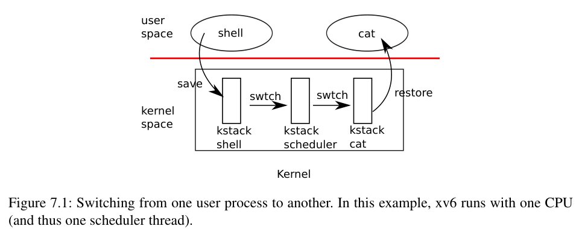

# 第 11 讲 · 调度的机制

## 第 7 章导言：调度

操作系统通常要运行比计算机 CPU 数量更多的进程，因此需要一种安排，让进程分时共享 CPU。理想情况下，这种共享对用户进程应当是透明的。常用办法是把多个进程复用到硬件 CPU 上，为每个进程制造拥有自己的一颗虚拟 CPU 的假象。本章解释 xv6 如何实现这种复用。

## §7.1 多路复用

xv6 在两种情况下把一个 CPU 从一个进程切到另一个进程。第一种通过 sleep 与 wakeup 机制发生：进程在等待设备或管道 I/O 完成、等待子进程退出，或者执行 sleep 系统调用时，系统会切换进程。第二种是周期性地强制切换，以应对长时间计算、一直不睡眠的进程。这种复用使每个进程看起来拥有自己的 CPU，正如内存分配器和硬件页表使每个进程看起来拥有自己的内存一样。

实现复用面临若干难点：

1. **怎样从一个进程切换到另一个进程？**上下文切换的想法很简单，但其实现是 xv6 中最难看懂的代码之一。
2. **怎样透明地强制切换？**xv6 使用标准方法，以定时器中断驱动上下文切换。
3. **多个 CPU 可能同时进行进程切换。**必须制定锁的使用规则，避免竞态。
4. **进程退出后需要释放内存等资源。**它不能独自完成所有释放工作，例如，仍在使用自己的内核栈时，就不能把这条栈释放掉。
5. **多核机器的每个核必须记住当前执行的是哪个进程。**这样，系统调用才能作用于正确的每进程内核状态。
6. **等待事件与唤醒也需要协调。**sleep 允许进程让出 CPU、睡眠等待事件；wakeup 允许另一个进程唤醒它。必须防止竞态导致唤醒通知丢失。

xv6 尝试用尽可能简单的办法解决这些问题，但最后的代码仍然相当微妙。

## §7.2 代码：上下文切换



**图 7.1，教材印刷页 68 原图。**从一个用户进程切到另一个用户进程。图中假设 xv6 只运行一个 CPU，因此也只有一个调度器线程。`user space` / `kernel space` 分别是用户空间 / 内核空间；`kstack` 是内核栈；`save` / `restore` 表示保存 / 恢复用户状态；两处 `swtch` 分别连接进程内核线程与 scheduler。红线表示用户与内核边界。

图 7.1 概括了这次切换的步骤：先通过系统调用或中断，从用户态进入旧进程的内核线程；再上下文切换到当前 CPU 的调度器线程；接着上下文切换到新进程的内核线程；最后通过 trap 返回，进入新进程的用户态。

xv6 为每个 CPU 的调度器安排专用线程，也就是专用的寄存器保存区和栈。调度器不能安全地一直使用旧进程的内核栈：其他核可能唤醒并运行旧进程，两个核同时使用一条栈将造成灾难。本节分析进程内核线程与调度器线程之间的切换机制。

切换线程包含保存旧线程的 CPU 寄存器，以及恢复新线程以前保存的寄存器。恢复栈指针与执行位置，使 CPU 改用另一条栈、执行另一段代码。

`swtch` 函数负责内核线程切换中的保存和恢复。它并不直接理解线程；它只保存、恢复一组称作 **context（上下文）** 的寄存器。进程需要让出 CPU 时，其内核线程调用 `swtch`，保存自身 context，恢复调度器的 context。

每份 context 是一个 `struct context`，定义在 `kernel/proc.h`，嵌在进程的 `struct proc` 或 CPU 的 `struct cpu` 中。`swtch` 有两个参数：`struct context *old` 和 `struct context *new`。它把当前寄存器存入 old，从 new 加载寄存器，然后返回。

现在跟踪一个进程经 swtch 进入调度器。第 4 章已介绍，中断处理末尾的一条可能路径是 `usertrap` 调用 `yield`；yield 调用 `sched`，sched 再调用 swtch。当前 context 保存到 `p->context`，然后切换到 CPU 之前保存的 scheduler context。

> **编者校对：**rev1 这一段及随后多处把每 CPU 的调度器 context 写作 `cpu->scheduler`；本课程固定源码的实际字段为 `cpu->context`，课堂也用 `c->context` / `cpus[0].context`。这是教材字段名与对应源码的差异，不另造一个 scheduler 字段。

`swtch` 在 `kernel/swtch.S` 中实现，只显式保存这次函数边界所需的寄存器。需要跨调用保留的 caller-saved 寄存器值，由调用它的 C 代码按需保存在栈上。汇编知道各个寄存器字段在 `struct context` 中的偏移。

它不保存当前 PC，而是保存 `ra`，也就是调用 swtch 时设置的返回地址。随后，swtch 从新 context 恢复寄存器；这些值通常由以前某次 swtch 保存。执行返回指令时，它跳转到恢复出来的 `ra`，也就是新线程先前调用 swtch 之后应继续执行的位置；使用的也已经是新线程的栈。

在这个例子中，sched 调用 swtch，切到每 CPU 的调度器 context。那份 context 是 scheduler 以前调用 swtch 时保存的。因此，我们所跟踪的这次 swtch 返回时，进入的不是 sched，而是 scheduler；栈指针也已指向当前 CPU 的调度器栈。

> **编者校对：**原书把这一组简写为 callee-saved registers。准确的保存清单是 `ra`、`sp`、`s0–s11`，共 14 个；`ra` 在普通 ABI 分类中并非 callee-saved，但这里必须保存它，作为恢复执行的返回位置。

## §7.3 代码：调度

上一节分析了 swtch 的底层细节。现在把它当作已经具备的工具，来看一个进程的内核线程怎样经过调度器，切到另一个进程。每个 CPU 的调度器都是一个特殊线程，运行 `scheduler` 函数，由它选择接下来执行哪个进程。

一个进程如果想让出 CPU，必须获取自己的进程锁 `p->lock`，释放其他所有已持有的锁，更新 `p->state`，然后调用 `sched`。`yield` 遵守这套约定，后面要研究的 `sleep` 和 `exit` 也是如此。

`sched` 会检查上述条件，也会检查一个随之而来的要求：既然当前持有自旋锁，中断应当已经关闭。最后，它调用 swtch，把当前 context 保存到 `p->context`，恢复调度器 context。swtch 在 scheduler 的栈上返回，好像 scheduler 先前的 swtch 调用刚刚结束一样。调度器继续其 for 循环，找到可运行进程并切换过去，这个循环不断重复。

### 跨 swtch 持有进程锁

xv6 在整个 swtch 调用期间持有 `p->lock`：调用方必须已经取得锁，切换后的代码接过对锁的控制权。这个约定不常见。通常由取得锁的同一个线程释放锁，更容易推理正确性；上下文切换却必须打破这种常规。

原因是 `p->lock` 保护进程 state 与 context 的一些**不变量**，而 swtch 执行过程中，这些不变量暂时不成立。如果没有跨 swtch 持锁，yield 刚把状态设为 `RUNNABLE`、却还没有停止使用自己的内核栈时，另一颗 CPU 就可能决定运行它，导致两个 CPU 同时使用同一条栈。

普通内核线程总是在 sched 中让出 CPU，总是切到 scheduler 的同一个位置；scheduler 又几乎总是切回一个先前调用过 sched 的内核线程。所以，如果打印切换位置的源码行号，在教材所对应的源码中会交替看到 `kernel/proc.c:475` 与 `kernel/proc.c:509`，不断重复。以这种固定方式互相让出执行权的过程，有时称作 **coroutines（协程）**；在这里 sched 和 scheduler 就互为协程。

有一个例外：新进程第一次被调度时，scheduler 的 swtch 不会进入 sched，而会进入 `forkret`。forkret 的存在是为了释放 `p->lock`；否则新进程本来可以直接从 `usertrapret` 开始。

### 调度循环与状态不变量

scheduler 的循环很简单：寻找一个可运行进程，运行它直到它让出 CPU，再重复。它遍历进程表，寻找 `p->state == RUNNABLE` 的项。找到后设置每 CPU 的当前进程指针 `c->proc`，把进程标为 `RUNNING`，然后调用 swtch 启动它。

一种理解调度代码的方法，是把它看作维护每进程的一组不变量，并在不变量尚未成立时持有进程锁：

- **如果进程处于对外可见的 RUNNING 状态，**定时器中断调用 yield 时必须能安全地把它切走。这要求 CPU 寄存器里确实是该进程的运行值，而不是尚未完成恢复的混合状态；`c->proc` 也必须指向该进程。
- **如果进程处于对外可见的 RUNNABLE 状态，**空闲 CPU 的 scheduler 必须能安全地开始运行它。这要求 `p->context` 已保存其寄存器，没有 CPU 正在使用它的内核栈，也没有 CPU 的 `c->proc` 仍指向它。

注意，持有 `p->lock` 的内部过渡阶段，这些性质往往暂时不成立。

维护这些不变量，就是 xv6 经常在一个线程里获取进程锁、在另一个线程里释放它的原因。例如，yield 开始把运行中的进程转为 `RUNNABLE` 后，必须继续持锁，直到所有不变量恢复。最早的正确解锁位置，是 scheduler 已在自己的栈上运行、且清除了 `c->proc` 之后。

反方向也一样：scheduler 开始把一个 `RUNNABLE` 进程转成 `RUNNING` 后，必须等目标内核线程完全恢复运行，才可释放锁；例如恢复后回到 yield，由 yield 完成释放。

### 同一把锁还保护什么？

`p->lock` 也用于 exit 与 wait 的协调、防止唤醒丢失的机制，以及进程退出与其他进程读写其状态之间的竞态。例如，其他进程可能检查目标 PID 并设置 `p->killed`。值得思考：能否把进程锁的不同职责拆开，以改善清晰度，甚至提升性能？

> **编者校对：**rev1 在最后一个例子中写成“exit 系统调用查看 `p->pid` 并设置 `p->killed`”；它所指的 `kernel/proc.c:611` 实际对应 `kill` 的实现。这是原书文字错误。这里按真实操作说明，不将这个动作归给 exit。

## §7.4 代码：mycpu 与 myproc

xv6 经常需要取得当前进程的 `struct proc` 指针。单处理器上可以用一个全局变量指向当前进程，但多核机器上不能这样做，因为每个核可能执行不同进程。解决办法是利用每个核有自己一组寄存器这一事实，让某个寄存器帮助查找每核信息。

xv6 为每个 CPU 维护 `struct cpu`。其中记录当前 CPU 上运行的进程（如果有）、该 CPU 调度器线程的保存寄存器，以及管理中断关闭所需的嵌套计数。

`mycpu` 返回当前 CPU 的 cpu 结构指针。RISC-V 给每个 CPU 一个 hart ID；xv6 保证内核态 `tp` 中保存当前核的 hart ID。mycpu 便可用 tp 作为下标，在 cpu 结构数组中找到正确的那一项。

维持这个约定需要几个步骤。CPU 启动初期仍处于机器态时，把 hart ID 写入 tp；返回用户空间前，`usertrapret` 保存内核需要的 tp 值，因为用户代码可以改写自己的 tp；再从用户态进入内核时，`uservec` 恢复保存的内核 tp。编译器不会把 tp 当成普通临时寄存器使用。如果 RISC-V 允许 supervisor 模式直接读取 hart ID，会更方便，但相应寄存器只能在机器态读取。

> **编者校对：**原文称启动函数为 `mstart`，而固定 2020 源码中是 `kernel/start.c` 的 `start`。原文说 usertrapret 把 tp 保存在“trampoline page”，实际存放在每进程 `trapframe->kernel_hartid`；`trampoline.S` 的 uservec 从该字段加载 tp。trampoline 代码页与 trapframe 数据页不同。

`cpuid` 和 `mycpu` 的返回值有时效性：如果定时器中断使线程让出 CPU，之后它可能在另一颗 CPU 上恢复，那么先前取得的 CPU 编号或 cpu 指针就不再代表“当前 CPU”。因此，xv6 要求调用者关闭中断，并在用完返回的 cpu 结构后才能恢复中断。

`myproc` 返回正在当前 CPU 上运行的进程指针。它先关闭中断，调用 mycpu，从 cpu 结构中取出 `c->proc`，再恢复中断状态。与 mycpu 不同，myproc 返回的进程指针在恢复中断后仍可使用：即使调用进程以后迁移到另一颗 CPU，它还是同一个进程，`struct proc` 的地址不会因为这次迁移而改变。

> **编者校对：**这里的“恢复中断”并非无条件打开。实现使用 `push_off` / `pop_off`，维护嵌套层次，并按进入前的状态决定是否重新允许中断。

## 后续阅读

调度解释的是执行流怎样暂停、接续；怎样等待条件、怎样保证通知不会丢失，是下一部分的主题。第 71 页从 §7.5 开始的 sleep/wakeup，以及 §7.6–7.10，统一见[第 13 讲课程资料](#/c/mit-6.s081-2020/lec/lec13?v=materials)。本页止于 §7.4，不重复后续小节。

## 来源、图像与许可

- **B1：**Russ Cox、Frans Kaashoek、Robert Morris，[*xv6: a simple, Unix-like teaching operating system*，rev1](https://pdos.csail.mit.edu/6.S081/2020/xv6/book-riscv-rev1.pdf)，2020-08-31，第 7 章导言、§7.1–7.4，印刷页与 PDF 页序均为 67–71。以上逐节翻译指定范围；原文代码定位以函数为主，少量保留的行号属于该版本。
- **图 7.1：**从同一 PDF 第 68 页裁取，原页和裁图均已查看；本范围没有另一张独立表格。英文标签已在图注解释。
- **源码核对：**[固定提交 e23d53f27f6e187732a92a2b4705639d1c260f05](https://github.com/mit-pdos/xv6-riscv/tree/e23d53f27f6e187732a92a2b4705639d1c260f05)，仅作 2020 参考快照；不声称就是录课工作树或实验分支。教材字段名、锁交接和启动入口的差异已显式说明。
- 官方 `l-threads.txt` 是课堂提纲，未在本页重新翻译。课堂演示与问答见[中文译稿](#/c/mit-6.s081-2020/lec/lec11?v=draft)。

<details><summary>教材 MIT 许可：原始版权声明与许可全文</summary>

许可来自[教材官方仓库 LICENSE](https://github.com/mit-pdos/xv6-riscv-book/blob/xv6-riscv/LICENSE)，课程已保存其文本。版权年份照保存的许可保留；并不意味着教材版本换成 2024 年，也不把该许可延伸到视频。

```text
The xv6 book sources are:

Copyright (c) 2006-2024 Russ Cox, Frans Kaashoek, and Robert Morris,
                        Massachusetts Institute of Technology

Permission is hereby granted, free of charge, to any person obtaining a copy of
this source and associated documentation files (the "Book"), to deal in the Book
without restriction, including without limitation the rights to use, copy,
modify, merge, publish, distribute, sublicense, and/or sell copies of the Book,
and to permit persons to whom the Book is furnished to do so, subject to the
following conditions:

The above copyright notice and this permission notice shall be included in all
copies or substantial portions of the Book.

THE BOOK IS PROVIDED "AS IS", WITHOUT WARRANTY OF ANY KIND, EXPRESS OR IMPLIED,
INCLUDING BUT NOT LIMITED TO THE WARRANTIES OF MERCHANTABILITY, FITNESS FOR A
PARTICULAR PURPOSE AND NONINFRINGEMENT. IN NO EVENT SHALL THE AUTHORS OR
COPYRIGHT HOLDERS BE LIABLE FOR ANY CLAIM, DAMAGES OR OTHER LIABILITY, WHETHER
IN AN ACTION OF CONTRACT, TORT OR OTHERWISE, ARISING FROM, OUT OF OR IN
CONNECTION WITH THE BOOK OR THE USE OR OTHER DEALINGS IN THE BOOK.
```

</details>
