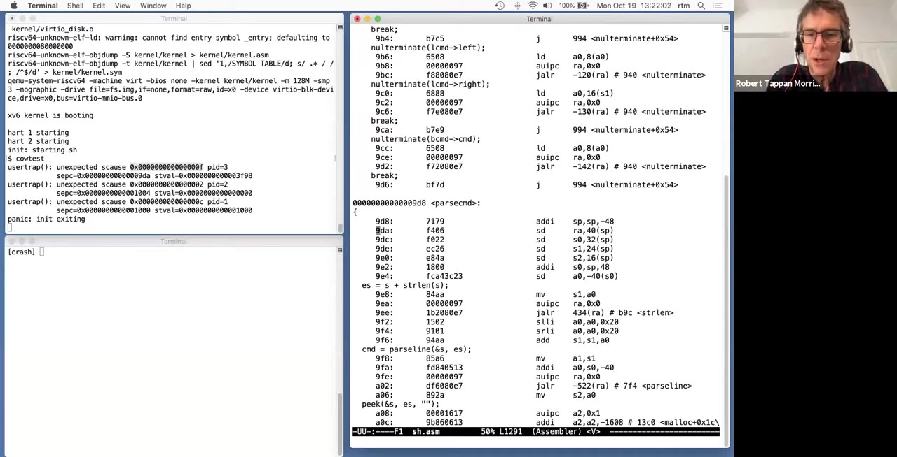
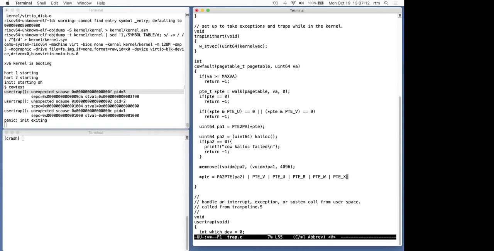
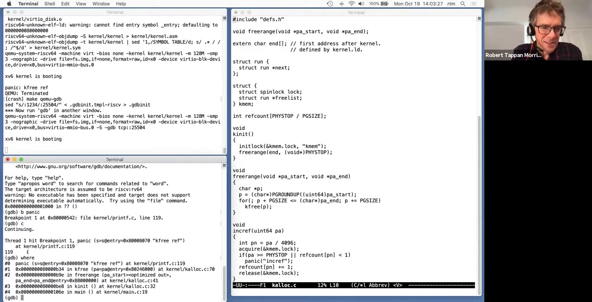
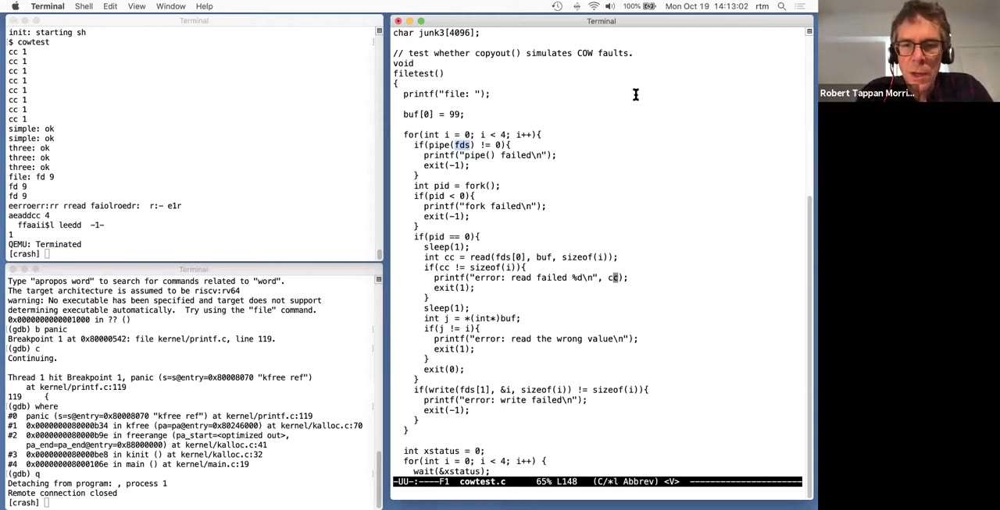
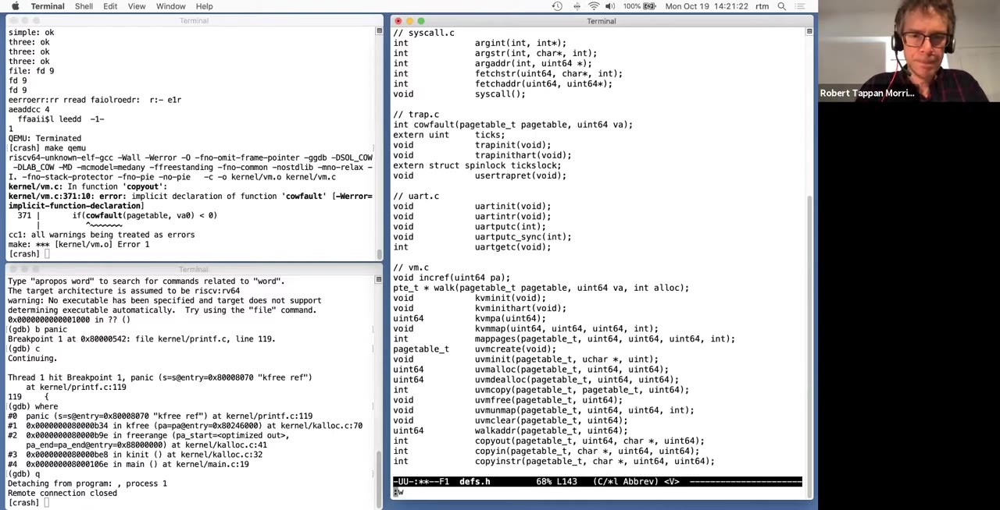
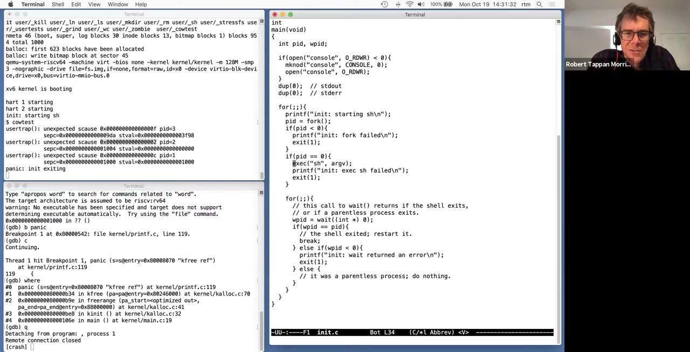

# 第 12 讲 · 实验问答（二）：边做 COW，边追查错误

## 00:00–03:00｜从复制成本说起：今天现场做 COW 实验

Robert 先确认大家能否听见，然后说明今天的安排：给同学们一个集中询问 xv6 和近期实验的机会。为了让问题有具体落点，他会从头做写时复制 fork（copy-on-write fork，COW）实验，能做到哪一步就做到哪一步。大家可以随时问：自己的实现为什么和他的不同，xv6 为什么这样设计，或者某个 bug 为什么会以眼前这种方式出现。

COW 要避免的是那些最终根本没有被修改的页所带来的复制成本。Robert 在自己的实现中加过少量统计代码，测量运行 `usertests` 时内存复制函数总共复制了多少字节，结果比原实现少了约 90%。他随即限定这个数字：`usertests` 是一个特殊的测试程序，这不是所有程序都会得到的比例。他猜测很大一部分收益来自指令页——这些页在程序执行期间通常不会被改写，没有必要为每次 fork 都复制一份。

收益不只在复制字节数。多个进程共用尚未修改的页，可以降低内存使用峰值；fork 自身也能更早返回。不过，延后工作并不保证总工作量更少：如果程序后来把所有共享页都写了一遍，最终仍要做原来的复制，还额外付出了每次缺页异常的成本。实践中 COW 通常值得采用，但应记住这个代价交换。

实现上有两个特别值得注意的问题。第一，共享物理页不能在某一个进程不用它时就立即释放，必须等最后一个使用者也放弃它，这要求额外的记账。第二，`copyout` 向用户内存写数据时，是软件查找用户页表后再通过内核地址访问物理页，不会按用户映射触发通常的写缺页；因此那里也得实现与 COW 缺页相当的处理。

## 03:00–06:00｜小步实现、看失败再决定下一步

开始写代码之前，Robert 先介绍自己的做实验方式。即使年年教这门课，他也不会记住每个实验的全部实现细节，实验本身还会变化。他通常只选下一个小目标，写五到十行左右，马上运行、排错，然后才继续下一步，而不是先把整个解答写完，再一次性测试。

这样做的原因不是完全不做设计，而是实际运行经常会暴露设计时没有想到的事情。如果直到全部写完才发现自己没有真正理解问题，前面的很多工作可能都白做了。眼前的 panic、崩溃或测试失败，常常就是下一步要解决什么的线索。今天他还会重现几处自己上次做实验时真的犯过的错误，让大家一起练习定位。

他从一份新的 COW 实验代码开始，启动系统，运行 `cowtest`，开玩笑说也许足够幸运，什么都不用写就能通过。结果当然是失败。接下来不是马上猜该加什么代码，而是打开失败测试，看看它到底做了什么。Robert 提醒，有些测试只是把很多操作混合起来尝试触发问题，不一定容易看懂；但这次的 `simple` 测试很直接。

这时学生打断：**是不是忘记共享屏幕了？我们什么也看不见。** Robert 道歉并打开共享，确认大家能看到后才继续。因此此前关于启动与初次失败的操作，不能当作观众已经看到的屏幕演示。

## 06:00–09:00｜simple 为什么失败：先让两个页表指向同一批页

共享屏幕恢复后，Robert 把这件事称作今天的“第一个 bug”，重新指给大家看：`cowtest` 的 `simple` 失败了。右侧测试的注释说明，它先申请超过 xv6 可用物理内存一半的空间，然后调用 fork。原版 fork 会真的复制父进程的所有用户页；既然父进程已经用了超过一半，再为子进程分配同样多的内存就不可能成功。

COW 的第一步就是改变这个行为：为子进程建立自己的页表，但让叶子映射指向父进程已经使用的物理页。不是把父子的页表对象也合成同一个，而是让两份页表先表达相同的虚拟地址到物理页关系。

他进入 `kernel/vm.c` 的 `uvmcopy`，找到原来为每一页调用 `kalloc`、复制内容、再映射新页的位置。现场先删除分配和复制的几行，把 `mappages` 的物理地址参数改成从父页表取出的 `pa`。既然这里已经没有新分配的 `mem`，失败分支中释放这个 `mem` 的代码也一并去掉。此时的修改只是让子进程映射父进程的物理页，尚未完成写保护和释放规则。

**学生问：**`pa` 不是已经是 `uint64` 了吗？再强制转换一次会不会有问题？Robert 回答，这类同宽、同类型的转换不会改变地址的位；转换有时只是为了满足编译器的类型检查。随后他实际查看变量声明，确认学生说得对，也移除了已经不再需要的 `mem` 变量。这里讨论的是当前代码中的地址表示，不是在主张所有 C 类型转换都没有运行时效果。

## 09:00–12:00｜得到非法指令，却没有得到期望的写缺页

Robert 再次运行测试，马上确认“肯定还没完成”。屏幕打印 `usertrap` 异常，`scause` 是 2。他问大家记不记得这个编号，随后说明它表示非法指令。学生猜测，是否装着指令的那部分内存被覆盖了？Robert 认为这是合理方向：用户程序正在执行的指令似乎受到了破坏。

但先把这个现象和另一个更基础的问题分开：实现 COW 时，他们本来就预期会出现异常，不过预期的是**写入只读页引起的 store page fault**，以便在异常处理里复制页面。现在没有出现这种写缺页，是为什么？有人提到页表标志。Robert 暂时把非法指令的完整原因放到一边，继续追问：RISC-V 在什么条件下才会因为一次 store 产生页错误？

学生指出，没有写权限时才会发生，而眼前仍可以正常写所有页。Robert 承认自己忘记清除写位——这是他上次做实验时也犯过的错误。`flags` 仍直接来自父进程原来的 PTE，父进程的页可写，复制到子进程的映射也就同样可写。

因此当前实现并不是“共享到第一次写才分裂”，而是“父子直接读写同一页”。即使暂时没有崩溃，它也已经破坏了 fork 后彼此修改内存应当独立的语义。下一步必须让写操作真的受到页表权限约束，不能只把物理地址改成共享。

## 12:00–15:00｜写保护必须同时作用于父子

Robert 请学生给出清除写权限的表达式。学生提出把 `flags` 与 `PTE_W` 的按位取反相与，也就是 `flags &= ~PTE_W`。他解释这里需要波浪号 `~`：目标是清除这一位，保留其余权限和状态位，而不是把整个 flags 变成别的值。

接着问：只改这个局部 `flags`，清掉的是父进程的写权限，还是子进程的？学生回答，只影响稍后建立的子进程映射。那父进程要不要也清掉？答案是要。若父进程还可以直接修改共享页，子进程就会看到这些修改，仍然不符合两个独立内存副本的语义。COW 必须对称地约束父子两边，不能把父进程当成永远不会写的特殊角色。

父 PTE 的指针已经保存在 `pte` 中，因此也可以对 `*pte` 清除 `PTE_W`。另一个学生提出更简洁的顺序：先修改父 PTE，再用 `PTE_FLAGS(*pte)` 提取标志，这样得到的就是已经清掉写位的版本，不必分别改两次。Robert 采纳了这个建议。

重新运行后，这回终于出现了期望的写缺页。课堂此时没有把出现 fault 本身当作实现退步：对共享页的写入本来就应该先被拦下来。现在需要做的是确认它确实来自所预想的 store，然后为这个虚拟地址建立可写的私有副本，让进程继续执行。

## 15:00–18:00｜用 sepc 查汇编：PID 3 还没来得及 exec

异常编号显示为十六进制 `f`，即 store page fault。Robert 不满足于“编号看上去对了”，还要验证发生异常的指令。他看到 PID 3，想到 PID 1 是 init、PID 2 是打印提示符的 shell，于是先猜 PID 3 已经是 `cowtest`。他打开 `cowtest.asm`，查 `sepc` 所示的地址 `0x9da`。

可是查到的指令是 `auipc`，它并不向内存写入，和 store page fault 对不上。这不是应该忽略的小矛盾，而是在提示：查找所用的程序映像可能错了。Robert 解释，异常实际上发生在 shell fork 出子进程之后、子进程 exec `cowtest` 之前，所以应当查 `sh.asm`。

切换到 shell 的反汇编后，同一个地址 `0x9da` 是 `parsecmd` 开头的 `sd ra,40(sp)`。函数序言要把返回地址等寄存器保存到栈上；而栈页刚刚被 fork 改成共享只读，因此第一次保存就触发写缺页。这和 COW 的设计完全吻合。大多数函数在 fork 返回后很快就会写栈，所以不奇怪会先在这里遇到异常。

*原片 17:10，未裁剪。左上显示 PID 3 的 `scause=0xf`、`sepc=0x9da`、`stval=0x3f98`；右侧 `sh.asm` 的 `parsecmd` 中，`0x9da` 对应向栈保存 `ra` 的 `sd`。同屏后续还有 PID 2、PID 1 的异常，后面会分别讨论，不能合并当作同一个 fault。*

**学生追问：**你是怎么判断应该查 shell 的？Robert 回答，起点就是 `cowtest.asm` 的那条指令不可能产生所观察到的 store fault，于是必须重新考虑进程当时实际在运行什么。

## 18:00–21:00｜这是预期缺页，不是 shell 的数据错了

学生继续确认 PID 的含义：PID 3 到底是不是 shell？Robert 把过程拆开：PID 2 是原来的 shell；它 fork 出 PID 3 后，PID 3 起初仍运行 shell 的一份副本。只有成功调用 exec 后，PID 3 才开始执行 `cowtest`。现在它在写自己的栈时就已经缺页，根本没走到 exec。

另一个追问是：这是否表示 PID 2 的数据有问题，导致 PID 3 继承了错误内容？Robert 澄清，眼前 PID 3 的这次写缺页不是那种 bug。刚才的代码有意把父子页都写保护了，因此任意一方从用户态执行 store 都可能触发缺页。这里是在检查机制是否按预期起作用，而不是已经发现 shell 的数据错误。学生确认：这就是我们想得到的那种 fault。

接下来进入 `kernel/trap.c` 的 `usertrap`，在不同异常类型的分支中加入对写缺页的处理。课堂口头一度把函数名说混，随后更正为 `usertrap`。这里只关心写入；读取共享页时，原数据已经在那里，不需要复制。

Robert 预先说明，复制与修改映射的代码会从两个地方使用，所以不把它全塞在 `usertrap` 的分支里，而是封装成一个叫 `cowfault` 的函数。一个入口是当前的写缺页，另一个就是稍后要修的 `copyout`。

## 21:00–24:00｜cowfault 的接口，以及为什么缺页失败会杀进程

`cowfault` 需要两个信息：要修改的页表，以及发生异常的虚拟地址。`usertrap` 可把当前进程页表和 `stval` 提供的地址传进去。函数约定成功返回 0，失败返回 -1；失败原因可能是地址非法，也可能是 `kalloc` 已经没有内存。当前这条缺页处理路径里，无论哪种失败，都把进程标记为需要终止。

成功意味着函数已经把那个虚拟地址改成可以继续写入的私有映射。这样从 trap 返回后，用户代码就能完成原来那次写操作。处理重点在修好映射，而不是把写操作简单跳过去。

**学生问：**把这段判断放在 `devintr` 分支前后，有特别原因吗？Robert 没有仅凭印象回答，而是检查 `devintr` 的实现：关键在于它会不会把缺页误认成设备中断。既然它检查 `scause`，遇到 `0xf` 会返回 0，那么把缺页处理放在不会被前面分支吞掉的位置即可；实际代码需要确认这一点。

随后他指出 COW 的一个接口代价。普通内存分配若通过系统调用进行，内核可以返回 -1，让程序决定如何处理失败；但这次分配是由一条普通 store 隐式触发的，没有现成的系统调用返回位置可以报告“内存不够”。更复杂的系统可以建立类似 alarm 实验的用户回调机制，通知程序缺页无法修复，不过今天不实现这些机制，直接终止进程更简单。

## 24:00–27:00｜用户给出的地址不能直接信任

开始写 `cowfault` 时，Robert 先问：如果用户故意写一个离谱的地址怎么办？它可能超出进程地址空间，也可能指向 trapframe、trampoline 或栈的 guard page。不能因为一次写操作产生了 fault，就把它自动变成一块允许用户写入的内存。

学生首先提到最大虚拟地址。Robert 说这确实相关，但只有上界并不够：进程自己的地址范围通常更小，而且 guard page 这类内部区域也不能放行。他先采用 `walk(pagetable, va, 0)` 查找 PTE；这里不分配缺失的页表层级。如果查不到表项，就返回失败。

不过“找到了 PTE”也不等于“用户可以写这个页”。在当前简化布局下，trampoline、trapframe 和用户栈保护页都没有 `PTE_U`。所以他再检查 `PTE_U` 与 `PTE_V`，任意一个没有设置都拒绝此次处理。这使得一大类非法地址能作为进程错误处理，而不是被转成可写映射。

此时他认为这些检查已经覆盖了要处理的非法地址，准备继续讨论从哪一页复制数据。但这还不是最终结论：接下来的学生问题会指出两条不同边界，一条关乎“有效用户页是不是一定能变成 COW 页”，另一条关乎 `walk` 本身可能在检查之前就 panic。

## 27:00–30:00｜两个学生问题：页的语义与 MAXVA

**学生问：**只靠 `PTE_U` 判断是不是适合 COW 的页，长远看可靠吗？如果以后增加一种本来就只允许读的区域，难道每加一个功能都要回来改这里？Robert 同意。加入 lazy allocation、换出到磁盘的页或文件映射后，就必须区分不同缺页的含义。成熟系统通常还维护描述虚拟地址空间及页面状态的软件数据结构，而不只看硬件页表；处理缺页时要结合那里的信息。今天的代码只针对当前实验的简化环境。

**另一个学生指出：**如果 `va` 大于允许上界，`walk` 会不会直接 panic？Robert 打开 `walk`，确认这确实是问题，并承认此前的判断不完整。非法用户访问当然不该成功，但也不该借一次写操作把整个内核弄崩溃。

同学建议参照 `walkaddr`：在调用 `walk` 之前就先做上界检查，越界直接返回失败。于是 `cowfault` 加入 `va >= MAXVA` 的前置判断。这里重要的不只是“要检查地址”，而是检查必须发生在具有更强输入前提的底层函数之前。

Robert 还说，自己原先的解答没有这一处检查却未被相应测试发现，令他有点不满。后面 `usertests` 的确会在另一个入口——修改后的 `copyout`——撞上同类问题。两个入口必须各自满足 `walk` 的约束，不能以为前面修过一次就覆盖了所有路径。

## 30:00–33:00｜分配副本，再替换发生异常的那个 PTE

Robert 请大家指出如何得到待复制的物理页。学生回答用 `PTE2PA`，因为查到的 PTE 里已经记录了原物理页号。新副本则由 `kalloc` 分配。他加上失败检查和一条输出：如果分配不到页，就打印 `cow kalloc failed` 并返回失败。这条消息稍后会帮助识别内存泄漏。

接着把原页 `pa1` 的整页内容复制到新页 `pa2`。这里不是只复制发生 store 的那个字节；为了保持 fork 的内存语义，未修改的其余字节也要保持原值。然后要让当前进程的同一虚拟页改指向 `pa2`，并允许写入。

学生给出两条路线：先解除原映射、再用已有函数建立新映射，或者直接更新 PTE。Robert 选择直接构造 PTE。课堂这一阶段在屏幕上使用 `PA2PTE(pa2)` 配合 `V/U/R/W/X` 标志，属于当时简化地址空间的写法。

*原片 32:20，未裁剪。右侧可见已经加上的 `va >= MAXVA`、PTE 的 U/V 检查、分配失败提示、整页 `memmove`，以及直接替换 PTE 的代码。画面是中间步骤：此刻还没有完成引用计数处理，不能把它当作完整解答。*

**学生问：**自己几次实验都需要重映射，所以写了一个允许 remap 的映射函数，这是不是危险或不好的设计？Robert 认为可以。xv6 的辅助函数针对原来的使用方式设计，某些 panic 是用来抓“不符合原假设的调用”；当系统功能真的改变时，也可以合理地调整这些接口。前提是理解新旧语义，而不是见到 panic 就不加分析地删掉。

## 33:00–36:00｜别急着释放旧页；跨文件调用还要补声明

Robert 延续对 remap 的回答：原来的 xv6 很少需要这种替换映射操作，所以现有接口不支持它，不代表扩展后的系统也永远不许做。随后他问，当前进程已经拿到私有副本，那另一个仍映射原页的进程要不要马上修改？

学生提出什么也不做：如果另一个进程一直只读，就无需改变；如果它以后也写，就走自己的 COW 缺页路径。Robert 认可这种方法。主动找到所有其他映射并正确更新会复杂得多，保留它们原来的只读映射就能安全工作。

另一位学生提醒：那原来的物理页是不是应当释放？Robert 把要释放的对象区分清楚：新页 `pa2` 正在使用，当然不能释放；旧页 `pa1` 此时也可能仍被别的进程映射。如果直接调用旧版 `kfree(pa1)`，其他进程仍在读写或执行的内存就会被重新利用，结果很可能是崩溃。按小步实现的顺序，此刻先不做这次释放，等建立正确的共享记账后再回来。

他补上成功返回，并尝试编译。新的代码从 `trap.c` 调用了原来主要在 `vm.c` 内部使用的 `walk`，于是还需要在公共声明处暴露函数原型。这是修改调用边界带来的编译层面问题，不是 COW 机制本身的另一个缺页原因。处理完这一类问题，运行时又回到了最早看到的 `scause=2`。

## 36:00–39:00｜非法指令背后：一个进程释放了另一个还在用的页

现在写缺页处理已经能复制页面，Robert 回到最开始留下的问题：为什么仍出现非法指令？他让大家按执行顺序推演，而不是只盯着报错那条指令。

输入 `cowtest` 后，shell fork；子进程最初继续执行 shell 的代码，可能写栈并由新的处理函数获得私有页；接着子进程 exec `cowtest`。exec 要放弃旧的用户映像。可此时那些没有被写过的旧页，还和父 shell 共享。若释放路径仍按“这个物理页只属于一个进程”的旧假设工作，就会释放父 shell 仍在使用的页，连指令页也不例外。

学生确认：也就是子进程在释放自己的映射时，实际上把父 shell 的页也释放了。Robert 认可。随后这些物理页可能被重新分配、填入其他内容，父进程脚下的指令和数据突然改变，出现非法指令就不难理解。这里必须修的是物理页的生命周期，而不是为非法指令异常添加一个“继续运行”的分支。

> **编者校对：**课堂口述把 exec 描述为先释放旧页、再装入新程序，用来解释共享页遭误释放的后果；固定 2020 参考源码实际先构造新映像，在提交成功后才释放旧页表。根本问题仍是旧共享页被过早释放，但不能把口述顺序当成 `exec.c` 的精确执行顺序。

**学生问：**这一次打印的 `sepc` 应该去哪个汇编文件找？Robert 没有声称已经定位：上次能确认是 shell，这一次他并没有把精确位置追到底，可能涉及 shell 或 `cowtest`，需要进一步检查。

## 39:00–42:00｜代码已经被踩坏时，静态反汇编也可能失去依据

Robert 进一步解释为什么这次光查 `.asm` 未必有帮助。若问题确实是指令所在的物理页被释放、重用，CPU 正在取到的字节就可能不再是可执行文件中原来的机器指令。静态反汇编只能说明原文件在那个地址原本有什么，不能证明当前内存仍然如此。要深入确认，可以用 GDB 查看那个虚拟地址实际指向的内存和指令。

**学生追问：**被覆盖后的字节有没有可能恰好仍构成合法指令，于是不会产生非法指令异常，而是先执行一些随机指令再出别的错？Robert 明确回答可以。一旦底层内存被这种方式破坏，表现可能很不同；也可能先踩坏的是栈或数据，最后出错位置离起因很远。如果他没有事先做过这个实验，也不能预言一定会看到眼前的异常。

所以修复目标应当回到一个清楚的条件：只在确实没人再用某个物理页时才回收它。Robert 邀请学生提出判据。有人建议为每页维护一个变量，记录引用数，分配和释放时增减。

这个建议把问题从“当前是谁在退出”变成“还剩多少使用者”。fork 可以反复发生，不能只用“父/子两份”这种固定数量来判断。后面要明确每个计数对应哪一个物理页，以及哪些操作增加或消除一个引用。

## 42:00–45:00｜为物理页计数：fork 增，解除映射减

Robert 把引用计数的目标说得更精确：当没有任何应计入的页表引用再指向这个物理页时，才允许释放。如果一个程序 fork，子进程又 fork，可能出现三四个进程共同映射同一页。fork 会使计数增加；进程退出或 exec 放弃旧映像时会减少；COW 写缺页把一个映射移到新页时，也要从旧页的计数中扣掉一次。

因此需要逐个思考代码路径：哪里真正添加了一个引用，哪里只是暂时取得地址，哪里真正撤销了一个引用。只想到增加而没想到所有减少的位置，虽然避免了早释放，却会泄漏内存。

课堂选择在分配器里放一个 `refcount` 数组，每个物理页对应一个整数。xv6 使用预设的物理内存上界，故可以直接按 `PHYSTOP / 4096` 为数组确定范围，再以物理地址除以页大小作下标。Robert 提到，更一般的系统需要发现机器到底有多少 RAM，再动态安排这些记录。

**学生问：**为什么写 4096，而不是页大小宏？Robert 开玩笑说，4096 他记得，宏的名字一时忘了，也愿意改成宏。若 xv6 要移植到各种页大小的机器，这种写法必须更谨慎；这里的实现本来就包含不少针对具体平台的假设。

> **编者校对：**`PHYSTOP` 是物理地址的上界，不等于 RAM 字节数。按 `pa / PGSIZE` 直接索引时，数组也包含低地址范围对应的空洞；这是简单但不紧凑的索引法。不能把这段口述推成“机器可用内存就是 PHYSTOP 字节”。

## 45:00–48:00｜页大小由谁决定？内核全局数组放在哪里？

有关页大小的问题继续了一会儿。页表翻译由硬件完成，硬件当然必须知道地址中哪些位是页内偏移，哪些位用来索引页表。RISC-V 的地址翻译模式规定了这些布局；当前 xv6 使用 4096 字节的基础页。这个数不是随便在 C 程序里换个宏就能任意改变的。

另一个学生转向 C 与装载过程：像 `refcount` 这样的全局变量到底存在哪里？它属于某个进程吗？Robert 先指出这是内核中的全局变量，然后从编译链接角度解释：编译器和链接器知道各全局对象的大小，为它们安排地址；内核被装入内存以后，执行代码就按这些地址访问它们。

他用“若干全局变量占若干字节、装载在某个地址附近”做口头示例，重点是变量名最终变成内存中的位置，而不是一个在运行时另外寻找的神秘对象。他没有在这里展开完整的 ELF 装载细节。

**学生尝试类比：**这是否像磁盘上程序只有一份指令，所以全局变量也只有一份？Robert 没有直接接受这个类比，而是重新回到链接器如何为一个声明出来的变量选定地址。这里尤其要分清：正在讨论的是这一个内核映像里的数组，不是在宣布同一用户程序的所有进程天然共享全局变量。

## 48:00–51:00｜kalloc 建立第一个引用，并用断言抓记账错误

Robert 用一个更具体的例子继续回答：声明一个全局变量 `x` 后，编译器和链接器决定它的地址；源程序里写 `refcount[0] = 1`，最终就是向对应地址存储数值 1。用户程序编译链接后访问全局变量，在这一层意义上也是相似过程。他也承认自己的现场解释未必已经完全解开学生的疑惑。

回到引用计数，刚从 `kalloc` 取得的物理页应该有一个引用，因为分配器已经把这页交给调用方，调用方拥有它。于是先根据返回地址除以页大小算页号，再把对应计数设成 1。

在赋值之前，Robert 特意加入一个一致性检查：既然这页刚从空闲链表取出来，它原来的引用计数应该是 0。如果不是，就 panic，而不要默默覆盖为 1。这样能尽早暴露“仍有人使用的页却被放进空闲链表”或计数维护不一致的问题。

他说自己知道引用计数很容易写错，所以会主动把这些预期变成检查。这里的断言不是为了捕捉用户正常的资源不足，而是用来指出内核自己的记账约定已经被破坏。下一步要配套修改释放端，否则只在分配时设 1 还不能解决共享页的回收。

## 51:00–54:00｜改变 kfree 的语义，而且必须先检查再填垃圾

Robert 列出减少引用的场景：退出、exec 放弃旧映像、COW 缺页改用副本。原版 xv6 假定一个页只有一个所有者，所以不少这些地方本来就在调用 `kfree`。一个简便办法是改变 `kfree` 的语义：它现在先减少一次引用，只有减到 0 时才真的把页放回空闲链表。这样原有调用点大多会自动获得新的共享回收行为。

不过修改的位置很重要。旧 `kfree` 会先用垃圾值填满待释放页，便于发现悬空引用。如果共享页的计数还大于 0，就绝不能先做这一步再决定不释放；那已经把其他进程使用的内容破坏了。因此引用计数判断必须放在填充垃圾之前。

这还涉及锁。原来的空闲链表临界区位于填充之后，不能直接把新增计数逻辑塞到那个位置。多个核上的进程可能同时释放同一个共享页，所以减少计数和读取结果必须受锁保护。

课堂实现先计算页号，确认当前计数不是 0，再减一，并把剩余数保存在临时变量中。释放锁后，如果剩余引用非零，就立即返回；只有剩余数为 0 才继续真正回收。Robert 在这里也加入断言，因为“对计数已经为 0 的页再减少一次”是内核内部错误，不能悄悄忽略。

## 54:00–57:00｜锁保护的是共享计数，新增引用发生在 uvmcopy

**学生问：**为什么连这段计算页号的代码也要拿 `kmem` 锁？Robert 指出，需要保护的核心不是除以页大小这个纯计算，而是随后对共享引用计数的检查和更新。两个进程若在不同 CPU 上同时退出，而它们的页表都指向同一页，就会同时进入这段代码。没有同步，可能丢失一次减少，或者错误地判断何时能释放。

**学生又问：**能否新建一把专门保护引用计数的锁？可以。Robert 强调的是所有操作这些计数的代码必须遵守同一套锁约定，而不是锁非得叫 `kmem.lock` 才行。课堂沿用已有锁，是一种实现选择。

减少端补上之后，还要有增加端。他写一个供其他代码调用的 `incref`，同样先检查物理地址和计数是否合理：地址不能让数组越界，也不能对一个计数已经是 0 的空闲页凭空增加引用。检查的目的仍是尽早暴露自己的实现错误。

该从哪里调用它？学生指出 `uvmcopy`。在当前设计里，正是这里把一个已经存在的物理页又映射到子进程页表，使共享引用数增加一次。Robert 把增加操作放入这一建立新映射的路径；后续还需要让跨文件调用有正确声明，并用实际运行找出初始化等遗漏。

## 57:00–60:00｜还没启动完就 panic：freerange 没经历过 kalloc

加入声明后重新编译运行，内核很快就报 `panic: kfree ref`。故障发生在极早的启动阶段，本身就是线索。Robert 打开调试器准备看调用栈，学生已经指出可能原因：初始化空闲链表时，这些页还没有先经过 `kalloc`，因此计数根本不是 1。

现场用 GDB 在 `panic` 设置断点、继续执行，再用 `where` 看回溯，确实看到 `kfree` 是由 `freerange` 调用，而上面是 `kinit` 和 `main`。这验证了学生的猜测，不必先从某个用户进程的退出路径找问题。

*原片 58:35，未裁剪。左下回溯依次为 `panic → kfree → freerange → kinit → main`；右侧 `freerange` 仍直接调用 `kfree(p)`。新增的引用计数前置条件与这条初始化路径不相容。*

原版初始化会把一段物理内存逐页交给 `kfree`，借此建起空闲链表；这些页此前当然没有被分配器分配过。现在 `kfree` 要求已有一个可减少的引用，而全局数组初值是 0。Robert 因此在 `freerange` 的初始化流程中补上与新语义相配的计数设置，再让 `kfree` 把它减到 0 并入链表。

修改后系统终于能启动。再跑 `cowtest`，`simple` 通过，`three` 也先通过一轮，但后续一轮出现之前特意加入的 `cow kalloc failed`。这说明问题从“过早释放”变成了“内存耗尽”，还需要找哪条路径没有归还引用。

## 60:00–63:00｜遗漏旧页减引用，然后轮到 file 测试失败

Robert 问为什么会没有内存。学生回到先前暂时跳过的步骤：COW 缺页已经把当前映射从 `pa1` 改到 `pa2`，却没有减少旧页 `pa1` 的引用计数。新页在不断分配，旧页的账却一直保留，最终自然耗尽。

现在可以在复制与映射替换完成后对 `pa1` 调用新的 `kfree`。这和半小时前的同一句调用意义不同：当时它会无条件回收物理页，现在它表示“放弃一个引用，若归零再回收”。例如父子原来共有两个引用，子进程复制后调用一次，旧页从 2 减到 1，父进程仍可安全使用，不会被真正释放。不能误把这里写成释放正在使用的新页 `pa2`。

再跑测试，`three` 的多轮操作不再把内存耗尽。不过 `file` 测试出现了新的失败。Robert 打开测试，看到注释就明确说它在检查 `copyout` 能否模拟 COW fault，这提示剩余问题很可能在内核写用户内存的路径。

屏幕上的错误文字有交错，因为测试循环创建了四个子进程，它们会同时打印。先不要把一串混在一起的字符误认成完全不认识的报错；要回到打印位置，确认失败条件。眼前知道的只是 `read` 返回的字节数不等于 `sizeof(i)`，还不知道到底返回了什么，于是下一步先捕获并打印这个返回值。

## 63:00–66:00｜不要停在猜测：read 返回 -1，却不是 fileread 返回的

Robert 在测试中保存 `read` 的返回值，并把它附在错误输出后。学生注意到有三个子进程失败、另一个似乎还在运行，问为什么不都失败。Robert 没有立即编造调度故事，而是说先查清至少一个为什么失败，再看是否足以解释剩下那个；此时他还不知道原因。

新增输出显示 `read` 返回 -1。直觉上的假设是：`read` 要把数据写入用户缓冲区，这会调用 `copyout`；也许失败就来自它对 COW 页的处理。于是 Robert 进入 `sys_read`，看到它获取参数后调用 `fileread`，便在 `fileread` 返回后打印结果，希望看到传上来的 -1。

实际输出却否定了这个猜想的具体版本：失败发生之前没有相应的 `fileread` 返回值打印，而看到的 `cc` 还出现了 4——这是正常读取一个整数的长度，不是失败。也就是说，一些调用根本没有走到 `fileread`，就在前面的检查中返回了 -1。

所以虽然总体问题可能仍与 `copyout` 有关，**这一次失败的直接位置不是“read 复制数据失败”**。接下来必须检查 `argfd`、`argint`、`argaddr` 等前置步骤，找出究竟哪个条件拒绝了调用。这个转折正好说明为什么打印应当用来证实或推翻假设，而不是只打印一句“我猜 copyout 坏了”。

## 66:00–69:00｜所有失败者拿到 fd 9：管道返回值污染了共享页

Robert 说，自己第一次追查时也没预料到直接失败会发生在参数检查。学生猜是不是文件描述符损坏了。他先在 `argfd` 的两个失败出口加输出，重新运行后看到了 `fd 9`。

9 并非负数，也没有超过当前每进程打开文件表的大小。于是触发失败的是对应表项为空：**这个进程并没有文件描述符 9**，却把 9 传给了 `read`。问题不在内核把一个合法 fd 的读取做坏了，而在用户代码持有的 fd 数值已经不属于自己的打开文件。

*原片 68:10，未裁剪。右侧 `filetest` 在循环中先 `pipe(fds)`、再 `fork`，子进程随后 `read(fds[0], buf, sizeof(i))`；左上出现多次 `fd 9` 和交错的 read 失败输出。下方旧的 GDB 回溯仍留在终端中，不是这次 file 测试的新调用栈。*

`fds` 数组由 `pipe` 填入。如果 pipe 成功，为什么数组里的值会错？Robert 提醒，真正值得怀疑的是：每轮创建的管道描述符应当不同，9 更像最后一轮才出现的值，却被多个早先的子进程都读到了。学生也注意到“它们全拿到了 9”。

这暗示几个进程正在不该共享修改的情况下看见同一块内存的变化。课堂还没有靠这个现象完全证明每一次调度顺序，但已经把问题缩小到 `pipe` 如何向用户空间写回数组。`copyout` 仍是核心，只是发生得比 `read` 更早。

## 69:00–72:00｜copyout 绕过的是用户映射的写权限检查

Robert 解释新的假设：pipe 把新分配的两个 fd 数字写回调用者的 `fds` 数组；如果承载这个数组的物理页仍被父子共享，而内核直接写了它，早先 fork 出去的进程也会看到后续 pipe 写入的新数字。这样就出现了某个子进程拿到另一个时刻、另一个进程上下文中的 fd 值的情况。

他打开 `sysfile.c`，确认 `sys_pipe` 的确使用两次 `copyout` 分别写回数组两个元素。再看 `copyout`：先软件遍历页表，从用户虚拟地址得到物理地址，再把数据复制到那个物理页。它没有检查用户 PTE 的 `PTE_W`，所以不知道目的地已经被 COW 改成只读共享页。

用户态 store 会让 MMU 按用户页表检查写权限，触发可供 COW 使用的异常。但眼前 `copyout` 没有通过那条用户映射去写，而是在内核地址空间里访问查出来的物理页，因此这次写入不会替它自动产生相同的用户写缺页。结果是所有仍引用原页的进程都能看到本该只属于一个进程的修改。

因此要在 `copyout` 中主动完成相当于 COW fault 的处理。原来调用 `walkaddr` 只拿到物理地址，现在需要知道权限位，就应取得 PTE 本身；Robert 开始把查找改成 `walk`。这里也意味着调用者要重新承担原来 `walkaddr` 替它做的一些检查。

> **编者校对：**“不使用 MMU”在课堂中的含义是不用 MMU 按用户页表完成这次用户地址翻译与权限判定；内核自己的访存仍受当前内核地址翻译机制支配，不是 CPU 关闭了分页。

## 72:00–75:00｜怎样识别 COW 页？引用数为 1 也可能仍写保护

修改后的 `copyout` 先检查常见错误：没有 PTE、映射无效，或没有用户权限，都返回失败。与普通用户 store 导致的缺页不同，这里处于系统调用的调用链中，可以把错误逐层返回，例如让读取操作返回 -1，不一定直接杀掉进程。

然后 Robert 问怎样判断该不该复制。学生提出看引用计数：共享者多，计数就大。Robert 认可这是重要线索，但反问计数为 1 是否就必定不是 COW 页？不一定：fork 后子进程因写缺页取得副本，旧页计数会降到 1，但父进程的原 PTE 仍然是写保护的，之前并没有顺手把父 PTE 改回来。

可以进一步利用计数为 1 的情况避免无谓复制，不过课堂选择更省事的实现。在他使用的 xv6 版本里，排除非用户页后，用户映射被写保护的情形就是眼前加入的 COW，所以直接检查 `PTE_W` 是否清除，然后调用之前在 `trap.c` 中写好的 `cowfault`。

> **版本边界：**这里的“用户可见但不可写就视为 COW”是录课简化环境的假设，不是普适判据。只读文本、文件映射或其他只读区域都可能要求保持只读。已核对的固定 2020 基础源码在 `uvmalloc` 中给用户页设置 R/W/X/U，能解释课堂为何采用此捷径；它不是录课解答树，也不能替代对自己实验分支的核对。2020 实验原页另有用 PTE 的 RSW 位记录 COW 状态的提示。

课堂在讨论引用数阈值时有口头反复；这里保留其可确定的结论——计数为 1 仍可能有只读 COW 映射——不把含混的阈值说法整理成可直接照抄的算法。

## 75:00–78:00｜复制后重新读取 PA；cowtest 之后还有 usertests

调用 `cowfault` 成功之后，还有一步容易遗漏：它可能已经把 PTE 的物理地址从旧页改成新页。如果 `copyout` 继续使用调用前缓存下来的物理地址，刚做的分裂就白费了，写入仍会落到共享旧页。所以 Robert 在处理完成后，重新从当前 PTE 提取 PA，再进行实际复制。

他询问大家对修改有没有问题，然后补上跨文件使用 `cowfault` 的函数声明。编译器先前正是因为没有看到声明而拒绝构建；这一点可从现场错误与 `defs.h` 对照确认。

*原片 76:30，未裁剪。左上编译输出指出 `copyout` 使用的 `cowfault` 没有声明；右侧 `defs.h` 正在补入该函数原型。这一帧仍保留上一轮 file 测试的输出，不应把旧输出误认作修复后的测试结果。*

随后运行结果看起来很好，Robert 问是否已经做完。同学提醒还有 `usertests`。他删除排错用的打印，运行更广的测试；等待时也提醒，有的测试会故意申请大量内存，不能见到分配失败消息就不分场合地认定实现错了。

不久 `usertests` 又撞到了熟悉的 `walk` panic。前面在 `cowfault` 处理过最大地址问题，但新改写的 `copyout` 又直接调用了 `walk`，把同一种调用前提遗漏带到了第二个入口。课堂接下来转去看具体测试。

## 78:00–81:00｜非法指针测试，与“还没实现”还是“实现错了”的疑问

`usertests` 的 `copyout` 测试注释明确说明，会向系统调用传入离谱的指针。此时 `copyout` 把那个地址原样交给 `walk`，而 `walk` 对超出 `MAXVA` 的参数执行 panic。用户给出非法地址时，内核完全可以返回错误；但不该让一个坏用户参数直接中止内核。

Robert 在调用 `walk` 前补上最大虚拟地址检查，再次运行测试，并表示目前没有意识到别的错误。字幕没有提供清晰的最终 `ALL TESTS PASSED` 宣告，因此这里仅记录重新运行与等待，不把期待通过改写成已经完整验收。

等待过程中，学生问了一个更宽的问题：采用小步开发时，中间版本总会出现很多奇怪错误。若自己从零开始，怎么分辨“刚写的代码错了”和“只是剩下部分还没实现”？Robert 坦言没有一个能普遍解决这个问题的答案，尤其页表相关 bug 会破坏很多平时默认成立的条件，每个问题都可能需要不同办法。

他列举自己常用的手段：先读代码，列出有哪些可能的解释；再插入打印或断言收集事实，排除或支持这些猜测。打印并不是为了让输出越多越好，而是为了问清具体的问题，比如“有没有真正走到 fileread”“传进来的 fd 到底是多少”。有时还可以回到不出现该问题的旧版本，逐块加回改动，观察是哪一步使现象出现。

## 81:00–84:00｜正式下课以后：为什么 init 也出现了异常？

Robert 继续说明，没有哪一种排错技巧总能成功。这门课不仅让大家学习操作系统机制，也在训练写代码、调试代码的经验。他为不能给出更简单的万能方法表示抱歉，随后宣布正式课程时间结束，愿意继续回答问题，并约大家周三再见。

一位学生又提起最早的异常输出：写缺页之后有 shell 的非法指令，还有 init 的异常，最后那一个是什么？Robert 起初没有明确解释，觉得 init 此时似乎不应再与其他进程共享页面，所以不能只凭前面讲过的故事就断言原因。

学生回忆 shell 那里出现过 `scause=f`，init 那里好像是 `scause=c`。这些口头回忆没有立即被当作精确事实；Robert 决定重现最早的中间版本。他重新准备一份实验代码，想只恢复到“已经共享物理页、还没有完整 COW 处理”的阶段，再观察实际输出。

这段保留了课堂重要的态度：不知道就承认不知道，必要时重新制造条件。此时是在追查一个早期错误版本，不是在修复刚刚已经推进到后面阶段的代码，更不能把接下来重现出的崩溃当成最终版本又退化了。

## 84:00–87:26｜重现早期错误，沿 init 的 wait/fork 循环寻找解释

Robert 重做 `uvmcopy` 的最初修改：去掉新页分配和内容复制，让子进程映射 `pa`。学生提醒，想重现的时点还包含清写位的改动，因此他也恢复父子写保护。重新启动并运行后，再次得到多个进程的异常。

这回 init 的 `scause` 确认为十六进制 `c`，也就是 instruction page fault；它和 `scause=2` 的非法指令是不同异常。Robert 一边查看 PID，一边承认还没有完整理论，随后打开 `user/init.c`，从 init 的实际控制流寻找线索。

init 在循环里 fork，子进程 exec shell，父进程等待。等到 shell 退出，它不会就此永远闲着，而是结束当前等待，再回到外层循环创建新的 shell。讨论中出现了一个解释方向：PID 2 因异常退出，init 的 `wait` 返回，init 再次 fork，于是又进入眼前这个尚未完成、会破坏共享页状态的实现。

*原片 86:40，未裁剪。右侧 `init.c` 可见 `fork`、子进程 `exec("sh", argv)`，以及 `wait` 等到 shell 后 `break` 回外层循环；左上重现 PID 3 的写缺页、PID 2 的非法指令、PID 1 的取指缺页和 `panic: init exiting`。这支持沿进程生命周期继续排查，不等于已经对最后一次取指缺页做了逐条指令证明。*

学生表示这样就能理解为何 init 也会卷进来。Robert 总结，这些错误之所以显得完全失常，是因为实现已经违反了很多平常关于内存、映射和生命周期的直觉。课堂到这里收尾；最后一条字幕只有询问是否还有问题的零碎词，没有新的技术结论。

## 来源、校对与覆盖说明

- 视频：Robert Morris，*6.S081 Fall 2020 Lecture 12: Q&A #2 (COW lab)*，课程官方 2020-10-19 课表所链，David Morejon 频道，视频 ID `S8ZTJKzhQao`，时长 5246 秒（87:26）。原片地址保存在本讲 `sources/video-metadata.json`；本文不提供分段视频跳转。
- 文字依据：英文自动字幕 1968 条，无人工字幕轨；全量文本已读。按上下文和源码校正 `scause`、`sepc`、`stval`、`kalloc`、`kfree`、`uvmcopy`、`copyout`、`cowfault` 等 ASR 错词。学生身份未辨认，不额外署名。
- 时间：正文为约三分钟阅读窗口，跨窗问答顺接；开始 0–11.120 秒无字幕，不推测内容。末条原始字幕结束到 87:28，超过视频元数据 2 秒，正文和覆盖范围按 87:26 封顶；这不是已确认的视频尾部缺失。
- 画面：六张真实单帧均已实际查看，时间为 17:10、32:20、58:35、68:10、76:30、86:40，无裁剪；它们仅用于核对正在讨论的课堂操作，不表示全片画面已审阅。
- 技术校对：只读复用固定源码 `e23d53f27f6e187732a92a2b4705639d1c260f05` 的 `vm.c`、`kalloc.c`、`exec.c`、`trap.c`、`sysfile.c`、`user/init.c`。它是基础参考快照，不是录课解答工作树或 cow 实验分支。课堂关于 exec 顺序、COW 判别捷径等与普遍规则不同之处已用编者注分开。
- 本讲没有指定阅读，不另造课程资料；机制提炼与自测见[课程笔记](#/c/mit-6.s081-2020/lec/lec12?v=notes)。实验要求集中在 [COW 实验页](#/c/mit-6.s081-2020/lab/cow?v=zh)，以保存的 [2020 官方原页](https://pdos.csail.mit.edu/6.S081/2020/labs/cow.html)为准。
- 视频未获得明确开放许可；本文是根据课堂证据自主组织的中文译述，没有公开整段英文字幕或套用课程网站 CC 许可。未逐句听音、未运行 xv6 实验，未确认课堂最终 `usertests` 完整成功输出；所有“运行”“通过”“失败”均指课堂演示到相应时点的观察。
