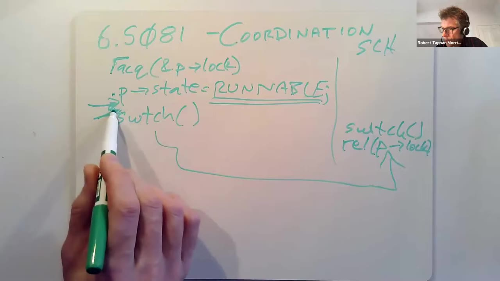
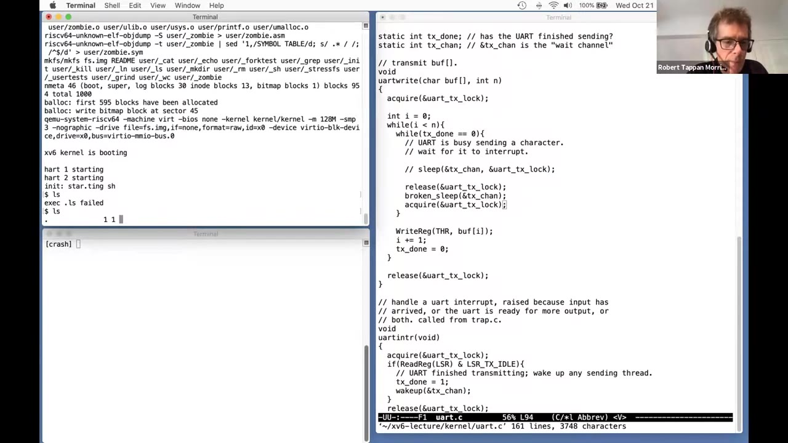
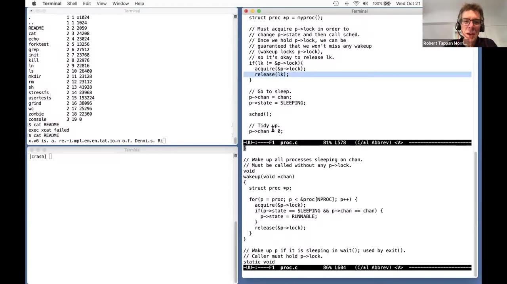
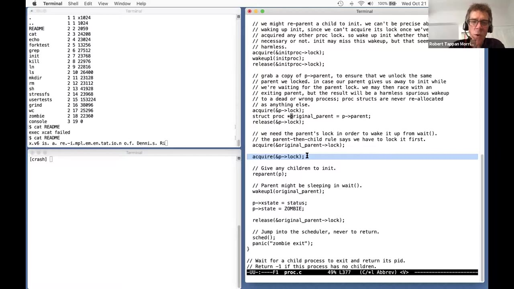

# 第 13 讲 · sleep 与 wakeup 中文译述

## 00:00–03:00｜切换线程时，为什么进程锁要交给调度器释放？

开场确认声音后，Robert Morris 说明今天先复习线程切换的两个约束，再讨论线程间的顺序协调，尤其是丢失唤醒问题。这里的协调是让一个执行者等待另一个执行者或设备完成某件事，xv6 的具体工具就是 `sleep` 和 `wakeup`。

第一个约束与上周的 `swtch` 有关。进程的内核线程准备交出 CPU 时，先取得自己的 `p->lock`，再修改状态，然后经 `sched()` 调用 `swtch()`。例如 `yield` 把状态从 `RUNNING` 改为 `RUNNABLE`，意思是仍然愿意运行，只是这轮先把 CPU 让出去。切换之后，是调度器线程原先的 `swtch` 调用返回，由调度器释放刚刚那个进程的锁。

这不是通常的“某个函数加锁，在返回前自己解锁”。取得锁与释放锁的执行者属于两个不同线程，中间还跨了一次上下文切换。要理解这个看起来不寻常的安排，需要把其他 CPU 的调度器也放进画面。

其他核可能正在遍历进程表，寻找 `RUNNABLE` 进程。如果某个进程刚把状态改成可运行，另一核就看到了这一状态，它可能立刻决定运行该进程。因此，调度器查看一个进程的状态前也必须取得它的锁；原线程持有的 `p->lock` 暂时阻止了这种观察。

## 03:00–06:00｜不能提前解锁，也不能带着其他自旋锁切换

如果原线程在 `swtch` 之前释放 `p->lock`，另一核就可能开始运行它，而它自己还在当前核上执行。两个核会使用同一个线程的栈和保存状态，几乎立刻造成破坏。正确的解锁点必须在原线程完全停止、原核不再使用它的栈之后。因此，只有切换到调度器线程后，才由调度器释放这把锁。



*03:30 原片板书：左侧取得 `p->lock`、把状态置为 `RUNNABLE`，再 `swtch()`；箭头通向右侧调度器 `SCH`，在那里执行 `release(&p->lock)`。不能把解锁移到左侧箭头所指的切换之前。原帧未裁剪。*

**课堂提问：多核之所以能看到同一把锁，是因为它们共享物理内存吗？** 是的，这里讨论的硬件就是共享内存的多核机器。提问者随后询问不满足这一条件的系统；这句自动字幕不够清楚。讲者举了两台独立计算机的例子：它们不共享内存，因而不是这里同一种共享内存锁问题。现代单颗处理器芯片通常有多个核，由硬件让它们共享内存系统。

接着引出第二个约束：线程切换时必须持有自己的进程锁，却不能持有其他自旋锁。这个约束同样会影响稍后的 `sleep` 设计。

## 06:00–09:00｜单核上的死锁推导

考虑进程 P1 的内核线程先取得一把锁 L，例如保护磁盘或 UART 数据的锁，然后在仍持有 L 时交出 CPU。P1 原本打算以后继续执行，再释放 L；但此刻它已经停止运行。

暂时假设机器只有一个 CPU。调度器选中 P2，P2 也需要访问同一个设备，于是调用 `acquire(L)`。由于 L 还在 P1 手里，P2 会停在自旋循环里。`acquire` 不返回，P2 就到不了后面的正常工作，更到不了它可能愿意执行的 `yield`。

于是产生了闭环：P2 要等 P1 解锁才能继续；P1 必须重新得到 CPU 才能解锁；唯一的 CPU 却被 P2 的自旋占住。不是 P1 忘了写 `release`，而是它再也没有机会执行到那个位置。这就是死锁，表现为系统冻结。

讲者先用单核说明，是为了让因果关系最直观。换成多核也不能把这条规则删除：引入多把锁和多个相互等待的执行者，同样能构造无法前进的局面。因此 xv6 采用统一约束：除进程自身的 `p->lock` 这个特殊交接对象外，不允许带着其他自旋锁主动切换出去。

## 09:00–12:00｜为什么时钟中断救不了这个自旋？

**聊天区提问：时钟中断不是可以把 P2 换下来，让 P1 解锁吗？** 这个想法抓住了重要细节：这里虽然运行的是内核代码，xv6 也确实允许在内核执行期间接受时钟中断。在 `trap.c` 的内核陷阱处理路径中，时钟中断可以触发 `yield`。如果中断能发生在刚才的自旋中，调度器确实可能重新运行 P1。

但 `acquire` 在开始等待锁之前已经关闭了本核中断。上一讲讨论过原因：若本核持有某锁时发生设备中断，而中断处理程序也要同一把锁，处理程序就会等待被它中断、因而无法继续执行的代码释放锁。这又是死锁。

不能把关中断挪到“已经抢到锁之后”。那样会留下一个短暂窗口：锁已经属于本核，但中断还开着；中断若恰好到来，同样有危险。所以代码采用先关中断、再自旋取得锁的顺序。代价是，刚才 P2 的自旋不能依靠时钟中断被抢占。

另一个问题请讲者重复避免死锁的办法。回答是禁止那种调用方式：内核代码不能持有其他自旋锁去交出 CPU，并有检查来发现违规。

> 编者核对：讲者口头把检查归到切换代码；固定 2020 源码中，具体检查在 `sched()`，包括持有 `p->lock`、`mycpu()->noff == 1`、状态不是 `RUNNING`、中断关闭，并非汇编 `swtch.S` 自己检查这些条件。

## 12:00–15:00｜互斥之外，还需要等待特定事件

讲者要求把前面两条规则留在脑中：必须带着进程锁完成交接，又不能带着任意其他自旋锁离开 CPU。接下来研究的协调机制必须同时满足它们。

锁主要帮助线程安全地使用共享数据：临界区内可以暂时不必考虑其他线程也在修改同一数据。但某些场景恰恰要求线程主动关心另一个执行者的进展。管道读取是一个例子：读者发现缓冲区为空时，必须等某个写者放入数据，才能把字节返回给调用者。

磁盘读取是另一个例子。内核向控制器提交读取某个块的请求后，机械设备可能还要寻道和旋转；对 CPU 来说，毫秒级等待很长。发出读取的进程需要等的是“这次磁盘读取已完成”，不能仅仅再执行几条指令就当作数据已准备好。

还有 `wait` 系统调用：父进程要等自己的某个子进程退出。这不是阻止别人访问数据，而是在两个进程之间安排事件发生的先后。

这三种情况的共同点是：一个线程需要等待特定条件；条件可能由另一线程改变，也可能由设备中断通知。顺序协调和互斥一样，是编写多线程系统的基本工具，而不是某个设备驱动的特殊技巧。

## 15:00–18:00｜忙等与主动交出 CPU

最直接的实现是在管道读取中写一个循环：只要缓冲区为空，就什么也不做；另一核的写者放入字节后，条件变为非空，循环退出。这在直觉上很好懂，却可能浪费大量 CPU 时间。

讲者没有说忙等永远错误。如果硬件任务确定极快，比如大约十分之一微秒就会完成，短循环可能比一次复杂的睡眠和调度更划算。有些硬件交互因此确实使用轮询。

但若等待可能持续毫秒，甚至根本不知道要等多久，就不同了。管道写者可能十分钟后才写数据，让读者一直占着 CPU 没有意义；CPU 本可以执行其他有用工作。所需机制应当让当前线程暂时退出竞争，把 CPU 交给别人，并在相关事件发生后恢复执行。

这与普通 `yield` 有区别：这里不仅是让出当前时间片，还需要记录“我在等什么”，避免调度器在条件尚未改变时反复运行该线程。历史上有多种协调原语，xv6 和许多 Unix 系统使用 `sleep`、`wakeup`。

随后讲者共享屏幕，准备查看 UART 代码，并强调自己为本讲改写了驱动的一部分。接下来的示例不能直接当作默认 xv6 UART 实现。

## 18:00–21:00｜教学版 UART 如何逐字符等待中断

当 shell 打印提示符或程序输出文本时，用户程序发起 `write`，在这份教学改写中最终进入 `uartwrite(buf, n)`。它用循环逐个把字符交给 UART 硬件。

示例把硬件简化为一次接收一个待发送字符。驱动交出一个字符后，要等 UART 表示“上一个已经发完，可以再收一个”，才能发送下一个。串行设备可能每秒只传约一千个字符；等待一个字符完成的毫秒级时间，在现代 CPU 上足以执行大量工作，因此不希望在这里持续自旋。

UART 可以在发送完成后触发中断。`uartintr` 读取内存映射的状态寄存器，检查 `LSR_TX_IDLE`；如果发送器已空闲，便把内存里的 `tx_done` 设为 1，再调用 `wakeup(&tx_chan)`。正在 `uartwrite` 中等待的线程得以继续，尝试发送下一字符。

写者则在 `tx_done == 0` 时调用 `sleep`。它不是自己去猜设备需要多久，而是等中断处理路径宣布条件改变。发送一个字符后，它又把 `tx_done` 清为 0，下一轮继续等待。

这里已经能看出成对关系：需要等待的一侧调用 `sleep`；知道事情已发生的一侧调用 `wakeup`。`sleep` 内部最终会经线程切换真正交出 CPU，而不是把“睡眠”实现成另一个轮询循环。

## 21:00–24:00｜channel 只负责匹配，逐字中断是教学选择

内核里可能同时有很多等待者，所以一次 UART 唤醒不能把等待磁盘、管道和其他事情的进程混为一谈。`sleep` 与 `wakeup` 使用相同的 channel 值来配对；本例两侧都传 `&tx_chan`。

接口把 channel 当成一个用于比较的值。在这里它是地址，但睡眠机制不读取这个地址中的内容，也不理解“UART 已空闲”是什么意思。睡眠者记录某个 channel，唤醒者提供同一个 channel，匹配的睡眠者就会变成可运行。这样调用者不必告诉调度器全部设备语义。

**提问：是不是并非每写一个字符都唤醒一次进程？** 讲者澄清：在这份专门改写的教学驱动中，确实按字符等待、中断、唤醒。每一轮先等 `tx_done`，写一个字符，再把标志清零；发送结束的中断再将标志置一。

真实 UART 往往可以缓冲多个字符，讲者举了 4 或 16 这样的可能容量，并未把它确认为本设备的精确参数。更高效的驱动可以一批交给硬件多个字符，从而减少每字节的中断成本；以太网等高速设备通常每次中断处理的数据更多。

这份代码的目的因此是清楚展示协调接口，而不是展示吞吐量最好的 UART 驱动。

## 24:00–27:00｜看似多余的第二参数：条件锁

`sleep` 与 `wakeup` 很灵活，因为它们只需要双方约定 channel，不需要了解事件类型。然而 `sleep` 还有一个不那么漂亮的参数：锁。为什么“等事件”还要把锁传进去？

这背后是丢失唤醒。单纯提供一个完全不了解调用者状态的“在某事件上睡眠”接口，很难把等待做正确。几乎所有协调机制都必须处理这个竞态；在 xv6 中，处理需求通过条件锁这个参数暴露给了使用者。

**有人问：已经有 channel，为什么还需要 done 标志？** 讲者先把这个问题留到后面的具体例子中回答。两者确实不同：一个是调用者维护的条件，一个是睡眠机制配对通知的名字；后面还会说明醒来为什么不代表条件必然成立。

为了找出锁参数的必要性，讲者先假设一个更简单的单参数接口 `broken_sleep(chan)`。它把进程状态改为 `SLEEPING`，表示暂时不应再被调度；还需要记录 channel，以便未来某次唤醒找到自己，然后交出 CPU。之所以直接命名为 broken，是因为接下来要展示它缺失的保证。

## 27:00–30:00｜构造 broken_sleep 与相应的唤醒路径

假设的 `broken_sleep` 仍然需要取得进程自身的锁，因为要修改 `p->state` 并调用 `sched`。它记录 `p->chan = chan`、设置 `SLEEPING`，然后切换出去；问题不在于完全没有进程锁，而在于没有与调用者检查条件的动作连接起来。

`wakeup(chan)` 的基本结构则很直接：遍历所有进程，如果某进程处于 `SLEEPING` 且 `p->chan` 与参数匹配，就把状态改为 `RUNNABLE`。暂时省略锁的细节，这已经很接近实际实现。注意是“可以再次被调度”，不是直接在 `wakeup` 里面运行这个进程。

接着把这个简单接口放回 UART 场景。写者对缓冲区中的每个字符重复：只要 `done` 为假，就在对应 channel 上睡眠；条件变真后发送字符，再把 `done` 置为假。中断处理程序负责把 `done` 置为真并发起唤醒。

仅看这段高层逻辑，好像发送与等待已经衔接起来了。但它还没回答共享数据怎样保护。下一步必须为写者和中断处理程序加锁，不能因为引入了 sleep/wakeup 就忽略数据竞争。

## 30:00–33:00｜把条件锁一直拿着，会阻止条件成立

两边都需要锁，理由有两个。第一，`tx_done` 是共享内存变量，读写它要遵守一致的同步规则。第二，写者与中断处理程序还会访问 UART 的内存映射寄存器；并发地操作硬件也可能出问题，不能任意交错。

中断处理程序的加锁位置容易理解：进入相关处理时取得 UART 锁，检查硬件、更新标志、唤醒，再释放锁。难点在写者。

一种直观写法是把整个“等上一个字符发完，再发送当前字符”的过程包在锁中。讲者在板书上把 lock 放在这一过程开头，unlock 放在末尾，然后问为什么肯定行不通。

答案是写者等待 `done` 变真，但只有中断处理程序能把它变真；中断处理程序又必须先拿到这把锁。若写者持锁睡眠，中断处理程序只能等锁，而写者又等中断处理程序推进条件。锁不只阻止了不安全的并发，还把所需的进展一并挡住了。

这同时呼应开场的约束：切换时不能持有这种额外的自旋锁。写者必须让中断处理程序有机会取得 UART 锁。问题变为：究竟在什么时候释放它，才能既让事件发生，又不把唤醒弄丢？

## 33:00–36:00｜现场改坏驱动：release、broken_sleep、acquire

下一种方案是在检查 `tx_done` 时持锁，但一旦决定等待，就先释放 UART 锁，再调用单参数 `broken_sleep`；睡眠返回后重新取得 UART 锁，继续检查条件。这样看起来既保护了共享数据，又允许中断处理程序运行。

讲者在编辑器中注释掉原本的 `sleep(&tx_chan, &uart_tx_lock)`，替换为三步：

```c
// 课堂故障演示：以下组合存在 lost wakeup
release(&uart_tx_lock);
broken_sleep(&tx_chan);
acquire(&uart_tx_lock);
```

这三步中的 `broken_sleep` 只负责在进程锁保护下登记 channel、置为睡眠状态、进入调度器。随后重新运行系统，结果 init 的启动输出只出现几个字符就停住了。讲者输入一个句点，输出又向前走了一段。运行 `ls` 后，同样先输出几个字符，随后卡住；再输入字符，又能继续。



*35:55 原片：右侧原 `sleep` 已注释，替换成 release / broken_sleep / acquire；左侧 `ls` 输出停在开头。屏幕还显示 `exec .ls failed`：先前为触发输入中断而键入的字符混进命令行了，并非另一个待解释的 sleep 实现。原帧未裁剪。*

代码没有出现明显的编译失败，也不是完全不能发送字符；它是在某种时序下停止推进。讲者接下来要求大家解释这一现象。

## 36:00–39:00｜丢失唤醒发生在登记睡眠之前

写者刚检查过 `tx_done == 0`，因此决定等待。它随后释放 UART 锁，却还没有运行到 `broken_sleep` 中把自己标为 `SLEEPING` 的位置。

在这个间隙，中断处理程序可能取得 UART 锁。释放最后一把相关自旋锁也可能让本核重新开中断；而在多核系统里，UART 中断还可以在其他核执行。讲者推测演示中很可能是另一核的处理程序已在等锁，一解锁就立即前进。

中断处理程序看到发送完成，将 `tx_done` 设为 1，并调用 `wakeup(&tx_chan)`。可是写者此时仍在执行 release 与 broken_sleep 之间的代码，还没有睡眠登记。`wakeup` 找不到这个睡眠者，于是什么也没有唤醒，然后结束。

写者继续执行 `broken_sleep`，终于记录 channel 并进入睡眠。问题是，它所期待的中断与唤醒已经发生过了；没有下一次事件保证它醒来。因此硬件明明已经准备好，写者却可能一直睡着。这才是丢失唤醒，而不是 UART 没有发出中断。

**学生追问：唤醒丢失后，下一次输入是否总会把缓冲的输出一下子全部放出来？** 讲者说这依赖具体实现；本例能靠输入恢复，是一个偶然的驱动行为，下一段继续解释。

## 39:00–42:00｜输入为什么能救回输出？done 又为什么不能删？

UART 的接收与发送事件进入同一个中断处理函数。键入字符产生的是输入中断，但处理函数不只读取输入，它还会检查发送器是不是空闲。发送早已完成，所以这次检查再次看到空闲，再次调用了发送方向的 `wakeup`。

这一次写者已经睡着，因此额外唤醒能够找到它，输出恢复。若接收与发送完全走不同路径，输入就未必有这种副作用。不能据此认为 lost wakeup 会自动修复，也不能依赖下一次无关事件来保证程序进展。

**提问：`tx_done` 这个标志到底有什么作用？** 它是中断处理程序向写者报告“上一个字符已完成，可以提交下一个”的共享状态。channel 只负责唤醒匹配，并不保存这个条件值。

学生进一步问：既然 `sleep` 返回，就应该知道 UART 唤醒了自己，为什么还要看标志？讲者把问题改写为“为什么要用 while 包住 sleep”，并说明不能把睡眠返回当成事件的精确担保。学生想到 UART 中断兼有输入与输出两种用途；讲者接着给出更一般、在很多等待场景中都会出现的多等待者理由。

## 42:00–45:00｜多个等待者与反复卡住的 cat README

假设两个进程同时写控制台。第一个写一个字符后睡眠并释放条件锁，第二个也进入写路径，发现 UART 忙，于是也睡在同一 channel 上。发送完成后，一次 `wakeup` 把两者都变为可运行，但硬件此时只允许其中一个提交下一个字符。

先取得条件锁的进程会发送并清除 `tx_done`；另一个恢复后必须重新检查标志，发现条件又不满足，就再睡一次。这就是 while 的作用：唤醒只是重新检查的机会，不是给每个醒来的线程发了一份独占资源。

**另一个学生问：前面的演示似乎只丢了一次唤醒，为什么输入一个字符后就把剩余输出全打印完了？** 讲者于是运行输出更长的 `cat README`。这一次只出少量字符就停住；输入句点，前进几个字符，又停住；再输入句点，又前进一小段。故障可以反复出现，只是它依赖两个执行者恰好交错，不保证每个字符都失败。

讲者由演示收束到修复目标：UART 锁必须释放，否则中断不能推进；但必须消除“已经允许唤醒者运行、自己却尚未登记睡眠”的窗口。不能只靠把三条语句写得相邻，就认为这个窗口不存在。

## 45:00–48:00｜正确接口承诺相对于 wakeup 的原子性

讲者把驱动调用恢复为正常的双参数 `sleep`，开始说明使用规则。等待方必须有一个实际条件，例如 `tx_done == 1`；还必须有一把保护该条件的锁。检查条件时持锁，决定等待后仍持锁进入 `sleep`，并把这把锁传给它。

`sleep` 承诺把“交出条件锁”和“使进程进入睡眠”做成相对于唤醒者不可分割的操作。并不是两者由一条机器指令完成，而是不能让配合协议的 `wakeup` 观察到那个危险的中间状态。更新条件并调用 `wakeup` 的一侧也应持有同一条件锁。

随后查看 `proc.c`。`wakeup` 逐项扫描进程表，对每个进程先取得 `p->lock`，检查 `SLEEPING` 和 channel 是否匹配，匹配就改为 `RUNNABLE`，再释放锁。这里的进程锁既保护状态字段，也是稍后避免 lost wakeup 的另一半。

再查看 `sleep`。它接收新的锁参数；既然中断处理程序需要这把锁，`sleep` 内部迟早必须释放它。真正的问题不是有没有 `release(lk)`，而是释放之前还有哪一个动作，可以继续挡住对当前进程的唤醒检查。

## 48:00–51:00｜两把锁交接：先取得 p->lock，再释放条件锁

关键顺序是：`sleep` 在释放条件锁之前，先取得当前进程的 `p->lock`。这样在整个危险区间内，睡眠方至少持有两把锁中的一把。

从 `uartwrite` 开始看：它取得 UART 条件锁，检查 `tx_done`，仍持锁进入 `sleep`。这时中断处理程序不能越过自己的条件锁获取，因此也不能执行后面的唤醒。进入 `sleep` 后，线程取得进程锁，短暂同时持有两把锁，再释放 UART 锁。

此后中断可以取得 UART 锁，甚至可以进入 `wakeup`，但轮到检查这个进程时，它还必须取得该进程的 `p->lock`。睡眠方仍握着它，因此唤醒者不能看见尚未完成的睡眠登记。



*50:20 原片：右上是 `sleep`，先 `acquire(&p->lock)` 再 `release(lk)`，然后登记 channel、置 `SLEEPING`、调用 `sched()`；右下 `wakeup` 遍历进程并逐个取得 `p->lock`。左侧仍保留前面 `cat README` 夹杂输入句点的故障输出，不是修复后的验收结果。原帧未裁剪。*

睡眠方继续设置状态并调用 `sched`，全程保持进程锁。按照开场讲过的规则，要等它真正切换到调度器、离开原线程的栈以后，调度器才释放这把锁。至此唤醒者才能完成对它的检查。

## 51:00–54:00｜不会漏掉登记，再把同一推理用于管道

当 `wakeup` 最终取得进程锁时，等待方已经是目标 channel 上的 `SLEEPING` 进程，于是可以把它设为 `RUNNABLE`。如果条件在等待方检查前就成立，等待方本来就不该睡；如果条件在检查后改变，唤醒者的检查又一定排在登记之后。两种情况都避开了危险空隙。

这套保证来自几件事共同配合：调用者持条件锁检查条件并进入 sleep，sleep 先取得进程锁再交出条件锁，而唤醒方的执行又需要经过这些锁。只读其中一个函数，看不出完整协议。讲者停下来询问是否有问题，随后换到另一个实例。

UART 是等待硬件中断；管道则是等待另一个线程。`read` 管道会进入 `piperead`，它取得保护整个管道的锁。要读到数据，需要已写入的字节数不同于已读出的字节数；课上用“写得比读得多”来解释这个条件。

如果当前没有数据，读者把管道锁传给 `sleep`。另一核的 `pipewrite` 则会往缓冲区加字节，再唤醒读者。两者仍有完全一样的风险：不能让写者在读者检查为空之后、登记睡眠之前完成通知。

## 54:00–57:00｜管道多读者，以及 sleep 返回前重新加锁

管道锁阻止写者在读者检查条件的临界区中插进来；`sleep` 的锁交接继续保护后半段，因此读者不会因为“检查后才写入”的数据而永久睡眠。

`piperead` 与 `pipewrite` 都把睡眠放在检查条件的循环里。讲者用多个读者等待同一管道的例子再次说明：如果写者只写了一个字节，却唤醒所有读者，只有一个读者能够拿走这个字节。

这里补充前面尚未强调的接口细节：`sleep` 返回前，会重新取得传入的条件锁。调用者进 sleep 时持锁，出来时也持锁，中间睡着的那段时间才交出它。因此醒来的多个读者不是无保护地一起读取计数和缓冲区。

第一个读者的 sleep 先重新取得管道锁并返回，看到 `nwrite` 比 `nread` 多一个字节，跳出等待循环，读走它并释放锁。其他读者才能依次取得同一把锁、从自己的 sleep 返回。它们重新检查时，管道已经空了，于是再次睡眠。

所以循环不是在补救一个偶发的 API 失效，而是正确使用广播式唤醒的常规方式。条件锁保证检查与消费一致，while 则处理醒来后条件又被其他执行者改变的情况。

## 57:00–60:00｜接口的通用性，以及线程退出的两个难题

讲者承认 sleep/wakeup 的规则有些麻烦：虽然不必告诉它等待条件的表达式，却要把保护条件的锁交给它，还要遵守双方的加锁约定。好处是它足够通用，条件并不局限于一个计数。

指定阅读里的信号量提供更高层接口。调用方执行计数的 P/V 操作，不需要每次传入条件锁，也不必在接口层面处理 lost wakeup。但问题没有凭空消失，而是封装进信号量的内部实现。由于它专门围绕计数增减设计，可以隐藏更多细节；若问题本身不是等待某个计数，就未必同样直接。

接着转向最后一个主题：如何关闭线程。进程退出时，要清理用户内存、页表、trapframe，以及进程表中的占位，使未来 `fork` 能重新使用相关资源。

有两个难题。其一，不能简单从外部销毁另一线程：它可能正在另一核执行，还在用自己的栈、context，或者持有内核锁。其二，即使线程自愿退出，也不能在自己仍需要某项资源来继续执行时，就把它提前销毁。接下来的 `exit`、`wait` 和 `kill` 要分别处理这两种危险。

## 60:00–63:00｜exit 先做能够由自己完成的清理

如果强行停止一个正在内核中执行的线程，它可能刚完成复杂共享数据更新的一半。线程被消灭后，数据不变式还没恢复，锁也可能永远不再释放。因此结束线程不能只是停止指令流。

自愿 `exit` 也有类似的资源生命周期问题。执行退出函数本身还需要栈、进程状态等资源；一个线程不能一面继续依赖它们，一面把它们交给无关的新线程复用。需要另一个执行者在安全时间完成最后清理。

讲者打开 `proc.c` 中的 `exit`。首先看到关闭所有打开文件，这可能涉及引用计数和文件系统，实际工作并不只是清空几个整数。随后释放当前工作目录的引用；当前目录是 `chdir` 一类操作维护的进程状态，也需要清理。

再往下有处理子进程归属的代码。如果退出者自己还有孩子，这些孩子不能失去最终执行 `wait` 的人。xv6 把它们交给 PID 1 的 init。讲者先指出这段代码存在的目的，随后再通过 `wait` 说明为什么这种接管不仅是用户接口上的便利，而是资源回收所必需。

## 63:00–66:00｜ZOMBIE：不再执行，但尚未成为空闲槽

每个退出进程都需要某个父进程用 `wait` 完成最后几步。原父进程自己退出时，无法再承担这个责任，所以要把其子进程重新挂到 init 名下。

退出者接着唤醒自己的父进程，因为父进程可能已经睡在 `wait` 中；然后记录退出状态，并把自身状态设为 `ZOMBIE`。此时还不能设为 `UNUSED`：一些资源仍未回收，而且退出代码还没有真正切换离开。

`ZOMBIE` 表示这个进程不会再执行，但它的记录还留着，等待另一个执行者收尾。调度器只选择 `RUNNABLE`，因此 `exit` 调用 `sched` 后，不会再把这个僵尸进程选回来。它也不能立刻被新一次 `fork` 当成空闲槽使用。

为了看清后半段，讲者切到 `wait`。父进程扫描进程表，找到 `parent` 指向自己的条目，特别寻找其中状态为 `ZOMBIE` 的子进程。若找到了，就可以收集该子进程传给 `exit` 的退出状态；这是用户程序通过 `wait` 获得结果的来源。

注意两边的职责已经分开：子进程完成部分清理、留下可辨识的终止状态，父进程从这一状态继续完成回收。

## 66:00–69:00｜freeproc、init 与 original_parent 的问题

父进程在 `wait` 中调用 `freeproc`，释放子进程的 trapframe、用户页表及其关联用户内存，并清理其他进程记录。讲者特别纠正一个容易从一般线程模型带来的假设：如果 xv6 每次都释放内核栈，那么栈也应在这里由别人释放；但这份实现的内核栈带保护页，实际上并不在每次进程退出时释放。

> 编者核对：固定快照在 `procinit` 为进程槽预分配内核栈；`freeproc` 没有释放该栈，而是将槽重新置为 `UNUSED` 供复用。不要把“不能自己释放正在使用的栈”误写成本版本 `wait` 真的调用了栈的释放函数。

因此，`wait` 不只是父进程想知道“孩子结束了吗”的便利接口，它还是退出协议的一部分。init 持续调用 `wait`，为收养的子进程执行同样的清理。只有完成回收后，进程槽才回到 `UNUSED`，可被后续 `fork` 使用。

**学生提问：为什么 exit 在 reparent 之前先保存 `original_parent`？** 讲者开始解释父子可能同时退出。平常是孩子退出、父亲等待，很容易理解；但父亲也可能正在退出，把孩子交给 init，而孩子同时试图通知原父亲。下一段保留讲者对这一复杂情况的回答边界。

## 69:00–72:00｜父子同时退出，以及先唤醒再置 ZOMBIE 为什么安全

对于 `original_parent`，讲者指出这一片代码是在处理父子并发退出：孩子准备通知父亲时，父亲自身可能正退出并改变孩子的归属。讲者坦言没有在现场重新建立对全部细节的把握，因此没有给出逐行完整证明。若没有这种并发情况，代码会简单得多，孩子直接唤醒父亲即可。

**另一个问题：为什么先唤醒父进程，再把自己设为 ZOMBIE？不应反过来吗？** 关键是退出的子进程持有自己的进程锁；父进程的 `wait` 要检查它，也必须取得同一把锁。即使父进程已变为可运行，也不能越过这把锁看到退出中的半完成状态。

子进程继续设置 `ZOMBIE` 并进入 `sched`，最终由调度器释放它的锁。父进程之后取得锁，才能检查到已经完成的终止状态。所以在这段受锁保护的范围内，不能只凭文本上“wakeup 在前”判断存在丢失通知。



*70:30 原片：保存 `original_parent` 后，先取得原父进程锁，再取得自己的 `p->lock`；随后 `reparent`、`wakeup1(original_parent)`、设置 `xstate` 与 `ZOMBIE`，释放父锁并 `sched()`。这是 2020 的协议，画面没有新版 `wait_lock`。原帧未裁剪。*

讲者最后强调这一部分要记住的设计：退出者不独自完成所有回收，而把仍涉及执行状态的最后清理交给父进程。

## 72:00–75:00｜kill 是请求，真正退出发生在安全点

`kill(pid)` 让一个进程要求另一个进程结束。若目标正在创建文件等多步骤内核操作中，不能把它立即从执行现场删除，否则会留下只更新到一半的数据结构。

实际 `kill` 做得很少：扫描进程表找到目标 PID，设置目标的 `p->killed`；若目标睡着，还把它改为 `RUNNABLE`。设置标志本身既不释放目标内存，也不保证它立即停止执行。

目标进程在内核中的安全位置检查这个标志，然后由目标自己调用 `exit`。讲者转到 `trap.c`：进入系统调用后、真正执行系统调用前，有一次检查；处理完成准备回到用户空间前，还有一次检查。后一处也覆盖用户态被时钟等设备中断打断后走过的路径。

这些位置适合退出，是因为进程还没有开始、或已经完成这一轮系统调用的复杂内部工作，不持有那些中途不能放弃的资源更新。对于在用户态持续计算的程序，也不需要它主动配合调用 exit；下一次中断会使内核得到检查机会。

因此 `kill` 应理解为发出终止请求，内核在合适的边界落实请求。不能把系统调用成功返回等同于目标的所有资源已经回收。

## 75:00–78:00｜睡在管道或控制台里的进程怎样响应 kill

目标若正在用户态，下次系统调用或中断进入内核时会检查终止标志。因此发出 `kill` 与目标实际退出之间可能有延迟。

但若目标卡在内核里的长时间等待呢？例如正从控制台读取输入，用户也许明天才键入下一个字符。若只等正常系统调用结束，终止请求就可能同样拖到明天。于是 xv6 的 `kill` 对睡眠进程还执行 `SLEEPING → RUNNABLE`，让它从 sleep 继续。

讲者用管道读说明后续动作：进程被唤醒后回到等待循环顶部，管道可能仍没有数据；循环检查 `p->killed`，发现已被请求终止，就释放相关锁并返回错误，而不是再次睡下去。系统调用逐层返回到 `usertrap`，由那里看到终止标志并调用 `exit`。

这里不是在 `kill` 里面直接完成清理，也不是睡眠函数自动退出调用者。是否能放弃当前工作，是具体等待循环的责任。只有在这里中止不会破坏内核状态时，才可以根据 killed 标志提前返回。

这也是醒来必须重新检查条件的另一个原因：这次唤醒来自终止请求，根本没有保证管道变得可读。

## 78:00–81:00｜磁盘等待不能任意中止；权限与 init 的提问

并非每个等待循环都检查 killed。讲者打开磁盘驱动，指出等待磁盘块完成的 while 循环只看请求是否结束，没有因为被 kill 就直接退出。

原因是这一 I/O 可能位于创建文件等操作的中间。一个文件系统操作会涉及多次读取、写入；即使此刻线程没有运行、正在睡眠，也不意味着整个操作处于可随意放弃的状态。xv6 选择继续等磁盘完成，并完成系统调用，再由 `usertrap` 检查终止标志。

**学生问：既然进程可以 kill 别人，为什么不杀掉所有其他进程，独占机器？** 讲者先开了分时机器使用纪律的玩笑，再说明 xv6 是教学系统，省略了权限体系。真实系统会把进程与用户身份联系起来，并在 kill 等接口检查权限；例如普通用户不能任意终止别人的进程。这里是概念性说明，不是对 Linux 完整权限规则的逐条列举。

**又有人问：init 会不会退出？** 讲者查看 `user/init.c`，看到 fork 失败时确有调用 exit 的错误路径，但指出系统设计意图是 init 始终运行、反复等待子进程。接下来又回到内核检查 init 真退出时会发生什么。

## 81:00–84:00｜init 不能消失；关机为什么绕不开文件系统

在 `exit` 开头可以看到，如果当前进程是 init，内核会 panic。若 init 消失，交给它的退出子进程就没人 `wait`，资源不能完成回收，进程槽会逐渐耗尽。因此不能把用户态 init 中存在错误退出分支理解为系统支持正常结束 init。

**学生问：那么关闭整个操作系统需要做什么？** 讲者先用“拔掉电源”开玩笑，再区分停止执行与正确保留持久状态。文件系统在重启之间保留，实质是磁盘上的数据结构。如果关机或断电发生在一次复杂更新中间，必须有办法避免磁盘留下破坏不变式、无法恢复的状态。

例如创建文件不是一个不可分割的磁盘动作。即便机器突然停止，也希望下次能把文件系统恢复到正确状态。后续讲座会研究为此需要的机制；它比“让 CPU 不再取指令”复杂得多。

此外还取决于机器上运行什么服务。如果是很多其他计算机通过网络依赖的数据库服务器，能否关机还涉及服务连续性。反过来，若没有这样的工作负担，主要问题就是保证文件系统处于可接受的状态，然后停止执行。讲者并未在这里演示 xv6 的关机命令，也没有把拔电当成通用的操作建议。

## 84:00–85:26｜关机回答的收尾与 P/V 接口

讲者继续把关机问题归结为两个层次：一方面确保持久化的文件系统能够正确保留或恢复；另一方面看正在运行的程序是否承担不能随意中断的工作。如果这些都处理妥当，机器停止执行本身没有神秘之处。提问者表示理解。

最后还有一个关于信号量接口的问题：前面说的接口是不是 P 和 V 两个函数？讲者确认教材讨论的信号量对象提供的就是这两项基本操作，并提醒 xv6 本身并没有直接提供这套信号量实现；它是教材用于解释协调机制的例子。

讲者再次询问还有没有问题，最后以简短确认结束。本段结束时间按视频元数据 85:26 封顶；最后一条自动字幕从 85:25.120 开始，其原始显示结束时间稍超出视频长度。

## 来源、校订与覆盖说明

- 视频：Robert Morris 主讲，David Morejon 频道，2020-10-21 发布，*6.S081 Fall 2020 Lecture 13: Sleep & Wakeup*，视频 ID `gP67sJ4PTnc`。官方 2020 课表所链视频，真实时长 5126 秒。
- 文字证据：无人工字幕，使用英文原语种自动字幕 `en-orig`，共 2273 条，已全部阅读。首条从 00:05.520 开始；末条原始结束 85:27.840，比元数据长 1.840 秒。开头无字幕区间未猜写发言；未逐句听音。
- 自主译述保留实际讲解顺序、推导、故障演示和问答；整理口头重复，不作为逐字翻译。自动字幕中的 switch/sked、weight、UART 等按上下文与源码分别校正为 `swtch`/`sched`、`wait`、UART。04:33 左右学生追问用词不清，正文明确标出；68:00–70:00 的并发退出问题未替讲者补造现场证明。
- 已实际查看 03:30、35:55、50:20、70:30 四帧，均为真实单帧，未裁剪。没有全片画面核验；课堂示例未在本地运行。
- 辅助核对：[官方提纲](https://pdos.csail.mit.edu/6.S081/2020/lec/l-coordination.txt)、[教学改写代码](https://pdos.csail.mit.edu/6.S081/2020/lec/l-coordination.c)。其服务器 Last-Modified 为 2025-09-05，不能断言与录课工作树逐字相同。固定源码快照 `e23d53f27f6e187732a92a2b4705639d1c260f05` 只用于 2020 机制核对，不称为录课工作树或实验分支。
- [课程笔记](#/c/mit-6.s081-2020/lec/lec13?v=notes)提炼协议与自测；[课程资料](#/c/mit-6.s081-2020/lec/lec13?v=materials)提供教材 §7.5–7.10 译文。字幕、逐段覆盖与图片记录见本讲 `sources/`。
