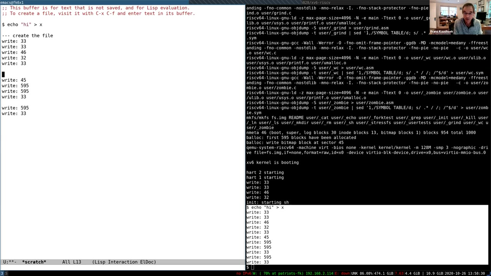
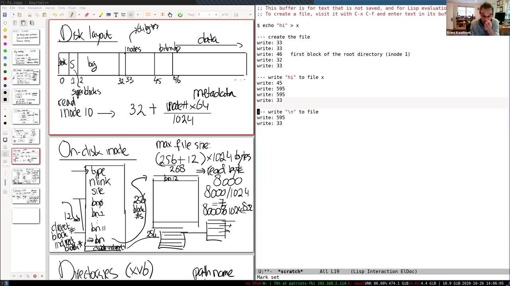

# 第 14 讲 · 文件系统课堂译述

## 00:00–03:00｜从日常文件系统与 xv6 的差异出发

开场先确认屏幕共享和声音。Frans 说明，接下来三讲围绕文件系统：两讲以 xv6 为背景，另一讲看 Linux。这也是课程集中阅读 xv6 的最后一个大主题。文件系统与 shell 一样，是用户最直接接触的操作系统部分；大家天天使用它，这次要深入看接口下面究竟发生了什么。

他没有立即列数据结构，而是请同学比较：日常电脑里的文件系统，与实验中的 xv6 有什么相同和不同？第一位同学回答，xv6 能支持的文件很小，文件名也短；自己使用的 Btrfs 还有文件系统级写时复制，而 xv6 没有这样的机制。讲者继续追问相似之处，同学指出，名字、inode、目录这些基本组织方式仍然类似。

随后又请另一位同学回答。对方先确认问题：是把 xv6 与笔记本或平时电脑上的文件系统作比较吗？讲者确认，重点既可以是差异，也可以是共同点。下一窗口接着讨论层次化路径。

> 编者注：字幕把 Btrfs 识别成近似“butterfast”，这里根据同学谈到的文件系统写时复制语境校订。开头原始字幕从 0.240 秒开始，无法据此确认此前是否还有发言。

## 03:00–06:00｜命名、共享、持久性与崩溃后的完整性

第二位同学提出共同点：路径具有层次结构。Frans 以此引出文件系统的第一项价值——提供便于人使用的名字，尤其是路径名。目录或文件夹让人按层次组织文件；用户和进程也能用这些容易记住的名字共享同一份数据。

另一个关键性质是持久性，也称 durability。关掉电脑，过几天再开机，文件仍在那里，可以继续工作。这与前面讨论的许多资源不同：重启之后，原来的进程、运行状态等不复存在，需要重新创建。文件系统则把用户希望保留的数据跨重启保存下来。

为什么值得研究其内部实现？首先，这个抽象本身就很有用。其次，持久性并不是把字节放到设备上就完成了：如果文件操作进行到一半时机器崩溃，重启后文件系统仍应完整，关键不变量仍应成立，已有文件应当能够访问。

因此要区分“介质断电仍有数据”与“数据结构经过中途崩溃仍然一致”。后者是 crash safety，接下来的课程会专门研究。这里先提出问题，下一段继续说明它为何是文件系统设计的核心挑战。

## 06:00–09:00｜把文件系统看作磁盘数据结构

若机器在一次文件操作中间崩溃，重启后整个文件系统消失，或者磁盘结构混乱、文件丢失，那就是灾难。Frans 说明，周三将重点讨论这种崩溃安全问题，今天先研究数据如何组织。

文件、目录和它们之间的关系都必须在磁盘上有表示方式。机器关闭、重新启动之后，系统不能靠上一次运行时的内存恢复这些关系，而要根据盘上的结构重建它们。所以可以把文件系统理解成一组**磁盘上的数据结构**。xv6 为教学选择了非常简单的结构，真实文件系统可能采用复杂得多的组织形式，但问题性质相同。

性能是另一个重点。存储设备比处理器慢得多，课堂用 SSD 的一次块写可能耗费毫秒量级来建立直觉：在这段时间里，CPU 已能完成很多工作。于是文件系统会用 buffer cache，也叫 block cache，尽量减少真正访问磁盘的次数。

同时还要允许并发。路径查找可能逐级读目录、寻找名字、取得下一目录，涉及多次磁盘操作。一个进程在查找时等待 I/O，不应使所有其他路径查找都停住。因此，前面学过的并发问题会在文件系统中再次出现。

课程实验也与此相连：即将进行的 fs 实验专门扩展文件系统；后面还有把虚拟内存与文件系统结合的实验；当前 locking 实验也包含提升块缓存并行性的任务。

## 09:00–12:00｜从 open 和 write 推导隐含状态

接着从用户接口反推实现需求。前半学期已经研究了 `fork`、`exec`、管道等接口的实现，现在轮到文件系统调用。Frans 在板书写一个简单情景：打开并创建目录 `x` 下的 `y`，获得文件描述符 `fd`，再向它写入三个字节 `abc`。

课堂省略具体 open 标志，因为此时关注的是接口形状，可以写成下面的示意：

```c
fd = open("x/y", /* 此处省略创建和写入标志 */);
write(fd, "abc", 3);
```

首先，用户提供的是人能阅读、自己选择的路径，而不是磁盘地址或某个固定数值编号。内部实现必须把这些名字翻译成真正的存储对象。

其次，`write` 参数里没有写入偏移。调用者只提供 fd、数据地址与字节数，下一次 write 却会接着上次的位置写。这说明内核一定在某处维护当前位置，不能每次都从文件开头覆盖。

Frans 继续引出另一个此前没有细讲的接口：同一个文件可以有多个名字，这由 `link` 创建。下一段用它说明“文件对象”与“路径名”必须分离。

> 编者注：课堂口述“下次写第 4 个字节”，对应零起始偏移 3；不要误写为偏移 4。

## 12:00–15:00｜删掉名字，为什么 fd 还能写？

在已有 `x/y` 后调用 `link("x/y", "x/z")`，相当于让同一文件再有一个名字 `x/z`。这不是复制文件内容。文件系统必须能记录多个名字指向同一对象。

接下来调用 `unlink("x/y")`，删除最初打开时使用的名字。尽管目录里的名字已经变化，先前得到的 fd 仍然有效，可以继续执行 `write(fd, "def", 3)`。不管改名空间的是同一进程还是另一进程，已经打开的文件都不能只因为那个名字消失就突然换成别的对象。

由此得到实现上的结论：fd 所引用的对象必须独立于路径名；操作系统内部还需要一个“不带名字的文件”表示。名字只是找到它的途径之一，而不是对象本身。多个名字也不能有一个“主名字”、另一个“附属名字”，否则删除主名字时就很难保持这个接口语义。

Frans 顺便提醒，这只是常见 Unix 文件系统的 API，并不是持久存储的唯一组织方式。例如数据库同样持久保存数据，却提供不同的查询和更新接口。数据库可以建立在文件系统之上，也可能绕过部分文件系统功能、直接操作磁盘。接下来仍专注操作系统通常提供的文件接口。

## 15:00–18:00｜硬链接、inode 与两种存活条件

聊天区问：`link` 是否增加底层文件描述符的引用数，`unlink` 是否减少？讲者先回应这是增加、减少引用的思路，随后有同学进一步澄清：**操作对象应该是 inode，而不是文件描述符，对吗？** Frans 确认，`link/unlink` 作用于 inode 及其名字关系。

另一个问题是软链接与硬链接的区别。Frans 表示本讲不展开软链接；初始 xv6 提供硬链接，即多个目录项直接指向同一 inode，而下一个 fs 实验会要求补上符号链接。

然后正式引入 inode：它保存与名字无关的文件信息。文件系统内部用 inode number，即一个整数编号，标识 inode，而不是一直拿路径字符串来引用文件。

从刚才的 API 可推导出 inode 至少要追踪两类“还活着”的理由。一类是 link count，统计还有多少名字指向它；另一类是课堂称为 open fd count 的打开引用。只要还有名字，不能删除文件；就算名字已经全部移除，只要进程仍打开着它，也不能回收内容。两类引用都消失，才可以真正释放存储。

最后，`read/write` 没有显式偏移参数，也再次要求打开文件这一层保存偏移。

> 编者注：源码里 `inode.ref` 不仅包含打开文件，还包含当前工作目录和路径查找期间的临时引用；`struct file.ref` 又是另一层计数。课堂的“open fd count”是概念简化，不能把三个字段混为一谈。

## 18:00–21:00｜从磁盘到名字的实现层次

inode 是文件系统的核心结构，文件描述符则把它接到进程。尽管不同文件系统的 API 很相似，其内部实现可以差别很大；为了理解复杂实现，按层次组织很有帮助。

底层是磁盘等存储设备，它真正提供跨断电保存数据的能力。上面是块缓存：把读过的磁盘数据留在内存里，避免一次次重新访问设备。再上面通常有日志层，许多文件系统利用日志实现崩溃安全；具体机制留待周三。

日志之上，xv6 有 inode cache。Frans 强调，这层的主要作用是同步，而不只是少读磁盘。一个 inode 通常小于一个磁盘块，因此一个块能装多个 inode；内核仍需管理各个 inode 自己的状态与并发访问。再往上是 inode 的文件内容实现，完成字节读取与写入；最上层是路径名和 fd 操作。

这里的层次是理解工具，不是说每个真实文件系统都严格遵循同一分层，也不是说 xv6 从不跨层调用。但大多数实现都能辨认出设备、块缓存、日志、inode 和名字解析这些职责。接下来从最底部的存储设备讲起，逐步走到磁盘布局与缓存实现。

## 21:00–24:00｜存储设备、sector 与 block

存储设备有许多种，区别包括容量、速度与持久性。常见的两类是 SSD 与磁性硬盘。课堂给出的数量级是：SSD 访问约为 100 微秒到毫秒，机械盘的一次随机块访问则常在 10 毫秒左右。这里是建立延迟直觉，并非针对所有设备的精确基准。

术语上要区分 sector 与 block。Sector 历史上指设备能读写的基本单位，典型大小是 512 字节。Block 则常由操作系统或文件系统定义，可能由一个或多个 sector 组成；xv6 的 `BSIZE` 是 1024 字节，即两个这样的扇区。有时文档又把设备 sector 称为 block，所以看代码时必须明确单位。

板书把 CPU、内存和存储画在总线上。文件系统代码在 CPU 上执行，把运行时结构放在内存里，再通过设备接口读写磁盘。抽象地说，设备接受“读某个块”或“把这些数据写到某个块”的请求。

这个描述省略了不少硬件细节。SSD 与 HDD 内部工作方式很不同，但设备控制器隐藏了大部分差异，使上层能围绕块号与数据组织操作，而不需要在每一次文件读写中操纵机械磁头或闪存单元。

## 24:00–27:00｜异步设备完成与块数组抽象

Frans 接着说明，设备通常通过标准总线或控制接口与处理器通信。驱动给出块号、数据位置与命令，设备执行对应工作。不同介质的性能性质不一样，但面向文件系统的基本编程模型可以相近。

**学生问：**读写接口是否同时提供同步和异步选择？讲者用之前的控制台驱动作类比：CPU 或驱动发出“开始读”“开始写”的命令，设备之后完成，再产生中断通知完成。驱动可能比控制台驱动复杂得多，但仍能看见上半部发请求、下半部处理中断，以及读写控制寄存器这样的结构。

因此，硬件命令的完成与调用者是否等待，不应该混为同一件事。课堂此处说明的是设备/驱动可以通过中断报告完成，并未给出一个新的用户态异步 I/O API。

从文件系统视角，可以把磁盘看成一个很大的块数组：0、1、2……直到设备末尾。文件系统的任务是把数据结构放在这个数组中，确保重启后仍能根据盘上内容解释出文件和目录。接下来具体画出 xv6 如何划分这个数组。

## 27:00–30:00｜超级块、日志区、inode 区与位图

xv6 的布局很简单，却仍具有传统 Unix 文件系统的典型形态。块 0 通常留作引导用途；块 1 是 superblock，描述整个文件系统，例如一共有多少块，以及各区域的位置与大小。

课堂这个小镜像中，日志从块 2 开始，占 30 块，也就是块 2–31。inode 区从块 32 开始，到块 44；每个 inode 64 字节，一个 1024 字节块能装多个 inode。块 45 是分配位图，后面从块 46 开始是内容块，保存普通文件或目录的内容。

位图说明哪些块空闲、哪些已经使用。超级块、inode、位图等不是用户文件的正文，而是让文件系统知道怎样解释和管理正文的元信息，通常统称 metadata。目录内容虽然位于数据块区，其语义仍是名字关系的元数据。

**学生问：**引导块里装的是让操作系统启动的代码吗？讲者先从一般情形回答：通常是一小块启动代码，先让机器运行起来，再进一步载入操作系统。学生随即追问，那 xv6 内核是不是也放在虚拟磁盘里？这个问题在下一段具体区分真实引导过程和本课程使用的 QEMU 方式。

## 30:00–33:00｜QEMU 启动捷径与 inode 编号换算

Frans 解释，课程使用 QEMU 时走了捷径：命令行 `-kernel` 直接指定要加载的内核文件，QEMU 把它载入相应物理地址，因此不必让 `fs.img` 里的引导块再去读内核。学生复述理解：启动模拟器时已经把程序路径交给它，它不需要先从虚拟文件系统读内核；讲者确认。

随后回到 inode 定位。假设一个 inode 是 64 字节，inode 区从块 32 开始，想读 inode 10，应读哪个磁盘块？有同学提出从 inode 区起点加上 inode 编号，讲者追问：能直接加 10 吗，单位是不是一致？

关键是先把 inode 编号换成字节距离，再换成块数。每块能放 $1024/64=16$ 个 inode，所以包含 inode $i$ 的块号为

$$32+\left\lfloor\frac{64i}{1024}\right\rfloor=32+\left\lfloor\frac{i}{16}\right\rfloor.$$

inode 10 仍在块 32；inode 17 则在块 33。块内位置也由编号决定，因此只要知道 inode 编号与 inode 区起点，就能找到它在磁盘上的字节。

> 编者注：字幕中的物理加载地址被截成“08000”，不据此补写课堂原话；固定源码的启动布局另见公共资料和第 3 讲。上述 inode 算式按板书、`IBLOCK` 与 64 字节 `dinode` 校订；这里的 32 只针对课堂镜像，通用实现从超级块读取 `inodestart`。

## 33:00–36:00｜磁盘 inode 里保存哪些地址？

现在看 inode 的内部。Frans 画出一个 64 字节的磁盘结构：有 `type`，表示普通文件、目录等；有 `nlink`，记录多个名字；有以字节为单位的文件长度 `size`。后面跟着一组块号。

xv6 的前 12 个块号是直接地址，对应文件的前 12 个逻辑数据块。如果文件只有两个字节，只需分配一个内容块，在第一个直接地址槽里记录它的磁盘块号；不会因为 inode 有 12 个槽，就把 12 个数据块全分配出来。

另外还有一个间接块地址。这个槽不直接指向文件正文，而是指向一个专门存块号的磁盘块。块大小是 1024 字节，块号占 4 字节，所以这个间接块能放 256 个数据块号。

因此逻辑数据块 0–11 的地址直接在 inode 中；逻辑块 12 起要先查间接块，再取得真正的数据块地址。这里多了一层访问，但 inode 本身仍能保持固定且较小的尺寸。

讲者随即让同学计算最大文件大小。一位同学回答，是 268 乘以 1024 字节。计算来自 12 个直接数据块加上间接块所描述的 256 个数据块；间接块自身存放地址，不是文件正文的一部分。

## 36:00–39:00｜268 KiB 的上限与双重间接

Frans 接着把算式写完整：$(12+256)\times1024$，即 268 KiB。能装下一段视频或一首歌吗？同学打趣说很短的歌也许可以；这个上限显然太小，真实文件系统通常需要大得多的文件。

怎样修改表示来扩大上限？同学提出扩展间接部分。讲者说明，可以再引入一个 double-indirect，即二级间接地址：它指向的块保存 256 个一级间接块的地址，而每个一级间接块再保存 256 个数据块地址。结构类似之前见过的多级页表，增加一层便能扩展很多。

这首先是磁盘数据结构的选择。可以用这种简单树，也可以采用 B 树或其他更复杂的组织。xv6 继承早期 Unix 的简单设计，fs 实验会让大家加入双重间接寻址，支持更大的文件。

**学生问：**256 是因为这些地址正好占一个完整块吗？讲者先说明总数据容量是“256 加 12”，不是把保存地址的间接块算成内容；学生进一步澄清想问“为什么恰好 256”。答复是：每个块号 4 字节，$1024/4=256$。

讲者再提出一个相关限制：如果块号只有 4 字节，总共又能表示多大的磁盘？这个问题接到下一窗口。

## 39:00–42:00｜间接层级不会自动无限延伸

对 4 字节块号的问题，同学答出 $2^{32}$。Frans 指出，真实存储的规模可能要求更大的编号。这里的 $2^{32}$ 是可编码的块号数量，而不是“只能有 4 GiB 字节”；要得到寻址字节量，还得乘以块大小。

另一位同学仍对最大文件大小有疑问：间接块所指向的块能不能继续指向更多块？Frans 澄清，默认 xv6 不是任意层级的树。规定就是 12 个直接块号，外加一个容纳 256 个数据地址的间接块，没有更多层。要继续间接，必须修改磁盘格式与解释这些地址的代码，不能把普通数据恰好看成数字就当成下一层指针。

实验会拿出原有直接地址槽中的一个，将其改为双重间接入口；这个入口指向一组间接块地址，间接块再指向文件内容，从而扩大上限。

接下来换一个具体读取问题：希望读取文件中偏移 8000 的字节，应当读取哪个磁盘块？同学尝试说先减掉 12 个直接块覆盖的字节数，再在间接块里找。讲者把问题拉回第一步：先除以块大小 1024，看看逻辑块号落在直接范围还是间接范围；8000 尚未超过 12 个直接块覆盖的区域。

## 42:00–45:00｜从字节偏移找到数据块，再引出目录项

计算 $8000/1024$ 的整数商为 7，所以目标位于逻辑块 7。应从 inode 的直接地址数组取 `addrs[7]`，其中的值才是要读取的**磁盘块号**。不能把商 7 当成“读取磁盘块 7”，因为文件逻辑位置与全盘块编号是两种坐标。

读出该块后，再计算余数 $8000\bmod1024=832$，从块内偏移 832 取得目标字节。完整过程就是：字节偏移换成逻辑块号，按逻辑块号查 inode 地址结构，读实际磁盘块，再用余数找块内字节。到此，已经有足够的信息支持普通文件 read/write 的定位部分。

接着讲目录。文件系统不只保存匿名字节，还提供用户友好的层次名字。Unix 的巧妙做法是：**目录也像一个文件，只是其内容具有文件系统认识的结构。** 因此可复用 inode 和数据块表示它。

xv6 的目录格式极简单：内容由固定大小的目录项组成。每项前 2 字节是 inode 编号，后 14 字节是文件名，总计 16 字节。靠这两个字段，就能把人可读名字与不带名字的 inode 连接起来，也就能实现路径查找。

## 45:00–48:00｜逐级解析 /y/x

Frans 用 `/y/x` 说明路径查找。开头的 `/` 表示从根目录开始；根 inode 的编号是事先约定的，xv6 中为 1。根据先前的布局，它位于 inode 区第一个块，也就是课堂镜像的块 32。64 字节 inode 的布局使 inode 1 位于该块内的字节偏移 64。

读到根 inode 后，还要读它的内容块。inode 的直接、间接地址结构告诉文件系统这些块在哪里；查找代码扫描目录项，寻找名字 `y`。如果第一个内容块没有目标，就继续检查后面的块，直到找到或确认不存在。

假设找到的 `y` 对应 inode 251。下一步读取 inode 251，再扫描该目录内容中的 `x`。找到后，返回 `x` 对应的 inode，这就是整个路径解析的结果。

课堂中讲者一度把第一层名字口述成 `x`，随后自行纠正：先找 `y`，再在 `y` 中找 `x`。这里按纠正后的顺序整理。重要的不是示例 inode 251 这个数值，而是每一层都重复“目录 inode → 目录内容 → 名字对应的下一级 inode”。

## 48:00–51:00｜目录类型检查与创建干净镜像

**学生问：**目录在磁盘上也像文件，系统在哪个标志位知道它是目录还是普通文件？Frans 回答，区别就在 inode 的 `type` 字段。路径解析如果还要往下查，而当前 inode 却是普通文件，文件系统会报错，不能把普通文件内容随意当目录项解析。

接着评价查找性能。xv6 要扫描目录内容才能找名字，效率并不高；真实文件系统常用更复杂的数据结构加速大目录查找。可以把熟悉的数据结构变成磁盘数据结构来改善性能，但 xv6 为了便于解释选择了简单线性结构。

之后切到实际 xv6，准备通过运行命令观察修改了哪些块。讲者已经做过 `make clean`，解释说需要新的文件系统时要确保旧镜像被清掉，然后 `make qemu` 会构建干净镜像。这也是许多同学实验时会遇到的现象：旧 `fs.img` 保留着之前的内容。

屏幕上出现 `mkfs` 命令，它创建新的磁盘镜像，并把命令行列出的用户程序等文件装进去。也就是说，“新建镜像”不是一个完全没有数据的空盘；它已经含有启动后要运行的用户工具。下一段用构建输出核对前面的磁盘布局。

## 51:00–54:00｜echo hi 的三组写入轨迹

`mkfs` 的输出显示：总共 1000 个块，其中 46 个是布局中的元数据块，包括引导块、超级块、30 个日志块、13 个 inode 块和 1 个位图块；其余 954 个是数据块。这个镜像很小，后续大文件实验需要更大的文件系统。

Frans 对 xv6 加了打印，每当记录某个块的写入就显示块号，借此追踪文件操作。他执行 `echo "hi" > x`，然后把结果复制到编辑器中，划成三组：创建文件、写入 `hi`、写入结尾换行。



*原片 53:00，未裁剪。左侧复制的轨迹中，创建阶段为 33、33、46、32、33；第二组为 45、595、595、33；第三组为 595、33。右侧可见 `mkfs` 的 1000 块镜像与 46 个元数据块输出。*

为什么是两个数据写调用？讲者打开 `echo` 的源码，说明它向 fd 1 写各个参数，最后另写一个换行。因此，不要把一个 shell 命令等同于一次文件系统操作：重定向先创建/打开目标，echo 写参数，随后再写换行，每一步又可能引起多个内部块更新。

接下来不急着进入所有源码，而是将这串块号与前面的布局图对照，让同学根据“这个块装什么”推断“为什么需要修改它”。

> 编者注：约 64:24 讲者进一步说明打印加在 `log_write`。这些是逻辑块更新记录，不等同于已逐个写到持久介质的实际 I/O 顺序；日志写回机制留到下一讲。

## 54:00–57:00｜为什么创建一个文件先写两次块 33？

Frans 把写入列表和磁盘布局并排，问创建文件时第一条写块 33 可能是什么。同学回答是写 inode。讲者进一步确认，块 33 属于 inode 区，容纳一组 inode；新文件分到的 inode 恰好在其中。

第一次写很可能用于占用空闲 inode。xv6 用 `type` 表示是否分配：0 是空闲，普通文件、目录等是其他值。创建者找到空 inode，把类型从空闲改为文件，并记录更新，使它不再被其他创建者当作空闲。

第二次又写 33，学生判断是在填 inode 的其余信息。讲者确认，例如把链接数设置为 1：新文件即将通过目录里的一个名字被引用。这两次写在同一个磁盘块上，但逻辑职责不同，一次是分配标记，一次是初始化元数据。

然后问块 46。有人先想到位图，又根据布局纠正：位图是 45，46 是第一个数据块。它是谁的数据？同学提出是根目录的内容。讲者确认，应当是根目录 inode 1 的第一个内容块；下一步需要说明，创建 `x` 为什么会改它。

## 57:00–60:00｜目录内容、目录 inode 与新数据块

创建文件不只分配 inode，还必须让名字出现在目录里。因此写块 46，是在根目录的内容中增加一个 `x` 目录项，把这个名字连接到刚才分配的 inode。

为什么下一条是块 32？它包含根目录 inode。学生指出目录长度发生变化，讲者解释：加入一个 16 字节目录项，使目录的 size 增加，因而要更新根目录 inode。创建阶段还有最后一次对新文件 inode 块的更新，讲者暂时把原因悬置，没有在这里展开。

然后进入写 `hi` 的第二阶段。首先写块 45，学生认出这是位图。新文件原本没有内容块，块分配器扫描位图寻找 0 位，再把它设为 1，标记对应块已被占用。

分配到的是哪块？从紧接着出现的 595 推断，新内容块就是 595，于是文件 inode 的第一个直接地址槽会记录 595。这里再次把“数据块从 46 开始”与“当前第一个可用块”区分开：前面许多块可能已经装着初始用户程序。

讲者随后开始让同学猜两次 595 写入的内容；这一处课堂口述需要与后面的源码校核区分，见下一段。

## 60:00–63:00｜595 的两次更新与需要单独标明的校正

面对第二阶段两次块 595 的写入，课堂讨论先把第一条解释为写字符 `h`，第二条解释为写字符 `i`，讲者顺着回答说 echo 逐字符写。随后对块 33 的更新，大家判断是 inode 长度变为 2，需要写回文件元数据。



*原片 60:35，未裁剪。左边是块布局、inode 定位与直接/间接寻址板书；右边清楚标出“create the file”“write hi”“write newline”三组，`hi` 组中确实有两次 595。画面并未显示这两次调用分别出自哪个函数。*

> **编者校正：**上面保留的是课堂当时的解释。固定 2020 源码及官方文字提纲显示，这两次应分别来自新分配块的 `bzero` 清零，以及 `writei` 写入整个 `hi`，而非一次 `h`、一次 `i`。固定快照的 echo 按参数长度调用 write，再另写换行。参考快照不是录课树，故不能仅凭它重写“课堂实际运行的源码”；不过两次日志的标准调用链与官方提纲一致。创建末尾额外的 inode 更新，提纲和源码对应 `O_TRUNC → itrunc → iupdate`，即新文件虽已为空，截断路径仍会更新它。

**学生问：**595 看起来很靠后，是前面已经存了内核引导代码等东西吗？Frans 回到 `mkfs` 命令，指出它已经放入很多文件，所占数据块自然使新的空闲块位于更后面。不能由此推断内核一定存放在该文件系统里，前面已经解释 QEMU 直接加载内核。

另一位同学问：595 与 inode 的对应关系，是最后写 33 时记下来的吗？讲者确认，不只更新长度，还要把第一个直接地址设成 595，然后一起更新磁盘 inode。他一度提到两个地址槽，又自行修正为这里只改第一个槽。讲完轨迹，接下来开始进入创建调用的源码。

## 63:00–66:00｜从 create 到 ialloc，再追到块缓存

Frans 先在 `sysfile.c` 中定位 `sys_open`。创建新文件时，它调用 `create`。`create` 先解析父目录，锁住目录，再查找名字是否已存在，然后进入真正分配新 inode 的 `ialloc`。路径解析的细节暂时搁下，重点追踪刚才第一条 inode 块更新。

`ialloc` 在 `fs.c`。与很多 xv6 代码一样，它简单但不追求高效：从 inode 编号 1 开始，一直检查到该文件系统允许的最大 inode 数。对每个 inode，先读其所在块，再看 `type` 是否为 0。找到空闲项就清好结构、设置新类型，使它被标为已分配，并调用 `log_write` 记录修改。

讲者在这里明确说，刚才的打印语句就放在 `log_write`。因此这次 `ialloc` 的更新对应轨迹中的第一条块 33。

接着提出并发问题：多核机器上两个进程同时创建不同文件，都走到 `ialloc`，会不会看到同一个空闲 inode 并同时抢走它？源码表面上没有为扫描过程另加一个“大分配锁”，正确性故事在哪里？

答案要追进 `bread`。它首先调用 `bget` 在块缓存中取得一个槽；而 `bget` 里的锁与引用计数，正是保证同一磁盘块被协调访问的关键。讲者提醒，这也是当前 locking 实验正在改造的代码。

## 66:00–69:00｜缓存锁与缓冲区锁各自保护什么

讲者让同学解释 `bget` 开头的几行。学生指出：先锁住链表，再检查缓存里有没有需要的块。以块 33 为例，如果它已经在缓存里，增加 `refcnt`，然后释放 `bcache.lock`。

这时只是取得了对缓冲区的引用，尚未取得独占读写权限。随后还要调用 `acquiresleep(&b->lock)`，拿到该缓冲区自己的睡眠锁，才把它返回给上层使用。

考虑两个进程几乎同时请求块 33。第一个先取得缓存锁、找到条目、增加引用，再释放缓存锁。第二个此时可以取得缓存锁，找到同一个条目，也增加引用。两者可以持有同一个 `buf *`，但随后竞争的是同一把缓冲区睡眠锁。

只有其中一个先成功。它继续返回到 `ialloc`，扫描这个 inode 块、挑选空闲 inode 并修改；另一个停在睡眠锁处，直到前者完成。这样，两个分配者不会同时在同一份块内容上无保护地执行“检查空闲—标为已用”。

这也解释了锁的层次：短时间持有的缓存锁管理“缓存里有什么”；每个块的锁管理“这一份内容当前由谁读写”。持有后者进行慢操作，不需要把整个块缓存都锁死。

## 69:00–72:00｜释放缓存锁到取得内容锁之间会出什么事？

**学生问：**从释放 `bcache.lock` 到拿到缓冲区锁，中间存在空隙；如果 `refcnt` 非零，缓冲区的哪些重要信息还能改变？

Frans 区分两件事。改缓存的管理结构，需要缓存锁；改块 33 的内容，需要块 33 的睡眠锁。由于当前线程已经增加引用，这个缓冲区不能被缓存回收或改派给另一块。别的进程仍可以查到它并增加自己的引用，也可以先取得内容锁修改数据；但它不会在等待者不知情时从“块 33 的缓冲区”变成“块 80 的缓冲区”。

所以 `refcnt` 保证的是对象身份和存活，不是把内容冻住。真正让调用者看到可安全读写的内容，是随后成功获得睡眠锁。

讲者又提出更严重的问题：如果块 33 在缓存中出现两份，放在两个不同槽里，会怎样？哪怕每份各有自己的锁，也无法互相协调。假设两个进程分别修改这个块中的不同 inode：一个改 inode 18，另一个改 inode 19；各自拿到旧块副本并整块写回，后写者会用旧数据覆盖前写者对另一个 inode 的修改。

因此最重要的不变量是：**同一设备上的同一磁盘块，在块缓存中只能有一份有效身份对应的缓冲区。** locking 实验可以改变查找和锁的组织，但不能破坏这一点。

## 72:00–75:00｜其他引用者如何看见修改，睡眠锁又是什么

**学生追问：**一个块有多个引用时，其中一个进程把内容写回磁盘，其他进程会看到什么？Frans 从 `brelse` 说明：前一个进程结束对缓冲区内容的使用，释放睡眠锁；等待者随后取得同一把锁，就能访问同一个缓存对象里的新内容。

以上面的分配为例，第一个进程将 inode 18 标为文件，第二个取得块锁之后会看到这个改变，于是不会再次分配 inode 18，而是继续找下一空闲项，例如 inode 19。这正符合期望：先完成的创建，其修改必须能被后来的使用者观察到。

随后转向睡眠锁本身。Frans 打开相关源码和头文件，寻找 `locked` 字段及内部自旋锁。这个锁并不是不再需要任何自旋同步，而是用一把很短期的自旋锁来保护睡眠锁自身的状态。

如果睡眠锁已经被占用，申请者就调用 `sleep`，把自己调度出去，而不是一直占着 CPU 自旋。讲者在屏幕间切换时有一次找错字段，随后定位到结构中的内部自旋锁，再继续解释为何文件系统缓冲区需要这种锁。

## 75:00–78:00｜为什么不能用自旋锁跨越磁盘 I/O

讲者问：既然睡眠锁内部也用自旋锁，为什么不干脆让每个缓冲区只有一把普通自旋锁？同学先回答，磁盘操作耗时很长，等待期间一直自旋不划算。

Frans 补充更关键的限制：xv6 获取自旋锁会关闭本 CPU 的中断。若持有缓冲区自旋锁时开始磁盘操作，之后又等完成中断，单核情形就收不到所需中断；多核可能由别的核接收，但这并不能使这种锁协议变得正确。此外，普通自旋锁不能随意跨越 `sleep` 或调度。

睡眠锁适合这类长期持有场景：持有者可以跨 I/O 等待，等待锁的线程则释放 CPU；内核不必为整个慢操作一直关闭中断，也不必让竞争者忙等。

随后回到 `brelse` 的尾部。它先释放缓冲区睡眠锁，再取得 `bcache.lock`，减少引用计数。如果计数变成 0，代码会调整双向链表。学生指出，它把该缓冲区插到 `head` 后面；讲者进一步问，这个位置在替换策略里代表什么？答复是“最近使用过”。

## 78:00–81:00｜最近最少使用与四个缓存要点

刚被使用并完全释放的缓冲区移动到表头，成为最近使用项。以后查找缓存未命中、需要复用缓冲区时，则从表尾的最近最少使用项开始找，选择没有引用的项。

为什么这通常合理？学生答“时间局部性”。讲者说明，刚用过的块往往不久还会用，过早淘汰它容易马上再从磁盘读回来；相反，很久没用的块通常更值得作为淘汰候选。这是一个经验性策略，不是每种访问模式下都最优的定理。

讲者回到板书，总结块缓存的四个要点：一块在内存中的唯一副本；可跨 I/O 的睡眠锁；LRU 替换；两级锁——缓存整体管理锁与每个缓冲区的内容锁。

由于时间将尽，本讲在这里停止继续深入源码，转为总结：今天主要把文件系统看成磁盘数据结构，研究了 xv6 的简单布局，并用实际块更新轨迹连接接口与数据结构。接下来会讨论更重要的另一半：多个块更新到一半崩溃时怎么办。

> 编者注：字幕在“最久没用”的后续复用概率上有一句反向识别。这里按上下文与实际 LRU 选择方向整理为“近期较不可能再次使用”，避免与其余讲解自相矛盾。

## 81:00–84:00｜总结之后的 brelse 顺序问答

Frans 总结，块缓存对性能很重要：磁盘访问通常要数百微秒到毫秒，近期读过的块不应每次都重新从盘上取。周三会介绍 xv6 的日志方案，它简单但慢；随后看 Linux ext3 更快的日志设计。讲者邀请有问题的同学留下，其他同学可以结束本次课程。

**学生问：**`brelse` 先释放块的睡眠锁，再修改引用计数，为什么这个顺序安全？讲者反问：如果另一个进程已经在等待这把睡眠锁，关于引用数可以知道什么？学生起初答为 0，随后在提示下修正。

关键在于，等待者在进入 `acquiresleep` 之前就已经增加引用。释放睡眠锁的这个调用者，此时也还没有减掉自己的引用。因此，有其他等待者时，引用数不可能因为本次减 1 就变成 0。`brelse` 只是撤销当前调用者的一个引用；若仍有其他人关心这个缓冲区，就不会执行“计数为 0，移到可回收候选位置”的那段逻辑。

**学生又问：**目录项中只用两字节保存 inode 编号，怎么够用？Frans 回答，它对现代文件系统确实太小，只是早期小系统的简化。课堂口述在位数和数量换算上有停顿与修正，接着转向磁盘字段与内存字段是否同宽的问题。

> 编者注：两字节是 16 位；`ushort` 可表示 0–65535，保留 0 后最多有 65535 个非零编号，不是字幕中的“三万二千”。这只是字段编码上限，实际 inode 数还受超级块和镜像配置限制。

## 84:00–85:38｜磁盘目录项与内存 inode 的编号宽度

学生进一步澄清，自己关心的是：在 xv6 这套结构里，这个 16 位编号还会在哪些地方出现？它是不是要求内存、寄存器里也都用两字节？

Frans 打开结构定义查看。磁盘目录项中的 `inum` 是 `unsigned short`，占两字节，也就是 16 位。这个字段是把目录里的名字连接到 inode 编号的盘上编码。

再看内存 inode 表示，它的 inode 编号字段是整数，在当前 C 编译环境中占四字节。所以盘上目录项与内存 inode 不必采用相同字段宽度；装载和使用时可以用更宽的内存整数表示较窄的磁盘编号。

学生表示理解并道谢，课堂在这段答疑后结束。

> 编者注：固定快照对应 `struct dirent.inum` 为 `ushort`，`struct inode.inum` 为 `uint`。磁盘 `struct dinode` 自身并不另存一个 inode 编号，编号由它在 inode 区中的位置决定。原始字幕最后一句开始于 85:37.600，标注结束到 85:39.920，超过元数据时长 85:38；本窗口按视频时长封顶，不把字幕外延当成额外视频。

## 来源、校核与覆盖说明

- 本页是根据 2076 条英文自动字幕完整阅读后，按原片顺序写成的自主中文译述。保留实质讲解、计算、演示、课堂提问及收尾答疑，整理了口头重复；不是授权逐字译本，也未逐句听音。
- 视频：Frans Kaashoek 主讲，David Morejon 频道，*6.S081 Fall 2020 Lecture 14: File Systems*，2020-10-26 发布，85:38，ID `ADzLv1nRtR8`。来源地址仅记于元数据与来源清单。
- 实际查看原片 53:00、60:35 两帧，未裁剪。前者确认镜像大小和 11 条块号轨迹，后者确认分组与板书。没有声称完整检查全片画面或本地运行演示。
- 字幕起点 0.240 秒；最后原始结束时间超视频 1.920 秒。内部字幕时间间隔不自动判定为静音，逐窗证据和原始 cue 范围见 `sources/coverage.json`。
- 核对材料：[官方文字提纲](https://pdos.csail.mit.edu/6.S081/2020/lec/l-fs.txt)、[11 页板书](https://pdos.csail.mit.edu/6.S081/2020/lec/l-fs.pdf)。两者 HTTP Last-Modified 为 2025 年，不能保证今天取得的文字提纲与录课时逐字相同。官网材料按 [CC BY 3.0 US](https://creativecommons.org/licenses/by/3.0/us/) 署名，不能将官网许可推及外链视频。
- 固定参考源码为 `e23d53f27f6e187732a92a2b4705639d1c260f05` 的 `bio.c/fs.c/sysfile.c/file.c` 及相关定义。源码仅帮助检查术语、数值和机制，不冒充录课树或 fs 实验分支。
- 官方文字提纲还列出 `rm x` 删除轨迹、完整 `namex` 并发查找及双重拷贝等讨论；本视频未实际展开这些段落，因此没有伪造对应课堂时间。相关机制分别见[课程资料](#/c/mit-6.s081-2020/lec/lec14?v=materials) §8.9、§8.12–8.14 与[课程笔记](#/c/mit-6.s081-2020/lec/lec14?v=notes)。
