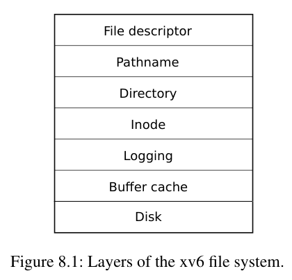
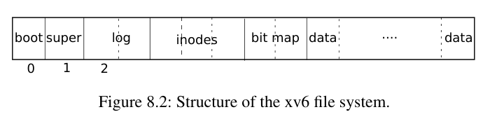
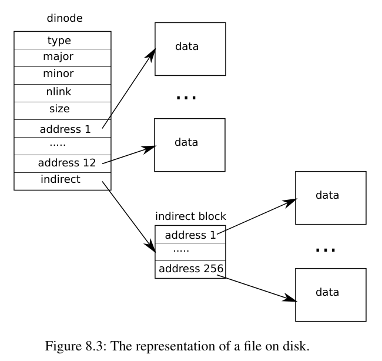

# 第 14 讲 · 文件系统阅读材料

## 第 8 章导言：文件系统

文件系统的用途是组织和存储数据。通常，它既支持用户与应用之间共享数据，也提供持久性，使数据在重启之后依然可用。

xv6 文件系统提供类似 Unix 的文件、目录和路径名（见第 1 章），把数据存放在 virtio 磁盘上以获得持久性。它需要解决以下挑战：

- 用磁盘数据结构表示带名字的目录和文件组成的树，记录各文件内容所在的块，并记录磁盘上哪些区域空闲。
- 支持崩溃恢复。发生断电等崩溃后，文件系统在重启后仍应正确工作。危险在于：崩溃可能打断一连串更新，使磁盘数据结构不一致，例如某块已经属于文件，却又被标为空闲。
- 不同进程可以同时操作文件系统，因此代码必须协调各方，维持不变量。
- 磁盘访问比内存访问慢几个数量级，所以必须在内存中缓存经常使用的块。

本章接下来解释 xv6 怎样应对这些挑战。

## §8.1 总览

xv6 文件系统分成七层，如图 8.1。磁盘层在 virtio 硬盘上读写块。缓冲区缓存层缓存磁盘块并同步访问，确保同一时刻只有一个内核执行线程能修改某个块的数据。日志层让上层把多个块的更新包在一个事务中，确保面对崩溃时更新具有原子性：要么全部更新，要么全部不更新。



**图 8.1：xv6 文件系统的层次。** 从上至下依次为：文件描述符、路径名、目录、inode、日志、缓冲区缓存、磁盘。

inode 层提供单个文件：每个文件由一个带有唯一 inode 编号的 inode，以及若干保存文件数据的块组成。目录层把目录实现为一种特殊 inode，其内容是一系列目录项；每项包含文件名和 inode 编号。路径名层提供 `/usr/rtm/xv6/fs.c` 这样的分层名字，通过逐级查找解析它们。文件描述符层用文件系统接口抽象管道、设备、文件等 Unix 资源，使应用程序员更容易使用它们。

文件系统必须规划 inode 和内容块在磁盘上的位置。xv6 将磁盘划为若干区域，如图 8.2。文件系统不使用块 0，它留作引导扇区。块 1 称为**超级块**，包含整个文件系统的元数据：以块为单位的总大小、数据块数、inode 数，以及日志块数。从块 2 开始是日志；日志后是 inode 区，每块容纳多个 inode；再往后是位图块，记录哪些数据块正在使用。剩下的是数据块：每块要么在位图中标为空闲，要么保存文件或目录的内容。一个独立程序 `mkfs` 构建初始文件系统，并填好超级块。



**图 8.2：xv6 文件系统的结构。** `boot`：引导块；`super`：超级块；`log`：日志；`inodes`：inode 区；`bit map`：分配位图；`data`：数据块。0、1、2 是块号，不是字节地址。

后文从缓冲区缓存开始逐层讨论。请留意：底层抽象选得好，能够简化上层设计。

> 编者注：本课程的 QEMU 用 `-kernel` 直接加载内核，因此这里的引导块是保留布局，不表示 xv6 从 `fs.img` 的块 0 加载内核。日志专节 §8.4–8.6 见[第 15 讲课程资料](#/c/mit-6.s081-2020/lec/lec15?v=materials)；本页按原书节号在 §8.3 后接 §8.7。

## §8.2 缓冲区缓存层

缓冲区缓存有两项工作：一是同步磁盘块访问，保证一个块在内存中只有一份副本，而且同一时刻只有一个内核线程使用这份副本；二是缓存常用块，避免重复访问缓慢的磁盘。代码位于 `kernel/bio.c`。

它的主要接口是 `bread` 和 `bwrite`。前者取得一个 `buf`，其中保存某个磁盘块的副本，调用者可以在内存中读取或修改；后者把修改后的缓冲区写回对应磁盘块。使用完后，内核线程必须调用 `brelse` 释放缓冲区。每个缓冲区都有睡眠锁：`bread` 返回已经加锁的缓冲区，`brelse` 释放这把锁，保证同一时刻只有一个线程使用该缓冲区，也就是使用对应磁盘块。

缓存只有固定数量的缓冲区。因此，文件系统请求一个尚未缓存的块时，必须回收某个原本保存其他块的缓冲区。缓存选择最近最少使用的缓冲区来保存新块；背后的假设是，最久没用过的块最不可能马上再次用到。

## §8.3 代码：缓冲区缓存

缓冲区缓存是一个缓冲区双向链表。`main` 调用 `binit`，后者把静态数组 `buf` 中的 `NBUF` 个缓冲区初始化为链表。其他访问通过 `bcache.head` 操作链表，而不是直接通过数组。

缓冲区有两个状态字段。`valid` 表示缓冲区包含对应磁盘块的有效副本；`disk` 表示缓冲区内容已经交给磁盘设备处理，设备可能修改它，例如把磁盘数据读入 `data`。

`bread` 调用 `bget`，取得指定块的缓冲区。如果还需要从磁盘读数据，就先调用 `virtio_disk_rw`，再返回缓冲区。

`bget` 首先扫描链表，查找设备号和块号都匹配的缓冲区。如果找到了，就取得该缓冲区的睡眠锁，返回锁住的缓冲区。

如果指定块尚未缓存，`bget` 必须为它准备缓冲区，可能复用曾保存其他块的缓冲区。它再次扫描链表，寻找未被使用的条目，即 `b->refcnt == 0`。它修改缓冲区元数据，记录新的设备号和块号，并取得睡眠锁。这里的 `b->valid = 0` 很重要：它保证 `bread` 从磁盘读取新块，而不是错误地沿用缓冲区之前的内容。

每个磁盘块最多只有一个缓存副本，这一点至关重要。否则，读者不一定能看到写者的修改，而且基于缓冲区锁的文件系统同步也会失效。`bget` 从第一个循环检查块是否已缓存，到第二个循环通过设置 `dev`、`blockno`、`refcnt` 宣布块已被缓存，始终持有 `bcache.lock`。因此，“检查是否存在”以及“不存在时指定一个缓冲区保存它”合在一起是原子操作。

`bget` 可以在离开 `bcache.lock` 临界区之后再取得缓冲区睡眠锁，因为非零的 `b->refcnt` 阻止这个缓冲区被改派给另一磁盘块。睡眠锁保护缓冲区内容的读写，`bcache.lock` 保护哪些块已被缓存的信息。

如果所有缓冲区都忙，说明同时执行文件系统调用的进程过多，`bget` 会 panic。更温和的做法或许是睡眠，等缓冲区可用，但那也可能引入死锁。

`bread` 必要时完成磁盘读取并返回之后，调用者独占缓冲区，可以读写其中字节。若修改了内容，就必须在释放之前通过 `bwrite` 把修改写回磁盘；`bwrite` 调用 `virtio_disk_rw` 与磁盘硬件交互。

> 编者注：这一段说明基础缓存接口。在启用日志的文件系统代码里，修改者通常调用 `log_write`，由日志层在正确时机调用 `bwrite`；不能为了“及时写回”而绕过日志协议。

调用者完成后必须执行 `brelse`。这个名字是 `b-release` 的缩写，虽然有些晦涩，却值得记住：它源于 Unix，BSD、Linux、Solaris 也沿用。`brelse` 释放睡眠锁，把缓冲区移到链表前部。这样，链表按最近使用、准确地说最近释放的次序排列：头部最近用过，尾部最久没用。

`bget` 的两个循环利用这种次序。查找已有缓冲区，最坏仍须扫描整个链表，但从 `bcache.head` 沿 `next` 先检查最近使用的项，在局部性较好时能缩短扫描。寻找可回收项则沿 `prev` 反向扫描，优先选择最近最少使用的缓冲区。

> 编者注：固定快照的 `brelse` 只在引用计数降到 0 时把条目移到表头，而不是每次释放都移动。其他等待者也已经计入 `refcnt`。

## §8.7 代码：块分配器

文件和目录内容存放在磁盘块中，这些块必须从空闲池分配。xv6 的分配器在磁盘上维护空闲位图，每块对应一位：0 表示空闲，1 表示已用。`mkfs` 把引导块、超级块、日志块、inode 块和位图块对应的位设为 1。

块分配器提供两个函数：`balloc` 分配新块，`bfree` 释放块。`balloc` 从块 0 开始，考察直到文件系统大小 `sb.size` 范围内的每个块，寻找位图中为 0 的位。找到后更新位图，并返回对应块。

为提高效率，循环分为两层：外层逐个读取位图块，内层检查一个位图块中的 `BPB` 个位。两个进程可能同时尝试分配同一空闲块，但缓冲区缓存保证同一时刻只有一个进程能使用给定的位图块，因此避免了竞争。

`bfree` 找到正确的位图块，清除正确的位。同样，`bread` 和 `brelse` 所提供的独占访问，使这里不必另写显式加锁代码。

与本章后续的大部分代码一样，`balloc` 和 `bfree` 必须在事务中调用。

## §8.8 inode 层

“inode”有两个相关含义：它可以指磁盘上的数据结构，保存文件大小和数据块号列表；也可以指内存中的 inode，其中包含磁盘 inode 的副本，以及内核需要的额外信息。

磁盘 inode 紧密排列在一片连续区域，即 inode 块区。每个 inode 大小相同，因此给定编号 $n$，很容易找到磁盘上的第 $n$ 个 inode。实现内部正是用这个编号——inode number，也称 i-number——标识 inode。

磁盘 inode 的定义是 `kernel/fs.h` 中的 `struct dinode`。`type` 区分普通文件、目录和设备特殊文件；`type == 0` 表示这个磁盘 inode 空闲。`nlink` 统计引用它的目录项数量，用于判断何时应释放 inode 和数据块。`size` 记录文件内容的字节数；`addrs` 数组保存文件内容所在的磁盘块号。

内核在内存中保存活跃 inode。`kernel/file.h` 中的 `struct inode` 是磁盘 `struct dinode` 的内存表示。只有存在指向 inode 的 C 指针时，内核才把它保留在内存中。`ref` 记录这些指针的数量；降到 0 时，该内存条目可以被回收。`iget` 取得指针、增加引用计数，`iput` 释放指针、减少引用计数。指针可能来自打开文件、当前工作目录，以及 `exec` 等临时使用 inode 的内核代码。

inode 代码有四种锁或类似锁的机制：

1. `icache.lock` 保护“每个 inode 最多出现一次”的不变量，以及“`ref` 正确统计指向缓存 inode 的内存指针数”的不变量。
2. 每个内存 inode 的 `lock` 是睡眠锁，保证对 inode 字段（如文件长度）及其文件或目录内容的独占访问。
3. `ref > 0` 使 inode 保留在缓存中，防止此条目被改派给其他 inode。
4. `nlink` 在磁盘上保存，缓存后也复制到内存；它统计指向文件的目录项。只要链接数大于 0，xv6 就不会释放磁盘 inode。

`iget()` 返回的 `struct inode *` 保证一直有效，直到对应的 `iput()`：inode 不会被删除，指针所指内存也不会被复用为其他 inode。`iget()` 提供的访问并不独占，所以多个指针可以同时指向一个 inode。很多代码依赖这一点：既可长期持有打开文件和当前目录的引用，也可在路径查找等涉及多个 inode 的操作中避免竞争，同时避免死锁。

不过，`iget` 返回的 `struct inode` 未必已经含有有用内容。调用者必须执行 `ilock`，才能保证其中装着磁盘 inode 的副本。`ilock` 既加锁，使其他进程不能再锁住它，也在尚未读取时从磁盘载入 inode。`iunlock` 释放锁。将“取得指针”和“加锁”分开，有助于避免目录查找等场景中的死锁：多个进程可以持有 `iget` 返回的指针，但同一时刻只能有一个锁住 inode。

inode 缓存只保存内核代码或数据结构仍持有 C 指针的 inode。它的主要任务其实是同步多进程访问，缓存性能只是次要目的。一个经常使用的 inode 即使不在 inode 缓存中，其所在块也很可能还在块缓存中。inode 缓存采用写穿方式：修改缓存 inode 的代码必须立即用 `iupdate` 更新它的磁盘表示。

> 编者注：“写穿”在这里指通过 `iupdate` 更新块缓存中的 `dinode` 并交给日志；不等于每次修改都同步完成持久介质写入。

## §8.9 代码：inode

创建文件等需要新 inode 的操作调用 `ialloc`。它类似 `balloc`：逐块扫描磁盘上的 inode，寻找标为空闲的项。找到后，将新 `type` 写入以占用它，再通过末尾的 `iget` 返回 inode 缓存条目。正确性依赖于同一时刻只有一个进程能独占使用对应 `bp` 的内容：另一个进程不能同时看到同一 inode 空闲并把它据为己有。

`iget` 扫描 inode 缓存，寻找 `ip->ref > 0` 且设备号、inode 编号匹配的活跃项。找到就返回新的引用。扫描过程中还记下第一个空槽位置，必要时用于建立缓存条目。

读取或修改 inode 元数据、内容之前，必须用 `ilock` 加锁。它使用睡眠锁；独占 inode 后，必要时从磁盘——更可能从块缓存——读取 inode。`iunlock` 释放睡眠锁，可能唤醒睡眠中的进程。

`iput` 通过减少引用计数释放一个 C 指针。如果这是最后一个引用，inode 缓存中的槽位就空闲了，可复用为其他 inode。

如果 `iput` 发现即将没有 C 指针引用，同时没有任何目录项链接到这个 inode，那么必须释放磁盘 inode 及其数据块。它调用 `itrunc` 将文件截断到 0 字节，释放数据块；将 inode 类型设为 0，表示未分配；然后更新磁盘 inode。

值得仔细检查释放 inode 时的锁协议。一个危险是：并发线程正在 `ilock` 中等待使用此 inode，例如读文件或列目录，醒来却发现它已不再分配。实际上，这不可能发生：如果 inode 没有任何链接，而且 `ip->ref == 1`，系统调用没有途径再取得指向它的新指针；唯一引用属于正在调用 `iput` 的线程。

原书接着指出：即便在 `icache.lock` 临界区外考虑引用数仍为 1 的条件，由于已知链接数为 0，也不会有线程获取新的引用。另一个主要危险是并发 `ialloc` 选择了正在由 `iput` 释放的 inode。只有 `iupdate` 将磁盘类型写为 0 之后，这才可能发生；这个竞争无害，新分配者在访问 inode 内容之前会等待取得睡眠锁，到那时 `iput` 已完成处理。

> 编者注：rev1 关于“在 `icache.lock` 外检查引用数”的措辞与固定快照不一致；快照 `fs.c:335–337` 在持有该锁时检查 `ref == 1`。核心论证仍然是：`nlink == 0` 且只剩调用者引用，没有其他合法使用者能持锁等待；`iput` 随后取得睡眠锁，再释放缓存自旋锁做截断。

`iput()` 可能写磁盘。这意味着，任何使用文件系统的系统调用都有可能最终写磁盘，因为它可能成为最后一个持有文件引用的调用。甚至看起来只读的调用，也可能走到 `iput()`。因此，文件系统中可能发生这种清理的只读操作，也需要事务保护。

> 编者注：原文用 `read()` 举例，并概括为只读文件系统调用都应放在事务中。固定快照的 `sys_read → fileread` 本身不调用 `iput`，也没有事务包围；应准确理解为“会释放 inode 引用、因而可能执行回收的路径必须处于事务中”，例如路径查找及 `fileclose` 的清理路径。

`iput()` 与崩溃之间还有一个棘手的交互。链接数降到 0 时，不能立即截断文件，因为进程可能仍通过成功打开的描述符读写它。但如果最后一个进程关闭描述符之前发生崩溃，磁盘上就留下一个标为已分配、却没有目录项指向的 inode。

文件系统通常用两种方法之一处理这种情况。简单方法是在重启恢复时扫描整个文件系统，寻找已分配却没有目录项引用的文件，然后释放它们。

另一种方法不要求全盘扫描：当某文件链接数降为 0、内存引用数仍非零时，把它的 inode 编号记录在磁盘上，例如超级块中的列表。如果之后引用数降到 0，文件系统真正删除文件，也从列表移除这个 inode；崩溃恢复时则释放列表中的所有文件。

xv6 两种方法都没有实现。因此，某些 inode 可能已不再使用，却仍在磁盘上标为已分配。久而久之，xv6 有耗尽磁盘空间的风险。

## §8.10 代码：inode 内容



**图 8.3：文件在磁盘上的表示。** `dinode` 包含类型 `type`、主/次设备号 `major/minor`、链接数 `nlink`、字节长度 `size`、12 个直接地址，以及一个间接地址。直接地址指向 `data` 数据块；`indirect` 指向间接块，间接块中有 256 个地址，分别指向数据块。图中的 address 1–12、1–256 是自然语言编号，C 数组下标从 0 开始。

磁盘 inode `struct dinode` 包含文件长度和块号数组。文件数据位于 `addrs` 数组指定的块中。前 `NDIRECT` 块直接列在数组的前 `NDIRECT` 项，称为**直接块**；接下来的 `NINDIRECT` 块号不在 inode 本身，而在称为**间接块**的磁盘块中。`addrs` 最后一项给出间接块地址。因此，文件前 12 KiB（`NDIRECT × BSIZE`）可通过 inode 中的块号加载；接下来的 256 KiB（`NINDIRECT × BSIZE`）必须先查间接块。

这种磁盘表示很好，但对使用者而言有些复杂。`bmap` 把表示细节封装起来，供 `readi`、`writei` 等高层函数使用：给它 inode `ip` 和逻辑块号 `bn`，它返回文件第 `bn` 个数据块的磁盘块号；如果该块尚不存在，就分配一块。

`bmap` 先处理简单情况：前 `NDIRECT` 个块号直接位于 inode 内。接下来的 `NINDIRECT` 个块号放在 `ip->addrs[NDIRECT]` 指向的间接块中。它读取间接块，在正确位置取得数据块号。请求超出 `NDIRECT + NINDIRECT` 范围时会 panic；`writei` 中有检查，避免走到这里。

`bmap` 按需分配。`ip->addrs[]` 或间接块中的 0 表示尚未分配；遇到 0 时，`bmap` 分配新块，并用新块号替换它。

`itrunc` 释放文件所有块，并把长度归零。它先释放直接块，再释放间接块中列出的数据块，最后释放间接块自身。

借助 `bmap`，`readi` 与 `writei` 很容易访问 inode 的数据。`readi` 先确认偏移量和长度没有越过文件末尾。原书把从文件末尾之后开始的读描述为返回错误，而从末尾开始或跨越末尾的读会少于请求字节数。主循环逐块处理，把缓冲区中的数据复制到 `dst`。

`writei` 与 `readi` 类似，区别有三点：写入到文件末尾或越过末尾会增长文件，直到最大文件长度；循环把数据复制进缓冲区，而不是复制出来；如果文件变长，必须更新 inode 中的长度。

原书还说，`readi` 和 `writei` 开头检查 `ip->type == T_DEV`，处理数据不在普通文件系统里的特殊设备；文件描述符层会继续讨论这种情况。`stati` 将 inode 元数据复制到 `stat` 结构，通过文件状态接口提供给用户程序。

> 编者注（按 `e23d53f` 校核）：本版本 `readi` 对 `off > size` 返回 0，原书的“错误”不是此处实际返回值。`writei` 拒绝 `off > size`，允许从 `off == size` 追加和从文件内部延伸，但尚不支持空洞。它也会为块地址变化调用 `iupdate`，不只是长度变化。设备分派实际已移到 `file.c` 的 `FD_DEVICE` 分支，类型名为 `T_DEVICE`；`readi/writei` 内没有原书所述旧版 `T_DEV` 检查。`stati` 经内核 `fstat` 暴露，用户态 `stat` 是封装。

## §8.11 代码：目录层

目录内部的实现与普通文件很相似。它的 inode 类型为 `T_DIR`，数据是一系列目录项。每项是 `kernel/fs.h` 中的 `struct dirent`，包含名字和 inode 编号。名字最多 `DIRSIZ`，即 14 个字符；不足 14 字节时用 NUL（0）结尾。inode 编号为 0 的目录项表示空闲。

`dirlookup` 在目录里查找给定名字。如果找到，返回对应 inode 的**未加锁指针**，并把目录项在目录内容中的字节偏移写到 `*poff`，方便调用者修改该项。这个 inode 由 `iget` 取得。

`dirlookup` 正是 `iget` 必须返回未加锁 inode 的原因之一。调用者已经锁住目录 `dp`；如果查找的是 `.`，它是当前目录的别名，再锁返回 inode 就相当于重复锁住 `dp`，导致死锁。还存在多个进程和父目录别名 `..` 引发的更复杂死锁，问题不只限于 `.`。调用者可以先解锁 `dp`，再锁 `ip`，从而一次只持有一把锁。

`dirlink` 在目录 `dp` 中写入新的目录项，名字和 inode 编号由参数给出。如果名字已经存在，返回错误。主循环读取目录项，寻找未分配的槽位；找到就提前停止，此时 `off` 是可用项的偏移。如果没找到空槽，循环结束时 `off == dp->size`。无论哪种情况，最后都在 `off` 处写入新的目录项。

## §8.12 代码：路径名

路径查找是一系列 `dirlookup` 调用，每次处理一个路径分量。`namei(path)` 解析路径并返回对应 inode。变体 `nameiparent` 在最后一个分量之前停止，返回父目录 inode，并将最后一个分量复制到 `name`。两者都调用通用函数 `namex` 完成实际工作。

`namex` 首先决定起点：路径以 `/` 开头，就从根目录开始，否则从当前工作目录开始。它用 `skipelem` 逐个取出路径分量。每轮需要在当前 inode `ip` 中查找 `name`，所以先锁住 `ip` 并检查它是否为目录；不是目录就失败。这里加锁不是因为 `ip->type` 可能突然变化——它不会——而是因为在执行 `ilock` 之前，`type` 未必已经从磁盘加载。

如果调用者要求 `nameiparent`，而当前已是最后一个分量，就按定义提前停止。最后的分量已经复制进 `name`，因此 `namex` 只须返回未加锁的 `ip`。否则调用 `dirlookup` 查找该分量，令 `ip = next` 准备下一轮；处理完全部分量时返回 `ip`。

路径查找可能很慢。如果 inode 和目录内容不在缓存里，需要多次磁盘操作。xv6 刻意允许一个内核线程的 `namex` 等待磁盘 I/O 时，另一个查找不同路径的线程继续运行。它分别锁路径上的每个目录，让不同目录上的查找能够并行。

并发也引入挑战。一个线程正在查找路径，另一个线程可能通过 unlink 目录来改变目录树。危险是查找线程还在搜索的目录已经被删除，其块被复用成其他文件或目录。

xv6 避免了这种竞争。在 `namex` 内执行 `dirlookup` 时，查找线程持有当前目录锁；`dirlookup` 通过 `iget` 取得结果，使目标 inode 引用数增加。收到目标 inode 之后，`namex` 才释放当前目录锁。此后其他线程虽然可以从目录里 unlink 目标，但引用数仍非零，所以 xv6 不会马上删除目标 inode。

另一种风险是死锁。查找 `.` 时，`next` 可能就是 `ip`。如果释放 `ip` 的锁之前先锁 `next`，就会死锁。所以 `namex` 先解锁当前目录，再锁下一个 inode。这再次说明，把 `iget` 与 `ilock` 分开十分重要。

## §8.13 文件描述符层

Unix 接口很巧妙的一点，是大部分资源都表示成文件，包括控制台等设备、管道，当然也包括真正的磁盘文件。文件描述符层实现了这种统一。

如第 1 章所见，每个进程有自己的打开文件表，也就是文件描述符表。每个打开文件由 `struct file` 表示，它封装 inode 或管道，并保存 I/O 偏移。每次 `open` 都新建一个打开文件对象；多个进程分别打开同一个文件，得到的实例具有不同的偏移。

另一方面，同一个 `struct file` 可以多次出现在某个进程的表中，也可以出现在多个进程的表中。例如先 `open`，再用 `dup` 建立别名，或者用 `fork` 与子进程共享。引用计数记录指向某个打开文件对象的引用数。文件可以只读、只写或读写；`readable` 和 `writable` 保存这些属性。

全系统的打开文件对象保存在全局 `ftable` 中。相关函数分别完成分配 `filealloc`、复制引用 `filedup`、释放引用 `fileclose`，以及读写 `fileread/filewrite`。

前三者采用熟悉的模式：`filealloc` 扫描表，寻找 `f->ref == 0` 的对象，并返回新引用；`filedup` 增加引用计数；`fileclose` 减少计数。降到 0 时，`fileclose` 根据类型释放底层管道或 inode。

`filestat`、`fileread`、`filewrite` 实现状态查询、读取和写入。`filestat` 只对带 inode 的文件适用，并调用 `stati`。读写函数先检查打开模式是否允许操作，再把请求交给管道或 inode 实现。若为 inode，使用打开文件对象中的 I/O 偏移，并在完成后推进；管道没有偏移量概念。

inode 函数要求调用者负责加锁。这个锁还有一个方便的副作用：数据访问与读写偏移的更新一起得到保护，所以同时写入者不会因为竞争更新同一个偏移而覆盖彼此的数据，不过写入片段可能交错。

> 编者注：这里“不会覆盖”指经 `dup/fork` 共享同一个打开文件对象、因而共享偏移的写入者。独立 `open` 得到不同偏移，仍可能写到同一文件位置。较大的 write 在本版本会拆成多个事务，不能据此认为任意长度的 write 都不会交错。设备文件另外走 `FD_DEVICE` 和 `devsw` 分支。

## §8.14 代码：系统调用

有了底层函数，多数系统调用实现都很直接，见 `kernel/sysfile.c`。以下几个值得细看。

`sys_link` 和 `sys_unlink` 编辑目录，创建或删除指向 inode 的引用，也是事务作用的好例子。`sys_link` 取得两个字符串参数 `old`、`new`。若 `old` 存在且不是目录，先增加 `ip->nlink`；随后通过 `nameiparent` 找到 `new` 的父目录和最后一个名字分量，建立指向旧 inode 的新目录项。

新名字的父目录必须存在，而且必须与旧 inode 位于同一设备，因为 inode 编号只在单个磁盘内有唯一意义。若发生此类错误，`sys_link` 必须回退，减少之前增加的 `ip->nlink`。

事务简化了实现。虽然要更新多个磁盘块，但不用担心崩溃使其中只有一部分完成：它们会整体生效或整体不生效。没有事务时，先增加链接数、后创建目录项，会使系统暂时处于不一致状态；如果中途崩溃就可能出问题。有事务就不必为这种写入顺序担忧。

> 编者注：事务不会替 C 代码自动撤销一般错误，`sys_link` 的 `bad` 路径仍必须显式减回链接数。原书用“havoc”笼统描述崩溃后果；本例先多计链接、后建目录项，典型后果是链接数过高及空间泄漏。

`sys_link` 为已有 inode 新建名字，`create` 则为新 inode 新建名字。它统一了三种创建调用：带 `O_CREATE` 的 `open` 创建普通文件，`mkdir` 创建目录，`mknod` 创建设备文件。

与 `sys_link` 类似，`create` 先用 `nameiparent` 取得父目录 inode，再用 `dirlookup` 检查名字是否已存在。如果存在，行为取决于调用种类：`open` 与 `mkdir/mknod` 的语义不同。为 `open` 服务、请求类型为 `T_FILE`，而现有对象也是普通文件时，`open` 将其视为成功，`create` 也就成功；其他情况视为错误。如果名字不存在，就用 `ialloc` 分配新 inode；新 inode 若是目录，要初始化 `.` 和 `..`。数据初始化好后，才能把它链接到父目录。

`create` 操作中会同时持有 `ip` 和 `dp` 两把 inode 锁。这里不会因此形成死锁，因为 `ip` 是刚分配的，其他进程不可能已经持有 `ip` 的锁又等待 `dp`。

> 编者注：原文将设备创建函数写为 `mkdev`，实际接口是 `mknod`；固定快照也允许 `O_CREATE` 打开已存在的设备文件。原文把 `sys_link` 一并描述为同时持有两把 inode 锁，但此快照中它先 `iunlock(ip)`，之后才锁 `dp`，不能照此理解其锁持有区间。

用 `create` 很容易实现 `sys_open`、`sys_mkdir`、`sys_mknod`。其中 `sys_open` 最复杂，因为创建只是它的一项功能。带 `O_CREATE` 就调用 `create`，否则调用 `namei`。前者返回锁住的 inode，后者返回未锁 inode，所以 `sys_open` 在后一种情况要自行加锁。这也是检查“目录只能只读打开”的方便位置。

无论通过哪条路径取得 inode，接着分配 `struct file` 和文件描述符，填好打开文件对象。这个尚未完全初始化的对象只存在于当前进程的表中，其他进程不能访问它。

第 7 章在尚未介绍文件系统前已经讲过管道实现。`sys_pipe` 用创建管道两端的方式把它接入文件描述符接口。参数是指向两个整数空间的指针，用来写回新分配的两个描述符；随后分配管道并安装描述符。

## §8.15 真实世界

真实操作系统的块缓存远比 xv6 复杂，但仍有相同的两个目的：缓存与同步磁盘访问。xv6 与 Unix V6 一样，采用简单的最近最少使用（LRU）淘汰策略。还有许多更复杂的策略，各自在不同工作负载下各有优劣。原书提出，更高效的实现可以用散列表做查找、用堆管理 LRU 淘汰，代替简单链表扫描。现代块缓存通常与虚拟内存系统整合，以支持内存映射文件。

xv6 日志系统效率较低：提交不能与文件系统调用同时执行；即使只改几个字节，也记录整个块；日志逐块同步写入，每次都可能耗费一次磁盘旋转等待。真实日志系统会设法解决这些问题。

日志并非崩溃恢复的唯一方法。早期文件系统在重启时运行清理检查程序，例如 Unix `fsck`，检查全部文件、目录、空闲块与空闲 inode 表，发现并修复不一致。大文件系统的扫描可能需要数小时，有些不一致也无法以保持原系统调用原子性的方式修复。日志恢复快得多，并能在崩溃情况下维持操作原子性。

xv6 的 inode、目录磁盘布局与早期 Unix 基本相同。这套结构沿用了很多年，BSD UFS/FFS、Linux ext2/ext3 本质上也采用相近数据结构。目录是其中低效的一环：每次查找都要线性扫描目录块。目录只有少量块时尚可，文件很多时就昂贵了。Windows NTFS、Mac OS X HFS、Solaris ZFS 等则用磁盘上的平衡树组织目录块；实现较复杂，但可保证对数时间的目录查找。

xv6 对磁盘故障处理很简单：操作失败就 panic。这样是否合理取决于硬件。如果底层特殊硬件用冗余掩盖故障，使操作系统极少看到错误，panic 或许可以接受；如果直接使用普通磁盘，就应预期故障并优雅处理，不能因为某个文件的一个块损坏，令其余文件系统都不可用。

xv6 要求整个文件系统装在一块设备上，而且大小固定。大型数据库与多媒体文件不断推高容量需求，操作系统发展出消除“一文件系统一磁盘”瓶颈的方法：把多块磁盘组合成一个逻辑磁盘。原书指出，RAID 等硬件方案很普遍，但越来越多逻辑正移入软件。

软件实现通常支持丰富功能，例如在运行时增删磁盘，扩展或缩小逻辑设备。可动态增减的存储层，也需要能相应伸缩的文件系统；xv6 固定大小的 inode 块数组不适合这种环境。将磁盘管理与文件系统分离也许是最清晰的设计，但两者复杂的接口促使一些系统，例如 Sun ZFS，将它们结合起来。

xv6 还缺少许多现代功能，例如快照和增量备份。

现代 Unix 允许通过与磁盘文件相同的系统调用访问许多资源：命名管道、网络连接、远程网络文件系统，以及 `/proc` 等监控与控制接口。它们通常不会像 xv6 那样在 `fileread/filewrite` 里用一串 `if`，而是为每个打开文件关联一张函数指针表，每个操作对应一个指针，调用时转到相应实现。网络文件系统和用户态文件系统可以把这些调用转换成网络 RPC，并等待响应后返回。

> 编者注：本节保留 rev1 的历史叙述，不把其中的“现代”“趋势”当作 2026 年存储技术现状报告。

## §8.16 习题

1. `balloc` 为什么会 panic？xv6 能否从这种情况恢复？
2. `ialloc` 为什么会 panic？xv6 能否恢复？
3. `filealloc` 耗尽打开文件对象时为何不 panic？为什么这种情况更常见、因而值得处理？
4. 假设 `sys_link` 在 `iunlock(ip)` 与 `dirlink` 之间，另一个进程 unlink 了 `ip` 对应的文件。链接还能正确创建吗？为什么？
5. `create` 要求四次调用成功：一次 `ialloc`，三次 `dirlink`。任何一次失败，它就 panic。为什么可以接受？为什么这四次调用不能失败？
6. `sys_chdir` 在 `iput(cp->cwd)` 之前调用 `iunlock(ip)`，而 `iput` 可能尝试锁住 `cp->cwd`。然而，即使把 `iunlock(ip)` 推迟到 `iput` 后面，也不会产生死锁。为什么？
7. 实现 `lseek` 系统调用。如果它把 `off` 设置到 `f->ip->size` 之后，还需要修改 `filewrite`，用零填充文件空洞。
8. 给 `open` 添加 `O_TRUNC` 和 `O_APPEND`，使 shell 的 `>` 和 `>>` 操作符能正常工作。
9. 修改文件系统以支持符号链接。
10. 修改文件系统以支持命名管道。
11. 修改文件系统和虚拟内存系统以支持内存映射文件。

> 编者注：题目完整保留。第 5 题的“不会失败”应在此教学实现的假设下分析；磁盘资源耗尽不应被理解为普遍不可能。第 6 题的 `cp` 在固定快照中名为 `p`。第 8 题是遗留题目：该快照已经有 `O_TRUNC`，请先核对实现，再考虑 `O_APPEND`。第 9 题与现成的 [fs 实验说明](#/c/mit-6.s081-2020/lab/fs?v=zh)相关，实验要求以实验页为准。

## 来源、范围与教材许可

- Russ Cox、Frans Kaashoek、Robert Morris，*xv6: a simple, Unix-like teaching operating system*，2020-08-31 rev1，[PDF](https://pdos.csail.mit.edu/6.S081/2020/xv6/book-riscv-rev1.pdf)。本页全文翻译第 8 章导言、§8.1–8.3、§8.7–8.16，印刷页 81–84、87–97；98 页为空白。§8.4–8.6 独占归第 15 讲，本页只链接，不重复翻译。
- 三张教材原图来自已查看的 PDF 第 82、83、90 页；习题另查看第 96、97 页。图中标签均在中文图注解释。原文函数定位保留，易漂移行号不作当前代码承诺。
- 校核源码：[mit-pdos/xv6-riscv，提交 e23d53f27f6e187732a92a2b4705639d1c260f05](https://github.com/mit-pdos/xv6-riscv/tree/e23d53f27f6e187732a92a2b4705639d1c260f05)。它是固定的 2020 参考快照，不宣称是录课工作树或 fs 实验分支。
- 官方课堂提纲及板书只用于核对，未在本页再译一次。来源时间、散列、实际阅读范围见 `sources/manifest.json`。
- 修改说明：中文翻译、图注翻译；原书与源码不一致之处以编者注明示。

<details><summary>教材 MIT 许可原文</summary>

许可来自[教材官方仓库 LICENSE](https://github.com/mit-pdos/xv6-riscv-book/blob/xv6-riscv/LICENSE)，本地共享存档 `xv6-book-license.txt`。此许可不自动适用于视频。

```text
The xv6 book sources are:

Copyright (c) 2006-2024 Russ Cox, Frans Kaashoek, and Robert Morris,
                        Massachusetts Institute of Technology

Permission is hereby granted, free of charge, to any person obtaining a copy of
this source and associated documentation files (the "Book"), to deal in the Book
without restriction, including without limitation the rights to use, copy,
modify, merge, publish, distribute, sublicense, and/or sell copies of the Book,
and to permit persons to whom the Book is furnished to do so, subject to the
following conditions:

The above copyright notice and this permission notice shall be included in all
copies or substantial portions of the Book.

THE BOOK IS PROVIDED "AS IS", WITHOUT WARRANTY OF ANY KIND, EXPRESS OR IMPLIED,
INCLUDING BUT NOT LIMITED TO THE WARRANTIES OF MERCHANTABILITY, FITNESS FOR A
PARTICULAR PURPOSE AND NONINFRINGEMENT. IN NO EVENT SHALL THE AUTHORS OR
COPYRIGHT HOLDERS BE LIABLE FOR ANY CLAIM, DAMAGES OR OTHER LIABILITY, WHETHER
IN AN ACTION OF CONTRACT, TORT OR OTHERWISE, ARISING FROM, OUT OF OR IN
CONNECTION WITH THE BOOK OR THE USE OR OTHER DEALINGS IN THE BOOK.
```

</details>
