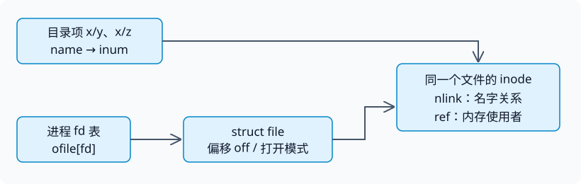

# 第 14 讲 · 文件系统是怎样让“名字”变成“磁盘字节”的？

理解文件系统，可以抓住两条主线：**一条把名字解析为字节位置，另一条保证这些对象在并发访问时既不被误回收，也不被互相覆盖。** inode、目录项、块缓存和各种计数，都是这两条主线上的工具。

## 1. 先分清四种“文件”

`open("x/y", ...)` 返回 fd，并不意味着 fd 里保存了字符串 `x/y`。否则原名字被 unlink 后，fd 就无法继续访问原对象了。

| 层次 | 表示什么 | 关键字段/关系 | 生命周期由什么控制 |
|---|---|---|---|
| 目录项 | 一个名字指向哪个 inode | `name → inum` | `link/unlink` |
| 磁盘 inode | 与名字无关的文件身份、长度、数据地址 | `type/nlink/size/addrs` | 链接和内存使用者都消失后回收 |
| 内存 inode | 内核当前使用的 inode 对象 | `dev/inum/ref/lock/valid`，加磁盘字段副本 | `iget/idup/iput` |
| 打开文件对象 | 一次打开所持有的访问模式和偏移 | `struct file` 的 `off/readable/writable/ref/ip` | `filealloc/filedup/fileclose` |

fd 本身还在这四层之外：它只是**当前进程 `ofile[]` 的下标**，表项指向 `struct file`。

*编者根据教材 §8.8、§8.13 重绘。名字路径和打开文件路径都能维持文件可用，但 `nlink`、`inode.ref`、`file.ref` 含义不同。*

### 三种计数不能互换

- `inode.nlink`：磁盘名字关系的计数，重启后仍有意义。
- `inode.ref`：当前内核里对内存 inode 的引用，包括打开文件、当前目录和临时查找引用；不是磁盘上的打开次数。
- `file.ref`：同一个打开文件对象被多少 fd 引用。`dup/fork` 可增加它，不需要重新 open，也不意味着 inode 的硬链接增加。

因此，`link` 不增加 fd 数；`dup` 不创建新名字；`close` 不直接删目录项。课堂用接口推导这些区别，见[中文译稿](#/c/mit-6.s081-2020/lec/lec14?v=draft) 09:00–18:00；完整实现见[课程资料](#/c/mit-6.s081-2020/lec/lec14?v=materials) §8.8、§8.13–8.14。

## 2. 一个偏移，需要做两次坐标变换

不要把“文件第 7 块”与“磁盘块 7”混为一谈。这里至少有三套坐标：字节偏移、文件逻辑块号、设备磁盘块号。

给定字节偏移 $o$ 和块大小 $B=1024$：

$$q=\lfloor o/B\rfloor,\qquad r=o\bmod B.$$

先用 $q$ 查文件的块地址映射，再在查到的磁盘块内取偏移 $r$。如果 $q<12$，取 `addrs[q]`；否则用 `addrs[12]` 找间接块，在其中取第 $q-12$ 个块号。最后拿到的才是可交给 `bread(dev, blockno)` 的地址。

课堂的偏移 8000 例子完整推导见译稿 39:00–45:00。另做一个跨边界推导：偏移 12288 恰好等于 $12\times1024$，所以 $q=12,r=0$，需要查间接块第 0 项；不能访问“第 13 个直接块”。

### 为什么最大文件是 268 KiB？

一个块号占 4 字节，一个间接块可存 $1024/4=256$ 个地址，因此原始布局容量为

$$\left(12+\frac{1024}{4}\right)\times1024=274432\ \text{字节}=268\ \text{KiB}.$$

保存这些地址的间接块要占磁盘空间，但不计入用户文件长度。这与页表页不算进用户数据容量是同类区分。

增加一层间接不是“自动多读一次”这么简单：磁盘格式、`bmap` 的索引计算和 `itrunc` 的回收逻辑必须共同认识它。[fs 实验指导](#/c/mit-6.s081-2020/lab/fs?v=guide)提供扩展骨架；不要把本页 12 个直接块的原始布局直接套到实验修改后的结构上。

## 3. 目录只是另一种内容，但路径解析不是纯字符串操作

目录 inode 和普通文件 inode 使用相同的块寻址机制。区别在于 `type == T_DIR`，以及内容被解释为 16 字节目录项：2 字节 `inum`，14 字节 `name`。`inum == 0` 是空槽；名字恰好 14 字节时可以没有结尾 NUL。

解析 `/y/x` 的过程是：根 inode → 根目录内容里寻找 `y` → 得到 `y` 的 inode → 检查是目录 → 在其内容中寻找 `x` → 得到目标 inode。其中任何一步都可能触发磁盘读，目录也可能被别的进程修改。

**引用与锁必须分开：**

1. 锁住当前目录，查出下一 inode，并用 `iget` 增加它的引用。
2. 解锁、释放当前目录引用。
3. 锁下一 inode，继续查找。

拿到引用之后，即使另一线程 unlink 了目标名字，目标也不会立刻被回收；而先放当前锁、再拿下一锁，可以避免 `.` 指向自己时重复锁同一 inode。

这里不是“路径上的所有目录同时冻结”，而是每一步安全持有将要访问的对象。完整 `namex` 并发代码只在教材 §8.12 展开；课堂讲了路径解析原理（45:00–51:00），未继续逐行讲完这段并发协议。

## 4. 唯一缓存副本，本身就是正确性条件

块缓存有性能作用，也有同步作用。假设同一个磁盘块在内存中有两个副本，即使每个副本各有一把锁，也仍然错误：

1. A、B 都读到旧版本，分别锁住自己的副本。
2. A 修改块内 inode 18，B 修改块内 inode 19。
3. A 整块写回。
4. B 整块写回，顺带把它副本里旧的 inode 18 覆盖回去。

**不同 inode 不意味着不同磁盘块。** 多个 64 字节 inode 可打包在同一 1024 字节块内，所以不能只盯着逻辑对象，忘记实际写回粒度。

`bget` 的基本契约是：同一个 `(dev, blockno)` 只有一个缓存身份。查找命中与未命中后的新身份登记，必须在同一个 `bcache.lock` 临界区内完成；否则两条线程都观察到“没有”，都可以各建一份。

### 两把锁、一个引用数

| 机制 | 保证 | 不保证 |
|---|---|---|
| `bcache.lock` | 查找、分配身份、引用计数和链表操作受保护 | 整段 I/O 期间独占块内容 |
| `b->lock` 睡眠锁 | 当前线程独占缓冲区内容 | 仅凭它阻止出现另一份缓存副本 |
| `b->refcnt > 0` | 缓冲区不被回收改派 | 内容不会被更早拿到睡眠锁的人修改 |

命中路径可以概括为：**缓存锁下找到并引用 → 放缓存锁 → 等待内容锁**。中间那段空隙之所以安全，是引用已固定了对象身份；内容可以变化，但成功取得锁之后，读者看到的就是同一份新内容。

释放顺序反过来为什么也安全？`brelse` 先放内容锁，再在缓存锁下减引用。它自己的引用尚在，缓冲区就不会突然变成无引用；其他等待者也提前加过引用。如果最后真的降为 0，才允许把它作为最近使用的空闲候选。详细课堂问答见 69:00–75:00、81:00–84:00。

## 5. 睡眠锁不是“不加自旋锁”，而是不长时间自旋

磁盘 I/O 可能让持有者等待很久。若用普通自旋锁包围整个操作，等待者会浪费 CPU；在 xv6 中还涉及关中断以及不能随意持锁调度的问题。

睡眠锁内部仍用一个短期自旋锁保护 `locked` 等状态，但不在整个文件访问期间持有它。拿不到睡眠锁时，线程通过 `sleep` 让出 CPU；真正取得睡眠锁后，可以在操作中等待磁盘。

所以应问“哪段状态转换要求短期原子性”，以及“哪段资源占用可能持续很久”，不能只凭出现了 `acquire` 就断定“全程都在自旋”。本讲讨论见 72:00–78:00，睡眠/唤醒背景见[第 13 讲](#/c/mit-6.s081-2020/lec/lec13?v=notes)。

## 6. 用修改集合理解一次创建，而不是背块号

课堂 `echo hi > x` 的 11 条记录见译稿 51:00–63:00；不必背 33、46、595。应能回答一次操作可能涉及哪些对象：

| 操作阶段 | 必须考虑的状态 |
|---|---|
| 创建文件 | 分配 inode；初始化类型与链接；向父目录加入名字；必要时更新父目录长度 |
| 第一次写内容 | 分配数据块并修改位图；初始化新块；写内容；更新 inode 地址和长度 |
| 继续写内容 | 在现有块写入；必要时分配后续块；更新长度/地址 |
| 删除最后一个名字 | 清目录项；减链接数；最后使用者退出时才释放数据块与 inode |

“这次写 2 字节”完全可能引起多个整块的逻辑更新。更重要的是，这些更新必须作为一致状态变化来考虑：inode 不能指向被标为空闲的块，目录项不能意外指到可复用 inode。

缓存锁解决并发访问，不解决断电后只写了一半的问题。课堂打印位于 `log_write`，也不是磁盘已完成每次物理写入的证据。这正是[第 15 讲崩溃恢复](#/c/mit-6.s081-2020/lec/lec15?v=notes)要补上的问题。

### 教材补充：删除以后继续打开，崩溃时怎么办？

`nlink == 0` 但还有内存引用时，文件继续存在，这是正确 Unix 语义。可是断电会消灭内存引用，盘上可能留下没有目录项的已分配 inode。rev1 的 xv6 没有全盘扫描回收或持久孤儿列表，因此可能泄漏这部分空间。完整论述见课程资料 §8.9。

这个例子提示：运行时引用计数正确，并不自动等于崩溃恢复完整。它是指定教材的补充，本视频没有展开孤儿 inode 恢复方案。

## 7. 阅读与实验路线

| 要解决的问题 | 中文译稿 | 课程资料 |
|---|---|---|
| 名字消失后 fd 为什么仍有效？ | 09:00–18:00 | §8.8、§8.13–8.14 |
| sector、block、inode 编号如何换算？ | 21:00–33:00 | §8.1、§8.8 |
| 文件偏移如何找实际块？ | 33:00–45:00 | §8.10、图8.3 |
| 目录如何逐级解析？ | 45:00–51:00 | §8.11–8.12 |
| 创建为何更新多个块？ | 51:00–66:00 | §8.7、§8.9、§8.14 |
| 两级锁与引用数如何配合？ | 66:00–85:38 | §8.2–8.3 |

官方文字提纲还准备了 `rm x` 的逐块轨迹、完整 `namex` 并发分析，以及双重拷贝/缓存内存配额问题。课堂因时间在块缓存处结束；删除与查找的实现见教材对应小节，不把提纲中的所有计划内容冒充已经讲过。

动手入口：[fs 实验说明](#/c/mit-6.s081-2020/lab/fs?v=zh)与[实验指导](#/c/mit-6.s081-2020/lab/fs?v=guide)。其中大文件任务训练多级块索引，符号链接任务训练路径解析；块缓存锁的优化另见 [lock 实验](#/c/mit-6.s081-2020/lab/lock?v=guide)。环境、教材及仓库统一见[公共资料](#/c/mit-6.s081-2020)。

## 自测：用不变量回答

1. open 后 unlink 唯一文件名，磁盘空间是否马上释放？

不会。`nlink` 可以变成 0，但打开文件仍维持 inode 引用。最后使用者 `iput` 才可能截断并释放；对应用来说通常是最后一个相关打开文件对象被关闭时。还要区分 `file.ref` 与 inode 引用数。

2. 两次独立 open 同一文件，与一次 open 再 dup，有什么区别？

两次 open 得到两个 `struct file`，偏移独立；dup 让多个 fd 指向同一个 `struct file`，共享偏移。两种情况都可以指向同一个 inode，所以文件内容是同一份。

3. 偏移 13000 在哪一块？需要哪些信息才能给出真实磁盘块号？

$13000=12\times1024+712$，所以查间接块的第 0 项，块内偏移 712。还需要目标 inode 的间接块地址及该间接块里的实际条目；仅靠偏移不能推断具体磁盘块号。

4. 已经给每个 buf 加锁，为什么还可能丢更新？

若同一磁盘块被缓存成两个 buf，锁也分成两把，无法互斥。两个旧副本各修改不同字节，后一次整块写回仍可能覆盖前一次结果。必须同时保证副本唯一性。

5. refcnt 已经大于0，为什么还要拿睡眠锁？

引用计数只阻止缓冲区被回收改派，不阻止其他引用者读写内容。拿到睡眠锁才具有独占内容访问权。

6. namex 先释放父目录锁，再锁下一 inode，会不会用到已经释放的对象？

`dirlookup` 返回前已经用 `iget` 持有下一 inode 的引用；父目录锁释放后，别人可以 unlink 名字，却不能在仍有引用时回收目标。若反过来先锁 next，查找 `.` 可能自锁死。

7. LRU 链表头部是否一定可以回收？尾部是否一定空闲？

都不是。头尾表示相对使用次序，可回收还必须满足 `refcnt == 0`。`bget` 从尾部向前找第一个符合条件者；不能只取尾部而跳过引用检查。

8. 日志已经保证更新原子性，为什么还会留下孤儿 inode？

“删名字但保留打开文件”本来就是合法、可提交状态；崩溃丢掉了内存中的打开引用，却没有正常执行最后 `iput`。原子日志不会自行发现所有无名且不再使用的文件；还需恢复扫描或持久孤儿列表等机制，rev1 未实现。

## 来源与版本说明

- [MIT 6.S081 2020 课表](https://pdos.csail.mit.edu/6.S081/2020/schedule.html)的 10 月 26 日 LEC14，Frans Kaashoek 主讲。视频元数据和英文自动字幕已获取，29 窗口译述覆盖至 85:38；未逐句听音。
- [官方文字提纲](https://pdos.csail.mit.edu/6.S081/2020/lec/l-fs.txt)、[板书](https://pdos.csail.mit.edu/6.S081/2020/lec/l-fs.pdf)全部已读/查看；两张真实课堂帧只用于中文译稿。提纲文件显示 2025 年修改时间，保留历史 URL 快照差异。
- [xv6 book rev1](https://pdos.csail.mit.edu/6.S081/2020/xv6/book-riscv-rev1.pdf)第8章导言、§8.1–8.3、§8.7–8.16，MIT 许可，全文译文及完整许可在课程资料；日志专节属于第 15 讲。
- 代码固定为 [e23d53f](https://github.com/mit-pdos/xv6-riscv/tree/e23d53f27f6e187732a92a2b4705639d1c260f05)，已读 `bio.c/fs.c/sysfile.c/file.c`，并核对 `fs.h/file.h/sleeplock.c/user/echo.c`。它不是录课工作树，也不是实验分支。
- 本文为自主提炼。自绘图无课堂画面；未运行实验、未本地复现演示。数据源散列、阅读范围与最小检查见本讲 `sources/manifest.json`、`sources/coverage.json`、`status.json`。
