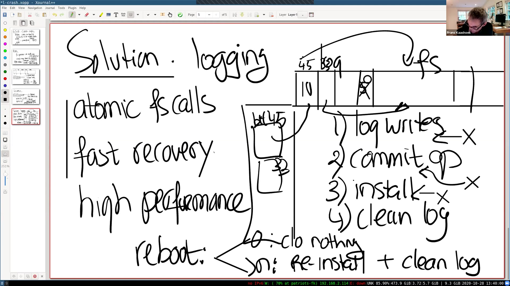
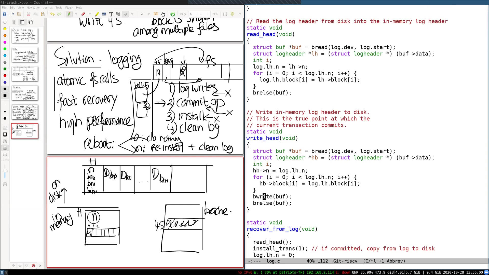
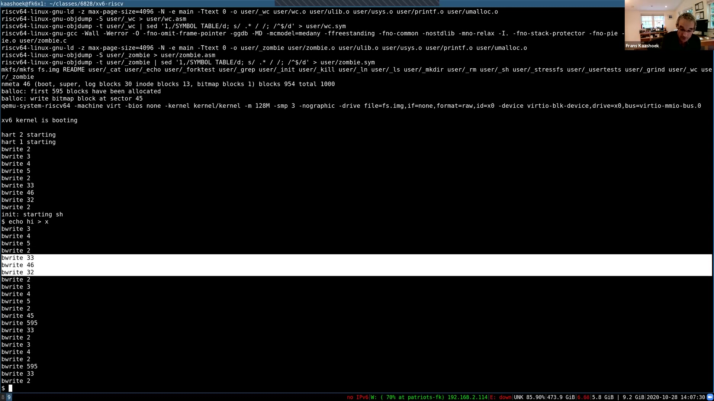

# 第15讲 · 崩溃恢复

## 00:00–03:00｜lock 实验的进展与无锁实现

Frans 确认大家能看到共享白板，然后先问 lock 实验做得怎样：是否已经开始，哪部分最难？一位同学说，内存分配器部分还算顺利，buffer cache 部分明显更难。难点不只是想出一个看似不会死锁的方案，还要检查特殊交错：例如已经持有一个桶的锁，又试图获取某个桶锁时，会不会再次拿到同一把锁？把这些情形想清楚后，实现才比较有把握。

另一位同学问，能否不按“每 CPU 分配器”的典型路线做，而直接采用无锁算法？教师回答，满足实验验收的方案可以采用，不过建议先做细粒度锁，再考虑无锁版本。学生解释自己的理由：若保留一条全局空闲链表，只把释放与分配变成原子操作，表面上反而不用管理多条链表及 CPU 间转移。

教师认为，对 `kalloc` 的单链表，这确实可以是值得探索的方向；但 buffer cache 的无锁实现会复杂得多。学生表示自己也不敢轻易尝试后一部分，教师回应，这种谨慎是合理的。这里讨论的是实验实现选择，并没有在课堂上给出一个经过证明的无锁算法。

> 编者注：开头 ASR 把 lock lab 识别成 log lab；结合后续 `kalloc`、桶锁、buffer cache 的讨论，本段指锁实验，不是日志实验。`make grade` 也被识别成近音词，正文按实验命令校正。

## 03:00–06:00｜怎样调试并发程序

有同学说，这类错误很难调试，因为看不出究竟发生了什么，只能在 GDB 中不断打断执行。教师回应，并发实验确实令他担心：bug 不一定每次运行都出现，复现和定位都很困难；但在内核里学习锁和并发，本身就是重要的真实工程经验。下一次实验基本不涉及这样的并发问题，希望会更直接一些。

学生继续问：多个线程一起运行时，有没有高效使用 GDB 的方法？教师介绍自己的朴素习惯：会用打印语句，但更重要的是写下自己认为始终应成立的不变量，再把它们变成断言。断言失败，说明代码不符合预期，或者这个“应该成立”的判断本身就错了；此时先停下来分析，而不是继续随机改代码。

在其他开发环境里，还可以使用 race detector，寻找共享变量在缺少相应同步时被读写的情形。但这需要一套额外工具和配置，课程没有要求大家搭建。竞争检测也不等于死锁检测。对本实验中的某些死锁，若已触发 panic 或能在调试器中停住，可从调用栈和持锁路径检查涉及哪些函数、锁和线程；相较于偶发数据破坏，这种固定卡住的状态有时反而更容易分析。

本段末尾转向课堂组织：反馈里有人提到，随着实际参会人数减少，或许可以鼓励提问者开摄像头，让讨论更接近线下课堂。教师将在下一段接着说明。

## 06:00–09:00｜本讲要恢复的是什么

教师鼓励愿意提问的同学开启摄像头，然后进入主题：今天讲文件系统的 crash safety。这里聚焦一种具体失败——电源中断或内核 panic，发生在文件系统操作中间，使磁盘上的结构进入不一致状态。例子是一个数据块错误地属于两个不同文件，或者一个 inode 被错误地分配给两个本应独立的文件。

可以想象用户正在运行 `make`。编译过程不断创建、读写文件，某一刻笔记本没电、家庭供电中断，或者内核 bug 导致整个系统停止。电源恢复后重启，用户希望仍能看到 shell 提示符，运行 `ls`，继续使用原来的文件系统。

为什么这竟然需要特别设计？直觉上，磁盘是持久介质，写进去的字节不会因为 RAM 断电而消失。然而文件系统的一项逻辑操作往往对应多个磁盘写。中间步骤可能暂时违反结构之间的关系；若恰好在那个时刻停机，暂态就会成为重启后唯一可见的状态。

因此，今天关心的是“多步修改执行到一半”的问题。进程、文件描述符、内存缓存不会因磁盘还在而自动恢复；文件系统首先要保证留下的磁盘结构仍然可用。

## 09:00–12:00｜日志的目标与课程转折

教师明确区分两种失败：如果磁盘本身起火、介质毁坏，里面的数据根本不存在了，就需要备份、重新安装等其他手段。今天假定持久介质仍能保存已经完成的写，研究的是运行途中停止造成的多步操作残缺。

解决方案叫 logging，也常称 journaling。它最初在数据库领域得到广泛发展，后来也成为文件系统中常见的技术。它受欢迎的重要原因，是能够给出有原则、可推理的恢复规则，而不只是为每一种坏状态单独写修补代码。

xv6 的实现非常精简，目的是把关键思想暴露出来。但即使这样一个最小实现，也有不能忽略的细节：缓存里的修改何时落盘，日志满了怎么办，并发调用怎样共用它。今天将逐步讨论这些问题。

简单也带来代价：xv6 的日志不是高性能实现。下一讲会阅读 Linux ext3 日志设计，研究如何兼顾正确性、快速恢复和正常运行性能。教师也说明，这是本课程最后一讲以 xv6 为主要对象的代码讲解；之后将转向论文，利用已经学到的基本概念理解更进阶的操作系统设计。

接下来回到问题本身：创建文件、向文件写入内容，都不是单个磁盘写，而是多步磁盘操作。

## 12:00–15:00｜不变量比“重启不崩溃”更重要

回忆上一讲创建文件的过程：先分配一个 inode，再把文件名和 inode 编号写入目录，还可能更新目录 inode。若机器在两步之间停止，就可能破坏文件系统不变量。例如，对普通文件数据块，应该是尚未分配，或者属于一个文件，而不能被两个本应独立的文件意外占用。

违反不变量后可能有两种后果。第一种是重启后马上再次崩溃：文件系统读到它根本无法处理的数据结构。另一种更隐蔽：系统看似正常，却读错内容、覆盖别的文件，或者不断丢失数据。不能仅以“还能启动、还能列目录”判定恢复成功。

教师问大家是否遇到过电脑或手机突然重启后变得不可用的经历，并指出文件系统恢复出错是可能原因之一。随后把讨论缩小到 xv6，准备通过具体块号分析，而不是只用抽象的“数据损坏”描述问题。

磁盘布局仍然是上一讲的布局：超级块、日志区、inode 区、空闲块位图和数据区。今天终于要使用此前暂时跳过的日志区。在接下来的推导中，先假设没有日志保护，看看直接写各结构会留下什么状态。

## 15:00–18:00｜创建文件：只分配 inode 就断电

教师展示 `echo "hi" > x` 的创建部分。板书记录了几个逻辑修改：写块 33 为 `x` 分配 inode，再写块 33 初始化它；写块 46，把 `x` 及其 inode 编号加入根目录的数据块；写块 32，更新根目录 inode；随后还有对 `x` inode 的更新。一个块中可以放多个 inode，所以“块 33”和“某个 inode”不能混为一谈。

现在在分配 inode 之后、目录项写入之前放一个故障点。断电会抹掉所有内存状态，包括进程、打开文件、内存里的缓存和尚未完成的工作；重启后能依靠的只有已经写在磁盘上的字节。

如果不增加任何恢复机制，此时磁盘表明某个 inode 已被分配，但没有目录项能找到它。教师让学生推断这意味着什么，而不是立刻给答案。关键是追问两件事：分配器以后是否还会使用它？用户能否通过文件名把它删除？

这段推导中的写入序列是用来说明文件系统的逻辑修改；稍后的真实 `bwrite` 演示会显示，加入日志后，实际设备写入比这多得多。

## 18:00–21:00｜换个顺序，会从泄漏变成错误共享

学生认为“这个块丢了”。教师校正得更精确：不是整个 inode 块丢失，而是为 `x` 分配的那个 inode 被占用了，却没有进入任何目录。普通用户既找不到它，也不能通过名字删除它，因此泄漏了一个 inode。

能否换一下写入顺序，避免先分配却找不到？假设先写块 46 建立目录项，再写块 32 更新目录 inode，最后才写块 33，把目标 inode 标为已分配。教师把故障点放在最后一步之前，要求大家再次只根据磁盘状态推理。

这时目录里已经有 `x`，但它引用的 inode 仍然被标成空闲。读 `x` 会遇到一个根本没分配好的 inode；更严重的是，之后分配器可能把这个 inode 分配给另一个新文件。于是两个本应独立的文件却共享同一个 inode。

教师用多用户系统说明这种错误的严重性：如果文件分别属于不同用户，一个用户可能读写另一个用户的数据。xv6 本身并没有完整多用户权限模型，这里是在说明同类结构错误在真实系统中的后果。调换顺序并未消除多步操作的危险，只是把“丢掉一个 inode”的问题换成了更危险的别名关系。

## 21:00–24:00｜写入文件：位图和 inode 分属两个块

第二个例子假定 `x` 已成功创建，现在要写入内容。相关逻辑修改包括：更新位图块 45，将一个数据块标成已占用；写入新分配的数据块 595；更新 inode 块 33，让 inode 记录数据块号及文件长度。

教师在位图已写、inode 尚未更新的位置设置故障点。学生指出，数据块会丢失。原因与 inode 泄漏类似：位图认为 595 已经被分配，但没有 inode 指向它。因此它既不在空闲集合中，也无法作为文件内容被访问。

再试着反过来：先把 595 写入 inode 的地址信息，再写位图块 45 标记占用。如果故障发生在两者之间，留下的又是什么？一位学生先想到文件大小与已分配块数不匹配。教师说，若大小和块指针在同一次 inode 块写入中更新，这两者本身可以一致；若拆成不同写，才会另外引出那种问题。这里还有一个更根本的危险，需要继续检查“inode 所说的占用”和“位图所说的空闲”是否一致。

> 编者注：板书把写 `h`、写 `i` 分列；65分钟附近教师明确纠正：实际 `echo hi` 对 `hi` 做一次 `write`，换行另做一次。这里保留板书所要表达的结构更新关系，不把分列误当成实际系统调用次数。

## 24:00–27:00｜真正需要的是多块修改的原子性

另一个学生给出关键答案：inode 以为自己拥有 595，但位图仍说它空闲，所以其他文件以后也可能得到 595。最终两个文件的 inode 都指向同一个数据块；写其中一个就会改掉另一个，用户之间也可能读写彼此内容。

所以，不能仅靠调整先后顺序来实现我们想要的保证。先标占用会泄漏，先写引用可能造成错误共享。共同的根因是：**逻辑上必须一起生效的修改，被分散成了多个独立磁盘写。** 我们希望恢复后的效果像一个原子操作——这次操作的全部修改都在，或者全部都不在。

日志就是本讲选用的解决方案。第一项目标是让文件系统操作相对于崩溃具有原子性；第二项是快速恢复，避免每次重启都扫描整个文件系统、逐一核查 inode 和位图再修补。

日志还可以支持高性能，但那是下一讲的主题。今天先证明最简单的机制确实能保证崩溃恢复，再看它在 xv6 中怎样实现。

> 编者注：教师此处先用“系统调用原子”建立直觉；72:00–75:00 会明确收窄这个说法：大 `write` 被拆成多个事务，并不保证整个调用一次性生效。

## 27:00–30:00｜先写日志，再宣布完成

与遍历整个文件系统检查一致性相比，日志把恢复所需的信息集中到一小块区域。教师把磁盘画成两部分：较小的 log，以及保存正常文件系统结构的区域。接下来所谓块的 home location，指它在正常文件系统中的原位置。

假设内存里已经修改了位图块 45。原本会直接写回磁盘块 45，现在先把新内容写进日志，并记住这份内容最终应该放到 45。若同时修改了 inode 块 33，也把它的新内容写进日志，登记目的块号 33。对本次操作的所有修改都这样处理，而暂时不改变它们的原位置。

等操作所需的全部块都进入磁盘日志后，才提交这次操作。教师用一个固定位置的计数表示提交记录：例如写入“5”，表示日志里已经有本次操作的五个完整块。这个记录不只是普通统计，它是在持久介质上宣布：恢复程序现在可以依赖这些块。

由此把一次逻辑操作分成两层：先在日志保存完整的新状态，再以一处明确的记录决定它是否生效。接下来才把新块内容逐个复制到各自的 home location。

## 30:00–33:00｜安装与重启恢复规则

第三阶段叫 installation：把日志里标为目的块 45 的内容复制到磁盘块 45，把标为 33 的内容复制到块 33，其余依次类推。全部安装成功后清理日志，在这个简单方案中就是把提交记录的数量设为 0，并不需要把每个数据字节都擦除。

重启时，恢复代码只需读提交记录。数量为 0，视为没有已提交事务，忽略日志中的残留数据；数量大于 0，说明有一个已提交事务可能还没安装完，于是重新安装所有记录的块，完成后再清零。

教师先问第一种故障：日志数据写了一部分或全部，但提交记录还没成功，怎么办？学生回答，恢复时什么也不做，因为正常文件系统还没有被改过。教师确认，这等价于故障发生在系统调用开始前；对于崩溃原子性而言，这是一种合法结果。

第二种故障：已经提交，但安装尚未开始。学生说，重启后完成全部安装即可。之所以敢这么做，正因为提交之前已经保证所有需要的新块内容都在磁盘日志里，不需要从丢失的内存中再找任何东西。

## 33:00–36:00｜安装做到一半也可以重新执行

教师继续把故障点移到安装过程中，或者安装完成但尚未清零的时刻。学生指出，从恢复程序看，提交记录仍在，所以照样重放整个日志。虽然有些块已经写过，但再写一次没有问题。

为什么不会把操作执行两遍？因为日志记录的是“把这些确定字节放到这个确定位置”，不是“再增加一次”。教师举例，若块 45 应包含值 10，每次都把同一个 10 放到块 45，结果仍相同。这就是幂等性：执行一次或多次，最终效果一致。

不过有一个边界：不能在恢复途中同时服务其他文件系统调用，否则别的新修改可能插进来，再次重放旧日志就可能覆盖它们。恢复要在正常文件系统活动重新开始之前进行。



*原片35:00。白板右侧依次写出记录日志、提交、安装、清理，并在不同位置画出故障标记；底部给出数量为0时忽略、大于0时重新安装并清理的恢复规则。*

学生追问：如果接口是 append，重复执行岂不是不安全？教师区分了层次：直接重复“追加”这个高层动作，确实不像覆盖固定地址那样自然幂等；但文件追加可以先转成对数据块、inode 等的修改，再使用当前这种日志保证它的原子性。不能把重放块映像误解为重新调用一次用户的 append。

## 36:00–39:00｜提交过程中断电，依靠什么判断

学生问得更尖锐：若要原子地完成多个写，却在“提交到一半”时崩溃怎么办？教师强调要分清两件事。把所有数据块写入日志，是提交之前的准备阶段；只有当这些写都已完成，才允许写提交记录。不能数据还没准备齐，就宣布提交成功。

提交动作本身写一个日志头。这里依赖底层的原子写假设：承载提交决定的磁盘写，要么完整生效，要么不生效，而不能留下半个有效的提交记录。若新记录成功写入，数量比如是 5，恢复就安装前五个日志块；若没写入，仍是旧的 0，恢复就按操作没有发生处理。

教师由此引出 write-ahead rule：在允许正常文件系统位置接收新块内容之前，必须先有完整的磁盘日志；在当前协议中，还必须先完成提交记录。否则一旦原位置已经改了一个块、接着断电，恢复却缺少其他块，就又回到了不完整修改的困境。

不同日志系统可以推迟安装、推迟清理，或采用更复杂的组织方式，但它们都必须守住相应的持久化依赖顺序。下一讲才会比较这些实现选择。

> 编者注：课堂在 block、sector 之间有简化表达。这里真正需要的是提交决定的原子性及规定的持久化顺序；不能由这段讨论推出任意设备上的任意大小写天然原子，也不能把坏盘、静默损坏算进本讲证明。

## 39:00–42:00｜xv6 的两份日志头与一份块缓存

教师把磁盘状态与内存状态分开画。磁盘日志最前面是 header，其中包含数量 `n`，以及每个日志数据块对应的 home block number。随后顺序存放这些块的完整数据。若第一个编号是 45，紧跟头部的第一个日志数据块就保存块 45 的新内容；编号和数据的位置要一一对应。

内存中也有一个日志头：一个 `n` 和一个块号数组。它用来记录当前操作已经修改哪些块。但块数据并不另存成一个独立的内存日志副本，而是仍留在 buffer cache。比如编号数组中出现 45，实际的新位图内容在缓存中那个标识为磁盘块 45 的 buffer 里。

所以必须同时记住三种对象：内存里的日志头、缓存里的修改后数据、磁盘上的日志头和日志数据。前两者用于组织当前操作，断电都会丢失；第三者才供重启恢复使用。不能因为内存 `n` 已经增长，就认为磁盘上的事务已经提交。

这个布局也解释了稍后代码中为什么要先按块号从缓存取数据，再写到日志槽位。日志头提供“哪些块、各自原位置在哪”的目录，buffer cache 提供准备写出的内容。

## 42:00–45:00｜begin_op、end_op 给原子修改划边界

教师切换到 Emacs，确认屏幕上的代码足够大，同时保留旁边的结构图。首先看对应创建操作的 `open` 路径：在文件系统操作开始处调用 `begin_op()`，结束时调用 `end_op()`。日志层需要这两个边界，才能知道哪些修改属于同一个不能被提交切开的操作。

在这对边界之间，文件系统更新内存数据结构和 buffer cache，并登记哪些块被改过。真正把数据写入磁盘日志、写提交记录的动作，发生在适当的 `end_op()` 中。教师暂时采用没有其他文件系统操作并发进行的简单情形；稍后再说明为什么不是每一次 `end_op()` 都马上提交。

接着看 `fs.c` 的 `ialloc`。它找到一个空闲 inode，修改包含它的缓存块，但调用的不是原来那种直接落盘的 `bwrite`，而是 `log_write`。这就是日志层嵌入原有文件系统的位置：上层仍负责怎样分配和修改 inode，日志层负责安排这些修改何时、按什么持久化顺序写入。

不要被函数名误导。`log_write` 并不意味着“此刻已经把日志写到磁盘”。下一段会看到，它主要维护内存中的登记表。

## 45:00–48:00｜log_write：登记、吸收与固定缓存块

假设块 45 的缓存内容已被改过，`log_write` 的工作是记住：本次提交时必须把它写进日志。它先获取保护日志头的锁，再遍历已登记的块号数组。

若 45 已经在数组中，就不再增加一个槽位。因为缓存里仍是同一块数据，等真正提交时写出其最终内容即可；在同一事务里多次修改该块，不必在磁盘日志里保存每个中间版本。这种合并叫 log absorption，日志吸收。

若块号尚未出现，就把它放入下一个数组位置，增加计数 `n`，并调用 `bpin` 把这个 buffer 固定在缓存中。教师此时先留下 `bpin` 的原因，后面会专门分析缓存淘汰问题。

于是 `log_write` 的整体行为很短：登记块号，必要时固定 buffer，释放日志锁。文件系统对缓存内容的修改仍留在内存，直到提交阶段才进入磁盘日志。

学生问：那是不是不应该在文件系统里直接使用 `bwrite`？教师确认，可以把这个改造理解为：原来上层文件系统直接调用 `bwrite` 的地方，改用 `log_write`。日志实现内部当然仍需要 `bwrite`，否则无法把日志及其安装结果送到设备。关键是上层修改不能绕过日志直接写回原位置。

## 48:00–51:00｜commit 的准备阶段与真正提交点

教师暂时跳过 `end_op` 中处理并发的分支，只看唯一操作完成时调用 `commit` 的路径。`commit` 先调用 `write_log()`，再调用 `write_head()`，接着安装，最后清零。

讲解开头短暂混淆了两个函数，随后自行纠正：`write_log` 写的是各块的内容；`write_head` 才写数量和目的块号数组。前者逐个读取内存日志头中的块号，取得对应缓存块，取得磁盘日志中的目标槽位，把一个完整块的数据复制过去，再用 `bwrite` 写日志块。

完成 `write_log` 还不算提交。假如就在它返回后、写日志头之前崩溃，磁盘日志里虽然已经有了新数据，但旧头仍表示 0，所以恢复会忽略它们。正常文件系统原位置还没改，因此结果等价于本事务未发生。

接着看 `write_head`：它取得日志头块，把内存中的 `n` 和块号数组复制进去，然后调用 `bwrite(buf)`。教师把注意力集中到这一行：真正区分“尚未发生”和“必须恢复完成”的，是这一处磁盘写成功，而不是前面给内存字段赋值。

## 51:00–54:00｜在提交点前后分别推理

教师问，如果在 `write_head` 的 `bwrite` 之前崩溃，怎样恢复？学生回答，此时改的只是内存中的 `hb` 数据，磁盘上还没有新的日志头。教师确认：即使一些日志数据块已经存在，恢复依旧忽略它们。

如果故障在这一行之后呢？学生指出，磁盘头中的数量不再为零，恢复会读到正确的头并重放。由此可见，提交点之后，即便应用暂时还没看到函数返回，只要恢复正确，本次事务也一定会完成。



*原片51:00。右侧 `write_head` 先赋值 `hb->n`、复制 `hb->block[]`，然后调用 `bwrite(buf)`；左侧图把日志头、日志数据与缓存区分开。画面下方的恢复调用是 `install_trans(1)`。*

随后看 `install_trans`：按日志头记录，读一个日志块，再取得它的目的块，把数据复制到目的 buffer，然后写回目的位置。若途中崩溃，不需要记住“上次安装到了第几项”，因为重启后从第一项重做也安全。

安装结束，代码把内存 `n` 设为 0，再写一次日志头，实现清理。这个清零动作也必须持久化；仅在 RAM 里清零，并不能改变下一次重启会看到的提交记录。

> 编者注：录课树与本项目固定的 `e23d53f` 参考快照有差异。该快照的签名是 `install_trans(void)`，课堂51:00画面显示恢复调用 `install_trans(1)`。本页按画面说明课堂，不把参考快照说成录课工作树。

## 54:00–57:00｜为何先读再覆盖，以及恢复入口

学生问，这些函数先把将被覆盖的块放进 buffer cache，又做一次 `memmove`，能否省掉读和复制，直接写设备，从而加速？讨论中双方先辨认具体指的是 `write_log`、`install_trans` 还是 `write_head`，最终问题落在共同的“取得旧 buffer 再覆盖”模式上。

教师回答，这些路径确实有优化空间。若内容马上会完整覆盖，读取旧内容本身并不是算法所必需；额外复制也可以通过接口设计减少。xv6 沿用简单的 buffer 接口，优先使代码清楚，没有把这些优化都做进去。

> 编者注：课堂口头把可减少的 I/O 泛称为读写开销。`bread` 若命中缓存，并不会再发起实际读盘；因此不能根据函数调用次数直接断言每次提交必有多少额外设备读取，也不能把可省去的读取说成一定能少写几个持久化必需块。

教师再次走过提交的四步，然后转到重启。初始化日志时调用 `recover_from_log`；它用 `read_head` 从磁盘载入日志头，随后调用同样的安装函数。代码不必先单独写一个 `if (n > 0)`：安装循环从 0 到 `n`，当 `n == 0` 时自然什么也不复制。

## 57:00–60:00｜恢复可以再次崩溃；打印位置也很重要

`recover_from_log` 安装完日志后清零日志头。若恢复执行到一半再次断电，下次启动仍会读到未清除的提交记录，再次从头重放。这个过程可以重复很多次；只要最终有一次能执行完，就能完成全部安装。

学生问，从进程角度看，程序似乎已经完成一些工作，但在日志提交和安装之前失败，重启后这些工作没有了，会不会有问题？教师先确认问题含义，然后回答：对当前保证来说，没有破坏文件系统。效果相当于那次文件系统操作没有发生。进程本身也随崩溃消失了，我们本来就不要求普通进程状态跨断电存活。真正持久的对象是磁盘状态，而不是进程对自己执行进度的记忆。

接下来用真实运行印证前面的分析。教师说明，上一讲为简化观察，把打印放在 `log_write` 里，所以显示的是逻辑上“某块被修改并登记”的轨迹，并非全部设备写入。现在把打印移到 `bwrite`，才能看到日志、提交头、安装和清理真正产生的磁盘写。

他再次运行 `echo hi > x`，准备把更长的输出按事务阶段拆开。这个对比本身就是调试技巧：同样写着“write”的输出，放在不同抽象层，代表的事件完全不同。

## 60:00–63:00｜读懂真实 bwrite 轨迹

实际输出明显比前面板书上的逻辑修改长。教师先问，连续写块 3、4、5 是什么，随后写块 2 又是什么？学生回答先写日志，随后写“超级块”；教师结合布局校正：块 2 是日志头，不是超级块，块 3 起才是日志数据。

创建 `x` 的事务可以分成四组：先写 3、4、5，把三个不同 home block 的新内容放入日志；再写 2，提交日志头；接着写 33、46、32，把 `x` 的 inode、目录内容、目录 inode 安装到原位置；最后再写 2，把日志头数量清零。

教师让学生辨认中间的 33、46、32 是哪一阶段。一开始有人想到“设置位图”，另一位同学指出是在创建文件的相关结构。教师强调，在前面的日志写里这些 home location 还没有改变，现在才是 installation。



*原片62:30。终端命令为 `echo hi > x`，反白部分是创建事务的安装阶段 `bwrite 33 / 46 / 32`。下面还可见写正文的安装块 `45 / 595 / 33`，以及写换行的 `595 / 33`。画面中 shell 启动前也有写入，不能混入这条命令的轨迹。*

以下只摘出画面中命令后的块号，并用竖线标记“日志数据｜提交｜安装｜清零”，竖线不是终端输出：

```text
创建 x：  3 4 5 | 2 | 33 46 32  | 2
写 hi：   3 4 5 | 2 | 45 595 33 | 2
写换行：  3 4   | 2 | 595 33    | 2
```

## 63:00–66:00｜双写成本与 echo 的口头纠正

学生问，能否从这段轨迹反推出 `begin_op`、`end_op` 在哪里？教师说，不能从这些磁盘打印精确看到开始时刻，因为 `begin_op` 本身不一定产生设备写；但可以知道，某次操作进入结束阶段后，日志头提交写会在适当的 `end_op` 路径中出现。

随后评价性能。一个学生指出，相同内容写了两次。教师确认：先把数据写日志，再把它写回文件系统原位置。仅从数据写入量看，这就带来大约两倍的工作；大文件也不能逃过这个代价。下一讲读 ext3 论文时，要带着这个问题：怎样避免所有文件数据一律付出这种双写成本？这里的“两倍”是成本直觉，不是课堂做过的吞吐测量。

另一位学生追问，轨迹是不是说明 `h` 和 `i` 分别写？教师起初说“我想是”，随后保留判断，学生也重新澄清自己指的是换行。最终课堂明确纠正：`h` 和 `i` 是同一次写，换行是另一次写。

> 编者注：固定参考快照的 `user/echo.c` 对一个参数调用一次 `write(1, argv[i], strlen(argv[i]))`，随后单独写空格或换行，与本段最终澄清一致。不能沿用前面板书分列 `h`、`i` 的形式，声称程序做了两个字符级系统调用。

## 66:00–69:00｜挑战一：缓存淘汰不能偷偷写回

现在讨论简单日志仍必须处理的复杂情形。第一个是 eviction。设事务已经修改了缓存中的块 45，还要继续处理其他块；此时 buffer cache 满了，缓存层想淘汰 45 为别的块腾位置。

如果采用普通写回缓存的思路，把脏的 45 写回 home location 再淘汰，是否可以？学生回答，若其他相关修改还没完成就崩溃，事务的原子性会被破坏。教师确认，这直接违反先写日志的规则：不能在整个事务的日志和提交决定都可靠之前，把部分修改写到正常文件系统。

另一方面，也不能直接丢掉这个缓存内容，因为它是尚未提交的新数据的唯一副本。因此需要同时避免两件事：过早写回和无声丢弃。xv6 的办法是让参与当前日志事务的修改块留在缓存，直到可以安全释放。

教师回到 `log_write`，指出前面暂时跳过的 `bpin` 正是在解决这个问题。事务完成前，块可以不再由原调用者持有 buffer 的 sleep lock，但其缓存槽位不能被重新分配给另一个块。

> 编者注：此处是教师提出的“若缓存采用脏块淘汰写回会怎样”的反例；固定快照的 `bget` 实际按 `refcnt == 0` 回收 buffer，并没有另一个自动脏块写回线程。

## 69:00–72:00｜引用计数固定 buffer，日志空间也有限

教师让正在做锁实验的同学猜 `bpin` 如何实现。学生回答，增加引用计数，使它不满足可淘汰条件。正是如此：buffer cache 只会回收引用计数为 0 的槽位，额外的 pin 引用保证原调用者 `brelse` 后，buffer 仍被保留。后面的安装路径会配对解除这种固定。

第二个挑战是空间。xv6 的日志区大小有限，课堂用 30 块说明。增加日志大小可以缓解压力，却不能消除问题：无论定多少，一次必须原子完成的操作都不能无限大。

如果操作需要的块数超过日志容量，又不能提前把一部分挪到 home location 来腾空间，就会陷入困境。后者会违反前面证明所依赖的顺序，因此不能当作溢出的补救办法。

教师问，30 这个数是怎样选的？真正需要估算的是一个文件系统操作最多会修改多少个不同的块。普通创建操作只有少数块；但不能只靠几个小例子判断上界，要逐个检查所有可能路径。下一段将用大 `write` 说明，单个用户调用甚至可以远超这个固定大小。

> 编者注：课堂把日志总量简称为30块。固定快照中 `LOGSIZE` 为30，同时 `log_write` 检查 `log.size - 1`，磁盘日志头也占一个块；不要把口头数字理解成“任意30个数据块加一个头都必然放得下”。

## 72:00–75:00｜挑战二：大 write 拆成多个事务

教师说明，课程实现者确实逐项查看了文件系统操作，估算每个操作的块修改上界，常见操作远不到30块。然后问，什么操作可能需要很多块？学生回答，对大文件写入。

例如调用 `write` 传入大约一兆字节的数据，可能对应约一千个块，显然不可能一次放入这个小日志。教师沿 `sys_write` 找到 `filewrite`，让大家看循环及其注释：它将一个大的写入请求切成许多较小的写入，每一小段使用自己的 `begin_op` / `end_op` 边界。

这意味着整个大 `write` 并不具有一次性全有或全无的崩溃语义。已经完成的前几个小事务可以留下，后面的部分可以尚未发生。但每一小段引发的分配、位图修改、inode 地址更新和数据写，都作为完整事务处理。因此不会留下“inode 指向空闲块”这样的结构性错误。

教师强调，这不违反这里讨论的 Unix 文件系统要求：目标是写的过程中不要把文件系统结构破坏，而不是保证一个任意大的用户缓冲区必定整体原子落盘。最初“把系统调用变成原子操作”的说法，到这里必须按实际事务边界理解。

## 75:00–78:00｜挑战三：并发操作不能一起挤爆日志

大写分段解决的是单个调用太大。还有相关资源约束：修改块在提交前都被 pin 在缓存中，因此缓存也必须能容纳事务需要固定的工作集。这个问题会在课后问答继续追到缓存耗尽的行为。

接下来考虑两个并发文件系统操作 `T0`、`T1`。它们交错产生块修改，假设直到日志接近尾部，两者都还没结束，各自还要继续登记新块。现在可否把其中一个先提交来腾空间？不能，因为它还没有完成；提交一半的修改正是日志原本要避免的事情。

因此，“每个操作单独能放进日志”仍然不够，**所有已经获准执行的并发操作，其合计最坏需求也必须放得下**。不能等实际填满再决定拒绝，因为那时前面的操作可能都无法收尾，既不能提交，也没有空间继续。

教师画出多项操作交织占据同一个日志的情形，引出入口控制。解决问题的位置应在 `begin_op`：新操作还没有修改共享结构时，就要判断是否允许它加入，而不是让它做了一半再失败返回。

## 78:00–81:00｜入口预留与组提交

`begin_op` 检查当前已经有多少个未结束的文件系统操作，并按它们可能修改的最大块数预留空间。若再加入一个可能超出容量，新调用就睡眠；已进入的操作继续执行，最终完成并提交，为等待者释放空间。

当一组重叠执行的操作都结束时，xv6 将它们的修改一次性提交，称为 group commit。对磁盘恢复来说，这是一个更大的事务：这些修改共同生效，或者共同不生效。

学生问，组提交是必须的吗？能不能某个系统调用先结束，就单独提交它，其余稍后再提交？教师提醒，不能随意改变操作的可观察先后关系。例如某次读取看到了一个写入，然后产生第二个写入；如果把第二个写入持久化，却把它所依赖的第一个写入丢掉，重启后的状态可能违背程序已经观察到的关系。

教师在此用“日志体现写入次序”解释保持依赖关系的重要性，并指出一起提交是安全而简单的方案。它不表示所有日志系统只能采用 xv6 这种组提交；若想独立提交，就必须更仔细地维护依赖、版本和提交顺序。

## 81:00–84:00｜outstanding 如何决定谁负责提交

教师结束上一问题，重新打开之前跳过的 `begin_op`。第一种等待条件是日志正在提交：这时不能让新操作进来改变本轮要安装的数据。第二种是现有使用量加上并发操作的保守预留，会超过日志容量，也需要睡眠。只有通过这两项检查，才将 `log.outstanding` 增加1，继续执行文件系统操作。

再看 `end_op`：先将 outstanding 减1。如果仍有别的操作没结束，当前调用不能提交整个日志；必要时唤醒等待者，让它们重新检查预留条件。如果减到0，则当前调用是这组操作中最后结束的一个，它负责发起提交。

提交期间设置 `committing`，防止新的 `begin_op` 进入；提交结束后撤销这个状态并唤醒等待者。这样，修改缓存的阶段与从缓存生成已提交日志的阶段不会重叠。短暂的日志状态锁与整个可能等待磁盘的提交过程，也不是同一个持续持有的大锁。

教师总结：即使是这样一个精简日志，也必须协调缓存保留、容量预留和并发结束条件。它很好地解决了多步文件系统操作的崩溃一致性，但正常运行性能仍有明显代价。阅读下一讲 ext3 论文时，应继续追问如何改善这些代价。

## 84:00–87:00｜课后问答：缓存真的满了怎么办

教师允许有事的同学离开，继续回答问题。学生指出，代码里 buffer cache 的大小似乎和日志容量相同。如果日志 pin 住了所有 buffer，另一个操作再申请缓存块，会发生什么？

教师检查 `bio.c` 和相关大小定义，没有给出一个对所有情况都足够的容量证明。他沿着找不到空闲 buffer 的路径确认：xv6 会 panic。这个行为当然不理想；实现希望所选容量使这种情况不容易发生，而不是提供了优雅的资源不足处理。

随后教师反问，为什么不简单返回错误，让调用者一路返回 -1？考虑一个多步文件系统调用已经完成前两个修改，第三步却因为缺少缓存槽位失败。如果直接返回，之前的部分修改怎么办？例如目录块可能已经变了，其他对应结构却还没完成，不能假装整个操作从未开始。

因此，通用的“申请失败就返回”并不足以解决此处问题。这类路径需要回滚已做的内存修改，或者在进入前保证拥有完成所需的资源，或采用其他明确的失败处理设计。xv6 选择简单，当前路径没有实现完整回滚机制。

## 87:00–90:00｜回滚代价与操作次序的追问

教师继续解释，要把缓存不足处理为正常系统调用失败，就必须撤销此前属于这个调用的修改；这会很麻烦，因此当前实现没有这样做。学生确认，极端情况下还是会 panic；教师也只是表达希望这种边角情况不要发生，并没有声称缓存容量已经被严格证明永远充足。

随后，之前询问 group commit 的学生试着构造具体例子：一个进程产生1到 `n` 的数，另外两个进程分别消费奇数、偶数，把它们写到同一个文件。如果原本最后应出现偶数，却允许较早的那次写更晚提交，是否可能最终留下倒数第二个奇数？

教师没有立即认定这个例子在所有细节上成立，而是说需要再仔细想，但它确实抓住了“重排操作会造成异常可观察结果”的方向。他指出，讲义中有一个 shell 命令的例子，强调的核心是事务之间需要维持应有的次序。

这和“所有系统都必须组提交”不是同一命题。真正危险的是：较晚的操作先完成，就为了腾空间把它先提交，而更早且相关的操作尚未结束。xv6 的组提交避免了这种随意挑选提交对象的诱惑，但更一般的设计还需要独立分析依赖关系。

## 90:00–90:30｜原片截断在讲义定位问题上

教师补完上一回答：不能因为较晚的事务已经完成，就先提交它来释放空间，而把更早尚未完成的事务留在后面。学生表示理解，接着问讲义里例子在哪里。

教师说是一个 shell 命令，用来说明顺序很重要；它没有直接绑定到 group commit 这个词，而是在解释为什么不能任意改变文件系统操作的持久化次序。学生随后确认是否指文本讲义，原片在这个追问尚未完整结束时终止，没有录到后续回答。

> 编者补充：已核对的 `l-crash.txt` 在“no order anomalies”下给出 `echo 99 > result ; echo done > status`。它说明不能只留下“完成”标志却丢失相应结果。命令未在片尾被完整念出，这里只是帮助定位教师提到的文本，不补造未录到的对话。

## 来源、核对方式与覆盖边界

- 主讲 Frans Kaashoek；David Morejon 频道，*6.S081 Fall 2020 Lecture 15: Crash Recovery*，2020-10-28 上传，90:30。视频地址由课程元数据提供，本页不添加时间跳转链接。
- 全部2345条原语言英文 ASR 已读；不存在人工字幕。原始第一条从00:00.240开始，最后一条原始结束时间为90:31.600，超过视频时长1.600秒，阅读窗口封顶90:30。开头0.240秒无字幕；70:17.840–70:29.920、77:40.560–77:54.880还有两段超过10秒的字幕空隙，未凭字幕推断有无讲话或补造内容。片尾学生问题未完；未逐句听音、未审阅全片画面。
- 三张截图分别为35:00、51:00、62:30，均从原片单帧提取并实际查看，未裁剪。特别核实提交点、`install_trans(1)` 与 `echo hi > x` 的真实设备写轨迹。
- 官方课堂提纲：[l-crash.txt](https://pdos.csail.mit.edu/6.S081/2020/lec/l-crash.txt)，文本标题仍写“2019 Lecture 13”，这里只把它作为2020课表所链接的辅助提纲，不据此改讲次；[l-crash.pdf](https://pdos.csail.mit.edu/6.S081/2020/lec/l-crash.pdf) 的10页板书已查看。两者用于核对，不另行全文翻译。
- 源码辅助校对使用2020参考提交 `e23d53f27f6e187732a92a2b4705639d1c260f05` 的 `kernel/log.c`、`bio.c`、`file.c`、`fs.c`、`sysfile.c`、`param.h`、`user/echo.c`。它不是录课工作树，也不是 fs 实验分支；已发现的安装函数签名差异见51:00–54:00。
- 本文保留讲授的推导、示例和实质问答，以自主中文组织表达；不提供英文字幕全文的网页再版，不宣称视频获得教材或课程网站的许可。源文件、获取记录及逐段证据见本讲 `sources/manifest.json`、`sources/coverage.json`。
- 提炼和自测见[课程笔记](#/c/mit-6.s081-2020/lec/lec15?v=notes)；教材日志三节全文中译见[课程资料](#/c/mit-6.s081-2020/lec/lec15?v=materials)。
