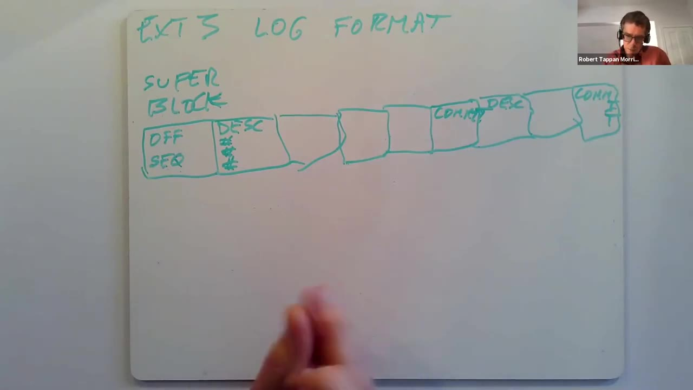
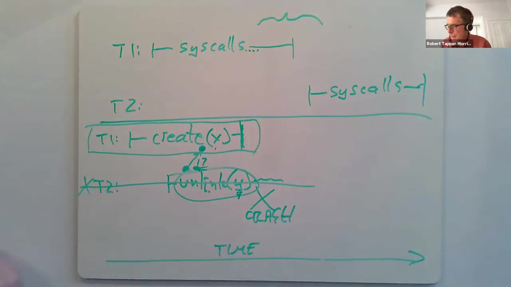

# 第 16 讲 · 文件系统性能与快速崩溃恢复

## 00:00–03:00｜为什么继续研究日志

Robert Morris 邀请大家随时打断提问，并鼓励打开摄像头。本讲继续讨论日志，但从 xv6 的教学实现转向 Linux ext3：给真实文件系统增加崩溃恢复时，怎样同时获得高性能？这里既有机制，也有为了性能不得不处理的复杂边界。

日志值得反复研究，是因为它能作为一种相对独立的机制附加在存储系统上。无论存的是数据库记录、文件还是专用持久化数据，都可以先有组织地记录更新，再利用这些记录恢复。分布式系统也使用日志梳理故障之前发生的事情。日志不只是“多存一份数据”，它使恢复过程有结构可循。

两个名称要先对齐：本课说的 log 与指定阅读里的 journal 指同一种思想；论文讨论的是给 ext2 增加 journal，后来发展出的文件系统叫 ext3。讲者接下来采用 ext3 这个名字。

讲解路线是先回顾 xv6，然后说明 ext3 如何修正它的性能瓶颈。这些优化也会改变应用程序在崩溃之后能够期待什么，不能只比较速度而忽略语义。

## 03:00–06:00｜磁盘、缓存和 xv6 日志

讲者画出磁盘上的文件系统树：根目录下有子目录，目录中有文件，文件关联若干数据块；另有不属于目录树的块位图，用来表示磁盘块是否空闲。inode、目录内容块和位图统称**元数据**，与保存普通文件内容的数据块区分。

同一磁盘上还留有日志区域。xv6 的布局很简单：一个头块，后面是若干被修改块的新版本。头块记录这些副本应当安装到文件系统中的哪个块，例如块 17、块 29；后面的内容按这个对应关系排列。

内存中有块缓存。用户进程执行 `write`、创建文件等操作时，先修改缓存中的块，包括文件内容、inode 等，并不立即改写磁盘原位置。操作结束后，系统把修改块复制进磁盘日志，最后写头块中的块号，表示这一组更新已经完整。

文件系统代码用 `begin_op()` 和 `end_op()` 标出这组更新的边界。前者通知日志系统“将开始一组必须共同处理的更新”，两者之间进行读写，后者通知“本次操作的修改已经做完”。这里先按单个操作解释；课堂稍后会澄清 xv6 也能把多个并发操作合为一个事务。

## 06:00–09:00｜提交点把多块更新变成全有或全无

修改块先留在缓存，提交时逐个写入日志；只有日志内容写完，才通过一次磁盘写更新头块中的块号。头块写入完成就是**提交点**。提交点之前崩溃，恢复时不会采用这批更新；之后崩溃，即使原位置还没更新完，恢复程序也能按照头块，把日志里完整的一组块重新写回原位置。

恢复代码在重启时读取日志头。如果里面有有效块号，就安装对应的所有日志块；如果日志头为空，就不需要重放。已经写回的块可以再写一次，因此不必记住崩溃前究竟完成了哪些原位置写入。

这样，`begin_op()` 与 `end_op()` 之间需要共同成立的多次更新，对崩溃呈现原子性：恢复后要么都生效，要么都不生效。这里的“原子”针对恢复结果，不表示实际只发出一次磁盘 I/O。

这一结论依赖 write-ahead rule：必须先把整组更新完整记录并提交到日志，才能把它们写到文件系统原位置。若先覆盖了原位置，随后崩溃却没有完整日志，就既无法保持旧状态，也无法补齐新状态。讲者把这条顺序约束称为日志恢复的基础。

## 09:00–12:00｜日志什么时候才能复用

另一个同样关键的约束是 freeing rule：只有某个事务的全部更新都已写到各自原位置，才能删除或覆盖该事务的日志空间。提交成功不意味着日志已经没用了；原位置可能仍只更新了一部分，剩余部分还要靠日志恢复。

在正常、没有崩溃的 xv6 执行中，提交过程依次做四件事：把修改块写进日志；写日志头完成提交；把这些块再写到原位置；最后清空日志头。这解释了为什么 `end_op()` 在触发提交时要完成很多工作。

清空头块也有顺序要求，必须发生在下一批内容覆盖日志之前。否则日志头中可能残留上一事务的目标块号，而日志数据已经换成下一事务的内容；此时崩溃，恢复程序就会把新内容写到旧目标，造成错误。

讲者由此转向性能问题：如果机制已经正确，Linux 为什么不原样照搬？答案在于这种简单组织方式把调用完成、日志提交、原位置安装以及空间回收紧紧串在一起，等待时间很长。

## 12:00–15:00｜同步提交与重复写的代价

在讲者用于比较的串行场景中，创建文件或写文件要等整套提交工作完成才返回：写日志数据、写头块、安装原位置、清头块。提交过程中，新一批文件系统操作也不能开始。问题不只是单个调用慢，还在于整个文件系统失去与这些 I/O 重叠执行的机会。

这种等待落盘再继续的方式称为同步更新。机械磁盘的一次写可能包含毫秒级寻道和旋转等待；讲者用约 10 毫秒说明延迟量级，一个调用若依赖多次写，吞吐就很低。换成 SSD 会改善单次 I/O 延迟，但不会自动消除设计中的串行依赖。

还有一个直接成本：每个修改块写两次，第一次写日志，第二次写文件系统原位置。两次写都有正确性原因，但 ext3 后来能在某些模式下避免对普通文件内容重复写。

ext3 是从没有日志的 ext2 演进来的。它基本保留原文件系统布局与主体实现，在外层增加日志管理，因此也展示了日志与原存储结构相对独立的优点。接下来先看它的数据结构，再解释性能优化。

> **编者校正：**这里的“每次调用都等待”“操作一次一个”是串行比较的简化。2020 xv6 `log.c` 允许多个操作加入同一事务，只有最后一个结束的操作触发提交；24:00–27:00 和 69:00–75:00 的课堂问答也修正了这一点。

## 15:00–18:00｜ext3 要管理多个生命周期阶段

内存仍然有 write-back block cache。缓存块可以是 clean：内容与磁盘一致；也可以是 dirty：内存中已修改，磁盘还没反映。部分脏块受日志约束暂时不能写回原位置，以免违反先写日志的规则。讲者这里短暂混用了规则名称，最终所指是 write-ahead rule。

与 xv6 相比，ext3 要记住多个事务的信息，因为它们可能同时处于不同阶段。每个事务至少有序号、它修改过的块号集合，以及仍在执行的系统调用集合。块号集合此时主要对应内存缓存中的修改版本；尚未提交不代表没有事务，只是它还没成为完整的磁盘记录。

仍在进行的操作通过 handle 表示，稍后会用它判断一个事务是否已经收齐全部修改。内核需要知道“这个操作属于哪个事务”，不能因为下一事务已建立，就把旧操作结束的通知算给新事务。

磁盘上保留普通文件系统的 inode、目录、文件内容和位图，这些位置称为块的 home locations；另有指定区域存日志。总体结构仍像 xv6，但日志可以同时容纳多个事务，这为提交、写回和新操作之间的重叠提供了基础。

## 18:00–21:00｜日志的物理布局

日志起点有自己的 superblock，**不是文件系统 superblock**。它保存最早有效事务在日志中的偏移，以及该事务的序号。偏移告诉恢复程序从哪里开始，序号帮助它辨认这一轮有效记录。

后续区域按事务组织。一个事务先有 descriptor block，记录目标块号；后面跟这些块修改后的内容；事务完整提交时，末尾有单独的 commit block。之后又可以接下一个事务的描述块、内容和提交块。因此日志不是“一个头加一个事务”的固定槽，而是一串事务记录。

*19:50 实际课堂帧，未裁剪。左侧日志 superblock 写有 OFF、SEQ；后面依次画出 DESC、内容块、COMMIT，再接下一事务。图中的块号栏是位置映射，不是文件名。*

描述块和提交块开头有特殊的 32 位 magic number，供恢复扫描识别管理记录。普通文件内容可能恰好包含任意位模式，因此“这个数字不常见”还不够；课堂后面会补充消除歧义的办法。

## 21:00–24:00｜一个开放事务与多个旧事务

**学生问：**既然日志中能放多个事务，下一个描述块能不能在前一事务提交块之前出现？是不是必须等前一个彻底完成，后一个才能开始？

讲者把“接受系统调用”和“在磁盘上写日志”分开解释：同时只有一个开放事务，当前调用把修改加到它里面；这个事务最初主要存在于内存。决定关闭它后，系统会建立新的开放事务，并开始把刚关闭的事务写入日志。旧事务的 I/O 可能很慢，而新事务已经可以在内存中积累更新。

因此完整图景是：磁盘上有多个已经关闭的旧事务，内存里有一个当前开放事务。有些旧事务虽然已在日志中，却尚未写回原位置。后台推进这些写回，某事务的全部块都安全安装后，才能释放它占用的日志空间。

日志按环形使用：到末端后绕回开头，但只能覆盖已经释放的区域，不能仅因为“写指针走到了这里”就丢弃旧事务。

讲者据此列出三个性能手段：异步系统调用、批处理和并发。异步表示调用修改内存后便可返回，不必等它引起的磁盘写；不过缓存未命中仍可能需要等待磁盘读。

## 24:00–27:00｜异步让计算与 I/O 重叠

**学生提醒：**xv6 不是也允许几个 `begin_op()` / `end_op()` 操作同时进行，然后一起提交吗？讲者确认：是的，xv6 已有有限的批处理，前面的对比不能理解成完全没有。

接着讨论异步调用。应用修改缓存后很快返回，能够继续计算；文件系统则在后台完成由这些调用产生的写盘任务。这样 CPU 工作与设备工作可以重叠，而不必让应用在每个调用结束时都等待设备。异步也为更大的批处理创造时间窗口。

代价是：**系统调用返回，不等于它的持久化工作已经完成。**讲者给出一个用户可感知的例子：程序创建文件、写入数据、关闭文件，再在终端打印“完成”；此时拔掉电源，重启后文件或新数据仍可能不在。程序确实执行完了这些调用，但数据可能只在已经消失的缓存中。

因此谈论 crash semantics 时，必须区分“用户已经看到成功”与“崩溃后仍然存在”。异步并没有取消文件系统内部一致性，却改变了应用可以依赖的持久化时点。

## 27:00–30:00｜fsync 让应用显式要求持久化

数据库、文本编辑器等应用不能只满足于调用已经返回。例如保存文件时断电，用户希望看到完整旧文件或完整新文件，而不是垃圾或半份文件。文件系统提供 `fsync(fd)`，让应用指定一个文件，并等待相关写入达到崩溃后可恢复的持久状态。

讲者的解释是：前面可以做多次写，到了必须保证结果的时候再调用 `fsync`。它不能像普通异步写那样立即返回，而要等需要的数据真正安全。认真处理持久化的数据库、编辑器等程序会在恰当位置调用它。

不是所有程序都需要为此付费。例如编译器的可再生成输出如果在断电后丢失，重新编译即可，这类程序通常愿意接受异步带来的速度收益。

**学生问：**这是不是也叫 flush？讲者答：可以把这里的 `fsync` 理解为把先前对该文件的写刷新到磁盘，并等待完成。这里是对概念的说明，不是在声明各种库函数里名为 flush 的接口都提供同样的持久化保证。

随后进入批处理：ext3 始终维护一个开放事务，许多独立系统调用的写可以进入同一个大事务，而不必一调用一提交。

## 30:00–33:00｜批处理：摊薄开销与写吸收

讲者以默认约五秒的提交周期说明：打开一个事务后，在接下来几秒内把许多系统调用的更新并入其中，到周期结束再整体提交。一个事务因此可能包含大量调用、数百个被修改块。五秒是此处介绍的配置尺度，不是任何时候都绝不能提前提交。

第一项收益是摊薄固定成本。描述块、提交块都要写；机械磁盘还要寻道到日志区域并等扇区转到磁头下。把许多调用合为一个事务，这些成本就不必对每次调用重复支付。

第二项是 write absorption，即写吸收。连续创建多个文件会修改多个 inode，而一个磁盘块能容纳多个 inode，因此这些创建操作常常反复改同一小批 inode 块。连续分配数据块也会反复翻转同一位图块里的不同位。

若每次修改都立即持久化，就可能把同一块写很多遍；若先在缓存中完成这一批修改，提交时只要写最终版本，单次块写便包含许多系统调用的效果。讲者提到 inode 很小、一个块可装多个，数字仅用于解释聚集效应，并非在这里定义 ext3 inode 的精确大小。

## 33:00–36:00｜成批 I/O 为磁盘调度提供余地

即使必须写出的不同块数量没有减少，大批量提交也更高效。比如要写一千个块，连续写入日志通常比一次提交一个零散位置的写更快。日志的连续布局让系统容易组合请求，减少寻道、旋转和每次请求的固定成本。

写回原位置也能受益：原位置虽然分散，但若同时把很多待写请求交给设备，调度器便能选择更有利的执行顺序。机械磁盘可以按磁道位置整理，减少来回移动；SSD 没有同样的机械动作，但成批提交仍可能减少开销、给设备更多调度机会，收益机制与幅度有所不同。

这要求系统手上先有足够多的工作。如果应用发出一次写就等它完成，然后才发出下一次写，调度器无法提前知道后面的请求，也就难以重排。

第三个大方向是并发。首先，许多系统调用可以同时在当前开放事务中操作缓存、贡献更新，尤其适合多核机器。这里不是说共享块无需锁，而是说日志组织不要求整个文件系统在一个调用结束前禁止所有其他调用。

## 36:00–39:00｜并发的两个层次

第一个层次是多个系统调用并行加入当前事务。只要当前事务仍开放，调用可以同时修改各自需要的缓存块，而不必因为日志正在处理另一调用就全局停住。

第二个层次是不同事务处于不同生命周期阶段：最新事务接受调用；较旧事务正在向日志提交；再旧的事务已经提交、正在把缓存块写回原位置；最老的事务完成这些工作后释放日志空间。后面的阶段通常由后台推进。

新调用因此往往不必等旧事务完成提交，更不必等旧事务全部写回原位置。xv6 则不能让下一事务的操作与上一事务的整套提交过程重叠，这才是这里最重要的并发差别。

**学生提出冲突：**如果某个缓存块一边被新操作修改，一边又正在写到磁盘，会怎样？讲者确认这确实是问题：旧事务的日志只能含属于它自己的更新，不能偷偷夹带下一事务的部分更新。后者可能只执行了一半，把它的一部分先提交会破坏全有或全无。

## 39:00–42:00｜为旧事务保留可提交的块版本

解决办法可以先在概念上理解为快照：关闭一个事务时，保留该事务结束那一刻所有修改块的版本。旧事务提交的是这些版本；后续事务继续修改缓存中的另一个版本。这样，即使后续操作改了同一块，也不会污染正在写入旧日志的内容。

真正实现不必在每次关闭事务时立即复制所有块。ext3 使用类似 copy-on-write 的做法：只有发现新事务要修改旧事务仍需要的块时，才分出副本。没有冲突的块不用付出额外复制成本。学生表示这样就解释了并行写入的问题。

并发的收益现在更明确：CPU 之间可以并行执行不同调用，CPU 工作又能和磁盘 I/O 重叠，从而更充分利用硬件。但要获得这些重叠，就必须对块的事务归属与版本做额外管理。

接着，讲者用抽象的 `unlink` 流程展示文件系统代码如何接入日志接口。这里只画接口结构，不是运行 Linux 内核、展示终端输出，也不是逐行阅读某个具体版本的 ext3 源文件。

## 42:00–45:00｜start、get、stop 与 handle

系统调用开始时执行 `start()`，取得一个 handle；这个 handle 表示本次操作及其所属事务。之后通过带 handle 的 `get(h, block_number)` 获取需要操作的缓存块，并通知日志系统该块属于哪个事务；修改结束后调用 `stop(h)`。

可把板书的抽象结构读作：`h = start()` → 获取并修改若干缓存块 → `stop(h)`。关键不在函数名字，而在让日志系统知道完整操作的边界，以及每一块更新的归属。

为什么要记录 handle？因为事务可能已经开始关闭，而某些属于它的系统调用仍在进行。系统收到某个 `stop` 时，必须知道应当减少哪个事务的未完成操作数。只有所有属于该事务、已经 `start` 的调用都 `stop` 了，才知道它的更新集合完整。

`get` 同时承担两件事：让调用者拿到缓存块，并把这个块登记到事务的修改集合。`stop` 则只是通知“本次调用做完了”，**并不直接要求提交事务**。事务可以继续等待批处理时机，只是已经完成了一个必要条件。

## 45:00–48:00｜关闭事务时的短暂屏障

假设周期到了，系统决定提交当前开放事务。讲者逐步列出过程。首先阻止新的系统调用加入，避免事务在试图收尾时不断增加工作；然后等待已经属于这个事务的操作全部结束。必须收齐它们的全部修改，不能把一个操作拦腰切进两个事务。

这段时间确实有性能代价：新调用被阻塞，不能立即在另一个事务里开始。除了为了拿到完整块集合，还有一个关于跨事务依赖的原因，讲者留到后面用 `create` / `unlink` 反例解释。

当旧事务的所有操作都已结束，便可以打开下一事务、放行新调用。**不需要一直等旧事务完成磁盘提交。**旧事务继续后台 I/O，新事务继续在缓存中工作；之前的版本保留机制使这两者能够重叠。

此时旧事务的完整修改集合已经确定，因为各操作取得块时都携带了 handle。系统因此知道描述块需要列出哪些目标块号，接下来就能把描述块和对应内容写进日志。

## 48:00–51:00｜日志写入、提交与原位置写回

系统先写描述块，再写事务的实际修改内容。若新事务已经动了相同缓存块，这里使用的是为旧事务保留的版本，而不是随时变化的最新缓存内容。

接着必须等待描述块和内容块的磁盘写全部完成；只有确定它们已在磁盘，才写 commit record。还要再等提交块本身写完，才能宣告越过提交点。这里有两次不同的等待，不能把“发出了提交请求”误当作“提交已经持久化”。

如果在提交点之前崩溃，恢复时不会采用这一不完整事务；提交点之后崩溃，恢复程序能够重放它，因此这组更新会保留下来。随后才允许将这些块写到文件系统原位置。

原位置写回不必立刻强制完成，可以继续交给后台；但只有这一事务的所有块都完成写回，才能复用它在日志中的区域。这些阶段说明为什么日志能同时容纳多个旧事务：有的已提交，却仍承担恢复所需的备份责任。

## 51:00–54:00｜后台线程与日志空间不足

若系统很忙，日志的写入端追上尚未释放的最旧区域，新事务就可能被迫等旧事务写回原位置。通常希望日志足够大，使这类等待较少，允许持久化与回收平稳地在后台进行；但环形结构本身并不保证永远有空间。

**学生问：**既然普通进程不用等待这些后台阶段，究竟是谁执行它们、由谁调度？讲者答：内核中有专门的后台线程负责。

**另一位学生追问：**新事务一开始还能写入空闲部分，后来越来越大，把刚释放的空间都占满，接下来是否只能等更多日志被释放？讲者回答是，并画出 T7、T8、T9 与计划写入的 T10。

图中 T7 是最老的有效事务。T10 想继续使用绕回来的区域，就可能要等待 T7 的块全部到达原位置，使 T7 占用的日志可被回收。等待不仅可能发生在日志写入阶段；为了避免接下无法完成的操作，系统也可能提前阻塞新的系统调用。

## 54:00–57:00｜为什么操作要预先申报日志额度

学生确认自己的意思：T10 起初只用空闲区域，继续增长后碰到 T7，便要等待 T7 腾出空间。讲者认可，并指出真正实现里还要防止潜在死锁，不能允许一个事务已经做了大量修改，却根本没有足够日志空间把它提交出去。

因此操作开始时要预先声明自己最多需要多少块。日志系统依据这些额度决定能否接纳它；空间不够时应在操作开始前等待，而不是修改了一半后才发现无路可走。课堂在这里说明预留的目的，没有展开官方提纲中块 17 的完整死锁例子。

**学生再问：**若 T10 很大，不仅要占 T7 的区域，还延伸到 T8 呢？回答是：那就要让多个最旧事务完成原位置写回并释放空间，直到腾出的总容量足以容纳 T10。

这里等待的对象是旧事务的写回和回收。T7、T8、T9 在这幅图中已完成自身日志提交，并不是它们的系统调用还没执行完。讲者反复区分这些状态，避免把“提交到日志”与“最终写回文件系统”统称成一次写盘。

## 57:00–60:00｜回收需要逐块记账与有序推进

**学生问实现怎么知道该等谁：**是不是要遍历事务，判断要腾出哪些区域？讲者解释，系统已经保存了每个事务的大小，还保存每个旧事务中每个块的原位置写回状态。由此才能识别“这笔事务的最后一个块也写完了”，进而安全回收。

所以日志管理不仅维护一个写指针，内存里还有相当多的状态。多个事务同时存在，正是这些记账信息帮助系统推进它们，并判断何时可以释放。

讲者随后重画环形布局：物理顺序可以是日志 superblock、绕回的新 T4，再接较旧的 T1、T2、T3。物理上靠前不等于逻辑上更早。若要回收 T2，需要 T2 已提交、其全部块已安装到原位置，且所有更早事务也已从日志释放。

最后一个条件使有效区域可以按逻辑顺序向前推进。不能仅因为中间某事务先完成，就随意在有效日志中挖洞。回收还需要更新磁盘上的日志 superblock，使恢复程序知道新的最早有效事务在哪里。

## 60:00–63:00｜崩溃后仅剩磁盘证据

释放日志时，系统把 superblock 指向现在最老的有效事务，记录相应偏移与序号。这样即使随即断电，恢复程序也能从持久化起点重新找到日志，而不依赖已经丢失的内存记账。

讲者明确故障模型：断电或崩溃使 RAM 中的缓存、事务状态、逐块写回进度全部消失，但假设磁盘本身完好，保留断电前已经完成的写入。这里不讨论磁盘被物理破坏或任意损坏后的数据抢救。

崩溃可能打断日志提交，也可能打断已提交事务的原位置写回。因此重启后，日志里可能有多个完整旧事务，后面跟一个没写完的新事务；文件系统原位置也可能已反映其中一些更新。恢复要能在不知道先前内存状态的条件下处理这种混合情况。

新例子是：T6 为最老有效事务，后面有 T7，随后日志绕回写 T8；更早的 T5 已经释放，T8 只覆盖了 T5 区域的一部分。superblock 指向 T6，恢复不能把余留的 T5 内容误当成新事务。

## 63:00–66:00｜怎样找到真正的日志末尾

恢复先读 superblock 找到 T6，再沿逻辑顺序扫描。描述块告诉程序这个事务包含多少内容块，于是它可以走到预期的提交块位置检查提交是否完整。讲者用“描述块声明 17 个内容块”说明这种定位方式。

如果 T6、T7 都有完整提交，而 T8 只有描述块和部分内容，就应在前一个有效提交处停止。如果 T8 已完整提交，还需要检查其后是否有 T9，不能预先假定“我们知道最后一个是 T8”。

问题是，T8 后面的物理块可能其实只是旧 T5 中间的一块普通内容。恢复程序怎样判断这是新事务描述块，还是旧数据？

**学生建议 magic number。**讲者确认描述块、提交块都以特定 32 位值开头，恢复可以借此识别管理块；他没有在课堂中给出这个数值。但仅凭“不像随机数据”的直觉不够：普通文件允许包含任意字节，自然也可能以相同位模式开头。这个剩余问题接下来还要解决。

## 66:00–69:00｜转义数据中的 magic number

**学生问：**能否先假设它是描述块，按其给出的长度寻找提交块，若那里没有正确提交就否定？讲者回答，这确实是检查的一部分；描述块看起来合法后，还要检查预期位置的提交块。但普通数据可能伪装成管理记录，仍需明确消除歧义。

ext3 的办法是在写日志时转义：对于普通内容块，如果开头恰好等于日志 magic number，就在日志副本中把这部分改成零，并在描述块中为该内容块设置标志。标志说明“这不是原始零，而是被替换的 magic”。

恢复重放这块内容时，检查对应标志，将零还原为原 magic，再写回原位置。因此这是日志编码上的可逆变换，不是修改用户文件。普通日志内容块便不会以未转义的管理 magic 开头。

恢复继续扫描，直到发现后面的块不是有效描述，或某事务找不到合法提交。它最终选择最后一个有效提交块作为可重放范围的末端。这里讲者先解释 magic；关于环形复用留下的旧提交块，还需要序号，84:00–87:00 的提问会补齐这一点。

## 69:00–72:00｜只重放完整前缀；再次比较 xv6

若日志末尾只有一个开始写但没有完成提交的事务，就必须忽略它。它可能没有全部更新，恢复程序不能挑出“看起来写好的部分”安装，否则原子性就被破坏。

确定范围后，恢复从日志起点重新遍历，把直到最后有效提交为止的更新按日志顺序写回原位置。恢复完成前，不应让普通程序使用这个尚未恢复一致的文件系统；完成后才继续正常运行。

**学生问：**这一套里 xv6 主要少了什么？讲者答：主要是日志中同时容纳多个事务的能力。ext3 可以让 T7 的系统调用在内存执行，同时将 T6 提交到磁盘；xv6 的日志最多容纳一个事务，必须先处理完它，才开始下一批。

**学生进一步确认：**xv6 能不能也有多个事务块，只是不异步执行？讲者澄清，不能把“多个系统调用”与“多个日志事务”混为一谈。xv6 的一个事务确实可以包括多个系统调用，因而已有部分批处理与并发；限制在于不同事务阶段不能像 ext3 一样重叠。

## 72:00–75:00｜为什么 T2 不能提前接收系统调用

讲者继续解释 xv6：它在一批调用执行完后，写日志、写头块、安装原位置、清空日志，然后才接纳下一批操作。它在“运行操作”和“提交事务”之间交替；ext3 则能重叠这两类工作。

接下来进入较难的细节。ext3 虽然允许旧事务提交与新事务操作并行，但在关闭旧事务时，仍必须等旧事务的全部系统调用结束，才让下一事务的系统调用开始。板书上 T1 的系统调用区间结束后，T2 的区间才开始，中间有一个拒绝新调用的阶段。

既然这会限制性能，为什么不能让 T2 提前开始？讲者准备一个反例：T1 中有 `create(x)` 尚未结束，此时系统若直接建立 T2 并允许新的操作进入，就可能使旧事务观察到未来事务的修改。

问题不只是写同一个缓存块时需要复制，还包括调用之间的读依赖。后一事务改变了某个“是否可分配”的状态，前一事务根据这个状态做了决定；仅保存结束时的块快照，未必能把这个依赖撤掉。

## 75:00–78:00｜create 与 unlink 的反向依赖

假设 T1 的 `create(x)` 还在执行，T2 已提前接纳 `unlink(y)`。删除 y 时，它把 y 的 inode 标记为空闲；随后 T1 的 create 去分配 inode，恰好复用了刚释放的 inode 17。

在内存里这一切似乎没问题：y 已被删除，x 获得了空闲 inode。接着 create 完成，T1 被提交；T2 却还没有提交，系统此时崩溃。

重启后，恢复接受已提交的 T1，忽略未提交的 T2。于是 x 的创建保留下来，使用 inode 17；但 y 的删除没有持久化，y 仍然存在，也指向 inode 17。结果是两个本应不同的文件意外共用同一 inode，写其中一个会影响另一个，并非用户请求的硬链接关系。

*77:35 实际课堂帧，未裁剪。上方是正常的 T1/T2 系统调用区间；下方假设 `unlink(y)` 提前进入 T2，把 inode 17 的可用信息传给 T1 中的 `create(x)`，随后发生崩溃。*

失败根源是旧事务把未来事务的一部分效果吸收进自己的决定。即使 T2 整体没有提交，它释放 inode 的效果已经通过 T1 进入持久状态，破坏了 T2 的原子性。

## 78:00–81:00｜屏障与快照解决不同的问题

讲者从原子性再解释一次：我们要求 unlink 的全部修改共同出现或共同消失，而不是只有“这个 inode 可再次分配”被采用、删除目录项等效果却消失。让旧事务读到新事务的修改，就会形成这样的部分提交。

理论上可以设计更复杂的方法，例如识别 inode 17 是被未来事务释放的，拒绝旧事务使用它。ext3 采用较简单的办法：直到 T1 的全部系统调用结束，都不让 T2 的系统调用开始。这样 T1 不可能读到 T2 尚未发生的修改。

> **编者校正：**本段末尾有一句口述把等待条件说成“T1 commits”。按前面 45:00–51:00 的步骤和本段反例，准确条件是 **T1 的系统调用全部结束**，不是等 T1 的日志提交完；后者仍可与 T2 的系统调用重叠。

**学生问：**关闭开放事务时，是不是会给当前缓存状态拍快照？讲者答，是，可以这样理解：旧事务保有其修改块的私有版本，从这些版本提交；未来事务继续使用正常缓存。旧事务完成日志提交后，这些专供提交用的副本可以丢掉。概念快照由按需复制实现，不等于每次都复制整个缓存。

## 81:00–84:00｜总结之后的后台线程问题

讲者说明，为了支持并发，ext3 还要处理许多类似的顺序边界，课堂来不及逐一展开。希望大家带走三点：日志使多步骤磁盘更新对崩溃呈现全有或全无；正确性依赖先完整提交日志、再修改原位置；批处理与并发能显著提高性能，但会增加实现复杂度。

文件系统使用日志的一大目的就是快速恢复。恢复工作量集中在相对小的日志，而不必每次遍历整个巨大文件系统。讲者用“重放几百块可以很快完成”说明量级优势，并未报告本次课堂实测结果。

82 分钟左右正式讲授收尾，但问答继续。

**学生问：**执行日志后台工作的线程是否只能有一个，否则会不会重现前面的顺序问题？讲者坦言自己不确定具体线程数量。一个线程很有吸引力，因为很多正确性推理依赖旧事务先提交；但这不是逻辑上的绝对要求，也可以想象多个线程重叠执行事务工作，只要仍然维护必须的顺序。

这里没有给出“ext3 恰好只有一个线程”的确定实现结论，不能从这段问答推导出具体线程配置。

## 84:00–87:00｜旧提交块为什么不能冒充新提交

**学生指出恢复反例：**T8 正覆盖已释放 T5 的区域，但 T8 尚未写提交块便崩溃；如果预期提交块位置恰好残留 T5 的提交块，magic 也正确，会不会误认为 T8 已提交？

讲者重画这个布局。T8 已经覆盖 T5 前半部分，新的内容都在那里，末尾却还是旧 commit。确实，仅靠 magic 无法区分。答案是描述块和提交块还携带**事务序号**：T8 的描述表明应当找序号 8，而那个旧提交块记录的是 5，二者不匹配，因此不能作为 T8 的提交证据。

*86:20 实际课堂帧，未裁剪。横条标 T8，右端提交格仍写 C、5。它有提交记录的形状，却属于旧事务；匹配序号才是恢复判断的一部分。*

**另一位学生问：**不是还可以找到 T5 的描述块，从而知道那是旧事务吗？讲者解释，T8 可能已用自己的数据块覆盖 T5 的描述块，旧描述已经不存在，只剩旧提交块。因此不能依赖旧事务结构仍完整，必须由新事务预期的序号进行验证。

## 87:00–90:00｜事务大小何时确定；能否合并描述和提交

**学生问：**开始 T8 之前就知道它有多大吗？讲者区分两个时间点：刚打开 T8、还在接收系统调用时，不知道最后会加入多少更新；到了关闭事务且全部调用结束时，系统已见过全部修改，能够确定完整块集合。写出描述块时，这个集合已经确定。

**学生提出替代设计：**把提交信息放进描述块，省掉独立提交块，是否就避开旧提交残留的问题？讲者认为这种结构可以实现，xv6 的头块就有类似作用。但需要沿用同样的持久化先后关系：所有内容块先写完，之后才能在描述块中设置“这事务已提交”的标志。

因此不能先把带有效提交标志的描述块写下去，再慢慢写数据。可行过程是先把全部内容写入日志，再回头写带目标块号和有效提交信息的描述块。讲者在现场讨论这种可能性，并没有把它说成 ext3 当前使用的布局。

这种替代形式是否更快，还要看真正节省了什么。一个块的空间开销与一次必须等待的持久化阶段，不是同一项成本。

## 90:00–93:00｜合并记录省不了顺序等待；校验和提供另一条路

讲者继续指出：合并描述与提交并不会自动解决旧记录歧义。如果目标位置还残留 T5 的旧描述，而 T8 写完内容但来不及更新描述就崩溃，恢复仍需要 magic 与序号，辨认“外形合法但属于旧事务”的记录。

学生解释自己的设想是先写“未提交”的描述，写数据，再改成“已提交”。讲者回应：依然得等数据确实落盘，才能设置已提交状态。因此可以改变布局，却没有省掉关键的同步等待，也未必节省很多时间。

随后讲者介绍后续 Linux 文件系统的一种优化：带日志校验和的异步提交思路。可以把日志内容和提交块一起交给磁盘，而不先等内容写完再发提交块。风险是设备可能重排，使提交块先落盘，内容还没写完就崩溃。

为识别这种不完整事务，在提交信息中保存覆盖事务数据的 checksum。恢复时根据磁盘上实际读到的内容重算；若不匹配，就知道提交块虽然存在，事务内容却没有完整持久化。讲者以 ext4 说明这个优化，不能把它倒推成前面 ext3 基础协议或 1998 年论文已有的机制。

## 93:00–96:00｜文件内容到底要不要进入日志

讲者完成校验和解释：恢复计算结果不匹配，就不能安装该事务。相较必须先写数据、等待、再写提交的顺序，允许一起发出可以节省机械盘上的一次旋转等待。这是机制收益分析，不是课堂测量。

**学生问：**前面说的提交步骤里，普通文件内容块在哪一步写？讲者说明 ext3 有不同模式，现场明确介绍两种：journaled data 和 ordered data。

在 journaled data 模式中，普通文件内容和 inode 等元数据都进日志。一次写若既改文件数据又改 inode，两者都会被记录；之后再写回原位置。理解上直接，但大量内容要先写日志、再写原位置，总共写两遍，可能很慢。

在 ordered data 模式中，只有 inode、目录块等元数据进入日志，普通文件内容直接写原位置，不在日志中再存一份。讲者称这是更常用的模式，因为避免了大部分文件内容的重复写。

不过“文件内容不记日志”不等于“内容随便什么时候写”。若元数据已经提交，却还没写入新分配块的内容，崩溃后可能暴露那块以前所属文件的数据。下一段用这个风险说明 ordered 的含义。

## 96:00–99:12｜ordered data 的顺序与最后一个未充分澄清的问题

假设一次写让文件获得一个新数据块。若先把含新块号的 inode 提交到日志，实际内容还没写入便断电，恢复会让 inode 指向该块，但块里仍是上一个使用者留下的字节。在多用户系统上，新文件就可能暴露另一用户已删除文件的内容。

ordered data 的约束是：**先把新内容写到新分配块的原位置，等这次写完成，再提交把该块纳入文件的元数据事务。**于是恢复只会看到两种安全情形：元数据没提交，文件还没取得这个块；或元数据已提交，新内容也已经在磁盘上。

**学生问：**这样仍可能出现数据写了、inode 没写的情况吧？讲者答，是。但在讨论的新分配块情形中，inode 和块位图的修改都还没提交，恢复后该块仍是空闲块，可以再分配。没有文件能通过新的 inode 引用它，也不会因为这种中间状态平白丢掉一块空间。

**学生最后追问：**如果不是新分配块，而是同一位置、同一大小的旧块，只覆盖其中一些内容呢？字幕中的回答却继续说“写到没有文件使用的块，所以不可见”，没有清楚回应“已经被现有文件使用的块”这个前提。随后学生致谢，讲者告别，字幕到 99:10.440 的 goodbye。

> **编者辨析：**最后这组问答存在前提错位，不能把回答解释为“覆盖已有文件内容也保证全有或全无”。ordered data 主要确保元数据一致性及相关新数据的先后顺序，不为普通内容的任意多块覆盖自动提供事务原子性。字幕不能确定是现场双方指代不同还是识别遗漏，本稿保留这个未澄清点。

## 来源、版本与覆盖说明

- 视频：Robert Morris 主讲，David Morejon 频道发布，*6.S081 Fall 2020 Lecture 16: File System Performance and Fast Crash Recovery*，2020-11-02，99:12；视频 ID `CmDcf6rjFb4`，由 2020 官方课表链接。
- 文字依据：原语言 `en-orig` 自动字幕，共 2,615 条，已完整阅读；分为 33 个约三分钟阅读窗口，保留 82 分钟之后的问答。没有逐句听音核验，也没有将讲义未讲内容补作课堂。
- 首条字幕始于 00:02.080，开头 2.08 秒没有文字证据；末条始于 99:10.440，原始结束时间 99:13.440 超出元数据时长 1.44 秒，窗口按 99:12 截止。末尾没有额外无字幕时段，但不据此声称逐帧核实了结束画面。
- 三张课堂帧为 19:50、77:35、86:20，均直接从原片抽取并实际查看，1280×720、无裁剪；只用于对应的机制和问答说明。没有课堂命令运行或实验输出可供转录。
- [官方课堂提纲](https://pdos.csail.mit.edu/6.S081/2020/lec/l-journal.txt)仅用于核对术语和范围。提纲中的 revoke、孤儿 inode、块类型转换等没有在这段视频展开；不能算作视频已覆盖。
- xv6 简化说法参照只读 2020 快照的 `kernel/log.c` 校正；它不是对本次录课工作树版本的认定。论文设计与后续 ext3 的区别见[课程资料](#/c/mit-6.s081-2020/lec/lec16?v=materials)。
- 视频未确认开放再利用许可，本稿采用自主中文译述，去除口头重复，不逐字搬运原字幕。来源哈希、字幕证据区间与实际检查见本讲 `sources/manifest.json`、`sources/coverage.json`。
