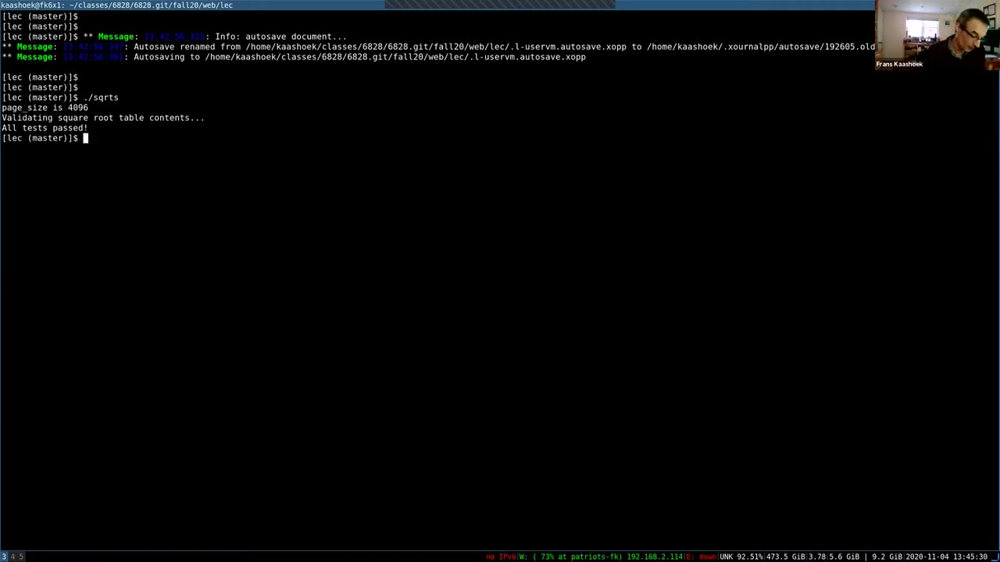
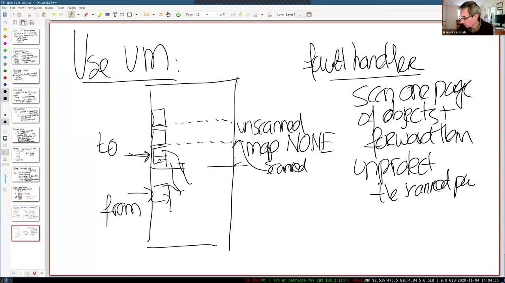
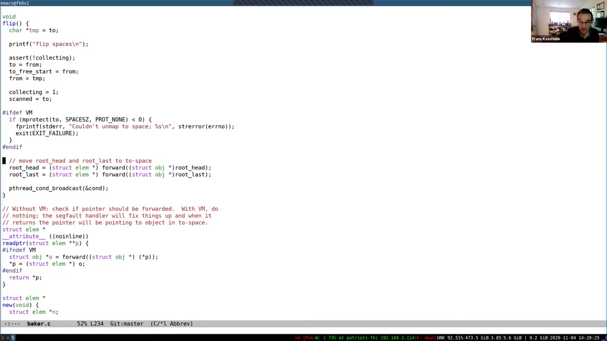

# 第17讲 · 面向应用的虚拟内存

## 00:00–03:00｜把内核的虚拟内存技巧交给应用

录像从实验交流中开始，开头的问题已经说到一半。教师询问当前实验与 locking lab 相比如何；有同学昨天才开始，目前完成约一半，也有同学已经做完，认为过程还算顺利，没有特别意外的困难。讨论没有提供足够信息确定开头所指实验的具体名称。

Frans 随后进入主题：**用户程序能否像内核一样，主动利用虚拟内存机制？** 以前的 lazy allocation、copy-on-write 实验说明，页表不只是把虚拟地址翻译成物理地址。内核可以故意让某次访问产生异常，再在异常发生时完成真正需要的工作。

1991 年 Appel 与 Li 的论文把问题反过来问：应用程序也有这种需求，为什么只有内核能做？这里说“应用使用 VM”，并不是说普通程序运行在虚拟地址空间中——那早已成立。真正想交给应用的是处理缺页事件、调整内存访问权限等机制，使应用能够按照自己的语义修复访问，再让程序继续。

论文不是只提出一个孤立接口，而是考察若干很不同的应用，再抽取它们共同需要的能力。教师请大家说说阅读中最感兴趣的应用，课堂在此留出思考和回答时间。

## 03:00–06:00｜从不同应用归纳出 Trap

一位同学先回答了“让用户改变某一页的访问位”。教师澄清，这确实是一种机制，但问题想问的是：哪些应用需要它？垃圾收集器是一个例子，尤其是并发垃圾收集器。

另一位同学喜欢数据压缩的应用；还有同学提到多台机器之间的共享虚拟内存：虽然没有完全弄懂实现，但能理解利用保护位约束各机器如何访问共享数据、维护一致性的总体思路。教师补充，共享虚拟内存后来发展成了一个研究领域，人们围绕它设计了许多优化。

这些工作从表面看差别很大：一个管理对象生命周期，一个压缩数据，一个跨机器协调访问；但底层都依赖一小组 VM 操作。因此第一个设计问题是：**OS 应当提供哪些原语，应用才有可能实现这些算法？**

首先是论文称为 **Trap** 的原语。硬件的缺页异常先进入内核，但内核能够把这个事件转交给用户态处理函数。用户函数采取相应措施，返回内核后，再恢复原来的指令。没有这条通知路径，即使应用能设置保护位，也不能对随后的访问作出有意义的响应。

## 06:00–09:00｜Prot1、ProtN 与批量修改的代价

接下来是 **Prot1**：降低一页的可访问程度。教师问“可访问程度”是什么意思，同学用读写权限来回答。具体可以是从可读写降为只读，也可以从只读降为完全不可访问。这样，一类原来成功的访问就会变成可捕获的事件。

**ProtN** 对一批页做同样的事。从最终权限来看，它似乎等于连续调用 N 次 Prot1；为什么还要单列一个接口？同学指出，批量处理可以摊薄固定开销。

教师用页表修改和 TLB 刷新来解释：单页操作不仅修改 PTE，还要让旧翻译失效，否则处理器可能继续使用旧权限。若每页独立调用，就可能反复付出刷新成本；批量操作则有机会先修改 N 个页表项，再统一处理失效。课堂模型可以写成：

$$
N\text{ 次单页操作}\approx N(C_{pte}+C_{flush}),\qquad
\text{一次批量操作}\approx NC_{pte}+C_{flush}.
$$

这不是某个现代系统调用的精确计时式，而是说明接口粒度为什么会影响实现空间。批量化的价值在于避免重复固定成本。

相反，**Unprot** 提高可访问程度，例如把只读页恢复为可读写。应用在处理完某一页对应的工作后，用它让原先被阻止的访问能够继续。随后教师开始引出 Dirty 和 Map2。

## 09:00–12:00｜Dirty、Map2，以及现实 Unix 的 mmap

**Dirty** 用来了解页面是否被修改，论文定义的是自上次调用以来变脏的页面集合。**Map2** 则把同一份物理内存映射到同一个地址空间的两个不同虚拟位置，并允许两个位置具有不同权限。后面 GC 的例子会解释为什么同一进程需要这样的两种视图。

教师问 xv6 是否支持这些能力。有同学认为基础 xv6 没有，但实验实现的 alarm handler 很接近 Trap。这个类比正确：两者都需要内核把控制流转到用户处理函数。不过未扩展的 xv6 接口很精简，内核虽能操作页表，却没有把这些能力作为系统调用完整暴露给用户。

论文的主张可以理解为：一个好的 OS 应提供这些机制。到课堂所处的 2020 年，现代 Unix，尤其 Linux，已经提供了大部分相应能力，只是接口名称和组合方式不完全等于论文的六个名字。

教师首先介绍 `mmap`：它把一个对象放进调用进程的地址空间。以映射文件为例，第一个参数可以指定期望地址，也可以传 `NULL` 让内核选择位置；接着指定映射长度。接口参数很多，本讲只解释与后续例子有关的部分。

## 12:00–15:00｜文件映射、匿名映射与访问权限

文件映射还需要保护位、映射标志、文件描述符和文件偏移。课堂写出可读写与 `MAP_PRIVATE` 的示例，但明确略过这个标志的细节。fd 确定文件对象，offset 确定从文件的哪里开始，length 确定映射多大的一段。

映射之后，程序可以用普通指针读取或修改这段内存里的数据结构，不必为每次访问显式调用 `read` 或 `write`。教师从文件映射的一般用途谈到之后把内容写回磁盘，并说明接下来的 mmap 实验会把 xv6 的文件系统与虚拟内存连接起来。

> 编者注：这里要区分一般的文件映射与板书中的 `MAP_PRIVATE`。私有映射中的修改不会自动写回原文件；需要写回的映射语义不能从“可读写”三个字推出。课堂本身没有展开这一分支。

`mmap` 也能映射匿名内存，即不由普通文件提供初始内容的内存。程序可以借此请求一段地址空间和相应内存服务，作用上可作为 `sbrk` 之外的分配途径。

建立映射之后，还需要 `mprotect` 调整其权限。它可以作用于原映射的全部或者一部分。例如把一段设为只读，load 仍能执行，store 则触发异常。此处讨论的是权限改变，不是把整个对象重新复制一遍。

## 15:00–18:00｜用信号接住本会导致崩溃的访问

把权限设置为 `PROT_NONE`，意味着对相应范围的访问都不允许。与 `mmap` 配对的 `munmap` 则移除映射；教师建议有兴趣的同学查看这些调用的 man page，以了解具体参数和约束。

另一个必需的接口是 `sigaction`，它让程序为特定信号安装一个处理函数。普通程序发生段错误时常常直接退出；但如果程序安装了 `SIGSEGV` 处理函数，内核可以把相应事件交给它，而不是直接按默认行为终止程序。

用户处理函数可能调用 `mprotect` 改变权限，或者通过映射操作补出原来缺少的内容。处理完毕后恢复执行，原先失败的指令就有机会成功。这与内核处理 lazy allocation 或 COW 的整体节奏相似，只是应用决策放到了用户态。

教师再次联系 alarm 实验：实验里，应用注册一个函数，时间达到条件时内核调用它；`sigaction` 是更一般化的信号机制，事件不限于时钟。这个类比帮助理解 upcall，但并不意味着硬件缺页会绕过内核直接跳进用户代码。

## 18:00–21:00｜接口的粒度与六个原语的落地

**学生问：** `mprotect` 接收地址和长度，看起来能给单独的地址设置不同权限；xv6 却只能按整页设置，这是不是两者的区别？

**教师解释：** 不是。这里仍然是页粒度保护；系统另有接口可查询页大小。API 写成地址范围，并不表示硬件突然能对每一个字节独立赋权。

接着把 Unix 接口与论文原语对应起来：Trap 依靠信号处理机制，Prot1、ProtN、Unprot 都可以用 `mprotect` 表达。它既能修改一页，也能修改多页，因此有机会获得前面说的批量失效收益。

Dirty 没有在这里列出的调用中得到直接对应，但可以用技巧间接实现。Map2 也不是一个同名系统调用，需要组合多次映射；具体组合留到 GC 示例再讲。

教师强调，这不意味着所有内核扩展都由这篇论文直接推动，而是说应用需求最终促使 OS 提供了相近能力。接下来的讲授转向两个问题：内核如何承接这些接口，以及应用如何真正把它们用起来。

## 21:00–24:00｜页表之外为什么还要有 VMA

一个地址空间不只是一张硬件页表。现代 Unix 通常还有一层与特定硬件格式无关的内核数据结构，称为 **Virtual Memory Area，VMA**。

一个 VMA 描述一段连续的虚拟地址范围。范围内具有相同的权限，并由同一种后备对象支撑。例如映射文件的一段区域，VMA 可以记录起止地址、权限、对应文件以及文件偏移。于是内核不只知道某个虚拟页“现在有没有 PTE”，还知道这段地址按程序的请求“应当代表什么”。

教师把它与即将进行的 mmap 实验联系起来：实验会实现一个简单 VMA 版本，保存映射文件所需的信息，并在后续缺页处理中使用。假如只保存页表，就很难区分“尚未按需读入的合法文件页”和“本来就不应该访问的地址”。

本段课堂口头把文件描述符作为容易理解的记录方式。这里的核心是保留对文件对象及偏移的关联；它不是对实际内核对象生命周期、fd 关闭行为的完整规定。

教师询问是否有问题，随后切换到用户级异常的控制流。VMA 将在那个流程中帮助 VM 子系统作出决定。

## 24:00–27:00｜一次用户级缺页处理怎样穿过内核

教师沿用 alarm 实验的思路，逐步梳理缺页路径。设一个 PTE 无效，或者页面只读而程序执行写入；处理器无法完成所需访问，先进入内核的异常入口。

内核入口保存被打断程序的状态，例如 trapframe 中的寄存器信息。随后 VM 子系统根据出错地址、页表以及 VMA 等记录，决定应当采取什么动作。以前实验里，可能是分配一页或进行 COW；有文件映射时，也可能要提供文件内容。

如果这次访问需要向应用递交信号，而且应用注册了相应 handler，内核就安排一次进入用户态的 upcall。handler 在用户空间执行，可以再通过系统调用请求改变映射或保护位。

执行结束后，handler 经返回路径进入内核，内核恢复先前保存的应用状态，再回到被打断的程序。这里实际上有两层处理者：硬件异常由内核先接住，应用自己的处理函数是内核安排的后续用户态执行。

这个流程的目标不是“跳过发生异常的那条指令”。在映射被正确修复的情况下，要让原来的访存操作完成，应用才能像什么都没发生一样继续。

## 27:00–30:00｜重试条件与隔离性问答

恢复后能否继续，取决于 handler 是否真的修复了问题。如果地址仍然不能翻译，或者权限仍然不足，程序会再次陷入内核。只注册一个函数并返回，并不会自动让访问变合法。

**学生问：** 让用户在 page fault 时运行自己的 handler，会不会引入额外的安全问题？

教师没有把“处理异常”与“获得内核权限”混为一谈，而是请大家考虑：这样是否破坏了用户与内核、不同进程之间的隔离？alarm 实验是否有相同问题？中间有一段请大家在方便时打开摄像头的课堂交流。

另一位同学回答，handler 仍然只能访问自己的进程地址空间，因此看不到其他进程的内存。教师确认：upcall 发生在安装 handler 的那个进程中，使用的是该应用的页表和用户权限。它不能借此随意切到其他进程页表，也不能直接取得其他进程内存。

如果 handler 不返回或把自己的状态弄坏，受影响的是它所属的程序，内核仍能管理和终止它。该回答说明的是这种机制在正常隔离实现下的权限边界，并不是声称任何信号实现都不可能存在 bug。

## 30:00–33:00｜把昂贵函数变成巨大查找表

结束隔离性问答后，教师先选一个论文里没有的简单例子，再进入大家提问较多的垃圾收集器。

设有函数 $f(i)$，计算一次很昂贵，但相同输入可能被反复使用。如果预先把 $f(0),f(1),\ldots,f(n)$ 都放进数组，那么需要 $f(i)$ 时就直接访问 `table[i]`，把计算变成一次查表。这就是记忆化表的基本动机。

麻烦在于，表可能非常大，甚至比物理内存还大。我们喜欢普通数组访问的接口，但不想为了保留这个接口，预先计算并常驻所有条目。

于是问题变成：能否让应用看起来拥有一个巨大的数组，而实际上只保存其中很少的一部分？程序仍写 `table[i]`，不知道何时真正发生计算；缺页机制可以把“第一次需要某页内容”变成一次运行应用逻辑的机会。

这一段建立的是一般模型，后续实现用平方根函数代替昂贵函数。教师没有声称平方根一定值得以这种方式优化；这个示例的目的在于展示 VM 接口提供的表达能力。

## 33:00–36:00｜用缺页把数组内容按页算出来

方案从选择一大段虚拟地址开始，但不为整个范围分配物理内容。某个 `table[i]` 的访问若落在尚未提供内容的页，就会触发缺页。

handler 根据出错地址确定哪一页缺失，分配并映射这页，然后计算该页覆盖的所有数组项。假设这一页覆盖下标 $i$ 附近的一组条目，就把相应的 $f(j)$ 逐一填入。恢复程序后，原来的数组读取便能取得正确值。

这样，再次访问同一条目不必重新计算；访问同页的相邻条目也可以直接命中。因此页粒度让一次处理为后续许多访问准备内容，收益取决于局部性。

不过，若每次缺页都只增加页面，最终仍会耗尽物理内存。所以 handler 还可以在占用过多时丢弃一些旧页，并确保以后再访问这些页时重新触发异常。对于可重新计算的纯函数表，不必把丢弃的数据写到磁盘。

**学生追问地址选择：** 是否一定要请求 OS 映射到某个指定地址？教师回答，大表的起点可以由 OS 选择，只要把地址告诉程序即可。随后处理某个已确定的数组地址时，则必须把所需页面安置到与该数组索引一致的位置。

## 36:00–39:00｜平方根表的初始化与信号处理代码

教师切到 Emacs，确认字体可读后，从 `main` 讲起。程序先设置平方根表使用的地址区域，再运行测试函数。测试以打乱的顺序访问表，并直接计算相应平方根作比较，检查读到的表项是否正确。

初始化阶段没有预先填满表；所以测试真正开始访问时，会陆续出现缺页。代码用 `sigaction` 为 `SIGSEGV` 安装 `handle_sigsegv`，让内核在相应事件发生时调用它。

handler 从信号信息中取出 fault address，把它向下对齐到页起点，再把一页可读写的匿名内存映射到这个位置。随后计算这一页对应的平方根条目。算法依赖“地址决定数组下标”这一关系，而不是随机找一页填入值。

本地官方 `sqrts.c` 快照中的对应计算是：起始下标用 `page_base - sqrts` 得到，一页的条目数用 `page_size / sizeof(double)` 得到；定址映射使用 `MAP_FIXED`。这些名称用于帮助阅读代码，不把整个文件快照当作录像工作树。

演示采取一个刻意极端的缓存策略：算完新页后，把上一次保留的旧页 `munmap` 掉。因此每次处理结束，整个巨大表只留下当前一页；它不是普通 lazy allocation 那种只增不减的方案。

## 39:00–42:00｜运行结果，以及“一页”究竟是什么意思

教师运行示例，测试在表中跳跃访问，许多次访问需要经过缺页处理，但结果与直接计算一致。已查看的 39:35 画面显示实际命令和输出：

```text
./sqrts
page_size is 4096
Validating square root table contents...
All tests passed!
```



*真实课堂帧，未裁剪。这里的通过是教师录课时的演示结果，本次内容制作没有运行示例。*

**学生问：** 这听起来像 lazy allocation，为什么最后只有一页？

教师按时间顺序解释。启动时没有为表保留已填好的物理页。第一次访问触发异常，创建并填好一页；随后同页访问直接使用它。若访问另一个尚未映射的页，就创建第二页并算出内容，然后释放先前那一页。区别就在最后这一步淘汰。

实际应用通常会保留一组工作集页面，而不是每次把上一页都丢掉。这个例子是为了把能力展示到极端：巨大虚拟数组与很少的驻留内存并不矛盾。

> 编者注：教师口头说“任何时刻只有一页”，但按刚讲的操作顺序，handler 内先映射新页、后释放旧页，可能短暂同时存在两页。准确地说，是每次 handler 完成后的表缓存为一页；也不包括代码、栈、页表等其他内存。

## 42:00–45:00｜从自动释放内存到复制式 GC

确认一页表问题之后，教师转向垃圾收集。使用 C 时，程序员通常必须显式管理分配与释放；有 GC 的语言则把判断对象是否仍在使用、回收无用内存的工作交给运行时。课堂举出 Java、Python、Go 等例子。

GC 有很大的设计空间和研究文献，本讲不是要挑出“最佳 GC”，而是说明其中某一类算法怎样利用用户级 VM 原语。

这里研究的是复制式垃圾收集器。把堆分成两个区域，称为 **from-space** 和 **to-space**。为了建立直觉，教师先假设应用在 from-space 中分配对象；有些对象仍可从根指针到达，有些虽然占着空间，却已经失去所有有效引用。

所谓根，可能来自寄存器、栈上的局部变量或其他运行时认识的顶层位置。后面的图只画一个根，是为了把图简化，而不是说真实程序只有一个根。

当原区域不够再分配对象时，收集器将从根出发，把仍然活着的对象复制到另一区域。无法从根到达的对象不必搬过去，从而在一次区域回收中消失。

## 45:00–48:00｜逐个追踪对象，留下 forwarding pointer

教师画出几个相互指向的对象，以及一些已经没有人引用的对象。收集器从根开始，把根指向的对象复制到 to-space。此时复制的是对象本身的字节，其中的指针最初仍指向旧位置；“已经复制”不等于“已经扫描”。

接着检查新对象里的指针。运行时知道对象布局和哪些字段是指针，所以能够沿它们发现更多存活对象。每发现一个尚未搬迁的目标，就在 to-space 为其创建副本，并把当前指针改成新地址。

还有一个必须保存的信息：旧对象已经搬到哪里。教师在 from-space 的旧位置留下 **forwarding pointer**，记录它的新位置。以后若别的对象也指向这个旧对象，就可以找到同一个副本，不必再复制一次。

把对象搬到新空间、并在旧位置留下转发信息的过程称为 forwarding。这个过程既处理重复引用，也为处理环状结构提供依据：沿环走回来时，会发现目标早已搬迁，而不是无限制造副本。

本段图中的复制和修正是逐步完成的。应当分别跟踪“外部指向这个对象的指针是否改好”和“这个对象内部的指针是否检查过”，不能把两者合并成一个动作。

## 48:00–51:00｜回收整个旧区域，再把停顿拆小

教师继续处理剩余指针：若目标尚未搬迁就复制，若目标已有 forwarding pointer 就直接改指针。等整个可达对象图都复制并修正完毕，活对象完全位于 to-space，原 from-space 整块都可以作为空闲空间重新使用。

这里的关键不是遍历每个旧对象并分别判断“要不要 free”，而是只从根追踪活对象，把它们留在新区域。旧区域里的不可达垃圾自然不被复制。

随后介绍 Baker 算法的增量思路。它历史上被称为 real-time，课堂在这里主要用“增量收集”来解释这个词：不必一次暂停应用，直到整个活对象图都搬完。

一个起点是只先复制根指向的对象，让应用尽早继续。新区域中可能已有一些对象，但它们的内部指针尚未全部修正。之后在每次分配新对象时，顺便扫描或转发少量对象，把总工作拆成多个小步骤。

这带来了新的正确性问题：应用已经恢复运行，而堆中可能还有指向旧空间的指针。下一段将解释如何在使用这些指针时维持约束，以及这种做法的成本。

## 51:00–54:00｜增量 GC 的软件读屏障

每次 `new` 都贡献一小部分扫描或复制工作，可以把长暂停分散到应用运行过程里。但应用也可能在扫描之前，沿某个对象的字段取到一个仍指向 from-space 的地址。

因此原始方案需要在相关指针使用处做检查：若目标在 from-space，就先执行 forwarding；若已经搬过，则用新地址替换；若本来就在 to-space，则继续。课堂把这种额外检查描述为需要编译器在指针访问周围插入代码。

它要维持的真正约束是：应用实际使用的指针应当指向已经搬到 to-space 的对象，最终扫描完成时也不能留下指向即将回收空间的有效引用。

> 编者注：字幕在约 52:48 把不变量口头简化成“to-space 中所有指针都指向 to-space”。增量过程中未扫描对象内仍可有旧指针；论文 p.97 明确区分已扫描区与未扫描区。后文 VM 方案正是利用这一区别。

教师提出第一个成本：原本一次 load/store 足够的地方，现在还要做判断、分支，必要时再调用 forwarding 逻辑。即使绝大多数访问不需要搬迁，也可能一直承担检查开销。第二个问题是如何让收集器真正与应用并行，下一段继续讨论。

## 54:00–57:00｜重复复制的竞态与页保护屏障

假设还有空闲 CPU，想让 collector 在后台追踪对象图，同时应用继续运行。软件检查方案中，应用可能因发现一个旧指针而开始复制对象，而 collector 恰好也在复制同一个对象。若没有正确协调，可能产生两个副本，之后不同引用指向不同位置，破坏对象身份和程序语义。

论文提出用 VM 同时改变检查方式和协调方式。把 to-space 按处理状态看成已扫描与未扫描两部分；刚翻转区域、复制根对象时，这些新副本还没有扫描完，内部仍可能指回 from-space。

对应用可见的 **未扫描 to-space 页面** 设置不可访问。应用一旦想读这些对象，就会发生缺页，先交给 handler 处理。因此应用不会直接读到那些尚未修正的内部指针。

这里要注意保护位置：不是等程序已经把旧指针取进寄存器，才设法在旧对象处追赶它，而是在它读取未处理的新对象时就拦住。

教师开始画出页面和扫描边界。页面背后可以已经有物理内容，只是应用访问权限为 `PROT_NONE`；课堂有时把它口头称为“unmapped”，此处应理解为应用不能访问的保护状态。

## 57:00–60:00｜先扫描一页，再开放这一页

应用第一次使用根指向的新对象时，会碰到不可访问页。handler 的工作是：扫描该页已经存在的对象，检查它们的指针；需要搬迁的目标复制到 to-space 的未扫描区域；再把本页各指针修正为目标的新位置。

做完这些工作，才解除本页保护。现在应用可以安全读取这一页，因为它从这里取出的指针不会再直接指向待回收的旧对象。目标新对象本身可能还在未扫描页上；等应用真的访问那个目标时，再触发下一次处理即可。



*真实课堂板书。左侧把 to-space 分成 scanned / unscanned，右侧先写扫描和 forwarding，再写 unprotect；这一先后关系就是读屏障的核心。*

算法仍然可以增量推进，也仍可在分配时顺便做一些工作。变化在于，应用不再为每次指针访问执行显式软件检查；MMU 的访问权限检查承担了触发机制。

**学生提出一个重要疑问：** handler 说扫描“一页对象”，怎么知道根所引用、需要转发的所有对象也都在这一页里？这不是必须满足的布局条件，下一段解释两种对象集合的区别。

## 60:00–63:00｜扫描范围、复制目标和两块空间的轮换

教师回答时从初始状态重新组织描述：to-space 开始为空，运行时可以逐渐复制若干对象，使它们占据一页。handler 遍历的是**位于这张出错页上的对象**，对每一个对象检查它的指针字段。

这些字段的目标不必在同一页，甚至此时还在 from-space。扫描某个字段时，需要把目标搬到 to-space 的未扫描部分，并修正该字段。新目标可以落在其他页面；那些页面暂时继续受保护。以后应用访问它们，再逐页推进。

所以“一页扫描”是当前待处理对象集合的边界，不是限制整个可达对象图必须放进一页。新发现的目标可能扩大未扫描区，扫描过程随后继续追赶它。

**另一位学生问：** 收集结束后，是否交换 to 和 from？教师确认，两块区域的角色是轮换的。当前可达对象搬完以后，旧区域成为空闲区；应用继续使用新的活动区域，下一轮收集再交换角色。名字表达的是当前收集方向，不是永远固定的物理身份。

教师接着回到并发收益：collector 可以逐页处理应用尚不可访问的页面，应用则继续操作已经准备好的页面。页权限把它们的访问边界划开，减轻每次普通访问都要参与同步的负担。

## 63:00–66:00｜Map2：同一份内存的两种权限视图

只要未扫描页仍对应用不可访问，collector 就能整理它，而不会让应用读到一半修正的对象。应用若抢先需要它，就先进入缺页处理路径；collector 完成扫描后不再继续修改那一页的对象指针结构。

不过，教师指出一个看似矛盾的问题：页面都被设成不可访问了，collector 自己怎么读写它？若 collector 与应用共享同一个地址空间，不能只因为线程名字叫 collector 就自动绕过页权限。

这就是 Map2 的用途。把承载 from/to 空间的同一份物理内存，在当前进程中再映射一次。应用使用第一组虚拟地址，其中未扫描 to-space 是 `PROT_NONE`；collector 使用另一组虚拟地址，对应同一物理内容，但仍具有读写权限。

这样 collector 可以通过自己的别名扫描和改写对象，而应用通过自己的别名仍会被拦住。扫描完成后，改变应用别名的权限即可发布结果，无需复制一份独立的堆给它。

本段结尾学生追问：是不是分别给 collector 和应用一份不同的页表？这个问题将在下一段得到明确回答。

## 66:00–69:00｜一张页表，两个地址范围；玩具 GC 的应用部分

**教师回答：** 不是两张页表。它们在同一个进程中，共用页表；同一物理内存出现在两个不同虚拟地址范围，两组 PTE 的权限可以不同。一边暂时不可访问，另一边可读写。

随后教师打开一个玩具实现，把抽象机制变成具体程序。他明确说，这段代码主要用于课堂说明，没有认真充分测试，可能有 bug；不能把它当作经过验证的生产级 GC。

应用看到两个主要接口：`new` 分配对象，`readptr` 在不使用 VM 时执行旧空间检查与转发；使用 VM 时则不再执行这套软件检查，直接返回已有指针。

示例只管理一种对象：循环链表节点。应用保留两个根，分别指向链表头和最后一个节点。应用线程重复一千次建立链表并检查它；开始创建新链表后，先前链表逐渐变成垃圾，让 collector 确实有东西可回收。

构造链表时，不断分配新节点，把它插到头部，再让末尾节点指回新的头，从而保持环。代码中大量 `readptr` 包装使写法显得繁琐；教师解释，这是手工模拟垃圾收集语言编译器可能生成的检查代码，并非 C 编译器自动知道这种 GC 规则。

## 69:00–72:00｜不用 VM 时，new、flip 和 forward 做什么

教师先看不使用虚拟内存技巧的版本，暂时略过为并发版本准备的互斥锁，聚焦两个接口的职责。

若当前未在收集且空间足够，`new` 只需推进空闲区指针，返回新对象位置。这种连续分配不需要为每个对象搜索复杂的空闲链表。若剩余空间不足，则调用 `flip` 开始下一轮收集。

`flip` 交换两块区域的角色，重置本轮分配和扫描状态，然后处理应用的两个根，使它们指向 to-space 中的对象。

`forward` 检查目标是否在 from-space。若不在，原指针可以保留；若在且尚未复制，就创建副本并记住新位置；若之前已复制，则沿转发信息取得原来的那一个副本。它并不为每一个指向同一对象的引用都创建新对象。

最后看 `readptr`：在非 VM 分支中，它调用 `forward`，把返回的新指针写回调用者提供的位置，再返回结果。昂贵之处不仅是偶尔的复制，也包括频繁执行“是不是旧空间对象”的判断。教师以此为基线，转向 VM 分支如何省掉这个显式检查。

## 72:00–75:00｜用共享对象组合 Map2，落实页级屏障

初始化时使用 `shm_open` 创建共享内存对象，再用 `ftruncate` 把它设置为 from-space 与 to-space 的总大小。教师把它比作具有文件式接口的内存对象，用来说明后续映射来源。

然后对同一个对象执行两次 `mmap`：一次供 mutator，也就是应用线程使用；一次供 collector 使用。这组共享对象创建、定长和双重映射的操作，组合出了论文所说的 Map2。

VM 分支的 `readptr` 直接返回指针；真正访存时，如果对象位于应用不可访问的未扫描区，就由硬件触发异常。handler 找到出错页，再通过 collector 的地址范围运行扫描函数。若扫描仍沿应用不可访问的那组地址执行，它自己也会遇到同样问题。

完成本页扫描后，handler 把应用对应页面开放。教师回到 `flip`，指出它在根被搬入新空间前后所建立的状态：先把新的 to-space 对应用设为不可访问，再转发 `root_head` 和 `root_last`。应用稍后使用这些根时，便会进入按需扫描路径。



*真实课堂代码帧。可见 `mprotect(to, SPACESZ, PROT_NONE)`，以及 `readptr` 中由 `#ifndef VM` 控制的 forwarding。两种版本的差异是检查路径，不是对象可以不满足正确性条件。*

## 75:00–78:00｜发布次序与是否值得使用 VM

教师特别强调 handler 的顺序：**先扫描，再增加页面的可访问程度。** 如果先开放页面、再慢慢修正内部指针，其他应用线程就可能在中间阶段读到未处理的引用。那样即使最后的页面内容正确，执行过程也已经违反了不变量。

这个例子还需要在实际执行扫描的线程之间协调；页保护不是让所有锁凭空消失。它提供的是应用普通访问与页面准备工作之间的边界，使应用无需在每一次访问上显式参与那套检查。

最后的问题是：这些技巧一定值得吗？并不一定。很多 GC 依靠编译器插桩，也会通过编译优化和其他运行时技术减少开销。大多数论文中的效果，原则上也可以用额外的软件指令来实现。

如果任务本来就在编译器或语言运行时内部，添加检查可能是自然的选择；但若希望给一般程序做 checkpoint，或提供共享虚拟内存，又不想要求所有应用换编译器、改代码，软件插桩会更难部署。

这正是用户级 VM 原语仍然有价值的地方：它们为那些不便控制每一次 load/store 的应用提供了另一条路径。课堂结论是已有足够多应用认为这些机制有用，现代 OS 才会支持它们，而不是宣布 VM 方案在所有工作负载中都更快。

## 78:00–81:00｜1991 年之后的变化与 VMA 连续性

不少同学在阅读提问里问到：从 1991 年到课堂的 2020 年，究竟变了什么？教师首先指出，现代 Unix 已更广泛地支持这些能力，而且 VM 子系统一直在发展，并非成熟后就不再变化。

课堂列举了几类变化：为更大的地址范围增加页表层级；用地址空间标识减少切换时的 TLB 刷新负担；以及因 Meltdown 一类攻击而引入的 KPTI，即内核页表隔离。KPTI 会在后面的课程中进一步讨论。

这些例子说明，接口、实现、硬件能力以及安全需求共同推动 VM 变化。教师结束主体讲授，允许有事的同学离开，并继续回答问题。

**学生回到前面的 VMA 图：** “连续的地址范围”到底是什么意思？教师举例说，一个 VMA 可以描述 1000 到 2000；另一个从 2100 开始的范围则有自己的 VMA。重点是每个 VMA 内部没有地址区间的空洞。

> 编者注：这些数字是解释连续区间的口头示例，不是合法页对齐映射的实参；“连续”说的是虚拟地址范围，不要求背后的物理页连续，也不要求每页已经驻留。

## 81:00–83:15｜VMA 的简化模型与 GC 何时结束

教师继续解释，在不重叠的简单映射情形中，可以先把一次 `mmap` 理解成建立一个 VMA，这有助于理解实验。学生确认理解后，另一位同学回到 GC：collector 什么时候停止，什么时候重新开始？

教师回答，并发版本可以在应用运行期间持续做收集工作；当没有未扫描对象时，本轮就结束。学生进一步追问：难道要把 from-space 里的所有对象都看一遍，才能知道搬完了？

解释仍然是从根追踪对象图：扫描会发现新的目标并把它们复制过来；当后续引用都指向已经复制的对象时，就不再增加新的待扫描对象。把已经积累的扫描工作完成，未扫描集合变空，才算结束。

> 编者注：字幕后一句把这个条件简称为“未扫描区不再增长就结束”。严格条件是**没有未扫描对象**；暂时不增长但还存在积压时，仍需把积压扫描完。也不必为每个不可达旧对象单独做一次访问。

学生最后用“旧指针会失效”确认理解，教师简短肯定后道别。这是对对象迁移后旧引用不可继续使用的概念确认，不能据此推断当前玩具代码一定在每次复制后立即 `munmap` 旧对象；官方快照的处理有自己的具体实现。

82:56 之后主要是告别、感谢和收尾停顿。83:12 起的自动字幕末句不清，无法可靠恢复原意，本页不补造其内容。

## 来源、许可与核对范围

- **V17**：Frans Kaashoek 主讲，David Morejon 频道发布，*6.S081 Lecture 17: Virtual Memory for Applications*，上传日期 2020-11-04，视频 ID `YNQghIvk0jc`，时长 4995 秒。来源入口记录在本讲元数据与 `sources/manifest.json`。未检出明确开放许可；本页为按时间顺序的自主中文译述，不是字幕逐字译本。
- 已完整读取 2203 条英文自动字幕；无人工字幕可用。字幕最早始于 0.080 秒，原始最后结束时间 4996.960 秒，比视频元数据超出 1.960 秒；正文时间封顶 83:15。录像开始时实验讨论已在进行，最后一句 ASR 不清。未做全片听音核对。
- **O17 / B17**：MIT 课程团队的 `l-uservm.txt` 与14页板书 `l-uservm.pdf`，全文/全页已读，用于术语与图意核对。官网内容标有 [CC BY 3.0 US](https://creativecommons.org/licenses/by/3.0/us/)；该许可不推及视频和论文。
- **C17S / C17B**：官方 `sqrts.c`（116行）与 `baker.c`（403行）已全读。课表 `sqrt.c` 已404，复用主agent确认的同年官方 `sqrts.c` 映射。两份抓取快照 Last-Modified 均为2025年，不能保证与录课工作树一致；没有把源码中的打印语句当成已观察到的运行结果。
- 三张截图分别取自 39:35、58:40、74:30，均实际查看、未裁剪；仅为课堂演示与机制分析保留。平方根例子的输出已看画面核对；GC 代码只作课堂走读，未声称运行或通过测试。
- 论文机制、评测和其他应用见[课程资料](#/c/mit-6.s081-2020/lec/lec17?v=materials)；提炼与自测见[课程笔记](#/c/mit-6.s081-2020/lec/lec17?v=notes)。mmap 实验在本轮不制作。
