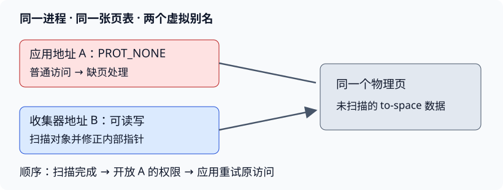

# 让“暂时不能访问”成为程序的一部分

本讲最值得掌握的转变是：**页保护不仅用来拒绝错误访问，也可以表达“这份数据还没准备好”。** 普通访问走硬件快速路径；需要准备时才触发异常，完成后再开放访问。

前置知识是页表、PTE权限、TLB、page fault，以及用户态与内核态的区分。这里不要求先熟悉完整垃圾收集器。

## 1. 三个层次：意图、当前状态、控制流

| 层次 | 回答的问题 | 本讲对应物 |
|---|---|---|
| 映射意图 | 这段地址应当是什么、允许做什么？ | VMA：范围、权限、文件或匿名对象、偏移 |
| 当前硬件状态 | 这次访问现在能否完成？ | 页表、PTE与TLB |
| 恢复策略 | 访问失败后如何让它可以继续？ | 内核VM处理，或向用户handler递交事件 |

缺少有效PTE，不等于地址非法。它可能是尚未分配的匿名页、尚未读取的文件页，也可能是应用故意保护的数据。VMA和相关软件状态决定“为什么缺”。

用户级处理也不等于用户直接编辑任意页表。典型路径是：**访存失败 → 内核判断 → 用户handler → 映射/改权限系统调用 → 恢复原访存。** handler仍以用户权限运行。详细控制流与隔离问答见[中文译稿](#/c/mit-6.s081-2020/lec/lec17?v=draft)24:00–30:00。

## 2. 从平方根表提炼：缓存的内容不一定来自磁盘

设数组基址为 $B$，元素大小为 $s$，页大小为 $P$。访问下标 $i$ 的地址为 $a=B+is$。出错页起点是：

$$q=\left\lfloor a/P\right\rfloor P.$$

对于课堂页对齐的表布局，这页的首个数组下标为 $(q-B)/s$，可容纳 $P/s$ 个完整元素。handler知道这些下标，就可以直接计算整页，不必从后备文件读入。

由此得到一条一般设计规则：**如果内容可以可靠重建，淘汰时可以只丢弃，不必写回。** 这与含有不可重建用户修改的匿名内存不同。

但是否划算取决于访问局部性。只保留上一页时，反复访问同页很便宜；在两页之间来回跳就会反复缺页、重算。课堂用一页是为了展示机制，不是推荐缓存策略。

真实运行画面与lazy allocation问答见中文译稿36:00–42:00。准确的“一页”是handler完成后表中只保留一页；新页建立到旧页释放之间可短暂存在两页，更不包括进程其他内存。

## 3. 从 GC 提炼：保护“尚未修好的指针容器”

复制对象至少有两个不同步骤：

1. **复制对象字节并留下转发信息**：旧对象已有唯一的新位置。
2. **扫描新对象内部的指针**：把其中仍指向旧空间的引用改到新对象位置。

只完成第一步，新对象仍可能藏着旧指针。VM方案把这样的**未扫描to-space页**暂时隐藏，直到第二步完成。

*编者自绘：仅展示一个未扫描页的两个虚拟别名。两线程共用页表；图中上下两条映射不是两份物理数据。*

正确性可以按一条访问链来检查：

- 应用已持有一个to-space指针，想读取目标对象。
- 若目标页未扫描，访问被阻止，应用尚未取得对象内部的旧指针。
- collector通过可读写别名扫描该页，把字段目标转发到to-space。
- **扫描完成后**开放应用别名；原指令重试，读到的是修正后的字段。
- 字段指向的另一个新对象仍可处于受保护页上，下一次访问再重复处理。

所以扫描一页不要求整个对象图都在一页内。它处理的是这一页中的指针字段，被这些字段引用的目标可以在其他页。课堂相应问答见60:00–63:00。

### 三条必须分清的边界

**应用与collector的边界：** 同一进程内的两套地址视图是合作式约定，不是对恶意同进程线程的安全隔离；同页表意味着代码若故意使用collector别名，也能访问它。

**collector与collector的边界：** 页保护拦住普通应用访问，不自动解决多个handler或后台collector同时扫描、分配、转发的竞争。仍需协调扫描归属和元数据。

**一次收集的结束边界：** 未扫描工作集合为空才结束；“这一刻没有发现新对象”不能代替“已有待处理对象也全部处理完”。

## 4. 把高速路径与慢速路径放进同一个账本

以下是编者用于比较实现的简化模型，而非论文实测公式。设普通访问次数为 $M$，每次软件屏障额外成本为 $c$；VM方案触发 $F$ 次异常，每次机制开销为 $t$，一轮批量保护与一致性成本为 $B$。两者共有的有效扫描成本暂不计：

$$C_{software}\approx Mc,\qquad C_{VM}\approx Ft+B.$$

只有当 $Ft+B$ 小于省掉的 $Mc$，并且单次停顿满足要求时，VM路径才有性能优势。这里最重要的量可能是**每页开放后能服务多少次普通访问**，而不是“硬件检查一定比软件快”。

批量保护能减少固定成本，却不能消除所有工作。权限降低必须让旧的宽松TLB项失效；权限提高时旧的严格项通常只会多拦一次，但恢复路径仍要正确处理。

论文的500微秒扫描与约1200微秒机制开销、表1的组合测量、图2的ADD归一化，都在[课程资料§3](#/c/mit-6.s081-2020/lec/lec17?v=materials)展开。它们属于1991年的平台与条件，不是今天机器的性能承诺。

## 5. 接口速记与阅读分工

| 需求 | 课堂Unix实现线索 | 进一步阅读 |
|---|---|---|
| 访问受保护页时通知应用 | `sigaction` + `SIGSEGV` | 译稿15:00–18:00、24:00–30:00 |
| 单页或多页改权限 | `mprotect` | 译稿06:00–09:00、18:00–21:00 |
| 提供或移除内容 | `mmap` / `munmap` | 译稿12:00–15:00、33:00–42:00 |
| 同页不同权限视图 | 共享对象 + 两次共享映射 | 译稿63:00–66:00、72:00–75:00 |
| 追踪被写过的页 | 原生Dirty，或只读保护后首次写入登记 | 资料§1、§2.4 |
| 页面初始内容来自哪里 | 文件、清零、计算、解压、远端等 | 资料§2各应用 |

论文的SVM、checkpoint、分代GC、持久化对象、扩展寻址、压缩分页与堆溢出检测，课堂多数仅点名，没有逐项展开；详见课程资料§2。官方提纲中的500/1200微秒讨论也没有在本次字幕中形成独立课堂评测段，不把它插入视频时间轴。

mmap实验会连接文件对象、VMA、缺页和解除映射，可用来检验自己是否理解“映射意图”与“当前页表状态”的区别。

## 6. 自测：从错误推断回到不变量

为什么不能在缺页handler里直接return，期待原指令自动成功？

原访问仍会检查同一映射和权限。如果没有补内容、改权限或采取其他正确恢复措施，它会再次失败。handler被调用不是自动修复。

把unscanned页先设成可读写，再由collector慢慢扫描，有什么问题？

其他应用线程可能立即读出未修正的from-space指针，继而访问旧对象。必须先完成扫描，再发布可访问状态；否则不能保证应用只看到安全引用。

两个mmap调用都成功，是否已经实现Map2？

不一定。需要指向同一后备对象的相同偏移，并具有共享同一内容的语义。两次独立匿名私有分配通常是两份内存；名字相似不代表物理内容共享。

VMA覆盖连续地址，是否意味着这些物理页连续、都已经存在？

都不是。连续的是虚拟地址区间及其映射意图。页可以按需建立，实际物理位置也可分散。

每页最多一次GC保护异常，是否意味着一个进程一生每页最多一次缺页？

不是。这个说法针对一轮收集中页面完成扫描后不再因同一读屏障受阻的模型；下轮会重新保护，其他缺页原因也不在这个计数里。并发的实际处理还需正确协调重复请求。

论文表1里一项结果更快，但mprotect没有刷新TLB，能据此选择它吗？

不能。旧权限可能仍放行本应拦截的访问，正确性条件已经不同。先确认语义成立，再比较时间。

普通数组表、压缩页与持久化事务，为什么不能都采用“淘汰时直接丢弃”？

平方根表可重新计算；压缩页需保留能够恢复原信息的压缩数据；事务中的未提交或已提交修改还涉及持久化与恢复语义。是否能丢，取决于数据来源和生命周期，而非都使用了mmap。

## 来源、版本与范围

- **V17**：Frans Kaashoek主讲，[LEC17视频](https://www.youtube.com/watch?v=YNQghIvk0jc)，2020-11-04上传，83:15。全文字幕已读，三张关键帧已查看；未全片听音，起始讨论缺少此前语境，最后一句ASR不清。视频无已核实的开放许可，采用自主译述与学习讲解。
- **P17**：Appel、Li，[Virtual Memory Primitives for User Programs](https://pdos.csail.mit.edu/6.S081/2020/readings/appel-li.pdf)，1991，印刷页96–107。已逐页阅读，论文©1991 ACM，不套用MIT官网CC；资料页为自主译述。
- **O17 / B17**：[官方提纲](https://pdos.csail.mit.edu/6.S081/2020/lec/l-uservm.txt)与[14页板书](https://pdos.csail.mit.edu/6.S081/2020/lec/l-uservm.pdf)，用于核对。MIT课程网站标示[CC BY 3.0 US](https://creativecommons.org/licenses/by/3.0/us/)。本页图为编者自绘，课堂截图只在中文译稿。
- **C17S / C17B**：[sqrts.c](https://pdos.csail.mit.edu/6.S081/2020/lec/sqrts.c)、[baker.c](https://pdos.csail.mit.edu/6.S081/2020/lec/baker.c)，只读复用共享抓取物。文件无独立许可头，保守仅用于核对与自主解释；Last-Modified为2025年，不声称与录课版本相同。`sqrts.c`快照使用`MAX_SQRTS`但未在文件内定义，本次没有猜补编译参数或声称可以原样独立构建。
- 课堂GC是明确标为toy的示例；没有运行、修复或验收该代码，也没有运行mmap实验。URL、抓取时间、哈希、阅读范围与核对证据见本讲 `sources/manifest.json`、`sources/coverage.json`。
- [2020官方mmap要求](https://pdos.csail.mit.edu/6.S081/2020/labs/mmap.html)：本轮未制作实验中文说明与指导。
