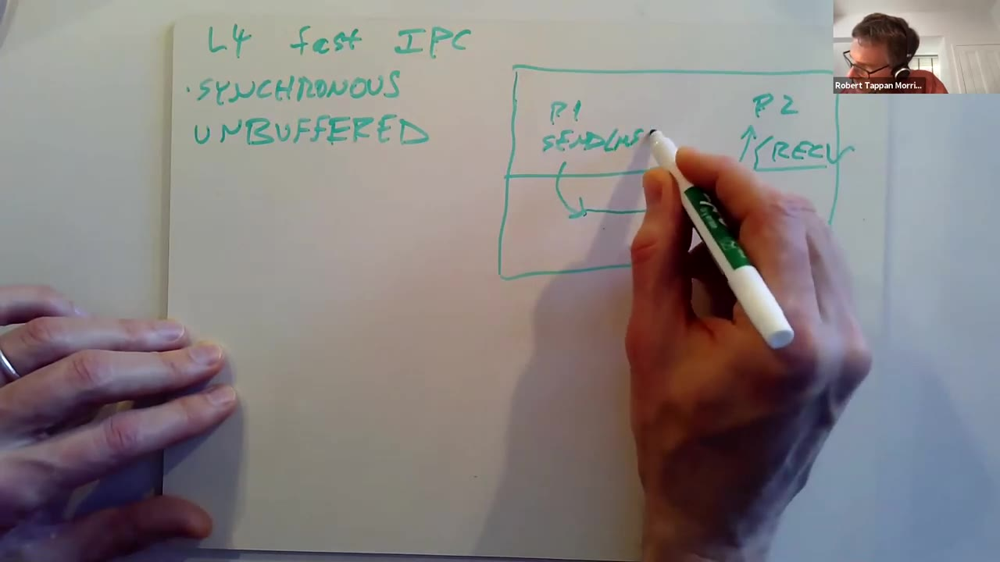
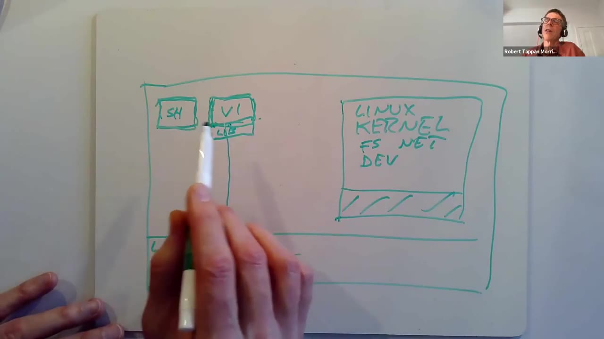

# 第 18 讲 · 操作系统组织：中文译稿

## 00:00–03:00｜先问内核究竟应当做什么

Robert 在确认大家能听到之后，说明今天主要讨论微内核，但先要回到一个此前学习 xv6 时容易忽略的问题：**为什么内核要提供现在这组功能？** 学习 xv6 时，我们通常接受 Unix 的系统调用、抽象和内部组件，然后研究怎样实现；现在则要把这些目标本身拿出来审视。

内核也可以看成程序员的开发平台。不同程序员喜欢不同接口，不同应用需要的基础设施也不一样。因此，这场讨论很难得到一个对所有人都最好的答案。不过，比较不同答案，仍然能帮助我们理解设计中的取舍。

传统路线的代表是 Unix、Linux 和 xv6。Robert 用 **monolithic，单体式** 来概括它们：内核是一个大程序，各种功能都在里面完成。这里的“大”不仅指代码行数，更是指它承担了很多种工作。

这一路线有一个鲜明特点：给应用提供能力很强的抽象。例如，应用面对的是文件、目录和文件描述符，而不是磁盘硬件。实现文件系统很复杂，但应用得到的是方便使用的接口。接下来的问题便是：把这么多能力集中在内核里，有什么好处，又会带来什么代价？

## 03:00–06:00｜强抽象带来可移植性，也集中资源管理

文件系统抽象首先让程序摆脱具体设备。磁盘换品牌、机械硬盘换成 SSD，甚至文件来自网络，程序仍然使用相似的文件与目录接口。不必每换一种硬件就改应用，这就是高层抽象的可移植性收益。

地址空间也一样：Unix 给程序一个可使用的虚拟地址空间，而不是让它直接操作 MMU。复杂性留在实现内部，接口保持相对简单。xv6 的文件描述符尤其直观——调用者只做 `read` 和 `write`，背后却可能有文件系统、磁盘布局、驱动等一长串工作。

抽象还让内核掌握资源分配的主动权。哪些内存空闲、磁盘哪部分已经被使用，都由内核维护；应用不用自己协调这些事情。若每个程序都能自行判定某个磁盘区域是否空闲，就可能把另一个程序的数据覆盖掉。

因此，资源管理不仅是方便编程，也是共享、可靠性与安全的基础。问题在于，简单接口不等于简单实现：越多复杂工作交给内核，它就越容易变成一个庞大而复杂的程序。

## 06:00–09:00｜集成为什么方便：以 exec 为例

单体内核中的文件系统、内存分配器、调度器和虚拟内存系统，都在同一个程序里。它们能直接使用彼此的数据结构，这使跨越多个子系统的功能比较容易实现。

`exec` 就不是单纯属于文件系统或虚拟内存的一件事。它要读取磁盘上的可执行文件，又要分配内存、建立新程序的地址空间。若两个部分被严格隔开，中间需要专门的协作接口；在 xv6 或 Linux 的单体结构里，两边就在同一个内核中，调用起来直接得多。

另一个方便之处是权限。xv6 内核代码运行在 supervisor mode，内部函数不会突然遇到“这部分内核没有权限访问那部分数据”的边界。所有代码都处于高权限环境，对内核开发者来说很省事；而内核开发者构建的强抽象，又方便了应用开发者。

不过，同样的结构也意味着大量互相依赖。Linux 不同部分能查看彼此的状态，容易写出功能，也容易形成复杂关系。Robert 从这里转向批评：如果整个内核既大又紧密关联，理解和维护它就会变得困难。

## 09:00–12:00｜复杂性、通用性与一个字节的管道开销

大程序不可避免会有 bug。放在内核中，某些 bug 不只让一个应用失败，还可能成为突破系统安全的入口。因此，“代码很多、关系复杂、权限很高”这一组合值得担忧。

Linux 又是极其通用的系统：手机、桌面、笔记本、服务器、路由器都可能使用它。能支持这么多场景当然是优点，但也让内核积累了许多功能。一个 Web 服务器通常不需要复杂声卡支持，却运行在同一个追求广泛适用性的体系上。

Robert 并不是说 Linux 一定慢，而是提出疑问：**对某一种特定工作，它是否已经做到可能达到的最快？** 只实现一两个功能的程序，可以集中优化很少的路径；需要支持上千种情况时，就难得多。

他用管道举例：即使只是从一个进程向另一个进程传一个字节，xv6 也会执行相当多的代码，包括缓冲、锁，可能还有 sleep/wakeup，以及调度和上下文切换。这些机制都有用途，但未必都是“传一个字节”在特定使用方式下的最低必要成本。

## 12:00–15:00｜接口也会把设计决定固定下来

管道的例子说明，通用抽象有自己的成本。另一类问题是：内核选择了一种接口之后，应用即便不喜欢，也常常只能接受。

例如，Unix 的 `wait` 允许父进程等待自己的子进程；如果你想等孙进程或一个无关进程，就不能直接使用同一接口完成。又如，应用可以改变自己的地址空间，但一般不能像操作自己的映射那样，替另一个受它管理的进程随意安排映射。

数据库是更有性能意味的例子。数据库知道自己的 B-tree 如何访问，也可能知道怎样在磁盘上安排树节点更快。但当它把数据写入普通文件时，文件系统并不知道这些字节构成 B-tree，也未必采用数据库最希望的布局。应用获得了文件接口的便利，却丢掉一部分决定底层布局的自由。

这引出 1990 年代受到重视的 **extensibility，可扩展性**：能否让应用改变系统提供服务的方式，甚至动态加入新的实现？传统大内核过去往往缺少适合这种需求的机制，程序只能接受既有实现。微内核是针对这些问题发展起来的一条路线，但并非唯一一条。

## 15:00–18:00｜微内核的基本图景

微内核不是一个具体产品的名字，而是一类设计思路。许多研究团队沿着这条路线建造了不同系统；其思想有很早的渊源，在 1980 年代中后期成为热门研究方向。

基本设想是，把真正留在内核里的东西缩到很少：能够运行任务、线程，以及让它们通过 **IPC，进程间通信** 交换消息。文件系统等其余能力，改由用户态服务进程实现。

Robert 画出的结构里，上层既有编辑器 `vi`、编译器、窗口系统这些应用，也有文件系统服务器、磁盘驱动服务器、网络协议处理以及负责分页技巧的服务。它们都在用户空间。底下的微内核负责让这些执行实体运行、隔离，并为它们传递消息。

这里不是取消文件系统或驱动，而是改变其所在位置与调用方式。需要写时复制或文件映射之类功能时，也可以安排用户态服务完成相关策略；后面会具体解释，内核怎样把缺页事件交给它们。

## 18:00–21:00｜沿着一次读文件请求看服务协作

编辑器要读文件，可以通过 IPC 给文件系统服务器发请求。文件服务器理解目录、文件和磁盘块之间的关系；若数据还不在内存，它再给磁盘驱动服务器发消息。驱动操作磁盘硬件，取得磁盘块后回复文件服务器，文件服务器最终把所需数据交还编辑器。

这条路径中，很多事情发生在用户态，但并不意味着不经过内核。进程之间发消息，仍由微内核提供受控的通信机制。关键区别是，微内核不解释文件名、不实现文件系统，也不必包含完整网络栈或每一种设备驱动。

内核因而可以小得多，优化工作也更集中，例如把 IPC 做得很快。Robert 随后联系实际使用：按他在 2020 年课堂中的介绍，L4 家族的后代存在于手机中的专用控制器等嵌入式环境，也提到 iPhone 中管理敏感密钥的专用 enclave 处理器。

这些场景运行的工作较专门，不一定需要 Linux 那么复杂的通用服务。另一条影响路径则是把“用户态服务器加 IPC”的思想吸收到普通操作系统中。Robert 以自己授课所用的 macOS 为例：它虽然有完整的大内核，也支持用户进程之间以服务方式协作。

## 21:00–24:00｜小内核的吸引力：清晰、验证与优化

在确认大家理解微内核的结构之后，Robert 讨论人们希望从中获得什么。第一项很难直接测量：设计审美。比起把大量不相干功能都塞进一个巨大的程序，少量职责清楚的核心机制显得更集中、更容易理解。

更具体的希望是安全性。代码少，潜在 bug 可能就少，攻击者能利用的错误也可能减少。再进一步，小内核有机会接受形式化验证。课堂提到 L4 后代 seL4：这类工作说明，在规模受控的系统上，可以证明实现满足明确的性质。

这里不能把“内核验证”听成整台机器和全部应用都没有 bug。Robert 的论证重点是规模：人们能对相对小的程序做深入验证，却很难对一个极其庞大的通用内核做同样的工作。

小还可能帮助性能优化。目标代码较少，开发者能集中精力；而如果内核本来就没有实现某个复杂功能，应用也不必因为经过共同路径而承担它的所有成本。下一段会接着讨论，减少功能还会给应用留下哪些选择空间。

## 24:00–27:00｜把服务移到用户态能换来什么

较小的内核通常固定了较少的高级策略，应用因而可能拥有更多自由。不过 Robert 特别提醒：这些是人们追求的收益，**不是一采用微内核就必然实现的结果**。

用户态服务器可能推动模块化。把文件服务、设备服务等分别实现，开发者必须更清楚地界定服务之间的关系。与改动内核相比，修改或替换某个用户态服务也可能容易一些，这为定制提供了空间。

故障处理同样如此。内核发生野指针写入后，系统往往无法确定哪些内部状态已损坏，只能 panic 或重启。如果出错的是独立服务，理想情况下只会终止这个服务，其他部分仍保持完整，随后可以尝试重启它。课堂尤其强调驱动：驱动是内核 bug 的重要来源，把它们移出内核可能减少整个内核被带倒的机会。

最后，微内核之上可以有不止一种操作系统服务环境。它本身做得很少，但可以由一个 Unix 服务进程向应用提供熟悉的接口，甚至在同一机器上支持多个这样的环境。这正逐渐接近当天论文的主题：把 Linux 作为 L4 上的一个服务来运行。

## 27:00–30:00｜难题：最小接口必须足够强大

要设计微内核，第一件困难的事不是简单删代码，而是选择一组最小却有用的接口。太复杂违背“小”的目标；太弱则无法在上面构造完整系统。

例如，最终系统仍要运行程序，可能仍希望支持 `fork`、`exec`、写时复制和文件映射。底层内核却不知道文件是什么。于是问题变成：怎样通过线程、地址空间和消息等原语，让用户态代码组合出这些高级操作？“内核不实现 exec”不等于整个系统可以没有 exec。

此外，被移走的功能并不会自动出现。还必须编写那些文件服务器、驱动和其他服务，并解决它们如何合作的问题。一个小内核后面仍然可能跟着大量操作系统代码。

性能是第三个挑战。系统调用、服务之间的调用、缺页处理、硬件通知，都可能带来 IPC。若每次通信都很贵，拆分服务之后的总开销会很快累积。因此，IPC 是否能快到足以支撑实际系统，是微内核必须回答的问题。

## 30:00–33:00｜L4 是一个具体答案，不代表所有版本

单体结构的优势还不只在于少几次消息传递。文件系统和虚拟内存紧密集成时，可能出现跨模块优化机会；拆成不同服务或分成内核、用户态之后，这些机会是否还存在，也需要评估。

接下来 Robert 聚焦 L4。它是微内核路线的一个代表，但长期以来经历了许多改版和重新实现。课堂介绍的是他对 1997 年论文时代设计的理解，不能不加区分地套到所有现代 L4 后代上。

作为“很小”的直观比较，他给出当时设计约 7 个系统调用、约 13,000 行代码的量级。相比之下，课堂所说的当代 Linux 有三百多个系统调用，xv6 也有 21 个。xv6 内核的代码量还更小，但它是有意删减功能的教学系统。

这些数字用于帮助理解设计规模，不是在说“系统调用越少越好”。有些 L4 调用本身并不简单，更重要的是：用这少量机制，到底能组合出哪些系统行为？

## 33:00–36:00｜task、thread、address space 和 IPC

L4 中的 **task** 可以先近似理解为一个拥有地址空间的执行容器。与 xv6 的普通进程不同，一个 task 里允许多个 thread。它们在同一地址空间中执行，但分别有自己的执行状态；内核负责调度这些线程。

多线程既是程序组织工具，也是利用多处理器并行性的基础。Robert 在这里没有确定论文当时的 L4 是否已经支持多核硬件，因此讲的是线程抽象的作用，不是报告论文做过多核测量。

IPC 以线程为端点。线程有标识符，发送者提供目标线程的 ID，以及想发送的字节。内核知道的是地址空间、线程和通信，不知道这些字节是在表达“打开文件”还是别的服务请求。

课堂接着按功能列出接口：创建线程，并指定它所属的 task；在相应情况下建立新的 task；发送和接收消息；安排页映射。这里不是逐项抄录七个系统调用的正式签名，而是在解释它们承担什么工作。

## 36:00–39:00｜用映射消息启动任务，把中断和缺页交给服务

映射操作的特别之处，是它可以影响另一 task 的地址空间。拥有相应权限、并满足接收条件时，发送方可以通过特殊 IPC，把自己持有的页映射给目标。不是让任意进程写别人页表，而是由内核解释这种消息并执行受控操作。

Robert 用新建任务解释组合过程：先创建线程及地址空间，此时里面还没有可用程序内存；再把准备好的代码页、数据页映射进去；最后通过启动消息提供程序计数器和栈指针，让线程从指定位置开始运行。这样，无需在微内核里放入一个完整的 Unix `exec`。

用户态驱动需要操作硬件。课堂说明，有权限的 task 可以访问设备控制寄存器；Robert 没有在这里展开初始授权和映射的具体实现。驱动还可以要求把某个设备的中断变成发给自己的 IPC。微内核只需知道中断该通知哪个线程，不必理解设备协议。

缺页也可以走同一路线。一个 task 的线程发生 page fault，L4 把通知送给指定的 **pager**。于是，决定如何处理缺页的代码可以在另一个用户态服务中。这为延迟分配、写时复制等机制留下了入口。

## 39:00–42:00｜线程切换仍然熟悉，缺页处理的位置变了

L4 不提供文件系统、Unix `fork`、`exec`、管道、完整设备驱动或网络栈。应用需要它们时，要依靠库或用户态服务实现。小内核并不是隐藏着另一个完整 Unix。

但线程调度本身与已经学过的机制很相似。内核保存每个线程的寄存器状态；选中线程后，恢复状态、安排地址空间，然后进入用户态。运行一段时间后，定时器中断、主动让出 CPU 或等待 IPC，都可能让控制权返回内核。

内核随后保存当前线程状态，选择另一个可运行线程，恢复它的寄存器和映射，再让它执行。定时器是微内核必须知道的一种硬件机制，因为它与 CPU 的复用直接相关。不能因为驱动可以移到用户态，就认为内核完全不参与任何中断处理。

Robert 再次写下 pager 的工作入口：缺页发生后，线程陷入内核，内核把故障转成 IPC。消息告诉 pager 哪个线程出了问题、故障地址是什么。下一步由 pager 决定如何修复，而不是由微内核内置一套文件映射或写时复制策略。

## 42:00–45:00｜pager 的用途与 task、thread 问答

以延迟分配为例，程序访问了一个尚未映射、但按约定应该存在的地址。pager 得到缺页消息后，找到可用内存，借助映射 IPC 把它放进故障线程的地址空间，然后使线程继续。微内核提供机制，用户态 pager 决定这次访问应该得到什么页。

写时复制和文件映射也可以沿这个方向构造。Robert 以此说明灵活性：若普通 Unix 没有某种分页功能，在不修改内核的情况下，用户代码往往很难完整补上；L4 则专门提供了把缺页交给用户代码的结构。讲者也随即收窄“不能实现”的说法，承认并非绝对不可能，而是通常很困难。

**学生问：thread 和 task 到底差在哪里？**

Robert 把 task 对应到 xv6 进程中“内存和地址空间”这一面。xv6 的一个进程只有一条用户执行线；现代系统和 L4 的一个 task 则可以有多条执行线。每条线程通常有自己的栈，但共享这个 task 的地址空间。

如果硬件有多个核，就能让这些线程在不同核上运行，从而使同一个程序获得并行加速。线程不是地址空间的另一种叫法，而是在地址空间里运行的活动。

## 45:00–48:00｜先设计一种直观但慢的 IPC

结束线程问答后，Robert 转回通信性能。微内核会频繁传消息：应用找文件服务、文件服务找驱动、缺页找 pager、中断通知驱动。于是，一个看起来只是底层细节的 IPC，会影响整个架构是否可行。

他先构造一个类似 Unix 管道的实现。假设 P1 要向 P2 发送消息，`send` 的参数包含目标线程 ID 和消息地址。P1 进入内核，内核把消息追加到一个等待队列中，然后让 `send` 返回。

为什么需要队列？因为 P2 可能正在做别的事，例如正在处理另一个客户的请求。让发送者把消息留下，接收者以后再取，是一种自然设计。

实际服务调用通常还需要回复。P1 不仅要发送请求，还想知道结果，因此接下来可能再调用 `receive`，等 P2 的应答。不过为了分析机制，Robert 先只看单向消息如何进入内核缓冲区。这个起点很容易理解，却包含后面要逐项消除的成本。

## 48:00–51:00｜异步、有缓冲：一次 RPC 如何走完

P1 的 `send` 先把消息从用户空间复制进内核缓冲区，然后返回。稍后 P2 调用 `receive`，内核从队首取出消息，复制到 P2 给出的地址，并告知发送者是谁。

这称为 **asynchronous，异步**：发送方不必等接收方到达接收点就能返回。也称为 **buffered，有缓冲**：消息先在内核保存，之后再交给目标。两者描述的是这套消息机制，不要和“整个应用没有等待”混为一谈。

若要实现请求—应答，可以为两个方向各设一个队列。P1 发送请求后调用接收，回复队列还为空，因此必须睡眠并让出 CPU。在论文使用的单核情境里，P2 才有机会继续执行：接收请求、处理请求、发送回复。

P2 的发送也只是先把回复放入队列并返回。之后 P2 让出 CPU，或被定时器打断，P1 才重新运行，从内核取出回复，回到用户态。这个设计功能完整，却让一次简单往返穿过了很多通用机制。

## 51:00–54:00｜数清成本，再换成同步 rendezvous

一次往返有两次发送、两次接收，共四个系统调用，即八次用户态/内核态边界穿越。请求和回复都先进入内核缓冲区再复制出来，还可能有缓冲区管理、睡眠唤醒、通用调度与上下文切换。

边界穿越的成本不仅是几条入口指令。切换地址空间可能影响 TLB，执行不同代码又会影响指令缓存和数据缓存。Robert 在这里用“切换页表会扰动缓存”说明常见成本；后面的问答还会回到论文怎样避免部分 TLB 开销。

L4 的快路径首先换成 **同步通信**：发送等待接收，接收等待发送。P1 不能把消息丢进队列后就走；只有 P1 的 send 和 P2 的 receive 都已到达，消息传递才真正发生。

这恰好适合常见的服务器模式：服务器闲下来时已经在等待下一条请求。若 P2 正停在 receive，P1 进入内核发送时，内核已经知道下一步应该把 CPU 交给谁，不必再绕一遍一般性的调度流程。这是下一段直接交接执行权的基础。

## 54:00–57:00｜直接交接、一次复制和寄存器消息

*55:00 原片单帧，未裁剪。左侧写着 SYNCHRONOUS、UNBUFFERED；右侧 P1 的 send 进入内核后，沿直接交接路径到达 P2 的 recv 返回点。手部遮住部分箭头，本图只辅助确认通信结构，不据遮挡处推测寄存器细节。*

当接收者已经等待时，P1 的 send 可以沿着专门的快路径直接返回到 P2 的用户空间，表现得像 P2 的 receive 刚刚返回。它不是先回 P1、再等通用调度器慢慢选 P2。

课堂把它概括成不需要一次普通的完整上下文切换或通用调度。更准确地说，**执行主体确实从 P1 变成了 P2，但省掉了通用切换路径中的很多工作**；线程状态和隔离要求并没有消失。

同步还让通信可以无缓冲：发送者提供源地址，接收者提供目标地址，双方已经会合，内核可以直接从一个用户缓冲区复制到另一个，不必先复制到内核队列、以后再复制出去。

如果消息足够短，可以更进一步，把内容放进约定的寄存器。快路径刻意保留这些寄存器；内核直接进入 P2 时，消息已经在那里。于是，无需做消息数据的内存到内存复制。这里的收益依赖消息大小和特定调用约定，不是任意长消息都能塞进寄存器。

对于很大的消息，思路又不同：不搬运全部数据，而是把装着数据的页映射给接收方。

## 57:00–60:00｜大消息映射与合并请求—回复调用

大消息可以通过页映射来交付。接收者获得访问这些页的权限，避免逐字节复制；当然，建立映射仍有页表管理成本，也需要明确是共享还是转交访问权。

另一项优化针对 RPC 的固定模式。客户端一般是“发请求，马上等回复”；服务器一般是“发出上一条回复，再等下一条请求”。既然两步几乎总是相邻，就不必每一步都回用户态再进入内核。

客户端使用 `call`，把发送与接收组合起来；服务器使用组合的 send/receive 操作，把回复和等待下一次请求合在一起。这样减少了往返边界的次数。这里的名字是在描述调用语义，具体 ABI 要看对应 L4 版本。

Robert 把同步、无缓冲、寄存器消息、页映射和组合调用放在一起，提到早先《Improving IPC by Kernel Design》报告的约 20 倍 IPC 改善。这个数字属于那篇工作及其比较对象，不是说本讲论文中任意应用都快了 20 倍。

**学生开始追问：进程到底什么时候发送或接收，使用的是哪一个系统调用？** Robert 从组合调用与服务器循环的关系继续解释。

## 60:00–63:00｜问答：为什么 P2 已经在 receive，如何返回 P1

客户端调用 `call` 时，既提供要发送的消息，也提供放回复的位置。内核把发送与等待回复接起来。Robert 承认这有针对常见模式专门设计的意味，但 IPC 太频繁，值得为它优化。

**学生问：图里的 P2 为什么会去调用 receive？是谁触发它这样做？**

因为 P2 是服务器，它本来就在一个服务循环中：接收任意客户的请求，做一些工作，例如查数据，然后回复，再继续接收。服务器无事可做时，通常就是在内核的 receive 中等下一条请求。快路径正利用了这个常见状态；它不假设任意一个毫无准备的进程都能直接接收消息。

**学生接着问：从 P1 进入内核却返回到 P2，那么怎样回到 P1？**

P2 处理完发送回复，控制流沿大致相反的方向走。P1 正阻塞在自己的 `call` 中，收到回复后，这次 call 才完成，内核回到 P1。请求方向的目标是服务器，回复方向的目标是等结果的客户。

Robert 用 Unix 管道作对照：通常想象的系统调用，是 P1 进入内核、内核替 P1 工作、再返回 P1；这条 IPC 路径则可以由 P1 进入，却直接从 P2 的接收点返回。它看起来不那么直观，但正是快速交接的关键。

## 63:00–66:00｜IPC 快了，完整操作系统仍从哪里来

快速 IPC 让微内核重新具有吸引力，但不能自动补齐文件系统、网络栈和其他服务。研究项目通常只有有限人力，必须解决这些功能的来源。

对某些嵌入式控制系统，这并不难。比如只运行少量代码的专用控制器，也许不需要完整文件系统；在小内核上配上少数服务就足够。但很多研究者希望更进一步，让工作站和服务器也能使用这种系统。

这时，兼容已有应用就成为现实门槛。Robert 用自己举例：如果新的系统不能运行熟悉的编辑器和 C 编译器，他就很难把日常机器迁过去。用户并不是为了欣赏内核架构才使用电脑。

最符合纯粹微内核理念的办法，是重新写许多独立服务器，共同模拟 Unix 或 Linux 接口。确实有人这样做过，但工作量巨大。于是出现一种更务实的选择：既然现成的 Linux 已经包含这些能力，能否把 Linux 本身移到微内核之上？

## 66:00–69:00｜把 Linux 内核作为一个用户态服务

论文选择了复用。下层是 L4，上层有一个相当完整的 Linux 内核，但这个 Linux 内核运行在一个 L4 task 中，是用户态服务。听起来有点矛盾，其实内核归根结底也是程序：只要替换它对特权硬件机制的依赖，就能在不同环境里执行。

需要改的是那些低层部分。例如，Linux 原先直接修改页表、访问某些处理器寄存器；在这里必须改成 L4 调用或 IPC。文件系统、网络和大量驱动等高层代码，则可以大幅复用，而不用研究团队从零重写。

Linux 服务器和 Linux 应用不是同一个 task。服务器有自己的 L4 地址空间；每个 Linux 用户进程也对应独立的 L4 task。例如启动 shell、终端里的编辑器时，会建立运行这些程序的任务。

因此，Linux 不能再像裸机内核那样直接把 `vi` 的硬件页表改掉。它要通过 L4 的映射机制，请实际控制硬件的微内核更新 `vi` 的地址空间。这保留了进程间的保护边界，也改变了操作系统服务的实现路径。

## 69:00–72:00｜Linux 系统调用变 IPC，出现两层线程

*70:00 原片单帧，未裁剪。左边是 SH 和 VI，VI 下方的小块标作 LIB；右边 Linux kernel 内标 FS、NET、DEV，表示复用的文件系统、网络和设备代码。它们位于同一个用户态服务器 task 内，不能把这幅图误读为 FS、NET、DEV 已拆成三个隔离服务器。*

`vi` 仍以为自己运行在 Linux 上。它调用 `fork`、`read` 或 `write` 时，要的是 Linux 服务，不是 L4 的原始接口。用户侧的小库把这些请求转成发给 Linux 服务器的 IPC，等到回复后，再按原系统调用的形式返回。

服务器空闲时，就阻塞在接收系统调用请求的位置。这个结构与前面讨论的快速 RPC 模式正好吻合：客户发请求，服务器处理，然后回送结果。

接下来是容易混淆的线程关系。在普通 xv6 的理解里，每个进程有对应的内核执行上下文，系统调用进入这个上下文，内核线程切换与相应用户进程的运行关系紧密。

论文里的 Linux 服务器却只用**一个 L4 主线程**处理系统调用等常规工作。与此同时，它内部仍保留对应不同用户进程的内核执行上下文，并在这些上下文之间切换。Robert 中途重新组织措辞，强调这里存在两种不同层次的“线程”：L4 看见的调度实体，与 Linux 服务器内部用来暂停、继续系统调用的线程或协程。

## 72:00–75:00｜为何不把每个 Linux 内核上下文都做成 L4 线程

Linux 内部切换上下文，并不直接决定 L4 接下来运行哪个用户进程。例如，服务器可能正在替 `vi` 处理一次调用，而 L4 随后调度 shell 的用户线程。单核机器不会在同一瞬间并行做这两件事；这里强调的是两个调度层的选择不再一一绑定。

Linux 仍需要内部上下文，是因为系统调用可能等待磁盘等事件。一个调用等待时，服务器要能继续处理另一个调用，而不是把整个服务停住。这些上下文只存在于 Linux 内部，L4 不把它们分别当作普通主服务线程来调度。

为什么不直接用多个 L4 线程？课堂给出两方面理由。论文机器是单核，同时执行多个内核线程不会获得多核加速；而移植基于单处理器 Linux 的同步假设，不能任由独立线程在未经保护的数据结构中交错，需要额外同步改造。

> 编者校订：课堂口头把这一点概括为“那时的 Linux 没有多核支持”。论文准确说的是此次采用的 **uniprocessor Linux** 实现及其同步约束，不宜扩大成 Linux 2.0 整个系列从未支持 SMP。

为尽量少改 Linux，这个方案保留内部上下文切换，把主服务执行交给一个 L4 线程。它的代价之一，就是下一段讨论的调度控制权问题。

## 75:00–78:00｜调度语义的代价，以及论文真正要回答的问题

裸机 Linux 可以按自己的策略决定哪个进程运行，实施优先级和公平性。在 L4Linux 中，实际用户线程由 L4 调度；Linux 内部调度自己的服务上下文，并不自动让 L4 按传统 Linux 的策略调度全部用户进程。

Robert 把这称作一个不太方便的地方，并推测其他版本可能提供更好的协调办法。论文的具体安排与可用的优先级机制，见课程资料 §3；这里的重点是两层调度如何破坏原来“内核作决定、用户进程跟着运行”的简单关系。

随后他要求读者分清论文的论点：它不是全面回答“微内核是不是好主意”，而是介入一场性能争论。早期 Mach 系统的测量曾显示，把 Unix 作为微内核上的服务运行，会比直接运行 Unix 慢得多。

慢的原因包括昂贵 IPC、过多边界穿越、切换和缓存影响。但不少人据此形成了更强的结论：微内核架构本身注定低效，永远不可能竞争。L4Linux 论文就是要检验这个推论是否成立。

## 78:00–81:00｜getpid 微基准：快路径解决了什么，没解决什么

论文的反驳路线是：认真优化底层通信后，同样的大体结构可以达到有竞争力的性能。因此，不能只凭过去一个微内核实现的慢，就把整个设计空间排除掉。

Robert 让大家看表 2 的 `getpid`。在论文的机器和 Linux 版本上，裸机 Linux 一次调用约 1.7 微秒；L4Linux 则要发请求、收回复，约 4 微秒。课堂把它粗略说成两倍，同时指出它也跨越了更多边界。

> 编者校订：表 2 的精确值是 1.68 µs 和 3.95 µs，约 **2.35 倍**。讲者的“约两倍、接近能期待的最低成本”是直觉解释，不是已证明的架构下界。

即便这个最短系统调用已很快，L4Linux 仍然比原生 Linux 慢。真正的问题是：这会让整个程序慢多少？如果程序只是不停调用极短的系统调用，影响可能很大；如果大多数时间在用户态计算，或系统调用内部本来就要做大量工作，边界成本的相对比例可能很小。

所以微基准不能代替整机或应用基准。表 2 帮助识别额外开销从哪里来，还需要更真实的混合负载判断这些开销是否足以否定系统。

## 81:00–84:00｜AIM 与微内核的实际影响

Robert 接着指向图 8 的 AIM 基准。它不是只重复 `getpid`，而是混合执行读写文件、创建进程等多种操作。论文中，L4Linux 在这种更完整的工作负载上只比原生 Linux 慢少量百分比，这使“性能必然糟糕”的判断站不住脚。

课堂没有逐点讲解图 8 的坐标或逐一列出全部实验结果。图 8 的 AIM load units、图 9 的 jobs/min，以及不同“慢了百分之几”的口径，统一在课程资料 §4 中展开。

随后，Robert 快进到课堂所处的 2020 年：微内核及 L4 后代在专用嵌入式环境中取得实际使用，但没有成为普通工作站和服务器的主流替代品。这不一定说明设计有致命缺陷；替换一个成熟系统，通常要求新方案好到足以抵消迁移成本。

与此同时，许多思想留下来了。支持用户态服务促使研究者探索更灵活的虚拟内存接口，这些思想进入主流系统；把完整操作系统放在更低层系统之上的思路，也与后来广泛使用的虚拟机监控器存在联系。Robert 这里讨论的是思想影响，不是把 L4Linux 直接等同于现代硬件虚拟机。

## 84:00–87:00｜正式讲授结束，追问 dual-space mistake

Robert 补充两类影响：Linux 的可加载内核模块回应了动态扩展需求；macOS 等系统则具有较强的 IPC 和客户端—服务器支持。正式讲授到这里结束，他留下来回答问题。

**学生问：论文里关于页表的设计是怎么回事，尤其是那个不成功的方案？** 学生先说到 §4.2，Robert 确认讨论的是 §4.3 的 **The Dual-Space Mistake**。

回答从旧版 x86 Linux 的地址空间安排讲起。传统 Linux 会在同一套活动页表中同时安排用户映射和受保护的内核映射，进入系统调用时内核已经可访问，因此不必像 xv6 RISC-V 的 trampoline 那样切换到另一套内核页表。这可以降低进入内核时的成本。

L4Linux 作者尝试保留其中一部分便利：当 Linux 服务器替某个进程处理系统调用时，让服务器所使用的地址空间也包含该进程的用户虚拟映射。这样系统调用参数中的用户指针，就可以较直接地用于读取或写入数据。接下来困难在于，谁能够选择和切换这套映射？

## 87:00–90:00｜为什么复制服务器地址空间反而变复杂

在 L4 眼中，应用和 Linux 服务器是不同 task，各自有地址空间。应用发 IPC 给服务器，不是裸机 Linux 那种直接进入“自己页表里已有的内核”；L4 按目标 task 的地址空间执行转移。

若希望服务器总能用当前客户的用户虚拟地址，服务器需要的映射就会随客户而变化。但单个服务器 task 不能同时把不同进程在相同虚拟地址上的内容都当成“当前用户页”。原来的便利无法直接搬过来。

Robert 据论文解释了那个绕行方案：为不同用户进程建立不同的服务器 task，各份服务器共享相同的内核代码和数据，却分别映射各自客户的用户空间。请求送往相应的服务器 task，L4 就会选到含该客户映射的地址空间。

这看起来达到了方便访问用户指针的目的，却产生额外 task、线程及同步复杂性。Robert 没有在口头回答中完整复述性能原因，明确表示细节比较复杂、该方案没有取得好结果。学生表示，这解释了为何它比 xv6 中直接控制页表要难。

> 编者定位：论文还特别强调大地址空间使 small-space 优化失效、频繁刷新 TLB；精确机制和 18 µs 对约 4 µs 的测量见课程资料 §3.4。课堂这里的“总要切页表”是对失败方案的简化，不能概括全部 L4 IPC。

## 90:00–93:00｜问答：一定要纯微内核吗

Robert 收束上一个问题：xv6 和裸机 Linux 的结构简单得多，进入内核后它们直接控制分页硬件；Linux 运行在 L4 上时，没有这份直接控制权。

**另一位学生问：为什么似乎只能把全部功能留在内核，或者全部搬出去？能否把分页等适合内核的功能留下，把需要替换的文件系统等放在外面，甚至允许选择内置或外部实现？**

Robert 认可这个思路，解释实际研究中有许多混合方案。例如某些 Mach 版本既具有微内核式 IPC，也把完整 Unix 功能放在同一个内核中；他具体提到 Mach 2.5。应用可以使用不同风格的设施，而不是非得服从最纯粹的拆分。

macOS 也符合这种混合思路：内核中有完整操作系统服务，同时又提供线程、IPC 等机制供用户态服务使用。课堂还有参与者提到 Google Fuchsia，Robert 简短回应，但没有继续分析其具体实现。

因此，纯微内核是值得探索的一端，不是唯一合法答案。部分同学随后离开去上下一节课；最后还有一位同学对“多做了这么多工作却只慢一点”提出感想。

## 93:00–94:19｜最后追问：额外工作为什么没有吞掉性能

学生觉得最令人惊讶的是：系统似乎做了更多操作，整体性能却只下降很少。Robert 回答，一方面作者为 IPC 性能投入了非常细致的优化，另一方面真实程序并不只做系统调用。

当一次调用本来就要查文件、遍历目录或做其他较多工作时，IPC 入口占整个调用的比例会缩小；程序在用户态进行的计算，也不会自动因为服务多了一层就全部变慢。因此，“额外工作很多”需要看相对于什么工作量而言。

学生再提醒，系统还会切换页表。Robert 承认这一点，并指出论文还有课堂没有展开的优化，尤其第 6 页的 **Supporting Tagged TLBs or Small Spaces**。作者有办法在某些情况下避免传统页表切换带来的代价，他读论文时也觉得这些技巧很有意思。

课程在感谢和道别中结束。这个最后的回应也给前面较简化的说法补上限制：不能只数 IPC 或页表切换的次数，就不看每条路径如何实现、有没有保存 TLB 工作集，以及真实程序的其他工作占了多少时间。

## 来源、校订与覆盖说明

- 主讲 Robert Morris；David Morejon 频道，视频 ID `dM9PLdaTpnA`，2020-11-09 上传，时长 94:19。全片英文自动字幕 2,526 条均已阅读，以上是保持课堂顺序的自主中文译述，不是逐字翻译。
- 首条字幕从 00:07.600 开始；00:00–00:07.600 无字幕，未推测该段内容。最后一条原始 ASR 延至 94:19.840，比元数据时长多 0.840 秒；正文时间封顶 94:19。原始字幕保留不改。
- 明显 ASR 错词如 `mock`→Mach、`copy on right`→copy-on-write、`tag tobs`→tagged TLBs，依据上下文和已读论文核对。重要技术范围收窄已用编者说明标出，详见 `sources/corrections.json`。
- 已对照 MIT 2020 本讲课堂提纲及 Här­tig 等人的 1997 年论文；提纲没有独立翻译。提纲中的详细 fork 步骤、copyin/out、驱动等不因存在于提纲就冒充课堂已逐项讲授。
- 未全片听音，未核对所有画面，未运行 L4、Linux 或 xv6 实验；共享 xv6 固定快照只是 2020 参考版本，不是录课工作树。
- 课堂画面仅取 55:00 与 70:00 两张真实单帧，均已实际查看；没有下载或听看整段音视频。视频许可字段为空，不把官网 CC 许可自动套用到视频。
- 论文机制、实验及局限见[课程资料](#/c/mit-6.s081-2020/lec/lec18?v=materials)；提炼与自测见[课程笔记](#/c/mit-6.s081-2020/lec/lec18?v=notes)。
